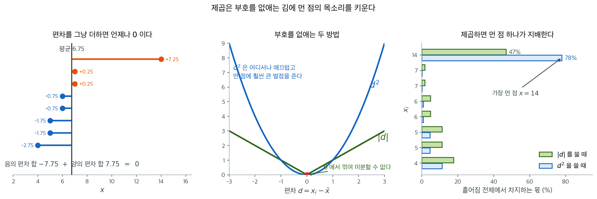
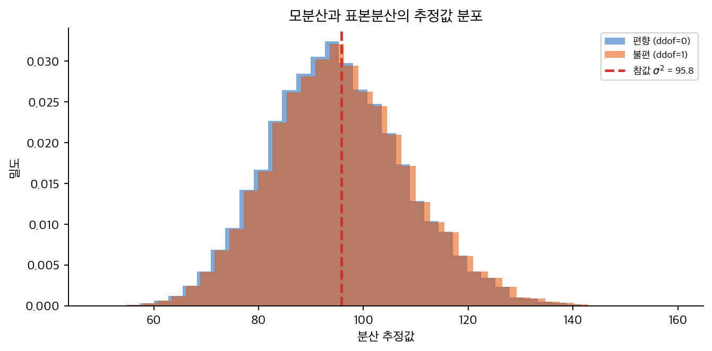
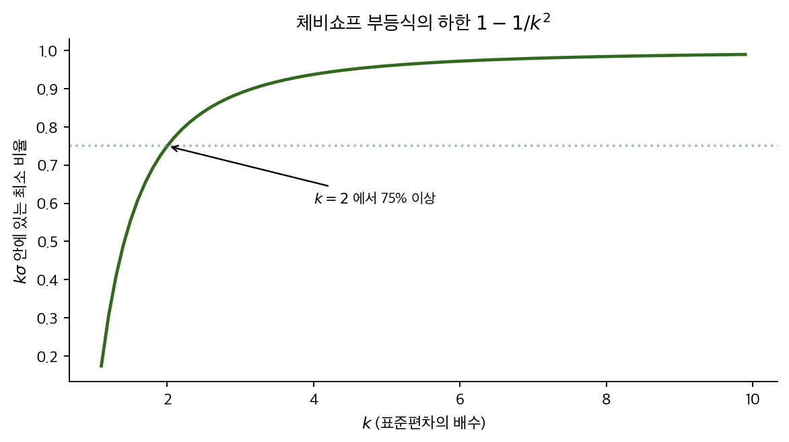

# 분산과 표준편차

## 개요

자료 여덟 개 가운데 혼자 멀리 떨어진 점 하나가 평균절대편차에서는 전체의 $47\%$ 를 차지하는데, 분산에서는 $78\%$ 를 차지한다. 나머지 일곱 점이 함께 가진 몫이 $22\%$ 뿐이라는 뜻이다. 자료 $2, 4, 4, 4, 5, 5, 7, 9$ 에서도 같은 일이 작게 일어난다 — 편차 $4$ 하나가 절대편차 합 $12$ 에서는 삼분의 일인데 제곱합 $32$ 에서는 절반이고, 그래서 평균절대편차 $1.5$ 와 표준편차 $2.0$ 이 갈린다. 부호를 지우는 길이 둘인데 실무는 거의 언제나 제곱을 고른다. 한 점에 그만큼 더 끌려다니는 측도를 왜 고르는가.

분산과 표준편차는 통계적 흩어짐을 재는 가장 널리 쓰이는 측도다. 개별 자료점이 평균에서 얼마나 벗어나는지를 정량화하여 자료의 퍼짐과 일관성에 관한 핵심 정보를 제공한다.

---

## 1. 왜 제곱하는가

흩어짐을 재려면 "각 점이 중심에서 얼마나 떨어져 있는가"를 평균 내면 될 것 같다. 그런데 편차 $x_i - \bar{x}$를 그대로 평균 내면 **언제나 정확히 0이 된다.**

$$
\frac{1}{n}\sum_{i=1}^{n} (x_i - \bar{x})
= \frac{1}{n}\sum_{i=1}^{n} x_i - \frac{1}{n}\sum_{i=1}^{n} \bar{x}
= \bar{x} - \bar{x} = 0
$$

자료가 어떻게 생겼든 그렇다. 양의 편차와 음의 편차가 정확히 상쇄되기 때문이며, 이는 평균이 **균형점**이라는 사실([평균, 중앙값, 최빈값](../center/mean_median_mode.md) 정리 1)의 다른 표현이다. 그러므로 편차를 그대로 평균 내는 것은 흩어짐의 측도가 될 수 없다.

부호를 없애는 방법은 두 가지다.

<div class="defn" markdown>

### 정의 1. 평균절대편차 { .dfn }

$$
\text{MeanAD} = \frac{1}{n}\sum_{i=1}^{n} \left| x_i - \bar{x} \right|
$$

</div>

부호를 없애는 둘째 방법이 제곱이고, 그것이 **분산**이다.

$$
s^2 \ (\text{또는 } \sigma^2) = \frac{1}{n}\sum_{i=1}^{n} (x_i - \bar{x})^2
$$

<div class="storybox" markdown>

**그림으로 보는 통계학 1.** 제곱을 떼는 순간 손이 닿지 않는다

<figure markdown>
  ![원둘레 위·원판 안·정사각형 안에서 두 점을 임의로 잡았을 때 거리의 분포 셋. 각 분포에 E[D] 와 루트 E[D 제곱] 이 서로 다른 자리에 세로선으로 그려져 있다](./img/ea__eg_meandist.png){ width=880 }
  <figcaption markdown>세 도형에서 두 점을 임의로 잡아 거리를 $40$ 만 번 잰 분포다. 초록 선이 **거리의 평균** $\mathrm E[D]$, 빨강 점선이 **거리제곱의 평균의 제곱근** $\sqrt{\mathrm E[D^2]}$ 이다. 세 경우 모두 두 선이 겹치지 않는다. *(이 책에서 그렸다)*</figcaption>
</figure>

제곱을 고르는 까닭이 부호를 지우는 데만 있는 것은 아니다. **제곱은 전개된다.**
절댓값은 그렇지 않다. 그 차이가 얼마나 큰지 보여 주는 보기가 있다.

반지름 $R$ 인 원에 내접하는 정 $N$ 각형의 꼭짓점 $P_1,\dots,P_N$ 을 놓고 서로 다른 두
꼭짓점의 **모든 쌍**에 대하여 거리의 제곱을 더해 보자. $\lvert P_i-P_j\rvert^2$ 을 펴면
$\lvert P_i\rvert^2+\lvert P_j\rvert^2-2\,P_i\cdot P_j$ 가 되고, 정 $N$ 각형에서는
위치벡터의 합이 $\vec0$ 이므로 내적 항이 통째로 사라져

$$
\sum_{i < j}\overline{P_iP_j}^{\,2}=N^{2}R^{2}
$$

이 한 줄에 나온다. 쌍이 $\binom N2$ 개이므로 거리제곱의 평균은 $\dfrac{2N}{N-1}R^{2}$ 이고,
$N\to\infty$ 에서 $2R^{2}$ 으로 간다. 꼭짓점을 무한히 늘린 정 $N$ 각형은 **원둘레**이니
이것이 원둘레 위 두 점의 거리제곱의 평균이다. 사진 맨 왼쪽 판의 빨강 선
$\sqrt2\approx1.4142$ 가 그것이다($R=1$).

그러면 제곱을 떼고 **거리 자체의 평균**을 구하면 어떻게 될까. 같은 수법이 통하지 않는다.
$\sqrt{\ }$ 안에 들어간 합은 펴지지 않고, 대칭을 써도 제곱근이 남는다. 이 어려운 쪽을
다루려면 **적분기하**라는 따로 선 연장이 필요하다.

그 연장을 쓰면 사진의 초록 선에 해당하는 수들이 나온다. 원둘레 위에서는 $\dfrac4\pi\approx1.2732$,
원판 안의 두 점 사이 평균 거리는 $\dfrac{128}{45\pi}$ 이고, 정사각형 안이라면
$\dfrac{2+\sqrt2+5\ln(1+\sqrt2)}{15}$ 이다. 제곱의 평균이 각각 $2$ 와 $1$ 과 $\dfrac13$ 이라는 것과
견주어 보라. 한쪽은 암산으로 되고, 다른 쪽에는 $\pi$ 와 로그가 끼어든다.

늘 이 방향이라는 것도 적어 둘 만하다. $\mathrm E[D]\le\sqrt{\mathrm E[D^2]}$ 이고, 등호는 $D$ 가
상수일 때뿐이다. 분산이 $\mathrm E[D^2]-(\mathrm E[D])^2\ge0$ 이라는 말을 옮겨 적은 것일 뿐이다.
사진에서 초록 선이 언제나 빨강 선의 왼쪽에 있는 까닭이 그것이고, 두 선 사이의 간격이 곧
그 도형에서 거리가 **얼마나 들쭉날쭉한가**를 말해 준다. 바로 아래 보기 $1$ 의
$\text{MeanAD}\le\sigma$ 가 $D=\lvert x_i-\bar x\rvert$ 로 적은 같은 부등식이다.

_확인한 곳 — 원판 안의 평균 거리 $\frac{128}{45\pi}$, 정사각형 안의 $\frac{2+\sqrt2+5\ln(1+\sqrt2)}{15}$,
원둘레 위의 $\frac4\pi$ 와 $\sqrt2$ 는 **난수로 맞추어 보았다**(각 $40$ 만 쌍, 소수 셋째 자리까지 일치)_

</div>

<div class="exbox" markdown>

**보기 1.** <span class="diff easy" title="쉬움"></span> 평균절대편차와 표준편차 가운데 어느 것이 더 큰가. 자료 $2, 4, 4, 4, 5, 5, 7, 9$ 에서 평균절대편차는 $1.5$, 표준편차는 $2.0$ 이다.

**(1)** 어떤 자료에서나 $\text{MeanAD} \le \sigma$ 임을 보이시오. 등호는 언제 성립하는가.

**(2)** 두 값의 비 $\text{MeanAD}/\sigma$ 가 이 자료에서 얼마인지 구하고, 정규분포에서의 이론값 $\sqrt{2/\pi}$ 와 견주시오.

</div>

??? success "풀이"

    **(1) 해석적으로.** 편차를 $d_i = x_i - \bar x$ 라 하면 두 측도는

    $$
    \text{MeanAD} = \frac1n\sum_i \lvert d_i\rvert, \qquad
    \sigma = \sqrt{\frac1n\sum_i d_i^2}
    $$

    이다. 코시–슈바르츠 부등식을 벡터 $(\lvert d_1\rvert, \ldots, \lvert d_n\rvert)$ 과 $(1, \ldots, 1)$ 에 쓰면

    $$
    \left(\sum_i \lvert d_i\rvert \cdot 1\right)^2 \le \left(\sum_i d_i^2\right)\left(\sum_i 1^2\right) = n\sum_i d_i^2
    $$

    이고, 양변을 $n^2$ 으로 나누면

    $$
    \left(\frac1n\sum_i \lvert d_i\rvert\right)^2 \le \frac1n\sum_i d_i^2
    \quad\Longrightarrow\quad
    \text{MeanAD} \le \sigma
    $$

    가 된다. **코시–슈바르츠의 등호는 두 벡터가 평행할 때만 성립하므로, 모든 $\lvert d_i\rvert$ 가 같을 때**에만 두 측도가 일치한다. 예컨대 $\{0, 2\}$ 나 $\{1, 1, 3, 3\}$ 처럼 모든 점이 평균에서 똑같이 떨어져 있는 자료다.

    같은 결론을 옌센 부등식으로도 얻는다. $\sqrt{\cdot}$ 이 오목하므로 $E[\sqrt{Y}] \le \sqrt{E[Y]}$ 이고 $Y = d^2$ 을 넣으면 된다.

    **그러므로 "표준편차는 평균에서 평균적으로 얼마나 떨어져 있는가"가 아니다.** 그 문장이 가리키는 수는 평균절대편차이고, 표준편차는 언제나 그보다 크다. 제곱이 큰 편차를 부풀려 담기 때문이다.

    **(2) 정규분포에서는 비가 정해져 있다.** $X \sim N(\mu, \sigma^2)$ 이면 $\lvert X - \mu\rvert/\sigma$ 가 반정규분포를 따르고

    $$
    E\!\left[\lvert X - \mu\rvert\right] = \sigma\sqrt{\frac{2}{\pi}} = 0.7979\,\sigma
    $$

    이다. 곧 정규자료에서는 $\text{MeanAD}/\sigma \approx 0.798$ 이어야 한다. 이 자료는 $1.5/2.0 = 0.75$ 다.

    **(3) 수치적으로.**

    ```python
    import numpy as np

    x = np.array([2.0, 4.0, 4.0, 4.0, 5.0, 5.0, 7.0, 9.0])

    # 편차는 각 값이 평균에서 얼마나 떨어졌는지다. 부호가 남아 있다.
    dev = x - x.mean()

    print("편차          :", dev)
    print("편차의 합      :", dev.sum())          # 항상 0
    print("평균절대편차   :", np.abs(dev).mean())
    print("분산(모집단)   :", (dev ** 2).mean())
    print("표준편차       :", np.sqrt((dev ** 2).mean()))

    # (1) MeanAD <= sigma 인가. 비를 재고 등호가 되는 자료도 확인한다.
    mad_, sd_ = np.abs(dev).mean(), np.sqrt((dev ** 2).mean())
    print(f"\n비 MeanAD/sigma = {mad_ / sd_:.4f}   (정규 이론값 sqrt(2/pi) = {np.sqrt(2 / np.pi):.4f})")
    print("등호가 되는 자료 (|편차| 가 모두 같은 경우):")
    for arr in ([0.0, 2.0], [1.0, 1.0, 3.0, 3.0], [0.0, 1.0, 2.0]):
        a = np.array(arr)
        dv = a - a.mean()
        print(f"  {arr}: MeanAD {np.abs(dv).mean():.4f}, sigma {np.sqrt((dv ** 2).mean()):.4f},"
              f" 비 {np.abs(dv).mean() / np.sqrt((dv ** 2).mean()):.4f}")

    # (2) 정규자료에서 비가 정말 0.798 인가.
    rng = np.random.default_rng(0)
    z = rng.normal(0, 1, 2000)
    dz = z - z.mean()
    print(f"\n정규 n=2000: 비 {np.abs(dz).mean() / np.sqrt((dz ** 2).mean()):.4f}")
    ```

    출력:

    ```
    편차          : [-3. -1. -1. -1.  0.  0.  2.  4.]
    편차의 합      : 0.0
    평균절대편차   : 1.5
    분산(모집단)   : 4.0
    표준편차       : 2.0

    비 MeanAD/sigma = 0.7500   (정규 이론값 sqrt(2/pi) = 0.7979)
    등호가 되는 자료 (|편차| 가 모두 같은 경우):
      [0.0, 2.0]: MeanAD 1.0000, sigma 1.0000, 비 1.0000
      [1.0, 1.0, 3.0, 3.0]: MeanAD 1.0000, sigma 1.0000, 비 1.0000
      [0.0, 1.0, 2.0]: MeanAD 0.6667, sigma 0.8165, 비 0.8165

    정규 n=2000: 비 0.8003
    ```

    편차의 합이 정확히 $0$ 이다. 절댓값이나 제곱을 거친 뒤에야 뜻이 있는 수가 나온다.

    **(1)이 확인된다.** 이 자료에서 $1.5 < 2.0$ 이고, $\lvert d_i\rvert$ 가 모두 같은 두 자료 $\{0,2\}$ 와 $\{1,1,3,3\}$ 에서는 비가 정확히 $1.0000$ 이다. $\{0,1,2\}$ 는 $\lvert d\rvert$ 가 $1, 0, 1$ 로 같지 않으므로 비가 $0.8165 < 1$ 이다.

    **(2)에서 이 자료의 비 $0.7500$ 은 정규 이론값 $0.7979$ 보다 작다.** 비가 작다는 것은 제곱이 특정 점들에 더 몰려 있다는 뜻이고, 이 자료에서는 혼자 떨어진 $x = 9$ 가 그 역할을 한다. 편차 $4$ 하나가 제곱합 $32$ 가운데 $16$, 곧 절반을 차지하는데 절대편차 합 $12$ 에서는 $4$, 곧 삼분의 일만 차지한다.

    그리고 정규자료 $2000$ 개에서 잰 비는 $0.8003$ 으로 이론값 $0.7979$ 와 $0.3\%$ 차이다. 표본이 유한하므로 정확히 맞지는 않지만, **이 비가 정규성에서 얼마나 멀리 있는지를 재는 쓸모 있는 눈금**이 된다는 것은 보인다. 이 자료의 $0.75$ 는 정규보다 꼬리가 무거운 쪽, 곧 큰 편차 하나가 두드러지는 쪽이다.

### 그런데 왜 절댓값이 아니라 제곱을 쓰는가

평균절대편차가 더 직관적인데도 실무에서 거의 쓰이지 않는 데에는 이유가 있다.

- **미분 가능하다.** $|x|$는 $0$에서 미분할 수 없지만 $x^2$는 어디서나 매끄럽다. 최소제곱법, 회귀, 최대가능도 같은 최적화 기반 방법이 모두 이 성질에 기댄다.
- **대수적으로 분해된다.** 독립인 두 변수의 분산은 더해진다($\operatorname{Var}(X+Y) = \operatorname{Var}(X) + \operatorname{Var}(Y)$). 절대편차에는 이런 성질이 없다.
- **정규분포와 직접 연결된다.** 정규분포의 밀도에 $\sigma^2$이 그대로 들어가 있어, 이후의 거의 모든 추론이 분산 위에 세워진다.



세 칸이 지금까지의 이야기를 차례로 담고 있다. 왼쪽은 편차를 그냥 더하면 왜 안 되는지다. 평균이 균형점이므로 왼쪽으로 간 만큼 오른쪽으로 가고, 이 자료에서는 $-7.75$와 $+7.75$가 정확히 상쇄된다. 가운데는 부호를 없애는 두 방법의 생김새다. $|d|$는 원점에서 꺾여 있고 $d^2$은 매끄러우며, 멀어질수록 두 곡선의 높이 차가 빠르게 벌어진다.

오른쪽이 그 높이 차가 실제로 무엇을 뜻하는지 보여 준다. 자료 여덟 개 가운데 혼자 멀리 떨어진 $x = 14$ 하나가 **평균절대편차에서는 전체의 47%를 차지하지만 분산에서는 78%를 차지한다.** 나머지 일곱 점이 함께 가진 몫이 22%뿐이라는 뜻이다. 한 점이 흩어짐의 정의를 거의 혼자 정하는 셈이다.

대신 제곱은 **큰 편차에 훨씬 큰 벌점**을 준다. 이것이 장점(큰 이탈을 민감하게 잡는다)이자 단점(이상치에 취약하다)이다. 이상치가 걱정되면 [중앙값 절대편차](median_absolute_deviation.md)나 [IQR](robust.md) 같은 강건 측도를 쓴다.

!!! warning "이름이 비슷한 두 가지를 구별하라"
    | 이름 | 정의 | 성질 |
    |---|---|---|
    | 평균절대편차 (mean absolute deviation) | $\frac{1}{n}\sum \lvert x_i - \bar{x} \rvert$ | **평균**을 중심으로. 강건하지 않다 |
    | 중앙값 절대편차 (median absolute deviation, MAD) | $\operatorname{median}(\lvert x_i - \operatorname{median}(x) \rvert)$ | **중앙값**을 중심으로. 붕괴점 50%로 강건하다 |

    영문 약자가 둘 다 MAD여서 혼동이 잦다. 이 책에서 **MAD**는 언제나 뒤쪽, 곧 [중앙값 절대편차](median_absolute_deviation.md)를 뜻한다.

---

## 2. 분산

<div class="defn" markdown>

### 정의 2. 분산 { .dfn }

**분산**은 평균으로부터의 편차를 제곱한 값의 평균이다.

$$
\text{모분산} \quad \sigma^2 = \frac{\sum_{i=1}^{N} (x_i - \mu)^2}{N},
\qquad
\text{표본분산} \quad s^2 = \frac{\sum_{i=1}^{n} (x_i - \bar{x})^2}{n - 1}
$$

표본분산의 분모 $n-1$ 을 **베셀 보정**이라 한다.

</div>

제곱함으로써 모든 편차가 양수로 기여하게 하고 큰 편차에 더 큰 벌점을 준다. 분모 $n - 1$은 참된 모평균 $\mu$ 대신 표본평균 $\bar{x}$를 씀으로써 생기는 아래쪽 편향을 보정한다. 왜 그 보정이 정확히 $n-1$ 인지는 5장에서 증명한다.

<div class="thmbox" markdown>

### 정리 1. 분산의 계산 꼴 { .thm }

$$
\frac{1}{n}\sum_{i=1}^{n}(x_i - \bar x)^2 = \frac{1}{n}\sum_{i=1}^{n} x_i^2 - \bar x^{\,2}
$$

이다. 곧 **제곱의 평균에서 평균의 제곱을 빼면** 된다. 자료를 두 번 훑지 않고 $\sum x_i$ 와 $\sum x_i^2$ 만 모아 한 번에 계산할 수 있다.

</div>

??? proof "증명"

    제곱을 전개하고 항마다 나눈다.

    $$
    \frac1n\sum_i (x_i - \bar x)^2
    = \frac1n\sum_i \bigl(x_i^2 - 2\bar x x_i + \bar x^{\,2}\bigr)
    = \frac1n\sum_i x_i^2 - 2\bar x\cdot\frac1n\sum_i x_i + \bar x^{\,2}
    $$

    가운데 항의 $\frac1n\sum_i x_i$ 가 바로 $\bar x$ 이므로 $-2\bar x^{\,2}$ 이고, 마지막 항과 합쳐 $-\bar x^{\,2}$ 가 남는다. $\square$

    **평균을 먼저 알아야 하는 제약이 사라지는 것이 요점이다.** 왼쪽 식은 $\bar x$ 를 구한 뒤 자료를 다시 훑어야 하지만, 오른쪽은 자료를 한 번 지나가며 두 개의 누적합만 들고 있으면 된다. 스트리밍 자료나 데이터베이스 집계에서 분산을 구하는 방식이 이것이다.

    다만 **수치적으로는 위험하다.** 두 큰 수의 차로 작은 수를 얻는 꼴이라, 평균이 표준편차보다 훨씬 크면 유효숫자가 깎여 나간다. 심하면 음수가 나오기도 한다. 실제 라이브러리가 이 식을 쓰지 않고 웰퍼드 알고리즘 같은 축차식을 쓰는 까닭이다(연습문제 참조).

### 다섯 수의 분산은 132.5 다

평균이 $\bar{x} = 88$인 자료 70, 85, 90, 95, 100에 대해 이렇게 된다.

1. 제곱편차: $(70-88)^2 = 324$, $(85-88)^2 = 9$, $(90-88)^2 = 4$, $(95-88)^2 = 49$, $(100-88)^2 = 144$
2. 합: $324 + 9 + 4 + 49 + 144 = 530$
3. 표본분산: $s^2 = 530 / 4 = 132.5$

### 파이썬에서 분산 계산하기

<div class="exbox" markdown>

**보기 2.** <span class="diff easy" title="쉬움"></span> `ddof` 가 실제로 하는 일은 분모를 $n - \texttt{ddof}$ 로 바꾸는 것 하나뿐이다. 자료 $1.5,\ 2.5,\ 4,\ 2,\ 1,\ 1$ 에서 `ddof=0` 이 $1.0833\ldots$, `ddof=1` 이 $1.3$ 을 준다.

**(1)** 두 값을 **분수로 정확히** 적으시오. 두 분수의 분자가 같은 수인 까닭은 무엇인가.

**(2)** `ddof` 를 $0$ 부터 $5$ 까지 바꾸면 어떤 값들이 나오는가. $\texttt{ddof} = 6$ 에서는 무슨 일이 벌어지는가.

</div>

??? success "풀이"

    **(1) 해석적으로.** 평균이

    $$
    \bar x = \frac{1.5 + 2.5 + 4 + 2 + 1 + 1}{6} = \frac{12}{6} = 2
    $$

    로 깔끔하게 떨어진다. 편차는 $-0.5,\ 0.5,\ 2,\ 0,\ -1,\ -1$ 이고 제곱합은

    $$
    \text{SS} = 0.25 + 0.25 + 4 + 0 + 1 + 1 = 6.5 = \frac{13}{2}
    $$

    이다. 두 분산은 이 하나의 $\text{SS}$ 를 각각 $6$ 과 $5$ 로 나눈 것이므로

    $$
    \hat\sigma^2 = \frac{13/2}{6} = \frac{13}{12} = 1.08\overline{3}, \qquad
    s^2 = \frac{13/2}{5} = \frac{13}{10} = 1.3
    $$

    이다. **두 분수의 분자가 $13$ 으로 같은 것은 우연이 아니다.** 분자는 $\text{SS}$ 에서 온 것이고 `ddof` 는 분모만 건드리기 때문이다. 비는 $\frac{13/10}{13/12} = \frac{12}{10} = \frac65$ 로 $n/(n-1) = 6/5$ 와 같다.

    **(2) 예측.** `ddof` 는 분모를 $n - \texttt{ddof}$ 로 바꾼다. 그러므로

    $$
    \frac{13}{2 \cdot (6 - \texttt{ddof})}
    $$

    이고 $\texttt{ddof} = 0, \ldots, 5$ 에 대해 $\frac{13}{12}, \frac{13}{10}, \frac{13}{8}, \frac{13}{6}, \frac{13}{4}, \frac{13}{2}$ 다. 마지막은 $6.5$, 곧 제곱합 그 자체다. $\texttt{ddof} = 6$ 이면 분모가 $0$ 이 되어 **나눗셈이 정의되지 않는다.**

    **(3) 수치적으로.**

    ```python
    import numpy as np
    from fractions import Fraction

    sample_data = np.array([1.5, 2.5, 4, 2, 1, 1])

    # ddof 는 "자유도에서 빼는 수"다. 기본값 0 이면 n 으로 나눈 모분산이 된다.
    population_variance = sample_data.var()
    print(f"모분산 (ddof=0): {population_variance}")

    # ddof=1 이면 n-1 로 나눈다. 표본에서 모분산을 추정할 때 쓰는 값이다.
    sample_variance = sample_data.var(ddof=1)
    print(f"표본분산 (ddof=1): {sample_variance}")

    # (1) 분수로 정확히 적으면 무엇인가.
    n = len(sample_data)
    SS = ((sample_data - sample_data.mean()) ** 2).sum()
    print(f"\n평균 {sample_data.mean()},  제곱합 SS = {SS} = {Fraction(SS).limit_denominator()}")
    print(f"  ddof=0: SS/{n}   = {Fraction(SS) / n}  = {SS / n}")
    print(f"  ddof=1: SS/{n-1} = {Fraction(SS) / (n - 1)}  = {SS / (n - 1)}")

    # (2) ddof 를 0 부터 5 까지 밀어 본다. 분모가 n - ddof 로 줄어들 뿐이다.
    print(f"\n{'ddof':>6}{'분모 n-ddof':>12}{'분수':>10}{'값':>22}")
    for ddof in range(6):
        print(f"{ddof:>6}{n - ddof:>12}{str(Fraction(SS) / (n - ddof)):>10}"
              f"{sample_data.var(ddof=ddof):>22.10f}")
    print("  ddof=6 이면 분모가 0 이라 나눗셈이 정의되지 않는다"
          " (numpy 는 경고와 함께 inf 를 돌려준다)")
    ```

    출력:

    ```
    모분산 (ddof=0): 1.0833333333333333
    표본분산 (ddof=1): 1.3

    평균 2.0,  제곱합 SS = 6.5 = 13/2
      ddof=0: SS/6   = 13/12  = 1.0833333333333333
      ddof=1: SS/5 = 13/10  = 1.3

      ddof   분모 n-ddof        분수                     값
         0           6     13/12          1.0833333333
         1           5     13/10          1.3000000000
         2           4      13/8          1.6250000000
         3           3      13/6          2.1666666667
         4           2      13/4          3.2500000000
         5           1      13/2          6.5000000000
      ddof=6 이면 분모가 0 이라 나눗셈이 정의되지 않는다 (numpy 는 경고와 함께 inf 를 돌려준다)
    ```

    **(1)과 (2)가 그대로 맞는다.** 여섯 줄의 분수가 모두 분자 $13$ 을 공유하고 분모만 $12, 10, 8, 6, 4, 2$ 로 줄어든다. $\texttt{ddof} = 5$ 에서 값이 $6.5$, 곧 제곱합과 같아지는 것도 예측대로다.

    **그러므로 `ddof` 는 통계적 개념이 아니라 산술적 손잡이다.** "자유도"라는 이름이 붙어 있지만 함수가 하는 일은 분모를 $n - \texttt{ddof}$ 로 바꾸는 것 하나뿐이고, 그 가운데 **$\texttt{ddof} = 1$ 만이 불편추정량을 준다**는 사실은 함수 밖에서 와야 하는 지식이다. $\texttt{ddof} = 2$ 를 넣어도 numpy 는 불평하지 않고 $1.625$ 를 돌려준다.

    한편 **이 자료는 변수 이름이 `sample_data` 이므로 보고할 값은 $\texttt{ddof=1}$ 의 $1.3$ 이다.** 코드가 $\texttt{ddof=0}$ 의 값을 `population_variance` 라 부르는 것은 "$n$ 으로 나눈 양"을 가리키는 관례적 이름일 뿐이고, 이 여섯 개가 모집단 전체라는 뜻이 아니다. 이 혼동이 `ddof` 를 둘러싼 오류의 대부분을 만든다.

### 제곱된 단위라 그대로 읽히지 않는다

분산이 132.5라는 것은 시험 점수가 평균으로부터 평균적으로 132.5 단위의 제곱거리만큼 흩어져 있다는 뜻이다. 분산은 제곱된 단위로 표현되므로 직접 해석하기 어려울 수 있으며, 그래서 표준편차가 흔히 선호된다.

---

## 3. 표준편차

<div class="defn" markdown>

### 정의 3. 표준편차 { .dfn }

표준편차는 분산의 제곱근이다. 퍼짐의 측도를 자료의 원래 단위로 되돌려 직접 해석할 수 있게 만든다.

</div>

### 제곱근을 씌워 단위를 되찾는다

**모표준편차:**

$$
\sigma = \sqrt{\frac{\sum_{i=1}^{N} (x_i - \mu)^2}{N}}
$$

**표본표준편차:**

$$
s = \sqrt{\frac{\sum_{i=1}^{n} (x_i - \bar{x})^2}{n - 1}}
$$

### 표준편차는 11.51 이다

위의 분산을 쓰면 $s = \sqrt{132.5} \approx 11.51$이다.

즉 시험 점수가 평균에서 평균적으로 약 11.51점만큼 벗어난다는 뜻이다.

### 파이썬에서 표준편차 계산하기

<div class="exbox" markdown>

**보기 3.** <span class="diff easy" title="쉬움"></span> 같은 자료의 두 표준편차 $1.0408329997330663$ 과 $1.140175425099138$ 은 보기 좋지 않은 소수지만 정확한 근호 꼴을 갖는다.

**(1)** 두 값을 $\sqrt{\ }$ 꼴로 정확히 적고, 비가 $\sqrt{6/5}$ 임을 보이시오.

**(2)** 이 자료의 평균절대편차를 구해 두 표준편차와 견주시오. "표준편차 $1.14$ 는 자료가 평균에서 평균적으로 $1.14$ 만큼 벗어난다는 뜻"이라는 말이 맞는가.

</div>

??? success "풀이"

    **(1) 해석적으로.** 보기 2 에서 분산이 $13/12$ 과 $13/10$ 이었으므로

    $$
    \hat\sigma = \sqrt{\frac{13}{12}} = \frac{\sqrt{13}}{2\sqrt{3}} = \frac{\sqrt{39}}{6},
    \qquad
    s = \sqrt{\frac{13}{10}} = \frac{\sqrt{130}}{10}
    $$

    이다. 수로 바꾸면 $\sqrt{39} = 6.2450$ 이라 $\hat\sigma = 1.0408330$, $\sqrt{130} = 11.401754$ 라 $s = 1.1401754$ 다. 비는

    $$
    \frac{s}{\hat\sigma} = \sqrt{\frac{13/10}{13/12}} = \sqrt{\frac{12}{10}} = \sqrt{\frac65} = 1.0954451
    $$

    이다. 분산의 비 $6/5$ 가 제곱근을 거쳐 $\sqrt{6/5}$ 가 된다. **분산에서 $20\%$ 던 차이가 표준편차에서는 $9.5\%$ 로 줄어든다.**

    **(2) 해석적으로 — 그 말은 맞지 않다.** 평균절대편차는 편차 $-0.5,\ 0.5,\ 2,\ 0,\ -1,\ -1$ 의 절대값 평균이므로

    $$
    \text{MeanAD} = \frac{0.5 + 0.5 + 2 + 0 + 1 + 1}{6} = \frac{5}{6} = 0.8\overline{3}
    $$

    이다. "평균에서 평균적으로 얼마나 벗어나는가"라는 질문의 답은 **$0.833$** 이고, 표준편차 $1.0408$(또는 $1.1402$)과 다르다. 보기 1 에서 증명했듯 $\text{MeanAD} \le \hat\sigma$ 는 언제나 성립하므로 **표준편차를 "평균 이탈"로 읽으면 늘 과장하게 된다.** 이 자료에서는 $0.833$ 을 $1.041$ 로, $25\%$ 부풀린다.

    표준편차의 정직한 뜻은 **"제곱평균제곱근(RMS) 이탈"** 이다. 이탈을 제곱해 평균 내고 제곱근을 씌운 것이지, 이탈을 평균 낸 것이 아니다.

    **(3) 수치적으로.**

    ```python
    import numpy as np

    sample_data = np.array([1.5, 2.5, 4, 2, 1, 1])

    # 표준편차는 분산의 제곱근이므로 ddof 규칙도 그대로 따라간다.
    population_std = sample_data.std()
    print(f"모표준편차 (ddof=0): {population_std}")

    # n-1 로 나눈 표본분산의 제곱근이다.
    sample_std = sample_data.std(ddof=1)
    print(f"표본표준편차 (ddof=1): {sample_std}")

    # (1) 근호 꼴이 정말 같은 값인가.
    print(f"\nsqrt(39)/6   = {np.sqrt(39) / 6!r}")
    print(f"sqrt(130)/10 = {np.sqrt(130) / 10!r}")
    print(f"비 s/sigma_hat = {sample_std / population_std:.10f},  sqrt(6/5) = {np.sqrt(6 / 5):.10f}")

    # (2) "평균에서 평균적으로 벗어난 거리" 는 어느 수인가.
    dev = sample_data - sample_data.mean()
    print(f"\n평균절대편차 (평균 이탈)   = {np.abs(dev).mean():.10f}")
    print(f"RMS 이탈 = 표준편차(ddof=0) = {population_std:.10f}")
    print(f"  표준편차가 평균 이탈보다 {100 * (population_std / np.abs(dev).mean() - 1):.1f}% 크다")
    ```

    출력:

    ```
    모표준편차 (ddof=0): 1.0408329997330663
    표본표준편차 (ddof=1): 1.140175425099138

    sqrt(39)/6   = 1.0408329997330663
    sqrt(130)/10 = 1.1401754250991378
    비 s/sigma_hat = 1.0954451150,  sqrt(6/5) = 1.0954451150

    평균절대편차 (평균 이탈)   = 0.8333333333
    RMS 이탈 = 표준편차(ddof=0) = 1.0408329997
      표준편차가 평균 이탈보다 24.9% 크다
    ```

    **(1)이 맞는다.** $\sqrt{39}/6$ 이 `population_std` 와 비트 단위로 같고, $\sqrt{130}/10$ 은 `sample_std` 와 마지막 자리에서 $1$ ULP 다르다($\ldots 991378$ 대 $\ldots 99138$ — 같은 양을 다른 연산 순서로 계산해 생기는 부동소수점 반올림이며, 상대오차가 $\varepsilon$ 한 배라 정상이다). 비도 $1.0954451150 = \sqrt{6/5}$ 로 열 자리가 같다.

    **(2)도 맞는다.** 평균 이탈은 $0.8333$ 이고 표준편차는 $1.0408$ 로 $24.9\%$ 크다. 그러므로 표준편차를 보고할 때 **"평균적으로 이만큼 벗어난다"고 풀어 말하면 과장이 된다.** 쓸 수 있는 정직한 문장은 두 가지다.

    - **"이탈의 제곱평균제곱근이 $1.04$ 다"** — 정확하지만 입에 잘 붙지 않는다.
    - **"자료가 대체로 평균 $\pm 1.04$ 안에 있다"** — 정규분포라면 그 안에 약 $68\%$ 가 들어가므로 쓸 만한 어림이다. 다만 정규 가정에 기댄 말이라는 것을 알아야 한다. 가정 없이 말할 수 있는 것은 연습문제 9 의 체비쇼프 한계뿐이다.

### 응용

표준편차는 여러 분야에서 쓰인다. 금융 수익률의 변동성 평가, 과학적 측정의 퍼짐 측정, 제조 일관성 평가 등이다. 정규분포에서는 자료의 약 68%가 평균에서 표준편차 1배 안에, 95%가 2배 안에, 99.7%가 3배 안에 들어간다(경험 규칙).

---

## 4. 모집단 대 표본: `ddof` 매개변수

NumPy와 pandas에서 분산과 표준편차를 계산할 때 `ddof`(delta degrees of freedom) 매개변수가 분모를 결정한다.

| 상황 | 분모 | `ddof` | 사용할 때 |
|---|---|---|---|
| 모집단 | $N$ | 0 | 모집단 전체를 가지고 있을 때 |
| 표본 | $n - 1$ | 1 | 더 큰 모집단에서 뽑은 표본을 가지고 있을 때 |

NumPy의 기본값은 `ddof=0`(모집단)이고 pandas의 기본값은 `ddof=1`(표본)이다. 어느 쪽을 계산하는지 언제나 명시하라.


### 만 번 뽑아 불편성을 확인한다

모집단에서 크기 100인 표본을 10,000번 뽑아 각 추정량의 평균을 참 분산과 비교하여 불편성을 확인한다.

<div class="exbox" markdown>

**보기 4.** <span class="diff easy" title="쉬움"></span> 이 모의실험의 **과녁이 어느 것인가**. 크기 $N = 1000$ 인 모집단에서 **비복원**으로 $n = 100$ 을 뽑기를 1만 번 되풀이한다.

**(1)** 비복원추출에서 $\texttt{ddof=1}$ 이 불편추정하는 것은 `np.var(population)`(분모 $N$)인가, 아니면 분모가 $N-1$ 인 $S^2$ 인가. 두 값의 비를 적고 $E[\texttt{ddof=0}]$ 도 구하시오.

**(2)** 작은 모집단에서 **모든 표본을 열거해** (1)을 정확히 확인하시오. 그리고 1만 번 모의실험이 그 차이를 분간할 수 있는지 몬테카를로 오차로 판정하시오.

</div>

??? success "풀이"

    **(1) 해석적으로 — 과녁은 $S^2$ 다.** 유한모집단 $y_1, \ldots, y_N$ 에서 크기 $n$ 을 **비복원 단순무작위추출**하면

    $$
    E\!\left[s^2\right] = S^2 \equiv \frac{1}{N-1}\sum_{i=1}^{N}\left(y_i - \bar Y\right)^2
    $$

    이 성립한다. 곧 $\texttt{ddof=1}$ 이 맞추는 과녁은 **분모가 $N-1$** 인 모집단 분산이고, 코드가 "모분산"이라 적은 `np.var(population)` 은 분모가 $N$ 이라 그것과 다르다. 두 값의 비는

    $$
    \frac{S^2}{\hat\sigma_N^2} = \frac{N}{N-1} = \frac{1000}{999} = 1.001001001
    $$

    이다. 자료를 넣으면 $\hat\sigma_N^2 = 95.7905$, $S^2 = 95.8864$ 로 **$0.0959$ 차이**다. 그리고 $\texttt{ddof=0}$ 은 같은 제곱합을 $n$ 으로 나눈 것이니

    $$
    E\!\left[\hat\sigma^2\right] = \frac{n-1}{n}\,S^2 = \frac{99}{100}\times 95.8864 = 94.9275
    $$

    이다. **$\texttt{ddof=0}$ 의 편향이 $-\sigma^2/n$ 이라는 익숙한 공식에 들어가는 $\sigma^2$ 도 $S^2$ 다.**

    $N$ 이 $1000$ 이라 차이가 $0.1\%$ 뿐이고 실무에서는 아무 영향이 없다. 그러나 **"과녁이 어느 것인지"는 $N$ 이 작을 때 중요해진다.** 그리고 모의실험으로 불편성을 확인하려면 애초에 올바른 과녁을 알고 있어야 한다.

    **(2) 수치적으로.**

    ```python
    import matplotlib
    matplotlib.use("Agg")
    import numpy as np
    import matplotlib.pyplot as plt
    from itertools import combinations

    plt.rcParams["font.sans-serif"] = ["NanumGothic", "Apple SD Gothic Neo", "Malgun Gothic"]
    plt.rcParams["font.family"] = "sans-serif"
    plt.rcParams["axes.unicode_minus"] = False

    np.random.seed(42)

    # 모집단을 직접 만들어 두었으므로 참 분산을 우리는 알고 있다.
    population = np.random.normal(170, 10, 1000)
    pop_var = np.var(population)

    n_samples = 10000
    sample_size = 100

    biased_vars = np.empty(n_samples)
    unbiased_vars = np.empty(n_samples)

    # 같은 표본에서 n 으로 나눈 값과 n-1 로 나눈 값을 나란히 기록한다.
    for i in range(n_samples):
        sample = np.random.choice(population, size=sample_size, replace=False)
        biased_vars[i] = np.var(sample, ddof=0)
        unbiased_vars[i] = np.var(sample, ddof=1)

    # 1만 번의 평균을 참값과 견준다. ddof=0 쪽만 아래로 치우쳐 있다.
    print(f"모분산            : {pop_var:.4f}")
    print(f"편향 추정 평균 (ddof=0): {biased_vars.mean():.4f}")
    print(f"불편 추정 평균 (ddof=1): {unbiased_vars.mean():.4f}")

    # --- 과녁이 둘이다. 비복원추출에서 ddof=1 이 맞추는 것은 어느 쪽인가 ---
    N = len(population)
    S2 = np.var(population, ddof=1)          # 분모 N-1
    print(f"\n분모 N   인 모분산 = {pop_var:.4f}")
    print(f"분모 N-1 인 S^2    = {S2:.4f}   비 N/(N-1) = {S2 / pop_var:.9f}")
    print(f"이론: E[ddof=1] = S^2         = {S2:.4f}")
    print(f"이론: E[ddof=0] = (n-1)/n S^2 = {(sample_size - 1) / sample_size * S2:.4f}")

    se = unbiased_vars.std(ddof=1) / np.sqrt(n_samples)
    print(f"\n모의 평균 - S^2    = {unbiased_vars.mean() - S2:+.4f}  ({(unbiased_vars.mean() - S2) / se:+.2f} SE)")
    print(f"모의 평균 - 모분산  = {unbiased_vars.mean() - pop_var:+.4f}  ({(unbiased_vars.mean() - pop_var) / se:+.2f} SE)")
    print(f"몬테카를로 표준오차 SE = {se:.4f},  두 과녁의 간격 = {S2 - pop_var:.4f}")
    print(f"-> 간격을 2 SE 로 분간하려면 반복 "
          f"{(unbiased_vars.std(ddof=1) / ((S2 - pop_var) / 2)) ** 2:,.0f}회 필요")

    # 작은 모집단에서는 모든 표본을 열거해 정확히 확인할 수 있다.
    print(f"\n완전열거로 E[s^2] = S^2 확인 (몬테카를로 오차 없음)")
    print(f"{'N':>4}{'n':>4}{'표본수':>8}{'E[s^2]':>14}{'S^2':>14}{'E[ddof=0]':>14}{'(n-1)/n S^2':>14}")
    for Ns, ns in ((5, 3), (6, 4), (7, 3)):
        rng = np.random.default_rng(7)
        y = rng.normal(0, 1, Ns)
        v1 = [np.var(np.array(c), ddof=1) for c in combinations(y, ns)]
        v0 = [np.var(np.array(c), ddof=0) for c in combinations(y, ns)]
        print(f"{Ns:>4}{ns:>4}{len(v1):>8}{np.mean(v1):>14.10f}{np.var(y, ddof=1):>14.10f}"
              f"{np.mean(v0):>14.10f}{(ns - 1) / ns * np.var(y, ddof=1):>14.10f}")
    ```

    출력:

    ```
    모분산            : 95.7905
    편향 추정 평균 (ddof=0): 94.9057
    불편 추정 평균 (ddof=1): 95.8643

    분모 N   인 모분산 = 95.7905
    분모 N-1 인 S^2    = 95.8864   비 N/(N-1) = 1.001001001
    이론: E[ddof=1] = S^2         = 95.8864
    이론: E[ddof=0] = (n-1)/n S^2 = 94.9275

    모의 평균 - S^2    = -0.0220  (-0.17 SE)
    모의 평균 - 모분산  = +0.0738  (+0.56 SE)
    몬테카를로 표준오차 SE = 0.1321,  두 과녁의 간격 = 0.0959
    -> 간격을 2 SE 로 분간하려면 반복 75,935회 필요

    완전열거로 E[s^2] = S^2 확인 (몬테카를로 오차 없음)
       N   n     표본수        E[s^2]           S^2     E[ddof=0]   (n-1)/n S^2
       5   3      10  0.2040262412  0.2040262412  0.1360174941  0.1360174941
       6   4      15  0.2514938167  0.2514938167  0.1886203625  0.1886203625
       7   3      35  0.2379084415  0.2379084415  0.1586056276  0.1586056276
    ```

    **완전열거가 (1)을 소수점 열째 자리까지 확인해 준다.** $N = 5$, $n = 3$ 이면 비복원 표본이 $\binom{5}{3} = 10$ 개뿐이므로 평균을 **정확히** 낼 수 있고, $E[s^2] = S^2 = 0.2040262412$ 로 열 자리가 모두 같다. $E[\texttt{ddof=0}] = \frac{n-1}{n}S^2$ 도 마찬가지다. $N = 6, n = 4$ 와 $N = 7, n = 3$ 에서도 같다. **모의실험이 아니라 열거이므로 오차가 없다.**

    **그러나 1만 번 모의실험으로는 두 과녁을 구별할 수 없다.** 모의 평균 $95.8643$ 은 $S^2 = 95.8864$ 에서 $-0.17$ 표준오차, `np.var(population)` $= 95.7905$ 에서 $+0.56$ 표준오차 떨어져 있다. **둘 다 통과한다.** 몬테카를로 표준오차 $0.1321$ 이 두 과녁의 간격 $0.0959$ 보다 크기 때문이다. 구별하려면 반복을 $75{,}935$ 회로 늘려야 한다.

    **그래서 이 출력의 세 줄이 보이는 것은 "$\texttt{ddof=1}$ 이 불편이다"가 아니라 "$\texttt{ddof=0}$ 이 약 $1\%$ 아래로 치우쳐 있다"다.** 전자는 분해능 밖이고 후자는 또렷하다. $\texttt{ddof=0}$ 의 편향 $-0.96$ 이 표준오차 $0.13$ 의 일곱 배가 넘기 때문이다. 모의실험으로 무엇을 보였는지 말할 때는 **분해능을 함께 적어야 한다.**

### 두 추정량의 분포를 겹쳐 본다

<div class="exbox" markdown>

**보기 5.** <span class="diff easy" title="쉬움"></span> 두 추정량의 분포를 겹쳐 그려 놓고 무엇을 읽어 낼 수 있는지 보기. 보기 4 에서 모은 $\texttt{ddof=0}$ 과 $\texttt{ddof=1}$ 의 추정값 1만 개씩을 한 그림에 넣는다.

**(1)** 두 히스토그램의 **모양이 정확히 같다**고 말할 수 있는가. 모든 분위수의 비가 무엇이 되는지 예측하고 확인하시오.

**(2)** 그림에서 두 분포가 거의 겹쳐 보인다. 그 까닭을 **편향과 표준편차의 비**로 설명하시오. 그리고 "불편한 쪽이 더 정확한가"를 MSE 로 판정하시오.

</div>

??? success "풀이"

    **(1) 해석적으로 — 같은 모양을 $100/99$ 배 늘린 것이다.** 두 추정량은 **표본마다** 같은 제곱합을 다른 수로 나눈 것이므로

    $$
    s^2 = \frac{n}{n-1}\,\hat\sigma^2
    $$

    이 모든 표본에서 성립한다. 곧 $\texttt{ddof=1}$ 의 표집분포는 $\texttt{ddof=0}$ 의 표집분포를 **배율 $n/(n-1) = 100/99 = 1.0101$ 로 늘인 것**이고, 따라서

    - 모든 분위수의 비가 정확히 $1.0101$,
    - 평균의 비도 $1.0101$,
    - 표준편차의 비도 $1.0101$,
    - 변동계수는 **같다.**

    모양이 "비슷"한 것이 아니라 가로축을 상수배 한 **같은 분포**다.

    **(2) 해석적으로 — 편향이 표준편차에 비해 작다.** $\texttt{ddof=0}$ 의 편향은 $-S^2/n$ 이고, 추정량의 표준편차는 정규 자료에서 대략

    $$
    \operatorname{sd}(s^2) \approx \sigma^2\sqrt{\frac{2}{n-1}}
    $$

    이다. 둘의 비는

    $$
    \frac{\lvert \text{편향}\rvert}{\operatorname{sd}} \approx \frac{S^2/n}{S^2\sqrt{2/(n-1)}}
    = \frac{1}{n}\sqrt{\frac{n-1}{2}} \approx \frac{1}{\sqrt{2n}}
    $$

    이고 $n = 100$ 이면 $1/\sqrt{200} = 0.0707$ 이다. **편향이 흩어짐의 $7\%$ 밖에 안 되므로 히스토그램에서 보일 수가 없다.** 그림에서 두 분포가 겹쳐 보이는 것은 당연한 결과이고, "$\texttt{ddof=0}$ 이 왼쪽으로 치우쳐 있다"는 것은 그림으로 **읽히는 것이 아니라** 1만 번의 평균을 수로 비교해야 보이는 것이다.

    그리고 $1/\sqrt{2n} \to 0$ 이므로 $n$ 이 커지면 이 비는 더 작아진다. **표본이 클수록 편향 보정은 그림에서 더 안 보이게 된다.**

    **MSE 는 다른 답을 준다.** 평균제곱오차는 편향제곱과 분산의 합이다.

    $$
    \text{MSE} = \text{편향}^2 + \text{분산}
    $$

    $\texttt{ddof=1}$ 은 편향항을 $0$ 으로 만들지만 분모를 작게 해서 **분산을 $(100/99)^2$ 배로 키운다.** 분산이 $171$ 쯤이고 편향제곱이 $0.96^2 = 0.92$ 쯤이므로 **분산 쪽 손실이 더 크다.** 그러므로 $\texttt{ddof=0}$ 의 MSE 가 더 작아야 한다.

    **(3) 수치적으로.**

    ```python
    # 그림이 가리는 것을 먼저 수치로 재 둔다.
    S2 = np.var(population, ddof=1)
    print(f"표본마다 ddof=1 / ddof=0 의 비: 최소 {np.min(unbiased_vars / biased_vars):.10f}, "
          f"최대 {np.max(unbiased_vars / biased_vars):.10f}")
    print(f"  n/(n-1) = {sample_size / (sample_size - 1):.10f}")
    print(f"\n{'분위수':>8}{'ddof=0':>12}{'ddof=1':>12}{'비':>14}")
    for q in (5, 25, 50, 75, 95):
        b, u = np.percentile(biased_vars, q), np.percentile(unbiased_vars, q)
        print(f"{q:>7}%{b:>12.4f}{u:>12.4f}{u / b:>14.10f}")

    sd = unbiased_vars.std(ddof=1)
    bias = (sample_size - 1) / sample_size * S2 - S2
    print(f"\n추정량의 표준편차 {sd:.4f},  ddof=0 의 편향 {bias:.4f}")
    print(f"  |편향| / 표준편차 = {abs(bias) / sd:.4f}   <- 그림에서 겹쳐 보이는 까닭")

    print(f"\n과녁을 S^2 = {S2:.4f} 로 두고 MSE 를 비교하면")
    for name, v in (("ddof=0", biased_vars), ("ddof=1", unbiased_vars)):
        print(f"  {name}: 편향 {v.mean() - S2:+.4f}, 분산 {v.var(ddof=1):.4f}, "
              f"MSE {np.mean((v - S2) ** 2):.4f}")
    print(f"  MSE 비 ddof=0 / ddof=1 = {np.mean((biased_vars - S2) ** 2) / np.mean((unbiased_vars - S2) ** 2):.4f}")

    SS = biased_vars * sample_size            # 제곱합을 되살린다
    print(f"\n제곱합을 c 로 나눌 때의 MSE")
    for c in (98, 99, 100, 101, 102, 103):
        tag = {99: "  <- ddof=1", 100: "  <- ddof=0", 101: "  <- 최소"}.get(c, "")
        print(f"  c = {c:>3}: MSE {np.mean((SS / c - S2) ** 2):.4f}{tag}")

    # 두 추정값의 분포를 겹쳐 그리고 참값 자리에 세로선을 긋는다.
    # 두 분포의 모양은 같고 위치만 조금 다르다. 그 차이가 편향이다.
    fig, ax = plt.subplots(figsize=(8, 4))
    ax.hist(biased_vars, bins=40, alpha=0.55, color="#1565C0",
            label="편향 (ddof=0)", density=True)
    ax.hist(unbiased_vars, bins=40, alpha=0.55, color="#E65100",
            label="불편 (ddof=1)", density=True)
    ax.axvline(pop_var, color="#D32F2F", linestyle="--", lw=2,
               label=f"참값 $\\sigma^2$ = {pop_var:.1f}")
    ax.set_xlabel("분산 추정값")
    ax.set_ylabel("밀도")
    ax.set_title("모분산과 표본분산의 추정값 분포")
    ax.legend(fontsize=8)
    ax.spines[["top", "right"]].set_visible(False)
    fig.tight_layout()
    fig.savefig("descriptive_measures_advanced_179.png", dpi=170,
                facecolor="white", bbox_inches="tight")
    ```

    출력:

    ```
    표본마다 ddof=1 / ddof=0 의 비: 최소 1.0101010101, 최대 1.0101010101
      n/(n-1) = 1.0101010101

         분위수      ddof=0      ddof=1             비
          5%     74.3806     75.1319  1.0101010101
         25%     85.8831     86.7506  1.0101010101
         50%     94.3173     95.2700  1.0101010101
         75%    103.2273    104.2700  1.0101010101
         95%    117.4685    118.6551  1.0101010101

    추정량의 표준편차 13.2114,  ddof=0 의 편향 -0.9589
      |편향| / 표준편차 = 0.0726   <- 그림에서 겹쳐 보이는 까닭

    과녁을 S^2 = 95.8864 로 두고 MSE 를 비교하면
      ddof=0: 편향 -0.9807, 분산 171.0674, MSE 172.0121
      ddof=1: 편향 -0.0220, 분산 174.5408, MSE 174.5238
      MSE 비 ddof=0 / ddof=1 = 0.9856

    제곱합을 c 로 나눌 때의 MSE
      c =  98: MSE 179.0175
      c =  99: MSE 174.5238  <- ddof=1
      c = 100: MSE 172.0121  <- ddof=0
      c = 101: MSE 171.3677  <- 최소
      c = 102: MSE 172.4829
      c = 103: MSE 175.2559
    ```

    

    **(1)이 맞는다. 비가 1만 개 모두 정확히 $1.0101010101$ 이다** — 최소와 최대가 같다. 분위수도 $5\%$ 에서 $95\%$ 까지 모두 같은 비다. 그러므로 두 히스토그램은 **같은 분포를 $1\%$ 늘여 놓은 것**이고, 그림에서 "모양이 같다"고 읽은 것은 정확한 관찰이다.

    **(2)도 맞는다.** $\lvert \text{편향}\rvert / \text{표준편차} = 0.0726$ 으로 어림한 $1/\sqrt{200} = 0.0707$ 과 가깝다. 추정값들이 $74$ 에서 $118$ 까지 퍼져 있는 그림에서 $0.96$ 짜리 이동을 눈으로 보려는 것은 무리다.

    **그리고 MSE 로는 $\texttt{ddof=0}$ 이 이긴다.** $172.0121$ 대 $174.5238$ 로 $1.4\%$ 작다. $\texttt{ddof=1}$ 이 편향을 $-0.98$ 에서 $-0.02$ 로 지우는 대가로 분산을 $171.07$ 에서 $174.54$ 로 키웠고, 그 손실이 지운 편향제곱 $0.96$ 보다 크다. 분모를 훑어보면 **최소가 $c = 101 = n + 1$** 에서 나온다. 정규 자료에서 제곱합을 $n+1$ 로 나누는 것이 MSE 최소라는 알려진 결과와 맞는다.

    **그러므로 "불편"은 "정확"이 아니다.** $\texttt{ddof=1}$ 을 쓰는 이유는 MSE 가 작아서가 아니라, 분산이 여러 표본에 걸쳐 합산되거나 다른 추정량에 꽂혀 들어갈 때 **치우침이 누적되지 않기** 때문이다. 하나의 표본에서 하나의 분산을 가장 정확하게 맞히는 것이 목적이라면 $n+1$ 이 낫다. 어느 쪽을 고를지는 **무엇을 최소화하려는가**가 정한다.

    $n = 100$ 에서는 세 선택($n-1$, $n$, $n+1$)의 MSE 차이가 $2\%$ 안이라 실무적으로 중요하지 않다. 그러나 $n$ 이 작아지면 상당해진다. 연습문제 4 이 $n = 3$ 에서 $\texttt{ddof=0}$ 의 편향이 $33\%$ 임을 보여 주는데, 그 자리에서는 편향이 분산에 밀리지 않는다.

---

두 분모의 차이는 자료 하나에서도 바로 드러난다. 같은 값들에 `np.var` 와 `pandas.var()` 를 돌리면 **답이 다르게 나오고**, 그 비가 닫힌 꼴로 적힌다 — $2.4$ 절 [기술통계 (대마 가격)](descriptive_stats_weed_prices.md) 보기 5 가 $48$ 개월 가격에서 $13.4693$ 과 $13.7559$ 를 받아 그 비를 끝까지 따진다.

---

## 5. 표준편차의 쓰임: Z-점수

표준편차는 흩어짐을 재는 데서 끝나지 않는다. **서로 다른 척도의 값을 비교 가능하게 만드는 자**로도 쓰인다.

중간고사가 평균 $60$점에 $\sigma = 10$, 기말고사가 평균 $80$점에 $\sigma = 20$이라 하자. 어떤 학생이 중간에 $70$점, 기말에 $95$점을 받았다. **어느 쪽이 더 잘한 것인가?**

원점수만 보면 기말이 높다. 그러나 두 시험은 난이도도 퍼짐도 다르므로 그대로 비교할 수 없다. 각 점수가 자기 분포의 중심에서 **표준편차 몇 배**만큼 떨어져 있는지로 바꾸면 비교할 수 있다. 이것이 **Z-점수**다.

<div class="defn" markdown>

### 정의 4. Z-점수 { .dfn }

값 $x$ 의 **Z-점수**는 중심에서 떨어진 거리를 표준편차 단위로 잰 것이다.

$$
Z = \frac{x - \mu}{\sigma}
$$

</div>

<div class="thmbox" markdown>

### 정리 2. 표준화하면 평균 0, 표준편차 1 { .thm }

자료 $x_1, \ldots, x_n$ 을 $z_i = (x_i - \bar x)/s$ 로 바꾸면

$$
\bar z = 0, \qquad s_z = 1
$$

이다. 단위도 사라져 **서로 다른 척도의 값을 견줄 수 있게 된다.**

</div>

??? proof "증명"

    평균은 선형이므로 상수를 빼고 상수로 나누는 일이 그대로 따라 나온다.

    $$
    \bar z = \frac1n\sum_i \frac{x_i - \bar x}{s} = \frac{1}{s}\cdot\frac1n\sum_i (x_i - \bar x) = \frac{1}{s}\cdot 0 = 0
    $$

    가운데에서 **편차의 합이 0** 이라는 성질([평균, 중앙값, 최빈값](../center/mean_median_mode.md) 정리 1)을 썼다. 표준편차는 제곱으로 들어가므로

    $$
    s_z^2 = \frac{1}{n-1}\sum_i (z_i - 0)^2 = \frac{1}{s^2}\cdot\frac{1}{n-1}\sum_i (x_i - \bar x)^2 = \frac{s^2}{s^2} = 1
    $$

    이다. $\square$

    **단위가 어떻게 사라지는지 보라.** 분자의 단위(점수, 달러, 센티미터)와 분모의 단위가 같으므로 나누면 **무차원**이 된다. 그래서 중간고사 점수와 기말고사 점수처럼 척도가 다른 둘을 한 자에 놓을 수 있다.

    주의할 것이 하나 있다. 표준화는 **중심과 퍼짐만** 맞추고 모양은 건드리지 않는다. 치우친 자료를 표준화해도 치우친 채로 남으므로, 같은 $Z$ 가 분포가 다르면 다른 백분위에 앉는다. 보기 6 이 그 반례를 만든다.

<div class="exbox" markdown>

**보기 6.** <span class="diff easy" title="쉬움"></span> $Z = +1.00$ 이 $Z = +0.75$ 보다 반드시 좋은 성적인가. 중간고사 $70$ 점($\mu = 60$, $\sigma = 10$)과 기말고사 $95$ 점($\mu = 80$, $\sigma = 20$)을 견준다.

**(1)** 두 분포가 **모두 정규**라면 두 $Z$ 가 각각 몇 번째 백분위인가. $300$ 명 학급에서 등수로는 몇 명 차이인가.

**(2)** 두 분포의 모양이 다르면 $Z$ 의 순서와 백분위의 순서가 **뒤집힐 수 있는가**. 할 수 있으면 반례를 만드시오.

</div>

??? success "풀이"

    **(1) 해석적으로.** 정규라면 백분위가 $\Phi(z)$ 다.

    $$
    \Phi(1.00) = 0.84134, \qquad \Phi(0.75) = 0.77337
    $$

    차이는 $0.0680$ 이다. $300$ 명 학급에서 위에 있는 사람 수는 $300\,(1 - \Phi(z))$ 이므로

    $$
    300 \times 0.15866 = 47.6 \ \text{명}, \qquad 300 \times 0.22663 = 68.0 \ \text{명}
    $$

    이고, 등수로 약 $48$ 등과 $68$ 등, **스무 명 차이**다. 중간고사 쪽이 낫다.

    **(2) 그런데 그 결론은 정규 가정 위에 서 있다.** $Z$ 는 평균과 표준편차만 쓰므로 **분포의 모양을 보지 않는다.** 모양이 다른 두 분포에서 같은 $Z$ 가 다른 백분위에 대응하고, 심하면 순서가 뒤집힌다.

    반례를 만들어 보자. 중간고사 점수가 $[0, 1]$ 에서 **균등**하고 기말고사 점수가 **지수분포**(평균 $1$)를 따른다고 하자.

    - 균등$(0,1)$: $\mu = 0.5$, $\sigma = 1/\sqrt{12} = 0.28868$. $Z = +1.00$ 은 $x = 0.5 + 0.28868 = 0.78868$ 이고, 균등분포에서 백분위는 $x$ 자신이므로 **$78.87$ 번째 백분위**다.
    - 지수$(1)$: $\mu = 1$, $\sigma = 1$. $Z = +0.75$ 는 $x = 1.75$ 이고 백분위는 $1 - e^{-1.75} = 0.82623$, 곧 **$82.62$ 번째 백분위**다.

    $$
    Z = +1.00 \ \rightarrow\ 78.87\%, \qquad Z = +0.75 \ \rightarrow\ 82.62\%
    $$

    **순서가 뒤집혔다.** $Z$ 가 작은 쪽이 더 많은 사람을 이겼다. 까닭은 분명하다. 균등분포는 꼬리가 없어 $1\sigma$ 위쪽에도 아직 $21\%$ 가 남아 있고($\sigma$ 가 범위의 $28.9\%$ 나 되므로), 지수분포는 오른쪽 꼬리가 길어 평균 위로 $0.75\sigma$ 만 올라가도 이미 대부분을 지나친다.

    **(3) 수치적으로.**

    ```python
    import numpy as np
    from scipy import stats

    # 두 시험은 평균도 표준편차도 다르다. 원점수만으로는 견줄 수 없다.
    midterm = {"score": 70, "mu": 60, "sigma": 10}
    final = {"score": 95, "mu": 80, "sigma": 20}

    # Z-점수는 "평균에서 표준편차 몇 개만큼 떨어졌나"를 재므로 단위가 사라진다.

    for name, e in [("중간고사", midterm), ("기말고사", final)]:
        z = (e["score"] - e["mu"]) / e["sigma"]
        print(f"{name}: 원점수 {e['score']}, Z = {z:+.2f}")

    # (1) 두 분포가 정규라면 백분위와 등수는?
    print(f"\n정규 가정 아래 (300명 학급)")
    for name, z in (("중간고사", 1.00), ("기말고사", 0.75)):
        p = stats.norm.cdf(z)
        print(f"  {name}: Z={z:+.2f}  백분위 {100 * p:.2f}%  위에 있는 사람 {300 * (1 - p):.1f}명")
    print(f"  백분위 차 {100 * (stats.norm.cdf(1.0) - stats.norm.cdf(0.75)):.2f}%p")

    # (2) 모양이 다르면 순서가 뒤집힌다.
    print(f"\n모양을 바꾸면 (중간=균등(0,1), 기말=지수(1))")
    x_u = 0.5 + 1.00 * (1 / np.sqrt(12))           # 균등의 Z=+1.00
    x_e = 1 + 0.75 * 1                             # 지수의 Z=+0.75
    print(f"  중간 Z=+1.00 -> x={x_u:.5f},  백분위 {100 * stats.uniform.cdf(x_u):.2f}%")
    print(f"  기말 Z=+0.75 -> x={x_e:.5f},  백분위 {100 * stats.expon.cdf(x_e):.2f}%")
    print(f"  -> Z 는 중간이 크지만 백분위는 기말이 크다. 순서가 뒤집혔다.")
    ```

    출력:

    ```
    중간고사: 원점수 70, Z = +1.00
    기말고사: 원점수 95, Z = +0.75

    정규 가정 아래 (300명 학급)
      중간고사: Z=+1.00  백분위 84.13%  위에 있는 사람 47.6명
      기말고사: Z=+0.75  백분위 77.34%  위에 있는 사람 68.0명
      백분위 차 6.80%p

    모양을 바꾸면 (중간=균등(0,1), 기말=지수(1))
      중간 Z=+1.00 -> x=0.78868,  백분위 78.87%
      기말 Z=+0.75 -> x=1.75000,  백분위 82.62%
      -> Z 는 중간이 크지만 백분위는 기말이 크다. 순서가 뒤집혔다.
    ```

    **(1)의 네 수가 그대로 나온다.** $84.13\%$ 와 $77.34\%$, 등수로 약 $48$ 등과 $68$ 등이다.

    **(2)의 반례도 성립한다.** $Z$ 의 순서는 $+1.00 > +0.75$ 인데 백분위의 순서는 $78.87\% < 82.62\%$ 로 반대다.

    **그러므로 $Z$ 로 서로 다른 분포를 견줄 때 조심해야 할 것이 하나 있다.** $Z$ 는 **같은 분포 안에서는** 순서를 그대로 보존한다($Z$ 가 원점수의 증가함수이므로). 그러나 **다른 두 분포 사이의 비교**에서는 "$Z$ 가 크다"와 "백분위가 높다"가 다른 말이 된다. 본문의 결론("중간고사가 더 좋은 성적이다")은 **두 시험 점수가 비슷한 모양으로 분포한다는 가정** 아래에서만 안전하다.

    등수를 알고 싶으면 $Z$ 를 거치지 말고 **백분위를 직접 보고하는 것**이 낫다. 백분위는 순위만 쓰므로 모양에 무관하게 "몇 명을 이겼는가"를 정확히 답한다. 그 대가로 간격 정보를 버리는데, 두 측도를 나란히 보고하는 것이 실무의 답이다.

중간고사의 $70$점이 기말의 $95$점보다 상대적으로 더 좋은 성적이다. 원점수는 $25$점이나 낮지만, 중간은 평균보다 $1$ 표준편차 위에 있고 기말은 $0.75$ 표준편차 위에 있기 때문이다.

Z-점수는 단위가 없다. 키(cm)와 몸무게(kg)처럼 단위가 아예 다른 변수도 Z-점수로 바꾸면 같은 자 위에서 견줄 수 있다. 이 성질 때문에 Z-점수는 이후 여러 곳에서 쓰인다.

- **이상치 탐지**: $|Z| > 3$인 점을 표시한다([이상치와 지렛대점](../shape/outliers.md)).
- **표준정규분포**: $X \sim N(\mu, \sigma^2)$이면 $Z \sim N(0, 1)$이다(4장).
- **자료 전처리**: 거리 기반 방법이나 정칙화에서는 변수의 척도를 맞추는 표준화가 필수다(18장).

!!! warning "Z-점수가 분포의 모양을 바꾸지는 않는다"
    표준화는 위치와 척도만 옮긴다. 치우친 분포를 표준화해도 **여전히 치우쳐 있다**. $Z$가 $0$을 중심으로 표준편차 $1$을 갖게 될 뿐, 정규분포가 되는 것이 아니다.

    "표준화하면 정규분포가 된다"는 흔한 오해다. 정규분포가 되는 것은 원래 분포가 정규일 때뿐이다.
### 단위를 바꾸면 무엇이 따라 변하고 무엇이 남는가

자료의 단위를 바꾸는 일은 $y_i = a x_i + b$ 꼴의 **선형변환**이다. 섭씨를 화씨로, 미터를 피트로, 원점수를 환산점수로 옮기는 일이 모두 여기에 든다. 이때 어떤 양은 따라 변하고 어떤 양은 꿈쩍도 하지 않는다. 그 갈림을 알아 두면 "이 수치를 보고해도 되는가" 를 그 자리에서 판단할 수 있다.

<div class="thmbox" markdown>

### 정리 3. 선형변환 아래에서 변하는 것과 변하지 않는 것 { .thm }

$y_i = a x_i + b$ ($a > 0$) 라 하면

$$
\bar y = a\bar x + b, \qquad s_y = a\,s_x
$$

이고, 각 관측값의 $Z$-점수는

$$
z_i^{(y)} = \frac{y_i - \bar y}{s_y} = \frac{a(x_i - \bar x)}{a\,s_x} = z_i^{(x)}
$$

로 **변하지 않는다.** 반면 변동계수 $\text{CV} = s/\bar x$ 는 $b \ne 0$ 이면 변한다.

</div>

??? proof "증명"

    평균과 표준편차는 앞서 본 $E[aX+b] = aE[X]+b$, $\operatorname{Var}(aX+b) = a^2\operatorname{Var}(X)$ 를 표본에 그대로 옮긴 것이다. $a > 0$ 이므로 $s_y = \lvert a\rvert s_x = a s_x$ 다.

    $Z$-점수는 분자에서 $b$ 가 상쇄되고 분모에서 $a$ 가 약분된다.

    $$
    z_i^{(y)} = \frac{(ax_i + b) - (a\bar x + b)}{a\,s_x} = \frac{a(x_i - \bar x)}{a\,s_x} = \frac{x_i - \bar x}{s_x} = z_i^{(x)}
    $$

    **평행이동은 차에서 사라지고 척도는 약분된다.** 이것이 표준화가 단위와 원점을 **둘 다** 걷어낸다는 말의 뜻이다.

    변동계수는 사정이 다르다.

    $$
    \text{CV}_y = \frac{s_y}{\bar y} = \frac{a\,s_x}{a\bar x + b}
    $$

    에서 $b = 0$ 이면 $a$ 가 약분되어 $\text{CV}_x$ 와 같지만, $b \ne 0$ 이면 분모에만 $b$ 가 더해져 값이 달라진다. $\square$

<div class="exbox" markdown>

**보기 7.** <span class="diff easy" title="쉬움"></span> 기온의 단위를 바꾸면. 어느 도시의 일 최고기온이 평균 $20^\circ\text{C}$, 표준편차 $5^\circ\text{C}$ 다. 화씨로 바꾸는 식은 $F = 1.8\,C + 32$ 다.

**(1)** 화씨로 잰 평균과 표준편차를 구하시오.

**(2)** 두 단위에서 변동계수를 각각 구하고, 어느 쪽을 보고해야 하는지 판단하시오.

**(3)** 기온이 $25^\circ\text{C}$ 였던 날의 $Z$-점수를 두 단위에서 각각 구하시오.

</div>

??? success "풀이"

    **(1)** $a = 1.8$, $b = 32$ 이므로

    $$
    \bar F = 1.8 \times 20 + 32 = 68, \qquad s_F = 1.8 \times 5 = 9
    $$

    **(2)** 두 값이 다르다.

    $$
    \text{CV}_C = \frac{5}{20} = 0.25, \qquad \text{CV}_F = \frac{9}{68} = 0.132
    $$

    같은 날씨를 두고 "변동성이 $25\%$" 와 "$13.2\%$" 가 동시에 나온다. **둘 중 어느 쪽도 보고해서는 안 된다.** 기온은 $0$ 이 "기온 없음" 을 뜻하지 않는 **구간척도**이고, 변동계수는 $0$ 이 참된 영점인 **비율척도**에서만 뜻을 갖기 때문이다. 섭씨 평균이 마침 $0^\circ$ 인 도시였다면 $\text{CV}_C$ 는 아예 정의되지도 않는다.

    키·몸무게·소득·가격처럼 영점이 고정된 양에서는 변동계수가 쓸모 있다. 기온·연도·IQ 처럼 영점이 약속일 뿐인 양에서는 쓰지 않는다. [자료의 종류](../data_types/data_types.md)가 척도의 층위를 다룬다.

    **(3)** $25^\circ\text{C}$ 는 $1.8 \times 25 + 32 = 77^\circ\text{F}$ 다.

    $$
    z_C = \frac{25 - 20}{5} = 1, \qquad z_F = \frac{77 - 68}{9} = 1
    $$

    **같다.** 단위를 바꾸어도 "평균보다 1 표준편차 위" 라는 사실은 달라지지 않는다. 정리 3 이 말한 그대로이며, 서로 다른 척도의 값을 견줄 때 원자료가 아니라 $Z$-점수를 쓰는 까닭이 이것이다. $\square$

---

앞 절의 $Z$ 점수는 「평균에서 몇 표준편차 떨어져 있는가」를 재지만, 그 거리가 **몇 퍼센트에 해당하는가**를 말하려면 분포의 모양을 알아야 한다. $68$–$95$–$99.7$ 은 정규분포의 수다. 분포를 모르면 아무 말도 못 하는가 — 그렇지 않다.

## 6. 분포를 모를 때 — 체비쇼프

### 진술

평균 $\mu$와 표준편차 $\sigma$가 유한한 **어떤** 분포에 대해서도, 평균에서 표준편차 $k$배 안에 있는 자료의 비율은 다음을 만족한다.

$$
P(|X - \mu| < k\sigma) \ge 1 - \frac{1}{k^2} \qquad \text{for } k > 1
$$

이 한계는 분포의 모양에 대해 아무 가정도 하지 않는다.

### 주요 값

| $k$ | $k\sigma$ 안에 있는 최소 비율 |
|---|---|
| 2 | $\ge 75\%$ |
| 3 | $\ge 88.9\%$ |
| 4 | $\ge 93.75\%$ |
| 5 | $\ge 96\%$ |

### 키 자료에 적용하기

키의 평균이 $\mu = 174$ cm이고 표준편차가 $\sigma = 4$ cm라고 하자. 모집단의 몇 퍼센트가 166 cm에서 182 cm 사이에 있는가?

$$
k = \frac{182 - 174}{4} = 2
$$

체비쇼프 부등식에 의해, 키 분포의 모양과 무관하게 모집단의 적어도 $1 - 1/4 = 75\%$가 이 범위에 들어간다.

### 체비쇼프 하한을 그려 본다

<div class="exbox" markdown>

**보기 8.** <span class="diff easy" title="쉬움"></span> 하한 곡선 $1 - 1/k^2$ 를 그려 놓고 무엇을 읽어 낼 수 있는지 보기. 가로축은 $k$, 세로축은 $k\sigma$ 안에 들어가는 자료의 **최소** 비율이다.

**(1)** 곡선이 $0.75$, $0.9$, $0.99$ 에 이르는 $k$ 를 각각 구하시오. 그림이 $k = 1.1$ 에서 시작하는 까닭은 무엇이며, $k \le 1$ 에서 이 곡선은 무슨 말을 하는가.

**(2)** 이 그림이 **가리고 있는 것**은 무엇인가. 정규·지수·균등분포의 실제 비율을 나란히 놓고 답하시오.

</div>

??? success "풀이"

    유도할 "정답"이 있는 문제가 아니다. **곡선 한 줄에서 무엇이 읽히고 무엇이 읽히지 않는가**가 이 보기의 전부다.

    **(1) 곡선을 거꾸로 풀면 된다.** $1 - 1/k^2 = p$ 에서

    $$
    k = \frac{1}{\sqrt{1 - p}}
    $$

    이므로 $p = 0.75$ 에 $k = 2$, $p = 0.9$ 에 $k = 1/\sqrt{0.1} = 3.1623$, $p = 0.99$ 에 $k = 10$, $p = 0.999$ 에 $k = 31.62$ 다. **보장을 $0.75$ 에서 $0.9$ 로 올리는 데는 $k$ 를 $2 \to 3.16$ 으로 올리면 되지만, $0.9$ 에서 $0.99$ 로 올리려면 $3.16 \to 10$ 까지 가야 한다.** 남은 여유분을 $10$ 분의 $1$ 로 줄일 때마다 $k$ 에 $\sqrt{10} = 3.16$ 을 곱해야 한다. 곡선이 $1$ 에 수평으로 접근하는 모양이 이 말을 하고 있다.

    $k = 1$ 에서 하한은 $1 - 1 = 0$ 이다. **"평균에서 $1\sigma$ 안에 적어도 $0\%$ 가 있다"는 참이지만 아무 내용이 없다.** $k < 1$ 이면 하한이 음수가 되어($k = 0.5$ 에서 $-3$) 더욱 공허하다. 비율은 언제나 $0$ 이상이니 틀린 말은 아니고, 다만 쓸 데가 없다. 그림이 $1.1$ 에서 시작하는 것은 그 구간을 잘라 낸 것이고, 코드의 주석도 그렇게 적혀 있다.

    이것은 그림의 흠이 아니라 **체비쇼프의 성질**이다. 흔히 인용되는 "$1\sigma$ 안에 $68\%$"는 체비쇼프가 아니라 **정규 가정**에서 나온 수다. 분포를 모르면 $1\sigma$ 에 대해서는 할 말이 없다.

    **(2) 가리는 것은 "이것이 하한일 뿐"이라는 사실이다.** 세로축에 "최소 비율"이라 적혀 있지만 곡선은 한 줄이라, 어떤 분포의 실제 비율이 어디에 놓이는지 보이지 않는다. 아래 코드가 셋을 나란히 재 준다.

    ```python
    import matplotlib
    matplotlib.use("Agg")
    import numpy as np
    import matplotlib.pyplot as plt
    from scipy import stats

    # 그림이 가리는 것: 하한과 "실제"의 거리. 세 분포에서 직접 재 본다.
    print(f"{'k':>6}{'체비쇼프 하한':>14}{'정규 실제':>11}{'지수 실제':>11}{'균등 실제':>11}")
    for k in (1.1, 1.5, 2.0, 3.0, 4.0, 5.0):
        cheb = 1 - 1 / k ** 2
        norm = 2 * stats.norm.cdf(k) - 1
        # 지수(1): mu = 1, sigma = 1
        expo = stats.expon.cdf(1 + k) - stats.expon.cdf(max(0.0, 1 - k))
        # 균등(0,1): mu = 0.5, sigma = 1/sqrt(12)
        s = 1 / np.sqrt(12)
        unif = min(1.0, 0.5 + k * s) - max(0.0, 0.5 - k * s)
        print(f"{k:>6.2f}{cheb:>14.4f}{norm:>11.4f}{expo:>11.4f}{unif:>11.4f}")

    print()
    for target in (0.75, 0.9, 0.99, 0.999):
        print(f"  하한 {target:.3f} 에 이르는 k = 1/sqrt(1-p) = {1 / np.sqrt(1 - target):.4f}")
    print(f"  k=1   에서 하한 = {1 - 1 / 1 ** 2:.4f}  (참이지만 내용이 없다)")
    print(f"  k=0.5 에서 하한 = {1 - 1 / 0.5 ** 2:.4f}  (음수라 더욱 공허하다)")

    # 그림에 한글을 쓰므로 한글 글꼴을 지정한다. 후보를 늘어놓으면 matplotlib 가
    # 설치된 첫 번째를 집으므로, 리눅스('NanumGothic')·맥('Apple SD Gothic Neo')·
    # 윈도우('Malgun Gothic')에서 코드를 고치지 않고 그대로 돌릴 수 있다.
    # 수식 글꼴에는 한글 글리프가 없으므로 한글은 $...$ 밖에 둔다.
    plt.rcParams["font.sans-serif"] = ["NanumGothic", "Apple SD Gothic Neo", "Malgun Gothic"]
    plt.rcParams["font.family"] = "sans-serif"
    plt.rcParams["axes.unicode_minus"] = False

    def chebyshev(k):
        """평균에서 k 표준편차 안에 들어가는 자료의 최소 비율."""
        return 1 - 1 / k**2

    # k=1 에서는 1 - 1 = 0 이라 아무 말도 하지 못한다. 그래서 1.1 부터 그린다.
    z_vals = np.arange(1.1, 10, 0.1)
    cheb_vals = [chebyshev(z) for z in z_vals]

    fig, ax = plt.subplots(figsize=(7, 4))
    ax.plot(z_vals, cheb_vals, lw=2, color="#33691E")
    ax.set_xlabel("$k$ (표준편차의 배수)")
    ax.set_ylabel(r"$k\sigma$ 안에 있는 최소 비율")
    ax.set_title("체비쇼프 부등식의 하한 $1 - 1/k^2$")
    ax.axhline(0.75, color="#90A4AE", linestyle=":", alpha=0.8)
    ax.annotate("$k = 2$ 에서 75% 이상", (2, 0.75), fontsize=9,
                xytext=(4, 0.6), arrowprops=dict(arrowstyle="->"))
    ax.spines[["top", "right"]].set_visible(False)
    fig.tight_layout()
    fig.savefig("descriptive_measures_advanced_97.png", dpi=170,
                facecolor="white", bbox_inches="tight")
    ```

    출력:

    ```
         k       체비쇼프 하한      정규 실제      지수 실제      균등 실제
      1.10        0.1736     0.7287     0.8775     0.6351
      1.50        0.5556     0.8664     0.9179     0.8660
      2.00        0.7500     0.9545     0.9502     1.0000
      3.00        0.8889     0.9973     0.9817     1.0000
      4.00        0.9375     0.9999     0.9933     1.0000
      5.00        0.9600     1.0000     0.9975     1.0000

      하한 0.750 에 이르는 k = 1/sqrt(1-p) = 2.0000
      하한 0.900 에 이르는 k = 1/sqrt(1-p) = 3.1623
      하한 0.990 에 이르는 k = 1/sqrt(1-p) = 10.0000
      하한 0.999 에 이르는 k = 1/sqrt(1-p) = 31.6228
      k=1   에서 하한 = 0.0000  (참이지만 내용이 없다)
      k=0.5 에서 하한 = -3.0000  (음수라 더욱 공허하다)
    ```

    

    **(1)의 네 수가 그대로 나온다.** $k = 2.0000$, $3.1623$, $10.0000$, $31.6228$ 이다. 그림에서 $k$ 축이 $10$ 까지 그려져 있으므로 **곡선의 오른쪽 끝에서 겨우 $0.99$ 에 닿는다.** 그 너머는 그림 밖이고, $0.999$ 를 보장받으려면 $k$ 를 세 배 더 늘려야 한다.

    **(2) 하한과 실제의 거리가 표에 드러난다.**

    | $k$ | 체비쇼프 하한 | 정규 | 지수 | 균등 |
    |---|---|---|---|---|
    | $1.1$ | $0.1736$ | $0.7287$ | $0.8775$ | $0.6351$ |
    | $2.0$ | $0.7500$ | $0.9545$ | $0.9502$ | $\mathbf{1.0000}$ |
    | $3.0$ | $0.8889$ | $0.9973$ | $0.9817$ | $1.0000$ |

    읽어 낼 것이 셋이다.

    **첫째, 셋 다 하한보다 한참 위에 있다.** $k = 1.1$ 에서 하한은 $0.1736$ 인데 정규는 $0.7287$, 지수는 $0.8775$ 다. 네 배가 넘는다. 심하게 치우친 지수분포도 하한을 여유롭게 넘는다. 그림의 곡선 한 줄은 이 거리를 전혀 보여 주지 못한다.

    **둘째, 균등분포는 $k = 2$ 에서 이미 $1.0000$ 이다.** 균등분포의 표준편차가 폭의 $1/\sqrt{12} = 0.2887$ 배이므로 지지구간 전체가 평균에서 $\pm 1.732\sigma$ 안에 들어간다. **$k \ge 1.733$ 에서는 자료의 $100\%$ 가 안에 있다.** 체비쇼프는 그때도 $0.75$ 라고만 말한다.

    **셋째, 분포에 따라 순서가 바뀐다.** $k = 1.1$ 에서는 지수 $(0.8775) >$ 정규 $(0.7287) >$ 균등 $(0.6351)$ 인데, $k = 3$ 에서는 균등 $(1.0) >$ 정규 $(0.9973) >$ 지수 $(0.9817)$ 로 완전히 뒤집힌다. **"어느 분포가 평균 근처에 더 몰려 있는가"는 $k$ 를 정하지 않으면 물을 수 없는 질문이다.** 하한 곡선 하나에서는 이런 교차가 보이지 않는다.

    하한이 그럼에도 쓸모 있는 까닭, 그리고 그것을 좁히려면 어떤 가정을 더해야 하는지는 연습문제 7, 9 에서 다룬다. 하한이 **달성 가능**하다는 것, 곧 더 좁힐 수 없다는 것도 거기서 확인한다.

---

## 7. 실무적 고려사항

**자료의 분포:** 정규분포에서 표준편차는 경험 규칙을 통해 깔끔한 해석을 갖는다. 치우친 분포에서는 전형적인 퍼짐을 정확히 반영하지 못할 수 있다.

**이상치에 대한 민감성:** 제곱이 큰 편차를 증폭하므로 분산과 표준편차 모두 극단값에 민감하다. 치우친 자료나 이상치가 있는 자료에는 IQR이 더 강건한 대안이다.

**실제 사례:**

- **주식시장 변동성:** 수익률의 표준편차가 위험을 잰다. 표준편차가 클수록 가격 변동이 크고 투자 위험이 높다.
- **학생 시험 점수:** 표준편차가 낮으면 대부분의 학생이 비슷한 점수를 받았다는 뜻이고, 높으면 성취도의 편차가 크다는 뜻이다.
- **제조 품질:** 제품 측정값의 표준편차가 공정의 일관성을 나타낸다. 값이 낮을수록 품질관리가 촘촘하다.

---

## 연습문제

<div class="drillbox" markdown>

**연습문제 1.** <span class="diff easy" title="쉬움"></span>
자료 $\{3, 7, 7, 9, 14\}$에 대해 (a) $\bar{x}$를 계산하라. (b) 베셀 보정을 적용해 $s^2$을 계산하라. (c) $s$를 계산하라. (d) 모든 관측값을 $c = 10$만큼 늘리면 평균, 분산, 표준편차는 어떻게 되는가?

</div>

??? success "풀이"
    (a) $\bar{x} = 40/5 = 8$.

    (b) 제곱편차: $25, 1, 1, 1, 36$, 합 $= 64$, $s^2 = 64/4 = 16$.

    (c) $s = \sqrt{16} = 4$.

    (d) 상수 $c$를 더하면 평균은 $c$만큼 이동하지만 분산과 표준편차는 변하지 않는다. $(x_i + c) - (\bar{x} + c) = x_i - \bar{x}$이므로 모든 제곱편차가 동일하다. 새 평균은 18이고 $s^2 = 16$, $s = 4$ 그대로다.

<div class="drillbox" markdown>

**연습문제 2.** <span class="diff med" title="중간"></span>
같은 자료를 넣어도 **라이브러리마다 분산이 다르게 나온다.** `numpy`, `pandas`, 표준 라이브러리 `statistics` 로 같은 자료의 분산과 표준편차를 구해 비교하고, 왜 그런지 설명하라. 어떤 경우에 이 차이가 실제로 문제가 되는가?

</div>

??? success "풀이"
    ```python
    import numpy as np
    import pandas as pd
    import statistics

    x = [2, 4, 4, 4, 5, 5, 7, 9]
    n = len(x)

    print(f"자료 {x},  n = {n}\n")
    print(f"{'호출':>26s}{'분산':>12s}{'표준편차':>12s}")
    print(f"{'np.var(x)':>26s}{np.var(x):>12.6f}{np.std(x):>12.6f}")
    print(f"{'pd.Series(x).var()':>26s}{pd.Series(x).var():>12.6f}"
          f"{pd.Series(x).std():>12.6f}")
    print(f"{'statistics.pvariance(x)':>26s}{statistics.pvariance(x):>12.6f}"
          f"{statistics.pstdev(x):>12.6f}")
    print(f"{'statistics.variance(x)':>26s}{statistics.variance(x):>12.6f}"
          f"{statistics.stdev(x):>12.6f}")

    print(f"\n두 값의 비 = {pd.Series(x).var() / np.var(x):.6f}")
    print(f"n / (n-1)  = {n / (n - 1):.6f}")
    ```

    ```text
    자료 [2, 4, 4, 4, 5, 5, 7, 9],  n = 8

                            호출          분산        표준편차
                     np.var(x)    4.000000    2.000000
            pd.Series(x).var()    4.571429    2.138090
       statistics.pvariance(x)    4.000000    2.000000
        statistics.variance(x)    4.571429    2.138090

    두 값의 비 = 1.142857
    n / (n-1)  = 1.142857
    ```

    **`numpy` 와 `pandas` 가 같은 자료에서 14% 다른 분산을 준다.**

    | 호출 | 분모 | 값 |
    |---|---|---|
    | `np.var`, `np.std` | **$n$** (ddof 기본값 0) | 4.000 |
    | `pd.Series.var`, `.std` | **$n-1$** (ddof 기본값 1) | 4.571 |
    | `statistics.pvariance` | $n$ | 4.000 |
    | `statistics.variance` | $n-1$ | 4.571 |

    **두 값의 비가 정확히 $n/(n-1)=8/7=1.1429$다.** 우연이 아니라 분모만 다르기 때문이다.

    $$
    \frac{s^2}{\hat\sigma^2}
    =\frac{\frac{1}{n-1}\sum(x_i-\bar x)^2}{\frac{1}{n}\sum(x_i-\bar x)^2}
    =\frac{n}{n-1}
    $$

    **차이가 문제가 되는 경우.**

    1. **$n$이 작을 때.** $n=8$에서 분산이 14%, 표준편차가 6.9% 차이다. $n=3$이면 분산이 50% 차이다. $n=100$이면 1%라 대개 무시할 만하다.
    2. **두 도구의 결과를 견줄 때.** `numpy` 로 계산한 표준편차와 `pandas` 로 계산한 것을 나란히 놓으면 **자료가 다른 것처럼 보인다.**
    3. **표준편차를 곱해 쓸 때.** 변동성을 연율화하거나 $z$ 점수를 만들 때 이 차이가 그대로 따라간다.

    **처방.** `ddof` 를 **언제나 명시한다.** `np.std(x, ddof=1)` 처럼 적어 두면 기본값을 기억할 필요가 없고, 코드를 읽는 사람도 어느 쪽인지 안다.

    **어느 쪽을 써야 하는가.** 가진 자료가 **모집단 전체**이면 $n$, **표본**이면 $n-1$이다. 실무에서는 거의 언제나 표본이므로 $n-1$ 이 기본이 되어야 한다.

    **왜 $n-1$ 이 표본에 맞는 분모인지**는 기댓값을 다루는 도구가 필요하다. [베셀 보정](../../ch05/variance/bessels.md) 절에서 $\mathbb{E}[s^2]=\sigma^2$ 을 증명한다. $\square$

<div class="drillbox" markdown>

**연습문제 3.** <span class="diff med" title="중간"></span>
**척도 변환과 평행이동.** $X$의 분산이 $\sigma^2$이고 $Y = aX + b$일 때 $\mathrm{Var}(Y)$를 유도하라. 이것이 $\sigma$의 단위에 대해 무엇을 뜻하는가?

</div>

??? success "풀이"
    $\mathbb{E}[Y] = a\mu + b$이므로

    $$
    \mathrm{Var}(Y) = \mathbb{E}\!\left[(aX + b - a\mu - b)^2\right] = a^2 \mathbb{E}[(X - \mu)^2] = a^2 \sigma^2
    $$

    이다. 따라서 $\mathrm{Var}(Y) = a^2 \sigma^2$이며 분산은 곱하는 상수의 *제곱*만큼 변한다. 더하는 상수 $b$는 아무 영향이 없다.

    **단위:** $X$가 달러 단위라면 $\sigma^2$은 달러 제곱 단위여서 "전형적인 편차"로 해석할 수 없고, $\sigma$는 달러 단위다. 표준편차가 원래 단위를 회복시키므로 "전형적인 퍼짐"을 보고할 때는 표준편차가 선호되고, 대수적 조작(예: 독립 변수들의 분산을 더하기)에는 분산이 선호된다.

<div class="drillbox" markdown>

**연습문제 4.** <span class="diff med" title="중간"></span>
**합의 분산.** 독립인 확률변수 $X_1, \ldots, X_n$에 대해 $\mathrm{Var}(\sum_i X_i) = \sum_i \mathrm{Var}(X_i)$임을 보여라. 독립성은 어디에서 쓰이며, 변수들이 *상관*되어 있을 때의 공식은 무엇인가?

</div>

??? success "풀이"
    $\mu_i = \mathbb{E}[X_i]$라 하자. 그러면

    $$
    \mathrm{Var}\!\left(\sum_i X_i\right) = \mathbb{E}\!\left[\left(\sum_i (X_i - \mu_i)\right)^2\right] = \sum_i \mathbb{E}[(X_i - \mu_i)^2] + \sum_{i \ne j} \mathbb{E}[(X_i - \mu_i)(X_j - \mu_j)]
    $$

    이다. 첫 항은 $\sum_i \sigma_i^2$이다. 둘째 항 $\sum_{i \ne j} \mathrm{Cov}(X_i, X_j)$는 독립성 아래에서 **0**이다(교차항이 $\mathbb{E}[X_i - \mu_i] \mathbb{E}[X_j - \mu_j] = 0$으로 분해되므로).

    **상관된 변수의 경우:**

    $$
    \mathrm{Var}\!\left(\sum_i X_i\right) = \sum_i \sigma_i^2 + 2 \sum_{i < j} \mathrm{Cov}(X_i, X_j)
    $$

    양의 상관은 합의 분산을 *부풀리고* 음의 상관은 줄인다. 포트폴리오 분산투자가 이를 활용한다. 상관이 낮거나 음인 자산을 결합하면 같은 기대수익에 대해 총분산을 줄일 수 있다.

<div class="drillbox" markdown>

**연습문제 5.** <span class="diff med" title="중간"></span>
표본평균의 **표준오차**는 $\mathrm{SE}(\bar{X}) = \sigma/\sqrt{n}$이다. 분모가 왜 $n$이 아니라 $\sqrt{n}$인가? 이를 이용해 표본 크기를 네 배로 늘려야 표준오차가 절반이 되는 이유를 설명하라.

</div>

??? success "풀이"
    i.i.d. 자료에서 표본평균의 분산은

    $$
    \mathrm{Var}(\bar{X}) = \mathrm{Var}\!\left(\frac{1}{n}\sum_i X_i\right) = \frac{1}{n^2} \cdot n \sigma^2 = \frac{\sigma^2}{n}
    $$

    이다. 표준오차는 그 제곱근인 $\mathrm{SE}(\bar{X}) = \sigma/\sqrt{n}$이다. $1/n$로 줄어드는 분산의 제곱근을 취하기 때문에 $\sqrt{n}$이 나타난다.

    **네 배 규칙:** $n$이 $n$에서 $4n$이 되면 $\sqrt{n} \to 2\sqrt{n}$이므로 표준오차가 절반이 된다. 표준오차를 다시 절반으로 줄이려면 표본 크기를 또 4배, 즉 $16n$으로 만들어야 한다. 정밀도는 $\sqrt{n}$으로만 좋아지며, 이 가차 없는 속도가 고정밀 조사의 비용을 좌우한다.

<div class="drillbox" markdown>

**연습문제 6.** <span class="diff med" title="중간"></span>
**변동계수** $\mathrm{CV} = \sigma/\mu$는 상대적 퍼짐을 재는 단위 없는 측도다. CV가 $\sigma$만 보는 것보다 유용한 때는 언제인가? $\sigma$는 같지만 CV는 크게 다른 두 분포의 예를 들어라.

</div>

??? success "풀이"
    CV는 곱셈적 척도 변환에 불변이다. 모든 자료값을 두 배로 하면 $\sigma$와 $\mu$가 모두 두 배가 되어 CV는 그대로다. 따라서 CV는 "척도에서 자유로운" 퍼짐 측도로서 **단위나 크기가 다른 분포들 사이에서 변동성을 비교**하는 데 유용하다.

    **예:**

    - 주식 A의 연간 수익률: $\mu = 5\%$, $\sigma = 5\%$이므로 CV $= 1.0$.
    - 주식 B의 연간 수익률: $\mu = 50\%$, $\sigma = 5\%$이므로 CV $= 0.1$.

    둘의 절대 표준편차는 같다(5%포인트). 그러나 A의 수익률은 *전형적인 값에 비해* 훨씬 변동이 크다. 표준편차 1배만큼 하락하면 한 해 수익이 통째로 사라질 수 있다. B의 수익률은 높은 수준 주위에 촘촘히 몰려 있다. CV가 이 차이를 포착한다.

    **단서:** $\mu$가 0에 가깝거나 부호가 바뀔 수 있으면(예: 손실을 포함하는 투자 수익률) CV는 정의되지 않거나 불안정해진다. 그런 자료에는 **샤프 지수**($\mu$가 양수인 비교에서의 $\mu/\sigma$)나 **사분위범위 / 중앙값**(강건한 대응물) 같은 대안 측도가 선호된다.

<div class="drillbox" markdown>

**연습문제 7.** <span class="diff med" title="중간"></span>
**총분산의 법칙**은 전체 분산을 집단내 성분과 집단간 성분으로 쪼갠다.

$$
\operatorname{Var}(Y) = \underbrace{\mathbb{E}\!\left[\operatorname{Var}(Y \mid G)\right]}_{\text{집단내}} + \underbrace{\operatorname{Var}\!\left(\mathbb{E}[Y \mid G]\right)}_{\text{집단간}}
$$

이를 수치로 확인하고 무엇에 쓰이는지 설명하라.

</div>

??? success "풀이"
    ```python
    import numpy as np

    rng = np.random.default_rng(0)
    g = np.repeat([0, 1, 2], [500, 300, 200])          # 세 집단
    mu = np.array([10., 14., 22.])                     # 집단 평균이 다르다
    y = rng.normal(mu[g], 2.0)                         # 집단내 표준편차는 같다

    w = np.array([np.mean(g == k) for k in range(3)])
    group_mean = np.array([y[g == k].mean() for k in range(3)])
    group_var = np.array([y[g == k].var(ddof=0) for k in range(3)])

    within = (w * group_var).sum()
    between = (w * (group_mean - y.mean()) ** 2).sum()

    print(f"전체 분산    {y.var(ddof=0):.4f}")
    print(f"집단내 성분  {within:.4f}")
    print(f"집단간 성분  {between:.4f}")
    print(f"합           {within + between:.4f}")
    print(f"\n집단간 비율(급내상관 ICC) {between / y.var(ddof=0):.4f}")
    ```

    출력:

    ```
    전체 분산    23.7283
    집단내 성분  3.8086
    집단간 성분  19.9198
    합           23.7283

    집단간 비율(급내상관 ICC) 0.8395
    ```

    **분해가 정확히 맞는다**($3.809 + 19.920 = 23.728$).

    **어디에 쓰이는가.** 이 하나의 항등식이 여러 곳에서 되풀이된다.

    | 맥락 | 집단내 | 집단간 |
    |---|---|---|
    | 분산분석(ANOVA) | 오차제곱합 | 처리제곱합 |
    | 층화표집 | 층화가 남기는 분산 | 층화가 제거하는 분산 |
    | 군집표집 | 군집 안의 변동 | 군집 사이의 변동 |
    | 혼합모형 | 잔차 분산 | 임의효과 분산 |

    1.2절 [표본조사](../../ch01/classical/surveys.md) 연습문제 8에서 층화가 **집단간 성분을 제거하기 때문에** 정밀도가 높아진다고 했는데, 그 성분이 바로 이 식의 둘째 항이다. 여기서는 그것이 전체의 $84\%$를 차지하므로 층화의 이득이 클 것이다.

    **급내상관(ICC)** 은 집단간 비율로 정의되며, 1.1절 [모집단과 표본](../../ch01/classical/population_sample.md) 연습문제 10 의 설계효과 $1+(m-1)\rho$에 들어가는 $\rho$가 이것이다.

    **해석상의 주의.** 집단간 성분이 크다고 집단이 결과를 **유발**한다는 뜻은 아니다. 이 분해는 순전히 기술적이며, 인과 해석에는 1장에서 본 식별 조건이 따로 필요하다.

    **한 가지 더.** 분해는 **분산**에서만 이렇게 깔끔하다. 표준편차는 $\sqrt{\text{집단내}+\text{집단간}} \ne \sqrt{\text{집단내}}+\sqrt{\text{집단간}}$이므로 더해지지 않는다. 이 절 앞부분에서 "제곱을 쓰는 이유"로 든 성질이 여기서 다시 쓰인다. $\square$

<div class="drillbox" markdown>

**연습문제 8.** <span class="diff med" title="중간"></span>
$s$는 $\sigma$의 추정값이며 그 자체가 확률변수다. 표본이 얼마나 있어야 $\sigma$를 믿을 만하게 알 수 있는가?

</div>

??? success "풀이"
    정규모집단에서 $(n-1)s^2/\sigma^2 \sim \chi^2_{n-1}$이므로

    $$
    \operatorname{SD}(s^2) = \sigma^2\sqrt{\frac{2}{n-1}},
    \qquad
    \operatorname{SD}(s) \approx \frac{\sigma}{\sqrt{2(n-1)}}
    $$

    이다. 뒤의 식은 델타 방법($\sqrt{\cdot}$의 미분)에서 나온다.

    ```python
    import numpy as np

    rng = np.random.default_rng(0)
    sigma = 1.0
    print(f"{'n':>6}{'SD(s^2) 모의':>14}{'이론':>10}{'SD(s) 모의':>13}{'이론':>10}{'s 의 상대오차':>15}")
    for n in (5, 10, 30, 100, 1000):
        s = rng.normal(0, sigma, (200_000, n)).std(axis=1, ddof=1)
        print(f"{n:>6}{(s ** 2).std():>14.5f}{sigma ** 2 * np.sqrt(2 / (n - 1)):>10.5f}"
              f"{s.std():>13.5f}{sigma / np.sqrt(2 * (n - 1)):>10.5f}{s.std() / sigma:>15.4f}")
    ```

    출력:

    ```
         n    SD(s^2) 모의        이론     SD(s) 모의        이론       s 의 상대오차
         5       0.71078   0.70711      0.34201   0.35355         0.3420
        10       0.47168   0.47140      0.23245   0.23570         0.2325
        30       0.26317   0.26261      0.13108   0.13131         0.1311
       100       0.14182   0.14213      0.07083   0.07107         0.0708
      1000       0.04486   0.04474      0.02242   0.02237         0.0224
    ```

    **표준편차를 아는 것은 평균을 아는 것보다 훨씬 어렵다.**

    | $n$ | $s$의 상대오차 | 참고: $\bar{x}$의 상대오차 |
    |---|---|---|
    | $5$ | $34.2\%$ | $44.7\%$ |
    | $30$ | $13.1\%$ | $18.3\%$ |
    | $1000$ | $2.2\%$ | $3.2\%$ |

    두 상대오차가 비슷해 보이지만, $\operatorname{SD}(s) \approx \sigma/\sqrt{2n}$이므로 **$s$의 표준오차는 $\bar{x}$의 표준오차보다 $\sqrt{2}$배 작을 뿐이다.** 즉 $\sigma$를 알아내는 일도 $\mu$를 알아내는 일과 같은 차수의 어려움이다.

    **실무적 함의.**

    - **$n = 5$에서 $s$는 거의 정보가 없다.** 상대오차가 $34\%$이므로 참 $\sigma$가 $1$일 때 $s$가 $0.5$나 $1.5$로 나오는 일이 흔하다. 소표본에서 "분산이 두 배 차이 난다"는 관찰은 대개 잡음이다.
    - **$t$ 검정이 $s$를 쓰는 대가가 여기 있다.** $\sigma$를 모르고 $s$로 대체하기 때문에 $t$ 분포의 꼬리가 두꺼워지며, $n$이 작을수록 심하다.
    - **표본 크기 계획에 $\sigma$의 추정값을 쓸 때 조심하라.** 예비 연구의 $n = 20$짜리 $s$는 상대오차가 $16\%$이므로, 그것으로 계산한 표본 크기도 그만큼 불확실하다. 보수적으로 $\sigma$를 크게 잡는 것이 안전하다.
    - **분산비 검정($F$ 검정)이 정규성에 민감한 이유**도 같은 뿌리다. $s^2$은 $4$차 적률에 의존하므로 분포 가정이 조금만 어긋나도 크게 흔들린다. $\square$

<div class="drillbox" markdown>

**연습문제 9.** <span class="diff med" title="중간"></span>
표준편차의 해석으로 흔히 쓰는 "$68$–$95$–$99.7$ 규칙"은 정규분포에서만 성립한다. **어떤 분포에서든** 성립하는 보장은 무엇인가? 체비셰프 부등식과 실제 값을 비교하라.

</div>

??? success "풀이"
    **체비셰프 부등식**은 절 6 이 진술하고 보기 8 이 그림으로 읽은 것이다 — 분산이 유한한
    어떤 분포에서든 $P(\lvert X - \mu\rvert < k\sigma) \ge 1 - 1/k^2$ 이다. 여기서는 그
    한계가 **실제 비율과 얼마나 벌어지는지**를 네 분포에서 재어 본다.

    ```python
    import numpy as np

    rng = np.random.default_rng(0)
    n = 2_000_000
    dists = {"정규": rng.normal(0, 1, n),
             "균등": rng.uniform(-np.sqrt(3), np.sqrt(3), n),
             "지수": rng.exponential(1, n),
             "t(3)": rng.standard_t(3, n)}

    print(f"{'k':>5}{'체비셰프 하한':>14}" + "".join(f"{name:>10}" for name in dists))
    for k in (1, 1.5, 2, 3):
        row = f"{k:>5}{max(0, 1 - 1 / k ** 2):>14.4f}"
        for x in dists.values():
            row += f"{np.mean(np.abs(x - x.mean()) < k * x.std()):>10.4f}"
        print(row)
    ```

    출력:

    ```
        k       체비셰프 하한        정규        균등        지수      t(3)
        1        0.0000    0.6830    0.5775    0.8647    0.8191
      1.5        0.5556    0.8665    0.8657    0.9180    0.9202
        2        0.7500    0.9543    1.0000    0.9505    0.9598
        3        0.8889    0.9973    1.0000    0.9817    0.9863
    ```

    **어떤 분포도 하한을 어기지 않는다.** 그러나 하한이 **매우 느슨하다.**

    | $k$ | 체비셰프 | 정규 실제 |
    |---|---|---|
    | $1$ | $0$ (무의미) | $0.683$ |
    | $2$ | $0.750$ | $0.955$ |
    | $3$ | $0.889$ | $0.997$ |

    $k = 3$에서 체비셰프는 "적어도 $88.9\%$"라고만 말하는데 정규분포의 실제는 $99.73\%$다. **정규분포에서 $3\sigma$ 밖은 $0.27\%$인데 체비셰프는 $11.1\%$까지 허용한다.** $40$배 차이다.

    **왜 이렇게 느슨한가.** 체비셰프는 **분산만 아는 상태에서 최악의 분포**를 가정한다. 그 최악의 경우는 질량이 $\mu$와 $\mu \pm k\sigma$ 세 점에만 놓인 이산분포이며, 실제 자료가 그런 모습인 경우는 거의 없다.

    **그래도 쓸모가 있는 곳.**

    - **분포를 전혀 모를 때의 안전한 진술.** "적어도 $75\%$가 $\pm 2\sigma$ 안에 있다"는 언제나 참이다.
    - **이론적 도구.** 큰수의 약법칙 증명이 체비셰프에서 나온다. $\operatorname{Var}(\bar{X}) = \sigma^2/n \to 0$이므로 $P(\lvert\bar{X}-\mu\rvert>\varepsilon) \le \sigma^2/(n\varepsilon^2) \to 0$이다.
    - **더 강한 가정이 있으면 더 좋은 부등식이 있다.** 단봉이면 비소찬스키–페투닌 부등식($k=3$에서 $95.1\%$), 유계이면 회프딩, 정규이면 정확한 값을 쓸 수 있다.

    **표에서 지수분포를 눈여겨보라.** $k=1$에서 $0.865$로 정규($0.683$)보다 높은데, 이는 치우친 분포에서 $\pm k\sigma$ 구간이 비대칭 분포에 잘 맞지 않기 때문이다. **치우친 자료에 $\mu \pm k\sigma$를 쓰는 것 자체가 부적절하며**, 그런 경우에는 분위수를 보고하는 것이 옳다. $\square$

<div class="drillbox" markdown>

**연습문제 10.** <span class="diff med" title="중간"></span>
이 절의 $Z$-점수를 더 밀고 나가라. 표준화가 **보존하는 것과 바꾸는 것**은 각각 무엇인가?

</div>

??? success "풀이"
    ```python
    import numpy as np
    from scipy import stats

    rng = np.random.default_rng(4)
    n = 500
    x1 = rng.normal(50, 2, n)
    x2 = 0.8 * (x1 - 50) / 2 * 30 + 300 + rng.normal(0, 18, n)   # 단위가 전혀 다르다
    X = np.column_stack([x1, x2])
    Z = (X - X.mean(0)) / X.std(0, ddof=1)

    print(f"원자료  평균 {X.mean(0).round(3)}   표준편차 {X.std(0, ddof=1).round(3)}")
    print(f"표준화  평균 {Z.mean(0).round(6)}   표준편차 {Z.std(0, ddof=1).round(6)}")

    print(f"\n피어슨 상관:   원자료 {np.corrcoef(X.T)[0, 1]:.6f}   표준화 {np.corrcoef(Z.T)[0, 1]:.6f}")
    print(f"스피어만 상관: 원자료 {stats.spearmanr(X)[0]:.6f}   표준화 {stats.spearmanr(Z)[0]:.6f}")
    print(f"왜도 (첫 변수): 원자료 {stats.skew(X[:, 0]):.6f}   표준화 {stats.skew(Z[:, 0]):.6f}")

    d_raw = np.linalg.norm(X[0] - X[1])
    d_std = np.linalg.norm(Z[0] - Z[1])
    print(f"\n두 점 사이 유클리드 거리: 원자료 {d_raw:.4f}   표준화 {d_std:.4f}")
    ```

    출력:

    ```
    원자료  평균 [ 50.007 299.67 ]   표준편차 [ 2.019 29.279]
    표준화  평균 [ 0. -0.]   표준편차 [1. 1.]

    피어슨 상관:   원자료 0.779248   표준화 0.779248
    스피어만 상관: 원자료 0.766642   표준화 0.766642
    왜도 (첫 변수): 원자료 -0.082544   표준화 -0.082544

    두 점 사이 유클리드 거리: 원자료 27.1591   표준화 1.0405
    ```

    **보존되는 것.**

    - **상관계수.** 피어슨도 스피어만도 소수점 여섯째 자리까지 같다. $Z = (X-\mu)/\sigma$는 양의 기울기를 갖는 선형변환이라 상관을 바꾸지 않는다.
    - **분포의 모양.** 왜도와 첨도가 그대로다. 표준화는 위치와 척도만 바꾸므로 표준화된 적률은 불변이다(왜도 문서 연습문제 3).
    - **순위와 상대적 순서.** 단조 변환이므로 분위수의 순위가 유지된다.

    **바뀌는 것.**

    - **거리.** 두 점 사이의 유클리드 거리가 완전히 달라진다. 단위가 큰 변수가 지배하던 것이 사라지고 모든 변수가 같은 무게를 갖는다.
    - **단위와 해석.** $Z = 1.5$는 "평균보다 $1.5$ 표준편차 위"이지 원래 단위의 값이 아니다.

    **함의가 갈린다.**

    | 방법 | 표준화의 영향 |
    |---|---|
    | 상관·회귀($R^2$) | **없다** (계수의 척도만 바뀐다) |
    | k-평균, k-NN, 계층 군집화 | **크다** — 앞 절에서 본 대로 결과가 뒤바뀔 수 있다 |
    | PCA | **크다** — 공분산 PCA와 상관 PCA가 다르다 |
    | 능형·라소 | **크다** — 벌점이 계수 크기에 걸리므로 척도에 의존한다 |
    | 의사결정나무 | **없다** — 각 변수를 따로 분할한다 |

    **표준화가 언제나 옳은 것은 아니다.** 모든 변수를 표준편차 $1$로 맞추는 것은 **"모든 변수가 똑같이 중요하다"고 선언하는 것**이다. 변수들이 같은 단위이고 분산 차이가 실제 정보를 담고 있다면 그 정보를 지우게 된다.

    **한 가지 함정.** 학습·시험 자료를 나눌 때는 **학습 자료의 평균과 표준편차로 양쪽을 모두 변환해야 한다.** 시험 자료의 통계량을 쓰면 1장에서 본 전처리 누출이 된다. `sklearn` 의 `StandardScaler` 를 `fit` 은 학습 자료에만, `transform` 은 양쪽에 적용하는 이유가 이것이다. $\square$

---

<div class="drillbox" markdown>

**연습문제 11.** <span class="diff easy" title="쉬움"></span>
어떤 자료의 평균이 50이고 표준편차가 5다. 체비쇼프 부등식을 이용해 구간 $[35, 65]$에 있는 자료의 최소 비율을 구하라. 그런 다음 자료가 정규분포를 따를 때의 비율과 비교하라.

</div>

??? success "풀이"
    구간 $[35, 65]$는 $[50 - 15, 50 + 15]$이므로 $k = 15/5 = 3$이다.

    체비쇼프에 의해 적어도 $1 - 1/9 \approx 88.9\%$다.

    정규분포에서는 $P(|Z| < 3) = P(-3 < Z < 3) \approx 0.9974$이므로 약 $99.7\%$다.

    정규분포는 체비쇼프의 보편적 하한이 요구하는 것보다 훨씬 많은 질량을 평균 근처에 몰아 놓는다. 그 차이($99.7\%$ 대 $88.9\%$)가 분포에 대해 아무 가정도 하지 않는 데 드는 비용을 보여준다.

---

<div class="drillbox" markdown>

**연습문제 12.** <span class="diff med" title="중간"></span>
체비쇼프 부등식을 증명하라. 마르코프 부등식에서 출발하라: 음이 아닌 확률변수 $Y$와 $a > 0$에 대해 $P(Y \ge a) \le E[Y]/a$.

</div>

??? success "풀이"
    $a = (k\sigma)^2 = k^2 \sigma^2$로 두고 $Y = (X - \mu)^2$에 마르코프 부등식을 적용한다.

    $$
    P\bigl((X - \mu)^2 \ge k^2 \sigma^2\bigr) \le \frac{E[(X - \mu)^2]}{k^2 \sigma^2} = \frac{\sigma^2}{k^2 \sigma^2} = \frac{1}{k^2}
    $$

    $(X - \mu)^2 \ge k^2 \sigma^2$은 $|X - \mu| \ge k\sigma$와 동치이므로

    $$
    P(|X - \mu| \ge k\sigma) \le \frac{1}{k^2}
    $$

    이고, 여집합을 취하면

    $$
    P(|X - \mu| < k\sigma) \ge 1 - \frac{1}{k^2}
    $$

    이다. $\square$

---

<div class="drillbox" markdown>

**연습문제 13.** <span class="diff med" title="중간"></span>
보기 4 의 모의실험은 $n = 100$ 하나만 보았다. **$n$을 바꿔 가며 반복**해서, `ddof=0` 이 참값을 얼마나 과소추정하는지 $n$의 함수로 나타내라. 언제부터 무시해도 되는가?

</div>

??? success "풀이"
    ```python
    import numpy as np

    rng = np.random.default_rng(0)
    SIGMA2 = 100.0          # 참 모분산
    B = 20_000

    print(f"참 모분산 {SIGMA2:.1f},  모의실험 {B:,}회")
    print(f"{'n':>5s}{'ddof=0 평균':>13s}{'ddof=1 평균':>13s}"
          f"{'과소추정':>10s}{'n/(n-1)':>10s}")
    for n in [3, 5, 10, 20, 50, 100, 500]:
        x = rng.normal(0, np.sqrt(SIGMA2), size=(B, n))
        v0 = x.var(axis=1, ddof=0).mean()
        v1 = x.var(axis=1, ddof=1).mean()
        print(f"{n:>5d}{v0:>13.4f}{v1:>13.4f}"
              f"{1 - v0 / SIGMA2:>10.4f}{n / (n - 1):>10.4f}")
    ```

    ```text
    참 모분산 100.0,  모의실험 20,000회
        n    ddof=0 평균    ddof=1 평균      과소추정   n/(n-1)
        3      66.8261     100.2392    0.3317    1.5000
        5      80.6105     100.7631    0.1939    1.2500
       10      90.0330     100.0366    0.0997    1.1111
       20      95.0686     100.0722    0.0493    1.0526
       50      97.8564      99.8535    0.0214    1.0204
      100      98.9133      99.9125    0.0109    1.0101
      500      99.7507      99.9506    0.0025    1.0020
    ```

    **`ddof=1` 은 모든 $n$에서 참값 100 근처에 있고, `ddof=0` 은 언제나 아래에 있다.**

    | $n$ | `ddof=0` 평균 | 과소추정 비율 | $1/n$ |
    |---|---|---|---|
    | 3 | 66.83 | **33.2%** | 0.333 |
    | 5 | 80.61 | **19.4%** | 0.200 |
    | 10 | 90.03 | 10.0% | 0.100 |
    | 20 | 95.07 | 4.9% | 0.050 |
    | 100 | 98.91 | **1.1%** | 0.010 |
    | 500 | 99.75 | 0.3% | 0.002 |

    **과소추정 비율이 정확히 $1/n$을 따라간다.** $n=3$에서 33%, $n=100$에서 1%다. 모의실험이 알려 주는 규칙은 간단하다.

    $$
    \text{과소추정 비율} \approx \frac{1}{n}
    $$

    **언제부터 무시해도 되는가.** $n$이 30을 넘으면 3% 미만이라 대개 실무적으로 무시할 만하고, **$n$이 10 미만이면 반드시 `ddof=1` 을 써야 한다.** $n=3$에서 33%는 어떤 기준으로도 큰 오차다.

    **비 `ddof=1 평균 / ddof=0 평균` 이 $n/(n-1)$ 과 맞는다.** 표의 마지막 열이 그것이며, 두 추정량이 **같은 제곱합을 다른 수로 나눈 것**이므로 당연하다.

    **왜 하필 $1/n$ 만큼 치우치는가**는 기댓값 계산이 필요하다. $\mathbb{E}[\hat\sigma^2]=\frac{n-1}{n}\sigma^2$ 이므로 편향이 $-\sigma^2/n$ 이라는 것을 [분산추정량](../../ch05/variance/naive.md) 절에서 증명한다. $\square$

---

<div class="drillbox" markdown>

**연습문제 14.** <span class="diff med" title="중간"></span>
체비쇼프 부등식은 양쪽 꼬리를 함께 다룬다. **한쪽 꼬리**만 관심이 있다면 더 날카로운 한계가 있는가? **칸텔리 부등식**을 진술하고 비교하라.

</div>

??? success "풀이"
    **칸텔리 부등식**(한쪽 체비쇼프)은 $k > 0$에 대해

    $$
    P\!\left(X - \mu \ge k\sigma\right) \le \frac{1}{1 + k^2}
    $$

    를 준다. 체비쇼프를 반으로 쪼갠 $\frac{1}{2k^2}$이 아니라는 점에 주의하라. 대칭을 가정할 수 없으므로 그렇게 쪼갤 수 없고, 소박하게 쓸 수 있는 한계는 양쪽 한계 $\frac{1}{k^2}$ 그대로다.

    ```python
    import numpy as np

    rng = np.random.default_rng(0)
    normal = rng.normal(0, 1, 3_000_000)
    expo = rng.exponential(1, 3_000_000)

    print(f"{'k':>5}{'체비셰프':>11}{'칸텔리':>11}{'정규 실제':>12}{'지수 실제':>12}")
    for k in (1, 2, 3):
        print(f"{k:>5}{1 / k ** 2:>11.4f}{1 / (1 + k ** 2):>11.4f}"
              f"{np.mean(normal >= k):>12.5f}{np.mean(expo - 1 >= k):>12.5f}")
    ```

    출력:

    ```
        k       체비셰프        칸텔리       정규 실제       지수 실제
        1     1.0000     0.5000     0.15852     0.13515
        2     0.2500     0.2000     0.02291     0.04948
        3     0.1111     0.1000     0.00133     0.01826
    ```

    **칸텔리가 언제나 더 날카롭다.**

    | $k$ | 체비쇼프 | 칸텔리 | 정규 실제 |
    |---|---|---|---|
    | $1$ | $1.000$ (무의미) | $\mathbf{0.500}$ | $0.159$ |
    | $2$ | $0.250$ | $\mathbf{0.200}$ | $0.023$ |
    | $3$ | $0.111$ | $\mathbf{0.100}$ | $0.001$ |

    $k = 1$에서 특히 차이가 크다. 체비쇼프는 아무 정보도 주지 못하지만($\le 1$) 칸텔리는 $\le 0.5$를 준다.

    **유도의 요령.** 임의의 $t > 0$에 대해 $Y = X - \mu + t$로 두면

    $$
    P(X-\mu \ge k\sigma) = P(Y \ge k\sigma + t) \le \frac{\mathbb{E}[Y^2]}{(k\sigma+t)^2} = \frac{\sigma^2 + t^2}{(k\sigma+t)^2}
    $$

    이고, 우변을 $t$에 대해 최소화하면 $t = \sigma/k$에서 $\frac{1}{1+k^2}$을 얻는다. **자유 모수를 넣고 최적화하는 것**이 이런 한계를 날카롭게 만드는 표준 기법이며, 체르노프 한계도 같은 발상이다.

    **어디에 쓰는가.** 한쪽 위험만 중요한 상황이 많다. "손실이 $k\sigma$를 넘을 확률", "지연이 기준을 초과할 확률", "농도가 상한을 넘을 확률"이 모두 한쪽 꼬리 문제다. 이때 양쪽 체비쇼프를 쓰면 불필요하게 보수적이다. $\square$

---

<div class="drillbox" markdown>

**연습문제 15.** <span class="diff hard" title="어려움"></span>
연습문제 11 에서 체비쇼프 한계가 실제보다 훨씬 느슨함을 보았다. 그렇다면 이 한계는 **개선할 수 있는가**? 답을 하고 근거를 제시하라.

</div>

??? success "풀이"
    **개선할 수 없다.** 체비쇼프 한계는 **달성 가능하다**. 즉 부등식을 등호로 만드는 분포가 실제로 존재한다.

    $k > 1$을 고정하고 세 점에 질량을 놓자.

    $$
    P(X = -k) = P(X = k) = \frac{1}{2k^2}, \qquad P(X = 0) = 1 - \frac{1}{k^2}
    $$

    ```python
    import numpy as np

    k = 2.0
    p = 1 / (2 * k * k)
    values = np.array([-k, 0.0, k])
    probs = np.array([p, 1 - 2 * p, p])

    mu = (values * probs).sum()
    var = ((values - mu) ** 2 * probs).sum()

    print(f"값 {values}   확률 {probs.round(4)}")
    print(f"  평균 {mu:.4f}   분산 {var:.4f}   표준편차 {np.sqrt(var):.4f}")
    print(f"\n  P(|X - mu| >= {k} sigma) = {2 * p:.4f}")
    print(f"  체비쇼프 한계 1/k^2      = {1 / k ** 2:.4f}   → 정확히 일치")
    ```

    출력:

    ```
    값 [-2.  0.  2.]   확률 [0.125 0.75  0.125]
      평균 0.0000   분산 1.0000   표준편차 1.0000

      P(|X - mu| >= 2.0 sigma) = 0.2500
      체비쇼프 한계 1/k^2      = 0.2500   → 정확히 일치
    ```

    평균 $0$, 분산 $1$이고 $P(\lvert X\rvert \ge 2\sigma) = 0.25 = 1/k^2$로 **한계를 정확히 달성한다.**

    **이것이 뜻하는 바.** 체비쇼프는 "분산만 알 때 말할 수 있는 최선"이며, 그 이상 좁힐 수 없다. 실제 분포에서 훨씬 느슨해 보이는 이유는 **우리가 분산 외에도 많은 것을 알고 있기 때문**이다. 정규분포라는 것을 알면 $3\sigma$ 밖이 $0.27\%$임을 안다. 아무것도 모르면 $11.1\%$까지 열어 두어야 한다.

    **한계를 좁히려면 가정을 추가해야 한다.**

    | 추가 가정 | 한계($k = 3$) |
    |---|---|
    | 없음 (체비쇼프) | $0.1111$ |
    | 단봉 (비소찬스키–페투닌) | $0.0494$ |
    | 유계 지지 (회프딩) | 지지 폭에 의존 |
    | 정규 | $0.0027$ |

    **일반 원리.** 확률 부등식의 세계에서는 언제나 **가정과 날카로움을 맞바꾼다.** 가정이 약할수록 적용 범위가 넓고 한계는 느슨하다. 이 책 전체에서 되풀이되는 구조이며, 앞서 본 컨포멀 예측(가정 없음, 구간 넓음) 대 모수적 예측구간(가정 강함, 구간 좁음)이 같은 대비다.

    **실무적 함의.** 체비쇼프로 얻은 한계가 쓸모없을 만큼 느슨하다면, 그것은 부등식의 결함이 아니라 **분포에 대해 아는 것이 너무 적다는 신호**다. 자료를 더 보고 분포 형태를 파악하는 것이 답이다. $\square$

---

## 정리하며

분산과 표준편차는 모든 관측값의 평균으로부터의 거리를 고려하여 자료 변동성의 완전한 그림을 제공한다. 표준편차는 원래 단위를 쓰므로 해석하기 쉽고 널리 쓰인다. 모집단 공식과 표본 공식의 구분을 이해하고 `ddof`를 올바르게 설정하는 것이 정확한 통계 분석에 필수적이다.

다음 쪽 **[사분위범위와 강건 측도](robust.md)**로 넘어간다. 분산은 편차를 **제곱해서** 더하므로 멀리 있는 점 하나가 크게 끌고 가는데, 사분위범위는 가운데 절반만 보아 그 영향을 받지 않는다.
