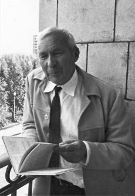
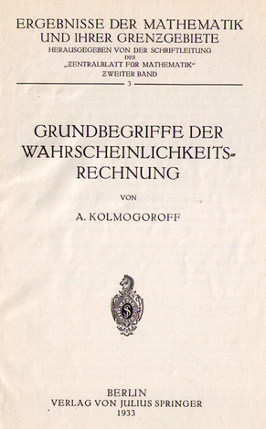
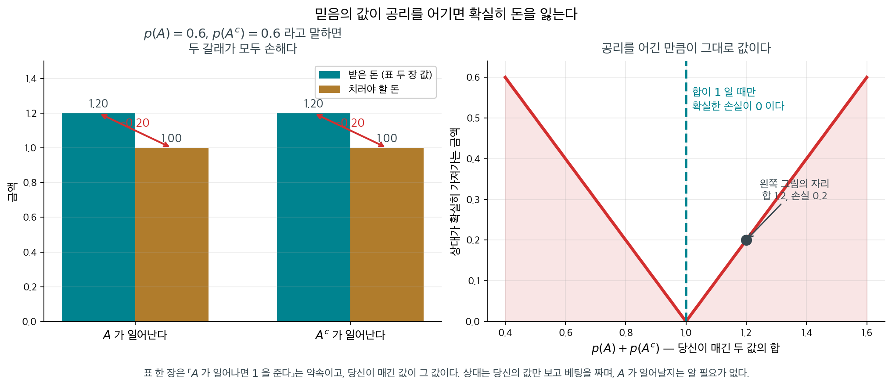
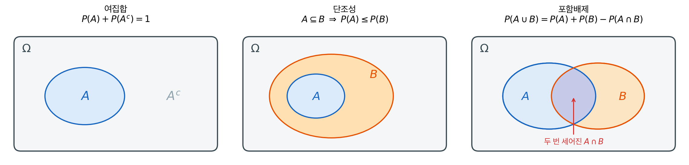
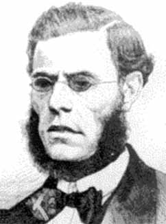
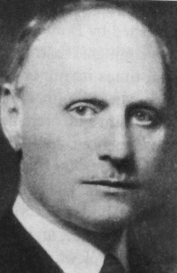
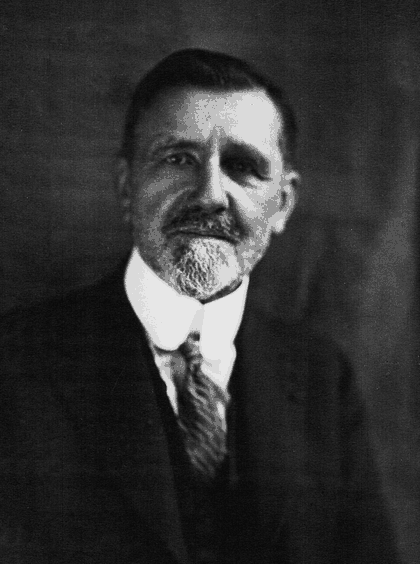

# 확률의 공리

## 개요

앞 절에서 결과마다 무게를 달아 확률을 만들었다. 그런데 무게를 아무렇게나 달아도 되는가? 어떤 사건의 확률이 음수여도 괜찮은가? 겹치지 않는 두 사건의 확률을 더했더니 전체보다 커져도 괜찮은가?

그럴 리 없다. 무게가 지켜야 할 규칙은 놀랄 만큼 적다. **세 줄**이면 충분하고, 확률론의 나머지는 전부 그 세 줄에서 따라 나온다. 1933년 콜모고로프가 정리한 이 세 줄을 **확률의 공리**라 한다.

이 절은 한 정의와 두 정리로 이루어진다. 공리가 무엇인가(정의 1), 거기서 무엇이 따라 나오는가(정리 1), 그리고 왜 유한이 아니라 가산 무한까지 요구하는가(정리 2)이다.

---

## 1. 무게가 지켜야 할 최소한의 규칙

세 규칙은 모두 "무게" 그림에서 당연해 보이는 것들이다. 무게는 음수일 수 없고 전체보다 무거울 수도 없으며, 빈 것에는 무게가 없고 전체를 다 합치면 1이며, 겹치지 않는 덩어리는 따로 재서 더해도 된다.

<div class="defn" markdown>

### 정의 1. 확률측도 — 콜모고로프 공리 { .dfn }

**확률측도** $P$는 사건 위에 정의된 실숫값 함수로서 다음 셋을 만족한다.

$$
\begin{aligned}
&\textbf{(1) 범위} && 0 \leq P(A) \leq 1 \quad \text{모든 사건 } A \text{에 대해} \\[4pt]
&\textbf{(2) 정규화} && P(\emptyset) = 0, \quad P(\Omega) = 1 \\[4pt]
&\textbf{(3) 가산가법성} && P\!\left(\bigcup_{i=1}^{\infty} A_i\right) = \sum_{i=1}^{\infty} P(A_i)
\quad \text{서로소인 } A_1, A_2, \ldots \text{에 대해}
\end{aligned}
$$

</div>

!!! note "공리에 적었지만 논리적으로는 빼도 되는 둘"
    위 목록에는 **없어도 되는 것이 둘** 들어 있다. 공리 (1)의 위쪽 부등호 $P(A) \leq 1$과 공리 (2)의 $P(\emptyset) = 0$이다. 이 둘은 나머지에서 **유도된다.** 따라서 둘을 지우고

    $$
    P(A) \ge 0, \qquad P(\Omega) = 1, \qquad \text{가산가법성}
    $$

    셋만 남겨도 확률론은 그대로 서 있으며, 실제로 그렇게 적는 책이 많다. 그럼에도 적어 두는 것은 "확률은 0과 1 사이다", "빈 사건에는 무게가 없다"가 공리와 나란히 놓일 만큼 기본적인 사실이기 때문이다.

    다만 **무엇이 진짜 가정이고 무엇이 편의인지는 알고 있어야 한다.** 두 증명 모두 서너 줄이면 끝나므로 **연습문제 1**에서 직접 해 보라. 둘 다 공집합으로 자리를 메워 공리 (3)을 쓰는 같은 수법이며, **전체 무게가 1로 유한하다**는 점이 결정적으로 쓰인다.

먼저 $P$가 **함수**라는 점을 분명히 해 두자. 함수에는 정의역과 공역이 있어야 하는데, $P$의 정의역은 수가 아니라 **사건**이다.

$$
A \;\longmapsto\; P(A), \qquad A \subseteq \Omega, \quad P(A) \in [0, 1]
$$

집합을 넣으면 수가 나온다. 앞 절의 벽돌 그림으로 말하면 $P$는 "사건에 속한 벽돌들의 무게를 재는 저울"이고, 그래서 정의역이 $\Omega$가 아니라 $\Omega$의 **부분집합들의 모임**이다. 이 모임이 정확히 무엇이어야 하는지는 연습문제 11에서 다룬다.

공리 (3)에서 합집합이 **무한**하다는 점이 핵심이다. 서로 배반인 두 사건에 대한 익숙한 규칙

$$
P(A \cup B) = P(A) + P(B) \qquad (A \cap B = \emptyset)
$$

은 나머지를 모두 공집합으로 두면 나오는 특수한 경우다.

<div class="storybox" markdown>

**그림으로 보는 통계학 1.** 세 줄로 적은 확률

<figure markdown>
  { width=150 align=right }
  <figcaption markdown>안드레이 콜모고로프($1903$–$1987$). *(Wikimedia Commons, 촬영 Konrad Jacobs, 오버볼파흐 수학연구소, CC BY-SA 2.0 DE)*</figcaption>
</figure>

정의 1 의 세 조건은 짧다. 음이 아니다, 전체가 $1$ 이다, 배반이면 더한다. 이 세 줄이 확률의 전부라고 선언한 사람이 **안드레이 콜모고로프**($1903$–$1987$)다.

그 전까지 확률은 **잘 쓰이지만 무엇인지는 또렷하지 않은** 분야였다. 「같은 정도로 일어날 법한 경우의 수의 비」라는 오래된 설명은 「같은 정도로 일어날 법한」이라는 말 안에 이미 확률을 숨겨 두고 있어 제자리를 맴돈다. $1900$ 년 힐베르트가 내놓은 문제 목록에서 여섯째가 물리학을 공리로 세우라는 것이었는데, 거기 첫머리에 꼽힌 것이 확률이었다.

<figure markdown>
  { width=175 align=right }
  <figcaption markdown>『확률론의 기본 개념』 표제지, 베를린 슈프링거 $1933$. 저자가 독일식 철자 A. KOLMOGOROFF 로 적혀 있다. *(Wikimedia Commons, 스캔 KurtSchwitters, CC BY-SA 3.0)*</figcaption>
</figure>

$1933$ 년, 서른 살의 그가 독일에서 낸 얇은 책이 사진이다. 그가 한 일은 뜻밖에도 **확률이 무엇인지 말하기를 그만둔 것**이었다. 대신 이렇게 물었다 — 확률이라 부를 만한 함수라면 무엇을 지켜야 하는가. 그 답이 정의 1 의 세 줄이고, 뼈대는 넓이를 재는 이론에서 빌려 왔다. 확률은 **전체 무게가 $1$ 인 넓이**인 셈이다.

값어치는 곧바로 드러난다. 이 쪽의 정리 1 — 유한가법성, 여집합, 단조성, 포함배제, 본페로니 — 이 모두 그 세 줄에서만 따라 나오고, 공리에 함께 적어 둔 $P(\varnothing)=0$ 과 $P(A)\le 1$ 조차 나머지 셋에서 유도된다(연습문제 1). 그리고 주사위처럼 가짓수가 유한한 것과 길이나 시간처럼 끊김 없는 것이 **같은 이론 안에** 들어온다. 유한이 아니라 가산 무한까지 요구한 것이 그 값을 치른 자리이며, 그 까닭이 정리 2 다.

다만 공리는 확률이 무엇인지 끝내 말해 주지 않는다. 「이 동전의 앞면 확률이 정말 $\dfrac12$ 인가」는 세 줄로 답할 수 없는 물음이고, 그래서 [큰수의 법칙](../limits/lln.md)이 따로 필요하다.

*확인한 곳 — [Shafer & Vovk 「The Sources of Kolmogorov's Grundbegriffe」](https://arxiv.org/pdf/math/0606533) · [Wikipedia 「Hilbert's sixth problem」](https://en.wikipedia.org/wiki/Hilbert%27s_sixth_problem)*

</div>

<div class="exbox" markdown>

**보기 1.** <span class="diff easy" title="쉬움"></span> 짝수 또는 홀수. 공정한 주사위에서 $A = \{2,4,6\}$, $B = \{1,3,5\}$라 하자. $A \cap B = \emptyset$이므로

</div>

??? success "풀이"
    $$
    P(A \cup B) = P(A) + P(B) = \tfrac{3}{6} + \tfrac{3}{6} = 1
    $$

    이고, $A \cup B = \Omega$이므로 정규화 공리와 어긋나지 않는다.

!!! note "공리는 확률이 무엇인지 말하지 않는다"
    공리는 확률이 지켜야 할 **문법**만 정한다. 그 수를 무엇으로 읽을지는 공리 바깥의 문제이며, 크게 두 갈래가 있다.

    - **빈도로 읽기.** "내일 비 올 확률 0.7"은 같은 기상 조건의 날 10일 중 약 7일에 비가 온다는 뜻이다. 반복 가능한 실험에 자연스럽다.
    - **믿음의 정도로 읽기.** "이 후보가 당선될 확률 0.7"은 반복할 수 없는 사건이다. 여기서 0.7은 내가 가진 확신의 크기이며, 새 정보가 오면 갱신된다(베이즈 정리).

    두 해석은 같은 공리를 쓰므로 계산 규칙이 완전히 같다. 갈리는 것은 계산이 아니라 **무엇에 확률을 붙일 수 있는가**이다.

<div class="exbox" markdown>

**보기 2.** <span class="diff easy" title="쉬움"></span> 콜모고로프 공리를 수치로 확인하기. 주사위 두 개의 무게 목록을 놓는다. 공정한 쪽은 $(\tfrac16, \ldots, \tfrac16)$이고 기운 쪽은 $(0.1, 0.1, 0.1, 0.1, 0.1, 0.5)$다.

**(1)** 결과마다 무게 $p_1, \ldots, p_6 \ge 0$을 달고 $P(A) = \sum_{i \in A} p_i$로 정의하면 공리 (3)이 **저절로** 성립함을 보이시오. 그래서 코드가 확인할 것이 둘뿐인 까닭을 말하시오.

**(2)** 기운 주사위에서 $P(\text{짝수})$와 그 여집합의 확률을 공리만으로 계산하고, 두 목록이 공리를 만족하는지 코드로 확인하시오.

</div>

??? success "풀이"

    **(1) 가법성은 가정이 아니라 합의 성질이다.** 무게 목록 $p_1, \ldots, p_6$에서 출발해 $P(A) = \sum_{i \in A} p_i$로 정의했다고 하자. $A$와 $B$가 서로소이면 $A \cup B$에 속한 첨자의 모임은 $A$의 첨자와 $B$의 첨자를 겹침 없이 이어 붙인 것이므로

    $$
    P(A \cup B) = \sum_{i \in A \cup B} p_i = \sum_{i \in A} p_i + \sum_{i \in B} p_i = P(A) + P(B)
    $$

    이다. 유한개든 가산무한개든 같다. 항이 모두 음이 아니어서 급수가 절대수렴하므로 항의 순서를 바꾸어 묶어도 합이 변하지 않기 때문이다. $P(\emptyset) = 0$도 같은 자리에서 나온다. 공집합에 속한 첨자가 하나도 없으므로 빈 합, 곧 $0$이다.

    그러므로 **무게로 확률을 만드는 순간 공리 (3)과 $P(\emptyset) = 0$은 공짜로 따라온다.** 남는 것은 무게 자체에 대한 두 조건뿐이다.

    $$
    p_i \ge 0 \ \text{(모든 } i\text{)}, \qquad \sum_{i=1}^{6} p_i = 1
    $$

    코드의 단언문이 정확히 이 둘이고, 셋째 공리에 주석만 달려 있는 이유가 이것이다.

    **(2) 기운 주사위.** 짝수는 $\{2, 4, 6\}$이므로 무게를 더하면 된다.

    $$
    P(\{2,4,6\}) = 0.1 + 0.1 + 0.5 = 0.7
    $$

    여집합은 정리 1 의 여집합 규칙으로 $1 - 0.7 = 0.3$이고, 직접 더해도 $0.1 + 0.1 + 0.1 = 0.3$으로 같다. 둘의 합이 $1$인 것이 정규화 공리다.

    ```python
    import numpy as np

    def verify_axioms(probabilities):
        """이산 확률분포가 콜모고로프의 세 공리를 만족하는지 확인한다."""
        # 공리 1: 확률은 0 과 1 사이다
        assert all(0 <= p <= 1 for p in probabilities), "Range violated"

        # 공리 2: 전체 확률이 1 이다
        #   P(공집합) = 0 은 따로 확인할 것이 없다. 공집합에 속한 결과가 하나도
        #   없으므로 무게의 합이 빈 합, 즉 0 이기 때문이다.
        total = sum(probabilities)
        assert np.isclose(total, 1.0), f"Normalization violated: total = {total}"

        # 공리 3: 서로소 사건의 확률은 더해진다(만드는 방식으로 이미 보장된다)
        print("All axioms satisfied!")
        print(f"  Total probability: {total:.4f}")
        print(f"  Min probability:   {min(probabilities):.4f}")
        print(f"  Max probability:   {max(probabilities):.4f}")

    # 공정한 주사위
    fair_die = [1/6] * 6
    verify_axioms(fair_die)

    # 한쪽으로 기운 주사위
    loaded_die = [0.1, 0.1, 0.1, 0.1, 0.1, 0.5]
    verify_axioms(loaded_die)

    # 사건의 확률은 무게를 더한 것이다. 짝수는 {2, 4, 6} 이므로 2, 4, 6번 칸.
    for name, probs in [("fair  ", fair_die), ("loaded", loaded_die)]:
        p_even = probs[1] + probs[3] + probs[5]
        print(f"{name}: P(even) = {p_even:.4f},  P(odd) = {1 - p_even:.4f},"
              f"  sum = {p_even + (1 - p_even):.4f}")
    ```

    출력:

    ```
    All axioms satisfied!
      Total probability: 1.0000
      Min probability:   0.1667
      Max probability:   0.1667
    All axioms satisfied!
      Total probability: 1.0000
      Min probability:   0.1000
      Max probability:   0.5000
    fair  : P(even) = 0.5000,  P(odd) = 0.5000,  sum = 1.0000
    loaded: P(even) = 0.7000,  P(odd) = 0.3000,  sum = 1.0000
    ```

    손으로 더한 $0.7$과 $0.3$이 코드의 마지막 줄과 같고, 두 목록 모두 단언문을 통과했다. **두 길이 맞는다.**

    **찌그러진 주사위도 공리를 만족한다는 점에 주목하라.** 공리는 확률이 **공정할 것**을 요구하지 않는다. 기운 쪽의 무게가 $0.1$에서 $0.5$까지 다섯 배 차이 나지만 음이 아니고 합이 $1$이면 그것으로 충분하다. 공리가 걸러 내는 것은 "불공정한 주사위"가 아니라 "무게가 음수이거나 합이 $1$이 아닌 목록"이다.

---

<div class="storybox" markdown>

**그림으로 보는 통계학 1.** 공리를 어기면 돈을 잃는다

정의 1 이 세 줄을 적어 두었다. 음이 아닐 것, 전체가 $1$ 일 것, 배반이면 더해질 것.
§2 가 그 셋에서 무엇이 따라 나오는지 보인다. 그런데 **왜 하필 그 셋인가**는 다른 물음이다.
콜모고로프는 그것을 **공리**로 놓았을 뿐 증명하지 않았다 — 공리란 원래 그런 것이다.

그래도 답을 내놓은 사람들이 있다. $1926$ 년의 **프랭크 램지**와 $1931$ 년의 **브루노 드
피네티**가 따로, 거의 같은 답에 닿았다. 답은 수학이 아니라 **내기**였다.

확률을 「세상에 있는 양」이 아니라 **당신이 매긴 값**이라고 해 보자. 드 피네티는 이것을
평생 밀어붙였고, $1970$ 년에 낸 책의 첫 줄에 대문자로 이렇게 적었다 — **확률은 존재하지
않는다.** 있는 것은 사람의 믿음뿐이라는 뜻이다.

그러면 이런 물음이 생긴다. **아무 값이나 매겨도 되는가.**

<figure markdown>
  { width=1000 }
  <figcaption markdown>표 한 장은 「$A$ 가 일어나면 $1$ 을 준다」는 약속이고, 당신이 매긴 값이 그 표의 값이다. 상대는 **당신의 값만 보고** 베팅을 짜며, $A$ 가 실제로 일어날지는 알 필요가 없다. 자료에서 직접 그렸다.</figcaption>
</figure>

$p(A) = 0.6$ 이고 $p(A^c) = 0.6$ 이라고 말했다고 하자. 둘 다 $0$ 과 $1$ 사이이니 첫 공리는
지켰다. 그런데 상대가 두 표를 **모두** 당신에게 팔면, 그는 $1.20$ 을 받고 나중에 $1$ 을
돌려준다. $A$ 가 일어나든 안 일어나든 **정확히 한 장이 당첨되기 때문**이다. 당신은 어느
갈래에서나 $0.20$ 을 잃는다.

이런 베팅 묶음을 **더치북**이라 한다. 요점은 둘이다.

**하나. 상대는 미래를 몰라도 된다.** 그가 쓴 것은 당신이 매긴 값뿐이고, $A$ 가 일어날지는
셈에 들어가지도 않았다. **확실한 손실**이지 운이 나쁜 손실이 아니다.

**둘. 손실의 크기가 곧 어긴 크기다.** 오른쪽 그림의 V 자가 그것이다. 두 값의 합이 $1$ 에서
벗어난 만큼이 그대로 상대의 몫이 되고, 합이 정확히 $1$ 일 때만 $0$ 이 된다. 가법성도
마찬가지다 — $A$ 와 $B$ 가 배반인데 $p(A \cup B)$ 를 $p(A) + p(B)$ 와 다르게 매기면 그
차액만큼 확실히 잃는다.

**그러니 공리는 하늘에서 떨어진 것이 아니다.** 「확실히 지는 내기를 받아들이지 않겠다」는
한 가지만 요구하면, 당신의 믿음은 **반드시** 정의 1 의 세 줄을 따라야 한다. 이것을
정합성이라 부른다. $1954$ 년에 **레너드 새비지**가 이 생각을 결정이론의 공리계로 다듬었고,
오늘날 베이즈 통계가 「사전분포를 적어도 되는가」라는 물음에 내놓는 답이 여기서 나온다.

_확인한 곳 — 램지($1926$)와 드 피네티($1931$)가 따로 더치북 논증에 닿았고, 드 피네티의 $1970$ 년 책 『확률론』이 「PROBABILITY DOES NOT EXIST」로 시작한다는 것, 새비지가 『The Foundations of Statistics』($1954$)에서 주관확률과 효용을 공리화했다는 것은 널리 알려진 바다 · 그림의 수치는 위 설정에서 이 쪽이 직접 셈했다_

</div>

## 2. 세 줄에서 나머지가 따라 나온다

공리가 세 줄뿐이라는 것은 인색해 보이지만, 실제로 쓰는 규칙들이 전부 여기서 유도된다. 아래 다섯 가지는 확률 계산에서 거의 매번 쓰이는 것들이다.

<div class="thmbox" markdown>

### 정리 1. 공리의 따름정리 — 유한가법성·여집합·단조성·포함배제·본페로니 { .thm }

임의의 사건 $A, B, A_1, \ldots, A_n$에 대해 다음이 성립한다.

$$
\begin{aligned}
&\textbf{유한가법성} && P\!\left(\bigcup_{i=1}^{n} A_i\right) = \sum_{i=1}^{n} P(A_i)
\quad \text{서로소인 } A_1, \ldots, A_n \text{에 대해} \\[4pt]
&\textbf{여집합} && P(A^c) = 1 - P(A) \\[4pt]
&\textbf{단조성} && A \subseteq B \;\Longrightarrow\; P(A) \leq P(B) \\[4pt]
&\textbf{포함배제} && P(A \cup B) = P(A) + P(B) - P(A \cap B) \\[4pt]
&\textbf{본페로니} && \sum_{i=1}^{n} P(A_i) - \sum_{i<j} P(A_i \cap A_j)
\;\leq\; P\!\left(\bigcup_{i=1}^{n} A_i\right) \;\leq\; \sum_{i=1}^{n} P(A_i)
\end{aligned}
$$

</div>

??? proof "증명"

    다섯 가지가 나오는 순서가 있다. 앞의 것이 뒤의 것의 재료가 되므로 그 차례대로 보자.

    **유한가법성은 공집합으로 자리를 메워 얻는다.** 공리 (3)은 무한 열에 대한 진술인데, 유한개만 있을 때는 $A_{n+1} = A_{n+2} = \cdots = \emptyset$으로 두면 된다. 서로소 조건이 그대로 유지되므로

    $$
    P\!\left(\bigcup_{i=1}^{n} A_i\right) \overset{(3)}{=} \sum_{i=1}^{\infty} P(A_i) = \sum_{i=1}^{n} P(A_i)
    $$

    이다. 마지막 등호에서 꼬리 항이 사라지는 것이 공리 (2)의 $P(\emptyset) = 0$이다. **유한가법성이 가산가법성의 특수한 경우**라는 말의 내용이 이것이며, 공집합을 공리에 함께 적어 둔 덕을 여기서 바로 본다.

    **여집합과 단조성은 유한가법성의 두 줄짜리 따름이다**(연습문제 2, 5). 특히 단조성에 $A \subseteq \Omega$를 넣으면 $P(A) \leq 1$이 **다시** 나온다. 공리 (1)에 적어 둔 상한과 같은 결론이며, 앞의 주석에서 그 부등호를 빼도 된다고 한 이유가 여기서 한 번 더 확인된다. **공리에 적혀 있다고 해서 가정이라는 뜻은 아니다.**

    **포함배제**는 "겹치는 부분을 두 번 세지 말라"는 말이다. $P(A) + P(B)$는 $A \cap B$를 두 번 세므로 한 번 빼 준다(연습문제 4). 사건이 셋이면 두 번 뺀 것을 한 번 되돌려 주어야 한다.

    $$
    \begin{aligned}
    P(A \cup B \cup C) = {}& P(A) + P(B) + P(C) \\
    &- P(A \cap B) - P(B \cap C) - P(C \cap A) \\
    &+ P(A \cap B \cap C)
    \end{aligned}
    $$

    부호가 $+, -, +$로 번갈아 나타나고, $n$개로 가면 마지막 항이 $\pm P(A_1 \cap \cdots \cap A_n)$까지 이어진다.

    **본페로니 부등식은 그 번갈아 나오는 급수를 중간에서 자른 것이다.** 첫 항에서 자르면 상한, 둘째 항에서 자르면 하한이 된다.

    $$
    \underbrace{\sum_i P(A_i) - \sum_{i<j} P(A_i \cap A_j)}_{\text{둘째 항까지 — 하한}}
    \;\leq\; P\!\left(\bigcup_i A_i\right) \;\leq\;
    \underbrace{\sum_i P(A_i)}_{\text{첫 항만 — 상한}}
    $$

    자르는 위치를 뒤로 밀수록 상한과 하한이 번갈아 나오며 참값을 조여 온다. 그 일반형과 수치 확인은 연습문제 8에 있다.

    $\square$

다섯 중 뒤의 셋은 그림 한 장으로 보아 두면 증명이 한눈에 들어온다. 앞 절 **표본공간과 사건**의 상자 그림을 그대로 쓴다. 바깥 상자가 $\Omega$이고 안의 도형이 사건이며, 도형의 **넓이**가 확률이라고 읽으면 된다.



**여집합**은 상자를 도형과 나머지 둘로 가른 것이다. 둘은 서로소이고 합이 $\Omega$이므로 넓이의 합이 1이다. **단조성**은 작은 도형이 큰 도형 안에 들어 있으면 넓이도 작다는 말이다. 차이 $B \setminus A$의 넓이가 음수일 수 없다는 것이 증명의 전부다. **포함배제**는 겹친 부분이 두 번 칠해졌으니 한 번 지우라는 말이다. 오른쪽 그림의 가운데 렌즈 모양이 $P(A) + P(B)$에서 두 번 세어진 부분이다.

<div class="storybox" markdown>

**그림으로 보는 통계학 2.** 식당 창문에 끼운 세 개의 원

<figure markdown>
  { width=250 align=right }
  <figcaption markdown>케임브리지 곤빌 앤 카이우스 칼리지 식당의 창. 아래에 JOHN VENN · FELLOW 1857–1923 · PRESIDENT 1903–23 이라 적혀 있다. *(Wikimedia Commons, 촬영 Schutz, CC BY-SA 2.5)*</figcaption>
</figure>

바로 위에서 보았듯 정리 1 의 따름정리들은 원 두세 개를 겹쳐 그려 읽는다. 그 그림에
이름을 준 **존 벤**은 케임브리지 곤빌 앤 카이우스 칼리지의 연구원이었고, 나중에는 학장을
지냈다. 그 칼리지 식당의 창 하나가 그를 기린다 — 새겨진 것이 초상이 아니라 **그림 자체**다.

창을 눈여겨보면 위 그림의 셈이 고스란히 들어 있다. 색유리는 빛을 걸러 내므로 **원이
겹칠수록 어두워진다.** 노랑·보라·파랑 세 원이 저마다는 환한데, 둘이 겹친 자리는 벌써
거의 검고(보라와 파랑이 겹친 데에만 남빛이 희미하게 남는다), 셋이 다 겹친 한가운데는
완전히 검다. 곧 한 자리의 색이 **그 자리를 덮은 원이 어느 것들인가**로 정해진다. 세 원이
만드는 조각은 정확히 일곱 개이고, 바깥의 옅은 바탕이 여덟째 — $(A\cup B\cup C)^{c}$ 다.

가운데 가장 어두운 조각이 $A\cap B\cap C$ 이고, 이 조각이 왜 눈에 띄어야 하는지를
말하는 것이 정리 1 의 증명에 적어 둔 **세 집합의 포함배제**다. 세 원의 넓이를 그냥
더하면 두 원이 겹친 자리는 두 번, 세 원이 겹친 가운데는 세 번 세어진다. 그래서 두 겹인
곳을 한 번씩 빼고 나면 가운데는 $3-3=0$ 번 세어져 아예 사라지므로, 마지막에 한 번
되돌려 놓아야 한다. 증명에서 부호가 $+,-,+$ 로 번갈아 나오는 까닭이다.

벤이 이 그림을 처음 그린 것은 아니다. 오일러가 백 년 앞서 원으로 명제를 그렸다. 벤이 한
일은 **원을 미리 다 겹쳐 놓는 것**이었다. 오일러의 원은 참인 관계에 맞추어 원을 붙이거나
떼어 놓지만, 벤의 원은 언제나 모든 겹침을 그려 놓고 **비어 있는 조각을 칠해서 지운다.**
그래서 사건이 $n$ 개면 조각이 늘 $2^{n}$ 개다. 포함배제의 항이 $2^n-1$ 개인 것이 그
때문이고(빈 조각 하나를 뺀 수다), 연습문제 8 이 「$n=30$ 이면 항이 $10$ 억 개가 넘는다」고
적는 수가 바로 이것이다.

*확인한 곳 — [Wikipedia 「John Venn」](https://en.wikipedia.org/wiki/John_Venn) — 곤빌 앤 카이우스 칼리지의 기념 창, 벤이 $1903$ 년에 학장으로 뽑혀 죽을 때까지 그 자리에 있었다는 것, 그리고 그가 이 그림을 $1880$ 년에 내놓으면서도 여전히 「오일러의 원」이라 불렀다는 것 · 창에 적힌 글자와 세 원이 만드는 조각이 일곱이라는 것, 겹칠수록 어두워져 한가운데가 가장 검다는 것은 사진에서 직접 읽었다(두 원이 겹친 자리의 밝기까지 재어 보았다) · 사진은 [Commons 파일 쪽](https://commons.wikimedia.org/wiki/File:Venn-stainedglass-gonville-caius.jpg)*

</div>

<div class="storybox" markdown>

**그림으로 보는 통계학 3.** 이름이 둘 붙었는데 둘 다 처음이 아니다

<figure markdown>
  { width=150 align=right }
  <figcaption markdown>다니엘 아우구스투 다 실바($1814$–$1878$). *(Wikimedia Commons, PD-old-assumed)*</figcaption>
</figure>

정리 1 의 넷째 줄은 영어로 「포함배제의 원리」라 불리지만, 식 자체에는 **다 실바의 공식**이라는 이름과 **실베스터의 체**라는 이름이 함께 붙어 다닌다. 프랑스에서는 **푸앵카레의 체**라고도 한다. 이름이 셋이나 되는데 **그중 누구도 이 식을 처음 적은 사람이 아니다** — 교대로 더하고 빼는 셈 자체는 $1718$ 년 드무아브르의 책에 이미 있다.

사진의 **다니엘 아우구스투 다 실바**는 그 가운데 *증명을 붙인* 첫 사람이다. 포르투갈의 해군 장교였고 열다섯에 왕립해군학교에 들어가 코임브라에서 공부한 뒤 $1845$ 년부터 해군학교에서 가르쳤다. $1852$ 년 $3$ 월 리스본 과학아카데미에 『이항합동식의 일반 성질과 직접 풀이』를 내놓았고, 책은 $1854$ 년에 나왔다.

그가 적은 꼴이 눈여겨볼 만하다. 조건 $a$ 를 **떼어 내는 일**을 기호 하나로 놓고, 조건이 여럿이면 그것들을 **곱했다**.

$$
S^{\cdots,c,b,a}=S\,[1-{}_a]\,[1-{}_b]\,[1-{}_c]\cdots
$$

이 곱을 전개하면 교대합이 저절로 나온다 — $(1-x_1)(1-x_2)\cdots(1-x_n)$ 을 펼친 것이 곧 포함배제의 우변이고, 한 원소가 조건 $m$ 개에 걸리면 그 자리에서 $(1-1)^m=0$ 이 되어 사라진다. 정리 1 의 증명이 부호를 번갈아 붙인 까닭을 한 줄로 적은 셈이다.

그런데 그는 **같은 해에 병으로 휴직**했고, 책의 뒷장들을 끝내 손보지 못한 채 $1868$ 년 퇴직했다. 글은 포르투갈어로 리스본에서만 나왔으므로 아무도 읽지 않았고, $1883$ 년 실베스터가 같은 식을 다시 내놓을 때도 그 책을 몰랐다. 반세기가 지나 이탈리아의 알라지아가 **거의 우연히** 그 논문을 발견해 $1903$ 년부터 세 편의 글로 알린 뒤에야 다 실바의 차례가 첫째였다는 것이 알려졌다.

이름이 늦게 돌아온 일은 흔하다. 다만 여기서는 **적은 꼴까지 그가 더 앞서 있었다** — 조건을 떼어 내는 일을 곱으로 적는 생각은, 오늘날 포함배제를 가장 짧게 증명하는 방법 그대로다.

*확인한 곳 — [Wikipedia 「Inclusion–exclusion principle」](https://en.wikipedia.org/wiki/Inclusion%E2%80%93exclusion_principle) — 드무아브르($1718$)에게 돌려지지만 다 실바($1854$)에 처음 나오고 실베스터($1883$)가 뒤따랐다는 것 · [Celestino, 「Daniel Augusto da Silva, Poet of Mathematics」, arXiv:1812.06267](https://arxiv.org/abs/1812.06267) — 생몰·해군 이력·$1852$ 년 $3$ 월 발표와 $1854$ 년 간행·휴직과 미완성·위의 기호 꼴·알라지아의 재발견이 모두 여기 있다*

</div>

실무에서 압도적으로 많이 쓰이는 것은 위쪽, 즉 겹침을 아예 모를 때 쓰는 상한이다. 9장의 **다중검정**에서 이 부등식이 결정적으로 쓰인다. 수준 $\alpha$로 $n$번 검정하면 적어도 한 번 잘못 기각할 확률이 $n\alpha$ 이하이므로, 각 검정을 $\alpha/n$으로 하면 전체 오류율이 $\alpha$ 아래로 묶인다. 의존 구조를 몰라도 언제나 성립한다는 것이 이 부등식의 힘이다.

<div class="storybox" markdown>

**그림으로 보는 통계학 4.** 인쇄 오류를 평생 미워한 사람의 이름이 붙은 부등식

<figure markdown>
  { width=150 align=right }
  <figcaption markdown>카를로 에밀리오 본페로니 $(1892\text{–}1960)$. *(Wikimedia Commons, PD-Italy)*</figcaption>
</figure>

정리 1 의 마지막 줄을 오늘날 **본페로니 부등식**이라 부른다. 이름의 주인은 베르가모에서
태어난 이탈리아 사람 카를로 에밀리오 본페로니다.

그는 수학자가 될 사람이 아니었다. 처음 배운 것은 **지휘와 피아노**였고, 토리노 음악원에
다니던 그를 수학부에 넣은 것은 아버지였다. 토리노 대학에서 페아노와 세그레 밑에서
공부했는데, 학부 시절에 보렐의 『확률론 요강』을 읽다가 동전 던지기 문제에서 **틀린
곳을 찾아** 보렐에게 편지를 썼다. 답장은 오지 않았다. 다만 그 책의 제 $2$ 판에서는
그 자리가 조용히 고쳐져 있었다.

그 부등식이 들어 있는 글은 두 편이다. $1935$ 년 것은 생명보험에 쓰려고 쓴 구체적인
글이고, $1936$ 년 것이 지금 우리가 보는 꼴로 추상화한 글이다. 그런데 **많은 책이 두 편
모두 $1936$ 년이라고 적는다.** 원본을 펴 보지 않고 앞서 적힌 글을 베낀 탓이다.

인쇄된 뒤에야 드러나는 오류를 평생 못 견뎌 했다는 사람의 이름이, 정작 **잘못 베껴진
연도와 함께** 불리고 있는 셈이다. 남이 적어 둔 것을 믿는 일이 어디까지 위험한지를
이보다 잘 보여 주는 예가 드물다.

_확인한 곳 — [MacTutor 「Carlo Emilio Bonferroni」](https://mathshistory.st-andrews.ac.uk/Biographies/Bonferroni/) — 생몰($1892$ 베르가모 –$1960$ 피렌체), 토리노 음악원에서 지휘와 피아노를 배운 일, 페아노·세그레 밑에서 공부한 일, 보렐의 오류를 찾아 편지했으나 답을 못 받고 제 $2$ 판에서 고쳐진 것을 보았다는 일, 인쇄 오류에 집착했다는 일이 모두 여기 있다. **$1935$ 년과 $1936$ 년 두 편이라는 것과, 많은 출처가 둘 다 $1936$ 년으로 적는 것이 「원본이 아니라 2차 자료를 따라간」 탓이라는 지적도 같은 글에 있다** — 서지는 「Il calcolo delle assicurazioni su gruppi di teste」($1935$)와 「Teoria statistica delle classi e calcolo delle probabilità」(*Pubblicazioni del R. Istituto Superiore di Scienze Economiche e Commerciali di Firenze* $8$, $1936$, $3$–$62$)다_

</div>

---

## 3. 유한이 아니라 무한까지 요구하는 이유

공리 (3)에서 유한 합집합만 요구해도 위의 따름정리는 전부 나온다. 그렇다면 왜 굳이 무한까지 요구할까?

<div class="thmbox" markdown>

### 정리 2. 가산가법성과 측도의 연속성 — 극한을 확률 안으로 들여오기 { .thm }

가산가법성은 확률에 **극한을 취할 권리**를 준다. 사건들이 커지며 쌓여 갈 때

$$
A_1 \subseteq A_2 \subseteq A_3 \subseteq \cdots, \qquad A = \bigcup_{n=1}^{\infty} A_n
$$

이면

$$
P(A) = \lim_{n \to \infty} P(A_n)
$$

이 성립한다. 이를 **측도의 연속성**이라 한다.

</div>

??? proof "증명"

    쌓여 가는 사건열을 서로소인 **껍질**로 쪼갠다. $C_1 = A_1$, 그리고 $n \geq 2$에 대해

    $$
    C_n = A_n \setminus A_{n-1}
    $$

    이라 두자. $A_1 \subseteq A_2 \subseteq \cdots$이므로 $C_1, C_2, \ldots$는 서로소이고

    $$
    \bigcup_{i=1}^{n} C_i = A_n, \qquad \bigcup_{i=1}^{\infty} C_i = A
    $$

    이다. 공리 (3)을 오른쪽 등식에, 유한가법성을 왼쪽 등식에 적용하면

    $$
    P(A) = \sum_{i=1}^{\infty} P(C_i)
    = \lim_{n \to \infty} \sum_{i=1}^{n} P(C_i)
    = \lim_{n \to \infty} P(A_n)
    $$

    을 얻는다. 가운데 등호는 무한급수가 부분합의 극한이라는 정의 그대로다. $\square$

    줄어드는 사건열 $B_1 \supseteq B_2 \supseteq \cdots$에 대해서는 여집합을 취해 $A_n = B_n^c$로 두면 위 결과가 그대로 적용되어 $P(\bigcap_n B_n) = \lim_n P(B_n)$을 준다. 연습문제 9의 보렐–칸텔리 보조정리가 이 형태를 쓴다.

유한 가법성만으로는 이 성질이 보장되지 않으며, 그 대가가 크다.

- **극한정리를 쓸 수 없다.** 큰수의 법칙은 "거의 확실한 수렴"을 말하는데, 이는 가산 개의 사건에 대한 진술이다.
- **연속분포를 만들 수 없다.** 구간을 무한히 잘게 쪼개어 확률을 부여하는 일이 가산 연산이다.
- **역설이 들어온다.** 유한 가법성만 요구하면 정수 전체 위의 "균등분포" 같은 것이 허용되는데, 이는 가산가법성과 양립하지 않는다.

콜모고로프가 가산가법성을 택한 이유가 이것이다. 확률론을 **측도론**과 같은 언어로 쓸 수 있게 되고, 그 순간 해석학의 도구 전체를 가져다 쓸 수 있게 된다.

!!! warning "확률 0과 불가능은 다르다"
    유한한 표본공간에서는 $P(A) = 0$과 $A = \emptyset$이 같다. 보통의 주사위에서 7이 나올 확률이 0인 것은 7이 애초에 표본공간에 없기 때문이다.

    그러나 표본공간이 연속이면 둘이 갈린다. $[0,1]$에서 균등하게 수를 뽑을 때 $P(\{0.5\}) = 0$이지만 $0.5$가 나오는 것이 불가능하지는 않다. 자세한 논의는 앞 절 **표본공간과 사건**의 정리 3에 있다.

    이 구별이 가능해진 것도 가산가법성 덕분이다. 확률 0인 사건을 가산 개 모아도 여전히 확률 0이라는 사실이 "거의 확실하게"라는 개념을 떠받친다.

<div class="storybox" markdown>

**그림으로 보는 통계학 5.** 원숭이 백만 마리를 불러낸 까닭

<figure markdown>
  { width=170 align=right }
  <figcaption markdown>에밀 보렐($1871$–$1956$). $1929$ 년 보도사진이고, 원 자료의 설명은 그를 수학자가 아니라 **「아베롱 선출 하원의원」**이라 적어 두었다. *(Wikimedia Commons · 프랑스 국립도서관, 저작권 만료)*</figcaption>
</figure>

서로 [독립](independence.md)인 사건 $A_1, A_2, \ldots$ 를 $n$ 개까지 모으면

$$
P(\text{적어도 하나})=1-\prod_{i=1}^{n}\bigl(1-P(A_i)\bigr)
$$

이다. 하나하나의 확률이 아무리 작아도 $n$ 을 키우면 이 값은 $1$ 로 다가가고, 그 극한을 확률 안으로 들여올 권리를 주는 것이 정리 2 다. 이 한 줄에서 **타자 치는 원숭이**가 나왔다.

$1913$ 년 논문 「통계역학과 비가역성」, 그리고 이듬해 책 『우연』에서 **에밀 보렐**이 그린 그림이다. 원숭이 백만 마리가 하루 열 시간씩 자판을 두드린다면 그 결과가 국립도서관의 책들과 똑같아질 수 있는가. 위 식으로 보면 「그럴 수 있다」이다.

얼마나 걸리는지를 재 보자. 알파벳 $26$ 자판에서 길이 $m$ 인 글자열이 한 번에 맞을 확률은 $p=26^{-m}$ 이고, $n$ 번 쳐서 적어도 한 번 맞을 확률이 $\frac12$ 이 되는 $n$ 은 $1-(1-p)^n=\frac12$ 에서

$$
n\approx\frac{\ln 2}{p}
$$

이다. 백만 마리가 하루 열 시간, 초당 넉 자를 친다고 보면 이렇다.

| 치려는 글 | 길이 | $p$ | 반반이 되는 시도 수 | 걸리는 시간 |
|---|---|---|---|---|
| `TOBEORNOTTOBE` | $13$ | $4.0\times10^{-19}$ | $1.7\times10^{18}$ | 약 $3$ 만 해 |
| `TOBEORNOTTOBETHATISTHEQUESTION` | $30$ | $3.6\times10^{-43}$ | $2.0\times10^{42}$ | 약 $4\times10^{28}$ 해 |

열세 글자는 삼만 해면 반반이다. 길지만 상상은 된다. 그런데 글자를 열일곱 자 더 붙이면 **우주 나이의 $10^{18}$ 배**가 된다. $p$ 가 길이에 **지수로** 매달려 있기 때문이고, 한 줄짜리 문장이 이러니 책 한 권은 말할 것도 없다.

이 이야기는 흔히 「무한히 치면 셰익스피어가 나온다」로 전해진다. 그런데 **보렐이 하려던 말은 정반대였다.** 그는 그런 일이 **일어나지 않는다**는 것을 보이려고 원숭이를 불러냈다. 수학에서 확률이 $0$ 이 아니라는 것과 세상에서 실제로 일어난다는 것은 다른 일이라는 말이다. $1-(1-p)^n\to 1$ 은 $n$ 을 끝까지 밀었을 때의 이야기이고, 우리가 쓸 수 있는 $n$ 은 언제나 유한하다. 정리 2 는 **극한을 주지 시간을 주지 않는다.**

그가 어떤 사람이었는지도 적어 둘 만하다. 길이와 넓이를 재는 방법을 다시 세워 **보렐 집합**에 이름을 남겼고 — 연습문제 11 의 보렐 $\sigma$-대수와 연습문제 9 의 보렐–칸텔리 보조정리가 모두 그의 것이다 — $1921$ 년부터 전략이 있는 게임을 처음 식으로 적었다. 다만 거기서 핵심이 되는 미니맥스 정리는 끝내 받아들이지 않았고, $1953$ 년 폰 노이만이 『에코노메트리카』에 편지를 보내 「그는 전략 게임을 정의할 수 없었다」고 반박했다. 그러면서 $1924$ 년부터 $1936$ 년까지 하원의원이었고, $1925$ 년에는 — 역시 수학자인 팽르베의 내각에서 — **해군장관**을 지냈으며, 2차대전 때는 레지스탕스로 싸워 훈장을 받았다. 확률이 아주 작은 일은 일어나지 않는다고 평생 말한 사람치고는, 일어날 법하지 않은 일이 꽤 많았던 삶이다.

_확인한 곳 — 타자 치는 원숭이(*singes dactylographes*)가 보렐의 $1913$ 년 논문 「Mécanique Statique et Irréversibilité」와 $1914$ 년 책 『Le Hasard』에 나온다는 것, 그 원숭이가 실제 원숭이가 아니라 무작위 글자열을 만드는 방법의 비유라는 것, 그리고 보렐이 「백만 마리가 하루 열 시간씩 쳐도 국립도서관의 모든 책과 똑같아지는 일은 극히 있을 법하지 않다」고 적었다는 것은 [Wikipedia 「Infinite monkey theorem」](https://en.wikipedia.org/wiki/Infinite_monkey_theorem) · 보렐 집합, $1921$–$27$ 년에 전략 게임을 처음 정의한 일과 $1953$ 년 폰 노이만이 『에코노메트리카』에 보낸 반박(보렐이 미니맥스 정리를 받아들이지 않았으므로 전략 게임을 정의할 수 없었다는 것), $1924$–$36$ 년 하원의원과 $1925$ 년 팽르베 내각의 해군장관, 레지스탕스 활동과 훈장은 [Wikipedia 「Émile Borel」](https://en.wikipedia.org/wiki/%C3%89mile_Borel) · 사진이 $1929$ 년 보도사진이고 설명에 「député de l'Aveyron」이라 적혀 있다는 것은 [Commons 파일 쪽](https://commons.wikimedia.org/wiki/File:Emile_Borel-1932.jpg) 에서 **직접 읽었다** · 표의 $p$ · 시도 수 · 걸리는 시간은 **이 쪽에서 직접 계산해 보았다**_

</div>

---

## 연습문제

<div class="drillbox" markdown>

**연습문제 1.** <span class="diff easy" title="쉬움"></span>
정의 1 의 공리 목록에는 **없어도 되는 것이 둘** 있다. 공리 (1)의 위쪽 부등호 $P(A) \leq 1$과 공리 (2)의 $P(\emptyset) = 0$이다. 나머지 셋 — $P(A) \geq 0$, $P(\Omega) = 1$, 가산가법성 — 만으로 이 둘을 각각 증명하라. 그리고 어느 단계에서 **전체 무게가 유한하다**는 사실이 쓰이는지 밝혀라.

</div>

??? success "풀이"
    **(가) $P(\emptyset) = 0$.** $\emptyset \cap \emptyset = \emptyset$이므로 공집합은 **자기 자신과도 서로소**다. 따라서

    $$
    \Omega = \Omega \cup \emptyset \cup \emptyset \cup \cdots
    $$

    는 서로소인 가산 합집합이고, 가산가법성에 의해

    $$
    P(\Omega) = P(\Omega) + \sum_{j=1}^{\infty} P(\emptyset)
    $$

    이다. $P(\Omega) = 1$은 **유한**하므로 양변에서 지울 수 있어 $\sum_j P(\emptyset) = 0$이고, 각 항이 $0$ 이상이니 $P(\emptyset) = 0$이다. $\square$

    **(나) $P(A) \leq 1$.** $A$와 $A^c$는 서로소이고, 나머지 자리를 공집합으로 채우면

    $$
    \Omega = A \cup A^c \cup \emptyset \cup \emptyset \cup \cdots
    $$

    이므로 가산가법성과 (가)의 $P(\emptyset) = 0$에 의해

    $$
    1 = P(\Omega) = P(A) + P(A^c)
    $$

    이다. $P(A^c) \geq 0$이므로 $P(A) = 1 - P(A^c) \leq 1$이다. $\square$

    **순환이 아님을 확인하라.** (나)는 $P(A^c) \geq 0$만 쓴다. 즉 공리 (1)의 **아래쪽** 부등호만 쓰고 증명하려는 위쪽은 쓰지 않는다. (가)도 마찬가지다.

    **유한성이 쓰이는 곳.** (가)에서 $P(\Omega)$를 양변에서 지우는 단계다. $P(\Omega) = \infty$라면 $\infty = \infty + c$가 모든 $c$에 대해 성립하므로 아무것도 결론 낼 수 없다.

    **그래서 두 조건의 지위가 같지 않다.** 일반 측도론에서는 $\mu(\Omega) = \infty$가 허용되어 (가)의 소거를 할 수 없고, 그래서 $\mu(\emptyset) = 0$을 **측도의 정의에 넣는다.** 반면 상한은 측도론에 **아예 없는 조건**이다. $\mu(A) \leq 1$은 전체 무게를 1로 못박은 확률에만 있는 것이다. 둘 다 편의로 적어 두었지만, 측도의 정의와 모양이 맞는 쪽은 $P(\emptyset) = 0$ 하나다.

---

<div class="drillbox" markdown>

**연습문제 2.** <span class="diff easy" title="쉬움"></span>
확률의 세 공리만을 사용해 임의의 사건 $A$에 대해 $P(A^c) = 1 - P(A)$임을 증명하라.

</div>

??? success "풀이"
    $A$와 $A^c$는 서로 배반이고 $A \cup A^c = \Omega$이므로 가법성 공리에 의해

    $$
    P(A \cup A^c) = P(A) + P(A^c)
    $$

    이다. 정규화 공리에 의해 $P(\Omega) = 1$이므로

    $$
    1 = P(A) + P(A^c)
    $$

    이고, 정리하면

    $$
    P(A^c) = 1 - P(A)
    $$

    이다. $\square$

---

<div class="drillbox" markdown>

**연습문제 3.** <span class="diff easy" title="쉬움"></span>
공리를 사용해 $A \subseteq B$이면 $P(A) \leq P(B)$임을(확률의 단조성) 증명하라.

</div>

??? success "풀이"
    $A \subseteq B$이므로 $B = A \cup (B \cap A^c)$로 쓸 수 있고, $A$와 $B \cap A^c$는 서로소다. 가법성 공리에 의해

    $$
    P(B) = P(A) + P(B \cap A^c)
    $$

    이다. 공리 (1)에 의해 $P(B \cap A^c) \geq 0$이므로

    $$
    P(B) = P(A) + P(B \cap A^c) \geq P(A)
    $$

    이다. $\square$

---

<div class="drillbox" markdown>

**연습문제 4.** <span class="diff med" title="중간"></span>
공리로부터 임의의 두 사건 $A$와 $B$에 대해 다음이 성립함을 증명하라.

$$
P(A \cup B) = P(A) + P(B) - P(A \cap B)
$$

</div>

??? success "풀이"
    $A \cup B$를 서로소인 합집합으로 쓴다. $A \cup B = A \cup (B \cap A^c)$이고 $A$와 $B \cap A^c$는 서로소임에 유의하라. 가법성 공리에 의해

    $$
    P(A \cup B) = P(A) + P(B \cap A^c)
    $$

    이다. 마찬가지로 $B = (B \cap A) \cup (B \cap A^c)$도 서로소인 합집합이므로

    $$
    P(B) = P(B \cap A) + P(B \cap A^c)
    $$

    이고, $P(B \cap A^c)$에 대해 풀면

    $$
    P(B \cap A^c) = P(B) - P(A \cap B)
    $$

    이다. 이를 대입하면

    $$
    P(A \cup B) = P(A) + P(B) - P(A \cap B)
    $$

    를 얻는다. $\square$

---

<div class="drillbox" markdown>

**연습문제 5.** <span class="diff med" title="중간"></span>
어떤 학생이 $P(A) = 0.4$, $P(B) = 0.5$, $P(A \cup B) = 0.8$이라고 주장한다. 다른 학생은 $P(A) = 0.7$, $P(B) = 0.6$, $P(A \cap B) = 0.1$이라고 주장한다. 각 배정이 공리와 모순되지 않는지 판정하라.

</div>

??? success "풀이"
    **첫 번째 학생:** 포함배제를 쓰면 $P(A \cap B) = P(A) + P(B) - P(A \cup B) = 0.4 + 0.5 - 0.8 = 0.1$이다. $0 \leq 0.1 \leq \min(0.4, 0.5)$이고 모든 확률이 $[0,1]$에 있으므로 이 배정은 공리와 **모순되지 않는다**.

    **두 번째 학생:** $P(A \cup B) = P(A) + P(B) - P(A \cap B) = 0.7 + 0.6 - 0.1 = 1.2$여야 한다. 그러나 정규화 공리는 $P(A \cup B) \leq P(\Omega) = 1$을 요구한다. $1.2 > 1$이므로 이 배정은 공리를 **위반하며** 따라서 불가능하다.

---

<div class="drillbox" markdown>

**연습문제 6.** <span class="diff med" title="중간"></span>
**본페로니 부등식.** 임의의 사건 $A_1, \ldots, A_n$에 대해 $P(\bigcup_i A_i) \le \sum_i P(A_i)$임을 증명하라. 이것은 언제 유용한가?

</div>

??? success "풀이"
    $n$에 대한 귀납법으로 증명한다. 기저 단계 $n = 1$: 자명하게 $P(A_1) \le P(A_1)$이다.

    귀납 단계: $P(\bigcup_{i=1}^k A_i) \le \sum_{i=1}^k P(A_i)$라고 가정하자. 포함배제에 의해

    $$
    P(A_1 \cup \cdots \cup A_{k+1}) = P(\bigcup_{i=1}^k A_i) + P(A_{k+1}) - P((\bigcup_{i=1}^k A_i) \cap A_{k+1})
    $$

    이고 마지막 항이 음이 아니므로

    $$
    P(\bigcup_{i=1}^{k+1} A_i) \le P(\bigcup_{i=1}^k A_i) + P(A_{k+1}) \le \sum_{i=1}^k P(A_i) + P(A_{k+1}) = \sum_{i=1}^{k+1} P(A_i)
    $$

    이다. $\square$

    **용도:** **다중비교**에서 각각 수준 $\alpha$로 $n$번의 가설검정을 수행한다고 하자. 적어도 한 번 잘못 기각할 확률은 본페로니에 의해 $P(\bigcup_i \text{Reject}_i \mid H_0) \le n\alpha$다. 따라서 수준 $\alpha/n$으로 검정하면 가족단위 오류율이 $\le \alpha$가 된다. 본페로니 보정은 보수적이지만 의존 구조와 무관하게 언제나 타당하다.

---

<div class="drillbox" markdown>

**연습문제 7.** <span class="diff med" title="중간"></span>
**$\sigma$-가법성 대 유한 가법성.** 차이를 진술하고 측도론적 확률이 왜 더 강한 성질을 요구하는지 설명하라.

</div>

??? success "풀이"
    **유한 가법성:** 서로소인 (유한 모임) $A_1, \ldots, A_n$에 대해 $P(\bigcup_{i=1}^n A_i) = \sum_{i=1}^n P(A_i)$.

    **$\sigma$-가법성**(가산가법성, 콜모고로프의 공리 3): 서로소인 사건의 *가산무한* 열 $A_1, A_2, \ldots$에 대해 $P(\bigcup_{i=1}^\infty A_i) = \sum_{i=1}^\infty P(A_i)$.

    **왜 $\sigma$-가법성인가?** 유용한 여러 결과가 이를 필요로 한다.

    - **측도의 연속성**: $A_1 \subseteq A_2 \subseteq \ldots$이고 $A = \bigcup A_n$이면 $P(A) = \lim P(A_n)$이다. 극한정리에 결정적이다.
    - **확률밀도의 존재**: 연속분포를 정의하려면 임의로 잘게 나눈 부분들에 확률을 부여해야 하는데, 이는 가산 연산이다.
    - **강한 큰수의 법칙**: 가산 합집합으로 정의되는 거의 확실한 수렴을 필요로 한다.

    유한 가법성만으로는 역설적인 배정이 허용된다(예: 직관적이지만 $\sigma$-가법적이지 않은 정수 위의 "균등" 분포). 콜모고로프는 이런 것들을 배제하고 확률을 측도론과 연결하기 위해 $\sigma$-가법성을 택했다.

---

<div class="drillbox" markdown>

**연습문제 8.** <span class="diff hard" title="어려움"></span>
연습문제 6의 본페로니 부등식은 포함배제 공식을 **첫 항에서 자른 것**이다. 더 자르면 어떻게 되는가? 절단 차수에 따라 상계와 하계가 번갈아 나옴을 보이고 수치로 확인하라.

</div>

??? success "풀이"
    **포함배제 공식**은

    $$
    P\!\left(\bigcup_{i=1}^n A_i\right) = \sum_i P(A_i) - \sum_{i<j} P(A_i \cap A_j) + \sum_{i<j<k} P(A_i \cap A_j \cap A_k) - \cdots
    $$

    이다. **보네페로니 부등식**(일반화된 본페로니)은 이 급수를 $m$번째 항에서 자르면

    $$
    m \text{ 이 홀수} \;\Rightarrow\; \text{부분합} \ge P\!\left(\bigcup A_i\right),
    \qquad
    m \text{ 이 짝수} \;\Rightarrow\; \text{부분합} \le P\!\left(\bigcup A_i\right)
    $$

    임을 말한다. $m = 1$인 경우가 연습문제 6의 본페로니 부등식이다.

    ```python
    import numpy as np
    from itertools import combinations

    rng = np.random.default_rng(0)
    N, n = 400_000, 5
    p = rng.uniform(0.15, 0.4, n)
    X = rng.random((N, n)) < p                    # 독립인 다섯 사건

    truth = np.mean(X.any(axis=1))
    print(f"참 P(합집합) = {truth:.6f}\n")

    terms = []
    for k in range(1, n + 1):
        terms.append(sum(np.mean(X[:, list(c)].all(axis=1))
                         for c in combinations(range(n), k)))

    print(f"{'절단 차수 m':>12}{'부분합':>12}{'관계':>10}{'오차':>12}")
    partial = 0.0
    for k in range(1, n + 1):
        partial += (-1) ** (k + 1) * terms[k - 1]
        rel = "상계" if k % 2 == 1 else "하계"
        print(f"{k:>12}{partial:>12.6f}{rel:>10}{partial - truth:>+12.6f}")
    ```

    출력:

    ```
    참 P(합집합) = 0.752478

         절단 차수 m         부분합        관계          오차
               1    1.194400        상계   +0.441922
               2    0.641637        하계   -0.110840
               3    0.765327        상계   +0.012850
               4    0.751905        하계   -0.000573
               5    0.752477        상계   -0.000000
    ```

    **부분합이 참값을 번갈아 넘나들며 조여 온다.**

    | $m$ | 부분합 | 오차 |
    |---|---|---|
    | $1$ | $1.194$ | $+0.442$ (상계) |
    | $2$ | $0.642$ | $-0.111$ (하계) |
    | $3$ | $0.765$ | $+0.013$ (상계) |
    | $4$ | $0.752$ | $-0.0006$ (하계) |
    | $5$ | $0.752477$ | $0$ (정확 — 부동소수 오차만 남는다) |

    $m = 1$일 때 $1.194$로 $1$을 넘는 것에 주목하라. **본페로니 상계는 확률이 아닐 수 있다.** 그래도 부등식으로는 유효하며, 다만 그 경우 아무 정보도 주지 못한다.

    **왜 유용한가.**

    - **$m = 2$에서 이미 쓸 만한 하계를 얻는다.** 항의 개수가 $\binom{n}{1} + \binom{n}{2}$로 전체 $2^n - 1$보다 훨씬 적다.
    - **$n$이 크면 포함배제를 끝까지 계산할 수 없다.** $n = 30$이면 항이 $10$억 개가 넘는다. 절단이 실용적 유일한 방법이다.
    - **다중검정 보정의 근거가 $m=1$ 본페로니다.** 1장 절충 문서 연습문제 8에서 본 그 부등식이며, 보수적인 이유가 여기서 분명해진다. 첫 항만 쓰므로 겹침을 전혀 반영하지 않는다. $\square$

---

<div class="drillbox" markdown>

**연습문제 9.** <span class="diff hard" title="어려움"></span>
정리 $3$의 **측도의 연속성**을 응용하라. **보렐–칸텔리 보조정리**를 진술하고 수치로 확인하라.

</div>

??? success "풀이"
    사건열 $A_1, A_2, \ldots$에 대해 "무한히 자주 일어난다"는 사건을

    $$
    \{A_n \text{ i.o.}\} = \bigcap_{m=1}^\infty \bigcup_{n \ge m} A_n
    $$

    로 정의한다. 측도의 연속성이 이 무한 연산을 다룰 수 있게 해 준다.

    **제$1$ 보조정리.** $\sum_n P(A_n) < \infty$이면 $P(A_n \text{ i.o.}) = 0$이다.

    **증명 스케치.** $B_m = \bigcup_{n \ge m} A_n$이라 하면 $B_m$은 감소열이고 $\bigcap_m B_m = \{A_n \text{ i.o.}\}$이다. 정리 $3$의 위에서의 연속성으로

    $$
    P(A_n \text{ i.o.}) = \lim_m P(B_m) \le \lim_m \sum_{n\ge m} P(A_n) = 0
    $$

    이다. 마지막 등호는 수렴하는 급수의 꼬리가 $0$으로 가기 때문이다. $\square$

    **제$2$ 보조정리.** $A_n$이 **독립**이고 $\sum_n P(A_n) = \infty$이면 $P(A_n \text{ i.o.}) = 1$이다.

    ```python
    import numpy as np

    rng = np.random.default_rng(0)
    window = np.arange(5000, 10_000)

    for label, p_fn in [("p_n = 1/n^2  (합이 수렴)", lambda n: 1 / n ** 2),
                        ("p_n = 1/n    (합이 발산)", lambda n: 1 / n)]:
        p = p_fn(window)
        hits = np.mean([(rng.random(len(window)) < p).any() for _ in range(300)])
        print(f"{label}")
        print(f"  구간 합 = {p.sum():.4f}")
        print(f"  이 구간에서 한 번이라도 일어날 확률: 모의 {hits:.4f}, "
              f"이론 {1 - np.exp(-p.sum()):.4f}\n")
    ```

    출력:

    ```
    p_n = 1/n^2  (합이 수렴)
      구간 합 = 0.0001
      이 구간에서 한 번이라도 일어날 확률: 모의 0.0000, 이론 0.0001

    p_n = 1/n    (합이 발산)
      구간 합 = 0.6932
      이 구간에서 한 번이라도 일어날 확률: 모의 0.5100, 이론 0.5000
    ```

    **$p_n = 1/n^2$이면 $n \ge 5000$ 구간 전체에서 사건이 일어날 확률이 $0.0001$에 불과하다.** 꼬리 합이 $0$으로 가므로 결국 아무 일도 일어나지 않는다.

    **$p_n = 1/n$이면 같은 구간에서 확률이 $0.51$이다.** 그리고 구간을 뒤로 옮겨도 그 확률이 $0$으로 가지 않는다($\sum 1/n$이 발산하므로). 그래서 무한히 자주 일어난다.

    **왜 이것이 중요한가.**

    - **큰수의 강법칙 증명의 핵심 도구다.** "거의 확실한 수렴"을 다루려면 무한히 많은 사건의 극한을 확률로 계산해야 하는데, 그것이 정확히 측도의 연속성이 하는 일이다.
    - **유한 가법성만으로는 불가능하다.** 연습문제 7의 답이 여기서 구체화된다. $\{A_n \text{ i.o.}\}$는 가산 무한 번의 합집합과 교집합으로 만들어지므로, 가산가법성이 없으면 이 사건에 확률을 부여할 수조차 없다.
    - **두 보조정리의 비대칭.** 제$1$은 독립을 요구하지 않지만 제$2$는 요구한다. 독립이 없으면 $\sum P(A_n) = \infty$여도 $P(A_n \text{ i.o.}) = 0$일 수 있다(예: 모든 $A_n$이 같은 사건). $\square$

---

<div class="drillbox" markdown>

**연습문제 10.** <span class="diff hard" title="어려움"></span>
가산가법성이 **무엇을 금지하는지** 보여라. 자연수 전체에 "균등한" 확률을 줄 수 있는가?

</div>

??? success "풀이"
    **불가능하다.** 각 자연수에 같은 확률 $c$를 준다고 하자. 가산가법성에 의해

    $$
    1 = P(\mathbb{N}) = P\!\left(\bigcup_{n=1}^\infty \{n\}\right) = \sum_{n=1}^\infty c
    $$

    인데, $c > 0$이면 우변이 $\infty$이고 $c = 0$이면 $0$이다. 어느 쪽도 $1$이 될 수 없다. $\square$

    ```python
    import numpy as np

    print("자연수에 균등 확률을 주려는 시도")
    for c in (1e-3, 1e-6, 1e-9, 0.0):
        # 앞의 N 개만 더해도 발산하거나 0 이다
        for N in (10 ** 3, 10 ** 6, 10 ** 9):
            print(f"  c={c:.0e}, 앞 {N:.0e}개의 합 = {c * N:.3e}", end="")
            if c * N > 1:
                print("   → 이미 1 을 넘었다")
                break
            print()
        if c == 0:
            print("  c=0 이면 전체 합이 0")
    print("\n어떤 c 도 합을 정확히 1 로 만들 수 없다")

    print("\n반면 유한집합에서는 문제가 없다")
    for N in (10, 1000, 10 ** 6):
        print(f"  {N}개 원소에 각 1/{N}: 합 = {N * (1 / N):.1f}")
    ```

    출력:

    ```
    자연수에 균등 확률을 주려는 시도
      c=1e-03, 앞 1e+03개의 합 = 1.000e+00
      c=1e-03, 앞 1e+06개의 합 = 1.000e+03   → 이미 1 을 넘었다
      c=1e-06, 앞 1e+03개의 합 = 1.000e-03
      c=1e-06, 앞 1e+06개의 합 = 1.000e+00
      c=1e-06, 앞 1e+09개의 합 = 1.000e+03   → 이미 1 을 넘었다
      c=1e-09, 앞 1e+03개의 합 = 1.000e-06
      c=1e-09, 앞 1e+06개의 합 = 1.000e-03
      c=1e-09, 앞 1e+09개의 합 = 1.000e+00
      c=0e+00, 앞 1e+03개의 합 = 0.000e+00
      c=0e+00, 앞 1e+06개의 합 = 0.000e+00
      c=0e+00, 앞 1e+09개의 합 = 0.000e+00
      c=0 이면 전체 합이 0

    어떤 c 도 합을 정확히 1 로 만들 수 없다

    반면 유한집합에서는 문제가 없다
      10개 원소에 각 1/10: 합 = 1.0
      1000개 원소에 각 1/1000: 합 = 1.0
      1000000개 원소에 각 1/1000000: 합 = 1.0
    ```

    **유한 가법성만 요구하면 이런 "균등 분포"가 존재한다.** 바나흐–타르스키 유형의 구성으로, 선택공리를 쓰면 자연수 위에 유한 가법적이고 모든 유한집합에 $0$을 주는 측도(밀도 측도)를 만들 수 있다. 그런 측도는 "짝수의 확률 $= 1/2$"처럼 자연밀도와 일치하는 값을 준다.

    **그것을 왜 쓰지 않는가.**

    - **극한을 다룰 수 없다.** 연습문제 9에서 본 대로 $\lim_n P(A_n) = P(\lim_n A_n)$이 성립하지 않으므로, 큰수의 법칙도 중심극한정리도 진술할 수 없다.
    - **기댓값이 잘 정의되지 않는다.** 단조수렴정리와 지배수렴정리가 가산가법성 위에 서 있다.
    - **유일성을 잃는다.** 그런 유한 가법적 측도는 유일하지 않으며, 어느 것을 쓰느냐에 따라 답이 달라진다.

    **실무적 함의.** "무작위로 자연수 하나를 고른다"는 말은 **정의되지 않는다.** 마찬가지로 "무작위로 실수 하나를 고른다"도 범위를 정하지 않으면 무의미하다. 이런 무한 균등 직관이 만드는 역설(예: 두 봉투 문제의 어떤 변형)은 대개 **존재하지 않는 분포를 가정한 데서** 나온다.

    **반면 가산 집합에 균등하지 *않은* 확률은 얼마든지 가능하다.** $P(n) = 2^{-n}$처럼 합이 $1$이 되면 된다. 금지되는 것은 균등성이지 가산성이 아니다. $\square$

---

<div class="drillbox" markdown>

**연습문제 11.** <span class="diff hard" title="어려움"></span>
공리는 확률을 **어떤 집합에 부여할지** 말해 주지 않는다. 왜 모든 부분집합에 확률을 줄 수 없으며, 그래서 무엇이 필요한가?

</div>

??? success "풀이"
    **모든 부분집합에 확률을 줄 수 있다면 좋겠지만 불가능하다.** $[0,1)$ 위의 균등확률을 생각하자. 이 측도가 가져야 할 자연스러운 성질은 **평행이동 불변성**이다. 구간을 옮겨도 길이가 변하지 않으므로

    $$
    P(A \oplus r) = P(A), \qquad A \oplus r = \{(a + r) \bmod 1 : a \in A\}
    $$

    이어야 한다.

    **비탈리 집합.** $x \sim y \iff x - y \in \mathbb{Q}$로 동치관계를 정의하고, 선택공리를 써서 각 동치류에서 대표원 하나씩을 골라 모은 집합을 $V$라 하자. 그러면 $[0,1)$의 유리수 $q_1, q_2, \ldots$에 대해

    $$
    [0,1) = \bigsqcup_{i=1}^\infty (V \oplus q_i)
    $$

    로 **가산개의 서로 배반인 조각으로 정확히 분할된다.** 가산가법성과 평행이동 불변성을 적용하면

    $$
    1 = P([0,1)) = \sum_{i=1}^\infty P(V \oplus q_i) = \sum_{i=1}^\infty P(V)
    $$

    인데, 우변은 $P(V) = 0$이면 $0$이고 $P(V) > 0$이면 $\infty$다. **어느 쪽도 $1$이 될 수 없다.**

    연습문제 10과 정확히 같은 구조의 모순이다. 결론은 $P(V)$가 **존재할 수 없다**는 것, 즉 $V$에는 확률을 부여할 수 없다는 것이다. $\square$

    ```python
    import numpy as np

    print("연습문제 10 과 같은 형태의 모순")
    print(f"{'P(V)':>10}{'가산합':>14}{'판정':>10}")
    for c in (0.0, 1e-9, 1e-3, 0.5):
        total = "0" if c == 0 else "무한대"
        print(f"{c:>10.0e}{total:>14}{'모순':>10}")
    print("\n어느 값도 1 을 줄 수 없으므로 P(V) 는 정의될 수 없다")

    # 유한 근사로는 모순이 보이지 않는다
    print("\n유한개 조각으로 자르면 아무 문제가 없다")
    for k in (2, 10, 1000):
        print(f"  {k}조각으로 균등 분할: 각 1/{k}, 합 = {k * (1/k):.1f}")
    ```

    출력:

    ```
    연습문제 10 과 같은 형태의 모순
          P(V)           가산합        판정
         0e+00             0        모순
         1e-09           무한대        모순
         1e-03           무한대        모순
         5e-01           무한대        모순

    어느 값도 1 을 줄 수 없으므로 P(V) 는 정의될 수 없다

    유한개 조각으로 자르면 아무 문제가 없다
      2조각으로 균등 분할: 각 1/2, 합 = 1.0
      10조각으로 균등 분할: 각 1/10, 합 = 1.0
      1000조각으로 균등 분할: 각 1/1000, 합 = 1.0
    ```

    **그래서 확률공간은 세 쌍 $(\Omega, \mathcal{F}, P)$이다.**

    | 요소 | 역할 |
    |---|---|
    | $\Omega$ | 가능한 결과 전체 |
    | $\mathcal{F}$ | **확률을 부여할 사건들의 모임** ($\sigma$-대수) |
    | $P$ | $\mathcal{F}$ 위의 함수 |

    $\mathcal{F}$가 만족해야 할 조건은 공리 자체가 요구하는 것들이다. 여집합 규칙을 쓰려면 $A \in \mathcal{F} \Rightarrow A^c \in \mathcal{F}$여야 하고, 가산가법성을 쓰려면 가산 합집합에 대해 닫혀 있어야 한다. **$\sigma$-대수의 정의가 곧 "공리를 적용할 수 있는 집합족"의 정의다.**

    **실무에서 걱정할 일은 거의 없다.** 실수 위에서는 **보렐 $\sigma$-대수**(구간들로부터 생성되는 최소 $\sigma$-대수)를 쓰는데, 여기에는 상상할 수 있는 거의 모든 집합이 들어 있다. 비탈리 집합처럼 선택공리로만 만들어지는 병리적 집합만 빠진다.

    **그럼에도 $\mathcal{F}$가 중요한 이유가 따로 있다.** 확률변수의 정의(가측함수), 조건부기댓값, 여과(filtration)와 마팅게일 이론이 모두 "**어느 시점에 어떤 정보를 알고 있는가**"를 $\sigma$-대수로 표현한다. $\mathcal{F}$는 병리적 집합을 막는 장치이기 전에 **정보를 형식화하는 언어**다. $\square$

---

## 정리하며

확률론 전체가 세 줄 위에 서 있다.

- **정의 1**은 그 세 줄을 적었다. 0과 1 사이이고, 빈 것은 0이며 전체는 1이고, 서로소이면 더한다. 이 가운데 $P(A) \le 1$과 $P(\emptyset) = 0$은 나머지에서 유도되므로 논리적으로는 없어도 된다(연습문제 1). 편의를 위해 적어 둔 것이지 가정이 아니다.
- **정리 1**은 거기서 실제로 쓰는 규칙들이 전부 따라 나옴을 보였다. 유한가법성, 여집합, 단조성, 포함배제, 본페로니. 공리에 적어 둔 상한 $P(A) \le 1$조차 단조성에서 다시 나온다.
- **정리 2**는 왜 유한이 아니라 가산 무한까지 요구하는지 설명했다. 극한을 확률 안으로 들여오기 위해서다.

공리가 이렇게 인색한 데는 이유가 있다. 규칙이 적을수록 그것을 만족하는 대상이 많아지고, 따라서 결론이 널리 적용된다. 주사위든 주가든 내일의 날씨든, 세 줄만 지키면 이 책의 나머지 전부가 그대로 적용된다.

이제 규칙은 갖췄다. 다음 절부터는 이 규칙 위에서 실제로 계산을 시작한다. 첫 번째 도구는 **조건부확률** — 무언가를 알게 되었을 때 확률이 어떻게 달라지는가이다.
