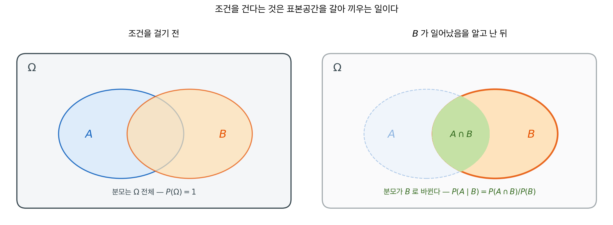
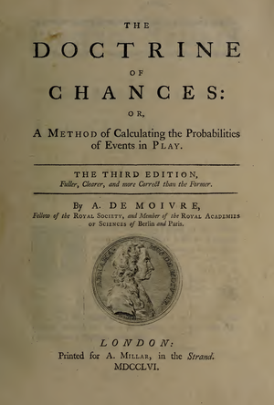
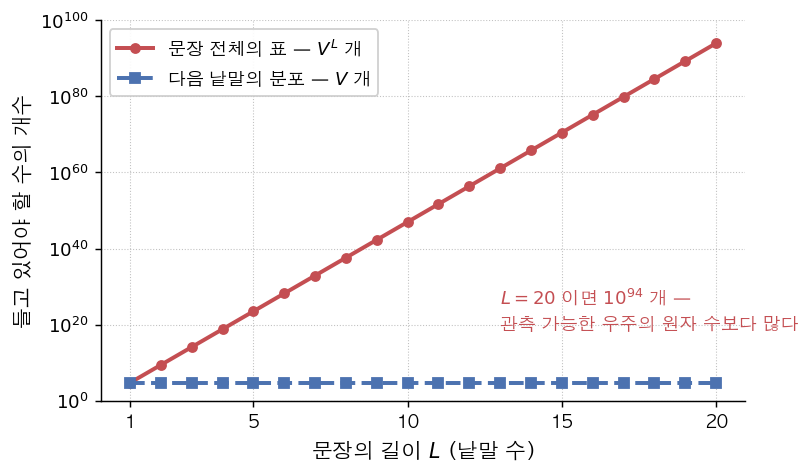
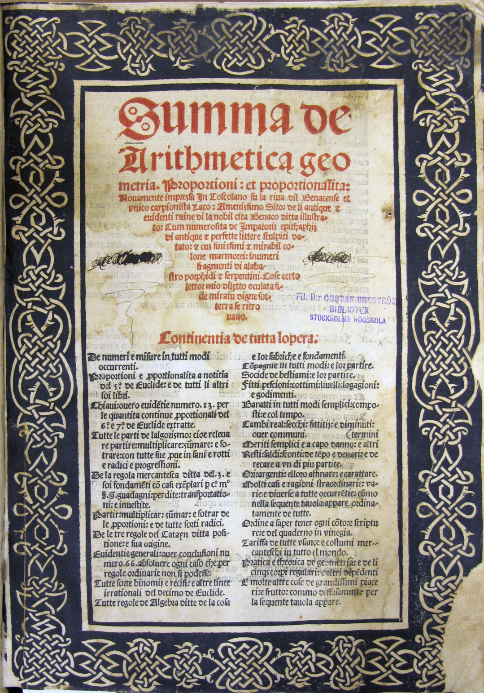
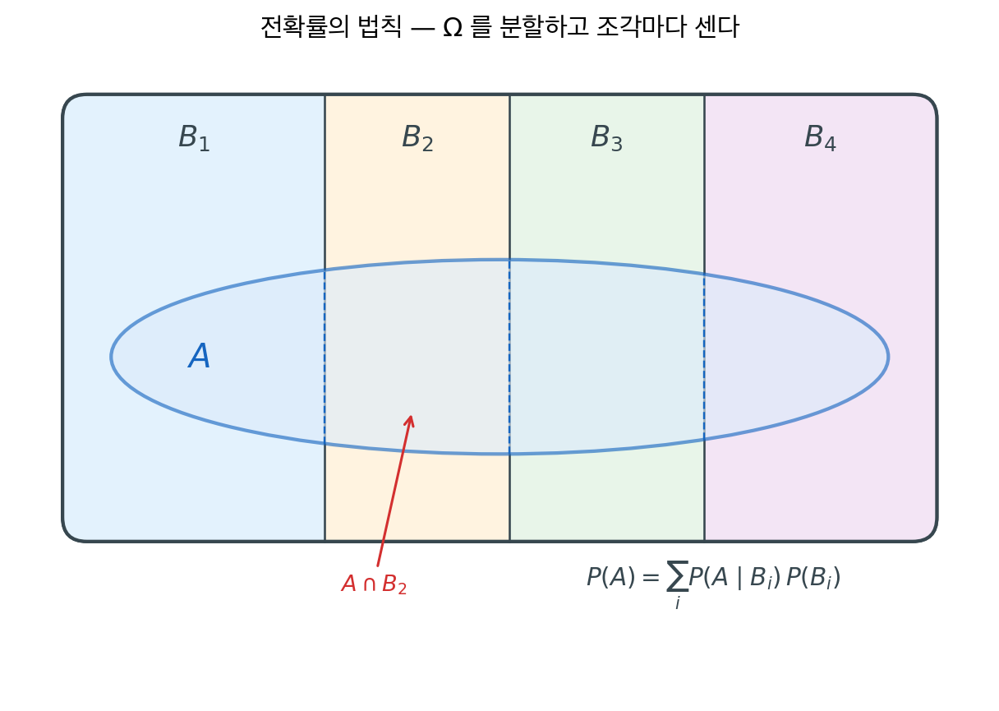
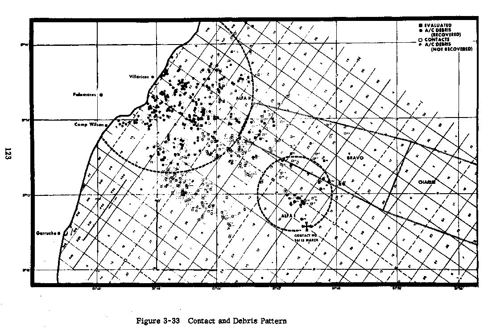
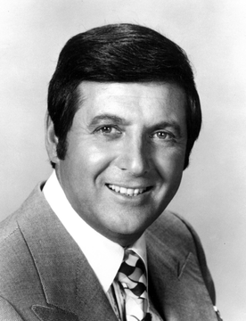

# 조건부확률

## 개요

무언가를 알게 되면 확률이 달라진다. 카드가 그림 카드라는 사실을 알면 그것이 킹일 확률이 달라지고, 검사가 양성이라는 사실을 알면 병에 걸렸을 확률이 달라진다. **조건부확률**은 이 "알게 된 뒤의 확률"을 정확히 정의한다. 확률론에서 가장 널리 쓰이는 도구이며, 베이즈 정리·통계적 추론·불확실성 아래의 의사결정이 모두 여기서 출발한다.

이 절은 한 정의와 두 정리로 이루어진다. 조건부확률이 무엇인지(정의 1), 두 단계로 이어지는 시행의 확률을 어떻게 곱하는지(정리 1), 여러 갈래로 갈라지는 경우를 어떻게 더하는지(정리 2)이다.

---

## 1. 표본공간을 좁히면 확률이 달라진다

조건을 건다는 것은 **표본공간을 갈아 끼우는 일**이다. $B$가 일어났음을 알면 $B$ 바깥의 결과는 더 이상 가능하지 않으므로 버리고, 남은 것들의 확률 합이 다시 1이 되도록 척도를 맞춘다.

<div class="defn" markdown>

### 정의 1. 조건부확률 { .dfn }

$P(B) > 0$일 때, 사건 $B$가 주어졌을 때 사건 $A$의 **조건부확률**은 다음과 같다.

$$
P(A \mid B) = \frac{P(A \cap B)}{P(B)}
$$

$B$에 배정된 전체 확률 가운데 $A$에도 속하는 부분의 비율이다. 분모가 $P(\Omega) = 1$이 아니라 $P(B)$라는 점이 전부다.

</div>

"갈아 끼운다"는 말을 그림으로 보면 이렇다.



왼쪽에서는 모든 확률을 $\Omega$ 전체에 대한 비율로 잰다. 오른쪽에서 $B$가 일어났음을 알고 나면 $B$ 바깥은 더 이상 가능하지 않으므로 흐려지고, 남은 세계는 $B$뿐이다. 그 안에서 $A$에 해당하는 부분은 $A$ 전체가 아니라 **$A \cap B$**이며, 이것을 새 전체인 $P(B)$로 나눈 것이 $P(A \mid B)$다. $B$로 나누는 일이 곧 "$B$의 확률이 1이 되도록 눈금을 다시 매기는" 일이다.

이 정의는 새로운 확률을 하나 만들어 낸다. $P(\cdot \mid B)$는 그 자체로 확률의 세 공리를 모두 만족하는 **어엿한 확률측도**다(연습문제 4). 조건을 건 뒤에도 확률론의 모든 규칙을 그대로 쓸 수 있는 이유가 여기에 있다.

<div class="exbox" markdown>

**보기 1.** <span class="diff easy" title="쉬움"></span> 카드 뽑기. 표준 52장 한 벌에서 한 장을 뽑는다. $A$ = "킹", $B$ = "그림 카드(J, Q, K)"라 하자.

</div>

??? success "풀이"
    $$
    P(A \mid B) = \frac{P(A \cap B)}{P(B)} = \frac{4/52}{12/52} = \frac{4}{12} = \frac{1}{3}
    $$

    모든 킹이 그림 카드이므로 $A \cap B = A$이다. 그림 카드라는 사실을 알면 가능성이 12장으로 좁혀지고, 그중 4장이 킹이다.

<div class="exbox" markdown>

**보기 2.** <span class="diff easy" title="쉬움"></span> 주사위 두 개. $A$ = "합이 8", $B$ = "첫 주사위가 3"이라 하자. $P(B) = 1/6$이고 $A \cap B = \{(3,5)\}$이므로 $P(A \cap B) = 1/36$이다.

</div>

??? success "풀이"
    $$
    P(A \mid B) = \frac{1/36}{1/6} = \frac{1}{6}
    $$

모의실험으로 확인해 보자.

<div class="exbox" markdown>

**보기 3.** <span class="diff easy" title="쉬움"></span> 주사위로 조건부확률 확인하기. 보기 2의 $A$ = "합이 8", $B$ = "첫 주사위가 3"을 10만 번 모의실험으로 세어 본다.

**(1)** 10만 번 중 $B$가 일어나는 횟수의 기댓값은 얼마인가. 그 횟수로 나눈 비율 추정값의 **몬테카를로 표준오차**를 적으시오.

**(2)** 모의실험으로 $P(A \mid B)$를 세어 보기 2의 $1/6$과 견주고, 차이가 (1)의 오차로 설명되는지 판정하시오.

</div>

??? success "풀이"

    **(1) 이론값.** 보기 2에서 $P(A \mid B) = 1/6 = 0.16667$이다. 조건부확률을 세는 일은 **$B$가 일어난 시행만 모아 놓고** 그 안에서 $A$의 비율을 재는 것이므로, 유효 표본크기는 10만이 아니라 $B$가 일어난 횟수다. 그 횟수는 $\text{Binomial}(100000, 1/6)$을 따르므로

    $$
    E[n_B] = \frac{100000}{6} = 16667, \qquad
    \operatorname{sd}(n_B) = \sqrt{100000 \cdot \tfrac16 \cdot \tfrac56} = 118
    $$

    이다. $n_B$를 고정하고 보면 추정값 $\hat p = n_{A \cap B}/n_B$는 성공확률 $1/6$인 $n_B$번의 시행에서 나온 비율이므로

    $$
    \operatorname{se}(\hat p) = \sqrt{\frac{p(1-p)}{n_B}}
    = \sqrt{\frac{(1/6)(5/6)}{16667}} = 0.00289
    $$

    다. **셋째 자리까지만 믿을 수 있다는 뜻이다.** 10만 번을 돌렸는데도 그런데, 분모가 10만이 아니라 1만 6천이기 때문이다. 조건을 좁히면 자료도 그만큼 줄어든다.

    **(2) 모의실험.** 코드가 하는 일이 정의 그대로임에 주목하라. `mask_B`로 표본공간을 좁히고, 그 안에서 $A$가 일어난 비율을 센다.

    ```python
    import numpy as np

    def conditional_probability_simulation(n_simulations=100_000):
        """주사위 두 개로 조건부확률을 모의실험한다.

        조건부확률을 계산하는 대신 **직접 세어 본다.**
        P(A|B) = (A와 B가 모두 일어난 횟수) / (B가 일어난 횟수)
        라는 정의를 그대로 코드로 옮긴 것이다.
        """
        np.random.seed(42)

        # randint(1, 7)은 1 이상 7 미만, 즉 1~6을 뽑는다
        die1 = np.random.randint(1, 7, size=n_simulations)
        die2 = np.random.randint(1, 7, size=n_simulations)
        total = die1 + die2

        # 여기가 조건부확률의 핵심이다. 표본공간을 "첫 주사위가 3인 시행"으로 좁힌다.
        mask_B = die1 == 3                            # 조건 B가 성립한 시행들
        mask_A_and_B = (die1 == 3) & (total == 8)     # 그중 A도 성립한 시행들

        # 전체 10만이 아니라 **좁혀진 표본공간의 크기**로 나눈다.
        # 이 한 줄이 P(A|B) = P(A∩B)/P(B) 를 실행한 것이다.
        p_conditional = mask_A_and_B.sum() / mask_B.sum()
        print(f"Simulated P(sum=8 | die1=3) = {p_conditional:.4f}")
        print(f"Theoretical P(sum=8 | die1=3) = {1/6:.4f}")

        # 분모가 몇인지, 그래서 오차가 얼마인지 함께 본다.
        n_B, n_AB = int(mask_B.sum()), int(mask_A_and_B.sum())
        se = np.sqrt((1/6) * (5/6) / n_B)
        print(f"n_B = {n_B:,} (기댓값 {n_simulations/6:,.0f}),  n_AB = {n_AB:,}")
        print(f"se = {se:.5f},  차이 = {p_conditional - 1/6:+.5f}"
              f"  ({(p_conditional - 1/6) / se:+.2f} se)")

    conditional_probability_simulation()
    ```

    출력:

    ```
    Simulated P(sum=8 | die1=3) = 0.1705
    Theoretical P(sum=8 | die1=3) = 0.1667
    n_B = 16,390 (기댓값 16,667),  n_AB = 2,795
    se = 0.00291,  차이 = +0.00386  (+1.33 se)
    ```

    **맞는다.** 모의값 $0.1705$가 참값 $0.16667$에서 $+0.0039$ 어긋나 있는데, 그것은 표준오차 $0.0029$의 $1.33$배다. 이 정도 어긋남은 열 번에 두 번쯤 나오는 흔한 일이다. 참값이 소수 셋째 자리에서 비껴 보이는 것은 **난수 때문이지 식이 틀려서가 아니다.**

    $n_B = 16{,}390$이 기댓값 $16{,}667$보다 $277$ 작은 것도 같은 성질이다. $\operatorname{sd}(n_B) = 118$이므로 $-2.3$ 표준편차에 해당한다. 조건 $B$ 자체가 몇 번 일어나는지도 난수에 맡긴 양이며, 이 변동이 다시 $\hat p$의 분모를 흔든다.

---

## 2. 두 단계 시행과 확률나무

정의의 양변에 $P(B)$를 곱하면 방향이 뒤집힌다. 조건부확률을 *구하는* 식이 결합확률을 *만드는* 식이 된다. 이것이 두 단계로 이어지는 시행을 다루는 표준 도구다.

<div class="thmbox" markdown>

### 정리 1. 곱셈 규칙 — 경로의 곱 { .thm }

$$
P(A \cap B) = P(A \mid B)\,P(B) = P(B \mid A)\,P(A)
$$

세 개 이상의 사건으로 이어지면 **연쇄 법칙**이 된다.

$$
P(A_1 \cap A_2 \cap \cdots \cap A_n) = \prod_{i=1}^{n} P(A_i \mid A_1, \ldots, A_{i-1})
$$

</div>

??? proof "증명"

    $P(B) > 0$이면 정의 1 에 $P(B)$를 곱해

    $$
    P(A \mid B)\,P(B) = \frac{P(A \cap B)}{P(B)} \cdot P(B) = P(A \cap B)
    $$

    를 얻는다. $A$와 $B$의 역할을 바꾸면 $P(B \mid A)P(A) = P(A \cap B)$이므로 두 곱이 같다.

    **연쇄 법칙은 $n$에 대한 귀납이다.** $n = 2$는 위에서 본 곱셈 규칙이다. $n$에서 성립한다고 가정하고 $B = A_1 \cap \cdots \cap A_n$으로 두면 곱셈 규칙 한 번으로

    $$
    P(B \cap A_{n+1}) = P(A_{n+1} \mid B)\,P(B)
    = P(A_{n+1} \mid A_1, \ldots, A_n) \prod_{i=1}^{n} P(A_i \mid A_1, \ldots, A_{i-1})
    $$

    이 되어 $n+1$에서도 성립한다. $\square$

곱셈 규칙은 **확률나무**로 읽으면 명확해진다. 나무의 각 가지에 조건부확률을 적고, 뿌리에서 잎까지 한 경로를 따라 **곱하면** 그 경로의 확률이 된다.

```
             ┌─ 2번째 에이스   3/51 ──→  경로 확률 = (4/52)(3/51)
   1번째 에이스 ─┤
    4/52     └─ 2번째 비에이스 48/51 ──→ (4/52)(48/51)
  ─┤
   1번째 비에이스 ┌─ 2번째 에이스   4/51 ──→ (48/52)(4/51)
    48/52    ─┤
             └─ 2번째 비에이스 47/51 ──→ (48/52)(47/51)
```

<div class="storybox" markdown>

**그림으로 보는 통계학 1.** 곱셈정리가 활자로 놓인 자리

<figure markdown>
  { width=260 align=right }
  <figcaption markdown>아브라암 드무아브르, 『The Doctrine of Chances』 제 $3$ 판. 런던, $1756$ 년. 표제지에 「THE THIRD EDITION」과 발행 연도 「MDCCLVI」가 찍혀 있다. *(Wikimedia Commons, PD-old-100-expired)*</figcaption>
</figure>

**정리 1** 은 조건부확률의 정의를 곱셈 꼴로 옮겨 쓴 것뿐이라 새로울 것이 없어 보인다. 그런데 이 주장이 문장으로 적힌 자리를 거슬러 찾아가면 오른쪽 책이 나온다. 아브라암 드무아브르($1667$–$1754$)의 『The Doctrine of Chances』, 「우연을 셈하는 법」쯤 되는 제목이다. 그림은 그가 죽고 두 해 뒤에 나온 제 $3$ 판의 표제지로, 런던에서 A. 밀러(A. Millar)가 찍었다.

드무아브르는 위그노 박해를 피해 프랑스에서 영국으로 건너간 사람이라 이 책을 영어로 썼다. $1718$ 년에 나온 초판은 확률론의 첫 교과서로 꼽힌다.

책의 서론 제 $7$ 쪽에는 이런 문장이 있다. 「서로 딸린 두 사건이 함께 일어날 확률은, 그중 하나가 일어날 확률에, 첫째가 일어난 것으로 쳤을 때 다른 하나가 일어날 확률을 곱한 것이다. 그리고 같은 규칙은 사건이 몇 개가 되든 그대로 넓혀진다.」 앞 문장이 **정리 1** 의 곱셈 규칙이고, 뒤 문장이 그 아래 **연쇄 법칙**이다.

드무아브르가 그 자리에서 든 예는 이 절의 보기 4 와 모양이 같다. 카드 $13$ 장이 한 더미에 있고, 에이스를 먼저 뽑고 이어서 듀스를 뽑으려 한다. 에이스가 첫 자리에 올 확률은 $\frac1{13}$ 이다. 듀스가 둘째 자리에 올 확률도 따로 떼어 놓고 보면 $\frac1{13}$ 이지만, 에이스를 이미 빼냈다면 더미에 $12$ 장만 남으므로 그 확률은 $\frac1{12}$ 로 바뀐다. 그래서 두 사건은 서로 딸려 있고, 둘 다 일어날 확률은

$$
\frac1{13}\times\frac1{12}=\frac1{156}
$$

이 곱셈이 그대로 활자로 인쇄되어 있다. 위의 확률나무에서 둘째 가지의 분모를 $52$ 에서 $51$ 로 줄이는 일 — 한 번 꺼낸 뒤 남은 것만 세는 일 — 을 드무아브르는 $18$ 세기 중반에 카드로 했다.

*확인한 곳 — 드무아브르 『The Doctrine of Chances』 제$3$ 판(런던, A. Millar, $1756$) — [원문 스캔](https://archive.org/details/doctrineofchance00moiv) 에서 직접 폈다: 서론 제 $8$ 항 $7$ 쪽에 카드 $13$ 장의 에이스·듀스 보기와 $\frac{1}{13}\times\frac{1}{12}=\frac{1}{156}$ 이 있고, 위에 옮긴 문장이 바로 뒤에 「From whence it may be inferred, that the Probability of the happening of two Events dependent, is the product of…」로 이어진다(제 $9$ 항 도중에 $8$ 쪽으로 넘어간다) · [Commons 표제지](https://commons.wikimedia.org/wiki/File:Abraham_de_Moivre_-_Doctrine_of_Chance_-_1756.jpg) 에서 출판사와 연도를 직접 읽었다*

</div>

<div class="aibox" markdown>

**AI로 보는 통계학 1.** 문장 하나의 확률을 낱말 하나씩 쪼개는 법

정리 1 의 연쇄 법칙

$$
P(A_1\cap\cdots\cap A_n)=P(A_1)\,P(A_2\mid A_1)\cdots P(A_n\mid A_1\cap\cdots\cap A_{n-1})
$$

은 비복원추출에서 남은 개수를 세려고 쓴 식이었다. 요즘 언어모델은 이 식 하나 위에
통째로 서 있다.

모델에게 묻고 싶은 것은 「이 문장이 얼마나 그럴듯한가」, 곧 문장 전체의 확률이다.
그런데 그것을 표로 들고 있을 수가 없다. 낱말이 $V$ 가지이고 길이가 $L$ 이면 가능한
문장이 $V^{L}$ 가지인데, $V$ 가 몇 만이고 $L$ 이 스물만 되어도 그 수가 우주의 원자
수를 넘는다.

그래서 연쇄 법칙으로 **쪼갠다.** $A_k$ 를 「$k$ 번째 낱말이 $w_k$ 인 사건」으로 두면

$$
P(w_1w_2\cdots w_n)=P(w_1)\,P(w_2\mid w_1)\cdots P(w_n\mid w_1\cdots w_{n-1})
$$

이고, 모델이 실제로 내놓는 것은 오른쪽 인수 **하나**뿐이다 — 지금까지의 낱말이
주어졌을 때 **다음 낱말의 조건부분포**. 글을 한 낱말씩 이어 붙이는 일은 이 곱을
왼쪽에서 오른쪽으로 한 인수씩 계산해 가는 일 그대로다.

여기서 중요한 것은 이 쪼개기가 **근사가 아니라 항등식**이라는 점이다. 조건부확률의
정의에서 바로 나오므로 아무것도 잃지 않는다. 낱말 $4$ 가지로 길이 $3$ 인 문장을
만들어 확인해 보자.

```python
import numpy as np

rng = np.random.default_rng(0)                   # 씨앗을 고정해 늘 같은 값이 나오게
V, L = 4, 3                                      # 낱말 4 가지, 길이 3 인 문장
joint = rng.random((V, V, V))
joint /= joint.sum()                             # 문장 전체의 확률분포 P(w1,w2,w3)

# 정리 1 의 연쇄 법칙에 나오는 오른쪽 인수들 — 모델이 내놓는 것은 이것뿐이다
p1 = joint.sum(axis=(1, 2))                      # P(w1)
p2 = joint.sum(axis=2) / p1[:, None]             # P(w2 | w1)
p3 = joint / joint.sum(axis=2)[:, :, None]       # P(w3 | w1, w2)

for w in [(0, 1, 2), (3, 3, 0), (2, 0, 1)]:
    chain = p1[w[0]] * p2[w[0], w[1]] * p3[w[0], w[1], w[2]]
    assert abs(chain - joint[w]) < 1e-15         # 근사가 아니라 항등식이다
    print(f"문장 {w} :  결합 {joint[w]:.8f}   연쇄 {chain:.8f}")

print(f"조건부분포의 합 = {p3[2, 0].sum():.8f}")  # 다음 낱말의 분포는 늘 합이 1
```

실행하면 다음이 나온다.

```text
문장 (0, 1, 2) :  결합 0.01920148   연쇄 0.01920148
문장 (3, 3, 0) :  결합 0.01280504   연쇄 0.01280504
문장 (2, 0, 1) :  결합 0.02283684   연쇄 0.02283684
조건부분포의 합 = 1.00000000
```

세 문장 모두 소수점 여덟째 자리까지 똑같다. 표 하나를 통째로 들고 있는 것과, 인수
셋을 차례로 곱하는 것이 **같은 수**를 준다는 뜻이다. 마지막 줄은 각 단계에서 나오는
것이 제대로 된 확률분포임을 확인한 것이다.

<figure markdown>
  { width=640 }
  <figcaption markdown>낱말이 $5$ 만 가지일 때, 문장 전체의 분포를 표로 들고 있으려면 길이 $20$ 에서 $10^{94}$ 개의 수가 필요하다. 연쇄로 쪼개면 한 번에 내놓아야 하는 것은 언제나 $5$ 만 개뿐이라 길이가 늘어도 가로선으로 머문다.</figcaption>
</figure>

다만 연쇄 법칙이 공짜로 주는 것은 **쪼갤 권리**뿐이다. 쪼갠 각 인수
$P(w_n\mid w_1\cdots w_{n-1})$ 의 참값은 여전히 아무도 모르고 모델이 어림할 뿐인데,
곱해지는 인수가 문장 길이만큼 늘어나므로 인수 하나하나의 작은 어긋남이 긴 글에서는
쌓인다.

</div>

<div class="exbox" markdown>

**보기 4.** <span class="diff easy" title="쉬움"></span> 에이스 두 장 연속. 52장에서 비복원으로 두 장을 뽑아 둘 다 에이스일 확률은 맨 위 경로다.

</div>

??? success "풀이"
    $$
    P(A_1 \cap A_2) = P(A_1)\,P(A_2 \mid A_1) = \frac{4}{52} \cdot \frac{3}{51} = \frac{12}{2652} \approx 0.0045
    $$

    두 번째 가지의 확률이 $4/52$가 아니라 $3/51$인 것이 핵심이다. **첫 단계의 결과가 두 번째 단계의 조건을 바꾼다.** 비복원추출, 마르코프 연쇄, 순차적 베이즈 갱신이 모두 이 구조 위에 서 있다.

<div class="storybox" markdown>

**그림으로 보는 통계학 2.** 모든 것을 모아 적은 책에, 풀지 못한 물음 하나

<figure markdown>
  { width=360 align=right }
  <figcaption markdown>루카 파촐리 『산술·기하·비례·비례론 집성』 표제지. 붉은 제목 아래 「**Continentia de tutta lopera**」(책 전체의 차례)가 두 단으로 이어진다 — 산술·비례·유클리드·대수에 상인의 셈법까지 들어 있고, 베네치아식 장부를 다루는 줄도 보인다. 이 그림은 처음 나온 $1494$ 년 판이 아니라 $1523$ 년에 토스콜라노에서 **다시 찍은 판**의 표제지다. *(Stockholms Universitetsbibliotek 촬영, CC BY 2.0)*</figcaption>
</figure>

위 확률나무가 말하는 것은 **앞 단계의 결과가 뒤 단계의 조건을 바꾼다**는 것이다. 그 나무
하나로 답이 정해지는 오래된 물음이 있다 — 경기를 끝내지 못하고 중단했을 때 걸어 둔 상금을
어떻게 나눌 것인가. 답은 **앞으로 이길 확률의 비**다. 당연해 보이지만, 활자로 처음 나온
답은 그렇지 않았다.

루카 파촐리($1445$–$1517$)가 $1494$ 년에 낸 『수마』는 그때까지 알려진 수학을 모두
모은 육백 쪽짜리 책이다. 거기에 중단된 경기 문제가 실려 있고, 그가 내놓은 답은
**이미 딴 점수의 비로 나누라**는 것이었다.

왜 안 되는지는 나무를 두 단만 그려 보면 바로 보인다. $\mathrm A$ 가 $1$ 승만 더 하면
끝나고 $\mathrm B$ 는 $2$ 승이 남았다고 하자. 남은 경기는 많아야 두 판이고, 네 가지
갈림 가운데 $\mathrm A$ 가 우승하는 것이 셋이므로 공정한 몫은 $3:1$ 이다. 그런데
점수가 $2:1$ 이었다면 파촐리의 방법은 $2:1$ 로 나눈다. **이긴 판의 수가 같아도 남은
판의 수가 다르면 사정이 전혀 다르다**는 것을 셈에 넣지 못한 것이다. 조건을 걸어야 할
자리에서 조건을 걸지 않았다는 뜻이고, 정의 1 이 하는 일이 바로 그 자리를 만들어 주는
것이다.

그 뒤로도 타르탈리아를 비롯한 여럿이 손을 댔지만 답을 맞히지 못했고, 물음은 백육십
해를 살아남았다. $1654$ 년에 파스칼과 페르마가 편지를 주고받으며 「**앞으로 경기가
어떻게 이어질 수 있었는가**」를 세기 시작하면서 풀렸고, 그 편지들이 확률론의 시작으로
꼽힌다.

같은 책에 복식부기를 다룬 대목이 들어 있어서, 파촐리는 회계의 아버지로도 불린다.
**회계를 세운 책이 확률론의 물음을 품고 있었던 셈**인데, 두 가지가 한 권에 같이 있는
것이 우연은 아니다. 돈을 어떻게 적고 어떻게 나눌 것인가는 그때 상인들에게 같은
물음이었다.

_확인한 곳 — 표제지는 [Commons 의 『수마』 표제지](https://commons.wikimedia.org/wiki/File:Titelbladet_till_%22Summa_de_arithmetica_...%22.jpg) (**CC BY 2.0**, 촬영 Stockholms Universitetsbibliotek, 소장본은 Gustaf Eneström 문고) 이고, 파일 설명이 **$1523$ 년 판**이라고 밝히고 있어 본문에도 그대로 적었다. 붉은 제목과 「Continentia de tutta lopera」는 그림에서 직접 읽었다 · 생몰년($1445$ 산세폴크로 — $1517$ 같은 곳), 『수마』($1494$)가 육백 쪽에 당시 수학을 모은 책이고 복식부기 논고를 담고 있다는 것, 그리고 **「『수마』는 점수 분배 문제도 다루었으나 그가 내놓은 풀이는 틀렸다」**는 것은 [MacTutor 「Luca Pacioli」](https://mathshistory.st-andrews.ac.uk/Biographies/Pacioli/) · 파촐리가 이미 딴 점수의 비로 나누었다는 것, 타르탈리아의 시도, $1654$ 년 파스칼–페르마의 서신이 「경기가 이어질 수 있었던 경우」를 센 것은 [Wikipedia 「Problem of points」](https://en.wikipedia.org/wiki/Problem_of_points) · $1$ 승과 $2$ 승이 남았을 때의 $3:1$ 은 이 쪽에서 직접 세어 보았다_

</div>

---

## 3. 원인을 나누어 전체를 더하기

경로를 곱해서 얻었으니, 이제 여러 경로를 더할 차례다. 어떤 사건이 서로 다른 여러 경로로 일어날 수 있다면, 각 경로의 확률을 계산해 모두 더하면 된다.

<div class="thmbox" markdown>

### 정리 2. 전확률의 법칙 — 경로의 합 { .thm }

$B_1, \ldots, B_n$이 표본공간 $\Omega$의 **분할**을 이루면(서로 배반이고 합집합이 $\Omega$이면), 임의의 사건 $A$에 대해

$$
P(A) = \sum_{i=1}^{n} P(A \mid B_i)\,P(B_i)
$$

이다. 각 항 $P(A \mid B_i)P(B_i)$가 정리 1 의 경로 확률이고, 전체 확률은 그 **합**이다.

</div>

??? proof "증명"

    $B_1, \ldots, B_n$이 분할이므로 $A$는

    $$
    A = A \cap \Omega = A \cap \left(\bigcup_{i=1}^{n} B_i\right) = \bigcup_{i=1}^{n} (A \cap B_i)
    $$

    로 쪼개진다. $B_i$들이 서로 배반이면 $A \cap B_i$들도 서로 배반이므로 유한가법성이 적용되고, 각 항에 정리 1 의 곱셈 규칙을 쓰면

    $$
    P(A) = \sum_{i=1}^{n} P(A \cap B_i) = \sum_{i=1}^{n} P(A \mid B_i)\,P(B_i)
    $$

    이다. 첫 등호가 **분할**이고 둘째 등호가 **곱셈 규칙**이다. 전확률의 법칙은 이 둘을 이어 붙인 것에 지나지 않는다. $\square$

    분할이 가산무한개여도 같다. 유한가법성 대신 공리 (3)을 쓰면 되며, $P(B_i) = 0$인 항은 $P(A \mid B_i)$가 정의되지 않으므로 $P(A \cap B_i) = 0$으로 읽어 합에서 빼면 된다.

그림으로 보면 "쪼개고 더한다"가 눈에 들어온다.



분할이라는 말은 상자를 빈틈없이, 겹치지 않게 나누었다는 뜻이다. 그러면 사건 $A$도 자동으로 $A \cap B_1, \ldots, A \cap B_n$으로 쪼개지고, 이들 역시 서로소이므로 조각마다 따로 재서 더해도 된다. 이것이 위 증명의 내용 전부다.

이 정리의 쓸모는 방향에 있다. $P(A)$를 직접 구하기는 어려운데 각 시나리오 $B_i$ 안에서는 쉬운 경우가 흔하다. 그럴 때 문제를 시나리오별로 쪼개고 다시 합친다.

<div class="storybox" markdown>

**그림으로 보는 통계학 3.** 바다를 칸으로 나누고 하나씩 지워 나간 기록

<figure markdown>
  { width=700 }
  <figcaption markdown>미국 국방핵국이 펴낸 $1975$ 년 보고서의 「그림 $3$-$33$ 접촉과 잔해의 분포」. 바다가 ALFA·ALFA I·BRAVO·CHARLIE 로 나뉘어 있고, 범례는 점을 「평가 완료」·「건져 올린 기체 잔해」·「접촉」·「건져 올리지 못한 기체 잔해」로 가른다. 아래쪽 십자 옆에 「$15$ MARCH」가 적혀 있다. *(미국 공군 자료, PD-USGov)*</figcaption>
</figure>

정리 2 를 쓰려면 먼저 **분할이 있어야** 한다. $B_1,\ \dots,\ B_n$ 이 없으면 더할 것도 없다. 바다에서 물건 하나를 찾을 때 사람들이 맨 먼저 한 일이 그 분할을 그리는 일이었다.

$1966$ 년 $1$ 월 $17$ 일, 스페인 팔로마레스 상공에서 폭격기와 급유기가 부딪쳐 수소폭탄 넷이 떨어졌다. 셋은 땅에서 찾았고 하나는 바다로 들어갔다. 사진은 그 바다를 그린 공식 보고서의 도판이다. 구역을 나눈 큰 칸들, 배가 훑고 지나간 빗금, 그리고 음파로 잡았거나 건져 올린 것 하나하나가 점으로 찍혀 있다.

칸을 나누었으면 칸마다 「여기 있을 법함」을 수로 적는다. 비행기가 지나간 길, 물살, 떨어지는 것을 보았다는 어부의 말 같은 것을 확률로 바꾼 값이다. 그러고 나서 한 칸을 훑는다. $B_i$ 를 「폭탄이 $i$ 번 칸에 있다」, $F$ 를 「훑어서 찾아낸다」라 하면, 한 번 훑어 찾을 확률은 정리 2 그대로

$$
P(F)=\sum_{i=1}^{n}P(F\mid B_i)\,P(B_i)
$$

이다. 앞의 $P(F\mid B_i)$ 는 「거기 있다면 과연 찾아낼 수 있는가」로 깊이와 바닥과 장비가 정하고, 뒤의 $P(B_i)$ 는 「거기 있을 법한가」다. 공식이 말해 주는 것은 이 둘이 **곱해져서 더해진다**는 것뿐인데, 그 한 줄이 그대로 탐색 계획이 된다. 있을 법하지만 훑기 어려운 칸과, 훑기는 쉽지만 있을 법하지 않은 칸 가운데 어디를 먼저 갈지가 곱의 크기로 정해지기 때문이다.

훑고도 못 찾으면 그 칸의 수를 낮추고 나머지 칸의 수를 올린다. **헛걸음도 정보다.** 이렇게 분할을 깔고 확률을 고쳐 가며 찾는 방법을 베이즈 탐색이라 부르고, 이 사건이 그것이 통한 이른 사례로 꼽힌다. 사진에 찍힌 수백 개의 점은 대부분 「아니었던 자리」이고, 그 아님 하나하나가 남은 칸의 확률을 조금씩 올려 주었다. 확률을 고쳐 적는 그 단계가 다음 절의 [베이즈 정리](bayes.md)다.

폭탄은 결국 바닷속에서 다시 보였고 $4$ 월 $7$ 일에 끌어올렸다. 깊이는 $880$ 미터쯤이었다. 정리 2 가 하는 일은 모르는 것을 아는 것들로 쪼개어 적을 **자리를 만들어 주는** 것인데, 쪼개 놓고 나면 찾지 못한 날조차 수를 바꾼다.

_확인한 곳 — 그림은 [Commons 「Palomares ADA955702 Page 124.jpg」](https://commons.wikimedia.org/wiki/File:Palomares_ADA955702_Page_124.jpg), 미국 국방핵국이 $1975$ 년에 펴낸 보고서(DTIC AD-A$955702$)의 한 쪽이며 라이선스 틀은 `PD-USGov-Military-Air Force` 다. 구역 이름 ALFA·ALFA I·BRAVO·CHARLIE, 범례의 네 갈래, 그림 제목 「Contact and Debris Pattern」, 십자 옆의 「$15$ MARCH」는 **사진에서 직접 읽었다**. 십자 옆 접촉 번호도 적혀 있으나 스캔이 거칠어 또렷하지 않아 옮기지 않았다 · 사고 날짜($1966$ 년 $1$ 월 $17$ 일), 폭탄 넷 가운데 셋은 땅·하나는 바다, 끌어올린 날($4$ 월 $7$ 일)과 깊이(약 $880\ \mathrm{m}$), 어부 프란시스코 시모 오르츠가 떨어지는 것을 보았다는 것은 [Wikipedia 「1966 Palomares incident」](https://en.wikipedia.org/wiki/1966_Palomares_incident) · ⚠️ **바닷속에서 폭탄을 처음 찾은 날은 자료마다 갈린다** — 그림에는 「$15$ MARCH」로 적힌 접촉이 표시되어 있는데 위키백과는 $3$ 월 $17$ 일이라 적는다. 어느 쪽인지 가리지 못해 본문에서는 그 날을 적지 않았다 · 가설을 세워 칸마다 확률을 주고 훑은 뒤 고쳐 가는 절차와, 이 사건이 그 방법이 통한 사례로 꼽힌다는 것은 [Wikipedia 「Bayesian search theory」](https://en.wikipedia.org/wiki/Bayesian_search_theory)_

</div>

<div class="exbox" markdown>

**보기 5.** <span class="diff easy" title="쉬움"></span> 의학 검사. 어떤 질병이 인구의 1%에 발생한다. 검사의 민감도는 95%($P(\text{양성} \mid \text{질병}) = 0.95$), 특이도는 90%($P(\text{음성} \mid \text{질병 없음}) = 0.90$)다. 검사가 양성일 확률은 얼마인가?

"양성"은 두 경로로 도달할 수 있다. 병이 있으면서 맞게 나온 경우와, 병이 없으면서 잘못 나온 경우다.

</div>

??? success "풀이"
    $$
    \begin{aligned}
    P(\text{양성}) &= P(\text{양성} \mid \text{질병})\,P(\text{질병}) + P(\text{양성} \mid \text{질병 없음})\,P(\text{질병 없음}) \\
    &= 0.95 \times 0.01 + 0.10 \times 0.99 \\
    &= 0.0095 + 0.099 = 0.1085
    \end{aligned}
    $$

!!! warning "두 번째 항이 첫 번째 항의 열 배다"
    실제로 병이 있는 사람은 1%뿐인데 인구의 **10.85%**가 양성 판정을 받는다. 양성자의 대부분이 건강한 사람인 것이다.

    원인은 두 경로의 **밑변 크기**가 다르다는 데 있다. 병이 있는 1%에서 나오는 참양성은 $0.0095$인 반면, 병이 없는 99%에서 나오는 거짓양성은 $0.099$다. 검사의 정확도가 아무리 높아도 드문 병에서는 거짓양성이 참양성을 압도한다.

    "양성이면 병일 확률은 얼마인가"라는 반대 방향의 물음에 답하려면 다음 절의 **[베이즈 정리](bayes.md)**가 필요하다. 여기서 계산한 $P(\text{양성}) = 0.1085$가 그 식의 분모가 된다.

<div class="exbox" markdown>

**보기 6.** <span class="diff easy" title="쉬움"></span> 전확률의 법칙 모의실험. 보기 5의 설정을 100만 명에게 적용한다.

**(1)** 전확률의 법칙이 예측하는 $P(\text{양성})$과 **두 경로 각각의 기여**를 적고, 100만 명 모의실험에서 양성률 추정값의 몬테카를로 표준오차를 구하시오.

**(2)** 모의실험으로 (1)의 세 수를 모두 확인하시오.

</div>

??? success "풀이"

    **(1) 이론값.** 보기 5에서 이미 계산했다. 경로가 둘이고 각 경로의 무게는 "그 시나리오의 확률 × 그 시나리오 안에서 양성일 확률"이다.

    $$
    \underbrace{0.95 \times 0.01}_{\text{참양성 } 0.00950}
    \; + \;
    \underbrace{0.10 \times 0.99}_{\text{거짓양성 } 0.09900}
    \; = \; 0.10850
    $$

    모의실험은 이 **세 수를 따로따로** 재현해야 한다. 합만 맞고 쪼갠 몫이 틀리면 우연히 맞은 것이다.

    양성 여부는 사람마다 독립인 베르누이 시행이므로 100만 명에서 양성률 추정값의 표준오차는

    $$
    \operatorname{se} = \sqrt{\frac{0.1085 \times 0.8915}{10^6}} = 0.00031
    $$

    이다. 소수 **넷째 자리까지** 맞아야 하고, 그 이상을 기대해서는 안 된다.

    **(2) 모의실험.**

    ```python
    import numpy as np

    def medical_test_simulation(n_people=1_000_000):
        """전확률의 법칙을 100만 명 모의실험으로 확인한다."""
        np.random.seed(42)

        prevalence = 0.01            # 유병률 P(질병) = 1%
        sensitivity = 0.95           # 민감도 P(양성|질병) = 95%
        false_positive_rate = 0.10   # 위양성률 P(양성|건강) = 10%

        # 1단계: 100만 명 각자가 질병을 가졌는지 정한다(확률 1%)
        has_disease = np.random.rand(n_people) < prevalence

        # 2단계: 검사 결과를 정한다. 여기서 확률이 사람에 따라 달라진다.
        # np.where(조건, 참일 때, 거짓일 때) 로 두 경우를 한 번에 처리한다.
        #   질병이 있으면 95% 확률로 양성
        #   건강하면    10% 확률로 양성
        test_positive = np.where(
            has_disease,
            np.random.rand(n_people) < sensitivity,
            np.random.rand(n_people) < false_positive_rate
        )

        # 전체 양성률. 전확률의 법칙이 예측하는 값과 맞는지 아래에서 비교한다.
        #   P(양성) = P(양성|질병)P(질병) + P(양성|건강)P(건강)
        #           = 0.95*0.01 + 0.10*0.99 = 0.1085
        p_positive = test_positive.mean()
        print(f"Simulated P(positive) = {p_positive:.4f}")
        print(f"Theoretical P(positive) = {0.1085:.4f}")

        # 합만이 아니라 두 경로를 따로 재어 본다.
        tp = (has_disease & test_positive).mean()        # 질병이면서 양성
        fp = (~has_disease & test_positive).mean()       # 건강하면서 양성
        se = np.sqrt(0.1085 * (1 - 0.1085) / n_people)
        print(f"  참양성   {tp:.5f} (이론 0.00950)")
        print(f"  거짓양성 {fp:.5f} (이론 0.09900)")
        print(f"  합       {tp + fp:.5f} (이론 0.10850),  se = {se:.5f},"
              f"  차이 = {p_positive - 0.1085:+.5f}")

    medical_test_simulation()
    ```

    출력:

    ```
    Simulated P(positive) = 0.1085
    Theoretical P(positive) = 0.1085
      참양성   0.00950 (이론 0.00950)
      거짓양성 0.09903 (이론 0.09900)
      합       0.10853 (이론 0.10850),  se = 0.00031,  차이 = +0.00004
    ```

    **세 수가 모두 맞는다.** 합이 $0.10853$으로 이론값에서 $+0.00004$ 어긋나 있고 이는 표준오차 $0.00031$의 $0.1$배에 지나지 않는다. 쪼갠 몫도 참양성 $0.00950$, 거짓양성 $0.09903$으로 각각 $0.00950$과 $0.09900$에 붙어 있다.

    **거짓양성이 참양성의 10.4배**라는 것도 모의실험에서 그대로 읽힌다. 전확률의 법칙은 이 두 덩어리를 더하는 일이고, 다음 절의 베이즈 정리는 거꾸로 **합에서 첫째 덩어리가 차지하는 몫**을 묻는다. 그 몫이 $0.00950/0.10853 = 0.0875$이며, 그것이 보기 5의 경고가 가리키던 수다.

---

## 연습문제

<div class="drillbox" markdown>

**연습문제 1.** <span class="diff easy" title="쉬움"></span>
항아리에 빨간 구슬 4개와 파란 구슬 6개가 있다. 구슬 두 개를 비복원으로 뽑는다. 첫 구슬이 파란색이라는 조건에서 두 번째 구슬이 빨간색일 확률은 얼마인가?

</div>

??? success "풀이"
    $B_1$ = "첫 구슬이 파란색", $R_2$ = "두 번째 구슬이 빨간색"이라 하자.

    파란 구슬 하나를 뽑고 나면 항아리에는 빨간 구슬 4개와 파란 구슬 5개(총 9개)가 남는다. 따라서

    $$
    P(R_2 \mid B_1) = \frac{4}{9}
    $$

    이다.

---

<div class="drillbox" markdown>

**연습문제 2.** <span class="diff easy" title="쉬움"></span>
공정한 주사위 두 개를 굴린다. $A$ = "합이 10 이상", $B$ = "두 주사위 모두 5 이상"이라 하자. $P(A \mid B)$를 계산하라.

</div>

??? success "풀이"
    먼저 사건 $B$ = "두 주사위 모두 5 이상"을 파악한다. 각 주사위가 5 또는 6일 수 있으므로 $B = \{(5,5),(5,6),(6,5),(6,6)\}$이고 $|B| = 4$, $P(B) = 4/36$이다.

    다음으로 $A \cap B$는 $B$의 결과 중 합이 10 이상인 것이다.

    - $(5,5)$: 합 $= 10$ (해당)
    - $(5,6)$: 합 $= 11$ (해당)
    - $(6,5)$: 합 $= 11$ (해당)
    - $(6,6)$: 합 $= 12$ (해당)

    $B$의 네 결과가 모두 합이 $\geq 10$이므로 $A \cap B = B$이고 $P(A \cap B) = 4/36$이다.

    $$
    P(A \mid B) = \frac{P(A \cap B)}{P(B)} = \frac{4/36}{4/36} = 1
    $$

    두 주사위가 모두 5 이상이면 합은 반드시 10 이상이다.

---

<div class="drillbox" markdown>

**연습문제 3.** <span class="diff med" title="중간"></span>
어떤 공장에서 기계 A가 제품의 60%를, 기계 B가 40%를 생산한다. 기계 A의 불량률은 2%이고 기계 B의 불량률은 5%다. 제품 하나를 무작위로 골랐다. 전확률의 법칙을 사용해 그 제품이 불량일 확률을 계산하라.

</div>

??? success "풀이"
    $A$ = "기계 A가 생산", $B$ = "기계 B가 생산", $D$ = "불량"이라 하자. 다음이 주어져 있다.

    $$
    P(A) = 0.60, \quad P(B) = 0.40
    $$

    $$
    P(D \mid A) = 0.02, \quad P(D \mid B) = 0.05
    $$

    전확률의 법칙에 의해

    $$
    P(D) = P(D \mid A) P(A) + P(D \mid B) P(B) = 0.02 \times 0.60 + 0.05 \times 0.40 = 0.012 + 0.020 = 0.032
    $$

    이다. 전체 불량률은 3.2%다.

---

<div class="drillbox" markdown>

**연습문제 4.** <span class="diff med" title="중간"></span>
$P(B) > 0$이면 $P(\cdot \mid B)$가 확률의 세 공리를 만족함을 증명하라. 즉 조건부확률 자체가 제한된 표본공간 위의 타당한 확률측도임을 보여라.

</div>

??? success "풀이"
    $P(\cdot \mid B)$에 대해 세 공리를 확인한다.

    **범위:** 임의의 사건 $A$에 대해 $P(A \cap B) \geq 0$이고 $P(B) > 0$이므로

    $$
    P(A \mid B) = \frac{P(A \cap B)}{P(B)} \geq 0
    $$

    이다. 위쪽은 $A \cap B \subseteq B$에서 나온다. 단조성에 의해 $P(A \cap B) \leq P(B)$이므로

    $$
    P(A \mid B) = \frac{P(A \cap B)}{P(B)} \leq \frac{P(B)}{P(B)} = 1
    $$

    **정규화:** $\emptyset \cap B = \emptyset$이고 $\Omega \cap B = B$이므로

    $$
    P(\emptyset \mid B) = \frac{P(\emptyset)}{P(B)} = 0,
    \qquad
    P(\Omega \mid B) = \frac{P(\Omega \cap B)}{P(B)} = \frac{P(B)}{P(B)} = 1
    $$

    **가산가법성:** $A_1, A_2, \ldots$가 서로 배반이면 $A_1 \cap B, A_2 \cap B, \ldots$도 서로 배반이므로

    $$
    P\!\left(\bigcup_i A_i \mid B\right) = \frac{P\!\left(\bigcup_i (A_i \cap B)\right)}{P(B)} = \frac{\sum_i P(A_i \cap B)}{P(B)} = \sum_i P(A_i \mid B)
    $$

    세 공리가 모두 성립하므로 $P(\cdot \mid B)$는 타당한 확률측도다. $\square$

---

<div class="drillbox" markdown>

**연습문제 5.** <span class="diff med" title="중간"></span>
결합확률에 대한 **연쇄 법칙**은 $P(A_1, A_2, A_3) = P(A_1) P(A_2 \mid A_1) P(A_3 \mid A_1, A_2)$이다. 이를 사용해 표준 52장 카드 한 벌에서 비복원으로 카드 3장을 뽑을 때 $P(\text{하트 3연속})$을 계산하라.

</div>

??? success "풀이"
    $H_i$를 "$i$번째 카드가 하트"라 하자. 52장 한 벌에 하트는 13장이다.

    $$
    P(H_1, H_2, H_3) = P(H_1) P(H_2 \mid H_1) P(H_3 \mid H_1, H_2)
    $$

    $P(H_1) = 13/52 = 1/4$이다.

    하트 한 장을 뽑고 나면 51장 중 하트가 12장이므로 $P(H_2 \mid H_1) = 12/51$이다.

    하트 두 장을 뽑고 나면 50장 중 하트가 11장이므로 $P(H_3 \mid H_1, H_2) = 11/50$이다.

    결합확률: $P(H_1, H_2, H_3) = (1/4)(12/51)(11/50) = 132/10200 = 11/850 \approx 0.0129$.

    하트를 연속 3장 뽑을 확률은 약 1.3%다.

    **일반적인 연쇄 법칙:** $P(A_1, \ldots, A_n) = \prod_{i=1}^n P(A_i \mid A_1, \ldots, A_{i-1})$. 이것이 순차적 확률 모형 — 마르코프 연쇄, 은닉 마르코프 모형, 순차적 베이즈 갱신 — 의 토대다.

---

<div class="drillbox" markdown>

**연습문제 6.** <span class="diff med" title="중간"></span>
**몬티 홀 문제.** 문이 셋인데 하나 뒤에는 자동차가, 둘 뒤에는 염소가 있다. 당신은 1번 문을 골랐다. (각 문 뒤에 무엇이 있는지 아는) 진행자가 3번 문을 열어 염소를 보여주고 바꿀 기회를 준다. 바꿀 때와 그대로 둘 때 이길 확률은 각각 얼마인가?

</div>

??? success "풀이"
    $C_i$를 "자동차가 $i$번 문 뒤에 있다"라 하자($i = 1, 2, 3$에 대해 균등한 사전확률 $P(C_i) = 1/3$). $H_3$을 "진행자가 3번 문을 연다"라 하자.

    진행자의 행동: 당신이 자동차를 골랐다면(1번 문, $C_1$) 진행자는 2번과 3번 중 무작위로 고르므로 $P(H_3 \mid C_1) = 1/2$이다. 자동차가 2번 문 뒤에 있으면($C_2$) 진행자는 3번을 열 수밖에 없으므로 $P(H_3 \mid C_2) = 1$이다. 자동차가 3번 문 뒤에 있으면 진행자가 그 문을 열 수 없으므로 $P(H_3 \mid C_3) = 0$이다.

    베이즈에 의해

    $P(C_1 \mid H_3) = (1/2)(1/3) / P(H_3) = (1/6)/P(H_3)$.

    $P(C_2 \mid H_3) = (1)(1/3) / P(H_3) = (1/3)/P(H_3)$.

    $P(C_3 \mid H_3) = (0)(1/3) / P(H_3) = 0$.

    정규화하면 $P(H_3) = 1/6 + 1/3 + 0 = 1/2$이므로 $P(C_1 \mid H_3) = 1/3$, $P(C_2 \mid H_3) = 2/3$, $P(C_3 \mid H_3) = 0$이다.

    **그대로 두기**: 확률 $P(C_1 \mid H_3) = 1/3$로 이긴다.
    **바꾸기**: 확률 $P(C_2 \mid H_3) = 2/3$로 이긴다.

    바꾸면 이길 확률이 두 배가 된다. 직관은 이렇다. 처음 고른 문이 맞을 확률은 1/3이었고, 진행자의 선택이 정보를 주기 때문에 진행자가 열지 않은 문이 나머지 2/3의 확률을 떠안는다. 이 문제는 널리 알려졌을 때 수학자들조차 헷갈리게 한 것으로 유명하다. 베이즈 정리로 형식화하기 전까지는 답이 틀린 것처럼 느껴진다.

<div class="storybox" markdown>

**그림으로 보는 통계학 4.** 이름만 빌려준 사람

<figure markdown>
  { width=165 align=right }
  <figcaption markdown>몬티 홀($1921$–$2017$)의 방송 홍보 사진. 본명은 몬테 할퍼린이고 캐나다 위니펙에서 태어났다. *(Wikimedia Commons, PD-Pre1978)*</figcaption>
</figure>

이 문제의 이름이 된 **몬티 홀**은 수학자가 아니다. $1963$ 년에 시작한 미국 텔레비전 프로그램 「거래를 합시다」의 사회자였다. 그는 이 문제를 낸 적도, 푼 적도 없다.

이름을 붙인 사람은 따로 있다. $1975$ 년 통계학자 **스티브 셀빈**이 학술지에 보낸 짧은 편지에서 이 문제를 처음 꺼냈고, 뒤이어 보낸 편지의 제목이 「몬티 홀 문제에 관하여」였다. 그 제목이 그대로 이름이 되었다.

더 묘한 것은 **실제 방송이 연습문제 6 의 규칙대로 돌아가지 않았다**는 점이다. $1991$ 년 한 신문기자가 몬티 홀을 찾아가 식탁에서 직접 게임을 해 보았는데, 기자가 문을 고르자 그는 바꿀 기회를 **주지 않았다.** 규칙상 그는 제안을 하지 않아도 되었고 대개 하지 않았다. 참가자가 자동차를 골랐을 때만 바꾸라고 꾀면 바꾸기는 오히려 지는 전략이 된다.

위 풀이가 조용히 깔아 둔 것 — 진행자는 염소 문만 고르면서 **반드시** 문 하나를 연다 — 이 그래서 사족이 아니다. $P(H_3\mid C_3)=0$ 이라 적은 한 줄이 그 가정이고, 그 줄이 빠지면 $\dfrac23$ 은 무너진다. 사회자의 규칙도 확률모형의 일부라는 말이 이 사람의 실제 행동으로 증명된 셈이다. 앞 절 [표본공간과 사건](sample_space.md)에서 「관측된 결과뿐 아니라 그것이 생성된 방식도 표본공간에 넣어라」라고 한 것이 이 뜻이다.

*확인한 곳 — [Wikipedia 「Monty Hall problem」](https://en.wikipedia.org/wiki/Monty_Hall_problem) · [Wikipedia 「Steve Selvin」](https://en.wikipedia.org/wiki/Steve_Selvin) · [뉴욕타임스 1991 년 기사(사본)](https://people.csail.mit.edu/carroll/probSem/Documents/Monty-NYTimes.pdf)*

</div>

<div class="storybox" markdown>

**그림으로 보는 통계학 5.** 편지 만 통이 쏟아진 칼럼

<figure markdown>
  { width=145 align=right }
  <figcaption markdown>폴 에르되시, $1992$ 년 부다페스트. *(Topsy Kretts 촬영, Wikimedia Commons, CC BY 3.0)*</figcaption>
</figure>

연습문제 6 의 답 $\dfrac23$ 이 세상에 알려진 것은 논문이 아니라 **주간지 칼럼**을 통해서다. $1990$ 년, 잡지 『퍼레이드』에 실린 **매릴린 보스 서번트**의 문답 칼럼이 이 문제를 받아 「바꾸는 편이 낫다」고 답했다.

그다음에 벌어진 일이 이 문제를 유명하게 만들었다. 편지가 **만 통 가까이** 쏟아졌는데, 대부분이 **답이 틀렸다**는 항의였다. 그 가운데 박사학위를 가진 사람이 **천 명 가까이** 있었다. 수학과 교수들이 「당신은 틀렸다」, 「이 나라에 수학 문맹이 너무 많다」고 적어 보냈다.

사진의 **폴 에르되시**도 그중 한 사람이다. 논문을 가장 많이 쓴 수학자로 꼽히는 그조차 증명을 몇 개나 보고도 받아들이지 못했고, 컴퓨터로 수천 번 굴린 모의실험 결과를 보고 나서야 수긍했다고 전한다.

**왜 이렇게 어려울까.** 문이 둘 남았으니 반반이라는 생각이 먼저 들기 때문이다. 그 직관은 「사회자가 아무 문이나 무작위로 열었다」를 몰래 깔고 있는데, 실제로 그렇게 해서 — 그래서 가끔 자동차 문도 열리고 — 염소가 나온 판만 추려 보면 답이 정말 반반이 된다. 풀이에서 $P(H_3\mid C_3)$ 을 $0$ 으로 둘지 $\frac13$ 으로 둘지가 갈리는 자리다. 틀린 것은 셈이 아니라 **사회자에 대한 가정**이다.

*확인한 곳 — [Britannica 「Monty Hall problem」](https://www.britannica.com/topic/Monty-Hall-problem) · [MWSUG 「Monty Hall, Paul Erdös, and Monte Carlo」](https://www.mwsug.org/proceedings/2010/stats/MWSUG-2010-87.pdf)*

</div>

---

<div class="drillbox" markdown>

**연습문제 7.** <span class="diff med" title="중간"></span>
연습문제 6의 몬티 홀처럼 **조건 사건을 어떻게 서술하느냐가 답을 바꾸는** 문제가 또 있다. **두 아이 문제**를 풀어라.

어떤 가정에 아이가 둘 있다. 다음 각 정보가 주어졌을 때 둘 다 아들일 확률은?

**(a)** "적어도 하나는 아들이다."
**(b)** "첫째가 아들이다."
**(c)** "화요일에 태어난 아들이 있다."

</div>

??? success "풀이"
    ```python
    import numpy as np

    rng = np.random.default_rng(0)
    N = 2_000_000
    kids = rng.integers(0, 2, (N, 2))            # 0=딸, 1=아들
    day = rng.integers(0, 7, (N, 2))             # 0~6, 1=화요일
    both = kids.sum(axis=1) == 2

    cond_a = kids.sum(axis=1) >= 1
    cond_b = kids[:, 0] == 1
    cond_c = ((kids == 1) & (day == 1)).any(axis=1)

    print(f"(a) 적어도 하나 아들:        {both[cond_a].mean():.6f}   이론 1/3 = {1/3:.6f}")
    print(f"(b) 첫째가 아들:             {both[cond_b].mean():.6f}   이론 1/2 = {0.5:.6f}")
    print(f"(c) 화요일에 태어난 아들 있음: {both[cond_c].mean():.6f}   이론 13/27 = {13/27:.6f}")
    ```

    출력:

    ```
    (a) 적어도 하나 아들:        0.333428   이론 1/3 = 0.333333
    (b) 첫째가 아들:             0.500179   이론 1/2 = 0.500000
    (c) 화요일에 태어난 아들 있음: 0.481286   이론 13/27 = 0.481481
    ```

    **(a) $1/3$.** 표본공간은 $\{(\text{남},\text{남}), (\text{남},\text{여}), (\text{여},\text{남}), (\text{여},\text{여})\}$이고 각각 확률 $1/4$다. 조건 "적어도 하나 아들"은 앞의 셋을 남기고, 그중 둘 다 아들인 것은 하나다.

    **(b) $1/2$.** 조건이 **첫째**를 지목하므로 표본공간이 $\{(\text{남},\text{남}), (\text{남},\text{여})\}$로 좁아진다. 둘째의 성별은 여전히 반반이다.

    **(a)와 (b)의 차이가 핵심이다.** 둘 다 "아들이 있다"는 정보처럼 들리지만, (b)는 **어느 아이인지까지** 지목한다. 정리 $1$의 표현으로는 **좁혀진 표본공간의 크기가 다르다**($3$개 대 $2$개).

    **(c) $13/27 \approx 0.4815$.** 놀랍게도 $1/3$과 $1/2$ 사이다.

    각 아이를 (성별, 요일)로 나타내면 $14$가지, 두 아이면 $196$가지가 동등확률이다. "화요일생 아들이 적어도 하나"인 경우를 세면

    $$
    \underbrace{13}_{\text{첫째가 화요일생 아들}} + \underbrace{13}_{\text{둘째가 화요일생 아들}} + \underbrace{1}_{\text{둘 다}} = 27
    $$

    이고, 그중 둘 다 아들인 것은 $7 + 7 - 1 = 13$이다.

    **왜 요일이 답을 바꾸는가.** 정보가 구체적일수록 **"어느 아이인지"를 더 많이 지목하기 때문**이다. 극단적으로 "$3$월 $14$일 오후 $2$시에 태어난 아들이 있다"처럼 유일하게 특정되면 답이 $1/2$에 수렴한다. (c)는 (a)와 (b) 사이의 중간 정도로 특정한 셈이다.

    !!! warning "실무적 교훈"
        이 문제들이 헷갈리는 진짜 이유는 **정보가 어떻게 얻어졌는지**가 서술되지 않았기 때문이다. "화요일생 아들이 있다"를 부모가 자발적으로 말한 것인지, 우리가 "화요일생 아들이 있습니까?"라고 물어 확인한 것인지에 따라 조건 사건이 달라진다.

        1장의 표집 기제 논의가 여기서 되풀이된다. **관측된 자료만으로는 부족하고, 그 자료가 어떻게 선택되었는지를 알아야 조건부확률을 계산할 수 있다.** 몬티 홀도 진행자의 행동 규칙을 명시해야만 답이 정해진다. $\square$

---

<div class="drillbox" markdown>

**연습문제 8.** <span class="diff med" title="중간"></span>
연습문제 5의 연쇄 법칙을 일반화하라. $n$개 사건에 대한 형태를 쓰고, 이것이 왜 확률모형의 **기본 도구**인지 설명하라.

</div>

??? success "풀이"
    **일반 연쇄 법칙.**

    $$
    P(A_1 \cap \cdots \cap A_n) = P(A_1)\,P(A_2\mid A_1)\,P(A_3\mid A_1,A_2)\cdots P(A_n \mid A_1,\ldots,A_{n-1})
    $$

    **증명은 귀납이다.** $n=2$는 정리 $2$의 곱셈 규칙이고, $n$에서 $n+1$로 갈 때 $B = A_1\cap\cdots\cap A_n$으로 두고 곱셈 규칙을 한 번 더 적용하면 된다. $\square$

    ```python
    import numpy as np
    from math import comb

    # 카드 13장 하트 중 연속으로 뽑기
    print("52장에서 비복원으로 k장을 뽑아 모두 하트일 확률")
    print(f"{'k':>4}{'연쇄 법칙':>14}{'조합으로':>14}")
    for k in (1, 2, 3, 5, 13):
        chain = np.prod([(13 - i) / (52 - i) for i in range(k)])
        direct = comb(13, k) / comb(52, k)
        print(f"{k:>4}{chain:>14.8f}{direct:>14.8f}")

    # 마르코프 가정이 있으면 항이 줄어든다
    print("\n연쇄 법칙의 항 개수 (조건에 들어가는 변수 수)")
    print(f"{'n':>5}{'일반':>12}{'마르코프(1차)':>16}")
    for n in (3, 5, 10, 50):
        print(f"{n:>5}{sum(range(n)):>12}{n - 1:>16}")
    ```

    출력:

    ```
    52장에서 비복원으로 k장을 뽑아 모두 하트일 확률
       k         연쇄 법칙          조합으로
       1    0.25000000    0.25000000
       2    0.05882353    0.05882353
       3    0.01294118    0.01294118
       5    0.00049520    0.00049520
      13    0.00000000    0.00000000

    연쇄 법칙의 항 개수 (조건에 들어가는 변수 수)
        n          일반        마르코프(1차)
        3           3               2
        5          10               4
       10          45               9
       50        1225              49
    ```

    **연쇄 법칙이 기본 도구인 이유는 결합분포를 조건부분포의 곱으로 쪼개기 때문이다.** 결합분포는 다루기 어렵지만 조건부분포는 하나씩 모형화할 수 있다.

    **그런데 그대로 쓰면 항이 폭발한다.** $n$번째 항은 $n-1$개 변수에 조건을 걸므로, 이진 변수 $n$개라면 $2^{n-1}$개의 조건부확률을 지정해야 한다. $n = 50$이면 불가능하다.

    **그래서 구조 가정을 넣는다.**

    | 가정 | 형태 | 어디에 쓰이는가 |
    |---|---|---|
    | **마르코프성** | $P(A_n \mid A_1,\ldots,A_{n-1}) = P(A_n\mid A_{n-1})$ | 마르코프 연쇄, 시계열 |
    | **조건부 독립** | 일부 조건을 떨어뜨린다 | 나이브 베이즈, 베이즈망 |
    | **교환가능성** | 순서가 무관하다 | 계층모형 |

    **마르코프 가정이면 조건 변수가 $1$개로 줄어** 항이 $n-1$개가 된다. 위 표에서 $n=50$일 때 일반 연쇄는 조건 변수가 총 $1225$개인데 마르코프는 $49$개다.

    **베이즈망이 이 발상의 일반형이다.** 어떤 조건을 떨어뜨릴 수 있는지를 그래프로 표현하고, 그 그래프가 결합분포의 인수분해를 정한다. 1장에서 본 인과 그래프가 바로 이것이며, **연쇄 법칙 + 조건부 독립 가정**이 그 수학적 내용이다.

    다음 절의 조건부 독립이 이 이야기를 이어받는다. $\square$

---

<div class="drillbox" markdown>

**연습문제 9.** <span class="diff hard" title="어려움"></span>
조건부확률의 정의는 $P(B) > 0$을 요구한다. 연속형 확률변수에서는 어떻게 되는가?

</div>

??? success "풀이"
    ```python
    import numpy as np

    rng = np.random.default_rng(2)
    N = 4_000_000
    x = rng.normal(0, 1, N)
    y = 0.8 * x + rng.normal(0, 0.6, N)

    print(f"P(X = 0.5) 를 추정하려 하면")
    for eps in (0.1, 0.01, 0.001, 0.0001):
        m = np.abs(x - 0.5) < eps
        print(f"  |X - 0.5| < {eps:<7}: 해당 표본 {m.sum():>8}개 "
              f"({m.mean():.6f})   E[Y|·] = {y[m].mean() if m.sum() else float('nan'):.4f}")
    print(f"\n이론값 E[Y | X=0.5] = 0.8 x 0.5 = {0.8 * 0.5:.4f}")
    ```

    출력:

    ```
    P(X = 0.5) 를 추정하려 하면
      |X - 0.5| < 0.1    : 해당 표본   281692개 (0.070423)   E[Y|·] = 0.3988
      |X - 0.5| < 0.01   : 해당 표본    28047개 (0.007012)   E[Y|·] = 0.4044
      |X - 0.5| < 0.001  : 해당 표본     2814개 (0.000704)   E[Y|·] = 0.4032
      |X - 0.5| < 0.0001 : 해당 표본      256개 (0.000064)   E[Y|·] = 0.4033

    이론값 E[Y | X=0.5] = 0.8 x 0.5 = 0.4000
    ```

    **$P(X = 0.5) = 0$이므로 조건부확률의 정의를 그대로 쓸 수 없다.** 분모가 $0$이다.

    **그런데 $\mathbb{E}[Y \mid X = 0.5]$는 분명히 의미가 있다.** 위 출력에서 구간을 좁혀 갈수록 추정값이 $0.4$에 안정적으로 수렴한다. 표본 수는 줄지만 값은 흔들리지 않는다.

    **해결책은 극한이다.**

    $$
    \mathbb{E}[Y \mid X = x] = \lim_{\varepsilon \to 0}\mathbb{E}\!\left[Y \,\big|\, \lvert X - x\rvert < \varepsilon\right]
    $$

    그리고 조건부밀도를 직접 정의한다.

    $$
    f_{Y\mid X}(y \mid x) = \frac{f_{X,Y}(x,y)}{f_X(x)}, \qquad f_X(x) > 0
    $$

    **형태는 같지만 확률이 아니라 밀도의 비다.** 분모가 $0$이 아니므로 정의가 살아난다.

    !!! danger "보렐–콜모고로프 역설"
        이 극한이 **어떻게 좁혀 가느냐에 의존한다**는 것이 깊은 문제다. 구면 위의 균등분포에서 "적도 위의 조건부분포"를 구할 때, 위도로 좁히면 균등이 나오고 경도로 좁히면 균등이 아니다. **같은 측도 $0$인 사건에 조건을 걸었는데 답이 다르다.**

        이 때문에 측도론에서는 조건부기댓값을 극한이 아니라 **$\sigma$-대수에 대한 사영**으로 정의한다. 앞 절 공리 문서 연습문제 11에서 $\mathcal{F}$가 "정보를 형식화하는 언어"라고 한 것이 여기서 구체화된다. $\mathbb{E}[Y \mid \mathcal{G}]$는 "$\mathcal{G}$가 담은 정보로 $Y$를 가장 잘 예측한 것"으로 정의되며, 이 정의는 유일성(거의 확실하게)을 보장한다.

    **실무에서는 어떻게 하는가.** 대부분의 경우 밀도의 비로 충분하다. 회귀분석의 $\mathbb{E}[Y\mid X=x]$가 정확히 이것이며, 조건이 어떻게 주어졌는지가 자연스럽게 정해지므로 역설이 나타나지 않는다. **역설은 조건 사건을 서술하는 방식이 여럿일 때만 생기며**, 그 점에서 연습문제 7의 두 아이 문제와 같은 뿌리를 갖는다. $\square$

---

<div class="drillbox" markdown>

**연습문제 10.** <span class="diff hard" title="어려움"></span>
정리 $3$의 전확률의 법칙을 **재귀적으로** 써 보라. 도박꾼의 파산 문제를 풀어라.

$p$의 확률로 $1$원을 따고 $1-p$의 확률로 $1$원을 잃는 게임을 한다. 현재 $i$원을 갖고 있고, $0$원이 되면 파산하며 $N$원에 도달하면 목표 달성이다. 목표에 도달할 확률은?

</div>

??? success "풀이"
    **첫걸음 분석.** $u_i$를 "현재 $i$원일 때 목표에 도달할 확률"이라 하자. 첫 판의 결과로 분할하면 전확률의 법칙이

    $$
    u_i = p\,u_{i+1} + (1-p)\,u_{i-1}, \qquad u_0 = 0,\ u_N = 1
    $$

    을 준다. **정리 $3$을 "다음 상태"라는 분할에 적용한 것**이다.

    **풀이.** $q = (1-p)/p$라 하면

    $$
    u_i = \begin{cases}
    \dfrac{1 - q^{\,i}}{1 - q^{\,N}} & p \ne \tfrac12 \\[8pt]
    \dfrac{i}{N} & p = \tfrac12
    \end{cases}
    $$

    ```python
    import numpy as np

    def theory(p, i, N):
        if abs(p - 0.5) < 1e-12:
            return i / N
        q = (1 - p) / p
        return (1 - q ** i) / (1 - q ** N)

    def simulate(p, i, N, reps=40_000, seed=1):
        rng = np.random.default_rng(seed)
        wins = 0
        for _ in range(reps):
            x = i
            while 0 < x < N:
                x += 1 if rng.random() < p else -1
            wins += (x == N)
        return wins / reps

    print(f"{'p':>6}{'시작':>6}{'목표':>6}{'모의':>10}{'이론':>10}")
    for p, i, N in [(0.5, 5, 10), (0.45, 5, 10), (0.6, 5, 10)]:
        print(f"{p:>6}{i:>6}{N:>6}{simulate(p, i, N):>10.4f}{theory(p, i, N):>10.4f}")

    print("\n공정한 게임에서 목표를 키우면")
    for N in (10, 50, 200, 1000):
        print(f"  1원으로 시작해 {N}원 목표: {theory(0.5, 1, N):.6f}")

    print("\n약간 불리한 게임(p=0.49)에서 자본을 늘리면")
    for i, N in [(10, 20), (50, 100), (200, 400), (500, 1000)]:
        print(f"  {i}원으로 시작해 {N}원 목표: {theory(0.49, i, N):.3e}")
    ```

    출력:

    ```
         p    시작    목표        모의        이론
       0.5     5    10    0.5017    0.5000
      0.45     5    10    0.2688    0.2683
       0.6     5    10    0.8845    0.8836

    공정한 게임에서 목표를 키우면
      1원으로 시작해 10원 목표: 0.100000
      1원으로 시작해 50원 목표: 0.020000
      1원으로 시작해 200원 목표: 0.005000
      1원으로 시작해 1000원 목표: 0.001000

    약간 불리한 게임(p=0.49)에서 자본을 늘리면
      10원으로 시작해 20원 목표: 4.013e-01
      50원으로 시작해 100원 목표: 1.192e-01
      200원으로 시작해 400원 목표: 3.350e-04
      500원으로 시작해 1000원 목표: 2.056e-09
    ```

    **모의와 이론이 정확히 맞는다.**

    **두 가지 결과가 인상적이다.**

    **첫째, 공정한 게임($p = 0.5$)에서도 목표가 크면 거의 불가능하다.** $1$원으로 $1000$원을 만들 확률은 $0.001$이다. 기댓값이 $0$인 게임인데도 그렇다. **기댓값이 공정하다는 것과 이길 가능성이 높다는 것은 전혀 다르다.**

    **둘째, 약간 불리한 게임에서는 자본을 늘려도 소용없다.** $p = 0.49$에서 비율을 유지한 채($i/N = 1/2$) 판돈을 키우면 성공 확률이

    $$
    0.401 \;\to\; 0.119 \;\to\; 3.4\times10^{-4} \;\to\; 2.1\times10^{-9}
    $$

    로 급락한다. **불리한 게임을 오래 할수록 파산이 확실해진다.**

    **왜 그런가.** $q = (1-p)/p > 1$이므로 $q^N$이 지수적으로 자란다. 한 판의 우위가 아주 작아도 판수가 많아지면 그 효과가 **지수적으로** 누적된다. 카지노의 사업 모형이 정확히 이것이며, 3.5절 큰수의 법칙이 같은 이야기를 다른 언어로 한다.

    **첫걸음 분석의 일반성.** 이 기법은 마르코프 연쇄 전반에 쓰인다. "다음 한 걸음"으로 분할하고 전확률의 법칙을 적용해 재귀식을 세우는 것이며, 흡수 확률·기대 도달 시간·정상분포가 모두 이 방식으로 계산된다. **정리 $3$이 단순한 계산 도구가 아니라 확률과정 분석의 출발점**임을 보여 준다. $\square$

---

## 정리하며

세 정리는 하나의 그림으로 이어진다. **확률나무**다.

- **정의 1**은 나무의 가지 하나에 무엇을 적을지 정한다. 가지의 값은 조건부확률 $P(A \mid B)$이고, 그것은 좁혀진 표본공간에서의 비율이다.
- **정리 1**은 뿌리에서 잎까지 한 경로를 따라 **곱한다**. 곱셈 규칙이다.
- **정리 2**는 같은 결과에 닿는 여러 경로를 **더한다**. 전확률의 법칙이다.

곱하고 더하는 이 두 동작이 확률 계산의 거의 전부다. 복잡해 보이는 문제도 대개 "경로를 어떻게 나눌 것인가"를 정하고 나면 곱셈과 덧셈만 남는다.

한 가지가 아직 빠져 있다. 지금까지는 **원인에서 결과로** 나무를 따라 내려왔다. 병이 있으면 검사가 양성일 확률, 기계 A가 만들었으면 불량일 확률처럼. 그러나 현실에서 우리가 관측하는 것은 대개 **결과**이고, 알고 싶은 것은 **원인**이다. 검사가 양성일 때 병이 있을 확률은 얼마인가?

나무를 거꾸로 거슬러 올라가는 이 물음에 답하는 것이 다음 절의 **[베이즈 정리](bayes.md)**다. 그리고 그 식의 분모에는 방금 정리 2 로 계산한 전확률이 그대로 들어간다.
