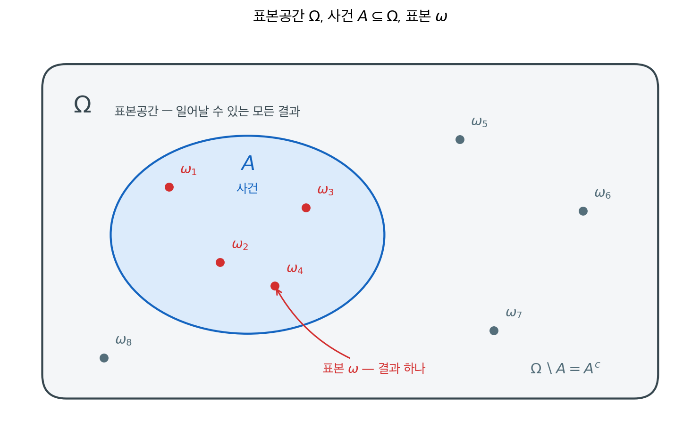
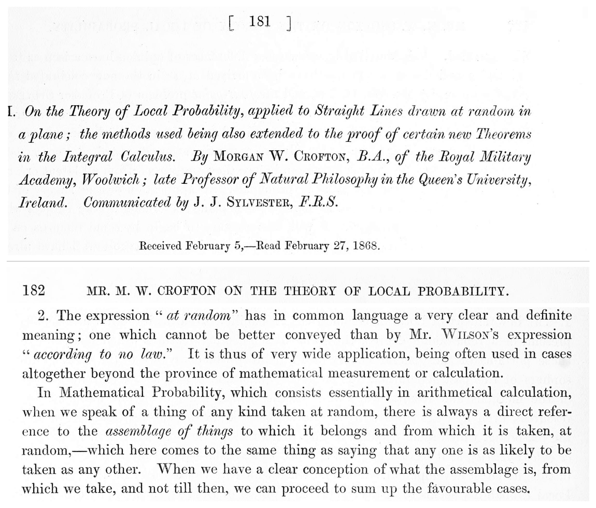
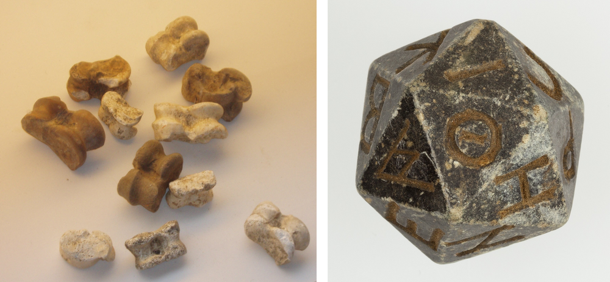
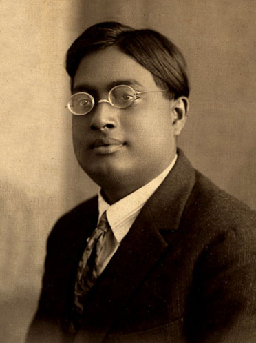
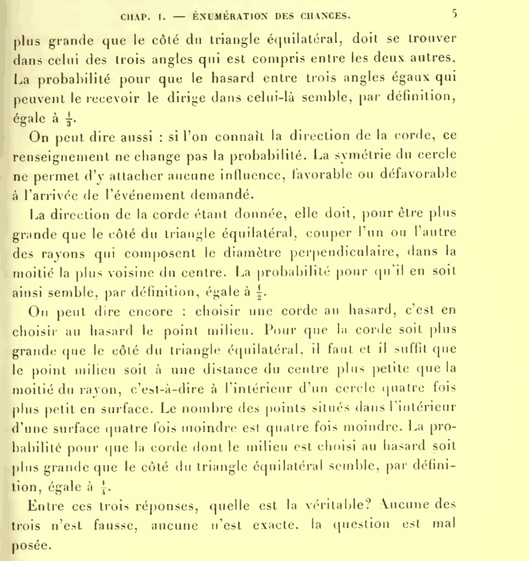

# 표본공간과 사건

## 개요

동전 두 개를 던져 둘 다 앞면일 확률을 묻는다. 두 동전을 구별하면 결과가 앞앞·앞뒤·뒤앞·뒤뒤 넷이어서 답이 $\tfrac14$ 이고, 구별하지 않으면 결과가 「앞 둘」·「하나씩」·「뒤 둘」 셋이어서 답이 $\tfrac13$ 이 된다. **셈 자체에는 양쪽 다 틀린 데가 없는데 답이 둘이다.** 갈린 자리는 세는 방법이 아니라 **무엇을 하나로 볼지**이고, 그것을 세기 전에 적어 두는 일이 이 절의 주제다.

확률 문제를 푸는 첫 걸음은 언제나 같다. **무슨 일이 일어날 수 있는지 빠짐없이 적는 것**이다. 그 목록이 표본공간이고, 우리가 관심을 갖는 결과들의 묶음이 사건이다. 이 두 가지를 정해 놓고 나면 확률은 "결과마다 무게를 달고 필요한 만큼 더하는 일"이 된다.

이 절은 두 정의와 한 정리로 이루어진다. 결과를 집합으로 적는 방법(정의 1), 거기에 무게를 달아 확률을 만드는 방법(정의 2), 그리고 무게가 모두 같을 때 확률 계산이 세기로 바뀐다는 것(정리 1)이다. 끝에서 표본공간의 크기가 달라지면 무엇이 달라지는지를 본다.

---

## 1. 일어날 수 있는 일을 모두 적는다

주사위를 굴린다고 하자. 나올 수 있는 것은 1부터 6까지 여섯 가지다. "짝수가 나온다"는 그중 세 가지를 묶은 것이다. 확률론은 이 두 층위 — 개별 결과와 결과들의 묶음 — 를 구별하는 데서 시작한다.

<div class="defn" markdown>

### 정의 1. 표본공간과 사건 { .dfn }

어떤 실험에서 가능한 결과 하나 $\omega$를 **표본**이라 한다. 가능한 모든 결과의 집합

$$
\Omega = \{\omega_1, \omega_2, \omega_3, \ldots\}
$$

를 **표본공간**이라 하고, 표본공간의 임의의 부분집합

$$
A \subseteq \Omega
$$

를 **사건**이라 한다.

</div>

세 이름이 서로 어떤 층위에 있는지를 한 장에 그리면 다음과 같다.



**바깥 상자가 표본공간 $\Omega$다.** 일어날 수 있는 결과를 하나도 빠뜨리지 않고 담은 것이므로 이 상자 밖에는 아무것도 없다. **안쪽 타원이 사건 $A$다.** 상자의 일부를 오려 낸 것, 즉 부분집합이다. **점 하나하나가 표본 $\omega$다.** 실험을 한 번 하면 점 하나가 실제로 일어나며, 그 점이 타원 안($\omega_1, \ldots, \omega_4$)이면 "사건 $A$가 일어났다"고 하고 타원 밖($\omega_5, \ldots, \omega_8$)이면 "$A$가 일어나지 않았다", 즉 $A^c$가 일어났다고 한다.

층위를 섞지 않는 것이 중요하다. $\omega$는 $\Omega$의 **원소**이고 $A$는 $\Omega$의 **부분집합**이다. 그래서 $\omega \in \Omega$, $A \subseteq \Omega$라 쓰고 $\omega \subseteq \Omega$나 $A \in \Omega$라 쓰지 않는다. 한 점만 묶은 사건 $\{\omega\}$와 점 $\omega$ 자체가 다른 것도 같은 이유다.

사건이 부분집합이라는 점이 중요하다. 집합의 언어를 그대로 쓸 수 있기 때문이다. "$A$ 또는 $B$"는 $A \cup B$, "$A$ 그리고 $B$"는 $A \cap B$, "$A$가 아님"은 $A^c$다. 확률 문제의 말을 집합 연산으로 옮기는 것이 계산의 절반이다.

<div class="storybox" markdown>

**그림으로 보는 통계학 1.** 「그때에야 비로소 셀 수 있다」

<figure markdown>
  { width=740 }
  <figcaption markdown>크로프턴 「평면에 무작위로 그은 직선에 적용한 국소확률론, 그리고 그 방법을 넓혀 얻은 적분학의 새 정리들」 — 『Philosophical Transactions』 제$158$ 권($1868$)의 $181$·$182$ 쪽. 제목 쪽과, 「무작위」라는 말을 따지는 제 $2$ 절을 잘라 위아래로 붙였다. *(Internet Archive 스캔, PD-old)*</figcaption>
</figure>

정의 1 이 이 책의 맨 앞에 오는 까닭 — **셈을 시작하기 전에 무엇을 셀지부터 적어야 한다**는
것 — 이 처음 또렷하게 활자가 된 자리가 사진이다. $1868$ 년 $2$ 월 $5$ 일에 접수되어
$2$ 월 $27$ 일에 낭독되었다.

크로프턴은 계산을 시작하기 전에 말부터 손본다. 제 $2$ 절이다 — 「수학적 확률에서 어떤
것을 **무작위로** 집는다고 말할 때에는, 언제나 그것이 속해 있고 그로부터 집어내는
**집합체**를 함께 가리키고 있다. … 우리가 어디에서 집는지, 그 집합체가 무엇인지를
또렷이 알았을 때, **그때에야 비로소** 유리한 경우를 세어 나갈 수 있다.」

그 「집합체」가 정의 1 의 $\Omega$ 다. 그리고 「그때에야 비로소 세어 나갈 수 있다」가
정리 1 의 $P(A)=|A|/|\Omega|$ 다 — 분모를 적을 수 있게 되는 순간이 바로 그 「그때」다.

이 말이 필요했던 까닭은 바로 앞 문단에 적혀 있다. 그 무렵 같은 물음에 서로 다른 답이
나오고 있었다는 것이다(울하우스의 세 점 문제, 실베스터의 네 점 문제). 그는 그 어긋남이
「주제 자체에 모호함이 있어서가 아니라 **쓰는 연장이 아직 약해서**」라고 적는다. 베르트랑이
한 원에 세 개의 답을 나란히 적어 보이기(연습문제 10 과 그 뒤의 상자 4) **스물한 해 전**이다.

그러니 이 쪽의 보기들이 하나같이 주사위 눈이나 던진 동전부터 적고 시작하는 것은 버릇이 아니라
방법이다. 틀리는 자리는 세기를 잘못하는 데가 아니라 **무엇을 하나로 보았는가**이고, 그것은
문제를 아무리 들여다보아도 문제가 말해 주지 않는다. 먼저 적어
두어야 한다 — 크로프턴의 「그때에야 비로소」가 그 뜻이다.

_확인한 곳 — 쪽 번호 $181$·$182$, 논문 제목과 저자 소개(「Morgan W. Crofton, B.A., of the
Royal Military Academy, Woolwich … Communicated by J. J. Sylvester, F.R.S.」), 「Received
February 5,—Read February 27, 1868」, 제 $2$ 절의 인용문(「when we speak of a thing of any kind
taken at random, there is always a direct reference to the *assemblage of things* to which it belongs
and from which it is taken … When we have a clear conception of what the assemblage is, from which
we take, and not till then, we can proceed to sum up the favourable cases」), 그리고 바로 앞
문단의 울하우스·실베스터 대목(「the now celebrated *three-point* problem, by Mr. Woolhouse, and
the *four-point* problem of Professor Sylvester … not from any inherent ambiguity in the subject
matter, but from the weakness of the instrument employed」)은
[Internet Archive: philosophicaltra1581roya](https://archive.org/details/philosophicaltra1581roya)
(『Philosophical Transactions』 v.$158$, $1868$)의 낱장 n$205$(인쇄 $181$ 쪽)·n$206$(인쇄 $182$ 쪽)에서
**사진으로 직접 읽었다** · 베르트랑의 $1889$ 년은 아래 상자 4 에 적어 둔 것과 같다_

</div>

<div class="exbox" markdown>

**보기 1.** <span class="diff easy" title="쉬움"></span> 육면체 주사위. 공정한 주사위를 굴릴 때

</div>

??? success "풀이"
    - 표본공간: $\Omega = \{1, 2, 3, 4, 5, 6\}$
    - 사건 $A$("짝수가 나옴"): $A = \{2, 4, 6\}$
    - 사건 $B$("홀수가 나옴"): $B = \{1, 3, 5\}$

    여기서 $A$와 $B$는 서로소이고 $A \cup B = \Omega$이므로 $\Omega$의 **분할**을 이룬다.

<div class="exbox" markdown>

**보기 2.** <span class="diff easy" title="쉬움"></span> 동전 세 개. 동전 세 개를 던지면

</div>

??? success "풀이"
    - 표본공간: $\Omega = \{HHH, HHT, HTH, HTT, THH, THT, TTH, TTT\}$
    - 사건("앞면이 정확히 2개"): $A = \{HHT, HTH, THH\}$

    결과가 $2^3 = 8$개이고 그중 3개가 $A$에 속한다.

---

## 2. 결과마다 무게를 달면 확률이 된다

표본공간을 적었다고 확률이 정해지는 것은 아니다. 각 결과가 **얼마나 그럴듯한지**를 따로 정해 주어야 한다. 공정한 주사위와 찌그러진 주사위는 표본공간이 같지만 확률은 다르다.

<div class="defn" markdown>

### 정의 2. 확률의 벽돌 그림 { .dfn }

각 결과 $\omega \in \Omega$에 무게를 가진 "벽돌"을 하나씩 붙인다고 하자. 무게는 결과마다 다를 수 있지만 전체 무게의 합은 1이다. 사건의 확률은 그 사건에 속한 벽돌들의 무게를 더한 값이다.

$$
\begin{aligned}
P(\omega) &= \omega \text{에 붙은 벽돌의 무게} \\
P(A) &= \sum_{\omega \in A} P(\omega) = A \text{에 속한 벽돌들의 총 무게}
\end{aligned}
$$

</div>

이 그림이 주는 것은 두 가지다. 첫째, **확률은 더하는 것**이다. 서로 겹치지 않는 사건의 확률은 각각의 확률을 더하면 된다. 둘째, **전체 무게가 1**이라는 제약이 모든 계산의 기준선이 된다.

모든 결과의 무게가 같은 경우 — 공정한 주사위, 잘 섞은 카드 — 에는 계산이 세기로 환원된다.

<div class="thmbox" markdown>

### 정리 1. 등가중 표본공간에서 확률은 세기다 { .thm }

$\Omega$ 가 유한하고 모든 결과의 무게가 같으면, 모든 사건 $A \subseteq \Omega$ 에 대해

$$
P(A) = \frac{|A|}{|\Omega|}
$$

이다.

</div>

??? proof "증명"

    공통의 무게를 $c$ 라 하고 $n = |\Omega|$ 라 하자. 전체 무게가 1 이라는 조건을 정의 2 에 넣으면

    $$
    1 = P(\Omega) = \sum_{\omega \in \Omega} P(\omega) = \sum_{\omega \in \Omega} c = nc
    $$

    이므로 $c = 1/n$ 이다. **"같다"와 "합이 1"이라는 두 조건만으로 무게가 하나로 정해진다.** 그러면 임의의 사건에 대해

    $$
    P(A) = \sum_{\omega \in A} P(\omega) = \sum_{\omega \in A}\frac1n = \frac{|A|}{n} = \frac{|A|}{|\Omega|}
    $$

    다. $\square$

    **확률 계산이 조합 계산으로 바뀌는 자리다.** 동전 세 개에서 $P(\text{앞면 2개}) = 3/8$ 이 이 식이고, 이 한 줄 때문에 1장의 세는 법이 확률론의 도구가 된다. 등가중이 아니면 이 식은 **틀린다** — 그때는 정의 2 로 돌아가 무게를 하나하나 더해야 한다.

<div class="storybox" markdown>

**그림으로 보는 통계학 2.** 네 면으로만 서는 주사위

<figure markdown>
  { width=720 }
  <figcaption markdown>왼쪽 — 양·염소의 복사뼈. 길쭉해서 **네 면으로만 서고** 둥근 두 끝으로는 서지 않는다. *(Wikimedia Commons, 촬영 Xocolatl, PD-self)* · 오른쪽 — 이집트에서 나온 사문석 이십면체. 스무 면에 그리스 글자가 하나씩 새겨져 있다. 기원전 $2$ 세기에서 기원후 $4$ 세기 사이의 것이다. *(메트로폴리탄 미술관 10.130.1158, CC0)*</figcaption>
</figure>

정리 1 에는 단서가 하나 달려 있다 — **등가중이 아니면 개수만으로 확률을 구할 수
없다.** 그 단서가 왜 필요한지를 가장 오래된 주사위가 보여 준다.

왼쪽 것이 주사위의 조상인 **복사뼈**다. 정육면체가 아니라 길쭉한 뼈라서 설 수 있는 면이
넷뿐이고, 그리스와 로마 사람들은 그 네 면에 $1$, $3$, $4$, $6$ 을 주었다. 마주 보는 면의
합이 $7$ 인 것은 지금 주사위와 같다. 그런데 **네 면이 똑같이 나오지 않는다.** 넓은 두
면은 한 번에 $0.38$ 가량, 좁은 두 면은 $0.12$ 가량으로 나온다. 그래서 드물게 서는 쪽에
$1$ 과 $6$ 이라는 양 끝 수가 붙었다. 네 개를 한꺼번에 던져 나오는 값의 모둠은
$\binom{4+4-1}{4}=35$ 가지이고, 던지기마다 베누스·왕·독수리 같은 이름이 따로 있었다.

오른쪽 것은 같은 물음에 반대로 답한 물건이다. 스무 면을 **모두 같은 정삼각형**으로 깎아
놓으면, 어느 면이 바닥에 오든 사정이 똑같아진다. 반듯하게 만드는 일이 곧 정리 1 의 조건을
손으로 만들어 내는 일이다. 그런데 이렇게 깎을 수 있는 입체는 아무 면 수로나 되는 것이
아니다. 모든 면이 합동인 정다각형이고 어느 꼭짓점이나 사정이 같은 입체는 **정확히 다섯
가지뿐**이어서, 면이 $4$ · $6$ · $8$ · $12$ · $20$ 일 때만 가능하다. 사진의 것이 그 가운데
면이 가장 많은 것이다.

면을 세는 것과 확률을 아는 것은 **같은 일이 아니다.** 둘이 같아지려면 누군가 주사위를
반듯하게 깎아 주어야 하고, 복사뼈에는 그렇게 해 줄 사람이 없었다. 정의 2 가 무게를 먼저
놓고 정리 1 이 그 무게가 고를 때만 세기로 넘어가는 까닭이 이것이다.

*확인한 곳 — [Wikipedia 「Knucklebones」](https://en.wikipedia.org/wiki/Knucklebones) — 복사뼈가 거의 대칭이라 설 수 있는 면이 넷뿐이라는 것, 넓은 면이 $0.38$ 가량이고 나머지가 $0.12$ 가량이라는 것, 네 면에 $1$·$3$·$4$·$6$ 을 주고 마주 보는 면의 합이 $7$ 이라는 것, 넷을 던지면 $35$ 가지 값이 나오고 베누스·왕·독수리 따위의 이름이 있었다는 것이 모두 여기 있다 · $\binom{7}{4}=35$ 는 이 쪽에서 직접 셈해 맞추었다 · 이십면체는 [메트로폴리탄 미술관 소장품 기록 551072](https://www.metmuseum.org/art/collection/search/551072) — 사문석, 프톨레마이오스–로마 시대(기원전 $2$ 세기–기원후 $4$ 세기), $1910$ 년 Helen Miller Gould 기증*

</div>

<div class="storybox" markdown>

**그림으로 보는 통계학 3.** 틀린 셈이 맞는 답을 냈다

<figure markdown>
  { width=155 align=right }
  <figcaption markdown>사티엔드라 나트 보스 $(1894\text{–}1974)$, $1925$ 년 무렵. *(Wikimedia Commons, PD-India)*</figcaption>
</figure>

정리 1 은 **등가중일 때만** 확률이 세기가 된다고 했다. 그렇다면 무엇을 하나로 셀지, 곧
표본공간을 어떻게 잡을지가 답을 바꾼다. 아래 보기 3 의 동전으로 줄여 보자. 동전을
구별하면 결과는 앞앞·앞뒤·뒤앞·뒤뒤의 **네 가지**이고 앞앞이 $\tfrac14$ 이다. 구별하지
않으면 「앞 둘」「하나씩」「뒤 둘」의 **세 가지**뿐이고, 이것들을 똑같이 여기면 앞앞이
$\tfrac13$ 이 된다.

동전이라면 뒤엣것은 **틀린 답**이다. 달랑베르가 『백과전서』의 「앞면이냐 뒷면이냐」
항목에서 바로 이 실수를 했고, 연습문제 7 이 그 오류를 따로 다룬다.

그런데 $1924$ 년, 다카 대학에서 강의하던 **사티엔드라 나트 보스**가 복사 이론을 설명하다
같은 실수를 저질렀다. 셈을 틀렸는데 **나온 값이 실험과 맞았다.** 그는 그 자리에서 멈추고
생각을 바꾸었다 — 틀린 것은 셈이 아니라, 빛알을 구별할 수 있다고 여긴 쪽일지 모른다고.

논문은 『필로소피컬 매거진』에서 거절당했다. 보스는 원고를 아인슈타인에게 보냈고,
아인슈타인은 그것을 **독일어로 직접 번역해** 『물리학지』에 싣게 했다. 보스가 전에
아인슈타인의 상대성이론 논문을 영어로 옮긴 적이 있었으니 번역을 주고받은 셈이다.
그렇게 나온 것이 **보스–아인슈타인 통계**다.

그러니 「무엇을 하나로 셀 것인가」는 수학이 정해 주는 것이 아니다. **빛알과 원자는
구별하지 않는 쪽을 고른다.** 구별하지 않고 세는 수 $\dbinom{n+k-1}{k}$ 가 자연이 쓰는
셈이라는 뜻이고, 동전에서 틀린 표본공간이 빛알에서는 맞는 표본공간이다. 정리 1 을 쓰기
전에 **정의 1 의 $\Omega$ 를 무엇으로 잡았는지** 먼저 말해야 하는 까닭이 여기 있다.

*확인한 곳 — [Wikipedia 「Bose–Einstein statistics」](https://en.wikipedia.org/wiki/Bose%E2%80%93Einstein_statistics) — 다카 대학 강의 중의 실수가 「공정한 동전 두 개를 던져 앞앞이 $\tfrac13$ 이라고 말하는 것과 비슷한」 것이었고 「달랑베르가 Croix ou Pile 에서 한 유명한 실수와 닮았다」는 것, 그런데 예측이 실험과 맞아 보스가 실수가 아닐지 모른다고 여긴 것, 『필로소피컬 매거진』에 거절당한 뒤 아인슈타인에게 보냈고 아인슈타인이 영어에서 독일어로 직접 옮겨 『Zeitschrift für Physik』에 싣게 한 것, 보스가 전에 아인슈타인의 상대성이론 논문을 독일어에서 영어로 옮긴 적이 있다는 것이 모두 여기 있다 · 동전 두 개의 $4$ 가지와 $3$ 가지는 이 쪽에서 직접 셈했다($\binom{2+2-1}{2}=3$) · 초상은 [Commons 파일 쪽](https://commons.wikimedia.org/wiki/File:SatyenBose1925.jpg)*

</div>

<div class="exbox" markdown>

**보기 3.** <span class="diff easy" title="쉬움"></span> 표본공간을 나열해 사건의 확률 세기. 공정한 동전 세 개를 던진다.

**(1)** $|\Omega|$와 사건 $A$ = "앞면이 정확히 두 번"의 확률을 세어서 구하고, 동전 $n$개에서 앞면이 $k$번일 확률을 일반식으로 적으시오.

**(2)** 표본공간을 실제로 나열해 (1)을 확인하시오. 이 나열이 $n$이 커져도 쓸 수 있는 방법인지 말하시오.

</div>

??? success "풀이"

    **(1) 해석적으로.** 동전마다 결과가 두 가지이고 세 동전이 서로 무관하므로 결과의 수는 자리마다 두 가지를 곱한 것이다.

    $$
    |\Omega| = 2 \times 2 \times 2 = 2^3 = 8
    $$

    공정한 동전이면 여덟 결과의 무게가 모두 같으므로 $P(\omega) = 1/8$이고, 정리 1 의 등가중 꼴 $P(A) = |A|/|\Omega|$를 쓸 수 있다. 남은 일은 $|A|$를 세는 것이다. 앞면이 들어갈 **자리 두 개를 세 자리에서 고르는** 가짓수이므로

    $$
    |A| = \binom{3}{2} = 3, \qquad P(A) = \frac{3}{8} = 0.375
    $$

    이다. 같은 셈을 동전 $n$개로 밀면

    $$
    P(\text{앞면이 } k \text{번}) = \frac{\binom{n}{k}}{2^n}
    $$

    이 된다. 분자가 "앞면 자리를 고르는 방법의 수", 분모가 "전체 결과의 수"다.

    **(2) 나열해서.** 코드가 하는 일이 정확히 정의 2 다. 표본공간을 만들고, 사건에 해당하는 결과를 고르고, 개수를 센다.

    ```python
    from itertools import product
    from math import comb

    # 동전 세 번 던지기의 표본공간
    sample_space = list(product(['H', 'T'], repeat=3))
    print(f"Sample space size: {len(sample_space)}")
    print(f"Sample space: {sample_space}")

    # 사건: 앞면이 정확히 두 번
    event_2_heads = [s for s in sample_space if s.count('H') == 2]
    print(f"\nEvent (2 heads): {event_2_heads}")
    print(f"P(2 heads) = {len(event_2_heads)}/{len(sample_space)} = {len(event_2_heads)/len(sample_space):.4f}")

    # (1)의 일반식과 맞는지 본다. 세지 않고 조합으로 바로 구한 값이다.
    print(f"C(3,2)/2^3  = {comb(3, 2)}/{2**3} = {comb(3, 2)/2**3:.4f}")
    ```

    출력:

    ```
    Sample space size: 8
    Sample space: [('H', 'H', 'H'), ('H', 'H', 'T'), ('H', 'T', 'H'), ('H', 'T', 'T'), ('T', 'H', 'H'), ('T', 'H', 'T'), ('T', 'T', 'H'), ('T', 'T', 'T')]

    Event (2 heads): [('H', 'H', 'T'), ('H', 'T', 'H'), ('T', 'H', 'H')]
    P(2 heads) = 3/8 = 0.3750
    C(3,2)/2^3  = 3/8 = 0.3750
    ```

    나열이 $8$개를 내놓고 그중 $3$개를 골라 $0.3750$을 주었다. 조합으로 바로 센 $\binom{3}{2}/2^3$도 같은 $0.3750$이다. **두 길이 맞는다.**

    **다만 나열은 $n$이 조금만 커져도 쓸 수 없다.** 결과의 수가 $2^n$이므로 $n = 20$이면 $1{,}048{,}576$개, $n = 50$이면 $10^{15}$개를 넘는다. 목록을 메모리에 담는 일 자체가 불가능해진다. 그런데 (1)의 일반식은 $n$이 얼마든 분자와 분모를 한 번 계산하면 끝난다. **표본공간을 다 적는 것은 확률을 정의하는 방법이지 계산하는 방법이 아니다.** 이 일반식에 이름을 붙인 것이 4장의 이항분포다.

---

## 3. 표본공간의 크기가 확률의 성격을 바꾼다

무게를 더한다는 그림은 결과가 유한할 때 가장 편하다. 그런데 표본공간은 무한할 수도 있고, 그때는 사정이 달라진다.

!!! note "표본공간의 세 가지 크기 — 무엇에 확률을 줄 수 있는가"

    표본공간은 크기에 따라 셋으로 나뉘며, 각각 확률을 부여하는 방식이 다르다.

    | 크기 | 예 | 확률의 부여 |
    |:---|:---|:---|
    | **유한** | 주사위 한 번, $\Omega = \{1,\ldots,6\}$ | 모든 부분집합에 부여 가능 |
    | **가산무한** | 첫 앞면까지 던지기, $\Omega = \{H, TH, TTH, \ldots\}$ | 모든 부분집합에 부여 가능 |
    | **비가산** | 회전판의 각도, $\Omega = [0, 360)$ | 모든 부분집합에는 불가능 |

유한하거나 가산무한이면 결과 하나하나에 무게를 달고 더하면 된다. 사건 공간은 모든 부분집합의 모임, 즉 **멱집합** $2^\Omega$다.

비가산인 경우에는 이 방식이 무너진다. $[0, 1]$에서 균등하게 수를 뽑으면 개별 실수 하나가 뽑힐 확률은 0이므로, 무게를 더해서는 어떤 구간의 확률도 만들어 낼 수 없다. 확률은 점이 아니라 **구간**에 부여된다. 그리고 멱집합은 너무 커서 모순 없는 측도를 허용하지 못하므로(비탈리 집합), 열린구간이 생성하는 **보렐 $\sigma$-대수**를 사건 공간으로 삼는다.

!!! warning "확률이 0이라고 불가능한 것은 아니다"
    $\Omega = [0, 1]$에서 균등하게 수를 뽑으면 $P(\{0.5\}) = 0$이다. 그렇다고 $0.5$가 나올 수 **없는** 것은 아니다. 실제로 어떤 수든 하나는 나오고, 그 수가 나올 확률은 0이었다.

    "불가능"은 $A = \emptyset$이라는 뜻이고 "확률 0"은 $P(A) = 0$이라는 뜻이다. 유한한 표본공간에서는 둘이 같지만 연속인 표본공간에서는 갈린다. 수학에서 "**거의 확실하게**"($P = 1$이지만 예외가 있을 수 있음)와 "확실하게"($A = \Omega$)를 구별하는 이유가 이것이다.

---

## 연습문제

<div class="drillbox" markdown>

**연습문제 1.** <span class="diff easy" title="쉬움"></span>
주머니에 빨간 공 3개와 파란 공 2개가 있다. 공 두 개를 비복원으로 뽑는다. 순서쌍(예: $(R_1, B_1)$)을 써서 표본공간 $\Omega$를 모두 나열하고 빨간 공 두 개를 뽑을 확률을 계산하라.

</div>

??? success "풀이"
    공에 $R_1, R_2, R_3, B_1, B_2$라는 이름을 붙이자. 순서를 고려한 뽑기의 표본공간은 다음과 같다.

    $$
    \Omega = \{(R_1,R_2),(R_1,R_3),(R_1,B_1),(R_1,B_2),(R_2,R_1),(R_2,R_3),(R_2,B_1),(R_2,B_2),
    $$

    $$
    (R_3,R_1),(R_3,R_2),(R_3,B_1),(R_3,B_2),(B_1,R_1),(B_1,R_2),(B_1,R_3),(B_1,B_2),
    $$

    $$
    (B_2,R_1),(B_2,R_2),(B_2,R_3),(B_2,B_1)\}
    $$

    똑같이 일어날 법한 순서 있는 결과가 $5 \times 4 = 20$개다. 사건 "빨간 공 두 개"는 $A = \{(R_1,R_2),(R_1,R_3),(R_2,R_1),(R_2,R_3),(R_3,R_1),(R_3,R_2)\}$로 결과가 6개다. 따라서

    $$
    P(A) = \frac{6}{20} = \frac{3}{10}
    $$

    이다.

---

<div class="drillbox" markdown>

**연습문제 2.** <span class="diff easy" title="쉬움"></span>
공정한 주사위를 굴리고 공정한 동전을 던지는 실험이 있다. 표본공간을 모두 나열하라. 사건 $A$ = "주사위가 짝수이고 동전이 앞면"을 정의하고 $P(A)$를 계산하라.

</div>

??? success "풀이"
    표본공간은 주사위 결과와 동전 결과의 곱집합이다.

    $$
    \Omega = \{(1,H),(1,T),(2,H),(2,T),(3,H),(3,T),(4,H),(4,T),(5,H),(5,T),(6,H),(6,T)\}
    $$

    똑같이 일어날 법한 결과가 $6 \times 2 = 12$개다.

    사건 $A$ = {주사위 짝수 그리고 앞면} = $\{(2,H),(4,H),(6,H)\}$로 결과가 3개다.

    $$
    P(A) = \frac{3}{12} = \frac{1}{4}
    $$

---

<div class="drillbox" markdown>

**연습문제 3.** <span class="diff easy" title="쉬움"></span>
$\Omega = \{a, b, c\}$이고 $P(a) = 0.5$, $P(b) = 0.3$, $P(c) = 0.2$라 하자. 가능한 모든 사건($\Omega$의 부분집합)을 나열하고 각각의 확률을 계산하라.

</div>

??? success "풀이"
    원소가 3개인 집합은 $2^3 = 8$개의 부분집합을 갖는다.

    | 사건 | 확률 |
    |:---|:---|
    | $\emptyset$ | $0$ |
    | $\{a\}$ | $0.5$ |
    | $\{b\}$ | $0.3$ |
    | $\{c\}$ | $0.2$ |
    | $\{a, b\}$ | $0.5 + 0.3 = 0.8$ |
    | $\{a, c\}$ | $0.5 + 0.2 = 0.7$ |
    | $\{b, c\}$ | $0.3 + 0.2 = 0.5$ |
    | $\{a, b, c\} = \Omega$ | $0.5 + 0.3 + 0.2 = 1.0$ |

---

<div class="drillbox" markdown>

**연습문제 4.** <span class="diff easy" title="쉬움"></span>
유한 표본공간, 가산무한 표본공간, 비가산 표본공간의 차이를 설명하라. 각 유형에 해당하는 실험의 예를 하나씩 들어라.

</div>

??? success "풀이"
    **유한 표본공간:** 결과의 집합이 유한하다. 예: 주사위를 굴리면 $\Omega = \{1,2,3,4,5,6\}$이고 $|\Omega| = 6$이다.

    **가산무한 표본공간:** 결과의 집합을 자연수와 일대일 대응시킬 수 있다. 예: 첫 앞면이 나올 때까지 동전을 던지면 $\Omega = \{H, TH, TTH, TTTH, \ldots\}$이다. 결과가 무한히 많지만(첫 앞면 전에 나오는 뒷면의 개수마다 하나씩) 차례로 열거할 수 있다.

    **비가산 표본공간:** 결과의 집합이 실수의 농도를 가지며 열거할 수 없다. 예: 완벽하게 균형 잡힌 회전판을 돌려 각도를 기록하면 $\Omega = [0, 360)$이며 이는 비가산집합이다. 개별 각도의 확률은 0이고 확률은 구간에 부여된다.

---

<div class="drillbox" markdown>

**연습문제 5.** <span class="diff med" title="중간"></span>
원소가 $n$개인 표본공간 $\Omega$에 대해 **멱집합** $2^\Omega$의 원소는 $2^n$개다. 이를 귀납법으로 증명하라. 멱집합이 이산 확률에서 자연스러운 "사건 공간"인 이유는 무엇인가?

</div>

??? success "풀이"
    **기저 단계:** $n = 0$이면 $\Omega = \emptyset$의 부분집합은 공집합뿐이므로 $|2^\Omega| = 1 = 2^0$이다. ✓

    **귀납 단계:** 원소가 $k$개인 임의의 집합 $A$에 대해 $|2^A| = 2^k$라고 가정하자. $\Omega$의 원소가 $k + 1$개라 하고 원소 하나 $x$를 고른다. $\Omega$의 모든 부분집합은 $x$를 포함하거나($\Omega \setminus \{x\}$의 부분집합 개수만큼 있으므로 $2^k$개) 포함하지 않는다(역시 $2^k$개). 합치면 $2 \cdot 2^k = 2^{k+1}$이다. $\square$

    **멱집합인 이유:** 이산 $\Omega$에서는 모든 부분집합이 가측 사건이기를 원한다. 결과들의 어떤 조합에도 확률을 부여할 수 있어야 하기 때문이다. 멱집합은 이산 상황에서 모든 한 점 집합을 포함하는 유일한 $\sigma$-대수다.

    연속(비가산) $\Omega$에서는 멱집합이 너무 커서 $\sigma$-가법 측도를 허용하지 못한다. 대신 열린구간이 생성하는 **보렐 $\sigma$-대수**를 쓰는데, 이는 병적인 비가측 집합(비탈리 집합, 바나흐–타르스키)을 배제하면서 합리적인 모든 사건을 포함한다.

---

<div class="drillbox" markdown>

**연습문제 6.** <span class="diff med" title="중간"></span>
**연속 표본공간과 "확률 0" 사건.** 균등확률을 갖는 $\Omega = [0, 1]$에 대해 확률이 0인 사건의 예를 두 개 들어라. 이들은 불가능한 사건인가?

</div>

??? success "풀이"
    두 가지 예:

    1. **한 점 집합:** $\{0.5\}$의 확률은 0이다. 균등분포는 어떤 한 점에도 질량을 부여하지 않는다.
    2. **유리수:** $\mathbb{Q} \cap [0, 1]$의 확률은 0이다. 유리수는 가산이며, 한 점 집합들의 가산 합집합의 확률은 $\sum 0 = 0$이다.

    **불가능한 사건인가?** 아니다. "불가능"은 $A = \emptyset$, 즉 그 사건이 일어날 수 없다는 뜻이다. "확률 0"은 $P(A) = 0$이라는 뜻이며 $A$가 공집합이 아닐 수도 있다.

    이 구분은 연속 확률에서 중요하다. "$[0, 1]$에서 균등하게 무작위한 수를 뽑는다"고 하면 그 결과는 *어떤* 구체적인 실수다. 그 수가 어떤 특정 값(자기 자신을 포함해!)이 될 확률은 0인데도 실제로 일어났다. 가산가법성 공리는 확률 0인 사건들의 가산 합집합의 확률이 여전히 0임을 보장할 뿐이며, 비가산 합집합은 양의 확률을 가질 수 있다(예: $[0, 1]$ 안 모든 한 점 집합의 비가산 합집합은 확률이 1인 $[0, 1]$이다).

    수학자들이 "거의 확실하게"($P = 1$이고 여집합의 $P = 0$이지만 여집합이 공집합일 필요는 없음)와 "확실하게"($A = \Omega$이고 여집합이 공집합)를 구분하는 이유가 이것이다. 유한한 $\Omega$에서는 둘이 일치하지만 연속인 $\Omega$에서는 갈린다.

---

<div class="drillbox" markdown>

**연습문제 7.** <span class="diff med" title="중간"></span>
같은 문제를 서로 다른 표본공간으로 모형화할 수 있다. 답이 **같은가**? 항아리 문제로 확인하라.

</div>

??? success "풀이"
    ```python
    import numpy as np
    from math import comb, factorial

    n, k = 5, 3
    print(f"원소 {n}개에서 {k}개를 뽑는 네 가지 방식")
    print(f"  순서 O, 복원 O:  n^k           = {n ** k}")
    print(f"  순서 O, 복원 X:  n!/(n-k)!     = {factorial(n) // factorial(n - k)}")
    print(f"  순서 X, 복원 X:  C(n, k)       = {comb(n, k)}")
    print(f"  순서 X, 복원 O:  C(n+k-1, k)   = {comb(n + k - 1, k)}")

    rng = np.random.default_rng(0)
    N = 400_000
    balls = np.array([0, 0, 0, 1, 1])           # 빨강 3, 파랑 2
    hits = sum((balls[rng.choice(5, 2, replace=False)] == 0).all() for _ in range(N))

    print(f"\n빨강 2개를 뽑을 확률")
    print(f"  모의               {hits / N:.5f}")
    print(f"  순서 없는 표본공간  C(3,2)/C(5,2) = {comb(3,2)}/{comb(5,2)} = {comb(3,2)/comb(5,2):.5f}")
    print(f"  순서 있는 표본공간  (3x2)/(5x4)   = {3*2}/{5*4} = {3*2/(5*4):.5f}")
    ```

    출력:

    ```
    원소 5개에서 3개를 뽑는 네 가지 방식
      순서 O, 복원 O:  n^k           = 125
      순서 O, 복원 X:  n!/(n-k)!     = 60
      순서 X, 복원 X:  C(n, k)       = 10
      순서 X, 복원 O:  C(n+k-1, k)   = 35

    빨강 2개를 뽑을 확률
      모의               0.29869
      순서 없는 표본공간  C(3,2)/C(5,2) = 3/10 = 0.30000
      순서 있는 표본공간  (3x2)/(5x4)   = 6/20 = 0.30000
    ```

    **두 표본공간이 같은 답을 준다.** 크기가 $10$과 $20$으로 다른데도 그렇다.

    **왜 그런가.** 두 표본공간 모두 **각 결과가 동등확률**이 되도록 구성되었기 때문이다. 순서를 붙이면 결과가 두 배로 늘지만 관심 사건의 결과도 두 배가 되므로 비가 유지된다.

    **그러나 언제나 그런 것은 아니다.** 순서를 무시한 표본공간이 **동등확률이 아닌** 경우가 많다.

    | 실험 | 순서 없는 표본공간 | 동등확률인가 |
    |---|---|---|
    | 동전 두 개 | $\{앞앞, 앞뒤, 뒤뒤\}$ | **아니다** ($1/4, 1/2, 1/4$) |
    | 주사위 두 개의 합 | $\{2,\ldots,12\}$ | **아니다** |
    | 비복원 구슬 | $\{RR, RB, BB\}$ | **아니다** |

    **달랑베르의 오류가 이것이다.** 동전 두 개에서 $\{앞앞, 앞뒤, 뒤뒤\}$를 각각 $1/3$로 두는 것인데, "앞뒤"가 두 가지 순서를 포함하므로 틀렸다.

    **실무 규칙.** **동등확률로 다루려면 결과를 충분히 세분해야 한다.** 순서를 붙이거나 개체를 구별하면 대개 동등확률이 되고, 그러면 정리 $2$의 "무게를 세는" 계산이 단순한 세기 문제로 바뀐다. 세분하는 것이 손해가 아니라 **안전장치**다. $\square$

---

<div class="drillbox" markdown>

**연습문제 8.** <span class="diff med" title="중간"></span>
표본공간이 **가산무한**이면 유한과 무엇이 달라지는가? 확률보행의 원점 복귀로 확인하라.

</div>

??? success "풀이"
    ```python
    import numpy as np

    rng = np.random.default_rng(0)
    steps = 4000

    print(f"{steps}걸음 안에 원점으로 돌아올 확률")
    for d in (1, 2, 3):
        M = 10_000 if d == 1 else 1000
        if d == 1:
            pos = np.cumsum(rng.choice([-1, 1], (M, steps)), axis=1)
            back = (pos == 0).any(axis=1)
        else:
            step = np.zeros((M, steps, d))
            axis = rng.integers(0, d, (M, steps))
            sign = rng.choice([-1, 1], (M, steps))
            step[np.arange(M)[:, None], np.arange(steps)[None, :], axis] = sign
            pos = np.cumsum(step, axis=1)
            back = (np.abs(pos).sum(axis=2) == 0).any(axis=1)
        print(f"  {d}차원: {back.mean():.4f}")
    ```

    출력:

    ```
    4000걸음 안에 원점으로 돌아올 확률
      1차원: 0.9883
      2차원: 0.7170
      3차원: 0.3160
    ```

    **차원이 오를수록 복귀가 어려워진다**($0.99 \to 0.72 \to 0.32$).

    **폴리아의 정리**가 극한을 말해 준다. $1$차원과 $2$차원 대칭 확률보행은 **확률 $1$로 원점에 무한히 자주 돌아오고**($\text{재귀적}$), $3$차원 이상에서는 **양의 확률로 영영 돌아오지 않는다**($\text{일시적}$). $3$차원의 복귀 확률은 약 $0.3405$다.

    **"술 취한 사람은 집에 돌아오지만 술 취한 새는 영영 길을 잃는다."**

    **가산무한 표본공간에서 무엇이 달라지는가.**

    - **각 결과의 확률이 $0$이 아니어도 된다.** 다음 절 공리 문서 연습문제 9에서 보듯 균등한 배정은 불가능하지만, 균등하지만 않으면 가산집합에 확률질량을 줄 수 있다. 복귀 시점의 분포가 그런 예다.
    - **기댓값이 무한할 수 있다.** $1$차원 확률보행은 확률 $1$로 돌아오지만 **평균 복귀 시간은 무한대**다. "반드시 일어나지만 평균적으로 무한히 오래 걸린다"는 유한 표본공간에서는 불가능한 현상이다.
    - **극한 사건에 확률을 부여하려면 가산가법성이 필요하다.** "무한히 자주 돌아온다"는 사건은 가산 무한 번의 합집합·교집합으로 만들어진다(공리 문서 연습문제 8의 보렐–칸텔리).

    **실무적 함의.** 대기행렬, 분기과정, 마르코프 연쇄가 모두 가산무한 상태공간을 갖는다. **"결국 흡수될 것인가", "평균 도달 시간은 유한한가"** 가 핵심 질문이며, 둘의 답이 다를 수 있다는 것이 이 절의 요점이다. $\square$

---

<div class="drillbox" markdown>

**연습문제 9.** <span class="diff med" title="중간"></span>
표본공간을 정하는 것은 **모형을 정하는 것**이다. 무엇을 $\Omega$에 넣을지가 답을 바꾸는 예를 들고, 실무 지침을 정리하라.

</div>

??? success "풀이"
    ```python
    import numpy as np

    rng = np.random.default_rng(3)
    N = 500_000

    # 몬티 홀: 진행자의 행동까지 표본공간에 넣어야 한다
    car = rng.integers(0, 3, N)
    pick = np.zeros(N, dtype=int)                    # 참가자는 항상 0번 문

    # 규칙 A: 진행자가 염소 문 중 하나를 무작위로 연다 (표준)
    host_a = np.empty(N, dtype=int)
    for i in range(N):
        choices = [d for d in (0, 1, 2) if d != pick[i] and d != car[i]]
        host_a[i] = choices[rng.integers(len(choices))]
    switch_a = np.array([[d for d in (0, 1, 2) if d != pick[i] and d != host_a[i]][0]
                         for i in range(min(N, 200_000))])
    print(f"규칙 A (표준): 바꾸면 승률 {np.mean(switch_a == car[:len(switch_a)]):.5f}   이론 2/3")

    # 규칙 B: 진행자가 무작위로 문을 열고, 자동차가 나오면 그 판은 무효
    host_b = rng.integers(0, 3, N)
    valid = (host_b != pick) & (host_b != car)
    sw_b = np.array([[d for d in (0, 1, 2) if d != pick[i] and d != host_b[i]][0]
                     for i in np.flatnonzero(valid)[:200_000]])
    car_b = car[np.flatnonzero(valid)[:200_000]]
    print(f"규칙 B (무지한 진행자): 바꾸면 승률 {np.mean(sw_b == car_b):.5f}   이론 1/2")
    ```

    출력:

    ```
    규칙 A (표준): 바꾸면 승률 0.66619   이론 2/3
    규칙 B (무지한 진행자): 바꾸면 승률 0.49906   이론 1/2
    ```

    **같은 관측("진행자가 염소 문을 열었다")인데 답이 $2/3$과 $1/2$로 갈린다.** 차이는 오직 **진행자의 행동 규칙**이며, 그것은 관측되는 결과가 아니라 **자료 생성 과정**이다.

    **표본공간을 정할 때의 지침.**

    | 지침 | 이유 |
    |---|---|
    | **관측된 결과뿐 아니라 그것이 생성된 방식도 넣어라** | 몬티 홀, 두 아이 문제 |
    | **동등확률이 되도록 충분히 세분하라** | 연습문제 7의 달랑베르 오류 |
    | **연속이면 어떤 매개변수로 균등인지 밝혀라** | 연습문제 10의 베르트랑 역설 |
    | **모르는 양은 $\Omega$에 넣어 확률변수로 다루어라** | 베이즈 추론의 모수 |
    | **선택 기제를 명시하라** | 1장의 표집·생존자 편향 |

    **마지막 두 줄이 이 책 전체를 관통한다.**

    - **베이즈 방법이 하는 일이 "모수를 $\Omega$에 넣는 것"이다.** 빈도주의는 모수를 고정된 미지수로 두어 $\Omega$ 밖에 놓고, 베이즈는 $\Omega$ 안에 넣어 확률변수로 만든다. 두 접근의 차이가 **표본공간을 어디까지 잡느냐**의 차이로 환원된다.
    - **1장의 편향 논의가 모두 "$\Omega$를 잘못 잡았다"로 요약된다.** 생존자 편향은 관측된 것만 $\Omega$에 넣은 것이고, 무응답 편향은 응답 여부를 $\Omega$에 넣지 않은 것이다.

    **가장 중요한 조언.** 확률 문제를 만나면 **계산을 시작하기 전에 $\Omega$를 명시적으로 적어라.** 대부분의 확률 역설은 계산 실수가 아니라 **표본공간을 서로 다르게 잡은 데서** 나온다. $\square$

---

<div class="drillbox" markdown>

**연습문제 10.** <span class="diff hard" title="어려움"></span>
연습문제 4가 세 가지 크기를 구분했다. 표본공간이 **비가산**일 때 확률을 어떻게 정하는지, 그리고 그 선택이 유일하지 않음을 보여라.

</div>

??? success "풀이"
    **베르트랑의 역설.** 반지름 $1$인 원에 **무작위로 현을 하나 긋는다.** 그 현이 내접 정삼각형의 한 변($\sqrt{3}$)보다 길 확률은?

    ```python
    import numpy as np

    rng = np.random.default_rng(0)
    N = 500_000
    side = np.sqrt(3)

    # 방법 1: 한 끝점을 고정하고 다른 끝점을 원둘레에 균등하게
    theta = rng.uniform(0, 2 * np.pi, N)
    chord1 = 2 * np.sin(theta / 2)

    # 방법 2: 반지름을 하나 고르고 그 위에 중점을 균등하게
    d = rng.uniform(0, 1, N)
    chord2 = 2 * np.sqrt(1 - d ** 2)

    # 방법 3: 중점을 원 안에 균등하게
    dd = np.sqrt(rng.uniform(0, 1, N))
    chord3 = 2 * np.sqrt(1 - dd ** 2)

    print(f"{'무작위의 정의':>14}{'P(현 > 변)':>13}{'이론':>10}")
    for label, c, th in [("끝점 균등", chord1, 1 / 3),
                         ("반지름 위 균등", chord2, 1 / 2),
                         ("중점 균등", chord3, 1 / 4)]:
        print(f"{label:>14}{np.mean(c > side):>13.5f}{th:>10.5f}")
    ```

    출력:

    ```
           무작위의 정의     P(현 > 변)        이론
             끝점 균등      0.33278   0.33333
          반지름 위 균등      0.50010   0.50000
             중점 균등      0.24973   0.25000
    ```

    **같은 질문에 세 가지 답이 나온다.** $1/3$, $1/2$, $1/4$이며 모두 계산이 옳다.

    **원인은 "무작위로 현을 긋는다"가 표본공간을 지정하지 않았다는 것이다.**

    | 방법 | 표본공간 | 무엇이 균등한가 |
    |---|---|---|
    | $1$ | 원둘레의 각 | 끝점의 위치 |
    | $2$ | 반지름 위의 거리 | 중심으로부터의 거리 |
    | $3$ | 원판 | 중점의 위치 |

    **세 표본공간이 서로 다르고, 어느 것도 "옳지" 않다.** 물리적 실험 절차를 지정해야만 답이 정해진다. 막대를 원 위에 무작위로 던지면 방법 $2$에 가깝고, 원판에 다트를 던져 중점을 정하면 방법 $3$이다.

    **유한 표본공간과의 결정적 차이.** 유한이면 "각 결과가 동등확률"이 자연스러운 기본값이지만, **비가산이면 그런 기본값이 없다.** "균등"이라는 말 자체가 어떤 매개변수로 잰 균등인지에 의존한다.

    **정리 $3$의 세 번째 경우가 어려운 이유가 이것이다.** 비가산 표본공간에서는 확률을 **부여해야** 하며, 그 부여가 모형 선택이다. 다음 절 공리 문서 연습문제 $10$–$11$에서 보듯, 공리는 어떤 부여가 허용되는지만 말하고 어느 것을 고를지는 말하지 않는다.

    **실무적 교훈.** 연속 확률 문제에서 "무작위로"라는 말을 보면 **어떤 절차로 무작위인지**를 물어야 한다. 뒤에 나올 조건부확률 문서의 두 아이 문제·몬티 홀과 같은 종류의 모호함이며, 여기서는 그것이 연속 세계에서 나타난 것이다. $\square$

<div class="storybox" markdown>

**그림으로 보는 통계학 4.** 세 답을 나란히 적고 물음이 틀렸다고 한 쪽

<figure markdown>
  { width=520 }
  <figcaption markdown>베르트랑 『확률의 계산』 제1장 「경우를 세는 법」의 $5$ 쪽. 초판은 $1889$ 년이고 이 그림은 뒤에 다시 찍은 판이다. *(Wikimedia Commons, PD-US-expired)*</figcaption>
</figure>

위 풀이가 세 모형에서 $\dfrac13$, $\dfrac12$, $\dfrac14$ 을 얻었다. 그 셋이 한 쪽에 나란히 인쇄된 자리가 위의 쪽이다.

**조제프 베르트랑**은 「원에 그은 현이 내접 정삼각형의 한 변보다 길 확률」을 묻고 세 번 답한다. 세 문단이 모두 「$\dots$ par définition, égale à $\dots$」— 「정의에 의하여 $\dots$ 와 같다」로 끝나고, 그 끝의 값이 차례로 $\dfrac13$, $\dfrac12$, $\dfrac14$ 다. 「정의에 의하여」라는 말이 세 번 똑같이 나오는 것이 요점이다 — 세 번 다 **무엇을 균등하게 볼지 먼저 정의해 놓고** 세었다는 뜻이다.

첫 문단은 한 끝점을 붙들고 다른 끝점이 세 등분된 호 가운데 어디에 떨어지는지를 보는 끝점 모형, 둘째는 현의 방향을 정해 놓고 그에 수직인 지름 위에서 자리를 보는 평행현 모형, 셋째는 현의 중점이 넓이가 $4$ 분의 $1$ 인 안쪽 원에 드는지를 보는 중점 모형이다. 위 풀이의 세 가지가 그대로 이 세 문단이다.

이 쪽의 값어치는 마지막 세 줄에 있다 — 「이 세 답 가운데 어느 것이 참인가? 셋 다 틀리지 않았고, 셋 다 옳지도 않다. 물음이 잘못 놓인 것이다.」 베르트랑이 한 일은 셋 중 하나를 고른 것이 아니라 **그 물음이 아직 확률 문제가 아니었음**을 보인 것이다. 정의 1 이 $\Omega$ 를 먼저 적으라고 요구하고, 상자 1 의 크로프턴이 「집합체를 먼저 밝혀라」라고 적어 둔 까닭이 여기에 있다.

*확인한 곳 — 베르트랑 『확률론』($1889$) — [Wikipedia 「Bertrand paradox (probability)」](https://en.wikipedia.org/wiki/Bertrand_paradox_(probability)) · 프랑스어 문구와 세 값 $\tfrac13$, $\tfrac12$, $\tfrac14$ 은 사진의 쪽에서 직접 읽었다*

</div>

---

## 정리하며

확률 문제는 언제나 같은 세 단계로 시작한다.

1. **무엇이 일어날 수 있는가**를 집합 $\Omega$로 적는다(정의 1).
2. **각 결과가 얼마나 그럴듯한가**를 무게로 정하고, 사건의 확률을 무게의 합으로 얻는다(정의 2). 무게가 모두 같으면 세기로 끝난다(정리 1).
3. $\Omega$가 연속이면 무게를 점이 아니라 **구간**에 준다.

이 그림에서 아직 정하지 않은 것이 하나 있다. 무게를 아무렇게나 달아도 되는가? 예컨대 어떤 사건의 확률이 음수이거나, $P(A \cup B) > P(A) + P(B)$가 되어도 괜찮은가?

그럴 리 없다. 무게가 지켜야 할 **최소한의 규칙**이 있고, 그것을 세 줄로 적어 놓은 것이 다음 절의 **[콜모고로프 공리](axioms.md)**다. 지금까지 자연스럽게 써 온 성질들 — 확률은 0과 1 사이다, 빈 것은 0이고 전체는 1이다, 겹치지 않으면 더한다 — 이 바로 그 세 줄이다.
