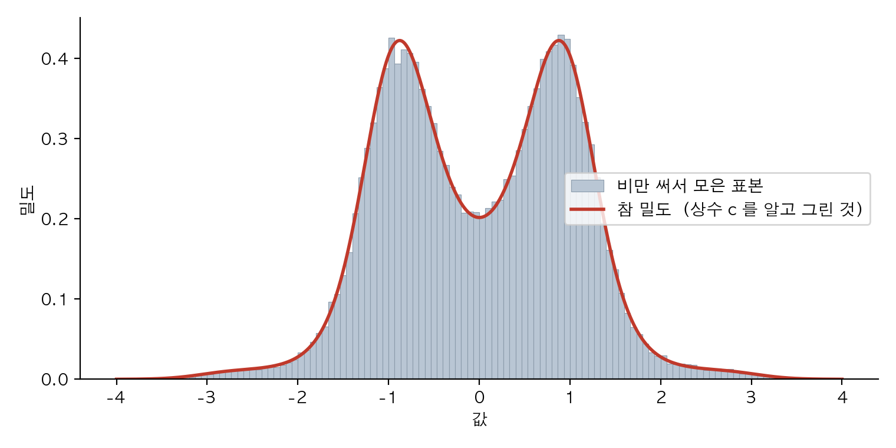
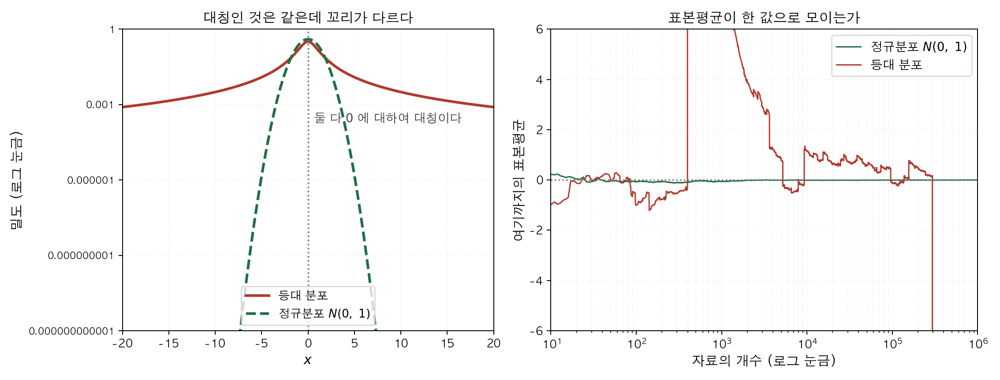
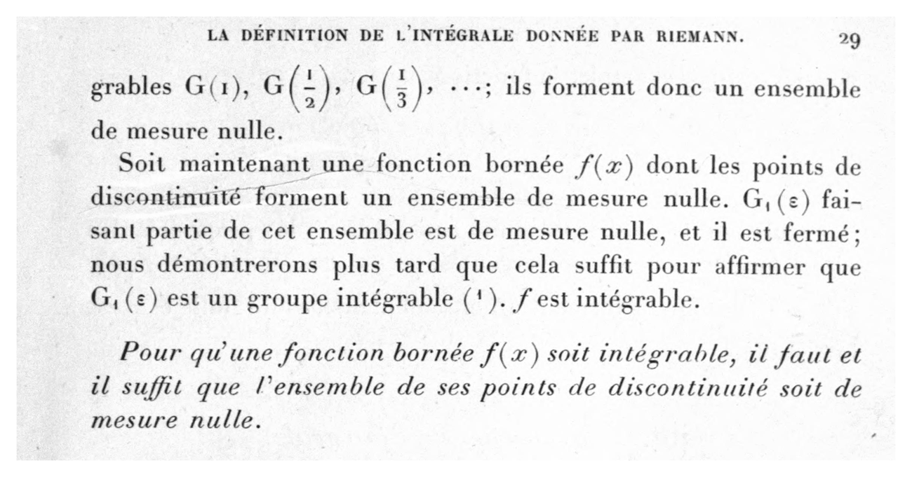
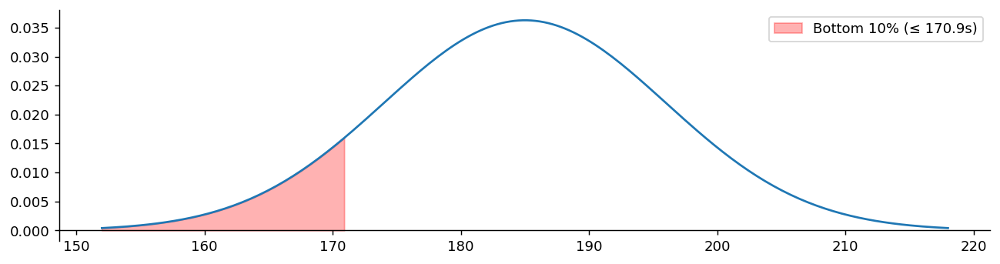
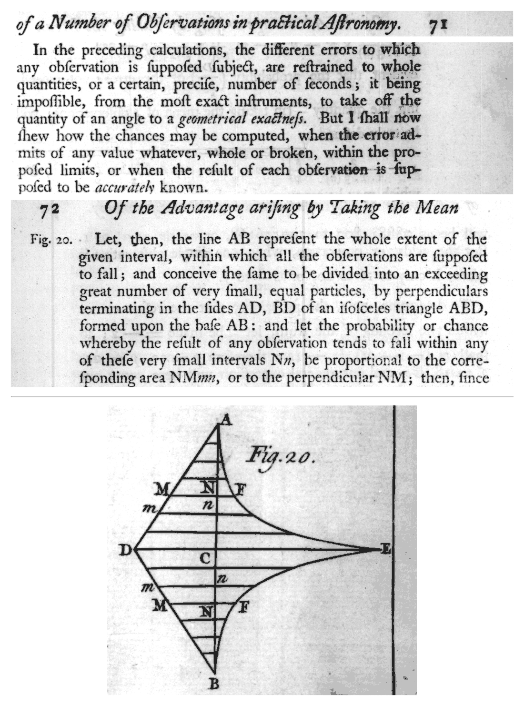

# 연속확률변수

## 개요

앞 절의 이산확률변수는 값이 가산개뿐이라 각 값에 벽돌을 하나씩 놓을 수 있었다. 그런데 대기 시간, 키, 온도처럼 **연속인 값**을 취하는 양은 사정이 다르다. 가능한 값이 비가산개이므로 각 값에 양의 무게를 놓으면 총합이 무한이 되어 버린다.

해결책은 무게를 **점이 아니라 구간에** 놓는 것이다. 벽돌을 하나씩 세워 놓는 대신 실직선 위에 흙을 얇게 펴 바른다고 생각하면 된다. 어느 한 점의 흙의 양은 0이지만, 구간을 잡으면 그 안의 흙의 양은 양수다.

이 절은 한 정의와 한 정리로 이루어진다. 밀도로 무게를 기술하는 방법(정의 1)과 한 점의 확률이 왜 0인지(정리 1)이다. 끝에서 이산과 연속이 무엇을 공유하고 무엇이 다른지(정리 3)이다.

---

## 1. 무게를 점이 아니라 밀도로 놓는다

밀도라는 말은 물리에서 온 것이다. 막대의 어느 점에서 "질량"을 물으면 0이지만 "선밀도"를 물으면 양수이고, 구간에 걸쳐 적분하면 그 부분의 질량이 나온다. 확률도 똑같다.

<div class="defn" markdown>

### 정의 1. 확률밀도함수 { .dfn }

연속확률변수 $X$의 **확률밀도함수(PDF)** $f(x)$는 다음을 만족하는 함수다.

$$
f(x)\,dx = \text{구간 } [x,\, x+dx] \text{ 안의 무게}
$$

성질은 세 가지다.

$$
\textbf{(1)}\; f(x) \geq 0 \qquad
\textbf{(2)}\; \int_{-\infty}^{\infty} f(x)\,dx = 1 \qquad
\textbf{(3)}\; P(a \leq X \leq b) = \int_a^b f(x)\,dx
$$

</div>

앞의 둘은 이산의 경우와 같다. 비음성과 정규화이며, 합이 적분으로 바뀌었을 뿐이다.

!!! warning "$f(x)$는 확률이 아니다"
    확률질량함수 $p_x$는 그 자체가 확률이었지만 **확률밀도함수 $f(x)$는 확률이 아니다.** 밀도이므로 값이 1을 넘을 수도 있다.

    예컨대 $[0, 0.5]$ 위의 균등분포는 $f(x) = 2$다. 그래도 문제가 없다. 확률을 주는 것은 높이가 아니라 **곡선 아래의 넓이**이고, 이 경우 $2 \times 0.5 = 1$이다.

    $f(x)$를 확률로 읽는 것이 연속확률변수에서 가장 흔한 오해다. 단위를 보면 분명해진다. $X$가 초 단위라면 $f(x)$의 단위는 "초당"이고, $f(x)\,dx$에서야 비로소 단위가 없는 확률이 된다.

<div class="aibox" markdown>

**AI로 보는 통계학 1.** 상수를 구하지 못한 채 쓰는 밀도

정의 1 의 성질 (2)는 밀도를 모두 적분하면 $1$ 이어야 한다고 못 박는다. 그래서 모양만 주어진
$g\ge0$ 이 있으면 상수 $c=1/\int g$ 를 곱해 밀도로 만든다. 교과서 문제에서는
그 적분이 늘 손으로 되지만, 기계가 다루는 분포에서는 **바로 그 적분이 안 되는 것**이 보통이다.

요즘 모델이 내놓는 것은 확률이 아니라 **점수**인 경우가 많다. 그럴듯할수록 작은 값을 주는
점수 $E(x)$ 를 두고 $g(x)=e^{-E(x)}$ 로 모양을 적으면, 확률밀도는
$f(x)=c\,e^{-E(x)}$ 다. 문제는 $c$ 다. 변수가 하나면 적분해서 구할 수 있지만, 변수가 열 개만
되어도 같은 촘촘함의 격자에 점이 $10^{23}$ 개가 깔려 전부 더하는 일이 불가능해진다.

그런데 **두 점의 밀도의 비에는 $c$ 가 없다.**

$$
\frac{f(y)}{f(x)}=\frac{c\,g(y)}{c\,g(x)}=\frac{g(y)}{g(x)}
$$

그래서 「어디가 몇 배 그럴듯한가」만 보고 움직이는 규칙을 만들면, $c$ 를 끝내 모른 채로도
그 분포를 따르는 표본을 모을 수 있다.

```python
import numpy as np

def score(x):                                   # 모델이 내놓는 「점수」 — 확률이 아니다
    return 0.5 * x ** 2 + 0.6 * np.cos(3 * x)   # 값이 작을수록 그럴듯하다는 뜻으로 쓴다

xs = np.linspace(-6, 6, 200_001)
Z = np.trapz(np.exp(-score(xs)), xs)        # 정의 1 의 성질 (2) 가 요구하는 상수
print(f"1 차원에서의 상수 Z = {Z:.6f}")
print(f"같은 촘촘함의 격자를 10 차원에 깔면 점이 {201**10:.3e} 개 — 더할 수 없다")

print(f"그런데 두 점의 확률의 비에는 Z 가 없다:  f(0.5)/f(1.5) = "
      f"{np.exp(-(score(0.5) - score(1.5))):.6f}")

rng = np.random.default_rng(0)                  # 비만 써서 표본을 모은다
x, out = 0.0, np.empty(200_000)
for i in range(out.size):
    y = x + rng.normal(0.0, 1.2)                # 한 걸음 옮겨 보고
    if rng.random() < np.exp(-(score(y) - score(x))):   # 비가 크면 받아들인다
        x = y
    out[i] = x

print("구간         표본의 비율    참값(상수를 아는 경우)")
for a, b in [(-2.0, -1.0), (-1.0, 0.0), (0.0, 1.0), (1.0, 2.0)]:
    m = (xs >= a) & (xs <= b)
    print(f"[{a:4.1f}, {b:4.1f})  {np.mean((out >= a) & (out < b)):10.4f}"
          f"   {np.trapz(np.exp(-score(xs[m])), xs[m]) / Z:14.4f}")
```

실행하면 다음이 나온다.

```text
1 차원에서의 상수 Z = 2.719881
같은 촘촘함의 격자를 10 차원에 깔면 점이 1.076e+23 개 — 더할 수 없다
그런데 두 점의 확률의 비에는 Z 가 없다:  f(0.5)/f(1.5) = 2.295797
구간         표본의 비율    참값(상수를 아는 경우)
[-2.0, -1.0)      0.1700           0.1701
[-1.0,  0.0)      0.3136           0.3136
[ 0.0,  1.0)      0.3163           0.3136
[ 1.0,  2.0)      0.1681           0.1701
```

<figure markdown>
  { width=700 }
  <figcaption markdown>막대는 **상수 $c$ 를 한 번도 쓰지 않고** 비만 보며 모은 표본이고, 곡선은 $c$ 를 적분으로 구해 그린 참 밀도다. 구간 확률도 소수 셋째 자리까지 맞는다.</figcaption>
</figure>

네 구간의 비율이 참값과 소수 셋째 자리까지 맞는다. 상수를 모른 채 모았는데도 분포가
제대로 재현된 것이다.

다만 이 방법이 거저 주는 것은 **비**뿐이다. $c$ 를 모르므로 「이 값이 나올 확률이 얼마인가」
같은 물음에는 여전히 답할 수 없고, 한 걸음의 폭을 잘못 잡으면 봉우리 하나에 갇혀 다른
봉우리를 못 보기도 한다. 정의 1 이 그 상수를 $\int f=1$ 하나로 못 박아 둔 것이 고마워지는
자리다 — 그 하나를 구할 수 있을 때와 없을 때 할 수 있는 일이 이렇게 갈린다.

</div>

<div class="storybox" markdown>

**그림으로 보는 통계학 1.** 대칭인데 평균이 없는 밀도

<figure markdown>
  { width=880 }
  <figcaption markdown>왼쪽 — 두 밀도 모두 $0$ 에 대하여 **완벽하게 대칭**이다. 다른 것은 꼬리뿐이어서, $x=20$ 에서 정규분포는 $10^{-12}$ 아래로 내려가 있는데 붉은 쪽은 아직 $0.001$ 언저리다. 오른쪽 — 그 차이가 하는 일이다. 정규분포의 표본평균은 $0$ 으로 내려앉지만 붉은 쪽은 백만 개를 모아도 **자리를 잡지 못한다.** *(이 책에서 그렸다)*</figcaption>
</figure>

밀도가 $x=c$ 에 대하여 대칭이면 평균과 중앙값이 둘 다 $c$ 라고들 한다. 그럴듯한 논법도
붙는다 — 대칭축이 넓이를 반으로 가르니 중앙값이 $c$ 이고, 축에서 잰 편차에 밀도를 곱한
것이 기함수라 상쇄되니 평균도 $c$ 다.

그런데 그 상쇄에는 **말해지지 않은 단서**가 하나 붙어 있다. 두 쪽의 넓이가 각각 유한해야
빼서 $0$ 이 된다는 것이다. 둘 다 무한하면 $\infty-\infty$ 가 되어 상쇄가 뜻을 잃는다.
그런 일이 실제로 일어나는 밀도가 있다.

$$
f(x)=\frac{1}{\pi\left(1+x^{2}\right)}
$$

등대 하나가 바닷가 직선에서 $1$ 만큼 떨어져 있고 등불이 **고르게 돌아간다**고 하자. 빛줄기가
해안선과 이루는 각을 $\theta$ 라 하면 빛이 닿는 자리는 $x=\tan\theta$ 이고, $\theta$ 가
$\left(-\frac\pi2,\ \frac\pi2\right)$ 에서 고르면 $x$ 의 밀도가 바로 위 식이다. 오역 때문에
「아녜시의 마녀」라는 이름이 붙은 그 곡선이다.

이 밀도는 정의 1 의 세 조건을 모두 지키고, $0$ 에 대하여 더없이 대칭이다. 그러니 위
논법을 그대로 쓰면 평균이 $0$ 이어야 한다. 그런데 평균이 **없다.** $\mathrm E|X|$ 를 재어 보면

$$
\int_{-\infty}^{\infty}\frac{|x|}{\pi\left(1+x^{2}\right)}\,dx
=\frac2\pi\int_{0}^{\infty}\frac{x}{1+x^{2}}\,dx
=\frac1\pi\Bigl[\ln\left(1+x^{2}\right)\Bigr]_{0}^{\infty}=\infty
$$

로 발산한다. 양쪽 넓이가 각각 무한하므로 상쇄를 말할 수 없고, 평균은 **정의되지 않는다.**
두 결론 가운데 중앙값에 관한 것만 살아남는다 — 중앙값은 멀쩡히 $0$ 이다.

이것이 그저 말장난이 아님을 사진 오른쪽이 보인다. 자료를 모아 평균을 내면 보통은 참값으로
가라앉는데, 이 분포에서는 백만 개를 모아도 가라앉지 않는다. 씨앗을 바꾸어 백만 개씩 세 번
재어 보면 $+2.22$, $+2.54$, $-6.34$ 가 나온다(정규분포에서는 같은 조건에서 $\pm0.001$ 이다).
자료를 늘리는 것으로는 고칠 수 없다. **없는 값을 재고 있기 때문**이다. 7장
[코시에서 대수의법칙의 실패](../../ch05/non_normal/cauchy_lln_failure.md)가 이 분포 하나만
따로 붙들고 다룬다.

이 분포를 세상에 내놓은 사람과 이름이 붙은 사람이 다르다는 것도 적어 둘 만하다. 성질을
처음 제대로 따진 것은 $1824$ 년의 푸아송이고, 그는 이런 자료에서는 **평균의 오차가 어떤
유한한 값으로도 수렴하지 않는다**는 것을 이미 알아보았다. 코시의 이름이 붙은 것은 그보다
한참 뒤인 $1853$ 년의 다툼에서다. 그해 $7$ 월 $4$ 일에 비에나메가 학술원에서 코시의 $1835$ 년
보간법과 최소제곱법을 견주며 최소제곱이 낫다고 주장했고, 코시는 **최소제곱이 완전히 쓸모없어지는
한 경우**를 들어 반박했다. 그때 꺼내 든 것이 이 분포였다. 최소화할 분산이 아예 없으니
최소제곱이 할 일이 없다는 것이다.

그러니 대칭을 확인하는 것으로 끝내지 말고 **평균이 있는지를 먼저 보아야
한다.** 이 쪽에서 다루는 밀도는 모두 구간이 유한하거나 꼬리가 충분히 빨리 사그라들어 그 걱정이
없지만, 걱정이 없다는 것과 걱정할 것이 없다는 것은 다른 말이다.

_확인한 곳 — 이 분포의 성질을 처음 명시적으로 따진 것이 $1824$ 년의 푸아송이고 그가
「이런 분포를 따르는 관측의 평균을 내면 평균오차가 어떤 유한한 값으로도 수렴하지 않는다」는
것을 짚었다는 것, 코시의 이름이 $1853$ 년의 논쟁에서 붙었다는 것, $1853$ 년 $7$ 월 $4$ 일에
비에나메가 학술원에서 코시의 $1835$ 년 보간법과 최소제곱법을 견주며 최소제곱의 우월함을
주장했다는 것, 그리고 코시가 **최소제곱이 완전히 비효율적인 추정량이 되는 경우**를 보이려고
이 분포를 꺼냈다는 것(분산이 없어 최소화할 것이 없기 때문)은
[Wikipedia 「Cauchy distribution」](https://en.wikipedia.org/wiki/Cauchy_distribution) ·
$\mathrm E|X|$ 가 발산한다는 적분, 등대 모형에서 $\tan\theta$ 의 밀도가 위 식이 된다는 것,
그리고 사진의 두 판(꼬리 견주기와 백만 개까지의 표본평균, 백만 개씩 세 번 재어 $+2.22$·$+2.54$·$-6.34$)은
**이 쪽에서 직접 계산하고 뽑아 보았다**_

</div>

<div class="exbox" markdown>

**보기 1.** <span class="diff easy" title="쉬움"></span> 정규분포. 가장 널리 쓰이는 연속분포는 평균 $\mu$, 분산 $\sigma^2$인 **정규분포**이며 밀도는 다음과 같다.

</div>

??? success "풀이"
    $$
    f(x) = \frac{1}{\sqrt{2\pi\sigma^2}} \exp\!\left(-\frac{(x - \mu)^2}{2\sigma^2}\right)
    $$

    두 값 사이의 곡선 아래 넓이가 $X$가 그 범위에 들어갈 확률이다.

---

## 2. 한 점의 확률은 0이다

밀도로 무게를 놓기로 한 순간 따라오는 귀결이 있다. 폭이 없는 점에는 넓이가 없다.

<div class="thmbox" markdown>

### 정리 1. 점 확률의 소멸 — 연속확률변수는 특정 값을 취할 확률이 0이다 { .thm }

연속확률변수 $X$와 임의의 값 $a$에 대해

$$
P(X = a) = \int_a^a f(x)\,dx = 0
$$

이다. 따라서 등호의 포함 여부가 확률을 바꾸지 않는다.

$$
P(a \leq X \leq b) = P(a < X < b)
$$

</div>

??? proof "증명"

    정의 1 의 성질 (3)에 $a = b$ 를 넣으면 적분의 아래끝과 위끝이 같아진다. 폭이 0 인 구간 위의 적분은 피적분함수가 무엇이든 0 이므로

    $$
    P(X = a) = P(a \le X \le a) = \int_a^a f(x)\,dx = 0
    $$

    이다.

    등호의 포함 여부는 양 끝점 두 개의 차이뿐이다. $[a,b]$ 에서 양 끝을 떼어 내면

    $$
    \{a \le X \le b\} = \{a < X < b\} \cup \{X = a\} \cup \{X = b\}
    $$

    이고 세 사건이 서로소이므로 유한가법성에서

    $$
    P(a \le X \le b) = P(a < X < b) + 0 + 0
    $$

    이다. $\square$

    **밀도로 무게를 놓기로 한 순간 피할 수 없는 귀결이다.** 폭이 없는 것에 넓이를 줄 방법이 없다. 이산에서는 한 점이 양의 무게를 가질 수 있었지만, 연속에서는 무게가 **구간에만** 놓인다.

이산확률변수에서는 $P(X = a)$를 묻는 것이 자연스러웠지만, 연속에서는 그 물음 자체가 정보를 담지 않는다. 의미 있는 물음은 **범위**에 대한 것뿐이다. "대기 시간이 정확히 185.000…초일 확률"이 아니라 "180초에서 190초 사이일 확률"을 묻는다.

3.1절에서 확인했듯 **확률 0은 불가능이 아니다.** 실제로 어떤 값 하나는 반드시 실현되며, 그 값이 나올 확률은 0이었다.

<div class="storybox" markdown>

**그림으로 보는 통계학 2.** 몇 점까지 바꿔도 되는가 — 「측도 $0$」이라는 자

<figure markdown>
  { width=660 }
  <figcaption markdown>앙리 르베그 『적분과 원시함수 찾기에 관한 강의』($1904$)의 인쇄 $29$ 쪽. 머리글이 「**리만이 준 적분의 정의**」인 데서 알 수 있듯 아직 자기 적분을 꺼내기 전, **리만의 적분을 따져 보는 장**이다. 기울인 세 줄이 이 상자의 전부다. *(Internet Archive, PD-old)*</figcaption>
</figure>

정리 1 은 연속확률변수에서 한 점의 확률이 $0$ 이라고 했다. 그러면 밀도를 **한 점에서만**
고쳐 적어도 모든 구간의 확률이 그대로다. 그러면 묻게 된다. **그러면 몇 점까지 바꿔도
되는가?** 한 점은 되고 두 점도 될 것이다. 열 점은? 유리수 전체는?

사진의 기울인 세 줄이 그 물음에 자를 들이댄다.

> 유계함수 $f(x)$ 가 **적분 가능할 필요충분조건**은 그 **불연속점의 집합이 측도 $0$** 인
> 것이다.

**측도 $0$** 이란 그 집합을 **길이의 합이 아무리 작은** 구간 몇 개(또는 셀 수 있게 많은
구간)로 덮을 수 있다는 뜻이다. 점 하나는 길이 $0$ 인 구간으로 덮이니 당연히 측도 $0$ 이고,
점이 열 개여도 백만 개여도 마찬가지다. 놀라운 것은 **유리수 전체**도 측도 $0$ 이라는 점이다.
유리수를 $q_1,\ q_2,\ q_3,\dots$ 로 줄 세운 뒤 $q_n$ 을 길이 $\dfrac{\varepsilon}{2^{n}}$ 인
구간으로 덮으면 전체 길이가

$$
\frac{\varepsilon}{2}+\frac{\varepsilon}{4}+\frac{\varepsilon}{8}+\cdots=\varepsilon
$$

이고 $\varepsilon$ 은 얼마든지 작게 잡을 수 있기 때문이다. 수직선을 빽빽이 메우고 있는 유리수가
**길이로 재면 아무것도 아니다.**

이 자를 손에 쥐면 정의 1 의 밀도가 **하나로 정해지지 않는다**는 것도 또렷해진다. 측도 $0$ 인
집합 위에서 값을 어떻게 바꾸어도 성질 (3)의 적분이 달라지지 않으므로, 같은 분포를 주는 밀도가
얼마든지 많다. 그래서 「밀도」라고 할 때 실제로 말하는 것은 함수 하나가 아니라 **측도 $0$ 만큼의
자유를 남긴 한 묶음**이다. 뒤에 「거의 모든 곳에서」라는 말이 붙어 나오는 까닭이 이것이고,
정리 1 이 $P(X=a)=0$ 이라고 적은 뒤 「확률 $0$ 은 불가능이 아니다」를 굳이 덧붙이는 까닭도
같은 자리에 있다.

사진의 쪽은 기울인 세 줄 **바로 뒤에서** 리만이 예로 든 함수를 든다. 그 함수는 불연속점이
$x=\dfrac{2p+1}{2n}$ 꼴뿐이라 셀 수 있고, 따라서 측도 $0$ 이라 **적분된다.** 반대쪽 예는 두 쪽
뒤에 나온다 — 유리수에서 $1$, 무리수에서 $0$ 인 디리클레 함수는 **모든 점에서** 불연속이라
적분되지 않는다. 겉보기에는 둘 다 「여기저기서 끊긴 함수」인데 한 기준이 둘을 갈라 놓는다.

**앙리 르베그**($1875$–$1941$)가 이 자를 만들었다. 리만이 적분을 정의한 것이 $1854$ 년이니
오십 년이 걸린 셈이다. 그사이에도 적분 가능의 조건을 적어 보려는 시도는 있었고 — 사진의 앞
쪽들이 리만의 진동 조건과 뒤부아레몽의 꼴을 차례로 다룬다 — 르베그가 한 일은 새 조건을
찾아낸 것이라기보다 **그것을 「길이」라는 한마디로 적을 수 있게 만든 것**이다. 그리고 그
자를 만들고 나니 리만의 적분을 고칠 수도 있게 되었는데, 그것이 같은 책의 뒷부분이다.

_확인한 곳 — 인쇄 $29$ 쪽의 기울인 문장(「Pour qu'une fonction bornée $f(x)$ soit intégrable,
il faut et il suffit que l'ensemble de ses points de discontinuité soit de mesure nulle」)과
그 쪽의 머리글(「LA DÉFINITION DE L'INTÉGRALE DONNÉE PAR RIEMANN」), 그리고 바로 뒤의 리만의
예와 불연속점 $x=\frac{2p+1}{2n}$ 은
[Internet Archive 『Leçons sur l'intégration et la recherche des fonctions primitives』($1904$)](https://archive.org/details/leonssurlint00lebeuoft)
낱장 n$42$ 에서 **사진으로 직접 읽었다** · 뒤부아레몽과 리만의 진동 조건($26$–$28$ 쪽),
디리클레 함수가 적분되지 않는다는 대목(인쇄 $31$ 쪽, 「la fonction $\psi(x)$ de Dirichlet」)은
같은 스캔의 OCR 전문에서 쪽 머리글과 함께 짚었다 ·
유리수 전체가 측도 $0$ 이라는 덮기 계산은 **이 쪽에서 직접 적었다** ·
르베그의 생몰년($1875$ 년 $6$ 월 $28$ 일–$1941$ 년 $7$ 월 $26$ 일)은
[위키백과 「앙리 르베그」](https://ko.wikipedia.org/wiki/%EC%95%99%EB%A6%AC_%EB%A5%B4%EB%B2%A0%EA%B7%B8) ·
르베그 적분이 비롯한 박사학위 논문 『Intégrale, longueur, aire』($1902$)가 **파리 이과대학**에
제출된 것이라는 사실은 [MacTutor 「Henri Lebesgue」](https://mathshistory.st-andrews.ac.uk/Biographies/Lebesgue/)
— 같은 글이 그가 $1899$–$1902$ 년에 낭시의 리세에서 가르쳤다고 적는데, 이 때문에 학위를
낭시에서 받은 것으로 적은 글이 적지 않다_

</div>

<div class="exbox" markdown>

**보기 2.** <span class="diff easy" title="쉬움"></span> 어밀리아의 최대 대기시간. 드라이브스루의 평균 대기시간이 $\mu = 185$초, $\sigma = 11$초인 근사 정규분포를 따른다. 어밀리아는 대기시간이 하위 10%에 드는 식당만 이용한다. 그가 받아들이는 최대 대기시간은?

넓이가 0.1이 되는 지점을 찾는 문제, 즉 10번째 백분위수를 구하는 문제다.

</div>

??? success "풀이"
    ```python
    import numpy as np
    import matplotlib.pyplot as plt
    from scipy import stats

    plt.rcParams["font.sans-serif"] = ["NanumGothic", "Apple SD Gothic Neo", "Malgun Gothic"]
    plt.rcParams["font.family"] = "sans-serif"
    plt.rcParams["axes.unicode_minus"] = False

    mu = 185       # 평균 대기시간(초)
    sigma = 11     # 표준편차

    # ppf(0.1)은 "아래쪽 10%의 경계"를 돌려준다. CDF의 역함수다.
    # 즉 P(X <= max_wait) = 0.1 이 되는 지점이다.
    max_wait = stats.norm(loc=mu, scale=sigma).ppf(0.1)
    print(f"Maximum average wait time: {max_wait:.2f} seconds")

    # 시각화: 평균에서 좌우 3 표준편차 구간을 그린다
    x = np.linspace(mu - 3*sigma, mu + 3*sigma, 200)
    pdf = stats.norm(loc=mu, scale=sigma).pdf(x)

    fig, ax = plt.subplots(figsize=(12, 3))
    ax.plot(x, pdf)

    # 하위 10%에 해당하는 영역을 칠한다.
    # 연속확률변수에서 "확률 = 곡선 아래 넓이"라는 사실을 눈으로 보여 준다.
    x_fill = np.linspace(mu - 3*sigma, max_wait, 100)
    ax.fill_between(x_fill, stats.norm(loc=mu, scale=sigma).pdf(x_fill),
                    alpha=0.3, color='r', label=f'Bottom 10% (≤ {max_wait:.1f}s)')
    ax.spines[['right', 'top']].set_visible(False)
    ax.spines['bottom'].set_position('zero')
    ax.legend()
    plt.show()
    ```

    출력:

    ```
    Maximum average wait time: 170.90 seconds
    ```



색칠된 부분의 **넓이**가 0.1이다. 높이가 아니라 넓이라는 점을 다시 확인하라.

---

## 3. 이산과 연속은 같은 것의 두 얼굴이다

표기가 달라 다른 이론처럼 보이지만, 바뀐 것은 합이 적분으로 바뀐 것뿐이다.

!!! note "이산과 연속의 대응 — 합과 적분"

    | 특징 | 이산 | 연속 |
    |:---|:---|:---|
    | 값의 집합 | 가산 | 비가산(구간) |
    | 한 점의 확률 | $P(X=a) > 0$ 가능 | 언제나 $P(X=a) = 0$ |
    | 확률함수 | 확률질량함수 $p_{x_i}$ | 확률밀도함수 $f(x)$ |
    | 그 값의 의미 | 확률 자체 | 밀도(확률이 아님) |
    | 범위의 확률 | $\sum_{x_i \in [a,b]} p_{x_i}$ | $\int_a^b f(x)\,dx$ |
    | 전체 확률 | $\sum_i p_{x_i} = 1$ | $\int_{-\infty}^{\infty} f(x)\,dx = 1$ |

표의 마지막 두 줄이 요점이다. **$\sum$을 $\int$로 바꾸면 그대로 옮겨진다.** 3.4절의 기댓값과 분산도 이 대응을 따라 이산에서 연속으로 그대로 확장된다.

두 세계를 하나의 언어로 묶는 도구가 있다면 더 편할 것이다. 실제로 있다. 다음 절의 **누적분포함수**가 그것이며, 이산이든 연속이든 똑같이 정의되고 똑같이 쓰인다.

<div class="storybox" markdown>

**그림으로 보는 통계학 3.** 질량이 밀도로 건너가는 자리

<figure markdown>
  { width=680 }
  <figcaption markdown>심프슨 『Miscellaneous Tracts』(런던, $1757$)의 $71$·$72$ 쪽과 권말 도판의 **Fig. 20** — 「관측 여러 개의 평균을 취하는 데서 생기는 이로움을 보이려는 시도」에 실린 것이다. $71$ 쪽은 오차를 **정수**로 묶어 둔 앞의 계산을 매듭짓고, $72$ 쪽이 그 묶음을 푼다. 그림에서 가로줄 하나하나가 그 「아주 작은 구간」이다. *(Internet Archive 스캔, PD-old)*</figcaption>
</figure>

위 대응표의 왼쪽 칸이 확률질량함수다 — **값마다 확률을 하나씩 얹은 표.** 사진은 그 표가
오른쪽 칸의 밀도로 건너가는 장면이 활자로 남은 자리다.

심프슨은 천문 관측의 오차를 다루고 있었다. 앞선 명제들에서 그는 「오차가 $-v$ 부터 $v$
까지의 **정수 초**만 될 수 있다」고 보고 각 값의 기회를 수열로 **가정**했다 — 가운데가 가장
크고 양쪽으로 $1, 2, 3, \dots$ 꼴로 줄어드는 수열이니, 오늘 말로 하면 삼각형 모양의 확률질량
함수다. $71$ 쪽 마지막 문단이 그 작업을 이렇게 매듭짓는다 — 「앞의 계산에서 오차는 정수
값으로 묶여 있었다. 그러나 이제 나는 오차가 **아무 값이나, 정수든 쪼개진 값이든** 가질 수
있을 때 그 기회를 어떻게 셈하는지 보이겠다.」

$72$ 쪽이 그 답이다. 선분 $\mathrm{AB}$ 를 「아주 많은 수의, 아주 작은 같은 조각들」로 나누고
이등변삼각형 $\mathrm{ABD}$ 를 세운 뒤, 「관측 결과가 그 작은 구간 $\mathrm{N}n$ 에 떨어질
확률이 거기 대응하는 **넓이** $\mathrm{NM}mn$ 에, 또는 **세로선** $\mathrm{NM}$ 에 비례한다」고
적는다. 값마다 얹혀 있던 확률이 띠의 넓이로 바뀌고, 세로선의 길이가 밀도가 된다. 그림의
가로줄이 그 띠들이다.

$$
P(\text{작은 구간에 떨어짐})\;\propto\;(\text{그 구간 위의 띠 넓이})
$$

같은 사람이 적분을 어림하는 **심프슨 공식**의 그 심프슨이다. 두 일이 닮은 것은 우연이
아니다 — 잘게 나누어 띠로 더한다는 생각 하나가 넓이를 재는 데에도, 확률을 재는 데에도
그대로 쓰였다. 앞 절 [이산확률변수](discrete.md)에서 표로 다룬 확률변수와 이 절에서
넓이로 다루는 확률변수가 갈라지는 자리가 바로 저 $71$ 쪽과 $72$ 쪽 사이이고, 위 대응표가
그 갈라짐을 한 장으로 적은 것이다.

_확인한 곳 — 쪽 번호 $71$·$72$ 와 머리글, $71$ 쪽의 「the different errors … are restrained to
whole quantities … But I shall now shew how the chances may be computed, when the error admits of
any value whatever, whole or broken」, $72$ 쪽의 「let the probability or chance whereby the result
of any observation tends to fall within any of these very small intervals N*n*, be proportional to the
corresponding area NM*mn*, or to the perpendicular NM」, 그리고 권말 도판의 Fig. 20 은
[Internet Archive: bim_eighteenth-century_miscellaneous-tracts-on-_simpson-thomas-frs_1757](https://archive.org/details/bim_eighteenth-century_miscellaneous-tracts-on-_simpson-thomas-frs_1757)
의 낱장 n$78$(인쇄 $71$ 쪽)·n$79$(인쇄 $72$ 쪽)·n$192$(도판)에서 **사진으로 직접 읽었다** ·
앞선 명제에서 기회를 「가운데에서 양쪽으로 등차수열을 따라 줄어드는」 수열로 가정한 것은
같은 글의 제 $2$ 명제에 있다(같은 스캔) · 같은 내용을 두 해 앞서 왕립학회에 편지로 보낸 것은
[『Philosophical Transactions』 제$49$ 권](https://archive.org/details/philosophicaltra4911roya)
에 실려 있다(「A Letter … on the Advantage of taking the Mean of a Number of Observations, in
practical Astronomy」, $1755$ 년 $4$ 월 $10$ 일 낭독 — 이 둘은 그 스캔의 **OCR 전문에서** 읽었다) ·
생몰($1710$-$08$-$20$ ~ $1761$-$05$-$14$)과 심프슨 공식이 그의 이름을 얻은 사정은
[Wikipedia 「Thomas Simpson」](https://en.wikipedia.org/wiki/Thomas_Simpson)_

</div>

---

## 연습문제

<div class="drillbox" markdown>

**연습문제 1.** <span class="diff easy" title="쉬움"></span>
$0 \le x \le 2$에서 $f(x) = c x^2$이고 그 밖에서는 0이다. (a) $c$를 구하라. (b) $F(x)$를 계산하라. (c) $P(1 \le X \le 2)$를 구하라. (d) 중앙값을 구하라.

</div>

??? success "풀이"
    (a) $\int_0^2 c x^2 dx = 8c/3 = 1 \Rightarrow c = 3/8$.

    (b) $x \in [0, 2]$에서 $F(x) = \int_0^x (3/8) t^2 dt = x^3/8$이고, 그 아래에서는 0, 위에서는 1이다.

    (c) $P(1 \le X \le 2) = F(2) - F(1) = 1 - 1/8 = 7/8$.

    (d) $F(m) = 1/2 \Rightarrow m^3/8 = 1/2 \Rightarrow m = \sqrt[3]{4} \approx 1.587$.

---

<div class="drillbox" markdown>

**연습문제 2.** <span class="diff easy" title="쉬움"></span>
**연속확률변수의 기댓값.** $[0, 1]$에서 확률밀도함수가 $f(x) = 2x$인 $X$에 대해 $\mathbb{E}[X]$, $\mathbb{E}[X^2]$, $\mathrm{Var}(X)$를 계산하라.

</div>

??? success "풀이"
    $\mathbb{E}[X] = \int_0^1 x \cdot 2x \, dx = \int_0^1 2x^2 \, dx = 2/3$.

    $\mathbb{E}[X^2] = \int_0^1 x^2 \cdot 2x \, dx = \int_0^1 2x^3 \, dx = 1/2$.

    $\mathrm{Var}(X) = \mathbb{E}[X^2] - (\mathbb{E}[X])^2 = 1/2 - 4/9 = 9/18 - 8/18 = 1/18 \approx 0.0556$.

    표준편차 $\approx 0.236$.

---

<div class="drillbox" markdown>

**연습문제 3.** <span class="diff med" title="중간"></span>
**연속인 $X$에 대해 $P(X = a) = 0$인 이유.** 누적분포함수로부터 엄밀하게 논증하라.

</div>

??? success "풀이"
    누적분포함수 $F$가 연속인 연속확률변수 $X$에 대해, $a$에서 $F$의 연속성을 이용하면

    $$
    P(X = a) = \lim_{\varepsilon \to 0^+} P(a - \varepsilon < X \le a) = \lim_{\varepsilon \to 0^+} [F(a) - F(a - \varepsilon)] = F(a) - F(a^-) = 0
    $$

    이다.

    **참고:** $P(X = a) = 0$이라고 해서 $X = a$가 불가능하다는 뜻은 *아니다*. 르베그의 의미에서 그 사건의 확률이 0이라는 뜻이다. 연속확률변수의 특정 결과는 하나하나가 "무한히 일어나기 어렵지만" 표본공간은 여전히 비가산이고 뽑을 때마다 확정된 결과가 나온다.

    이것이 초급 확률에서 "$P(0)$이 불가능을 뜻하지 않는다"는 혼란의 근원이다. 해결책은 점의 확률이 아니라 밀도로 생각하는 것이다. 연속확률변수는 확률을 점이 아니라 구간에 몰아 놓는다.

---

<div class="drillbox" markdown>

**연습문제 4.** <span class="diff med" title="중간"></span>
**연속 확률밀도함수의 변환 규칙.** $X$의 밀도가 $f_X$이고 $Y = g(X)$이며 $g$가 순증가하고 미분가능할 때 $Y$의 밀도를 유도하라.

</div>

??? success "풀이"
    누적분포함수에서 출발한다: $F_Y(y) = P(Y \le y) = P(g(X) \le y) = P(X \le g^{-1}(y)) = F_X(g^{-1}(y))$.

    연쇄법칙으로 미분하면

    $$
    f_Y(y) = F_Y'(y) = f_X(g^{-1}(y)) \cdot \frac{d}{dy} g^{-1}(y) = \frac{f_X(g^{-1}(y))}{g'(g^{-1}(y))}
    $$

    이다. 또는 더 간결하게, $x = g^{-1}(y)$로 두면

    $$
    f_Y(y) = \frac{f_X(x)}{|g'(x)|}
    $$

    이다. 절댓값을 쓰면 $g$가 감소하는 경우도 함께 다룰 수 있다.

    **예:** $X \sim N(0, 1)$, $Y = e^X$라 하자. 그러면 $g(x) = e^x$, $g'(x) = e^x = y$, $x = \ln y$이므로

    $$
    f_Y(y) = \frac{1}{\sqrt{2\pi}} e^{-(\ln y)^2/2} \cdot \frac{1}{y}
    $$

    이며, 이것이 **로그정규분포**의 밀도다.

---

<div class="drillbox" markdown>

**연습문제 5.** <span class="diff med" title="중간"></span>
**지수분포의 무기억 성질.** $X \sim \mathrm{Exp}(\lambda)$이면 모든 $s, t \ge 0$에 대해 $P(X > s + t \mid X > s) = P(X > t)$임을 증명하라. 그 해석은 무엇인가?

</div>

??? success "풀이"
    생존함수는 $P(X > x) = e^{-\lambda x}$이다. 조건부확률의 정의를 적용하면

    $$
    P(X > s + t \mid X > s) = \frac{P(X > s + t \cap X > s)}{P(X > s)} = \frac{P(X > s + t)}{P(X > s)} = \frac{e^{-\lambda(s+t)}}{e^{-\lambda s}} = e^{-\lambda t} = P(X > t)
    $$

    이다. $\square$

    **해석:** 어떤 사건을 이미 $s$만큼 기다렸다면 남은 대기시간의 분포는 방금 기다리기 시작한 것과 같다. 이 과정은 얼마나 오래 기다렸는지를 "잊어버린다".

    **현실적 함의:**

    - 방사성 붕괴: 붕괴가 무기억적이기 때문에 반감기가 잘 정의된다.
    - 통화 시간: 기억 효과 때문에 경험적으로 지수분포가 아니다(긴 통화는 대개 계속된다).
    - 창구에 오는 고객: 지수 도착간격을 갖는 포아송 과정으로 잘 모형화되는 경우가 많다.

    지수분포는 무기억 성질을 갖는 **유일한** 연속분포이며, 이는 인상적인 특성화다.

---

<div class="drillbox" markdown>

**연습문제 6.** <span class="diff med" title="중간"></span>
**혼합분포.** 순수하게 이산도 아니고 순수하게 연속도 아닌 확률변수 $X$의 예를 들어라. 그 누적분포함수에 도약과 연속 구간이 함께 있음을 보여라.

</div>

??? success "풀이"
    예: (센서가 작동하지 않아서 등의 이유로) "0"이 될 가능성이 있고, 작동할 때는 연속 성분을 갖는 측정값.

    $Y \sim \mathrm{Exp}(1)$이라 하고 $A$를 $Y$와 독립인 Bernoulli(0.3)이라 하자. $X = A \cdot Y$로 정의한다.

    - 확률 0.7로 $A = 0$이므로 $X = 0$이다.
    - 확률 0.3으로 $A = 1$이므로 $X = Y \sim \mathrm{Exp}(1)$이다.

    누적분포함수:

    $$
    F(x) = \begin{cases} 0 & x < 0 \\ 0.7 + 0.3(1 - e^{-x}) & x \ge 0 \end{cases}
    $$

    $x = 0$에서 $F(0) = 0.7$로 0에 있는 이산 질량에 대응하는 **도약**이 있다.
    $x > 0$에서는 0.7에서 1까지 연속적으로 증가한다.

    이런 혼합분포는 실무에 자주 등장한다(영과잉 계수 모형, 보험 청구액, 절단된 측정값). 르베그–스틸체스 적분의 틀이 이들을 엄밀하게 다루며, 실용적으로는 이산 부분과 연속 부분으로 분해해 각각 적절히 적분한다.

---

<div class="drillbox" markdown>

**연습문제 7.** <span class="diff med" title="중간"></span>
연습문제 $3$은 $g$가 **순증가**일 때의 변환 규칙이었다. $g$가 단조가 아니면 어떻게 되는가? $Y = X^2$으로 확인하라.

</div>

??? success "풀이"
    $g$가 단조가 아니면 $y$ 하나에 여러 $x$가 대응한다. 각 가지의 기여를 **더해야** 한다.

    $$
    f_Y(y) = \sum_{i:\, g(x_i)=y} \frac{f_X(x_i)}{\lvert g'(x_i)\rvert}
    $$

    $Y = X^2$이면 $x = \pm\sqrt{y}$ 두 가지이고 $\lvert g'(x)\rvert = 2\sqrt{y}$이므로

    $$
    f_Y(y) = \frac{f_X(\sqrt{y}) + f_X(-\sqrt{y})}{2\sqrt{y}}, \qquad y > 0
    $$

    이다. $X \sim N(0,1)$이면 $f_X$가 대칭이라

    $$
    f_Y(y) = \frac{2\phi(\sqrt{y})}{2\sqrt{y}} = \frac{1}{\sqrt{2\pi y}}e^{-y/2}
    $$

    이고, 이것이 자유도 $1$인 카이제곱분포의 밀도다.

    ```python
    import numpy as np
    from scipy import stats

    rng = np.random.default_rng(0)
    X = rng.normal(0, 1, 600_000)
    Y = X ** 2

    print("Y = X^2,  X ~ N(0,1)  →  Y ~ chi2(1)")
    print(f"{'분위수':>8}{'모의':>10}{'chi2(1)':>10}")
    for q in (0.25, 0.50, 0.75, 0.95):
        print(f"{q:>8.2f}{np.quantile(Y, q):>10.4f}{stats.chi2.ppf(q, 1):>10.4f}")

    print(f"\n평균 {Y.mean():.4f} (이론 1)   분산 {Y.var():.4f} (이론 2)")
    print(f"y=0 근처에서 밀도가 발산한다: f(0.01) = {stats.chi2.pdf(0.01, 1):.3f}")
    ```

    출력:

    ```
    Y = X^2,  X ~ N(0,1)  →  Y ~ chi2(1)
         분위수        모의   chi2(1)
        0.25    0.1025    0.1015
        0.50    0.4567    0.4549
        0.75    1.3239    1.3233
        0.95    3.8445    3.8415

    평균 1.0022 (이론 1)   분산 2.0121 (이론 2)
    y=0 근처에서 밀도가 발산한다: f(0.01) = 3.970
    ```

    **분위수가 정확히 맞는다.**

    **두 가지를 눈여겨보라.**

    **첫째, 밀도가 $y \to 0^+$에서 발산한다.** $1/\sqrt{y}$ 항 때문이다. **밀도는 $1$을 넘을 수 있고 무한대로 갈 수도 있다.** 확률이 아니라 밀도이기 때문이며, 적분만 유한하면 된다.

    **둘째, 이 변환이 카이제곱분포의 정의다.** 표준정규의 제곱합이 카이제곱이고, 그것이 표본분산의 분포로 이어진다(0장 선형대수 문서에서 본 이차형식). **변환 공식 하나가 통계 이론 전체의 출발점**인 셈이다.

    **주의할 경우.**

    - **$g'$가 $0$이 되는 점**에서는 공식이 무너진다. 그 점 근처를 따로 다루어야 한다.
    - **$g$가 상수인 구간이 있으면** 그 값에 **확률질량**이 생겨 순수 연속이 아니게 된다(연습문제 6의 혼합분포).
    - **가장 안전한 방법은 누적분포함수로 가는 것이다.** $F_Y(y) = P(g(X) \le y)$를 직접 계산한 뒤 미분하면 가지를 빠뜨릴 위험이 없다. $\square$

---

<div class="drillbox" markdown>

**연습문제 8.** <span class="diff med" title="중간"></span>
표본에서 **최솟값과 최댓값**의 분포는 어떻게 되는가? 순서통계량의 분포를 유도하고 확인하라.

</div>

??? success "풀이"
    $X_1,\ldots,X_n$이 i.i.d.이고 누적분포함수가 $F$일 때

    $$
    F_{X_{(n)}}(x) = P(\text{모두} \le x) = F(x)^n,
    \qquad
    F_{X_{(1)}}(x) = 1 - \left(1-F(x)\right)^n
    $$

    이다. 미분하면 밀도를 얻는다. 일반적으로 $k$번째 순서통계량은

    $$
    f_{X_{(k)}}(x) = \frac{n!}{(k-1)!(n-k)!}F(x)^{k-1}\left(1-F(x)\right)^{n-k}f(x)
    $$

    이며, **$U(0,1)$이면 $X_{(k)} \sim \text{Beta}(k,\ n-k+1)$**이다.

    ```python
    import numpy as np

    rng = np.random.default_rng(0)
    n, B = 10, 300_000
    U = np.sort(rng.random((B, n)), axis=1)

    print(f"U(0,1) 에서 n={n} 일 때 순서통계량의 평균")
    print(f"{'k':>4}{'모의':>11}{'이론 k/(n+1)':>15}")
    for k in (1, 3, 5, 8, 10):
        print(f"{k:>4}{U[:, k-1].mean():>11.5f}{k/(n+1):>15.5f}")

    print(f"\n최댓값의 분산 {U[:, -1].var():.6f}   "
          f"이론 {n / ((n+1)**2 * (n+2)):.6f}")
    ```

    출력:

    ```
    U(0,1) 에서 n=10 일 때 순서통계량의 평균
       k         모의     이론 k/(n+1)
       1    0.09096        0.09091
       3    0.27283        0.27273
       5    0.45469        0.45455
       8    0.72724        0.72727
      10    0.90910        0.90909

    최댓값의 분산 0.006901   이론 0.006887
    ```

    **모의와 이론이 소수점 다섯째 자리까지 맞는다.**

    **$\mathbb{E}[X_{(k)}] = k/(n+1)$이라는 결과가 깔끔하다.** $n$개의 점이 $[0,1]$을 $n+1$개의 구간으로 나누고, 각 구간의 기대 길이가 $1/(n+1)$로 같기 때문이다.

    **이것이 여러 곳에서 쓰인다.**

    - **Q–Q 그림의 플로팅 위치.** 0장 matplotlib 문서 연습문제 7에서 $(i-0.5)/n$을 썼는데, $i/(n+1)$을 쓰는 관례도 있다. 전자는 중앙값 기반, 후자는 평균 기반이다.
    - **분위수 추정.** 2장 ECDF 문서 연습문제 8의 여러 분위수 정의가 순서통계량을 어떻게 보간하느냐의 차이다.
    - **극단값 이론.** $X_{(n)}$의 분포가 $F$의 꼬리에 지배되며, 적절히 정규화하면 검벨·프레셰·바이불로 수렴한다(1장 모수 대 통계량 문서 연습문제 8).

    **최댓값의 특이한 성질.** 분산이 $n/((n+1)^2(n+2))$로 $n^{-2}$ 규모로 줄어든다. **표본평균의 $n^{-1}$보다 빠르다.** 그래서 유계 분포의 상한을 추정할 때는 최댓값이 매우 효율적이며, 이것이 1장에서 언급한 $U(0,\theta)$의 초효율 속도 $n^{-1}$의 근원이다. $\square$

---

<div class="drillbox" markdown>

**연습문제 9.** <span class="diff med" title="중간"></span>
연속분포라고 **적률이 존재한다는 보장은 없다.** 파레토분포로 확인하고 그 실무적 의미를 논하라.

</div>

??? success "풀이"
    파레토분포 $f(x) = \alpha x^{-(\alpha+1)}$, $x \ge 1$에서

    $$
    \mathbb{E}[X^k] = \int_1^\infty x^k \alpha x^{-(\alpha+1)}dx = \alpha\int_1^\infty x^{k-\alpha-1}dx
    $$

    는 $k < \alpha$일 때만 수렴한다. **즉 $\alpha$차 이상의 적률은 존재하지 않는다.**

    ```python
    import numpy as np

    rng = np.random.default_rng(0)
    N = 2_000_000

    print(f"{'alpha':>7}{'표본평균':>12}{'이론 평균':>12}{'표본분산':>16}{'분산 존재':>10}")
    for a in (0.8, 1.5, 2.5, 3.5):
        x = rng.pareto(a, N) + 1
        mean_th = a / (a - 1) if a > 1 else float("inf")
        print(f"{a:>7.1f}{x.mean():>12.3f}{mean_th:>12.3f}{x.var():>16.1f}{str(a > 2):>10}")

    print("\n표본평균의 변동이 sqrt(n) 속도로 줄어드는가?")
    for label, a in [("분산 없음 (alpha=1.5)", 1.5), ("분산 있음 (alpha=3.5)", 3.5)]:
        print(f"  {label}")
        prev = None
        for n in (10 ** 3, 10 ** 4, 10 ** 5, 10 ** 6):
            s = np.std([(rng.pareto(a, n) + 1).mean() for _ in range(300)])
            ratio = f"   직전 대비 {prev / s:.2f}배" if prev else ""
            print(f"    n={n:>8}: {s:.5f}{ratio}")
            prev = s
    print(f"\n  sqrt(n) 이면 n 이 10배 될 때마다 {np.sqrt(10):.2f}배씩 줄어야 한다")
    ```

    출력:

    ```
      alpha        표본평균       이론 평균            표본분산     분산 존재
        0.8     141.802         inf    1932163866.8     False
        1.5       3.006       3.000          2164.1     False
        2.5       1.666       1.667             2.0      True
        3.5       1.401       1.400             0.4      True

    표본평균의 변동이 sqrt(n) 속도로 줄어드는가?
      분산 없음 (alpha=1.5)
        n=    1000: 1.08544
        n=   10000: 0.18283   직전 대비 5.94배
        n=  100000: 0.15373   직전 대비 1.19배
        n= 1000000: 0.03477   직전 대비 4.42배
      분산 있음 (alpha=3.5)
        n=    1000: 0.01909
        n=   10000: 0.00606   직전 대비 3.15배
        n=  100000: 0.00201   직전 대비 3.02배
        n= 1000000: 0.00056   직전 대비 3.56배

      sqrt(n) 이면 n 이 10배 될 때마다 3.16배씩 줄어야 한다

    ```

    **$\alpha = 0.8$이면 평균조차 없다.** 표본 $200$만 개의 표본평균이 $141.8$로 나오지만 이 값은 아무 의미가 없다. 표본을 다시 뽑으면 전혀 다른 값이 나온다.

    **$\alpha = 1.5$면 평균은 있지만 분산이 없다.** 표본평균이 이론값 $3.0$에 맞기는 하지만, 수렴 방식이 전혀 다르다.

    | $n$ 10배 증가 | $\alpha=1.5$ (분산 없음) | $\alpha=3.5$ (분산 있음) |
    |---|---|---|
    | $10^3 \to 10^4$ | $5.94$배 | $3.15$배 |
    | $10^4 \to 10^5$ | $1.19$배 | $3.02$배 |
    | $10^5 \to 10^6$ | $4.42$배 | $3.56$배 |

    **분산이 있으면 감소 배수가 $\sqrt{10} \approx 3.16$ 근처로 안정적이다.** 중심극한정리가 보장하는 $\sqrt{n}$ 속도다.

    **분산이 없으면 배수가 $1.19$에서 $5.94$까지 들쭉날쭉하다.** 이 자체가 신호다. 큰 관측 하나가 들어오느냐에 따라 표본평균이 좌우되므로, **수렴 속도라는 개념 자체가 불안정하다.** 이론적으로는 $n^{1-1/\alpha}$ 속도로 안정분포에 수렴하지만, 그 극한은 정규가 아니다.

    **실무적 의미가 크다.**

    | 존재하는 적률 | 무엇이 무너지는가 |
    |---|---|
    | 평균 없음 ($\alpha \le 1$) | 큰수의 법칙 실패, 표본평균이 발산 |
    | 분산 없음 ($1 < \alpha \le 2$) | **중심극한정리 실패**, $t$ 검정·신뢰구간 무효 |
    | 4차 적률 없음 ($\alpha \le 4$) | 표본분산의 분산이 무한, $F$ 검정 불안정 |

    **둘째 줄이 특히 중요하다.** 3장 뒤에서 볼 중심극한정리는 **유한 분산**을 요구한다. 그것이 없으면 표본평균이 정규가 아니라 **안정분포**로 수렴하며, 표준적인 추론이 모두 무효가 된다.

    **어디서 마주치는가.** 소득, 도시 인구, 지진 규모, 보험 대형 손실, 금융 수익률의 꼬리가 $\alpha = 1.5$–$3$ 범위로 추정되는 경우가 많다. **$\alpha < 2$이면 "평균 손실"을 논하는 것 자체가 위험하다.**

    **진단.** 표본평균을 $n$에 따라 그려 보아 안정되지 않으면 적률의 존재를 의심해야 한다. 2장 왜도·첨도 문서 연습문제 9의 강건 측도가 이런 상황을 위한 것이다. $\square$

---

<div class="drillbox" markdown>

**연습문제 10.** <span class="diff hard" title="어려움"></span>
연습문제 $5$의 무기억성을 일반화하라. **위험률**로 분포를 특징짓고, 지수분포가 어떤 위치를 차지하는지 밝혀라.

</div>

??? success "풀이"
    **위험률**은 "지금까지 살아남았을 때 바로 다음 순간 일어날 조건부 강도"다.

    $$
    h(t) = \frac{f(t)}{1-F(t)} = -\frac{d}{dt}\log S(t), \qquad S(t) = 1-F(t)
    $$

    적분해 되돌리면 $S(t) = \exp\left(-\int_0^t h(u)\,du\right)$이므로, **위험률이 분포를 완전히 결정한다.**

    ```python
    import numpy as np
    from scipy import stats

    grid = np.linspace(0.1, 3.0, 7)
    print(f"{'t':>6}{'지수(1)':>11}{'와이불 k=0.5':>15}{'와이불 k=2':>13}{'로그정규':>12}")
    for t in grid:
        h_exp = 1.0
        h_w05 = stats.weibull_min.pdf(t, 0.5) / stats.weibull_min.sf(t, 0.5)
        h_w2 = stats.weibull_min.pdf(t, 2) / stats.weibull_min.sf(t, 2)
        h_ln = stats.lognorm.pdf(t, 1) / stats.lognorm.sf(t, 1)
        print(f"{t:>6.2f}{h_exp:>11.4f}{h_w05:>15.4f}{h_w2:>13.4f}{h_ln:>12.4f}")
    ```

    출력:

    ```
         t      지수(1)      와이불 k=0.5      와이불 k=2        로그정규
      0.10     1.0000         1.5811       0.2000      0.2846
      0.58     1.0000         0.6547       1.1667      0.8389
      1.07     1.0000         0.4841       2.1333      0.7870
      1.55     1.0000         0.4016       3.1000      0.7072
      2.03     1.0000         0.3506       4.0667      0.6383
      2.52     1.0000         0.3152       5.0333      0.5816
      3.00     1.0000         0.2887       6.0000      0.5349
    ```

    **지수분포만 위험률이 일정하다.** 그것이 무기억성의 정확한 내용이다.

    $$
    h(t) = \lambda \text{ (상수)} \iff S(t) = e^{-\lambda t} \iff \text{무기억성}
    $$

    **세 조건이 서로 동치이며, 연속분포 중 이를 만족하는 것은 지수분포뿐이다.**

    **위험률의 모양이 분포의 성격을 말해 준다.**

    | 위험률 | 뜻 | 예 |
    |---|---|---|
    | 일정 | 노화도 개선도 없다 | 방사성 붕괴, 지수 |
    | 증가 | **노화** — 오래될수록 위험 | 마모, 와이불 $k>1$ |
    | 감소 | **길들이기** — 초기 결함이 걸러진다 | 유아 사망, 와이불 $k<1$ |
    | 욕조 곡선 | 초기 감소 후 증가 | 기계 부품, 인간 수명 |
    | 증가 후 감소 | 비단조 | 로그정규 |

    **왜 위험률로 생각하는가.**

    - **해석이 직접적이다.** "$5$년을 버틴 기계가 앞으로 $1$년 안에 고장 날 확률"이 실무에서 묻는 질문이며, 밀도가 아니라 위험률이 그 답에 대응한다.
    - **검열된 자료를 자연스럽게 다룬다.** 아직 사건이 일어나지 않은 관측도 "그 시점까지 살아남았다"는 정보를 준다.
    - **비례위험 모형의 토대다.** 콕스 회귀는 $h(t\mid x) = h_0(t)e^{\beta^\top x}$로 두어 기저 위험률 $h_0$를 추정하지 않고도 $\beta$를 추정한다.

    **지수분포가 특별한 위치에 있는 이유가 정리된다.** 위험률이 일정하다는 것은 **"과거를 기억하지 않는다"** 는 뜻이고, 그것이 포아송 과정(이산형 문서 연습문제 8)과 마르코프 성질(조건부 독립 문서 연습문제 2)의 연속 시간판이다. **세 개념이 하나의 성질을 세 언어로 말한 것**이다. $\square$

---

## 정리하며

연속확률변수는 무게를 다루는 방식만 바꾼 것이다.

- **정의 1**은 무게를 점이 아니라 **밀도**로 놓았다. 확률을 주는 것은 높이가 아니라 곡선 아래의 넓이다.
- **정리 1**은 그 귀결로 한 점의 확률이 0임을 보였다. 등호를 넣든 빼든 확률이 같아지고, 의미 있는 물음은 범위에 대한 것뿐이다.
- 끝의 대응표는 이산과 연속이 $\sum \leftrightarrow \int$로 이어져 있음을 모았다.

이산과 연속을 나누어 배우는 것은 계산 방법이 다르기 때문이지 이론이 둘이기 때문이 아니다. 확률의 공리는 하나이고, 두 경우 모두 그 위에 서 있다.

그렇다면 두 세계를 아예 하나의 함수로 다룰 수는 없을까? 이산이든 연속이든 똑같이 정의되고, 확률질량함수와 확률밀도함수를 모두 대신할 수 있는 함수 말이다.

있다. **누적분포함수** $F(x) = P(X \le x)$이며, 다음 절의 주제다. 이 함수 하나로 분포가 완전히 결정되고, 여기서 분위수와 난수 생성까지 따라 나온다.
