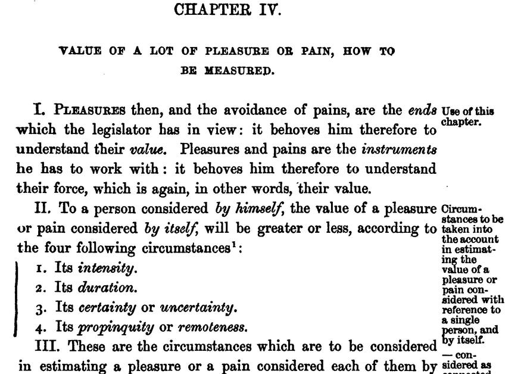
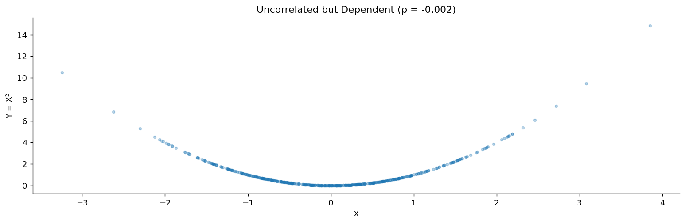
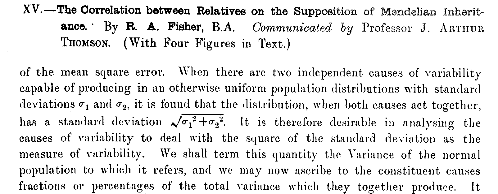
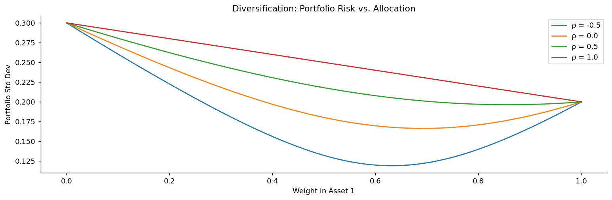
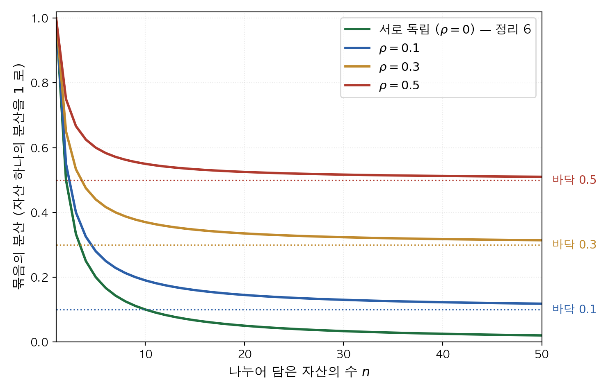

# 분산과 공분산

## 개요

기댓값은 분포의 중심을 알려 주지만 그것뿐이다. 언제나 정확히 3.5가 나오는 가짜 주사위와 공정한 주사위는 기댓값이 같다. 빠진 것은 **퍼짐**이다.

**분산**이 그 두 번째 요약값이다. 값들이 중심에서 얼마나 흩어져 있는가를 잰다. 그리고 확률변수가 둘이 되면 새로운 물음이 생긴다. 두 변수가 **함께** 움직이는가? 이것을 재는 것이 **공분산**이며, 정규화하면 **상관계수**가 된다.

이 절은 두 정의와 세 정리로 이루어진다. 분산의 정의(정의 1)와 그 계산 꼴(정리 1), 공분산과 상관계수(정의 2)와 그 계산 꼴(정리 2), 그리고 합의 분산이 왜 단순한 덧셈이 아닌지(정리 3)이다.

---

## 1. 중심에서 얼마나 흩어져 있는가

퍼짐을 재려면 "평균에서 얼마나 떨어져 있는가"를 평균 내면 될 것 같다. 후보가 셋인데 살아남는 것은 하나뿐이다.

**후보 1. 편차를 그대로 평균 낸다.** 앞 쪽의 선형성을 쓰면 한 줄로 끝난다.

$$
E[X - \mu] = E[X] - \mu = \mu - \mu = 0
$$

분포가 무엇이든 0이다. 양의 편차와 음의 편차가 정확히 상쇄되기 때문이며, 이는 $\mu$가 **균형점**이라는 사실의 다른 표현이다. 그러므로 퍼짐의 측도가 될 수 없다.

**후보 2. 절댓값을 씌운다.** $E\lvert X - \mu \rvert$는 0이 아니고 뜻도 직관적이다. 그런데 $\lvert x \rvert$는 $0$에서 미분할 수 없고, 무엇보다 합에 대해 분해되지 않는다. 이 절의 정리 3에서 볼 $\text{Var}(X+Y)$ 공식 같은 항등식이 절대편차에는 없다.

**후보 3. 제곱한다.** $E[(X - \mu)^2]$은 부호가 사라지고, 어디서나 매끄럽고, 대수적으로 분해된다. 이것을 분산으로 삼는다.

자료 수준에서 같은 비교를 한 것이 [2.4절 분산과 표준편차](../../ch02/spread/variance_std.md)다.

<div class="defn" markdown>

### 정의 1. 분산과 표준편차 { .dfn }

확률변수 $X$ 의 **분산**은 평균 $\mu = E[X]$ 에서의 기대 제곱편차

$$
\text{Var}(X) = E\big[(X - \mu)^2\big]
$$

이고, 그 제곱근을 **표준편차**라 한다.

$$
\sigma_X = \sqrt{\text{Var}(X)}
$$

</div>

<div class="storybox" markdown>

**그림으로 보는 통계학 1.** 곱하지 않은 목록

<figure markdown>
  { width=640 }
  <figcaption markdown>제러미 벤담 『도덕과 입법의 원리 서설』 제 $4$ 장. 제목이 **「쾌와 불쾌 한 묶음의 값, 어떻게 잴 것인가」**이고, 본문 II 에서 「한 사람을 두고 볼 때 쾌나 불쾌의 값은 **다음 네 가지 사정**에 따라 크거나 작다」고 한 뒤 목록을 든다 — **$1$. 그 강도. $2$. 그 지속. $3$. 그 확실함 또는 불확실함. $4$. 그 가까움 또는 멂.** 오른쪽 여백의 작은 글씨는 이 대목이 무엇을 다루는지 적은 난외주다. *(Internet Archive, 저작권 없음)*</figcaption>
</figure>

앞 쪽의 기댓값은 결과에 수를 붙인 뒤 확률을 곱해 **하나의 수**로 만든다. 그렇게 해야
한다고 처음 또박또박 적은 사람이 사진의 책을 쓴 **제러미 벤담**($1748$–$1832$)이다.
$1780$ 년에 찍고 $1789$ 년에 펴낸 책이다.

눈여겨볼 것은 **세 번째 항목**이다. 「그 확실함 또는 불확실함」 — 값을 재려면 확률을 보아야 한다는 말이 $1789$ 년에 목록으로 올라 있다.

그런데 벤담은 **거기서 멈춘다.** 네 가지를 어떻게 하라고 했는가. 같은 장 V 의 다섯째 항목에서 그는 「한쪽의 모든 쾌의 값을 **모두 더하고** 다른 쪽의 모든 불쾌의 값을 모두 더하여, 그 차가 쾌 쪽에 있으면 좋은 쪽」이라고 한다. **더하라는 것이다.** 강도와 확실함을 **곱하라**는 말은 이 장 어디에도 없다. 그 곱셈이 기댓값 $E[X]=\sum x_i p_i$ 다.

더 눈여겨볼 것은 그 곱셈이 **벤담보다 먼저 있었다**는 점이다. 다니엘 베르누이는 벤담의 책이 나오기 쉰 해쯤 앞선 $1738$ 년 논문을 「기하학자들이 운의 크기를 재기 시작한 뒤로 모두 이렇게 해 왔다 — 기대되는 값마다 그것이 나오는 경우의 수를 **곱하고**, 곱한 것들을 더해 전체 경우의 수로 나눈다」로 연다. 그러니 어려웠던 것은 곱셈을 **발명하는** 일이 아니라 두 갈래를 **같은 자리에 놓는** 일이었다.

**그리고 벤담에게 없던 것이 하나 더 있다 — 바로 정의 1 이다.** 네 항목 어디에도 「흩어짐」이 없다. $100$ 을 확실히 받는 것과 $200$ 과 $0$ 을 반반으로 받는 것은 기댓값이 둘 다 $100$ 이지만, 정의 1 로 재면 분산이 $0$ 과

$$
\operatorname{Var}(X)=E[(X-100)^2]=\tfrac12(100)^2+\tfrac12(-100)^2=10{,}000
$$

으로 갈린다. 「같은 값인데 다른 선택」이 생기는 자리이고, 벤담의 목록으로는 그 둘을
구별할 길이 없다. 이 쪽이 기댓값 다음에 따로 서는 까닭이 그것이다 — **중심 하나로는
모자란다.**

_확인한 곳 — 장 번호와 제목 「CHAPTER IV. VALUE OF A LOT OF PLEASURE OR PAIN, HOW TO BE MEASURED」, 본문 II 의 「the four following circumstances」와 네 항목(「$1$. Its *intensity*. $2$. Its *duration*. $3$. Its *certainty* or *uncertainty*. $4$. Its *propinquity* or *remoteness*.」)은 위 **사진에서 직접 읽었다** · 같은 장 V 의 다섯째 항목 「Sum up all the values of all the pleasures on the one side, and those of all the pains on the other. The balance, if it be on the side of pleasure, will give the good tendency」는 **사진에 실린 장 첫 쪽에는 없다** — 같은 스캔 [Internet Archive 『An Introduction to the Principles of Morals and Legislation』(클래런던판)](https://archive.org/details/anintroductiont03bentgoog) 의 전문에서 쪽 머리글 「IV.] how to be Measured. $31$」 아래로 이어지는 인쇄 $31$ 쪽에서 확인했다 · 이 책이 $1780$ 년에 인쇄되어 $1789$ 년에 출간되었다는 것은 [Wikipedia 「An Introduction to the Principles of Morals and Legislation」](https://en.wikipedia.org/wiki/An_Introduction_to_the_Principles_of_Morals_and_Legislation) · 베르누이가 $1738$ 년 논문을 「cum valores singuli expectati multiplicentur per numerum casuum quibus obtingere possunt aggregatumque productorum dividatur per summam omnium casuum」으로 연다는 것은 [『Commentarii Academiae Scientiarum Imperialis Petropolitanae』 제 $5$ 권 스캔](https://archive.org/details/commentariiacade05impe) 의 인쇄 $175$ 쪽(그 논문 제 $1$ 절의 첫 문장) · 두 선택지의 기댓값이 같고 분산이 $0$ 과 $10\,000$ 이라는 것은 **이 쪽에서 직접 계산해 보았다**_

</div>

<div class="thmbox" markdown>

### 정리 1. 분산의 계산 꼴 { .thm }

$$
\text{Var}(X) = E[X^2] - (E[X])^2
$$

이다. 평균 주위의 편차를 재지 않고 **두 적률만으로** 계산할 수 있다.

</div>

??? proof "증명"

    두 표현이 같다는 것만 보이면 된다. $\mu$는 **상수**이므로 $E[(X-\mu)^2]$의 제곱을 전개한 뒤 항마다 선형성을 쓸 수 있다.

    $$
    E\big[(X-\mu)^2\big] = E\big[X^2 - 2\mu X + \mu^2\big]
    = E[X^2] - 2\mu\,E[X] + \mu^2
    $$

    여기서 $E[X] = \mu$이므로

    $$
    = E[X^2] - 2\mu^2 + \mu^2 = E[X^2] - \mu^2 = E[X^2] - (E[X])^2
    $$

    이다. 표에 적은 성질도 같은 방식으로 나온다. 평행이동은 $X + c$의 평균이 $\mu + c$라서 편차 $(X+c)-(\mu+c) = X - \mu$가 변하지 않기 때문이고, 척도는 편차가 $a$배 되면 그 제곱이 $a^2$배 되기 때문이다.

    $$
    \text{Var}(aX + c) = E\big[(aX + c - a\mu - c)^2\big] = E\big[a^2(X-\mu)^2\big] = a^2\,\text{Var}(X)
    $$

    비음성은 $(X-\mu)^2 \ge 0$의 기댓값이 음수가 될 수 없다는 것이고, 등호는 $(X-\mu)^2$이 확률 $1$로 $0$일 때, 곧 $X$가 상수일 때만 성립한다. $\square$

두 번째 형태 $E[X^2] - (E[X])^2$이 계산에는 대개 더 편하다. 앞 쪽의 LOTUS를 $g(x) = x^2$에 적용하면 $E[X^2]$을 곧바로 얻을 수 있기 때문이다.

주요 성질은 다음과 같다.

| 성질 | 식 | 비고 |
|:---|:---|:---|
| 비음성 | $\text{Var}(X) \ge 0$ | $X$가 상수일 때만 0 |
| 상수 | $\text{Var}(c) = 0$ | |
| 척도 | $\text{Var}(aX) = a^2\,\text{Var}(X)$ | **$a$가 아니라 $a^2$** |
| 평행이동 불변 | $\text{Var}(X + c) = \text{Var}(X)$ | 퍼짐은 위치와 무관 |

척도 성질에서 제곱이 붙는 것이 기댓값과의 결정적 차이다. 기댓값은 선형이지만 **분산은 선형이 아니다**. 그래서 표준편차를 함께 쓴다. $\text{SD}(aX) = |a|\,\text{SD}(X)$로 원래 단위와 눈금이 맞는다.

<div class="exbox" markdown>

**보기 1.** <span class="diff easy" title="쉬움"></span> 공정한 주사위.

</div>

??? success "풀이"
    $$
    E[X] = 3.5, \qquad E[X^2] = \frac{1^2 + 2^2 + \cdots + 6^2}{6} = \frac{91}{6}
    $$

    $$
    \text{Var}(X) = \frac{91}{6} - 3.5^2 = \frac{35}{12} \approx 2.917
    $$

    ```python
    import numpy as np

    # 공정한 주사위의 분산
    values = np.arange(1, 7)          # 나올 수 있는 값 1~6
    probs = np.ones(6) / 6            # 각각 확률 1/6

    # 기댓값은 "값 x 확률"의 합이다
    E_X = np.sum(values * probs)

    # E[X^2]은 값을 제곱해서 같은 확률로 가중합한 것.
    # 주의: E[X^2] 와 (E[X])^2 은 다르다. 그 차이가 곧 분산이다.
    E_X2 = np.sum(values**2 * probs)

    # 계산에 편한 공식: Var(X) = E[X^2] - (E[X])^2
    # 정의식 E[(X - mu)^2] 를 전개하면 이 형태가 나온다.
    var_X = E_X2 - E_X**2
    print(f"E[X] = {E_X:.4f}")
    print(f"E[X²] = {E_X2:.4f}")
    print(f"Var(X) = {var_X:.4f}")
    print(f"SD(X) = {np.sqrt(var_X):.4f}")
    ```

    출력:

    ```
    E[X] = 3.5000
    E[X²] = 15.1667
    Var(X) = 2.9167
    SD(X) = 1.7078
    ```

<div class="exbox" markdown>

**보기 2.** <span class="diff easy" title="쉬움"></span> 베르누이. $X \sim \text{Bernoulli}(p)$이면 $X^2 = X$이므로 $E[X^2] = E[X] = p$이고

</div>

??? success "풀이"
    $$
    \text{Var}(X) = p - p^2 = p(1-p)
    $$

    이다. $p = 0.5$에서 최대(가장 불확실)이고 $p = 0$이나 $1$에서 0(확실)이다. 직관과 정확히 맞는다.

---

## 2. 두 변수가 함께 움직이는 정도

분산은 $X$가 자기 평균에서 벗어나는 정도였다. 두 변수를 함께 보면 자연스러운 확장이 나온다. $X$가 평균 위에 있을 때 $Y$도 평균 위에 있는 경향이 있는가?

<div class="defn" markdown>

### 정의 2. 공분산과 상관계수 { .dfn }

$X$ 와 $Y$ 의 **공분산**은

$$
\text{Cov}(X, Y) = E\big[(X - \mu_X)(Y - \mu_Y)\big]
$$

이고, 이를 두 표준편차로 나눈

$$
\rho(X, Y) = \frac{\text{Cov}(X,Y)}{\sigma_X\,\sigma_Y}
$$

를 **피어슨 상관계수**라 한다.

</div>

<div class="thmbox" markdown>

### 정리 2. 공분산의 계산 꼴 — 곱 규칙이 깨지는 정도 { .thm }

$$
\text{Cov}(X, Y) = E[XY] - E[X]\,E[Y]
$$

이다. 곧 공분산은 **곱 규칙 $E[XY] = E[X]E[Y]$ 가 깨지는 정도**다.

</div>

??? proof "증명"

    분산에서와 같이 제곱 대신 곱을 전개한다. $\mu_X, \mu_Y$가 상수임을 쓰면

    $$
    E\big[(X-\mu_X)(Y-\mu_Y)\big]
    = E\big[XY - \mu_Y X - \mu_X Y + \mu_X\mu_Y\big]
    $$

    이고, 선형성으로 항을 떼어 내면

    $$
    = E[XY] - \mu_Y\,E[X] - \mu_X\,E[Y] + \mu_X\mu_Y
    = E[XY] - \mu_X\mu_Y
    $$

    이다. $\text{Cov}(X,X) = E[X^2] - (E[X])^2 = \text{Var}(X)$가 곧바로 따라 나오고, 대칭성은 곱이 교환법칙을 따르기 때문이다. 쌍선형성은

    $$
    \text{Cov}(aX+b,\, cY+d) = E\big[a(X-\mu_X)\cdot c(Y-\mu_Y)\big] = ac\,\text{Cov}(X,Y)
    $$

    로 나온다. 마지막으로 $X$와 $Y$가 독립이면 앞 쪽의 곱 규칙에 의해 $E[XY] = E[X]E[Y]$이므로 공분산이 $0$이다.

    상관계수의 범위 $-1 \le \rho \le 1$은 코시–슈바르츠 부등식의 결과이며 [다음 쪽](correlation.md)의 정리 1에서 증명한다. $\square$

두 번째 형태 $E[XY] - E[X]E[Y]$를 눈여겨보라. 앞 쪽에서 곱 규칙 $E[XY] = E[X]E[Y]$가 **독립일 때만** 성립한다고 했다. **공분산은 정확히 그 등식이 깨지는 정도다.**

| 값 | 뜻 |
|:---|:---|
| $\text{Cov} > 0$ | 같은 방향으로 움직이는 경향 |
| $\text{Cov} < 0$ | 반대 방향으로 움직이는 경향 |
| $\text{Cov} = 0$ | **선형** 관계가 없음 |

성질은 다음과 같다. $\text{Cov}(X,X) = \text{Var}(X)$(자기 자신과의 공분산이 분산), $\text{Cov}(X,Y) = \text{Cov}(Y,X)$(대칭), $\text{Cov}(aX+b,\, cY+d) = ac\,\text{Cov}(X,Y)$(쌍선형), 그리고 **$X \perp\!\!\!\perp Y$이면 $\text{Cov}(X,Y) = 0$**이다.

!!! warning "무상관은 독립이 아니다"
    마지막 성질의 **역은 거짓이다.** 공분산이 $0$이어도 독립이 아닐 수 있다. 공분산이 **선형** 관계만 잡아내기 때문이며, 아래 보기가 $Y = X^2$로 그것을 보인다.

    두 개념이 얼마나 다르고 언제 같아지는지는 [독립성과 무상관성의 차이](independence_vs_zero_corr.md)에서 따로 다룬다. **상관계수가 $0$이라고 "관계가 없다"고 말해서는 안 된다.**

<div class="exbox" markdown>

**보기 3.** <span class="diff easy" title="쉬움"></span> 무상관이 독립을 뜻하지 않는다. $X \sim N(0,1)$ 이고 $Y = X^2$ 이다.

**(1)** $\operatorname{Cov}(X, Y) = 0$ 임을 해석적으로 보이시오. 무엇이 이것을 만드는가. 정규분포라는 사실이 꼭 필요한가.

**(2)** 그런데 $X$ 와 $Y$ 는 독립이 아니다. 확률이 양수인 사건 둘을 잡아 독립이 깨짐을 보이시오. 또 모의실험이 준 $\operatorname{Cov} = -0.0023$ 은 $0$ 에서 얼마나 떨어진 값인가.

</div>

??? success "풀이"

    **(1) 홀수 적률이 전부 $0$ 이어서다.** 정리 2 의 둘째 형태를 쓰면

    $$
    \operatorname{Cov}(X, X^2) = E[X \cdot X^2] - E[X]\,E[X^2] = E[X^3] - E[X]\,E[X^2]
    $$

    이다. $X$ 의 분포가 $0$ 을 중심으로 **대칭**이면 $-X$ 와 $X$ 가 같은 분포를 가지므로 홀수 거듭제곱의 기댓값이 자기 자신의 부호를 바꾼 것과 같아진다.

    $$
    E[X^3] = E[(-X)^3] = -E[X^3]
    \quad\Longrightarrow\quad
    E[X^3] = 0
    $$

    같은 논증이 $E[X] = 0$ 도 준다. 따라서 두 항이 모두 $0$ 이고

    $$
    \operatorname{Cov}(X, X^2) = 0 - 0 \cdot 1 = 0
    $$

    이다. **근사가 아니라 정확한 $0$ 이다.**

    **정규분포는 필요 없다.** 쓴 것은 $0$ 중심 대칭과 $E[\lvert X \rvert^3] < \infty$ 뿐이다. $X \sim \text{Uniform}(-1, 1)$ 로 바꾸어도 $E[X] = E[X^3] = 0$ 이라 똑같이 $\operatorname{Cov}(X, X^2) = 0$ 이 나온다. 대칭성이 깨지면 이야기가 달라진다. 예컨대 $X \sim \text{Exp}(1)$ 이면 $E[X^3] = 6$, $E[X] = 1$, $E[X^2] = 2$ 라 $\operatorname{Cov}(X, X^2) = 6 - 2 = 4 \ne 0$ 이다. **$0$ 을 만드는 것은 포물선이 아니라 대칭이다.**

    **(2) 독립은 확실히 깨진다.** 두 사건을 잡는다.

    $$
    A = \{\lvert X \rvert \le 1\},
    \qquad
    B = \{Y \le 1\}
    $$

    $Y = X^2$ 이므로 $Y \le 1$ 과 $\lvert X \rvert \le 1$ 은 **같은 사건**이다. 곧 $A = B$ 이고 $A \cap B = A$ 다. 표준정규에서 $P(A) = 2\Phi(1) - 1 = 0.6827$ 이므로

    $$
    P(A \cap B) = 0.6827,
    \qquad
    P(A)P(B) = 0.6827^2 = 0.4660
    $$

    이다. 독립이라면 둘이 같아야 하는데 $1.465$ 배 차이가 난다. **공분산이 정확히 $0$ 인 바로 그 쌍에서 독립이 $1.465$ 배로 깨져 있다.** 더 극단적으로 말하면 $X$ 를 아는 순간 $Y$ 는 한 점으로 정해져 $\operatorname{Var}(Y \mid X) = 0$ 이다. 이보다 강한 종속은 없다.

    공분산이 이것을 놓치는 까닭은 정의 2 에 그대로 적혀 있다. 공분산은 $(X - \mu_X)(Y - \mu_Y)$ 의 평균, 곧 **부호가 같이 바뀌는 경향**을 재는 양이다. $Y = X^2$ 에서는 $X$ 가 양일 때와 음일 때의 기여가 크기는 같고 부호만 반대라 평균에서 정확히 상쇄된다. **관계가 없어서 $0$ 이 아니라 관계가 대칭이라 상쇄되어 $0$ 이다.**

    **(3) 수치적으로.** 표본공분산도 확률변수이므로 그 퍼짐을 함께 잰다. $\mu_X = 0$, $\mu_Y = 1$ 이므로

    $$
    \operatorname{Var}(\widehat{\operatorname{Cov}}) \approx \frac{E\big[X^2(X^2-1)^2\big]}{n}
    = \frac{E[X^6] - 2E[X^4] + E[X^2]}{n}
    = \frac{15 - 6 + 1}{n} = \frac{10}{n}
    $$

    이고 $n = 10^4$ 에서 표준오차가 $\sqrt{10/10^4} = 0.0316$ 이다.

    ```python
    import numpy as np
    import matplotlib.pyplot as plt
    from scipy import stats

    plt.rcParams["font.sans-serif"] = ["NanumGothic", "Apple SD Gothic Neo", "Malgun Gothic"]
    plt.rcParams["font.family"] = "sans-serif"
    plt.rcParams["axes.unicode_minus"] = False

    def demonstrate_correlation():
        """무상관이 독립을 뜻하지 않는다는 것을 보인다."""
        np.random.seed(42)
        n = 10_000

        X = np.random.randn(n)      # 0을 중심으로 대칭인 표준정규
        Y = X ** 2                  # X만 알면 Y가 완전히 결정된다. 극단적인 종속이다.

        # 그런데 공분산은 0이 나온다. 이유는 대칭성에 있다.
        #   Cov(X, X^2) = E[X^3] - E[X]E[X^2] = 0 - 0*1 = 0
        # X가 0을 중심으로 대칭이면 E[X^3] = 0 이기 때문이다.
        # 양의 X가 만드는 기여와 음의 X가 만드는 기여가 정확히 상쇄된다.
        cov_XY = np.cov(X, Y)[0, 1]
        corr_XY = np.corrcoef(X, Y)[0, 1]

        print(f"Cov(X, X²) = {cov_XY:.4f} (theoretically 0)")
        print(f"Corr(X, X²) = {corr_XY:.4f}")
        print(f"Yet X and X² are clearly dependent!")

        # 표본공분산도 확률변수다. 그 퍼짐을 알아야 -0.0023 을 읽을 수 있다.
        #   Var(표본공분산) ~ E[(X-0)^2 (Y-1)^2]/n = E[X^6 - 2X^4 + X^2]/n = 10/n
        se_cov = np.sqrt(10 / n)
        se_corr = se_cov / np.sqrt(2)          # sd(X)=1, sd(Y)=sqrt(2)
        print(f"\n표본공분산의 SE = {se_cov:.4f},  관측/SE = {cov_XY / se_cov:+.3f}")
        print(f"표본상관계수의 SE = {se_corr:.4f},  관측/SE = {corr_XY / se_corr:+.3f}")

        # 독립이 아님을 사건 하나로 보인다. A = {|X| <= 1}, B = {Y <= 1} 은 같은 사건이다.
        A = np.abs(X) <= 1
        B = Y <= 1
        print(f"\nA = {{|X| <= 1}},  B = {{Y <= 1}}  (실은 같은 사건이다)")
        print(f"  P(A) = {A.mean():.4f}   이론 {2 * stats.norm.cdf(1) - 1:.4f}")
        print(f"  P(A and B) = {(A & B).mean():.4f}")
        print(f"  독립이라면 P(A)P(B) = {A.mean() * B.mean():.4f}")
        print(f"  비 = {(A & B).mean() / (A.mean() * B.mean()):.4f}")

        fig, ax = plt.subplots(figsize=(12, 4))
        ax.scatter(X[:500], Y[:500], alpha=0.3, s=10)
        ax.set_xlabel('X')
        ax.set_ylabel('Y = X²')
        ax.set_title(f'Uncorrelated but Dependent (ρ = {corr_XY:.3f})')
        ax.spines[['top', 'right']].set_visible(False)
        plt.tight_layout()
        plt.show()

    demonstrate_correlation()
    ```

    출력:

    ```
    Cov(X, X²) = -0.0023 (theoretically 0)
    Corr(X, X²) = -0.0016
    Yet X and X² are clearly dependent!

    표본공분산의 SE = 0.0316,  관측/SE = -0.073
    표본상관계수의 SE = 0.0224,  관측/SE = -0.072

    A = {|X| <= 1},  B = {Y <= 1}  (실은 같은 사건이다)
      P(A) = 0.6820   이론 0.6827
      P(A and B) = 0.6820
      독립이라면 P(A)P(B) = 0.4651
      비 = 1.4663
    ```

    **$-0.0023$ 은 $0$ 에서 $0.073$ 표준오차 떨어져 있다.** 어긋남이 아니라 몬테카를로 잡음이며, 참값은 정확히 $0$ 이다. 상관계수 쪽도 $-0.0016$ 이 표준오차 $0.0224$ 의 $0.072$ 배다. **"$-0.0023$" 이라는 작은 음수를 보고 "약한 음의 관계" 라고 읽어서는 안 된다.**

    사건 쪽은 유도와 그대로 맞는다. $P(A) = 0.6820$ 이 이론값 $0.6827$ 과 맞고, $P(A \cap B)$ 가 $P(A)$ 와 소수 넷째 자리까지 같아 두 사건이 실제로 같은 사건임이 확인된다. 독립이라면 나와야 할 $0.4651$ 과는 $1.4663$ 배 벌어져 있다.

    

    그림이 이 모든 것을 한 장에 담고 있다. 점들이 포물선 위에 **정확히** 놓여 있다. 흩어짐이 전혀 없으니 $X$ 를 알면 $Y$ 가 완전히 정해진다는 뜻이고, 이보다 강한 종속은 없다. 그런데 제목에 적힌 상관계수는 $\rho = -0.002$ 다. **흩뿌림그림이 완벽한 곡선을 보여 주는데도 상관계수는 $0$ 이라고 말한다.** 상관계수를 보기 전에 그림을 그려야 하는 이유가 이 한 장에 들어 있다.

---

## 3. 합의 분산에는 교차항이 붙는다

기댓값에서는 $E[X+Y] = E[X] + E[Y]$가 언제나 성립했다. 분산은 그렇지 않다. 여기서 공분산이 반드시 등장한다.

<div class="thmbox" markdown>

### 정리 3. 합의 분산 — 분산의 합에 공분산 두 배를 더한다 { .thm }

임의의 확률변수 $X_1, \ldots, X_n$에 대해

$$
\text{Var}\!\left(\sum_{i=1}^n X_i\right) = \sum_{i=1}^n \text{Var}(X_i) + 2\sum_{i<j} \text{Cov}(X_i, X_j)
$$

이다. 두 변수인 경우는

$$
\text{Var}(X + Y) = \text{Var}(X) + \text{Var}(Y) + 2\,\text{Cov}(X, Y)
$$

이며, 모든 쌍이 **무상관이면** 교차항이 사라져

$$
\text{Var}\!\left(\sum_{i=1}^n X_i\right) = \sum_{i=1}^n \text{Var}(X_i)
$$

가 된다.

</div>

??? proof "증명"

    $\mu_i = E[X_i]$, $S = \sum_i X_i$라 하면 선형성에 의해 $E[S] = \sum_i \mu_i$이므로 편차가 편차의 합으로 쪼개진다.

    $$
    S - E[S] = \sum_{i=1}^n (X_i - \mu_i)
    $$

    합의 제곱은 모든 쌍에 걸친 곱의 합이다.

    $$
    \left(\sum_{i=1}^n (X_i - \mu_i)\right)^{\!2}
    = \sum_{i=1}^n \sum_{j=1}^n (X_i - \mu_i)(X_j - \mu_j)
    $$

    양변에 기댓값을 취하고 선형성으로 항마다 나누면 $(i,j)$ 항이 $\text{Cov}(X_i, X_j)$다.

    $$
    \text{Var}(S) = \sum_{i=1}^n \sum_{j=1}^n \text{Cov}(X_i, X_j)
    $$

    이 $n^2$개의 항을 대각선과 그 밖으로 가른다. $i = j$인 $n$개 항은 $\text{Cov}(X_i,X_i) = \text{Var}(X_i)$이고, $i \ne j$인 항은 대칭성 $\text{Cov}(X_i,X_j) = \text{Cov}(X_j,X_i)$ 때문에 쌍 $\{i,j\}$마다 똑같은 값이 두 번씩 나타난다. 그래서 계수 $2$가 붙는다.

    $$
    \text{Var}(S) = \sum_{i=1}^n \text{Var}(X_i) + 2\sum_{i<j} \text{Cov}(X_i, X_j)
    $$

    모든 쌍이 무상관이면 두 번째 합의 모든 항이 $0$이므로 사라진다. $\square$

여기서 조건이 독립이 아니라 **무상관**이라는 점이 중요하다. 분산의 가법성에는 독립까지 필요하지 않다. 공분산만 0이면 된다.

이 식이 5장의 표준오차 $\sigma/\sqrt{n}$을 낳는다. 독립인 관측 $n$개의 합은 분산이 $n\sigma^2$이므로 평균의 분산은 $\sigma^2/n$이고, 제곱근을 취하면 $\sigma/\sqrt{n}$이다. **자료를 4배 모아야 정밀도가 2배가 되는** 그 관계가 여기서 나온다.

<div class="storybox" markdown>

**그림으로 보는 통계학 2.** 표준편차가 아니라 분산에 이름을 붙인 까닭

<figure markdown>
  { width=680 }
  <figcaption markdown>$1918$ 년 『에든버러 왕립학회 논문집』 제 $52$ 권에 실린 논문의 첫 쪽($399$ 쪽)에서 제목 줄과 본문 둘째 문단을 잘라 이어 붙였다. 아랫단 다섯째 줄에 「We shall term this quantity the **Variance**」가 있다. *(애들레이드 대학 R. A. Fisher Digital Archive 의 스캔)*</figcaption>
</figure>

정의 1 은 편차를 제곱하는 까닭을 적어 두었다 — 그냥 평균내면 $E[X-\mu]=0$ 이 되어 아무것도 남지 않으니 부호를 없애려고 제곱한다고. 틀린 말이 아니다. 그런데 **분산**이라는 낱말을 처음 쓴 사람이 든 까닭은 그것이 아니었고, 그가 든 까닭은 바로 위의 정리 3 이다.

사진이 그 낱말이 활자가 된 자리다. 옮기면 이렇다.

> 변이의 독립인 두 원인이 각각 표준편차 $\sigma_1$ 과 $\sigma_2$ 인 분포를 만들어 낸다면, 두 원인이 함께 작용할 때의 분포는 표준편차 $\sqrt{\sigma_1^2+\sigma_2^2}$ 을 갖는다는 것이 알려져 있다. 그러므로 변이의 원인을 분석할 때에는 **표준편차의 제곱**을 변이의 척도로 삼는 것이 바람직하다. 우리는 이 양을 그것이 가리키는 정규모집단의 **분산(Variance)** 이라 부르기로 한다.

제곱을 고른 까닭이 부호가 아니라 **더해지기 때문**이라고 적혀 있다. $\sigma$ 끼리는 더해지지 않는데 $\sigma^2$ 끼리는 더해진다 — 정리 3 에서 교차항이 사라질 때 남는 바로 그 식이다. 새 이름이 필요했던 쪽은 **더해지는 쪽**이었다. (피셔는 「독립인 두 원인」이라 적었지만, 정리 3 이 보였듯 실제로 필요한 것은 독립이 아니라 **무상관**뿐이다.)

이 낱말이 통계 논문이 아니라 **유전 논문**에서 태어난 것도 눈여겨볼 만하다. 제목 줄이 그대로 보여 준다 — 「멘델 유전을 가정했을 때 친족 사이의 상관」. 키처럼 연속으로 변하는 형질이 낱낱으로 갈라지는 멘델의 유전과 어떻게 어울리는지 따지려니, 변이를 원인별로 **쪼개어 더할** 수단이 있어야 했던 것이다. 같은 쪽 목차의 제 $21$ 절 제목에는 이미 「analysis of variance」, 곧 11장이 통째로 다루는 **분산분석**이 적혀 있다.

정의 1 은 「제곱을 했으니 단위도 제곱이 되고, 원래 단위로 되돌리려고 제곱근을 취한 것이 표준편차」라고 적는다. 피셔에게는 그 왕복의 방향이 반대였다. 눈에 익은 것은 표준편차지만 **셈이 되는 것은 분산**이어서, 이름은 제곱 쪽에 붙었다.

_확인한 곳 — 스캔은 애들레이드 대학 R. A. Fisher Digital Archive 의 문서 $9$ ([PDF 직접 주소](https://digital.library.adelaide.edu.au/server/api/core/bitstreams/0782aa50-014f-483f-b04f-48d4df737e69/content)). 제목 줄, 「We shall term this quantity the Variance of the normal population to which it refers」, 목차 제 $21$ 절의 「analysis of variance」는 모두 **그 첫 쪽에서 직접 읽었다** · 이 쪽이 $399$ 쪽인 것은 **다음 쪽 머리글이 「$400$ R. A. FISHER ON THE CORRELATION BETWEEN」임을 같은 스캔에서 확인**한 것이다 · 이 논문이 「variance」의 첫 쓰임이라는 것과, 먼저 런던 왕립학회에 보냈다가 에든버러에서 실리게 된 사정은 [Wikipedia 「The Correlation between Relatives on the Supposition of Mendelian Inheritance」](https://en.wikipedia.org/wiki/The_Correlation_between_Relatives_on_the_Supposition_of_Mendelian_Inheritance) · 본문은 $1918$ 년 발행이라 **미국에서 저작권이 만료**되었으나(발행 후 $95$ 년), 이 스캔 머리에는 「Reproduced by permission of the Royal Society of Edinburgh」가 적혀 있다_

</div>

<div class="aibox" markdown>

**AI로 보는 통계학 1.** 요즘 언어모델이 꼭 $\sqrt{d}$ 로 나누는 까닭

정리 3 은 서로 무상관인 것들을 더하면 **분산이 더해진다**고 말한다. 분산이 각각 $1$ 인
$d$ 개를 더하면 합의 분산이 $d$ 이고, 정의 1 대로 제곱근을 취하면 표준편차가 $\sqrt d$ 다.
요즘 언어모델 안쪽에는 이 $\sqrt d$ 가 **나눗셈의 분모로** 들어가 있다.

모델은 낱말마다 수백 개의 수를 늘어놓은 벡터를 하나씩 들고 있다. 어떤 낱말이 어떤 낱말을
얼마나 눈여겨볼지는 두 벡터의 **내적** 하나로 정한다. 그 값이 클수록 더 본다. 그런데
벡터의 길이를 $d$ 라 할 때, 내적은 성분 $d$ 개를 곱해 더한 것이라 $d$ 가 커질수록 값이
크게 출렁인다. 성분들이 서로 무상관이고 각각 분산이 $1$ 이면 정리 3 그대로 내적의 분산이
$d$ 이므로, **표준편차는 $\sqrt{d}$** 다.

$d$ 를 키워 가며 실제로 재어 보자.

```python
import numpy as np

rng = np.random.default_rng(0)                      # 씨앗을 고정해 늘 같은 값이 나오게

print(" 차원 d   내적의 표준편차      √d    √d 로 나눈 뒤")
for d in (16, 64, 256, 1024):
    q = rng.normal(size=(20000, d))                 # 질의 벡터
    k = rng.normal(size=(20000, d))                 # 열쇠 벡터
    s = (q * k).sum(axis=1)                         # 둘의 내적
    print(f"{d:>6}   {s.std():>10.2f}  {np.sqrt(d):>8.2f}  {(s / np.sqrt(d)).std():>10.3f}")

# 쏠림은 한 번 뽑아 보고 말할 수 없으므로 2000 번 뽑아 평균을 낸다
d, sc = 1024, rng.normal(size=(2000, 8)) * np.sqrt(1024)
for name, v in [("그대로", sc), ("√d 로 나눈 뒤", sc / np.sqrt(d))]:
    p = np.exp(v - v.max(axis=1, keepdims=True))
    p /= p.sum(axis=1, keepdims=True)
    print(f"{name:<13} 가장 큰 몫의 평균 {p.max(axis=1).mean():.3f}  (고르면 0.125)")
```

실행하면 다음이 나온다.

```text
 차원 d   내적의 표준편차      √d    √d 로 나눈 뒤
    16         4.00      4.00       0.999
    64         7.95      8.00       0.994
   256        16.06     16.00       1.003
  1024        32.12     32.00       1.004
그대로           가장 큰 몫의 평균 0.969  (고르면 0.125)
√d 로 나눈 뒤     가장 큰 몫의 평균 0.362  (고르면 0.125)
```

첫 표의 둘째 칸과 셋째 칸이 자릿수까지 겹친다. 내적이 출렁이는 폭은 $d$ 가 아니라
**$\sqrt{d}$** 를 따라 커지고, 그래서 $\sqrt{d}$ 로 나누면 $d$ 가 열여섯이든 천스물넷이든
출렁임이 $1$ 로 가지런해진다. 정리 3 한 줄이 차원을 지워 버리는 셈이다.

나누지 않으면 무슨 일이 생기는지가 아래 두 줄이다. 점수들을
[소프트맥스](../../ch20/softmax_regression/softmax.md)에 넣어 「어디를 얼마나 볼지」의
몫으로 바꿀 때, 그대로 넣으면 가장 큰 쪽이 평균 $0.969$ 를 가져간다. 여덟 곳 가운데 한
곳만 보고 나머지 일곱은 거의 버리는 것이다. 게다가 이렇게 한쪽으로 몰린 자리에서는
기울기가 $0$ 에 가까워 **배우는 일 자체가 멎는다.** $\sqrt{d}$ 로 나누면 가장 큰 몫이
$0.362$ 로 내려와, 한 곳을 더 보면서도 나머지를 버리지는 않는 상태가 된다.

**바로 위 문단이 말한 표준오차 $\sigma/\sqrt n$ 과 같은 식이다.** 거기서는 $n$ 개를 더해
**$n$ 으로 나누므로** 퍼짐이 $\sqrt n$ 분의 $1$ 로 줄었고, 여기서는 $d$ 개를 더해
**$\sqrt d$ 로 나누므로** 퍼짐이 그대로 $1$ 에 머문다. 어느 쪽이든 손잡이는 정리 3 하나다.

_확인한 곳 — 바스와니 외의 「Attention Is All You Need」($2017$)가 내적을 $\sqrt{d_k}$ 로 나누는 까닭을 **성분들이 평균 $0$·분산 $1$ 로 서로 독립이면 내적의 분산이 $d_k$ 가 된다**는 한 줄로 적어 두었다는 것, 나누지 않으면 소프트맥스가 극단으로 밀려 기울기가 작아진다는 것. 위 두 출력은 모두 직접 돌린 값이다_

</div>

<div class="exbox" markdown>

**보기 4.** <span class="diff easy" title="쉬움"></span> 포트폴리오 분산. 수익률 $R_1, R_2$인 두 자산에 가중치 $w_1, w_2$($w_1 + w_2 = 1$)로 투자하면

</div>

??? success "풀이"
    $$
    \text{Var}(R_p) = w_1^2\sigma_1^2 + w_2^2\sigma_2^2 + 2w_1 w_2 \,\text{Cov}(R_1, R_2)
    $$

    이다. $\rho < 1$이면 교차항이 충분히 작아 포트폴리오의 분산이 개별 분산의 가중평균보다 **낮아진다**. 이것이 분산투자의 수학적 근거이며, 상관이 낮은 자산을 섞을수록 효과가 크다.

    ```python
    import numpy as np
    import matplotlib.pyplot as plt

    plt.rcParams["font.sans-serif"] = ["NanumGothic", "Apple SD Gothic Neo", "Malgun Gothic"]
    plt.rcParams["font.family"] = "sans-serif"
    plt.rcParams["axes.unicode_minus"] = False

    def portfolio_variance_demo():
        """분산투자의 이득이 상관계수에 어떻게 달려 있는지 보인다."""
        sigma1, sigma2 = 0.20, 0.30      # 두 자산의 변동성 20%, 30%
        correlations = [-0.5, 0.0, 0.5, 1.0]

        fig, ax = plt.subplots(figsize=(12, 4))
        weights = np.linspace(0, 1, 100)     # 자산1의 비중을 0에서 1까지

        for rho in correlations:
            # 공분산 = 상관계수 x 두 표준편차
            cov_12 = rho * sigma1 * sigma2

            # 포트폴리오 분산: Var(aX + bY) = a^2 Var(X) + b^2 Var(Y) + 2ab Cov(X,Y)
            # 마지막 교차항이 분산투자의 정체다. rho가 작을수록 이 항이 작아지고,
            # 음수이면 아예 위험을 깎아 낸다.
            port_var = (weights**2 * sigma1**2
                        + (1 - weights)**2 * sigma2**2
                        + 2 * weights * (1 - weights) * cov_12)
            port_sd = np.sqrt(port_var)

            # rho = 1 이면 곡선이 직선이 된다. 완전상관이면 섞어도 위험이 줄지 않는다.
            ax.plot(weights, port_sd, label=f'ρ = {rho}')

        ax.set_xlabel('Weight in Asset 1')
        ax.set_ylabel('Portfolio Std Dev')
        ax.set_title('Diversification: Portfolio Risk vs. Allocation')
        ax.legend()
        ax.spines[['top', 'right']].set_visible(False)
        plt.tight_layout()
        plt.show()

    portfolio_variance_demo()
    ```



$\rho = 1$인 곡선만 직선이고 나머지는 아래로 휘어 있다. 그 휨의 크기가 곧 분산투자의 이득이다.

<div class="storybox" markdown>

**그림으로 보는 통계학 3.** 「서로 독립이면」이라는 단서에 상을 준 까닭

<figure markdown>
  { width=720 }
  <figcaption markdown>돈을 자산 $n$ 개에 고르게 나누어 담았을 때 묶음의 분산이다(자산 하나의 분산을 $1$ 로 잡았다). 초록은 정리 6 이 말하는 **서로 독립인 경우**로 $\frac1n$ 을 따라 $0$ 으로 내려간다. 나머지 셋은 자산들이 상관계수 $\rho$ 로 함께 움직이는 경우이고, 아무리 많이 나누어 담아도 **$\rho$ 에서 멈춘다**. *(이 책에서 그렸다)*</figcaption>
</figure>

위 보기는 자산 **둘**을 다루었다. 정리 3 으로 $n$ 개까지 넓히면 어떻게 되는가. 돈을 자산
$n$ 개에 고르게 나누어 담으면 묶음의 수익률은 $\frac1n\sum X_i$ 이고, 각 자산의 분산이
$\sigma^2$ 이며 **서로 무상관이면** 정리 3 의 교차항이 사라져

$$
\operatorname{Var}\!\left(\frac1n\sum_{i=1}^n X_i\right)=\frac1{n^2}\cdot n\sigma^2=\frac{\sigma^2}{n}
$$

이다. 나누어 담을수록 위험이 사라지고, 끝없이 나누면 $0$ 이 된다. 이 계산 하나가 **경제학에
노벨상을 가져왔다** — 정확히 말하면, 이 계산에 붙은 「서로 무상관이면」이라는 단서가 그랬다.

$1952$ 년, 시카고대학의 스물넷짜리 대학원생 해리 마코위츠는 도서관에서 존 버 윌리엄스의
『투자가치론』을 읽다가 걸리는 데가 있었다. 그 책대로라면 주식의 값어치는 앞으로 받을 배당의
현재가치이고, 그러면 **가장 좋은 투자는 기댓값이 가장 큰 종목 하나에 전부 넣는 것**이 된다.
그런데 현실의 누구도 그렇게 하지 않는다. 나누어 담는다. 뒷날 그는 「포트폴리오 이론의 기본
개념이 어느 날 오후 도서관에서 윌리엄스의 책을 읽다가 떠올랐다」고 적었다.

빠진 것이 무엇인지는 이 쪽의 도구로 바로 보인다. **기댓값만 보았기 때문**이다. 앞 쪽
기댓값의 선형성에 따라 $E\left(\frac1n\sum X_i\right)=\frac1n\sum E(X_i)$ 이라 나누어 담아도
평균치보다 좋아지지 않지만, 분산은 위 식처럼 $\frac1n$ 로 줄어든다. 그러니 나누어 담는 까닭은
더 벌려는 것이 아니라 **덜 흔들리려는 것**이고, 그 흔들림을 재는 자가 바로 정의 1 의 분산이다.
마코위츠는 기댓값과 분산 두 가지를 함께 보는 규칙을 세우고, 「기댓값이 같다면 분산이 작은 쪽,
분산이 같다면 기댓값이 큰 쪽」만 남겨 그 경계를 그렸다.

그런데 그의 진짜 기여는 분산을 쓰자고 한 데 있지 않다. **교차항이 사라진다는 단서가 현실에서는
성립하지 않는다**는 것을 짚은 데 있다. 주식들은 함께 오르고 함께 내린다. 상관계수 $\rho$ 로
함께 움직이면 정리 3 의 둘째 합이 살아남아 위 계산이 이렇게 바뀐다.

$$
\operatorname{Var}\!\left(\frac1n\sum X_i\right)=\sigma^2\left[\rho+\frac{1-\rho}{n}\right]
$$

$n$ 을 아무리 키워도 $\rho\sigma^2$ 밑으로는 내려가지 않는다. 사진의 곡선 셋이 저마다 제 높이에서
멈추는 것이 그것이다. 나누어 담기로 없앨 수 있는 위험과 **무엇을 해도 남는 위험**이 갈리는
자리이고, 둘을 가른 것이 그의 논문이 한 일이다. 정리 3 의 교차항이 $0$ 인지 아닌지가 「$0$ 까지
내려간다」와 「$\rho$ 에서 멈춘다」를 가른다.

이 논문이 처음부터 환영받은 것은 아니다. 박사학위 심사에서 밀턴 프리드먼은 **이것은 경제학이
아니라**고 했다고 한다. 수학에는 문제가 없지만 경제학 논문이 아니므로 경제학 박사를 줄 수 없다는
것이었다. 마코위츠 자신이 $1990$ 년 노벨상 강연에서 그 일을 꺼내며 이렇게 맺었다 — 「내가 논문을
변호하던 그때 포트폴리오 이론이 경제학이 아니었다는 데는 기꺼이 동의한다. 그러나 지금은 경제학이다.」
그가 노벨 경제학상을 받은 해가 바로 그해다.

_확인한 곳 — 논문의 서지(해리 마코위츠 「Portfolio Selection」, 『The Journal of Finance』 제$7$ 권
$1$ 호, $1952$ 년 $3$ 월, $77$–$91$ 쪽), 마코위츠의 생몰년($1927$–$2023$), $1990$ 년 노벨 경제학상,
박사학위 심사에서 프리드먼이 「경제학이 아니다」라고 했다는 일, 그리고 자산들이 함께 움직이면
나누어 담기로 위험을 다 없앨 수는 없다는 그의 핵심 통찰은
[Wikipedia 「Harry Markowitz」](https://en.wikipedia.org/wiki/Harry_Markowitz) ·
논문 원문은 [JSTOR](https://www.jstor.org/stable/2975974) 에 있다 ·
「포트폴리오 이론의 기본 개념이 어느 날 오후 도서관에서 존 버 윌리엄스의 『투자가치론』을 읽다가
떠올랐다」는 그 자신의 회고와, 윌리엄스의 논리대로라면 기댓값이 가장 큰 종목 하나에 전부 넣게
된다는 것, 그리고 그가 $24$ 세의 시카고대학 대학원생이었다는 것은
[UBS Nobel Perspectives 「Harry Markowitz」](https://www.ubs.com/global/en/our-firm/what-we-do/our-brand/nobel-perspectives/laureates/harry-markowitz.html) ·
노벨상 강연의 맺음말(「at the time I defended my dissertation, portfolio theory was not part of
Economics. But now it is」)은 그 강연을 인용한
[Conversable Economist 의 글](https://conversableeconomist.com/2023/06/26/harry-markowitz-1927-1923-bringing-finance-into-economics/)
에서 옮겼다. 다만 프리드먼은 뒷날 그 일을 기억하지 못한다고 말했다고 하므로, **주고받은 말의
정확한 꼴은 마코위츠 쪽 기록임**을 밝혀 둔다 ·
$\sigma^2\!\left[\rho+\frac{1-\rho}{n}\right]$ 과 사진의 네 곡선은 **이 쪽에서 직접 세우고 난수로
맞추어 보았다**_

</div>

---

## 연습문제

<div class="drillbox" markdown>

**연습문제 1.** <span class="diff easy" title="쉬움"></span>
확률질량함수가 $P(X = 1, 2, 3, 4) = 0.1, 0.3, 0.4, 0.2$이다. (a) $\mathbb{E}[X]$를 구하라. (b) $\mathbb{E}[X^2]$와 $\mathrm{Var}(X)$를 구하라. (c) $Y = 3X + 5$일 때 $\mathbb{E}[Y]$와 $\mathrm{Var}(Y)$를 구하라.

</div>

??? success "풀이"
    (a) $\mathbb{E}[X] = 1(0.1) + 2(0.3) + 3(0.4) + 4(0.2) = 2.7$.

    (b) $\mathbb{E}[X^2] = 1(0.1) + 4(0.3) + 9(0.4) + 16(0.2) = 8.1$. $\mathrm{Var}(X) = 8.1 - 7.29 = 0.81$.

    (c) $\mathbb{E}[Y] = 3 \cdot 2.7 + 5 = 13.1$. $\mathrm{Var}(Y) = 9 \cdot 0.81 = 7.29$. 상수를 더하는 것은 분산에 영향을 주지 않고, 곱하는 것은 분산을 그 제곱만큼 키운다.

---

<div class="drillbox" markdown>

**연습문제 2.** <span class="diff easy" title="쉬움"></span>
**두 자산의 포트폴리오 분산.** 두 자산이 $\sigma_1 = 0.20$, $\sigma_2 = 0.30$, $\rho = 0.30$이다. 포트폴리오 분산을 최소화하는 가중치 $w_1, w_2$($w_1 + w_2 = 1$, 둘 다 음이 아님)를 구하라.

</div>

??? success "풀이"
    포트폴리오 분산은

    $$
    \sigma_p^2(w_1) = w_1^2 \sigma_1^2 + (1 - w_1)^2 \sigma_2^2 + 2 w_1(1 - w_1)\rho \sigma_1 \sigma_2
    $$

    이다. $w_1$에 대해 미분해 0으로 두면

    $$
    \frac{d\sigma_p^2}{dw_1} = 2 w_1 \sigma_1^2 - 2(1 - w_1)\sigma_2^2 + 2(1 - 2w_1)\rho \sigma_1 \sigma_2 = 0
    $$

    이고, 풀면 $w_1^* = (\sigma_2^2 - \rho\sigma_1\sigma_2)/(\sigma_1^2 + \sigma_2^2 - 2\rho\sigma_1\sigma_2)$이다.

    $\sigma_1 = 0.20$, $\sigma_2 = 0.30$, $\rho = 0.30$을 넣으면

    분자: $0.09 - 0.30 \cdot 0.20 \cdot 0.30 = 0.09 - 0.018 = 0.072$.

    분모: $0.04 + 0.09 - 2 \cdot 0.30 \cdot 0.20 \cdot 0.30 = 0.13 - 0.036 = 0.094$.

    $w_1^* = 0.072/0.094 \approx 0.766$, $w_2^* \approx 0.234$이다.

    예상대로 최소분산 포트폴리오는 변동성이 낮은 자산에 더 큰 가중치를 둔다. 최소 분산은

    $$
    \sigma_p^2 = 0.766^2 \cdot 0.04 + 0.234^2 \cdot 0.09 + 2 \cdot 0.766 \cdot 0.234 \cdot 0.018 \approx 0.0349
    $$

    로 표준편차 $18.7\%$이며, 어느 개별 자산($20\%$, $30\%$)보다도 작다. 닫힌 형태로 검산하면

    $$
    \sigma_p^{2\ast} = \frac{\sigma_1^2\sigma_2^2 - \sigma_{12}^2}{\sigma_1^2 + \sigma_2^2 - 2\sigma_{12}}
    = \frac{0.0036 - 0.000324}{0.094} = \frac{0.003276}{0.094} = 0.03485
    $$

    로 같은 값이다.

---

<div class="drillbox" markdown>

**연습문제 3.** <span class="diff med" title="중간"></span>
**합의 분산 공식을 증명하라:** $\mathrm{Var}(X + Y) = \mathrm{Var}(X) + \mathrm{Var}(Y) + 2\mathrm{Cov}(X, Y)$.

</div>

??? success "풀이"
    $\mu_X = \mathbb{E}[X]$, $\mu_Y = \mathbb{E}[Y]$라 하자. 그러면 $\mathbb{E}[X + Y] = \mu_X + \mu_Y$이고

    $$
    \mathrm{Var}(X + Y) = \mathbb{E}[(X + Y - \mu_X - \mu_Y)^2] = \mathbb{E}[((X - \mu_X) + (Y - \mu_Y))^2]
    $$

    이다. 제곱을 전개하면

    $$
    = \mathbb{E}[(X - \mu_X)^2] + 2\mathbb{E}[(X - \mu_X)(Y - \mu_Y)] + \mathbb{E}[(Y - \mu_Y)^2]
    $$

    $$
    = \mathrm{Var}(X) + 2\mathrm{Cov}(X, Y) + \mathrm{Var}(Y)
    $$

    이다. $\square$

    **일반화:** $\mathrm{Var}(\sum_i X_i) = \sum_i \mathrm{Var}(X_i) + 2\sum_{i < j} \mathrm{Cov}(X_i, X_j)$. 이 이중합 구조가 금융에서 상관이 포트폴리오 분산에 영향을 주는 이유다. 자산이 $N$개면 분산 항 $N$개에 더해 상관 항이 $N(N-1)/2$개 기여한다.

---

<div class="drillbox" markdown>

**연습문제 4.** <span class="diff med" title="중간"></span>
**무상관 $\ne$ 독립.** $X \sim \mathrm{Uniform}(-1, 1)$이고 $Y = X^2$이라 하자. $\mathrm{Cov}(X, Y) = 0$이지만 $X$와 $Y$가 종속임을 보여라.

</div>

??? success "풀이"
    균등분포가 0에 대해 대칭이므로 $\mathbb{E}[X] = 0$이다. 또한 $\mathbb{E}[X^3] = 0$이다(대칭 정의역 위의 홀함수).

    $\mathrm{Cov}(X, Y) = \mathbb{E}[XY] - \mathbb{E}[X]\mathbb{E}[Y] = \mathbb{E}[X \cdot X^2] - 0 = \mathbb{E}[X^3] = 0$.

    따라서 $X$와 $Y$는 *무상관*이다. 그러나 $X = 0.5$임을 알면 $Y = 0.25$임이 정확히 결정된다. 둘은 *결정론적으로 종속*이다. 상관계수는 선형 연관만 재므로 이차 구조를 놓친다.

    **교훈:** 상관이 0인 것은 독립의 *필요*조건이지 *충분*조건이 아니다. 다변량 정규분포(와 몇몇 특수한 분포)에서는 무상관이 독립을 함의하지만, 이는 예외이지 일반 규칙이 아니다. 언제나 자료를 그려 보고 상관에만 의존하지 마라.

---

<div class="drillbox" markdown>

**연습문제 5.** <span class="diff med" title="중간"></span>
**공분산행렬.** $X \sim N(0, 1)$이고 $Z \sim N(0, \sigma_Z^2)$이 $X$와 독립일 때 $Y = aX + Z$인 $(X, Y)$의 $2 \times 2$ 공분산행렬을 계산하라. $\rho(X, Y)$는 얼마인가?

</div>

??? success "풀이"
    주변분산:

    $\mathrm{Var}(X) = 1$, $\mathrm{Var}(Y) = a^2 \cdot 1 + \sigma_Z^2 = a^2 + \sigma_Z^2$.

    공분산:

    $\mathrm{Cov}(X, Y) = \mathrm{Cov}(X, aX + Z) = a \mathrm{Var}(X) + \mathrm{Cov}(X, Z) = a + 0 = a$.

    공분산행렬:

    $$
    \boldsymbol{\Sigma} = \begin{pmatrix} 1 & a \\ a & a^2 + \sigma_Z^2 \end{pmatrix}
    $$

    상관:

    $$
    \rho(X, Y) = \frac{a}{\sqrt{1 \cdot (a^2 + \sigma_Z^2)}} = \frac{a}{\sqrt{a^2 + \sigma_Z^2}}
    $$

    특수한 경우:

    - $\sigma_Z = 0$: $\rho = a/|a| = \pm 1$. $Y$가 $X$의 결정론적 함수다.
    - $\sigma_Z \to \infty$: $\rho \to 0$. 잡음이 지배하여 $X$와 $Y$가 사실상 독립이 된다.

    이 분해 $Y = aX + Z$가 선형회귀의 바탕이다. 계수 $a$가 회귀 기울기이고, 상관 $\rho$는 $Y$의 변동 중 얼마를 $X$가 설명하는지를 잰다.

---

<div class="drillbox" markdown>

**연습문제 6.** <span class="diff med" title="중간"></span>
**표본에서의 분산 추정.** i.i.d. 표본 $X_1, \ldots, X_n$에 대해 **표본공분산** $\hat{\mathrm{Cov}}(X, Y) = \frac{1}{n-1}\sum_i (X_i - \bar X)(Y_i - \bar Y)$이 $\mathrm{Cov}(X, Y)$의 불편추정량임을 보여라.

</div>

??? success "풀이"
    전개하면 $\sum_i (X_i - \bar X)(Y_i - \bar Y) = \sum_i X_i Y_i - n \bar X \bar Y$이다.

    기댓값을 취하면

    $\mathbb{E}\sum X_i Y_i = n(\mathrm{Cov}(X, Y) + \mu_X \mu_Y)$이다(각 항이 $\mathbb{E}[X_i Y_i] = \mathrm{Cov}(X, Y) + \mu_X \mu_Y$를 기여한다).

    $\mathbb{E}[n \bar X \bar Y]$의 경우, 관측값 사이의 독립성을 이용하면

    $$
    \mathbb{E}[\bar X \bar Y] = \frac{1}{n^2}\sum_{i, j} \mathbb{E}[X_i Y_j] = \frac{1}{n^2}\left[n(\mathrm{Cov}(X, Y) + \mu_X \mu_Y) + n(n - 1)\mu_X \mu_Y\right]
    $$

    $= (\mathrm{Cov}(X, Y) + \mu_X \mu_Y)/n + (n - 1)\mu_X \mu_Y / n = \mathrm{Cov}(X, Y)/n + \mu_X \mu_Y$이다.

    따라서 $\mathbb{E}[n \bar X \bar Y] = \mathrm{Cov}(X, Y) + n\mu_X \mu_Y$이다.

    빼면 $\mathbb{E}[\sum_i (X_i - \bar X)(Y_i - \bar Y)] = n(\mathrm{Cov}(X, Y) + \mu_X \mu_Y) - \mathrm{Cov}(X, Y) - n\mu_X \mu_Y = (n - 1)\mathrm{Cov}(X, Y)$이다.

    $n - 1$로 나누면 $\mathbb{E}[\hat{\mathrm{Cov}}] = \mathrm{Cov}(X, Y)$이다. $\square$

    분모 $n - 1$은 공분산에 대한 **베셀 보정**이며 표본분산의 보정과 동일하다. 자료에서 $\mu_X$와 $\mu_Y$를 추정하면서 자유도 하나를 "써버리기" 때문이다.

---

<div class="drillbox" markdown>

**연습문제 7.** <span class="diff med" title="중간"></span>
아무 대칭행렬이나 공분산행렬이 될 수는 없다. **$\Sigma$가 반드시 양반정치여야 함**을 보이고, 그 제약이 상관계수들 사이에 어떤 관계를 강요하는지 밝혀라.

</div>

??? success "풀이"
    $\mathbf{a}\in\mathbb{R}^p$에 대해 선형결합 $\mathbf{a}^\top\mathbf{X}=\sum_i a_iX_i$의 분산은 연습문제 $2$를 일반화하여

    $$
    \operatorname{Var}(\mathbf{a}^\top\mathbf{X})
    = \sum_i\sum_j a_ia_j\operatorname{Cov}(X_i,X_j)
    = \mathbf{a}^\top\Sigma\,\mathbf{a}
    $$

    이다. **분산은 음수가 될 수 없으므로** 모든 $\mathbf{a}$에 대해 $\mathbf{a}^\top\Sigma\mathbf{a}\ge0$, 곧 $\Sigma$는 **양반정치**여야 한다. 동치로 모든 고유값이 음이 아니어야 한다.

    **상관계수에 대한 제약.** $3\times3$ 상관행렬에서 $\rho_{12},\rho_{13}$이 주어지면 $\rho_{23}$은 아무 값이나 될 수 없다. 행렬식이 음이 아니려면

    $$
    \rho_{12}\rho_{13}-\sqrt{(1-\rho_{12}^2)(1-\rho_{13}^2)}
    \;\le\;\rho_{23}\;\le\;
    \rho_{12}\rho_{13}+\sqrt{(1-\rho_{12}^2)(1-\rho_{13}^2)}
    $$

    ```python
    import numpy as np
    np.set_printoptions(precision=4, suppress=True)

    for r12, r13 in [(0.9, 0.9), (0.8, 0.5), (0.5, 0.5)]:
        c = r12 * r13
        h = np.sqrt((1 - r12 ** 2) * (1 - r13 ** 2))
        print(f"  r12={r12}, r13={r13}  ->  r23 는 [{c-h:+.4f}, {c+h:+.4f}] 안에만")

    R = np.array([[1, .9, .9], [.9, 1, -.5], [.9, -.5, 1]])   # 범위 밖
    ev, V = np.linalg.eigh(R)
    a = V[:, 0]
    print(f"\n  고유값 {np.round(ev, 4)}  <- 음수가 있다")
    print(f"  a = {np.round(a, 3)} 일 때 Var(a'X) = {a @ R @ a:.4f}  <- 음의 분산")
    ```

    출력:

    ```
      r12=0.9, r13=0.9  ->  r23 는 [+0.6200, +1.0000] 안에만
      r12=0.8, r13=0.5  ->  r23 는 [-0.1196, +0.9196] 안에만
      r12=0.5, r13=0.5  ->  r23 는 [-0.5000, +1.0000] 안에만

      고유값 [-0.5471  1.5     2.0471]  <- 음수가 있다
      a = [-0.635  0.546  0.546] 일 때 Var(a'X) = -0.5471  <- 음의 분산
    ```

    **$X_1$이 $X_2$와 $X_3$에 각각 $0.9$로 강하게 상관되면 $\rho_{23}$은 최소 $0.62$여야 한다.** "둘 다 나와 가까우면 둘끼리도 가깝다"는 **상관의 삼각부등식**이다.

    $\rho_{23}=-0.5$처럼 무리하게 넣으면 고유값 하나가 $-0.547$이 되고, 그 고유벡터 방향의 선형결합이 **음의 분산**을 갖는다. 그런 확률변수는 존재하지 않는다.

    **실무에서 언제 문제가 되는가.**

    | 상황 | 왜 깨지는가 |
    |---|---|
    | 전문가에게 상관계수를 따로따로 물어 채움 | 일관성을 강요하지 않음 |
    | 쌍별 결측 처리(pairwise deletion) | 쌍마다 다른 표본으로 추정 |
    | 상관행렬을 손으로 수정(스트레스 테스트) | 수정이 범위를 벗어남 |
    | 표본 크기 $n \le p$ | 반드시 특이해짐(연습문제 $9$) |

    **처방.** 고유값분해 후 음수 고유값을 $0$(또는 작은 양수)으로 바꾸고 대각을 $1$로 재정규화하는 **가장 가까운 상관행렬** 사영을 쓴다. 몬테카를로 모의에서 촐레스키 분해가 실패한다면 십중팔구 이 문제다. $\square$

---

<div class="drillbox" markdown>

**연습문제 8.** <span class="diff med" title="중간"></span>
연습문제 $4$의 두 자산을 $n$개로 늘려라. **분산투자로 위험을 얼마나 줄일 수 있으며, 어디서 멈추는가?**

</div>

??? success "풀이"
    $n$개 자산에 균등하게 $1/n$씩 투자하면

    $$
    \operatorname{Var}\!\left(\frac1n\sum_i X_i\right)
    = \frac{1}{n^2}\sum_i\sigma_i^2 + \frac{1}{n^2}\sum_{i\ne j}\sigma_{ij}
    = \frac{\bar{\sigma^2}}{n} + \left(1-\frac1n\right)\bar{\sigma}_{\text{cov}}
    $$

    이다($\bar{\sigma^2}$는 평균분산, $\bar\sigma_{\text{cov}}$는 평균공분산). $n\to\infty$이면

    $$
    \operatorname{Var}\longrightarrow \bar{\sigma}_{\text{cov}}
    $$

    ```python
    import numpy as np

    s2, cbar = 0.04, 0.012            # 평균분산 0.04 (sd 20%), 평균공분산 0.012
    print(f"{'n':>6}{'포트폴리오 분산':>18}{'표준편차':>12}")
    for n in (1, 2, 5, 10, 50, 500):
        v = s2 / n + (1 - 1 / n) * cbar
        print(f"{n:>6}{v:>18.5f}{np.sqrt(v):>12.4f}")
    print(f"{'무한':>6}{cbar:>18.5f}{np.sqrt(cbar):>12.4f}  <- 넘을 수 없는 바닥")
    ```

    출력:

    ```
         n          포트폴리오 분산        표준편차
         1           0.04000      0.2000
         2           0.02600      0.1612
         5           0.01760      0.1327
        10           0.01480      0.1217
        50           0.01256      0.1121
       500           0.01206      0.1098
        무한           0.01200      0.1095  <- 넘을 수 없는 바닥
    ```

    **표준편차가 $20\%$에서 $10.95\%$까지만 내려간다.** $n=50$에서 이미 $11.21\%$로 바닥에 거의 닿았고, $500$개로 늘려도 $10.98\%$다.

    **위험이 두 종류로 갈린다.**

    | 성분 | 크기 | $n\to\infty$ |
    |---|---|---|
    | **분산가능 위험**(고유위험) | $(\bar{\sigma^2}-\bar\sigma_{\text{cov}})/n$ | $\to 0$ |
    | **분산불가능 위험**(체계적 위험) | $\bar\sigma_{\text{cov}}$ | 그대로 남음 |

    $n=50$이면 분산가능 위험의 $98\%$가 제거된다. **더 담아도 의미가 없다** — 이것이 "$30$~$50$종목이면 충분하다"는 실무 규칙의 근거다.

    **핵심은 공분산이지 분산이 아니다.** 항이 $n$개의 분산과 $n(n-1)$개의 공분산으로 이루어지므로, $n$이 커지면 **공분산 항의 개수가 압도적**이다. 개별 자산이 아무리 안전해도 $\bar\sigma_{\text{cov}}>0$이면 바닥을 뚫을 수 없다.

    **$\bar\sigma_{\text{cov}}$를 낮추는 것만이 유일한 길**이며, 그래서 자산배분(주식·채권·원자재)이 종목 선택보다 중요하다고 말한다. 그리고 **위기에는 상관이 함께 올라가서** $\bar\sigma_{\text{cov}}$가 커지므로, 분산투자는 정확히 가장 필요한 순간에 가장 덜 작동한다. $\square$

---

<div class="drillbox" markdown>

**연습문제 9.** <span class="diff hard" title="어려움"></span>
연습문제 $6$의 표본공분산은 불편추정량이다. 그런데도 **변수의 개수 $p$가 표본 크기 $n$에 가까워지면 표본공분산행렬 전체는 쓸모없어진다.** 왜 그런가?

</div>

??? success "풀이"
    ```python
    import numpy as np

    rng = np.random.default_rng(0)
    print("참 공분산 = 단위행렬 (모든 고유값이 정확히 1이어야 한다)")
    print(f"{'p':>5}{'n':>7}{'p/n':>7}{'최소 고유값':>14}{'최대 고유값':>14}{'조건수':>12}")
    for p, n in [(5, 500), (50, 500), (200, 500), (400, 500), (600, 500)]:
        S = np.cov(rng.normal(size=(n, p)), rowvar=False)
        ev = np.linalg.eigvalsh(S)
        cond = ev[-1] / ev[0] if ev[0] > 1e-12 else float("inf")
        print(f"{p:>5}{n:>7}{p / n:>7.2f}{ev[0]:>14.4f}{ev[-1]:>14.4f}{cond:>12.1f}")

    print("\n마르첸코-파스투르 법칙의 예측 구간  [(1-r)^2, (1+r)^2],  r = sqrt(p/n)")
    for p, n in [(50, 500), (200, 500), (400, 500)]:
        r = np.sqrt(p / n)
        print(f"  p={p:>3}: [{(1 - r) ** 2:.4f}, {(1 + r) ** 2:.4f}]")
    ```

    출력:

    ```
    참 공분산 = 단위행렬 (모든 고유값이 정확히 1이어야 한다)
        p      n    p/n        최소 고유값        최대 고유값         조건수
        5    500   0.01        0.8270        1.1561         1.4
       50    500   0.10        0.4915        1.6853         3.4
      200    500   0.40        0.1531        2.5739        16.8
      400    500   0.80        0.0123        3.5212       286.6
      600    500   1.20       -0.0000        4.2999         inf

    마르첸코-파스투르 법칙의 예측 구간  [(1-r)^2, (1+r)^2],  r = sqrt(p/n)
      p= 50: [0.4675, 1.7325]
      p=200: [0.1351, 2.6649]
      p=400: [0.0111, 3.5889]
    ```

    **원소별로는 멀쩡한데 행렬로는 무너진다.** 각 $\hat\sigma_{ij}$는 여전히 불편추정량이다. 그런데 고유값이 $p/n$이 커질수록 $1$ 주위로 넓게 퍼진다.

    | $p/n$ | 고유값 범위 | 조건수 |
    |---|---|---|
    | $0.01$ | $0.827$–$1.156$ | $1.4$ |
    | $0.40$ | $0.153$–$2.574$ | $16.8$ |
    | $0.80$ | $0.012$–$3.521$ | $286.6$ |
    | $1.20$ | $0$–$4.300$ | $\infty$(특이) |

    **마르첸코–파스투르 법칙이 이 퍼짐을 정확히 예측한다.** $r=\sqrt{p/n}$일 때 고유값이 $[(1-r)^2,(1+r)^2]$에 분포하며, 모의 결과가 이 구간과 거의 정확히 일치한다($p=400$: 예측 $[0.011, 3.589]$ vs 실제 $[0.012, 3.521]$).

    **$p>n$이면 반드시 특이하다.** $\hat\Sigma$의 계수가 최대 $n-1$이기 때문이다. 관측이 $500$개인데 변수가 $600$개면 **$100$개 이상의 방향에서 "분산이 정확히 0"이라고 주장**한다. 물론 거짓이다.

    **왜 치명적인가.** 많은 절차가 $\hat\Sigma$ 자체가 아니라 **$\hat\Sigma^{-1}$**을 쓴다.

    | 절차 | $\Sigma^{-1}$의 역할 |
    |---|---|
    | 마할라노비스 거리 | $\sqrt{(\mathbf{x}-\boldsymbol\mu)^\top\Sigma^{-1}(\mathbf{x}-\boldsymbol\mu)}$ |
    | 최소분산 포트폴리오 | $\mathbf{w}\propto\Sigma^{-1}\mathbf{1}$ |
    | 선형판별분석 | 판별방향 $\Sigma^{-1}(\boldsymbol\mu_1-\boldsymbol\mu_2)$ |
    | 다변량 정규 밀도 | 지수 안의 이차형식 |

    역행렬은 **가장 작은 고유값을 뒤집으므로**, $0.012$짜리 고유값이 $83$배로 증폭된다. 순전히 잡음인 방향이 결과를 지배한다.

    **"불편이면 좋다"는 직관이 다차원에서 깨진다.** 각 원소가 불편이어도 그것들을 모은 행렬의 **함수**(고유값, 역행렬, 행렬식)는 심하게 편향될 수 있다. 처방은 다음 연습문제에서 본다. $\square$

---

<div class="drillbox" markdown>

**연습문제 10.** <span class="diff hard" title="어려움"></span>
연습문제 $9$의 처방으로 **축소추정**을 검토하라. 편향을 일부러 도입하는 것이 어떻게 도움이 되는가?

</div>

??? success "풀이"
    표본공분산 $S$를 구조가 단순한 목표 $F$ 쪽으로 끌어당긴다.

    $$
    \hat\Sigma_\alpha = (1-\alpha)S + \alpha F,\qquad F=\frac{\operatorname{tr}(S)}{p}I
    $$

    $F$는 **모든 변수가 같은 분산을 갖고 무상관**이라는 극단적으로 단순한 모형이다. 거의 확실히 틀렸지만 **분산이 매우 작다.**

    ```python
    import numpy as np

    rng = np.random.default_rng(1)
    p, n = 100, 150
    beta = rng.uniform(0.5, 1.5, p)                       # 1-요인 구조
    Sigma = np.outer(beta, beta) * 0.04 + np.diag(rng.uniform(0.01, 0.05, p))
    one = np.ones(p)

    def gmv(C):                                           # 최소분산 포트폴리오
        w = np.linalg.solve(C, one)
        return w / w.sum()

    best = 1 / (one @ np.linalg.solve(Sigma, one))         # 참 Sigma 를 알 때의 하한
    X = rng.standard_normal((n, p)) @ np.linalg.cholesky(Sigma).T
    S = np.cov(X, rowvar=False)
    target = np.trace(S) / p * np.eye(p)

    print(f"참 공분산을 알 때 달성 가능한 최소 분산 = {best:.6f}\n")
    print(f"{'축소계수':>10}{'조건수':>12}{'실현 분산':>13}{'하한 대비':>12}")
    for a in (0.0, 0.1, 0.3, 0.5, 0.9):
        w = gmv((1 - a) * S + a * target)
        realized = w @ Sigma @ w
        print(f"{a:>10.1f}{np.linalg.cond((1 - a) * S + a * target):>12.1f}"
              f"{realized:>13.6f}{realized / best:>11.2f}배")
    ```

    출력:

    ```
    참 공분산을 알 때 달성 가능한 최소 분산 = 0.003391

          축소계수         조건수        실현 분산       하한 대비
           0.0      5734.8     0.010957       3.23배
           0.1       509.9     0.004808       1.42배
           0.3       142.2     0.004359       1.29배
           0.5        62.4     0.005170       1.52배
           0.9         7.9     0.019602       5.78배
    ```

    **$\alpha=0$(순수 표본공분산)이 최악에 가깝다.** 하한의 $3.23$배다. 조금만 축소해도($\alpha=0.1$) $1.42$배로 떨어지고, $\alpha=0.3$에서 $1.29$배로 최적이다.

    **U자 곡선이다.**

    | $\alpha$ | 조건수 | 하한 대비 |
    |---|---|---|
    | $0.0$ | $5735$ | $3.23$배 |
    | $0.1$ | $510$ | $1.42$배 |
    | **$0.3$** | $142$ | **$1.29$배** |
    | $0.5$ | $62$ | $1.52$배 |
    | $0.9$ | $8$ | $5.78$배 |

    **양 끝이 모두 나쁘다.** $\alpha=0$은 잡음이 지배하고(분산), $\alpha=0.9$는 참 구조를 지워버린다(편향). 1장에서 본 **편향–분산 절충**이 행렬 수준에서 나타난 것이다.

    **조건수가 $5735$에서 $142$로 떨어지는 것이 핵심이다.** 축소는 모든 고유값을 평균 쪽으로 당기므로, 연습문제 $9$에서 본 **작은 고유값의 과소추정을 직접 교정한다.**

    !!! tip "레도이–울프 축소"
        $\alpha$를 예상 제곱오차 $\mathbb{E}\|\hat\Sigma_\alpha-\Sigma\|_F^2$를 최소화하도록 **자료에서 자동으로 정한다.** `sklearn.covariance.LedoitWolf`가 구현이며, 추가 조율 없이 위 실험의 최적 근처를 찾아 준다.

    **같은 발상이 여러 이름으로 반복된다.**

    | 분야 | 이름 |
    |---|---|
    | 회귀 | 능형회귀($X^\top X+\lambda I$) |
    | 공분산 추정 | 축소, 정칙화 |
    | 베이즈 | 사전분포로 끌어당기기 |
    | 수치해석 | 티호노프 정칙화 |

    **모두 "대각선에 무언가를 더해 역행렬을 안정시킨다"는 하나의 아이디어다.** $\square$

---

## 정리하며

분산과 공분산은 분포의 두 번째 요약이다.

- **정의 1**은 분산을 평균에서의 기대 제곱편차로 적었고 **정리 1**은 두 적률만으로 계산하는 꼴을 주었다. 기댓값과 달리 **선형이 아니며**, $\text{Var}(aX) = a^2\text{Var}(X)$의 제곱이 그 표시다.
- **정의 2**와 **정리 2**는 공분산이 곱 규칙 $E[XY] = E[X]E[Y]$가 깨지는 정도임을 밝혔다. 그리고 그것이 **선형** 관계만 잡아내므로 무상관이 독립을 뜻하지 않는다.
- **정리 3**은 합의 분산에 공분산 두 배가 붙음을 보였다. 무상관이면 사라지고, 그 결과가 5장의 표준오차 $\sigma/\sqrt{n}$이다.

이 절의 결과가 책 뒤쪽에서 쓰이는 곳을 미리 적어 둔다. 표준오차와 신뢰구간(5·8장), 분산투자(포트폴리오), 상관과 인과의 구별(12장), 그리고 회귀의 최소제곱(13장)이 모두 여기서 나온다.

공분산에는 아직 불편한 점이 남아 있다. **단위가 붙어 있다.** 키와 몸무게의 공분산은 cm·kg 단위로 나오므로 값의 크기만 보고 "관계가 세다"고 말할 수 없다. [다음 쪽](correlation.md)에서 이것을 표준편차로 나누어 단위를 지운 **상관계수**를 다루고, 그 뒤 [독립성과 무상관성의 차이](independence_vs_zero_corr.md)에서 위 경고 상자의 내용을 정면으로 파헤친다.

그리고 평균과 분산만으로는 분포가 결정되지 않는다는 문제가 남는다. 평균과 분산이 같은데 모양이 전혀 다른 분포는 얼마든지 있다. **분포를 완전히 결정하는 하나의 함수**는 없을까? 3.3절의 누적분포함수가 그런 함수이긴 하지만 계산에는 불편하다. 특히 **독립인 변수들의 합**을 다룰 때 그렇다.

이 절 마지막 쪽의 **적률생성함수**가 그 자리를 채운다. 분포를 유일하게 결정하고, 미분하면 적률이 줄줄이 나오며, 무엇보다 독립인 변수의 합을 곱셈으로 바꾼다. 중심극한정리의 증명이 이 도구 위에서 이루어진다.
