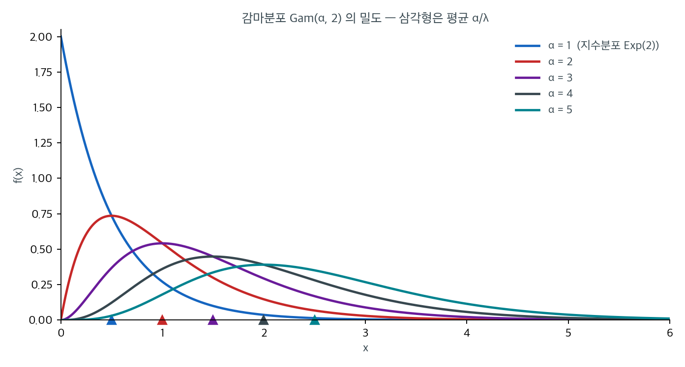

# 감마분포

## 개요

콜센터에 전화가 1분에 평균 두 통씩 포아송 과정으로 걸려 온다. 첫 통화까지의 시간은 지수분포(exponential distribution) $\text{Exp}(2)$ 다. 그렇다면 **다섯째 통화까지의 시간**은 어떤 분포를 따르는가. 지수 간격 다섯 개의 합이므로 평균은 $5/2$ 분이지만, 모양은 더 이상 지수분포가 아니다. 0 에서 시작해 봉우리를 하나 넘고 오른쪽으로 꼬리를 끄는 분포가 된다. 그것이 **감마분포**(gamma distribution)다.

감마분포는 이 장의 여러 분포를 한자리에서 잇는다.

- **지수분포**는 형상이 $1$ 인 감마분포이고, 지수분포를 $\alpha$ 개 더하면 형상 $\alpha$ 인 감마분포가 된다.
- **카이제곱분포**(chi-squared distribution)는 $\text{Gam}(d/2,\ 1/2)$ 다. 정규에서 나온 분포와 포아송 과정에서 나온 분포가 여기서 만난다.
- **음이항분포**를 시간 척도로 줄이면 감마분포로 간다. 기하분포가 지수분포로 가는 극한의 $r$ 번째 판이다.
- **포아송분포**(Poisson distribution)와는 같은 사건을 두 쪽에서 본 관계다. 「$t$ 까지 $r$ 번 이상 일어났다」와 「$r$ 번째가 $t$ 전에 일어났다」는 같은 말이다.

이 쪽은 감마함수에서 출발해 감마분포를 정의하고, 위의 네 관계를 차례로 증명한다.

---

## 1. 감마함수

<div class="defn" markdown>

### 정의 1. 감마함수 { .dfn }

$\alpha > 0$ 에 대해 **감마함수**(gamma function)는

$$
\Gamma(\alpha) = \int_0^\infty x^{\alpha-1}e^{-x}\,dx
$$

이다. $x \to 0$ 에서 $x^{\alpha-1}$ 이 적분 가능하려면 $\alpha > 0$ 이어야 하고, $x \to \infty$ 에서는 $e^{-x}$ 가 어떤 거듭제곱도 이기므로 적분이 수렴한다.

</div>

<div class="thmbox" markdown>

### 정리 1. 감마함수의 성질 { .thm }

**(a)** $\Gamma(\alpha + 1) = \alpha\,\Gamma(\alpha)$

**(b)** $\Gamma(1) = 1$ 이고, 자연수 $n$ 에 대해 $\Gamma(n+1) = n!$

**(c)** $\Gamma(1/2) = \sqrt\pi$

</div>

??? proof "증명"

    **(a)** 부분적분이다. $u = x^{\alpha}$, $dv = e^{-x}dx$ 로 두면

    $$
    \Gamma(\alpha+1) = \int_0^\infty x^{\alpha}e^{-x}\,dx
    = \Big[-x^{\alpha}e^{-x}\Big]_0^\infty + \alpha\int_0^\infty x^{\alpha-1}e^{-x}\,dx
    = \alpha\,\Gamma(\alpha)
    $$

    이다. 경계항은 $x = 0$ 에서 $x^\alpha = 0$ 이고 $x \to \infty$ 에서 $e^{-x}$ 가 이겨서 $0$ 이다.

    **(b)** $\Gamma(1) = \int_0^\infty e^{-x}dx = 1$ 이고, (a) 를 되풀이하면 $\Gamma(n+1) = n\,\Gamma(n) = \cdots = n!\,\Gamma(1) = n!$ 이다. 감마함수는 **계승을 실수로 넓힌 것**이다.

    **(c)** $x = s^2$ 으로 치환하면 $dx = 2s\,ds$ 이므로

    $$
    \Gamma(1/2) = \int_0^\infty x^{-1/2}e^{-x}\,dx = 2\int_0^\infty e^{-s^2}\,ds = \sqrt\pi
    $$

    이다. 마지막 적분은 가우스 적분 $\int_{-\infty}^{\infty}e^{-s^2}ds = \sqrt\pi$ 의 절반을 두 배 한 것이고, 가우스 적분은 4.2절 [정규분포](normal.md)에서 극좌표로 계산한다. $\square$

(a) 와 (c) 를 함께 쓰면 반정수에서의 값이 모두 나온다. 예컨대 $\Gamma(3/2) = \frac12\sqrt\pi$, $\Gamma(5/2) = \frac32\cdot\frac12\sqrt\pi = \frac34\sqrt\pi$ 다. 카이제곱분포의 자유도가 홀수일 때 이 값들이 밀도의 상수로 들어간다.

---

## 2. 감마분포

<div class="defn" markdown>

### 정의 2. 감마분포 { .dfn }

형상 $\alpha > 0$, 비율 $\lambda > 0$ 인 **감마분포**(gamma distribution)의 밀도는

$$
f(x) = \frac{\lambda(\lambda x)^{\alpha-1}e^{-\lambda x}}{\Gamma(\alpha)}
= \frac{\lambda^\alpha}{\Gamma(\alpha)}\,x^{\alpha-1}e^{-\lambda x},
\qquad x > 0
$$

이고 $X \sim \text{Gam}(\alpha, \lambda)$ 라 쓴다. 밀도의 넓이가 $1$ 인 것은 $u = \lambda x$ 로 치환하면 정의 1 이 그대로 나오기 때문이다.

</div>

첫째 꼴이 뜻을 읽기 좋다. $\lambda x$ 는 「비율 $\lambda$ 로 시간 $x$ 동안 기대되는 사건 수」이고, 밀도는 그 무차원 양의 함수에 $\lambda\,dx$ 를 곱한 꼴이다. **형상이 정수 $\alpha = n$ 이면 비율 $\lambda$ 인 포아송 과정에서 $n$ 번째 사건이 일어나는 시각**의 분포이고(따름정리 1), 이때를 얼랑분포(Erlang distribution)라고도 부른다.

!!! warning "모수화 둘과 SciPy"
    교재마다 둘째 모수가 다르다. 이 쪽은 **비율** $\lambda$ 를 쓰고(평균 $\alpha/\lambda$), 4.2절 [카이제곱분포](chi_square.md)는 **척도** $\theta = 1/\lambda$ 를 쓴다(평균 $\alpha\theta$). `scipy.stats.gamma` 는 척도를 받는다 — `stats.gamma(a=alpha, scale=1/lam)` 이다. 4.2절 [지수분포](exponential.md)의 `stats.expon(scale=1/lam)` 과 같은 함정이다.



**형상이 모양을, 비율이 척도를 정한다.** $\alpha = 1$ 은 0 에서 가장 높은 지수분포이고, $\alpha > 1$ 이면 밀도가 0 에서 출발해 봉우리 $(\alpha-1)/\lambda$ 를 넘는다(연습문제 3). $\alpha$ 가 커질수록 봉우리가 오른쪽으로 가며 종 모양에 가까워지는데, 지수 간격을 더 많이 더한 것이므로 중심극한정리(central limit theorem)가 작동하기 때문이다(연습문제 6).

<div class="thmbox" markdown>

### 정리 2. 감마분포의 평균과 분산 { .thm }

$X \sim \text{Gam}(\alpha, \lambda)$ 이면

$$
E[X] = \frac{\alpha}{\lambda}, \qquad \operatorname{Var}(X) = \frac{\alpha}{\lambda^2}
$$

</div>

??? proof "증명"

    적분을 직접 하지 않고 **형상을 하나 올린 감마밀도**를 알아보는 것이 요령이다.

    $$
    E[X] = \int_0^\infty x\,\frac{\lambda(\lambda x)^{\alpha-1}e^{-\lambda x}}{\Gamma(\alpha)}\,dx
    = \frac{\Gamma(\alpha+1)}{\lambda\,\Gamma(\alpha)}
    \int_0^\infty \underbrace{\frac{\lambda(\lambda x)^{(\alpha+1)-1}e^{-\lambda x}}{\Gamma(\alpha+1)}}_{\text{Gam}(\alpha+1,\,\lambda)\text{ 의 밀도}}\,dx
    = \frac{\alpha\,\Gamma(\alpha)}{\lambda\,\Gamma(\alpha)} = \frac\alpha\lambda
    $$

    이다. 같은 방식으로 형상을 둘 올리면

    $$
    E[X^2] = \frac{\Gamma(\alpha+2)}{\lambda^2\,\Gamma(\alpha)} = \frac{(\alpha+1)\alpha}{\lambda^2}
    $$

    이고, $\operatorname{Var}(X) = E[X^2] - (E[X])^2 = \frac{\alpha(\alpha+1) - \alpha^2}{\lambda^2} = \frac{\alpha}{\lambda^2}$ 이다. 두 번 다 정리 1 (a) 가 쓰였다. $\square$

$\alpha = 1$ 을 넣으면 지수분포의 $1/\lambda$, $1/\lambda^2$ 이 나오고, 일반 $\alpha$ 는 그 $\alpha$ 배다. 지수 $\alpha$ 개를 더한 것이니 평균도 분산도 $\alpha$ 배가 되는 것이 맞다(정리 4). 변동계수(coefficient of variation)는 $\sqrt{\alpha/\lambda^2}\,/\,(\alpha/\lambda) = 1/\sqrt\alpha$ 로, **형상만이** 상대적인 퍼짐을 정한다.

<div class="thmbox" markdown>

### 정리 3. 감마분포의 적률생성함수 { .thm }

$X \sim \text{Gam}(\alpha, \lambda)$ 이면 $t < \lambda$ 에서

$$
M_X(t) = E\big[e^{tX}\big] = \left(\frac{\lambda}{\lambda - t}\right)^{\alpha}
$$

</div>

??? proof "증명"

    $$
    M_X(t) = \frac{\lambda^\alpha}{\Gamma(\alpha)}\int_0^\infty x^{\alpha-1}e^{-(\lambda - t)x}\,dx
    = \frac{\lambda^\alpha}{\Gamma(\alpha)}\cdot\frac{\Gamma(\alpha)}{(\lambda - t)^\alpha}
    $$

    이다. 가운데 적분은 비율 $\lambda - t$ 인 감마밀도의 상수 $\Gamma(\alpha)/(\lambda-t)^\alpha$ 이고, 그것이 유한하려면 $\lambda - t > 0$ 이어야 한다. $t \ge \lambda$ 이면 피적분함수가 꼬리에서 줄지 않아 적분이 발산한다. $\square$

<div class="exbox" markdown>

**보기 1.** <span class="diff easy" title="쉬움"></span> $\text{Gam}(3, 2)$ 의 평균과 분산을 정리 2 로 구하고, SciPy 의 모수화로 같은 분포를 만들어 이론값과 표본값을 맞추시오.

</div>

??? success "풀이"

    정리 2 에서 평균은 $3/2 = 1.5$, 분산은 $3/4 = 0.75$ 다. SciPy 에는 척도 $1/\lambda = 0.5$ 를 넣는다.

    ```python
    import numpy as np
    from scipy import stats

    alpha, lam = 3.0, 2.0
    G = stats.gamma(a=alpha, scale=1 / lam)          # SciPy 는 비율이 아니라 척도 1/λ 를 받는다
    print(f"이론  평균 α/λ = {alpha / lam:.4f},  분산 α/λ² = {alpha / lam**2:.4f}")
    print(f"scipy 평균 {G.mean():.4f},  분산 {G.var():.4f}")

    rng = np.random.default_rng(0)
    x = G.rvs(size=1_000_000, random_state=rng)
    print(f"표본  평균 {x.mean():.4f},  분산 {x.var():.4f}")
    ```

    출력:

    ```
    이론  평균 α/λ = 1.5000,  분산 α/λ² = 0.7500
    scipy 평균 1.5000,  분산 0.7500
    표본  평균 1.5013,  분산 0.7520
    ```

    세 줄이 맞는다. `scale=lam` 으로 잘못 넣으면 평균이 $6$ 이 되어 첫 줄과 네 배 어긋나므로, `mean()` 한 번으로 모수화를 검산할 수 있다.

---

## 3. 더하면 형상이 더해진다

<div class="thmbox" markdown>

### 정리 4. 감마분포의 가법성 { .thm }

$X \sim \text{Gam}(\alpha, \lambda)$ 와 $Y \sim \text{Gam}(\beta, \lambda)$ 가 독립이면

$$
X + Y \sim \text{Gam}(\alpha + \beta,\ \lambda)
$$

이다. **비율이 같아야 한다.**

</div>

??? proof "증명"

    **합성곱으로.** $x > 0$ 에서 $f_X(s)f_Y(x-s)$ 가 $0$ 이 아니려면 $0 < s < x$ 여야 하므로

    $$
    f_{X+Y}(x) = \int_0^x \frac{\lambda(\lambda s)^{\alpha-1}e^{-\lambda s}}{\Gamma(\alpha)}\cdot\frac{\lambda(\lambda(x-s))^{\beta-1}e^{-\lambda(x-s)}}{\Gamma(\beta)}\,ds
    $$

    이다. 지수가 $e^{-\lambda s}e^{-\lambda(x-s)} = e^{-\lambda x}$ 로 $s$ 를 잃는 것이 **비율이 같아야 하는** 까닭이다. $s = xu$ 로 치환하면 $ds = x\,du$ 이고

    $$
    f_{X+Y}(x) = \underbrace{\frac{1}{\Gamma(\alpha)\Gamma(\beta)}\int_0^1 u^{\alpha-1}(1-u)^{\beta-1}\,du}_{c}\;\cdot\;\lambda(\lambda x)^{\alpha+\beta-1}e^{-\lambda x}
    $$

    이 된다. $x$ 에 매인 부분이 $\text{Gam}(\alpha+\beta, \lambda)$ 의 밀도와 상수만 다르고, 밀도는 넓이가 $1$ 이어야 하므로 상수 $c$ 는 $1/\Gamma(\alpha+\beta)$ 일 수밖에 없다. 덤으로 **베타함수** 항등식

    $$
    \int_0^1 u^{\alpha-1}(1-u)^{\beta-1}\,du = \frac{\Gamma(\alpha)\Gamma(\beta)}{\Gamma(\alpha+\beta)}
    $$

    까지 얻는다.

    **적률생성함수로.** 독립인 합의 적률생성함수는 곱이므로(3.4절 [적률생성함수](../../ch03/rv/mgf.md) 정리 3) $M_{X+Y}(t) = (\frac{\lambda}{\lambda-t})^{\alpha}(\frac{\lambda}{\lambda-t})^{\beta} = (\frac{\lambda}{\lambda-t})^{\alpha+\beta}$ 이고, 유일성(같은 쪽 정리 2)에 의해 $\text{Gam}(\alpha+\beta, \lambda)$ 다. $\square$

<div class="thmbox" markdown>

### 따름정리 1. 지수분포의 합 { .thm }

$X_1, \ldots, X_n \overset{\text{iid}}{\sim} \text{Exp}(\lambda)$ 이면 $X_1 + \cdots + X_n \sim \text{Gam}(n, \lambda)$ 이다. 그러므로 비율 $\lambda$ 인 포아송 과정에서 $n$ 번째 사건의 시각 $S_n$ 은 $\text{Gam}(n, \lambda)$ 를 따른다.

</div>

??? proof "증명"

    $\text{Exp}(\lambda)$ 의 밀도 $\lambda e^{-\lambda x}$ 는 정의 2 에 $\alpha = 1$ 을 넣은 것과 같다($\Gamma(1) = 1$). 그러므로 $\text{Exp}(\lambda) = \text{Gam}(1, \lambda)$ 이고, 정리 4 를 $n - 1$ 번 쓰면 된다. 포아송 과정의 사건 사이 간격은 독립인 $\text{Exp}(\lambda)$ 이고(4.2절 [지수분포](exponential.md) 6절) $S_n$ 은 간격 $n$ 개의 합이다. $\square$

기하분포를 $r$ 개 더하면 음이항분포가 되던 것(4.1절 [음이항분포](../discrete_distributions/negative_binomial.md))의 연속판이다. 「첫 성공까지 기다리기」를 $r$ 번 이어 붙이면 「$r$ 번째 성공까지 기다리기」가 된다는 같은 말을, 이산에서는 시행 횟수로, 연속에서는 시간으로 적은 것이다.

<div class="exbox" markdown>

**보기 2.** <span class="diff easy" title="쉬움"></span> $\text{Gam}(1.5, 2)$ 와 $\text{Gam}(2.5, 2)$ 를 독립으로 뽑아 더하면 $\text{Gam}(4, 2)$ 가 되는지 모의실험으로 확인하시오. 그리고 비율이 다른 $\text{Gam}(2, 1) + \text{Gam}(2, 4)$ 는 평균과 분산을 맞춘 어떤 감마분포와도 다르다는 것을 보이시오.

</div>

??? success "풀이"

    ```python
    import numpy as np
    from scipy import stats

    rng = np.random.default_rng(1)
    lam, N = 2.0, 400_000
    X = rng.gamma(shape=1.5, scale=1 / lam, size=N)
    Y = rng.gamma(shape=2.5, scale=1 / lam, size=N)
    S = X + Y                                          # 이론: Gam(4, 2)

    print(f"X + Y  평균 {S.mean():.4f} (4/2 = 2),  분산 {S.var():.4f} (4/4 = 1)")
    D, p = stats.kstest(S, stats.gamma(a=4.0, scale=1 / lam).cdf)
    print(f"Gam(4, 2) 까지의 KS 거리 D = {D:.5f},  p = {p:.3f}")

    # 비율이 다르면 더해도 감마가 아니다: Gam(2, 1) + Gam(2, 4)
    T = rng.gamma(2.0, 1.0, N) + rng.gamma(2.0, 0.25, N)
    a_mm = T.mean()**2 / T.var()                       # 평균·분산을 맞춘 감마의 형상
    D2, _ = stats.kstest(T, stats.gamma(a=a_mm, scale=T.var() / T.mean()).cdf)
    print(f"비율이 다른 합: 적률을 맞춘 감마까지의 KS 거리 D = {D2:.5f}")
    ```

    출력:

    ```
    X + Y  평균 1.9986 (4/2 = 2),  분산 0.9985 (4/4 = 1)
    Gam(4, 2) 까지의 KS 거리 D = 0.00195,  p = 0.094
    비율이 다른 합: 적률을 맞춘 감마까지의 KS 거리 D = 0.01249
    ```

    같은 비율의 합은 [KS](../../glossary.md#ks) 거리 $0.00195$ 로 표본 $40$ 만 개의 모의오차 수준이다. 비율이 다른 합은 평균과 분산을 맞춘 감마에 대어도 거리가 $0.01249$ 로 여섯 배 남짓 크다 — 표본이 이만큼 크면 확실히 가려지는 차이다. 증명에서 $e^{-\lambda s}$ 와 $e^{-\lambda(x-s)}$ 가 합쳐져 $s$ 가 사라지던 걸음이 비율이 다르면 일어나지 않는다.

---

## 4. 카이제곱분포는 감마분포다

<div class="thmbox" markdown>

### 정리 5. 척도를 바꾸어도 감마분포다 { .thm }

$X \sim \text{Gam}(\alpha, \lambda)$ 이고 $c > 0$ 이면 $cX \sim \text{Gam}(\alpha, \lambda/c)$ 이다. 특히

$$
\chi^2_d = \text{Gam}\!\left(\frac d2,\ \frac12\right), \qquad
X \sim \text{Gam}(n, \lambda) \;\Longrightarrow\; 2\lambda X \sim \chi^2_{2n}
$$

이다.

</div>

??? proof "증명"

    $Y = cX$ 의 밀도는 $f_Y(y) = \frac1c f_X(y/c)$ 이므로

    $$
    f_Y(y) = \frac1c\cdot\frac{\lambda(\lambda y/c)^{\alpha-1}e^{-\lambda y/c}}{\Gamma(\alpha)}
    = \frac{(\lambda/c)\big((\lambda/c)\,y\big)^{\alpha-1}e^{-(\lambda/c)y}}{\Gamma(\alpha)}
    $$

    이고, 이것이 $\text{Gam}(\alpha, \lambda/c)$ 의 밀도다. 비율 $\lambda$ 는 「단위 시간당」이므로 시간 축을 $c$ 배로 늘이면 단위 시간당 비율이 $1/c$ 배가 되는 것이다.

    4.2절 [카이제곱분포](chi_square.md) 정리 2 의 밀도 $\frac{1}{2^{d/2}\Gamma(d/2)}q^{d/2-1}e^{-q/2}$ 는 정의 2 에 $\alpha = d/2$, $\lambda = 1/2$ 를 넣은 것과 같다. 그래서 $\chi^2_d = \text{Gam}(d/2, 1/2)$ 다. 마지막으로 $X \sim \text{Gam}(n, \lambda)$ 에 $c = 2\lambda$ 를 쓰면 $2\lambda X \sim \text{Gam}(n, 1/2) = \chi^2_{2n}$ 이다. $\square$

**두 사슬이 여기서 만난다.** 카이제곱분포는 표준정규의 제곱합(sum of squares)으로 정의했고, 감마분포는 지수 간격의 합으로 얻었다. 출발점이 전혀 다른데 같은 분포족에 떨어진다. $d = 1$ 이면 $Z^2 \sim \text{Gam}(1/2, 1/2)$ — 표준정규 제곱 하나가 「형상 $1/2$」짜리 감마이고, 그런 것 $d$ 개를 더하면 정리 4 에 의해 형상이 $d/2$ 가 된다. 카이제곱의 가법성(4.2절 [카이제곱분포](chi_square.md) 정리 4)은 정리 4 의 특수한 경우다. 그리고 $d = 2$ 이면 $\text{Gam}(1, 1/2) = \text{Exp}(1/2)$ 로, 카이제곱 사슬이 지수분포로 되돌아온다.

뒤의 식 $2\lambda X \sim \chi^2_{2n}$ 은 실용적이다. 지수 수명 $n$ 개의 합을 카이제곱표로 다룰 수 있게 해 주어, 포아송 평균과 지수 비율의 **정확한** 신뢰구간이 이 한 줄에서 나온다(4.1절 [포아송분포](../discrete_distributions/poisson.md)의 정확 구간이 그 보기다).

---

## 5. 이산 사슬에서 건너오는 다리

지수분포는 기하분포의 극한이었다. 한 칸의 길이가 $1/n$ 인 시간 격자에서 칸마다 확률 $p = \lambda/n$ 으로 사건이 일어나게 하면, 첫 사건까지의 칸 수 $G \sim \text{Geo}(p)$ 를 시간으로 바꾼 $G/n$ 이 $n \to \infty$ 에서 $\text{Exp}(\lambda)$ 로 간다(4.2절 [지수분포](exponential.md) 5절). 같은 격자에서 **$r$ 번째** 사건까지 기다리면 감마분포가 나온다.

<div class="thmbox" markdown>

### 정리 6. 음이항분포의 극한은 감마분포다 { .thm }

$N_n \sim \text{NB}(r, p_n)$ 이 $r$ 번째 성공까지의 시행 횟수이고 $p_n = \lambda/n$ 이면

$$
\frac{N_n}{n} \;\xrightarrow{\ d\ }\; \text{Gam}(r, \lambda) \qquad (n \to \infty)
$$

이다.

</div>

??? proof "증명"

    적률생성함수로 보인다. $G \sim \text{Geo}(p)$ 의 적률생성함수는 $(1-p)e^s < 1$ 에서 $M_G(s) = \dfrac{pe^s}{1 - (1-p)e^s}$ 이다. $N_n$ 은 독립인 $\text{Geo}(p_n)$ $r$ 개의 합이므로

    $$
    M_{N_n/n}(t) = \left[M_G\!\left(\frac tn\right)\right]^r
    = \left[\frac{(\lambda/n)\,e^{t/n}}{1 - (1 - \lambda/n)\,e^{t/n}}\right]^r
    $$

    이다. $e^{t/n} = 1 + t/n + O(1/n^2)$ 를 넣으면 분모는

    $$
    1 - \Big(1 - \frac\lambda n\Big)\Big(1 + \frac tn + O(n^{-2})\Big) = \frac{\lambda - t}{n} + O(n^{-2})
    $$

    이고 분자는 $\lambda/n + O(n^{-2})$ 이므로, $t < \lambda$ 에서 괄호 안이 $\lambda/(\lambda - t)$ 로 간다. 따라서 $M_{N_n/n}(t) \to (\lambda/(\lambda-t))^r$ 이고, 이것은 정리 3 의 $\text{Gam}(r, \lambda)$ 적률생성함수다. 적률생성함수가 $0$ 근방에서 수렴하면 분포가 수렴한다. $\square$

$r = 1$ 이면 기하에서 지수로 가는 다리 그대로다. 그러니 이산 사슬의 「기하 → 음이항」(더하기)과 연속 사슬의 「지수 → 감마」(더하기)가 **같은 극한으로 층층이 이어져 있다.** 4장 개요의 관계도가 이 네 분포를 사각형으로 그리는 까닭이다.

<div class="exbox" markdown>

**보기 3.** <span class="diff easy" title="쉬움"></span> $r = 3$, $\lambda = 2$ 로 두고 $n = 5, 50, 500, 5000$ 에서 $\text{NB}(3, 2/n)/n$ 의 $10\%$·$50\%$·$90\%$ 분위수(quantile)를 $\text{Gam}(3, 2)$ 의 분위수와 견주시오.

</div>

??? success "풀이"

    SciPy 의 `nbinom` 은 시행 횟수가 아니라 **실패 횟수**를 세므로 `loc=r` 로 $r$ 만큼 옮겨 시행 횟수로 만든다.

    ```python
    import numpy as np
    from scipy import stats

    r, lam = 3, 2.0
    G = stats.gamma(a=r, scale=1 / lam)
    q = np.array([0.1, 0.5, 0.9])
    print(f"Gam({r}, {lam:g}) 분위수     " + "  ".join(f"{v:.4f}" for v in G.ppf(q)))
    for n in (5, 50, 500, 5000):
        p = lam / n                                    # 한 칸의 성공확률. np = λ 를 붙든다
        NB = stats.nbinom(r, p, loc=r)                 # 시행 횟수로 센 NB(r, p) — scipy 는 실패 수를 센다
        print(f"n = {n:>4}:  NB/n 분위수  " + "  ".join(f"{v / n:.4f}" for v in NB.ppf(q)),
              f"  평균 {NB.mean() / n:.4f}")
    print(f"감마 평균 r/λ = {r / lam:.4f}")
    ```

    출력:

    ```
    Gam(3, 2) 분위수     0.5510  1.3370  2.6612
    n =    5:  NB/n 분위수  0.8000  1.4000  2.4000   평균 1.5000
    n =   50:  NB/n 분위수  0.5800  1.3400  2.6400   평균 1.5000
    n =  500:  NB/n 분위수  0.5520  1.3380  2.6580   평균 1.5000
    n = 5000:  NB/n 분위수  0.5512  1.3370  2.6610   평균 1.5000
    감마 평균 r/λ = 1.5000
    ```

    평균은 모든 $n$ 에서 정확히 $1.5$ 다 — $E[N_n]/n = (r/p_n)/n = r/\lambda$ 이기 때문이다. 분위수는 $n = 5$ 에서 격자가 $0.2$ 간격이라 거칠지만 $n = 5000$ 에서 넷째 자리까지 맞는다. 칸이 잘수록 「몇 번째 칸」이 「언제」로 바뀐다.

포아송분포와 감마분포의 관계는 극한이 아니라 **같은 사건**이다.

<div class="thmbox" markdown>

### 정리 7. 세기와 기다리기 { .thm }

비율 $\lambda$ 인 포아송 과정에서 $N_t$ 를 시각 $t$ 까지의 사건 수, $S_r$ 을 $r$ 번째 사건의 시각이라 하면

$$
P(S_r \le t) = P(N_t \ge r), \qquad \text{곧}\qquad
\int_0^t \frac{\lambda(\lambda x)^{r-1}e^{-\lambda x}}{(r-1)!}\,dx = 1 - \sum_{k=0}^{r-1}\frac{e^{-\lambda t}(\lambda t)^k}{k!}
$$

이다.

</div>

??? proof "증명"

    「$r$ 번째 사건이 $t$ 까지 일어났다」와 「$t$ 까지 사건이 $r$ 번 이상 일어났다」는 **같은 사건**이다. 그러므로 확률이 같다. $S_r \sim \text{Gam}(r, \lambda)$ 이고(따름정리 1) $N_t \sim \text{Poisson}(\lambda t)$ 이므로 왼쪽은 감마 분포함수, 오른쪽은 포아송 생존함수다. $\square$

이 항등식은 4.2절 [지수분포](exponential.md) 6절이 수치로 맞대어 차가 기계정밀도로 $0$ 임을 보인다. 감마 분포함수를 손으로 구할 때는 오른쪽의 유한합이 훨씬 쉽다(연습문제 2).

---

## 6. 기다리는 간격은 왜 두 배인가

<div class="exbox" markdown>

**보기 4.** <span class="diff med" title="중간"></span> 비율 $\lambda = 1$ 인 포아송 과정에서 사건 사이 간격은 평균 $1$ 인 지수분포다. 그런데 미리 정해 둔 시각 $t_0$ 을 **품고 있는** 간격 $\tau$ 의 길이는 $\text{Gam}(2, 1)$ 을 따라 평균이 $2$ 다. 까닭을 설명하고 모의실험으로 확인하시오.

</div>

??? success "풀이"

    **해석적으로.** $\tau$ 는 $t_0$ 에서 **뒤로** 직전 사건까지의 거리와 **앞으로** 다음 사건까지의 거리의 합이다. 앞으로의 거리는 무기억성(4.2절 [지수분포](exponential.md) 정리 3)에 의해 $\text{Exp}(\lambda)$ 이고, 포아송 과정을 시간을 거꾸로 돌려 보아도 같은 포아송 과정이므로 뒤로의 거리도 $\text{Exp}(\lambda)$ 이며, 둘은 서로 겹치지 않는 구간에 대한 것이라 독립이다. 따름정리 1 에 의해 $\tau \sim \text{Gam}(2, \lambda)$ 이고 평균 $2/\lambda$, 분산 $2/\lambda^2$ 이다.

    ```python
    import numpy as np
    from scipy import stats

    rng = np.random.default_rng(7)
    lam, t0, reps = 1.0, 50.0, 200_000
    tau = np.empty(reps)
    for k in range(reps):
        arr = np.cumsum(rng.exponential(1 / lam, 120))   # 0 부터의 도착 시각(120 개면 t0 = 50 을 넉넉히 넘는다)
        j = np.searchsorted(arr, t0)                      # t0 바로 뒤의 도착
        tau[k] = arr[j] - (arr[j - 1] if j > 0 else 0.0)  # t0 를 품은 간격
    print(f"간격 하나의 평균 1/λ = {1 / lam:.4f}")
    print(f"t0 를 품은 간격:  평균 {tau.mean():.4f},  분산 {tau.var():.4f}")
    D, p = stats.kstest(tau, stats.gamma(a=2, scale=1 / lam).cdf)
    print(f"Gam(2, 1) 까지의 KS 거리 D = {D:.5f},  p = {p:.3f}")
    ```

    출력:

    ```
    간격 하나의 평균 1/λ = 1.0000
    t0 를 품은 간격:  평균 1.9998,  분산 2.0029
    Gam(2, 1) 까지의 KS 거리 D = 0.00146,  p = 0.787
    ```

    간격 하나하나는 평균이 $1$ 인데 **$t_0$ 이 떨어진 간격**은 평균이 $2$ 다. 긴 간격일수록 시간축을 더 넓게 차지하므로 $t_0$ 이 그 안에 떨어지기 쉽다 — 간격을 고르는 방식이 길이에 비례하는 가중을 건 것이다. 이것이 **검사의 역설**(inspection paradox)이고, 정류장에서 버스를 기다리는 승객이 평균 간격의 두 배를 겪는 일로 1.4절 [길이 편향 표집과 검사 역설](../../ch01/classical/length_biased_sampling.md)이 같은 현상을 다룬다.

---

## 연습문제

<div class="drillbox" markdown>

**연습문제 1.** <span class="diff easy" title="쉬움"></span>
$\Gamma(5/2)$ 와 $\Gamma(6)$ 을 정리 1 로 구하시오.

</div>

??? success "풀이"
    $\Gamma(5/2) = \frac32\,\Gamma(3/2) = \frac32\cdot\frac12\,\Gamma(1/2) = \frac34\sqrt\pi \approx 1.3293$ 이고, $\Gamma(6) = 5! = 120$ 이다.

---

<div class="drillbox" markdown>

**연습문제 2.** <span class="diff easy" title="쉬움"></span>
전화가 1분에 평균 두 통씩 포아송 과정으로 걸려 온다. 다섯째 통화까지의 시간 $S_5$ 의 평균과 표준편차를 구하고, $P(S_5 > 3)$ 을 정리 7 로 유한합으로 바꾸어 계산하시오.

</div>

??? success "풀이"
    $S_5 \sim \text{Gam}(5, 2)$ 이므로 평균은 $5/2 = 2.5$ 분, 표준편차는 $\sqrt{5}/2 \approx 1.118$ 분이다. 정리 7 에서 $P(S_5 > 3) = P(N_3 \le 4)$ 이고 $N_3 \sim \text{Poisson}(6)$ 이므로

    $$
    P(S_5 > 3) = e^{-6}\left(1 + 6 + \frac{6^2}{2} + \frac{6^3}{6} + \frac{6^4}{24}\right) = 115\,e^{-6}
    $$

    이다. 적분 한 번 없이 유한합으로 끝난다.

    ```python
    from scipy import stats

    lam, r, t = 2.0, 5, 3.0
    print(f"감마 생존함수   P(S_5 > 3)  = {stats.gamma(a=r, scale=1 / lam).sf(t):.6f}")
    print(f"포아송 분포함수 P(N_3 <= 4) = {stats.poisson(lam * t).cdf(r - 1):.6f}")
    ```

    출력:

    ```
    감마 생존함수   P(S_5 > 3)  = 0.285057
    포아송 분포함수 P(N_3 <= 4) = 0.285057
    ```

    $115\,e^{-6} = 0.285057$ 로 셋이 같다.

---

<div class="drillbox" markdown>

**연습문제 3.** <span class="diff med" title="중간"></span>
$\alpha > 1$ 이면 $\text{Gam}(\alpha, \lambda)$ 의 최빈값(mode)이 $(\alpha-1)/\lambda$ 임을 보이시오. $\alpha \le 1$ 이면 어떻게 되는가.

</div>

??? success "풀이"
    $\log f(x) = (\alpha - 1)\log x - \lambda x + \text{상수}$ 를 미분하면 $(\alpha-1)/x - \lambda$ 이고, 이것이 $0$ 인 자리가 $x^* = (\alpha-1)/\lambda$ 다. 이계도함수 $-(\alpha-1)/x^2 < 0$ 이므로 최댓값이다. $\alpha = 1$ 이면 도함수가 $-\lambda < 0$ 이라 밀도가 단조감소해 최빈값이 $0$(지수분포)이고, $\alpha < 1$ 이면 $x \to 0$ 에서 $x^{\alpha-1} \to \infty$ 라 밀도가 발산한다($\chi^2_1 = \text{Gam}(1/2, 1/2)$ 이 그 꼴이다). 평균 $\alpha/\lambda$ 와 최빈값의 차는 언제나 $1/\lambda$ 로, 오른쪽 꼬리가 평균을 봉우리보다 오른쪽으로 끈다.

---

<div class="drillbox" markdown>

**연습문제 4.** <span class="diff med" title="중간"></span>
$X \sim \text{Gam}(\alpha, \lambda)$ 이고 $\alpha > 1$ 이면 $E[1/X] = \lambda/(\alpha - 1)$ 임을 보이시오. $1/X$ 의 분포를 **역감마분포**(inverse gamma distribution)라 한다. $E[1/X]$ 와 $1/E[X]$ 중 어느 쪽이 큰가.

</div>

??? success "풀이"
    정리 2 의 요령을 거꾸로 쓴다. 형상을 하나 **내린** 감마밀도를 알아본다.

    $$
    E\!\left[\frac1X\right] = \int_0^\infty \frac1x\cdot\frac{\lambda^\alpha x^{\alpha-1}e^{-\lambda x}}{\Gamma(\alpha)}\,dx
    = \frac{\lambda\,\Gamma(\alpha-1)}{\Gamma(\alpha)}\int_0^\infty \frac{\lambda^{\alpha-1}x^{(\alpha-1)-1}e^{-\lambda x}}{\Gamma(\alpha-1)}\,dx
    = \frac{\lambda}{\alpha-1}
    $$

    이다($\alpha - 1 > 0$ 이어야 $\text{Gam}(\alpha-1, \lambda)$ 가 정의된다). $1/E[X] = \lambda/\alpha$ 보다 크다 — $1/x$ 가 볼록함수이므로 옌센 부등식이 말하는 방향이다. $\alpha \le 1$ 이면 $0$ 근처의 무게 때문에 $E[1/X] = \infty$ 다.

---

<div class="drillbox" markdown>

**연습문제 5.** <span class="diff med" title="중간"></span>
$X \sim \text{Gam}(\alpha, \lambda)$, $Y \sim \text{Gam}(\beta, \lambda)$ 가 독립일 때, 정리 4 의 증명에서 나온 베타함수 항등식을 써서 $\text{Gam}(\alpha, \lambda)$ 와 $\text{Gam}(\beta, \lambda)$ 의 비율 $U = X/(X+Y)$ 의 밀도가 $\dfrac{\Gamma(\alpha+\beta)}{\Gamma(\alpha)\Gamma(\beta)}u^{\alpha-1}(1-u)^{\beta-1}$ ($0<u<1$) 임을 보이시오. 결과가 $\lambda$ 에 매이지 않는 까닭은 무엇인가.

</div>

??? success "풀이"
    $(U, W) = (X/(X+Y),\ X+Y)$ 로 변수변환한다. 역변환은 $X = UW$, $Y = (1-U)W$ 이고 야코비안의 절댓값은 $W$ 다. 결합밀도는

    $$
    f_{U,W}(u, w) = \frac{\lambda^{\alpha}(uw)^{\alpha-1}e^{-\lambda uw}}{\Gamma(\alpha)}\cdot\frac{\lambda^{\beta}((1-u)w)^{\beta-1}e^{-\lambda(1-u)w}}{\Gamma(\beta)}\cdot w
    = \underbrace{\frac{u^{\alpha-1}(1-u)^{\beta-1}}{\Gamma(\alpha)\Gamma(\beta)}\,\Gamma(\alpha+\beta)}_{u\text{ 만의 함수}}\cdot\underbrace{\frac{\lambda^{\alpha+\beta}w^{\alpha+\beta-1}e^{-\lambda w}}{\Gamma(\alpha+\beta)}}_{\text{Gam}(\alpha+\beta,\,\lambda)}
    $$

    로 갈라진다. $w$ 에 대해 적분하면 뒤 인수가 $1$ 이 되어 $U$ 의 밀도가 남는다. 이것이 **베타분포** $\text{Beta}(\alpha, \beta)$ 이고, 곱으로 갈라졌으므로 덤으로 $U$ 와 $X+Y$ 가 **독립**이다. $\lambda$ 는 시간의 척도일 뿐인데 $U$ 는 비율이라 척도가 지워진다. 4.2절 [F 분포](f_distribution.md) 정리 6 의 베타 관계가 $\alpha = d_1/2$, $\beta = d_2/2$, $\lambda = 1/2$ 인 경우다.

---

<div class="drillbox" markdown>

**연습문제 6.** <span class="diff hard" title="어려움"></span>
$X_\alpha \sim \text{Gam}(\alpha, \lambda)$ 를 표준화한 $Z_\alpha = (X_\alpha - \alpha/\lambda)/(\sqrt\alpha/\lambda)$ 가 $\alpha \to \infty$ 에서 $N(0, 1)$ 로 감을 적률생성함수로 보이시오. 정수 $\alpha$ 에서는 이것이 무엇의 특수한 경우인가.

</div>

??? success "풀이"
    $\lambda X_\alpha \sim \text{Gam}(\alpha, 1)$ 이므로(정리 5) $\lambda = 1$ 로 두어도 된다. $Z_\alpha = (X_\alpha - \alpha)/\sqrt\alpha$ 이고, 정리 3 에서 $t < \sqrt\alpha$ 일 때

    $$
    \log M_{Z_\alpha}(t) = -t\sqrt\alpha - \alpha\log\!\left(1 - \frac{t}{\sqrt\alpha}\right)
    = -t\sqrt\alpha + \alpha\left(\frac{t}{\sqrt\alpha} + \frac{t^2}{2\alpha} + \frac{t^3}{3\alpha^{3/2}} + \cdots\right)
    = \frac{t^2}{2} + O(\alpha^{-1/2})
    $$

    이다. 그러므로 $M_{Z_\alpha}(t) \to e^{t^2/2}$ 이고, 이것이 $N(0,1)$ 의 적률생성함수다. 정수 $\alpha = n$ 이면 $X_n$ 은 독립인 $\text{Exp}(1)$ $n$ 개의 합이므로(따름정리 1) **중심극한정리**의 한 경우다. 오차항(error term)이 $\alpha^{-1/2}$ 차수인 것은 감마분포의 왜도(skewness) $2/\sqrt\alpha$ 가 그 속도로 줄기 때문이다. 4.2절 [지수분포](exponential.md) 8절이 몇 개를 더해야 정규로 갈음해도 되는지 수치로 따진다.

---

## 정리하며

- **감마분포 $\text{Gam}(\alpha, \lambda)$ 는 포아송 과정에서 $\alpha$ 번째 사건까지의 시간이다.** 밀도는 $\lambda(\lambda x)^{\alpha-1}e^{-\lambda x}/\Gamma(\alpha)$, 평균 $\alpha/\lambda$, 분산 $\alpha/\lambda^2$, 적률생성함수 $(\lambda/(\lambda-t))^\alpha$ 다. 감마함수가 계승을 실수로 넓혀 형상이 정수가 아니어도 된다.
- **비율이 같으면 형상이 더해진다.** 지수분포는 $\text{Gam}(1, \lambda)$ 이고 그 $n$ 개의 합이 $\text{Gam}(n, \lambda)$ 다 — 기하분포를 더해 음이항분포를 얻던 것의 연속판이다.
- **카이제곱분포는 $\text{Gam}(d/2, 1/2)$ 다.** 정규의 제곱합과 지수의 합이 같은 분포족에 떨어진다. 그래서 $2\lambda\,\text{Gam}(n, \lambda) = \chi^2_{2n}$ 이고, 카이제곱의 가법성은 감마의 가법성의 특수한 경우다.
- **이산 사슬과 층층이 이어진다.** $\text{NB}(r, \lambda/n)/n \to \text{Gam}(r, \lambda)$ 는 $\text{Geo}(\lambda/n)/n \to \text{Exp}(\lambda)$ 의 $r$ 번째 판이고, 포아송분포와는 $P(S_r \le t) = P(N_t \ge r)$ 로 같은 사건을 두 쪽에서 센다.
- **SciPy 는 척도를 받는다.** `stats.gamma(a=alpha, scale=1/lam)` 이다.

4장의 분포들이 서로 어떻게 이어지는지는 [4장 개요](../index.md)의 관계도가 한 장에 모아 둔다.

다음 쪽 **[정규분포 N(μ, σ²)](normal.md)**로 넘어간다. 감마분포의 형상을 키우면 그리로 간다(연습문제 6). 지수 간격을 많이 더하면 정규가 된다는 것이 4.2절 사슬의 다음 고리이고, 정규분포는 제곱하고 나누는 것만으로 남은 세 분포를 만들어 낸다.
