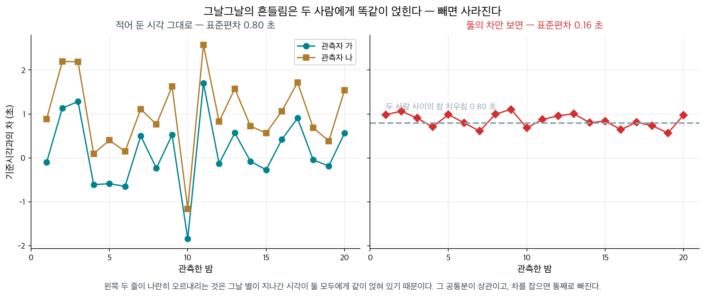
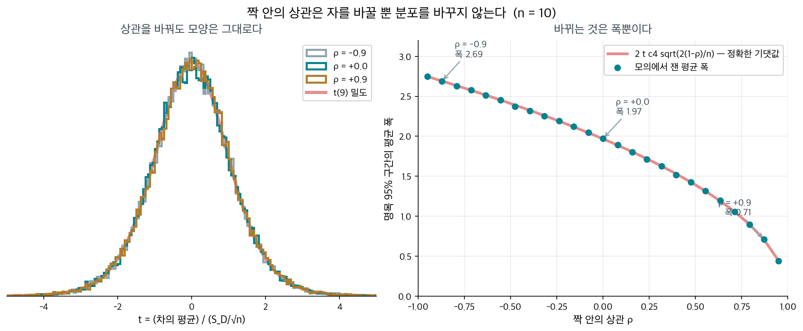

# 대응표본 차의 평균 표집분포

## 개요

지금까지 두 집단을 견줄 때는 두 표본이 **독립**이라고 두었다. 그런데 자료가 그렇게 오지 않는 설계가 있다. 같은 사람을 약 먹기 전과 뒤로 재는 경우, 같은 밭을 반으로 갈라 두 품종을 심는 경우, 같은 환자를 두 기계로 재는 경우다. 이때 $X_i$와 $Y_i$는 같은 $i$를 공유하므로 독립이 아니다.

[두 표본평균의 차](diff_means.md)에서 적어 둔 대로, 이런 자료에서 보아야 할 것은 $\bar X - \bar Y$가 아니라 **쌍마다 먼저 뺀 값** $D_i = X_i - Y_i$의 평균 $\bar D$다. 이 쪽은 그 $\bar D$의 표집분포를 모의실험으로 확인한다.

결론을 먼저 적으면 이렇다.

- **짝 안의 상관 $\rho$는 표집분포의 모양을 전혀 바꾸지 않는다.** $\rho$를 $-0.9$에서 $+0.9$까지 옮겨도 $t = \bar D/(S_D/\sqrt n)$은 언제나 정확히 $t_{n-1}$이고 포함률은 $0.950$이다. 두 표본 쪽에서 등분산이 깨지면 바로 무너지던 것과 아주 다르다.
- **$\rho$가 바꾸는 것은 자의 눈금뿐이다.** 구간의 폭이 $\sqrt{2(1-\rho)}$에 비례해 줄거나 는다. $\rho = 0.9$면 폭이 $0.316$배가 되고, $\rho = -0.9$면 $1.379$배가 된다.
- **깨뜨리는 것은 상관이 아니라 차의 비정규성이다.** 차가 치우쳐 있으면 $n = 5$에서 포함률이 $0.881$로 내려가고, 빗나가는 방향이 한쪽으로 몰린다.
- **짝을 무시하고 이표본 $t$를 걸면 분포 자체를 잘못 고르는 것이 된다.** $\rho = -0.9$에서 명목 5% 검정의 실제 오류율이 $0.160$이고, $\rho = +0.9$에서는 $0.0000$이다.

---

## 1. 설정

$n$개의 쌍이 서로 독립이고, 각 쌍이 이변량 정규를 따른다고 둔다.

$$
\begin{pmatrix} X_i \\ Y_i \end{pmatrix}
\overset{\text{iid}}{\sim}
N\!\left(
\begin{pmatrix} \mu_X \\ \mu_Y \end{pmatrix},\;
\begin{pmatrix} \sigma_X^2 & \rho\,\sigma_X\sigma_Y \\ \rho\,\sigma_X\sigma_Y & \sigma_Y^2 \end{pmatrix}
\right)
$$

모의실험에서는 $\sigma_X = \sigma_Y = 1$과 $\mu_X = \mu_Y = 0$으로 두었다. **두 평균을 같게 두었으므로 $\mu_D = 0$이 참이다.** 이 자료에 명목 95% 대응 $t$ 구간을 걸고 $0$을 담는 비율을 센다. 그 비율이 곧 **실제 포함률**이고, $0.950$에서 얼마나 벗어나는지가 이 쪽의 측정 대상이다.

격자는 다음과 같다.

| 축 | 값 |
|---|---|
| 짝 안의 상관 $\rho$ | $-0.9,\ -0.5,\ 0,\ +0.5,\ +0.9$ |
| 쌍의 개수 $n$ | $5,\ 10,\ 30$ |
| 비교 대상 | 대응 $t$ (자유도 $n-1$), 짝을 무시한 이표본 $t$ (자유도 $2n-2$) |

각 칸에서 반복 $40{,}000$회를 돌린다. 포함률 추정의 표준오차는 $\sqrt{0.95 \times 0.05/40000} = 0.0011$이므로 소수 셋째 자리까지 읽어도 된다.

---

## 2. 표집분포 이론

### 차를 잡으면 일표본 문제가 된다

쌍끼리 독립이므로 $D_1, \ldots, D_n$도 서로 독립이다. 그리고 이변량 정규의 일차결합은 다시 정규이므로 $D_i$는 정규를 따른다. **두 표본 문제가 일표본 문제로 돌아간다**는 것이 이 설계의 전부이고, 그러면 [평균의 표집분포](sample_mean.md)와 [$t$ 분포](../distributions/student_t.md)에서 얻은 결과가 글자 하나 바꾸지 않고 그대로 쓰인다.

<div class="thmbox" markdown>

### 정리 1. 대응 t 통계량은 짝 안의 상관과 무관하다 { .thm }

위 설정에서 $D_i = X_i - Y_i$로 두면 $D_1,\ldots,D_n \overset{\text{iid}}{\sim} N(\mu_D, \sigma_D^2)$이고

$$
\mu_D = \mu_X - \mu_Y, \qquad
\sigma_D^2 = \sigma_X^2 + \sigma_Y^2 - 2\rho\,\sigma_X\sigma_Y
$$

다. 따라서 모든 $n \ge 2$와 모든 $\rho \in (-1, 1)$에 대해

$$
\bar D \sim N\!\left(\mu_D,\ \frac{\sigma_D^2}{n}\right), \qquad
\frac{(n-1)S_D^2}{\sigma_D^2} \sim \chi^2_{n-1}, \qquad
\bar D \perp S_D^2
$$

이고

$$
T = \frac{\bar D - \mu_D}{S_D/\sqrt n} \sim t_{n-1}
$$

이다. **$\rho$는 $\sigma_D^2$에만 들어가고 $T$의 분포에는 들어가지 않는다.**

</div>

??? proof "증명"

    **(1) 차가 정규다.** 이변량 정규벡터의 일차결합은 정규다. $D_i = (1, -1)\binom{X_i}{Y_i}$이므로 $D_i$는 정규이고, 평균과 분산은 기댓값과 공분산의 성질에서 바로 나온다.

    $$
    E[D_i] = \mu_X - \mu_Y, \qquad
    \operatorname{Var}(D_i) = \sigma_X^2 + \sigma_Y^2 - 2\operatorname{Cov}(X_i, Y_i)
    $$

    이고 $\operatorname{Cov}(X_i,Y_i) = \rho\,\sigma_X\sigma_Y$다.

    **(2) 차들이 독립이다.** 쌍 $(X_i, Y_i)$들이 서로 독립이라고 두었으므로, 각 쌍의 함수인 $D_i$들도 서로 독립이다. **쌍 안의 종속은 $D_i$ 하나 안으로 전부 흡수되고 쌍끼리의 독립만 남는다.** 이 한 줄이 두 표본 문제를 일표본 문제로 바꾸는 자리다.

    **(3) 일표본 결과를 그대로 쓴다.** $(1)$과 $(2)$에서 $D_1,\ldots,D_n$은 정규모집단 $N(\mu_D, \sigma_D^2)$에서 뽑은 크기 $n$의 확률표본이다. 그러면 [카이제곱분포](../distributions/chi_square.md)의 결과가 그대로 적용되어 $(n-1)S_D^2/\sigma_D^2 \sim \chi^2_{n-1}$이고 $\bar D$와 $S_D^2$이 독립이다.

    **(4) $\sigma_D$가 약분된다.** $t$ 통계량을 $\sigma_D$로 위아래 나누면

    $$
    T = \frac{(\bar D - \mu_D)/(\sigma_D/\sqrt n)}{\sqrt{\dfrac{(n-1)S_D^2/\sigma_D^2}{n-1}}}
    = \frac{Z}{\sqrt{V/(n-1)}}
    $$

    이고 $Z \sim N(0,1)$, $V \sim \chi^2_{n-1}$이 독립이므로 정의에 의해 $T \sim t_{n-1}$이다. **$\rho$는 $\sigma_D$ 안에만 있었는데 그 $\sigma_D$가 약분되어 사라졌다.** 이것이 정리의 요점이다. $\square$

### 상관이 하는 일은 자를 바꾸는 것뿐이다

정리 1을 읽는 방식이 둘이다. 하나는 「$\rho$가 무엇이든 절차가 옳다」는 안심이고, 다른 하나는 「$\rho$를 알아도 절차가 나아지지 않는다」는 체념이다. 둘 다 맞다. $\rho$가 바꾸는 것은 **재는 자의 눈금**, 곧 $\sigma_D$ 하나뿐이다.

$\sigma_X = \sigma_Y = \sigma$인 흔한 경우에 적으면

$$
\sigma_D^2 = 2\sigma^2(1 - \rho)
$$

이므로 $\rho$가 $1$에 가까울수록 차가 조용해지고 $-1$에 가까울수록 요란해진다. 쌍을 이룬 두 측정이 **같이 오르내릴수록** 그 공통분이 빼기에서 사라지기 때문이다.

<div class="storybox" markdown>

**그림으로 보는 통계학 1.** 조수를 해고한 천문대장

$1796$ 년 그리니치 천문대에서 한 사람이 일자리를 잃었다. 조수 **데이비드 키너브룩**이다. 해고한 사람은 왕실 천문관 **네빌 매스컬라인**이고, 사유는 별이 자오선을 지나는 시각을 **제대로 못 적는다**는 것이었다.

그때의 관측은 이랬다. 망원경을 보며 머릿속으로 시계 소리를 세다가, 별이 금에 닿는 순간을 초 단위로 적는다. 매스컬라인이 보니 키너브룩의 기록이 자기 것보다 반 초쯤 늦었다. 주의를 주었는데 차이가 줄기는커녕 $0.8$ 초까지 벌어졌다. 그래서 내보냈다.

이십여 년 뒤 쾨니히스베르크의 **프리드리히 베셀**이 이 일화를 읽고 이상하게 여겼다. 그래서 자기와 다른 천문학자들을 **서로 견주어** 보았는데, 결과가 뜻밖이었다. 누구에게나 제 몫의 치우침이 있었다. 그리고 더 중요한 것 — **두 사람 사이의 차는 꽤 일정했다.** 베셀은 이것을 「개인 방정식」이라 불렀다.

<figure markdown>
  { width=960 }
  <figcaption markdown>왼쪽 두 줄이 **나란히** 춤추는 것은 그날 별이 실제로 지나간 시각이 두 사람에게 똑같이 얹혀 있기 때문이다. 그 공통분이 정리 1 의 $\rho$ 이고, 빼면 통째로 빠진다. 표준편차가 $0.80$ 초에서 $0.16$ 초로 **다섯 배** 좁아졌다. 자료에서 직접 그렸다.</figcaption>
</figure>

키너브룩이 틀린 것이 아니었다. **절대 시각을 혼자 재는 일 자체가 그런 것**이었고, 매스컬라인은 자기 기록을 참값으로 놓았을 뿐이다. 둘 중 누가 참값에 가까운지는 그 자료로는 알 수가 없다. 알 수 있는 것은 **둘의 차**뿐이다.

정리 1 이 적는 것이 바로 그 사정이다. 쌍을 이룬 두 측정에는 그날그날의 공통분 $b_i$ 가 얹혀 있어서

$$
X_i = \mu_X + b_i + e_i, \qquad Y_i = \mu_Y + b_i + f_i
$$

의 꼴이 되는데, 빼면 $D_i = (\mu_X - \mu_Y) + (e_i - f_i)$ 로 $b_i$ 가 **흔적 없이** 사라진다. $b_i$ 가 클수록 $\rho$ 가 $1$ 에 가까워지고 차가 조용해지는 것이 이 그림이다.

$19$ 세기 천문대들은 이후 관측자마다 개인 방정식을 재어 적어 두었다. 사람을 고치는 대신 **사람 사이의 차를 재기로** 한 것이다. 대응 설계가 하는 일이 글자 그대로 그것이다.

_확인한 곳 — 매스컬라인이 $1796$ 년에 조수 키너브룩을 자오선 통과 기록이 자기 것과 어긋난다는 이유로 내보냈다는 것, 베셀이 뒤에 관측자들을 서로 견주어 「개인 방정식」을 세웠다는 것은 천문학사와 실험심리학사에서 거듭 다루어져 온 일화다 · 그림의 수(원자료 표준편차 $0.80$ 초, 차의 표준편차 $0.16$ 초, 짝 안의 상관 $0.985$)는 위 모형에서 이 쪽이 직접 만들어 쟀다_

</div>

---

## 3. 모의실험

<figure markdown>
  { width=980 }
  <figcaption markdown>$n = 10$ 에서 잰 것이다. 왼쪽이 정리 1 의 결론이고 오른쪽이 그 정리가 **말하지 않는 것**이다. 모양은 $\rho$ 를 타지 않고, 폭은 전적으로 $\rho$ 가 정한다.</figcaption>
</figure>

<div class="exbox" markdown>

**보기 1.** <span class="diff easy" title="쉬움"></span> 격자 전체의 실제 포함률. $\rho \in \{-0.9,-0.5,0,0.5,0.9\}$와 $n \in \{5,10,30\}$의 열다섯 칸에서, $\mu_D = 0$이 참인 자료에 명목 95% 대응 $t$ 구간을 걸고 $0$을 담는 비율을 $4$만 번씩 센다.

**(1)** 열다섯 칸의 포함률이 얼마가 되어야 하는지 정리 1에서 답하시오.

**(2)** 모의실험으로 확인하고, $t$ 통계량의 분포가 $t_{n-1}$에서 얼마나 떨어져 있는지 KS 거리로 재시오.

</div>

??? success "풀이"

    **(1) 해석적으로.** 정리 1에 따라 $T \sim t_{n-1}$이 **정확히** 성립하므로

    $$
    P\!\left(\left|\frac{\bar D - \mu_D}{S_D/\sqrt n}\right| \le t_{0.975,\,n-1}\right) = 0.95
    $$

    가 모든 $n$과 모든 $\rho$에서 참이다. 열다섯 칸 모두 $0.950$이어야 하고, 근사가 아니므로 $n = 5$에서도 그렇다. **어긋남이 있다면 전부 모의오차다.**

    **(2) 모의실험.**

    ```python
    import numpy as np
    from scipy import stats

    B = 40_000          # 반복 횟수. 포함률 추정의 표준오차는 약 0.0011이다.
    RHOS = (-0.9, -0.5, 0.0, 0.5, 0.9)


    def paired_diffs(n, rho, reps, rng):
        """평균이 같은 이변량 정규 쌍 n 개를 reps 벌 만들어 차 D 를 돌려준다."""
        z1 = rng.normal(size=(reps, n))
        z2 = rng.normal(size=(reps, n))
        return z1 - (rho * z1 + np.sqrt(1 - rho ** 2) * z2)


    rng = np.random.default_rng(5)
    print(" n    rho    포함률    KS(t 통계량, t_{n-1})")
    for n in (5, 10, 30):
        tc = stats.t.ppf(0.975, n - 1)
        for rho in RHOS:
            d = paired_diffs(n, rho, B, rng)
            db, sd = d.mean(axis=1), d.std(axis=1, ddof=1)
            cov = np.mean(np.abs(db) <= tc * sd / np.sqrt(n))
            ks = stats.kstest(db / (sd / np.sqrt(n)), "t", args=(n - 1,)).statistic
            print(f"{n:2}   {rho:+.1f}   {cov:.4f}    {ks:.4f}")
    ```

    출력:

    ```
     n    rho    포함률    KS(t 통계량, t_{n-1})
     5   -0.9   0.9515    0.0043
     5   -0.5   0.9511    0.0046
     5   +0.0   0.9507    0.0076
     5   +0.5   0.9491    0.0034
     5   +0.9   0.9512    0.0037
    10   -0.9   0.9492    0.0061
    10   -0.5   0.9497    0.0057
    10   +0.0   0.9480    0.0044
    10   +0.5   0.9493    0.0057
    10   +0.9   0.9507    0.0035
    30   -0.9   0.9507    0.0061
    30   -0.5   0.9506    0.0044
    30   +0.0   0.9502    0.0040
    30   +0.5   0.9498    0.0039
    30   +0.9   0.9513    0.0057
    ```

    **열다섯 칸이 모두 $0.948$에서 $0.952$ 사이다.** 모의오차 $0.0011$의 두 배 안이므로 $0.950$과 구별되지 않는다. KS 거리도 $0.0034$에서 $0.0076$ 사이로, $4$만 개 표본에서 기대되는 수준($\approx 1.36/\sqrt{40000} = 0.0068$이 5% 임계값)이다.

    $n = 5$ 줄을 특히 보아 둘 만하다. **쌍이 다섯 개뿐인데도 근사가 아니다.** 5.4절에서 비정규 모집단의 $\bar X$가 $n = 30$으로도 모자랐던 것과 견주면, 여기서 정규성이 얼마나 많은 일을 하고 있는지가 드러난다.

---

<div class="exbox" markdown>

**보기 2.** <span class="diff med" title="중간"></span> $\rho$가 바꾸는 것은 폭이다. $n = 10$에서 명목 95% 구간의 **평균 폭**을 $\rho$별로 재고, 이론값과 맞추어 보시오.

$E[S_D] = c_4(n)\,\sigma_D$이고 $c_4(n) = \sqrt{2/(n-1)}\;\Gamma(n/2)/\Gamma((n-1)/2)$임을 쓰면 폭의 기댓값을 **정확히** 적을 수 있다.

</div>

??? success "풀이"

    구간은 $\bar D \pm t_{0.975,n-1} S_D/\sqrt n$이므로 폭은 $2t_{0.975,n-1}S_D/\sqrt n$이고, 기댓값은

    $$
    E[\text{폭}] = \frac{2\,t_{0.975,\,n-1}\,c_4(n)\,\sigma_D}{\sqrt n}
    = 2\,t_{0.975,\,n-1}\,c_4(n)\sqrt{\frac{2(1-\rho)}{n}}
    $$

    다($\sigma_X=\sigma_Y=1$을 넣었다). $\rho$는 **제곱근 안에만** 들어가므로, $\rho = 0$을 기준으로 삼으면 폭의 비가 정확히 $\sqrt{1-\rho}$가 된다.

    ```python
    from scipy.special import gamma

    rng = np.random.default_rng(12)
    n = 10
    tc = stats.t.ppf(0.975, n - 1)
    c4 = np.sqrt(2 / (n - 1)) * gamma(n / 2) / gamma((n - 1) / 2)   # E[S_D] = c4 * sigma_D

    rows = []
    for rho in RHOS:
        d = paired_diffs(n, rho, B, rng)
        w = (2 * tc * d.std(axis=1, ddof=1) / np.sqrt(n)).mean()
        rows.append((rho, w, 2 * tc * c4 * np.sqrt(2 * (1 - rho) / n)))

    base = [w for r, w, e in rows if r == 0.0][0]
    print(f"c4({n}) = {c4:.6f}")
    print("  rho    모의 평균 폭    정확한 기댓값    rho=0 대비    sqrt(1-rho)")
    for rho, w, exact in rows:
        print(f"  {rho:+.1f}      {w:.4f}         {exact:.4f}       "
              f"{w/base:.4f}       {np.sqrt(1-rho):.4f}")
    ```

    출력:

    ```
    c4(10) = 0.972659
      rho    모의 평균 폭    정확한 기댓값    rho=0 대비    sqrt(1-rho)
      -0.9      2.7166         2.7127       1.3790       1.3784
      -0.5      2.4125         2.4103       1.2246       1.2247
      +0.0      1.9700         1.9680       1.0000       1.0000
      +0.5      1.3913         1.3916       0.7063       0.7071
      +0.9      0.6228         0.6223       0.3161       0.3162
    ```

    다섯 줄 모두 모의값과 기댓값이 소수 셋째 자리까지 맞고, 마지막 두 열이 **소수 셋째 자리까지 같은 수**다. $\sqrt{1-\rho}$ 법칙이 어림이 아니라 등식이라는 뜻이다.

    $c_4(10) = 0.9727$을 빼먹으면 안 된다는 것도 읽어 둘 만하다. $S_D$는 $\sigma_D$의 불편추정량이 **아니고** 평균적으로 $2.7\%$ 작다. 이 보정을 넣지 않으면 기댓값이 모의값보다 체계적으로 커져, 맞는 법칙을 두고 틀렸다고 결론 내리게 된다.

    **$\rho = 0.9$에서 폭이 $0.316$배다.** 같은 쌍 수로 구간을 세 배 좁게 만든 것이며, 쌍 수로 같은 효과를 보려면 $n$을 $1/0.316^2 \approx 10$배로 늘려야 한다. 대응 설계가 값싸게 얻는 것이 이것이다.

    반대쪽도 봐 두어야 한다. **$\rho = -0.9$에서는 폭이 $1.379$배로 늘어난다.** 짝을 짓는 일이 언제나 이득은 아니다. 음의 상관이 생기는 설계라면 짝짓기가 손해다.

---

<div class="exbox" markdown>

**보기 3.** <span class="diff med" title="중간"></span> 이 결과를 깨뜨리는 것이 무엇인지 찾는다. $\rho$를 아무리 극단으로 밀어도 보기 1이 흔들리지 않았으므로, 깨뜨리려면 다른 가정을 건드려야 한다.

차가 **치우친** 경우를 보자. $D_i = 1 - E_i$, $E_i \sim \text{Exp}(1)$로 두면 $E[D_i] = 0$이지만 왜도가 $-2$다. $n = 5, 10, 30, 100$에서 포함률을 재고, **빗나가는 방향**까지 나누어 세시오.

</div>

??? success "풀이"

    ```python
    rng = np.random.default_rng(23)
    print("  n     포함률   왼쪽으로 빗나감   오른쪽으로 빗나감")
    for n in (5, 10, 30, 100):
        tc = stats.t.ppf(0.975, n - 1)
        d = 1.0 - rng.exponential(1.0, size=(B, n))     # 평균 0, 왼쪽으로 긴 꼬리
        db, half = d.mean(axis=1), tc * d.std(axis=1, ddof=1) / np.sqrt(n)
        print(f"{n:4}    {np.mean(np.abs(db) <= half):.4f}       "
              f"{np.mean(db - half > 0):.4f}            {np.mean(db + half < 0):.4f}")
    ```

    출력:

    ```
      n     포함률   왼쪽으로 빗나감   오른쪽으로 빗나감
       5    0.8813       0.1148            0.0038
      10    0.8978       0.0979            0.0043
      30    0.9301       0.0633            0.0066
     100    0.9432       0.0446            0.0121
    ```

    **$n = 5$에서 포함률이 $0.881$이다.** 명목 $0.95$에서 $7$ 퍼센트포인트 모자라고, 보기 1의 모든 칸이 $0.950$이었던 것과 뚜렷이 다르다. 상관을 극단까지 밀어도 꿈쩍 않던 결과가 **차의 비대칭 하나로** 무너진다. 이 표집분포가 기대고 있는 것이 $\rho$가 아니라 **차의 정규성**임을 이보다 분명히 보이기 어렵다.

    더 눈여겨볼 것은 **빗나가는 방향이 한쪽으로 몰린다**는 것이다. $n = 5$에서 구간이 참값을 놓치는 $11.9\%$ 가운데 $11.5\%$가 한쪽이고 반대쪽은 $0.4\%$뿐이다. $30$ 대 $1$이다. 명목 $2.5\%$씩 반반이어야 하는데 전혀 그렇지 않다.

    까닭은 $\bar D$와 $S_D$가 **함께 움직이기** 때문이다. [카이제곱분포](../distributions/chi_square.md)에서 본 대로 $\operatorname{Cov}(\bar D, S_D^2) = \mu_3/n$이고, 여기서는 $\mu_3 = -2 < 0$이다. 그래서 $\bar D$가 작게 나온 표본은 $S_D$가 **크게** 나오고, 구간이 덩달아 넓어져 참값을 덮어 준다. 반대로 $\bar D$가 크게 나오면 $S_D$가 작아져 구간이 좁아진 채로 참값에서 멀어진다. 한쪽에서만 놓치는 것이 그 자국이다.

    $n$을 키우면 나아지기는 한다. 중심극한정리가 듣기 때문이다. 그러나 $n = 100$에서도 포함률이 $0.943$이고 좌우가 $0.045$ 대 $0.012$로 여전히 기운다. **$\bar D$의 왜도가 $-2/\sqrt n$으로만 줄기 때문에** $n = 100$에서도 $-0.2$가 남는다.

---

<div class="exbox" markdown>

**보기 4.** <span class="diff hard" title="어려움"></span> 짝을 지어 모은 자료에 **짝을 무시하고** 이표본 $t$를 걸면 어떻게 되는가. $n = 10$ 쌍에서 두 검정의 실제 오류율을 $\rho$별로 재고, 그 결과를 분모가 무엇을 겨누는지로 설명하시오.

</div>

??? success "풀이"

    **먼저 해석적으로.** $\mu_X = \mu_Y$ 아래에서 분자 $\bar X - \bar Y = \bar D$의 참 분산은

    $$
    \operatorname{Var}(\bar D) = \frac{2\sigma^2(1-\rho)}{n}
    $$

    인데, 이표본 $t$의 분모 $S_p^2(1/n + 1/n)$은 **독립을 믿고** 계산한 양이라

    $$
    E\!\left[S_p^2\left(\tfrac1n+\tfrac1n\right)\right] = \frac{2\sigma^2}{n}
    $$

    을 겨눈다. 두 표본분산은 각자의 표본 안에서만 계산되므로 $\rho$를 아예 보지 못한다. 그러니 배율이

    $$
    R = \frac{E[\text{분모}^2]}{\operatorname{Var}(\bar D)} = \frac{1}{1-\rho}
    $$

    다. $\rho > 0$이면 $R > 1$이라 통계량이 참값보다 **작아져** 검정이 보수적이 되고, $\rho < 0$이면 $R < 1$이라 **커져서** 오류율이 부푼다.

    ```python
    rng = np.random.default_rng(31)
    n = 10
    tc_pair, tc_two = stats.t.ppf(0.975, n - 1), stats.t.ppf(0.975, 2 * n - 2)

    print("  rho    대응 t    이표본 t")
    for rho in RHOS:
        z1 = rng.normal(size=(B, n))
        z2 = rng.normal(size=(B, n))
        x, y = z1, rho * z1 + np.sqrt(1 - rho ** 2) * z2
        d = x - y
        rej_p = np.mean(np.abs(d.mean(axis=1) / (d.std(axis=1, ddof=1) / np.sqrt(n)))
                        > tc_pair)

        sp2 = (x.var(axis=1, ddof=1) + y.var(axis=1, ddof=1)) / 2
        t2 = (x.mean(axis=1) - y.mean(axis=1)) / np.sqrt(sp2 * 2 / n)
        print(f"  {rho:+.1f}    {rej_p:.4f}     {np.mean(np.abs(t2) > tc_two):.4f}")
    ```

    출력:

    ```
      rho    대응 t    이표본 t
      -0.9    0.0512     0.1598
      -0.5    0.0495     0.1062
      +0.0    0.0492     0.0503
      +0.5    0.0493     0.0089
      +0.9    0.0508     0.0000
    ```

    **대응 $t$ 열은 다섯 칸 모두 $0.05$다.** 정리 1이 보장하는 바다. 이표본 $t$ 열은 $\rho = 0$에서만 맞고 — 짝이 사실은 없는 경우이니 당연하다 — 양쪽으로 갈라진다.

    | $\rho$ | $R = 1/(1-\rho)$ | 이표본 $t$의 실제 오류율 |
    |---:|---:|---:|
    | $-0.9$ | $0.526$ | $0.160$ |
    | $-0.5$ | $0.667$ | $0.106$ |
    | $0.0$ | $1.000$ | $0.050$ |
    | $+0.5$ | $2.000$ | $0.009$ |
    | $+0.9$ | $10.000$ | $0.0000$ |

    $\rho = +0.9$에서 **$4$만 번 중 한 번도 기각하지 않았다.** 짝이 잘 맞을수록 손해가 커지는 것이 이 방향의 특징이고, 손해의 정체는 오류율이 아니라 **검정력**이다. 참으로 차이가 있어도 잡아내지 못한다. 반대로 $\rho < 0$ 쪽은 더 고약하다. $\rho = -0.9$에서 「$5\%$만 틀리겠다」고 약속한 검정이 **여섯 번에 한 번** 헛것을 본다.

    이 표의 요점은 「어느 설계가 나은가」가 아니라 **「자료의 짜임과 표집분포가 맞지 않으면 분포 자체가 틀린 것」**이라는 데 있다. 설계를 고르는 문제는 [8장 대응 설계와 독립 설계](../../ch08/paired_sample_intervals/paired_vs_independent.md)와 [9장 대응표본과 이표본](../../ch09/paired_sample_tests/paired_vs_two_sample.md)이 맡는다.

---

## 4. 이 표집분포를 언제 믿을 수 있는가

!!! note "주요 관찰"

    1. **$\rho$는 아무것도 깨뜨리지 않는다.** $-0.9$에서 $+0.9$까지 열다섯 칸이 모두 포함률 $0.950$이다. 두 표본 쪽에서 등분산이 깨지면 곧바로 무너지던 것과 대조된다. 차를 잡는 순간 쌍 안의 종속이 $D_i$ 하나로 흡수되기 때문이다.
    2. **$\rho$가 정하는 것은 폭이다.** 폭이 $\sqrt{1-\rho}$에 **정확히** 비례한다. $\rho = 0.9$면 $0.316$배, $\rho = -0.9$면 $1.379$배다.
    3. **깨뜨리는 것은 차의 비정규성이다.** 왜도 $-2$인 차에서 $n = 5$의 포함률이 $0.881$이고, 놓치는 쪽이 $30$ 대 $1$로 한쪽에 몰린다.
    4. **$n$이 고쳐 주기는 하는데 느리다.** $\bar D$의 왜도가 $-2/\sqrt n$으로만 줄어 $n = 100$에서도 포함률이 $0.943$이다.
    5. **짝을 무시하면 분포를 잘못 고르는 것이다.** $\rho = -0.9$에서 오류율 $0.160$, $\rho = +0.9$에서 $0.0000$이다.

!!! warning "쌍끼리의 독립은 여전히 필요하다"
    정리 1이 느슨하게 만든 것은 **쌍 안의** 독립이지 **쌍 사이의** 독립이 아니다. 증명 $(2)$가 쓰는 것이 바로 쌍 사이의 독립이고, 그것이 깨지면 전부 무너진다.

    흔한 자리가 이렇다. 한 병원에서 여러 쌍을 모으고 여러 병원을 합치면, 같은 병원에서 온 $D_i$들이 서로 닮는다. 쌍을 $n$개 모았어도 **독립인 단위는 병원 수**이며, $S_D^2/n$은 $\operatorname{Var}(\bar D)$를 과소추정한다. 포함률이 $0.95$ 아래로 내려가고, **쌍을 더 모아도 나아지지 않는다.** 보기 3의 비정규성과 달리 이쪽은 $n$으로 고쳐지지 않는다 — 틀린 것이 근사가 아니라 독립 단위의 수이기 때문이다.

이 표집분포를 가지고 실제로 구간과 검정을 만드는 일은 [8장 $\mu_D$의 신뢰구간](../../ch08/paired_sample_intervals/ci_mu_paired.md)과 [9장 대응 $t$ 검정](../../ch09/paired_sample_tests/paired_t_test.md)이 맡는다. 차가 너무 치우쳐 보기 3의 상황에 놓였다면 순위를 쓰는 [16장 대응 Wilcoxon 부호순위검정](../../ch16/paired_sample_nonparametric/paired_wilcoxon.md)이나 [대응 순열검정](../../ch16/paired_sample_nonparametric/paired_permutation.md)으로 갈아타는 편이 낫다.

---

## 연습문제

<div class="drillbox" markdown>

**연습문제 1.** <span class="diff easy" title="쉬움"></span>
$\sigma_X = \sigma_Y = 5$, $\rho = 0.8$, $n = 16$인 대응 자료에서 $\sigma_D$와 $\operatorname{SE}(\bar D)$를 구하라.

</div>

??? success "풀이"
    정리 1에서

    $$
    \sigma_D^2 = \sigma_X^2 + \sigma_Y^2 - 2\rho\sigma_X\sigma_Y = 25 + 25 - 2(0.8)(25) = 50 - 40 = 10
    $$

    이므로 $\sigma_D = \sqrt{10} = 3.1623$이다. 따라서

    $$
    \operatorname{SE}(\bar D) = \frac{\sigma_D}{\sqrt n} = \frac{3.1623}{4} = 0.7906
    $$

    이다. $\sigma_D^2 = 2\sigma^2(1-\rho) = 2(25)(0.2) = 10$으로 바로 계산해도 같다.

---

<div class="drillbox" markdown>

**연습문제 2.** <span class="diff easy" title="쉬움"></span>
연습문제 1과 같은 자료인데 짝을 모르고 **독립 두 표본**이라고 보았다고 하자. 표준오차를 얼마로 잡게 되는가. 참값과 견주어 몇 배 틀리는지 적어라.

</div>

??? success "풀이"
    독립이라고 보면 $\sigma_X^2/n + \sigma_Y^2/n = 25/16 + 25/16 = 3.125$이므로 표준오차를 $\sqrt{3.125} = 1.7678$로 잡는다. 참값은 $0.7906$이었으므로

    $$
    \frac{1.7678}{0.7906} = 2.2361 = \frac{1}{\sqrt{1-\rho}} = \frac{1}{\sqrt{0.2}}
    $$

    배다. **표준오차를 $2.24$배로 과대평가한다.** 구간이 쓸데없이 $2.24$배 넓어지고 검정력을 잃는다. 보기 4의 $\rho = +0.5, +0.9$ 줄이 이 방향의 손해다.

---

<div class="drillbox" markdown>

**연습문제 3.** <span class="diff easy" title="쉬움"></span>
연습문제 1에서 $\rho = -0.5$라면 어떻게 되는가. $\sigma_D$와 $\operatorname{SE}(\bar D)$를 구하고, 독립이라고 잘못 보았을 때의 방향이 연습문제 2와 어떻게 달라지는지 적어라.

</div>

??? success "풀이"
    $\sigma_D^2 = 2(25)(1-(-0.5)) = 2(25)(1.5) = 75$이므로 $\sigma_D = 8.6603$이고

    $$
    \operatorname{SE}(\bar D) = \frac{8.6603}{4} = 2.1651
    $$

    이다. 독립이라고 보면 여전히 $1.7678$로 잡으므로 이번에는 **과소평가**다($1.7678/2.1651 = 0.8165 = \sqrt{1-\rho}^{-1}$의 역수, 곧 $1/\sqrt{1.5}$).

    방향이 뒤집힌 것이 요점이다. $\rho > 0$이면 분모를 크게 잡아 **보수적**이 되고($\rho = 0.8$에서 구간이 $2.24$배 넓다), $\rho < 0$이면 분모를 작게 잡아 **위험해진다.** 보기 4에서 $\rho = -0.9$의 오류율이 $0.160$으로 치솟은 것이 이 자리다. 짝지은 자료를 독립으로 다루는 실수는 **언제나 보수적이지 않다.**

---

<div class="drillbox" markdown>

**연습문제 4.** <span class="diff med" title="중간"></span>
보기 1에서 $\rho$를 바꿔도 포함률이 꿈쩍하지 않는 까닭을 정리 1의 증명 가운데 어느 단계가 책임지는지 짚고, 두 줄로 설명하라.

</div>

??? success "풀이"
    $(4)$단계가 책임진다. $\rho$는 $\sigma_D^2 = \sigma_X^2+\sigma_Y^2-2\rho\sigma_X\sigma_Y$ 안으로만 들어가는데, $t$ 통계량을 만들 때 분자와 분모를 모두 $\sigma_D$로 나누면 그 $\sigma_D$가 약분되어 사라진다.

    바꾸어 말하면 **$\rho$는 자의 눈금에만 있고 자로 잰 값의 분포에는 없다.** $T$는 $\sigma_D$ 단위로 잰 양이므로 눈금이 바뀌어도 읽는 수는 같다. 보기 2가 재는 폭은 눈금 쪽이라 $\rho$를 타고, 보기 1이 재는 포함률은 읽는 수 쪽이라 타지 않는다.

---

<div class="drillbox" markdown>

**연습문제 5.** <span class="diff med" title="중간"></span>
$n = 10$, $\sigma_X = \sigma_Y = 1$, $\rho = 0.9$에서 명목 95% 대응 $t$ 구간의 **평균 폭**을 손으로 계산하고 보기 2의 모의값 $0.6228$과 견주어라. $t_{0.975,9} = 2.2622$, $c_4(10) = 0.972659$를 쓴다.

</div>

??? success "풀이"
    $\sigma_D = \sqrt{2(1-0.9)} = \sqrt{0.2} = 0.447214$이므로

    $$
    E[\text{폭}] = \frac{2\,t_{0.975,9}\,c_4(10)\,\sigma_D}{\sqrt{10}}
    = \frac{2(2.2622)(0.972659)(0.447214)}{3.162278}
    $$

    이고, 분자가 $1.967944$이므로 $E[\text{폭}] = 0.6223$이다. 모의값 $0.6228$과 소수 셋째 자리까지 맞는다.

    $c_4(10)$을 빼먹으면 $0.6223/0.972659 = 0.6398$이 나와 모의값보다 $2.8\%$ 크다. 반복을 $4$만 번 돌린 모의오차($\approx 0.1\%$)보다 한참 큰 어긋남이라, **법칙이 틀렸다고 잘못 결론 내리기에 딱 좋은 크기**다.

---

<div class="drillbox" markdown>

**연습문제 6.** <span class="diff med" title="중간"></span>
보기 1이 「$\rho$가 무엇이든 포함률이 $0.950$」이라고 했다. 그렇다면 「대응 설계가 낫다」는 말은 무엇을 두고 하는 말인가. 그 말이 **틀리는** $\rho$의 범위도 적어라.

</div>

??? success "풀이"
    포함률은 **타당성**(validity)이고, 대응 설계가 주장하는 것은 **효율**(efficiency)이다. 두 설계 모두 $95\%$를 지키지만 구간의 폭이 다르다. 보기 2에서 $\rho = 0.9$면 폭이 $0.316$배였다. 같은 신뢰수준을 더 좁은 구간으로 얻는 것, 같은 말로 더 높은 검정력을 얻는 것이 이득의 정체다.

    틀리는 범위는 $\rho < 0$이다. 그때 $\sigma_D^2 = 2\sigma^2(1-\rho) > 2\sigma^2$이므로 짝을 지은 쪽이 **더 넓은** 구간을 낸다. 짝짓기가 손해가 되는 설계가 실제로 있다 — 한 사람의 두 측정이 서로 밀어내는 관계(한쪽을 많이 쓰면 다른 쪽을 적게 쓰게 되는 자원 배분 같은 것)가 그렇다.

    자유도까지 넣으면 경계가 $0$보다 조금 위로 올라간다. 연습문제 7에서 센다.

---

<div class="drillbox" markdown>

**연습문제 7.** <span class="diff hard" title="어려움"></span>
관측값 $2n$개를 쓸 수 있다고 하자. $n$쌍으로 묶어 대응 $t$(자유도 $n-1$)를 쓰거나, 두 집단에 $n$개씩 나누어 이표본 $t$(자유도 $2n-2$)를 쓸 수 있다. 구간의 평균 폭이 같아지는 **손익분기 상관** $\rho^\*$를 식으로 구하고 $n = 5, 10, 30, 100$에서 계산하라.

</div>

??? success "풀이"
    두 설계의 평균 폭을 적는다($\sigma_X=\sigma_Y=\sigma$, $c_4$는 양쪽 자유도에서 거의 같으므로 생략한다).

    $$
    \text{대응} : \; \frac{2t_{0.975,\,n-1}}{\sqrt n}\,\sigma\sqrt{2(1-\rho)},
    \qquad
    \text{독립} : \; \frac{2t_{0.975,\,2n-2}}{\sqrt n}\,\sigma\sqrt{2}
    $$

    같다고 놓으면 $\sigma$, $\sqrt 2$, $\sqrt n$이 약분되어

    $$
    t_{0.975,\,n-1}\sqrt{1-\rho^\*} = t_{0.975,\,2n-2}
    \quad\Longleftrightarrow\quad
    \rho^\* = 1 - \left(\frac{t_{0.975,\,2n-2}}{t_{0.975,\,n-1}}\right)^2
    $$

    이다. 계산하면 이렇다.

    | $n$ | $t_{0.975,n-1}$ | $t_{0.975,2n-2}$ | $\rho^\*$ |
    |---:|---:|---:|---:|
    | $5$ | $2.7764$ | $2.3060$ | $0.3102$ |
    | $10$ | $2.2622$ | $2.1009$ | $0.1375$ |
    | $30$ | $2.0452$ | $2.0017$ | $0.0421$ |
    | $100$ | $1.9842$ | $1.9720$ | $0.0123$ |

    **짝짓기는 공짜가 아니다.** 자유도를 절반 가까이 내주므로 임계값이 커지고, 그만큼을 상관으로 갚아야 본전이다. $n = 5$에서는 $\rho$가 $0.31$을 넘어야 이득이고, $n = 100$에서는 $0.0123$만 넘으면 된다.

    실무의 결론은 「표본이 작을수록 섣불리 짝짓지 말라」가 된다. 다만 대응 설계를 고르는 까닭은 보통 효율보다 **교란 제거**에 있다는 점도 함께 보아야 한다(상자의 개인 방정식이 그 예다). 설계 선택의 전체 논의는 [8장](../../ch08/paired_sample_intervals/paired_vs_independent.md)에 있다.

---

<div class="drillbox" markdown>

**연습문제 8.** <span class="diff hard" title="어려움"></span>
보기 3에서 구간이 빗나가는 쪽이 $30$ 대 $1$로 기울었다. 차의 왜도가 $-2$가 아니라 $+2$라면 표가 어떻게 바뀌겠는가. $\operatorname{Cov}(\bar D, S_D^2) = \mu_3/n$을 써서 답하라.

</div>

??? success "풀이"
    좌우가 그대로 뒤집힌다. 왜도가 $+2$이면 $\mu_3 > 0$이라 $\operatorname{Cov}(\bar D, S_D^2) > 0$이므로, $\bar D$가 **크게** 나온 표본에서 $S_D$도 커져 구간이 넓어지고 참값을 덮어 준다. 반대로 $\bar D$가 작게 나오면 구간이 좁아진 채 참값에서 멀어진다.

    따라서 $n = 5$에서 「왼쪽으로 빗나감 $0.1148$, 오른쪽 $0.0038$」이 「왼쪽 $0.0038$, 오른쪽 $0.1148$」로 바뀐다. **포함률 자체는 그대로 $0.881$이다.** 왜도의 부호는 어느 쪽으로 빗나가는지만 정하고, 얼마나 빗나가는지는 왜도의 크기가 정한다.

    확인하려면 보기 3의 코드에서 `d = 1.0 - rng.exponential(...)`을 `d = rng.exponential(...) - 1.0`으로 바꾸면 된다.

---

<div class="drillbox" markdown>

**연습문제 9.** <span class="diff hard" title="어려움"></span>
세 병원에서 각각 쌍을 $10$개씩 모아 $n = 30$쌍을 얻었다. 같은 병원에서 온 차 $D_i$들이 상관 $\tau = 0.3$으로 서로 닮아 있다면 $\operatorname{Var}(\bar D)$가 $\sigma_D^2/30$의 몇 배인가. 쌍을 더 모으면 나아지는가.

</div>

??? success "풀이"
    병원이 $g = 3$개이고 병원마다 $m = 10$쌍이며 같은 병원 안의 상관이 $\tau$이면

    $$
    \operatorname{Var}(\bar D) = \frac{\sigma_D^2}{n}\bigl(1 + (m-1)\tau\bigr)
    = \frac{\sigma_D^2}{30}\bigl(1 + 9(0.3)\bigr)
    = \frac{\sigma_D^2}{30}\times 3.7
    $$

    이다. 괄호 안이 **설계효과**이며, 참 분산이 독립을 믿고 계산한 값의 $3.7$배다. 표준오차로는 $\sqrt{3.7} = 1.92$배이므로, 구간이 실제 필요한 폭의 **절반밖에 안 된다.** 명목 $95\%$ 구간의 실제 포함률이 크게 떨어진다.

    **쌍을 더 모아도 나아지지 않는다.** 병원 수 $g$를 그대로 두고 $m$을 키우면 설계효과 $1+(m-1)\tau$가 오히려 **커진다.** 유효 표본크기가

    $$
    n_{\text{eff}} = \frac{n}{1+(m-1)\tau} = \frac{30}{3.7} = 8.1
    $$

    로, 쌍 $30$개를 모았지만 정보는 여덟 쌍어치다. 나아지게 하려면 **병원 수를 늘려야** 한다. 독립인 단위가 쌍이 아니라 병원이기 때문이다. 보기 3의 비정규성이 $n$으로 고쳐지던 것과 결정적으로 다른 점이다.

---

<div class="drillbox" markdown>

**연습문제 10.** <span class="diff hard" title="어려움"></span>
$X_i$와 $Y_i$가 각각은 정규인데 **결합은** 이변량 정규가 아닐 수 있다. 그런 경우에 정리 1의 결론 가운데 무엇이 살아남고 무엇이 깨지는지 가려라. 그리고 각 주변분포만 보아서는 왜 알 수 없는지 적어라.

</div>

??? success "풀이"
    **깨진다.** 정리 1의 증명 $(1)$단계가 쓰는 것이 「이변량 정규의 일차결합은 정규」인데, 이 성질은 **결합**정규에서만 나온다. 각 주변분포가 정규라는 것만으로는 $D_i = X_i - Y_i$가 정규라는 보장이 없고, 그러면 $(3)$과 $(4)$가 줄줄이 무너진다.

    살아남는 것은 **적률**이다. 평균과 분산의 공식

    $$
    \mu_D = \mu_X - \mu_Y, \qquad \sigma_D^2 = \sigma_X^2+\sigma_Y^2-2\rho\sigma_X\sigma_Y
    $$

    은 기댓값과 공분산의 선형성만 쓰므로 분포의 모양과 무관하게 언제나 참이다. 깨지는 것은 $T \sim t_{n-1}$이라는 **분포에 관한 주장**이다. 실제로 보기 3이 그 예다 — 거기서 차는 정규가 아니었고, 포함률이 $0.881$로 내려갔다.

    주변분포만으로 알 수 없는 까닭은 **주변분포가 결합분포를 정하지 않기** 때문이다. 같은 정규 주변분포 두 개를 가지고도 서로 다른 결합분포를 얼마든지 만들 수 있고, 그중에는 차가 심하게 치우치는 것도 있다. [3장 독립과 무상관](../../ch03/rv/independence_vs_zero_corr.md)에서 상관계수가 종속의 전부를 담지 못했던 것과 같은 구조다.

    실무에서는 $X$와 $Y$를 따로 보지 말고 **차 $D_i$의 히스토그램과 정규 Q-Q 그림을 직접 그려 보는 것**이 답이다. 어차피 이 표집분포가 요구하는 것은 $D$의 정규성 하나뿐이므로, $X$와 $Y$를 각각 점검하는 일은 과녁을 빗나간 점검이다.

---

## 정리하며

- 쌍마다 먼저 빼면 두 표본 문제가 **일표본 문제**가 된다. 쌍 안의 종속은 $D_i$ 하나로 흡수되고, 남는 요구는 쌍끼리의 독립과 차의 정규성뿐이다.
- 짝 안의 상관 $\rho$는 $\sigma_D^2 = \sigma_X^2+\sigma_Y^2-2\rho\sigma_X\sigma_Y$ 안에만 들어가고 $t$ 통계량에서 약분된다. 그래서 $T \sim t_{n-1}$이 **$\rho$와 무관하게 정확**하다 — 열다섯 칸 모두 포함률 $0.950$이다.
- $\rho$가 정하는 것은 구간의 폭이다. $\sqrt{1-\rho}$에 정확히 비례하며, $\rho = 0.9$에서 $0.316$배, $\rho = -0.9$에서 $1.379$배다.
- **이 표집분포가 기대는 것은 $\rho$가 아니라 차의 정규성이다.** 왜도 $-2$인 차에서 $n = 5$의 포함률이 $0.881$로 떨어지고, 놓치는 쪽이 $30$ 대 $1$로 한쪽에 몰린다. $n$이 고쳐 주지만 왜도가 $1/\sqrt n$로만 줄어 느리다.
- 쌍끼리의 독립이 깨지면(군집 자료) 쌍을 더 모아도 나아지지 않는다. 독립인 단위가 쌍이 아니기 때문이다.
- 짝지은 자료에 이표본 $t$를 걸면 $\rho > 0$에서 검정력을 잃고($\rho=0.9$에서 오류율 $0.0000$), $\rho < 0$에서 오류율이 부푼다($\rho=-0.9$에서 $0.160$). **언제나 보수적인 실수가 아니다.**
