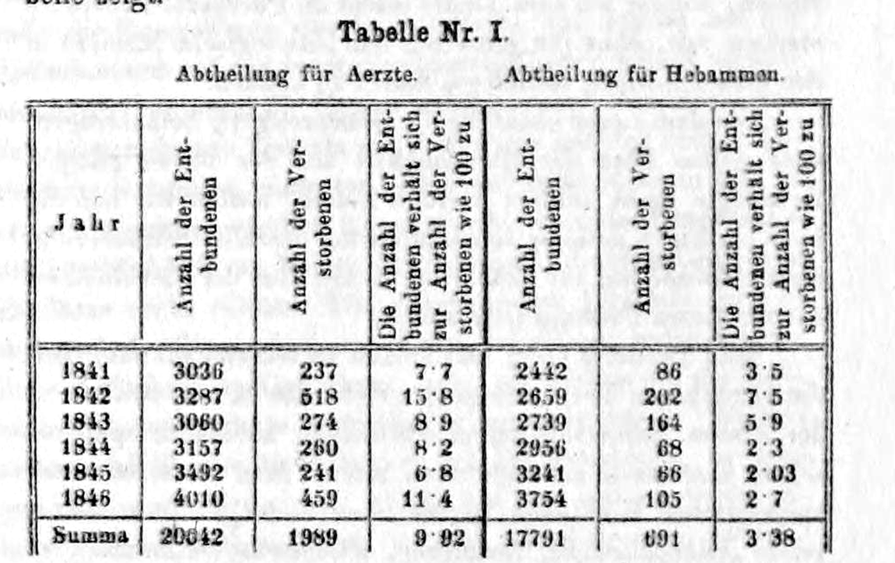
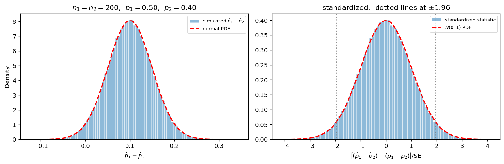
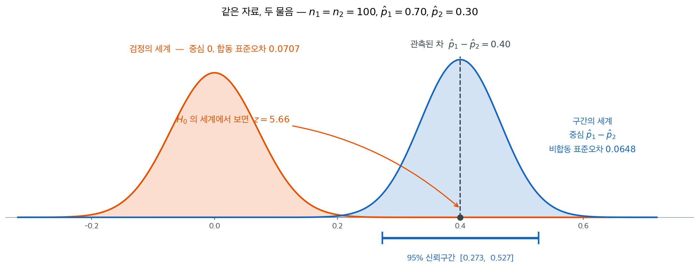

# 두 표본비율 차의 표집분포

## 개요

임상시험에서 처리군 200명 가운데 120명이, 대조군 200명 가운데 90명이 회복했다. 회복률로 치면 60%와 45%이니 차가 15%포인트다. 이 15%포인트를 치료의 효과라고 말해도 되는가, 아니면 두 군에 누가 배정되었는가에서 생긴 운의 차이일 뿐인가.

독립인 두 모집단의 비율을 비교할 때(처리군 대 대조군, 브랜드 A 대 브랜드 B, A안 대 B안) 관심 통계량은 $\hat{p}_1 - \hat{p}_2$이다. 이 차도 표본이 바뀌면 함께 바뀌므로 그 표집분포를 알아야 하고, 알고 나면 차 $p_1 - p_2$에 대한 신뢰구간과 가설검정이 따라 나온다.

그런데 이 쪽에는 걸려 넘어지기 쉬운 지점이 하나 있다. **같은 자료를 놓고도 신뢰구간과 검정이 서로 다른 표준오차를 쓴다**는 것이다. 왜 그렇게 되는지가 아래에서 밝혀진다.

---

## 1. 차의 중심과 퍼짐

$\hat{p}_1$과 $\hat{p}_2$를 참 비율이 $p_1$과 $p_2$인 모집단에서 뽑은 크기 $n_1$, $n_2$의 독립 표본으로부터 얻은 표본비율이라 하자.

<div class="thmbox" markdown>

### 정리 1. 두 비율 차의 중심과 폭 { .thm }

두 표본이 서로 독립이면

$$
E[\hat p_1 - \hat p_2] = p_1 - p_2,
\qquad
\operatorname{SE}(\hat p_1 - \hat p_2) = \sqrt{\frac{p_1(1-p_1)}{n_1} + \frac{p_2(1-p_2)}{n_2}}
$$

이다.

</div>

??? proof "증명"

    $\hat p_i$ 는 베르누이 표본의 표본평균이므로([표본비율](sample_proportion.md) 정리 1) $E[\hat p_i] = p_i$ 이고 $\operatorname{Var}(\hat p_i) = p_i(1-p_i)/n_i$ 다. 여기에 차의 중심과 폭([두 평균의 차](diff_means.md) 정리 1)을 $\sigma_i^2 = p_i(1-p_i)$ 로 적용하면 그대로 나온다. $\square$

    **새로 증명할 것이 없다.** 비율은 0 과 1 의 평균이므로 두 평균의 차에 대해 아는 것이 그대로 통한다. 다만 $\sigma_i^2$ 이 모수 $p_i$ 와 얽혀 있다는 차이가 뒤따르고, 그래서 **신뢰구간과 가설검정에서 표준오차를 다르게 추정한다**(§3, §4). 구간에서는 두 비율을 따로 추정하고, 검정에서는 귀무가설 $p_1 = p_2$ 아래에서 하나로 합쳐 추정한다.

차를 구하는데 분산을 더한다는 것이 처음에는 어색하다.차를 구하는데 분산을 더한다는 것이 처음에는 어색하다. 그러나 어느 쪽이 흔들려도 차는 흔들린다. 두 추정값 각각의 불확실성이 차의 불확실성에 함께 얹히는 것이다.

<div class="storybox" markdown>

**그림으로 보는 통계학 1.** 두 병동의 수가 갈라져 있었다

<figure markdown>
  { width=680 }
  <figcaption markdown>젬멜바이스 『산욕열의 원인·개념·예방』($1861$) $3$ 쪽의 「표 제 $1$ 호」. 왼쪽 세 칸이 **의사 병동**(Abtheilung für Aerzte), 오른쪽 세 칸이 **조산사 병동**(Abtheilung für Hebammen)이고, 각 묶음은 분만한 수·사망한 수·「분만 수 대 사망 수가 $100$ 대 얼마인가」다. *(Wellcome Library 스캔)*</figcaption>
</figure>

정리 1 이 재는 것은 두 비율의 차와 그 차의 표준오차다. 그 셈을 실제 자료에 들이댄 가장 이른 자리 가운데 하나가 사진이다.

빈의 종합병원 산과에는 병동이 둘이었다. 하나는 **의사와 학생**이 배우는 곳이고 하나는 **조산사**만 배우는 곳이었다. 표는 $1841$ 년부터 $1846$ 년까지 여섯 해 동안 두 병동에서 아이를 낳은 사람의 수와 죽은 사람의 수를 나란히 적었다. 합계 줄을 읽으면 의사 병동은 $20042$ 명 가운데 $1989$ 명, 조산사 병동은 $17791$ 명 가운데 $691$ 명이다. 나누면

$$
\widehat p_1=\frac{1989}{20042}=0.0992,\qquad \widehat p_2=\frac{691}{17791}=0.0388
$$

이고 차는 $6.04$ 퍼센트포인트다. 각각의 표준오차는 $0.21$ 과 $0.14$ 퍼센트포인트이고, 정리 1 대로 제곱합의 제곱근을 취하면 차의 표준오차는 $0.26$ 퍼센트포인트다. 그러니 이 차이는 표준오차의

$$
\frac{6.04}{0.26}\approx 23
$$

배다. 표준오차 두어 배만 되어도 우연으로 보기 어렵다고 말하는 마당에 스물세 배다.

그런데 수가 크다는 것만으로는 모자란다. **정리 1 이 「두 표본이 서로 독립이면」이라는 단서를 달아 두었기** 때문이다. 두 병동의 산모가 서로 견줄 만한 사람들이어야 한다는 뜻이다. 같은 책 앞쪽이 그 점을 적어 두었다. 산모를 받는 차례는 월요일 오후 네 시에 첫째 병동에서 시작해 이튿날 같은 시각에 둘째 병동으로 넘어가고, 그렇게 **스물네 시간마다 번갈아** 돌았다. 주에 한 번만 첫째 병동이 마흔여덟 시간을 이어 받았고, 그래서 첫째 병동의 받는 날이 한 해에 쉰이틀 많았다. 어느 병동에 눕게 되는지는 본인도 의사도 고르지 않았고 **대문에 닿은 시각**이 정했다. 두 수를 나란히 놓고 견줄 수 있었던 까닭이 거기에 있다 — 정리 1 이 기대는 독립이 **설계로** 지켜진 것이고, 1장의 [실험](../../ch01/classical/experiments.md)이 무작위 배정으로 하는 일을 시계가 대신한 셈이다.

표가 말해 주는 것은 거기까지다. 차이가 우연으로 생길 만한 크기가 아니라는 것, 그뿐이다. 무엇이 그 차이를 만들었는지는 표 안에 없고 표 밖에서 찾아야 했다. 같은 쪽의 본문은 첫째 병동의 사망이 **$1847$ 년 $6$ 월까지** 줄곧 더 높았다고만 적어 둔다 — 그 달에 무엇이 달라졌는지는 숫자가 아니라 사람이 알아내야 하는 것이었다.

_확인한 곳 — 스캔은 [Internet Archive 에 올라온 Wellcome Library 사본](https://archive.org/details/b33953740) — 젬멜바이스, 『산욕열의 원인·개념·예방』(페스트, $1861$), 저자가 $1865$ 년에 죽어 저작권이 만료되었다. 「표 제 $1$ 호」의 두 병동 이름과 세 칸의 머리, 여섯 해의 분만 수·사망 수, 합계의 $20042$／$1989$ 와 $17791$／$691$ 은 **사진에서 직접 읽었다** · 받는 차례가 스물네 시간마다 번갈았고 첫째 병동이 한 해에 쉰이틀 더 받았다는 것, 그리고 첫째 병동의 사망이 $1847$ 년 $6$ 월까지 줄곧 더 높았다는 것은 같은 스캔의 인쇄 쪽 $2$–$3$ 에서 직접 읽었다 · **비율과 표준오차는 이 쪽에서 직접 계산했다** — $0.0992$, $0.0388$, 차 $0.0604$, 표준오차 $0.00211$·$0.00145$, 차의 표준오차 $0.00256$ 으로 $23.6$ 배다. 합계도 맞추어 보았다($3036+\cdots+4010=20042$) · 표의 백분율 칸은 해마다 적힌 값이 직접 나눈 값과 $0.1$ 쯤 어긋나는 줄이 몇 있고, 합계 칸의 조산사 쪽 값은 스캔이 흐려 자릿수를 단정하기 어려워, 본문의 수는 모두 **분만 수와 사망 수에서 직접 나누어** 적었다_

</div>

---

## 2. 정규근사

$\hat{p}_1$과 $\hat{p}_2$가 각각 근사적으로 정규이고 서로 독립이므로 그 차도 근사적으로 정규다. $n_1$과 $n_2$가 충분히 크면(두 $i$ 모두에 대해 $n_i p_i \geq 5$이고 $n_i(1-p_i) \geq 5$) 차를 표준화한 양이 표준정규를 따른다.

$$
Z = \frac{(\hat{p}_1 - \hat{p}_2) - (p_1 - p_2)}{\sqrt{\frac{p_1(1-p_1)}{n_1} + \frac{p_2(1-p_2)}{n_2}}} \approx N(0, 1)
$$

그런데 분모에 미지의 $p_1$과 $p_2$가 들어 있어 이대로는 계산할 수 없다. 실무에서는 표본비율로 대체한다.

$$
Z \approx \frac{(\hat{p}_1 - \hat{p}_2) - (p_1 - p_2)}{\sqrt{\frac{\hat{p}_1(1-\hat{p}_1)}{n_1} + \frac{\hat{p}_2(1-\hat{p}_2)}{n_2}}}
$$

이 대체가 뒤에서 갈림길을 만든다. **무엇으로 대체하는 것이 옳은지가 지금 무엇을 묻고 있느냐에 따라 달라지기 때문이다.**

근사가 얼마나 잘 드는지는 재어 볼 수 있다. $n_1 = n_2 = 200$, $p_1 = 0.50$, $p_2 = 0.40$을 이 쪽의 붙박이 보기로 두고, 먼저 **모양**을 본다.

<div class="exbox" markdown>

**보기 1.** <span class="diff easy" title="쉬움"></span> 표집분포를 눈으로 확인한다. $X_1 \sim \text{Bin}(200, 0.50)$, $X_2 \sim \text{Bin}(200, 0.40)$에서 $\hat p_1 - \hat p_2$를 20만 번 만들어 정규밀도와 겹쳐 그린다.

**(1)** 차의 평균·표준오차·왜도·초과첨도를 닫힌 꼴로 구하시오. 그림에서 정규와의 어긋남이 보일 만한 크기인가.

**(2)** 그려서 확인하고, 오른쪽 그림의 계급폭 $0.101$이 어디서 온 수인지 밝히시오.

</div>

??? success "풀이"

    **(1) 네 값 모두 닫힌 꼴이다.** 이항의 누적률 $\kappa_2 = npq$, $\kappa_3 = npq(q-p)$, $\kappa_4 = npq(1-6pq)$를 $\hat p = X/n$의 척도로 옮기면 $\kappa_j(\hat p) = \kappa_j(X)/n^j$이므로

    $$
    \kappa_2(\hat p) = \frac{pq}{n}, \qquad
    \kappa_3(\hat p) = \frac{pq(q-p)}{n^2}, \qquad
    \kappa_4(\hat p) = \frac{pq(1-6pq)}{n^3}
    $$

    이다. 누적률은 독립인 확률변수의 합에서 더해지고 부호에서 $\kappa_j(-Y) = (-1)^j\kappa_j(Y)$이므로, 차에서는 **홀수 차수만 빼고 짝수 차수는 더한다.** 중심은 그대로 $p_1-p_2 = 0.10$이고

    $$
    \operatorname{Var} = \frac{0.25}{200}+\frac{0.24}{200} = 0.00245,
    \qquad \text{SE} = 0.049497
    $$

    $$
    \kappa_3 = \frac{0.25 \times 0}{200^2} - \frac{0.24 \times 0.2}{200^2} = -1.200\times10^{-6},
    \qquad
    \kappa_4 = \frac{0.25(1-1.5)}{200^3} + \frac{0.24(1-1.44)}{200^3} = -2.883\times10^{-8}
    $$

    이다. $p_1 = 0.5$인 집단은 대칭이라 $\kappa_3$에 **아무것도 보태지 않는다.** 표준화하면

    $$
    \gamma_1 = \frac{\kappa_3}{\kappa_2^{3/2}} = -0.00990,
    \qquad
    \gamma_2 = \frac{\kappa_4}{\kappa_2^{2}} = -0.00480
    $$

    **둘 다 $0.01$에 못 미친다.** 왜도 $-0.0099$는 지수분포의 $2$에 견주면 200분의 일이고, 표준정규의 표본 20만 개로 재어도 왜도 추정의 몬테카를로 오차가 $\sqrt{6/200000} = 0.0055$이니 이 크기는 잡음과 구별되기도 어렵다. **그림에서는 아무 어긋남도 보이지 않을 것**이라고 예측된다.

    눈에 보일 것이 하나 남는데 모양이 아니라 **격자**다. $n_1 = n_2 = 200$이면 $\hat p_1-\hat p_2$가 가질 수 있는 값은 $1/200 = 0.005$의 배수뿐이다. 계급폭을 그 격자에 맞추지 않으면 막대가 들쭉날쭉해진다.

    **(2) 그려서 확인한다.**

    ```python
    import matplotlib.pyplot as plt
    import numpy as np
    from scipy import stats

    rng = np.random.default_rng(1)

    n1 = n2 = 200
    p1, p2 = 0.50, 0.40
    mu = p1 - p2
    sd = np.sqrt(p1 * (1 - p1) / n1 + p2 * (1 - p2) / n2)

    B = 200_000
    x1 = rng.binomial(n1, p1, B)
    x2 = rng.binomial(n2, p2, B)
    d = x1 / n1 - x2 / n2

    fig, axes = plt.subplots(1, 2, figsize=(12, 4))

    # (좌) 차 자체의 분포. n1 = n2 이므로 가능한 값은 1/200 = 0.005 의 배수다.
    # 계급폭을 그 격자에 맞추어야 막대가 들쭉날쭉해지지 않는다.
    ax = axes[0]
    ax.hist(d, bins=np.arange(d.min() - 0.0025, d.max() + 0.0075, 0.005),
            density=True, alpha=0.5, edgecolor="white",
            label=r"simulated $\hat p_1-\hat p_2$")
    g = np.linspace(mu - 4.5 * sd, mu + 4.5 * sd, 400)
    ax.plot(g, stats.norm(mu, sd).pdf(g), "--r", lw=2, label="normal PDF")
    ax.axvline(mu, color="k", lw=1, ls=":")
    ax.set_xlabel(r"$\hat p_1 - \hat p_2$")
    ax.set_ylabel("Density")
    ax.set_title(r"$n_1=n_2=200$,  $p_1=0.50$,  $p_2=0.40$")
    ax.legend(fontsize=8)

    # (우) 참 표준오차로 표준화한 통계량. 계급폭 0.101 = 0.005 / SE 는
    # 격자 간격을 z 눈금으로 옮긴 값이다.
    ax = axes[1]
    ax.hist((d - mu) / sd, bins=np.arange(-4.5, 4.55, 0.101), density=True,
            alpha=0.5, edgecolor="white", label="standardized statistic")
    g = np.linspace(-4.5, 4.5, 400)
    ax.plot(g, stats.norm.pdf(g), "--r", lw=2, label=r"$N(0,1)$ PDF")
    for c in (-1.96, 1.96):
        ax.axvline(c, color="gray", lw=1, ls=":")
    ax.set_xlabel(r"$\left[(\hat p_1-\hat p_2)-(p_1-p_2)\right]/\mathrm{SE}$")
    ax.set_xlim(-4.5, 4.5)
    ax.set_title("standardized:  dotted lines at $\\pm 1.96$")
    ax.legend(fontsize=8)

    plt.tight_layout()
    plt.show()
    ```

    

    히스토그램과 빨간 곡선이 사실상 구분되지 않는다. 왼쪽 그림에서 중심이 $0.10$에 있고, 오른쪽 그림에서 표준화한 통계량이 $N(0,1)$과 겹친다. 오른쪽 계급폭 $0.101$은 우연한 값이 아니다. 가능한 $\hat p_1 - \hat p_2$ 값의 간격 $0.005$를 표준오차 $0.04950$으로 나눈 값이며, **이 통계량이 실은 격자 위의 이산확률변수**라는 사실을 계급폭이 그대로 반영한다.

    **예측대로 어긋남이 보이지 않는다.** 히스토그램과 빨간 곡선이 사실상 구분되지 않는다. 왼쪽 그림에서 중심이 $0.10$에 있고, 오른쪽 그림에서 표준화한 통계량이 $N(0,1)$과 겹친다. 왜도 $-0.0099$와 초과첨도 $-0.0048$이 그리는 차이는 선 두께 안에 들어간다.

    **오른쪽 계급폭 $0.101$은 우연한 값이 아니다.** 가능한 $\hat p_1-\hat p_2$ 값의 간격 $0.005$를 표준오차 $0.049497$로 나눈 값이다.

    $$
    \frac{0.005}{0.049497} = 0.1010
    $$

    곧 **$z$ 눈금으로 옮긴 격자 간격**이다. 계급 하나가 격자점 하나를 담도록 맞춘 것이고, 이 수가 계급폭으로 쓰였다는 사실 자체가 **이 통계량이 연속이 아니라 격자 위의 이산확률변수**임을 말해 준다.

    **그래서 이 그림이 보이는 것과 가리는 것이 갈린다.** 봉우리의 모양은 보이고 — 그리고 맞고 — 격자 간격은 계급폭에 숨어 있다. $z$ 눈금으로 $0.101$이면 꼬리확률을 잴 때 임계값이 격자점 어디에 떨어지느냐에 따라 **덩어리 하나만큼** 답이 달라질 수 있다는 뜻이다. 그 크기가 얼마인지는 보기 3에서 수로 잰다.

## 3. 신뢰구간에서는 두 비율을 따로 추정한다

차가 얼마인지만 묻고 어떤 가설도 전제하지 않는 경우를 먼저 보자. 이때 분모에 넣을 수 있는 것은 방금 얻은 추정 표준오차, 곧 $\hat{p}_1$과 $\hat{p}_2$를 **각각 따로** 넣어 계산한 값뿐이다. 두 비율이 같은지 다른지 모르는 채로 차가 얼마인지를 가늠하는 일이므로, 각 비율은 각자의 자료로 추정하는 수밖에 없다.

그러므로 이 물음에 대응하는 표집분포는 중심이 참 차 $p_1 - p_2$에 있고 폭이 그 **비합동** 표준오차인 정규분포다. 여기까지가 표집분포의 몫이다. 이 분포의 양옆을 임계값만큼 벌려 구간을 만드는 일은 [8.3절 $p_1-p_2$의 신뢰구간](../../ch08/two_sample_intervals/ci_p_diff.md)에서 한다.

비합동 표준오차로 세운 이 구간이 실제로 참값을 얼마나 덮는지는 모의실험 없이 전수로 셀 수 있다.

<div class="exbox" markdown>

**보기 2.** <span class="diff easy" title="쉬움"></span> 정확한 포함률 (모의실험이 아니라 전수 계산). $(X_1,X_2)$의 모든 조합에 이항확률을 곱해 평균·표준편차·포함률·평균 폭을 **오차 없이** 구한다.

**(1)** 네 양 가운데 어느 것이 근사 없이 **정확히** 이론값과 같아야 하고 어느 것이 근사인지 가르시오. 구간의 평균 폭은 $2 \times 1.96 \times \text{SE}$보다 클 것인가 작을 것인가.

**(2)** 전수 계산으로 확인하시오.

</div>

??? success "풀이"

    **(1) 둘은 정확하고 둘은 근사다.**

    **평균과 표준편차는 정확하다.** $E[\hat p_i] = p_i$와 $\operatorname{Var}(\hat p_i) = p_iq_i/n_i$는 이항분포의 정의에서 바로 나오는 등식이고, 두 표본이 독립이므로 차의 평균과 분산도 등식이다. 여기에는 정규근사가 한 번도 쓰이지 않는다. 그러므로 전수 계산은 $0.1000$과 $0.04950$을 **자릿수가 허락하는 한 그대로** 되돌려 주어야 한다.

    **포함률은 근사다.** 근사가 들어간 곳이 둘이다. 하나는 모양($Z$가 정규라는 것), 다른 하나는 분모($p_i$ 자리에 $\hat p_i$를 끼워 넣은 것)다.

    **평균 폭은 근사이고, 방향과 크기까지 손으로 나온다.** 구간의 폭은 $2z\widehat{\text{SE}}$이고 $\widehat{\text{SE}} = \sqrt{\hat V}$인데, $\hat V$는 $V$의 불편추정량이 **아니다.**

    $$
    E[\hat p(1-\hat p)] = E[\hat p] - E[\hat p^2] = p - \left(\frac{pq}{n} + p^2\right) = pq\left(1 - \frac 1n\right)
    $$

    이므로 $E[\hat V] = \left(1-\frac1n\right)V$로 **$1/n$만큼 작게** 겨눈다. 여기에 제곱근이 위로 오목하다는 옌센의 몫이 한 번 더 아래로 더해진다. $\hat V$의 변동계수를 $\mathrm{cv}$라 하면 델타법이 $E[\sqrt{\hat V}] \approx \sqrt{E[\hat V]}\,(1-\mathrm{cv}^2/8)$을 주므로

    $$
    \frac{E[\widehat{\text{SE}}]}{\text{SE}} \approx \sqrt{1-\frac1n}\left(1-\frac{\mathrm{cv}^2}{8}\right)
    = \sqrt{0.995}\,(1 - 2.8\times10^{-5}) = 0.99747
    $$

    이다($\mathrm{cv} = 0.0150$). **두 몫의 크기가 전혀 다르다.** 앞의 $-0.2503\%$가 거의 전부이고 옌센은 $-0.0028\%$에 그친다. 따라서 평균 폭은

    $$
    2 \times 1.96 \times 0.049497 \times 0.99747 = 0.1935
    $$

    로, $2z\,\text{SE} = 0.1940$보다 **조금 작아야** 한다.

    **(2) 전수 계산.**

    $n_1 = n_2 = 200$이면 $(X_1, X_2)$의 조합이 $201 \times 201 = 40401$개뿐이다. 모의실험을 돌릴 필요 없이 **모든 조합에 이항 확률을 곱해** 정확한 값을 얻을 수 있다.

    ```python
    import numpy as np
    from scipy import stats

    n1 = n2 = 200
    p1, p2 = 0.50, 0.40
    mu = p1 - p2
    sd = np.sqrt(p1 * (1 - p1) / n1 + p2 * (1 - p2) / n2)
    z975 = stats.norm.ppf(0.975)

    k1 = np.arange(n1 + 1)
    k2 = np.arange(n2 + 1)

    # W[i, j] = P(X1 = i) * P(X2 = j). 두 표본이 독립이므로 곱이 된다.
    W = np.outer(stats.binom.pmf(k1, n1, p1), stats.binom.pmf(k2, n2, p2))

    X1, X2 = np.meshgrid(k1, k2, indexing="ij")
    ph1, ph2 = X1 / n1, X2 / n2
    d = ph1 - ph2

    # 비합동 표준오차를 쓴 왈드 구간이 참값 mu 를 담는 칸을 골라낸다.
    se = np.sqrt(ph1 * (1 - ph1) / n1 + ph2 * (1 - ph2) / n2)
    inside = (d - z975 * se <= mu) & (mu <= d + z975 * se)

    print(f"이론 평균 {mu:.4f},  실제 평균 {(W * d).sum():.4f}")
    print(f"이론 표준오차 {sd:.5f},  실제 표준편차 {np.sqrt((W * (d - mu) ** 2).sum()):.5f}")
    print(f"명목 95% 구간의 정확 포함률 {W[inside].sum():.4f}")
    print(f"구간의 평균 폭 {(W * 2 * z975 * se).sum():.4f}")
    ```

    출력:

    ```
    이론 평균 0.1000,  실제 평균 0.1000
    이론 표준오차 0.04950,  실제 표준편차 0.04950
    명목 95% 구간의 정확 포함률 0.9504
    구간의 평균 폭 0.1935
    ```

    평균과 표준편차는 **근사가 아니라 정확히** 이론값과 같다. 애초에 근사가 들어간 곳은 모양뿐이기 때문이다. 포함률 $0.9504$는 명목 $0.95$와 0.04퍼센트포인트밖에 차이 나지 않는다.

    **(1)의 가르기가 그대로 확인된다.** 평균 $0.1000$과 표준편차 $0.04950$은 이론값과 **찍어 낸 자리까지 같다.** 애초에 근사가 없었으므로 당연한 결과이며, 이 두 줄은 전수 계산의 검산 노릇을 한다.

    **포함률 $0.9504$는 명목에서 $0.0004$ 떨어져 있다.** 모의실험이 아니라 $201 \times 201 = 40401$칸을 모두 센 값이므로 여기에 몬테카를로 오차는 없다. **$0.0004$는 전부 근사의 몫**이고, 기대도수가 $80$ 이상인 이 설정에서 왈드 구간이 실용적으로 완벽하다는 뜻이다.

    **평균 폭이 예측한 $0.1935$ 그대로다.** $2z\,\text{SE} = 0.1940$보다 작고, 전수 계산으로 재면 $E[\widehat{\text{SE}}] = 0.049372$로 참값 $0.049497$의 $0.99747$배다. (1)에서 손으로 낸 $0.99747$과 소수 다섯째 자리까지 같다. **$\hat p\hat q$의 $(1-1/n)$ 편향이 거의 전부이고 옌센의 몫은 백분의 일에 그친다.**

    **구간이 평균적으로 살짝 짧은데도 포함률이 모자라지 않는 까닭**은 짧아지는 표본과 중심이 빗나가는 표본이 서로 다르기 때문이다. $\widehat{\text{SE}}$는 $\hat p_i$가 $0.5$에서 멀어질 때 작아지는데, 그런 표본은 $\hat p_i$가 참값에서 크게 벗어난 표본이 아니라 그저 한쪽으로 치우친 표본이다. 두 어긋남이 같은 방향으로 겹치지 않아 상쇄가 일어난다. 다음 쪽에서 $n$을 줄이면 이 상쇄가 깨지고 왈드 구간의 포함률이 무너진다.

---


---

## 4. 가설검정에서는 귀무가설이 표준오차를 바꾼다

검정은 사정이 다르다. 검정통계량의 분포는 **귀무가설이 참이라는 전제 아래에서** 구하는 것이므로, 그 귀무가설이 표준오차에 관해 무엇을 말해 주는지 따져 보아야 한다.

귀무가설이 $H_0: p_1 - p_2 = d_0$처럼 차를 어떤 값 $d_0$로 못박는 일반적인 형태라면, 두 비율이 각각 얼마인지는 여전히 알려 주지 않는다. 그래서 신뢰구간에서와 같은 추정 표준오차를 그대로 쓴다.

$$
Z = \frac{(\hat{p}_1 - \hat{p}_2) - d_0}{\sqrt{\frac{\hat{p}_1(1-\hat{p}_1)}{n_1} + \frac{\hat{p}_2(1-\hat{p}_2)}{n_2}}}
$$

그러나 실제로 가장 많이 쓰는 귀무가설은 $H_0: p_1 = p_2$, 곧 $d_0 = 0$인 경우다. 이때는 이야기가 달라진다. 귀무가설이 참이라면 두 모비율이 같은 값 $p$이므로 추정할 것이 하나뿐이고, 두 표본의 자료를 모두 모아 그 하나를 추정하는 편이 낫다. 이렇게 얻은 것이 **합동비율**이다.

$$
\hat{p}_{\text{pool}} = \frac{X_1 + X_2}{n_1 + n_2}
$$

그것을 표준오차에 넣으면 귀무가설 아래에서 표준화한 양이 된다.

$$
Z = \frac{\hat{p}_1 - \hat{p}_2}{\sqrt{\hat{p}_{\text{pool}}(1-\hat{p}_{\text{pool}})\left(\frac{1}{n_1} + \frac{1}{n_2}\right)}}
$$

두 표준오차가 갈리는 까닭이 이것이다. 신뢰구간은 아무것도 전제하지 않으므로 합동하지 않고, 검정은 귀무가설을 전제하므로 합동한다.

두 세계를 나란히 그리면 이렇다.



주황 곡선이 **검정의 세계**다. 귀무가설이 참이라고 가정했으므로 중심이 $0$에 있고, 폭은 두 표본을 합쳐 추정한 합동 표준오차다. 관측된 차 $0.40$은 이 세계에서 보면 중심에서 $5.66$ 표준오차만큼 떨어진 자리, 곧 일어나기 어려운 자리에 있다.

파랑 곡선이 **구간의 세계**다. 아무 가설도 전제하지 않으므로 중심을 관측된 차에 두고, 폭은 두 비율을 따로 추정한 비합동 표준오차다. 이 곡선의 양옆을 $1.96$ 표준오차만큼 벌린 것이 아래의 신뢰구간이다.

두 곡선은 **중심도 폭도 다르다.** 중심이 다른 것은 전제가 다르기 때문이고, 폭이 다른 것은 합동 여부 때문이다. 이 예에서 합동 표준오차가 오히려 조금 더 큰데, $p(1-p)$가 $p = 0.5$에서 가장 크기 때문에 두 비율을 $0.5$ 쪽으로 합쳐 놓으면 폭이 늘어나는 것이다. 두 비율이 서로 멀수록 이 차이가 벌어진다.

여기서 눈여겨볼 것은 **같은 자료를 놓고도 무엇을 묻느냐에 따라 표집분포가 달라진다**는 점이다. 표준오차는 곧 표집분포의 폭이므로, 합동을 쓴다는 것은 $\hat{p}_1 - \hat{p}_2$를 귀무가설이 참인 세상에 놓고 그 세상에서의 흔들림을 재겠다는 뜻이다. 두 표본을 합쳐 하나의 $p$를 추정하므로 자료를 두 배로 쓰는 셈이고, 귀무가설이 정말 참이라면 그 폭이 더 정확하게 잡힌다. 두 값은 대개 비슷하지만 참 비율이 서로 멀수록 갈라지며, 얼마나 갈라지는지는 연습문제 2와 아래 보기 4에서 잰다.

검정은 꼬리에서 판정하므로 **꼬리가 얼마나 잘 맞는가**가 구간에서보다 더 직접적으로 걸린다. 꼬리확률을 먼저 재고, 이어서 합동과 비합동이 각각 어디에 맞는지를 1종오류율과 포함률로 가린다.

<div class="exbox" markdown>

**보기 3.** <span class="diff easy" title="쉬움"></span> 꼬리는 얼마나 잘 맞는가. 표준화한 통계량의 꼬리확률을 $c = 1,\ 1.96,\ 2.576$ 세 지점에서 정확히 계산해 표준정규와 견준다.

**(1)** 세 지점 가운데 어디서 어긋남이 가장 클지 미리 짚고, 그 크기를 **격자 덩어리의 크기**로 예측하시오.

**(2)** 전수 계산으로 확인하시오.

</div>

??? success "풀이"

    **(1) 어긋남은 모양이 아니라 격자에서 온다.** 보기 1에서 $\hat p_1-\hat p_2$의 왜도가 $-0.0099$, 초과첨도가 $-0.0048$이었다. 모양으로 생길 수 있는 오차는 이 크기를 넘지 못한다. 남는 범인은 **이 통계량이 $0.005$ 간격의 격자 위에만 산다**는 사실이다.

    격자 위의 확률은 덩어리로 놓여 있으므로, 임계값이 어느 격자점의 **바로 옆**에 떨어지면 덩어리 하나가 통째로 안쪽이나 바깥쪽으로 쏠린다. 세 지점의 경계를 격자와 맞춰 본다.

    $$
    c = 1: \ \mu + \sigma = 0.14950, \qquad
    c = 1.96: \ 0.19702, \qquad
    c = 2.576: \ 0.22751
    $$

    격자점은 $0.005$의 배수다. $c = 1.96$의 $0.19702$는 $0.195$에서 칸 폭의 $40\%$ 들어간 자리이고 $c = 2.576$의 $0.22751$도 $0.225$에서 $50\%$ 들어간 한가운데다. 둘 다 격자점에서 멀다. 그런데 $c = 1$의 $0.14950$은 격자점 $0.150$의 왼쪽 $0.00050$ 자리, 곧 칸 폭 $0.005$의 **10% 지점**이다. **$c = 1$에서 가장 크게 어긋나야 한다.**

    크기를 어림하자. 격자점 $0.150$에 놓인 덩어리가 $P(\hat p_1-\hat p_2 = 0.150) = 0.0243$인데, 경계가 그 왼쪽에 있으므로 이 덩어리가 **전부** 꼬리로 들어간다. 덩어리를 칸 폭 $0.005$에 고르게 펴 놓은 "연속판"에서라면 경계 오른쪽으로 넘어갈 몫은 $(0.1525-0.1495)/0.005 = 60\%$뿐이므로, 나머지 $40\%$가 초과분이다.

    $$
    \text{한쪽 초과분} \approx 0.0243 \times 0.4 = 0.0097,
    \qquad
    \text{양쪽} \approx 0.0194
    $$

    **$P(|Z|>1)$이 표준정규보다 약 $0.019$ 클 것으로 예측된다.**

    **(2) 전수 계산.**

    포함률은 하나의 숫자이므로 안쪽과 꼬리의 오차가 서로를 가려 줄 수 있다. 꼬리확률을 여러 지점에서 따로 본다.

    ```python
    zstat = (d - mu) / sd

    print("표준화한 통계량의 꼬리확률")
    for c in (1.000, 1.960, 2.576):
        exact = W[np.abs(zstat) > c].sum()
        print(f"  P(|Z| > {c:.3f}) = {exact:.4f}   표준정규 {2 * (1 - stats.norm.cdf(c)):.4f}")
    ```

    출력:

    ```
    표준화한 통계량의 꼬리확률
      P(|Z| > 1.000) = 0.3372   표준정규 0.3173
      P(|Z| > 1.960) = 0.0487   표준정규 0.0500
      P(|Z| > 2.576) = 0.0099   표준정규 0.0100
    ```

    실무에서 쓰는 두 지점($1.96$, $2.576$)은 소수 셋째 자리까지 맞는다. 그런데 $c = 1$에서는 $0.3372$ 대 $0.3173$으로 2퍼센트포인트나 어긋난다.

    원인은 정규근사의 실패가 아니라 **이산성**이다. $c = 1$에 해당하는 경계 $0.10 + 0.04950 = 0.14950$은 격자점 $0.150 = 30/200$의 바로 왼쪽($0.00050$ 차이)에 있다. 그래서 $P(\hat p_1 - \hat p_2 = 0.150) = 0.0243$이라는 **덩어리 하나가 통째로 꼬리에 들어간다.** 이 덩어리를 폭 $0.005$에 고르게 펴 놓았다면 경계 오른쪽으로 넘어갈 몫은 60%뿐이므로 약 $0.0243 \times 0.4 = 0.0097$이 초과된다. 양쪽 꼬리를 합치면 $0.0194$이고, 관측된 차이 $0.3372 - 0.3173 = 0.0199$와 같은 크기다.

    기대도수가 충분히 커도 이산성은 이렇게 남아 있다. [다음 페이지](diff_props_small.md)에서는 이 덩어리가 통계량 전체를 지배하게 된다.

    **예측 $0.0194$에 실제 $0.3372 - 0.3173 = 0.0199$다.** 격자 덩어리 하나로 어긋남의 거의 전부가 설명된다. 나머지 두 지점은 소수 셋째 자리까지 맞는다.

    | $c$ | 경계 | 가장 가까운 격자점 | 칸 안 위치 | 정확 | 표준정규 | 차 |
    |---:|---:|---:|---:|---:|---:|---:|
    | 1.000 | 0.14950 | 0.150 | 칸의 10% | 0.3372 | 0.3173 | $+0.0199$ |
    | 1.960 | 0.19702 | 0.195 / 0.200 | 칸의 40% | 0.0487 | 0.0500 | $-0.0013$ |
    | 2.576 | 0.22751 | 0.225 / 0.230 | 칸의 50% | 0.0099 | 0.0100 | $-0.0001$ |

    **실무에서 쓰는 두 지점이 맞은 것은 운이 좋아서다.** 근사가 특별히 좋아서가 아니라 경계가 격자점에서 멀리 떨어진 자리에 놓였기 때문이다. $n$이나 $p$를 조금만 바꾸면 $1.96$의 경계도 격자점 옆으로 옮겨 가고, 그때는 $c=1$에서 본 것과 같은 크기의 어긋남이 **거기서** 나타난다.

    **이것이 포함률 하나만 보면 안 되는 이유다.** 보기 2가 준 $0.9504$는 "안쪽 전체"를 재므로 양쪽 꼬리의 어긋남이 서로를 지우거나 묻힌다. 꼬리를 여러 지점에서 따로 보면 숨어 있던 $2$퍼센트포인트가 드러난다.

    **어긋남은 작아지지만 없어지지 않는다.** 격자 간격은 $1/n$이고 표준오차는 $1/\sqrt n$에 비례하므로, $z$ 눈금에서 잰 간격은 $1/\sqrt n$으로 줄어든다. $n$을 네 배로 키워야 절반이 된다. 0으로 가기는 하되 **느리게** 가며, 연속성 수정이 바로 이 몫을 손으로 메우는 장치다. 다음 쪽에서는 이 덩어리가 작아지기는커녕 통계량 전체를 지배한다.

---


<div class="exbox" markdown>

**보기 4.** <span class="diff easy" title="쉬움"></span> 합동과 비합동, 어느 쪽이 어디에 맞는가. $H_0: p_1 = p_2$ 검정의 정확한 1종오류율과, 신뢰구간에 합동 표준오차를 잘못 썼을 때의 정확한 포함률을 전수 계산한다.

**(1)** 합동 표준오차를 신뢰구간에 쓰면 포함률이 얼마가 되는지, 네 조합 각각에서 **미리 계산**하시오. 두 표준오차의 비 하나만 알면 된다.

**(2)** 전수 계산으로 확인하고, 검정에서는 왜 두 방식이 거의 같은지 적으시오.

</div>

??? success "풀이"

    **(1) 비 하나가 답을 정한다.** 구간의 반폭은 $z_{0.975}\widehat{\text{SE}}$이므로, 쓰는 표준오차가 참값의 $r$배이면 구간은 참 표준오차 눈금으로 $\pm 1.96r$만큼 뻗는다. 표본이 커서 $\hat p_1-\hat p_2$가 거의 정규라면

    $$
    \text{포함률} \approx P\!\left(|Z| \le 1.96\,r\right) = 1 - 2\left[1-\Phi(1.96r)\right]
    $$

    이다. 비합동은 $r \approx 1$이라 $0.95$를 준다. 합동은 $p_1 \ne p_2$일 때 $r$이 $1$에서 벗어난다. 두 표본크기가 같으면 $\hat p \to (p_1+p_2)/2 \equiv \bar p$이므로

    $$
    r = \frac{\sqrt{\bar p(1-\bar p)\left(\frac{1}{n_1}+\frac{1}{n_2}\right)}}{\sqrt{\frac{p_1q_1}{n_1}+\frac{p_2q_2}{n_2}}}
    = \sqrt{\frac{2\bar p(1-\bar p)}{p_1q_1+p_2q_2}}
    $$

    이다. $p_1 = \bar p + \delta/2$, $p_2 = \bar p - \delta/2$($\delta = p_1-p_2$)를 넣으면

    $$
    p_1q_1 + p_2q_2 = 2\bar p(1-\bar p) - \frac{\delta^2}{2}
    $$

    가 **정확히** 성립하므로

    $$
    r = \left[1 - \frac{\delta^2}{4\bar p(1-\bar p)}\right]^{-1/2} \;\ge\; 1
    $$

    임을 알 수 있다. **합동 표준오차는 언제나 참값 이상이고, 두 비율이 멀어질수록 커진다.** 네 조합에 넣으면 이렇다.

    | $p_1$ | $p_2$ | 참 SE | 합동 SE | $r$ | 예측 포함률 |
    |---:|---:|---:|---:|---:|---:|
    | 0.50 | 0.40 | 0.04950 | 0.04975 | 1.0051 | 0.9512 |
    | 0.60 | 0.40 | 0.04899 | 0.05000 | 1.0206 | 0.9545 |
    | 0.80 | 0.20 | 0.04000 | 0.05000 | 1.2500 | 0.9857 |
    | 0.90 | 0.10 | 0.03000 | 0.05000 | 1.6667 | 0.9989 |

    **$(0.9, 0.1)$에서 $r = 5/3$이다.** 합동 표준오차 $\sqrt{0.25 \times 2/200} = 0.05$는 두 비율이 **둘 다 $0.5$인 양 셈한 값**이고, 실제로는 $0.9$와 $0.1$이라 각 비율의 분산 $pq = 0.09$가 $0.25$의 삼분의 일 남짓이다. 구간이 참값 눈금으로 $\pm 3.27$까지 뻗으니 거의 아무것도 놓치지 않는다.

    **검정 쪽은 사정이 다르다.** $H_0$가 참이면 $p_1 = p_2$이므로 위 식에서 $(p_1-p_2)^2 = 0$, 곧 $r = 1$이다. **합동과 비합동이 겨누는 값이 같아진다.** 그래서 네 줄이 모두 $0.05$ 둘레에 있어야 한다.

    **(2) 전수 계산.**

    $H_0: p_1 = p_2$ 검정의 실제 1종오류율과, 신뢰구간에 합동 표준오차를 잘못 썼을 때의 포함률을 함께 계산한다.

    ```python
    ppool = (X1 + X2) / (n1 + n2)
    se_pool = np.sqrt(ppool * (1 - ppool) * (1 / n1 + 1 / n2))

    # 표준오차가 0 인 칸(두 표본이 모두 전원 성공 또는 전원 실패)은
    # 차도 0 이므로 기각하지 않는 것으로 둔다.
    z_pool = np.divide(d, se_pool, out=np.zeros_like(d), where=se_pool > 0)
    z_unpool = np.divide(d, se, out=np.zeros_like(d), where=se > 0)

    print("검정: 명목 유의수준 5% 의 실제 1종오류율")
    for p in (0.05, 0.20, 0.40, 0.50):
        W0 = np.outer(stats.binom.pmf(k1, n1, p), stats.binom.pmf(k2, n2, p))
        print(f"  p1 = p2 = {p:.2f}:  합동 {W0[np.abs(z_pool) > z975].sum():.4f}"
              f"   비합동 {W0[np.abs(z_unpool) > z975].sum():.4f}")

    print("신뢰구간: 명목 95% 의 실제 포함률")
    for a, b in [(0.50, 0.40), (0.60, 0.40), (0.80, 0.20), (0.90, 0.10)]:
        Wab = np.outer(stats.binom.pmf(k1, n1, a), stats.binom.pmf(k2, n2, b))
        t = a - b
        ok = Wab[(d - z975 * se <= t) & (t <= d + z975 * se)].sum()
        bad = Wab[(d - z975 * se_pool <= t) & (t <= d + z975 * se_pool)].sum()
        print(f"  p1 = {a:.2f}, p2 = {b:.2f}:  비합동 {ok:.4f}   합동 {bad:.4f}")
    ```

    출력:

    ```
    검정: 명목 유의수준 5% 의 실제 1종오류율
      p1 = p2 = 0.05:  합동 0.0481   비합동 0.0489
      p1 = p2 = 0.20:  합동 0.0508   비합동 0.0509
      p1 = p2 = 0.40:  합동 0.0482   비합동 0.0497
      p1 = p2 = 0.50:  합동 0.0510   비합동 0.0510
    신뢰구간: 명목 95% 의 실제 포함률
      p1 = 0.50, p2 = 0.40:  비합동 0.9504   합동 0.9513
      p1 = 0.60, p2 = 0.40:  비합동 0.9474   합동 0.9536
      p1 = 0.80, p2 = 0.20:  비합동 0.9460   합동 0.9853
      p1 = 0.90, p2 = 0.10:  비합동 0.9494   합동 0.9987
    ```

    **검정에서는 두 방식이 사실상 같다.** $H_0$가 참이면 $\hat p_1$과 $\hat p_2$가 모두 공통값 $p$에 가까우므로 합동과 비합동이 같은 값으로 수렴하기 때문이다. 합동을 권하는 이유는 그 수렴이 더 빠르다는 것뿐이다.

    **신뢰구간에서는 사정이 다르다.** 비합동 구간은 어느 조합에서든 $0.95$ 근처를 지키지만, 합동 구간은 두 비율이 멀어질수록 $0.9853$, $0.9987$로 치솟는다. 구간이 명목보다 훨씬 넓다는 뜻이다. 필요 이상으로 넓은 구간은 안전해 보이지만 **아무것도 말해 주지 않는 구간**이기도 하다.

    **예측이 네 자리까지 맞는다.**

    | $p_1$ | $p_2$ | $r$ | 예측 | 정확(합동) | 정확(비합동) |
    |---:|---:|---:|---:|---:|---:|
    | 0.50 | 0.40 | 1.0051 | 0.9512 | 0.9513 | 0.9504 |
    | 0.60 | 0.40 | 1.0206 | 0.9545 | 0.9536 | 0.9474 |
    | 0.80 | 0.20 | 1.2500 | 0.9857 | 0.9853 | 0.9460 |
    | 0.90 | 0.10 | 1.6667 | 0.9989 | 0.9987 | 0.9494 |

    가장 크게 어긋난 줄이 $(0.60,0.40)$의 $0.9545$ 대 $0.9536$으로 $0.0009$이고, 나머지 세 줄은 $0.0004$ 안이다. **표준오차의 비 하나로 포함률이 정해진다**는 (1)의 주장이 그대로 섰다.

    **검정 열도 예측대로다.** 네 줄이 $0.0481$에서 $0.0510$ 사이이고 합동과 비합동의 차이가 최대 $0.0015$다. $H_0$가 참이면 $r = 1$이므로 두 방식이 같은 것을 겨누고, 남는 차이는 유한표본에서 $\hat p$와 $(\hat p_1, \hat p_2)$가 서로 다르게 흔들리는 몫과 이산성뿐이다. 합동을 권하는 까닭도 거기에 있다. 두 표본을 합쳐 $400$개로 $p$를 추정하므로 **같은 값을 더 안정적으로 겨눈다.**

    **그러니 둘의 자리는 이렇게 갈린다.** 합동은 $p_1 = p_2$를 **가정**하고 계산한 흔들림이다. 그 가정이 전제인 검정에서는 정당하고 더 낫다. 신뢰구간에는 그 가정이 없으므로, 합동을 쓰는 것은 **묻지 않기로 한 것을 답으로 미리 써넣는 일**이다. 대가는 $(0.9,0.1)$에서 포함률 $0.9987$, 곧 명목 $95\%$를 내걸고 사실상 $99.9\%$ 구간을 보고하는 것이며, 그만큼 넓어 아무것도 배제하지 못한다.

---

---

## 5. 이 표집분포가 기대는 것

지금까지의 유도에서 실제로 쓴 가정은 셋이다.

첫째, 각 표본 안에서 관측이 서로 독립이고 성공확률이 일정하다. 이것이 있어야 $X_i$가 이항분포를 따르고 $\text{Var}(\hat{p}_i) = p_i(1-p_i)/n_i$가 나온다. 둘째, 두 표본이 서로 독립이다. 이 가정은 분산을 더하는 단 한 단계에서 쓰였으며, 독립이 아니면 그 자리에 공분산 항이 붙어 폭이 통째로 달라진다(연습문제 6). 셋째, 정규근사다. 이것은 모집단이 정규라는 가정이 아니라 베르누이 시행의 합에 중심극한정리를 적용한 결과이므로, "정규가 맞는가"의 문제가 아니라 "$n$이 얼마나 커야 하는가"의 문제가 된다.

가정이 쓰인 자리를 보면 무엇이 정확하고 무엇이 근사인지도 갈린다. 중심 $p_1 - p_2$와 분산 $p_1(1-p_1)/n_1 + p_2(1-p_2)/n_2$는 표본크기와 무관하게 **정확히** 성립한다. 근사가 개입하는 곳은 **모양**뿐이다.

그리고 모양에 관해서는 사정이 좋은 편이다. $\hat{p}_1 - \hat{p}_2$는 관측값을 그냥 더해 만든 1차 적률 계열의 통계량이라 **중심극한정리가 구해 준다.** 표본을 키우면 모양의 어긋남이 줄어든다는 뜻이며, 정리의 전제 자체가 어그러져 표본을 키워도 회복되지 않는 $S^2$이나 $S_1^2/S_2^2$과는 처지가 다르다.

다만 단서가 둘 붙는다.

첫째, **이산성이 남는다.** $\hat{p}_1 - \hat{p}_2$가 가질 수 있는 값은 연속이 아니라 격자 위에만 놓인다. $n_1 = n_2 = n$이면 간격이 $1/n$인 격자다. 정규근사는 이 계단을 매끈한 곡선으로 바꿔 읽는 일이므로, 기대도수가 작아 격자가 성기면 확률 덩어리 하나가 통째로 임계선 안팎을 오가며 근사가 계단처럼 어긋난다. 표본이 커지면 격자가 촘촘해져 이 효과가 묻히지만, 완전히 사라지지는 않는다.

둘째, **오차가 두 집단에서 더해진다.** 차의 분산이 두 분산의 합이듯 근사의 오차도 두 겹이다. 한 집단이 아무리 넉넉해도 다른 집단이 부실하면 차의 표집분포는 부실한 쪽을 따라간다(연습문제 5). 그래서 조건은 두 군 **모두**에 건다.

$$
n_1 \hat{p}_1 \geq 5, \quad n_1(1 - \hat{p}_1) \geq 5, \quad n_2 \hat{p}_2 \geq 5, \quad n_2(1 - \hat{p}_2) \geq 5
$$

성공과 실패가 두 군 모두에서 충분히 많아야 한다는 뜻이며, 한 군이라도 조건을 어기면 근사를 믿을 수 없다. 문턱값을 얼마로 할지는 무엇을 보려는가에 달렸다. [4.1절의 약속](../../ch04/discrete_distributions/binomial.md#언제-쓸-수-있는가-5와-10)대로, 봉우리의 모양만 눈으로 보려면 5로 족하고 구간의 포함률이나 검정의 오류율까지 따지려면 10이 필요하다. 두 비율의 차는 오차가 두 겹이므로 한 비율일 때보다 넉넉하게 잡는 편이 안전하다.

조건이 무너지면 어긋남은 표집분포에서 멈추지 않는다. 폭을 잘못 알면 그 폭으로 벌린 구간이 참값을 명목보다 덜 담고, 모양을 잘못 알면 그 모양으로 정한 임계값이 실제로는 다른 크기의 꼬리를 자른다. 위의 보기 셋은 조건이 넉넉할 때 그 어긋남이 얼마나 작은지를 쟀다. 조건이 깨지면 어떻게 되는지는 [작은 표본과 작은 비율](diff_props_small.md)이 같은 전수 계산으로 잰다.

---

## 6. 구간과 검정은 어디에서 다루는가

이 쪽이 한 일은 여기까지다. $\hat{p}_1 - \hat{p}_2$가 어디를 중심으로 얼마나 흔들리는가, 그 흔들림을 정규곡선으로 읽어도 되는 조건은 무엇인가, 그리고 무엇을 묻느냐에 따라 그 폭이 어떻게 갈리는가. 표집분포를 다루는 이 장의 몫은 그것으로 끝난다.

남는 물음은 "그래서 구간을 얼마나 벌리고 무엇을 근거로 판정하는가"이다. 그 일은 방금 구한 표집분포를 받아 쓰는 절차이며, 비합동 표준오차로 폭을 재어 구간을 만드는 쪽은 [8.3절 $p_1-p_2$의 신뢰구간](../../ch08/two_sample_intervals/ci_p_diff.md), 합동 표준오차로 표준화해 판정하는 쪽은 [9.3절 이표본 비율 검정](../../ch09/two_sample_tests/z_test_two_proportions.md)이 맡는다. 원하는 크기의 차를 검출하려면 각 군에 몇 명이 필요한가 하는 설계 문제는 [8.5절 두 집단 비교를 위한 표본크기](../../ch08/sample_size/two_group_sample_size.md)에, 기대도수가 작아 정규근사를 아예 믿을 수 없을 때 쓰는 정확검정은 [10장 피셔의 정확검정](../../ch10/practice/fisher_exact.md)에 있다.

---

## 연습문제

<div class="drillbox" markdown>

**연습문제 1.** <span class="diff easy" title="쉬움"></span>
어떤 임상시험에서 처리군 200명 중 120명이, 대조군 200명 중 90명이 회복했다. 표본비율의 차와 그 표준오차를 계산하라.

</div>

??? success "풀이"
    표본비율은:

    $$
    \hat{p}_1 = \frac{120}{200} = 0.60, \quad \hat{p}_2 = \frac{90}{200} = 0.45
    $$

    차는:

    $$
    \hat{p}_1 - \hat{p}_2 = 0.60 - 0.45 = 0.15
    $$

    표준오차는:

    $$
    \text{SE} = \sqrt{\frac{\hat{p}_1(1-\hat{p}_1)}{n_1} + \frac{\hat{p}_2(1-\hat{p}_2)}{n_2}} = \sqrt{\frac{0.60 \times 0.40}{200} + \frac{0.45 \times 0.55}{200}}
    $$

    $$
    = \sqrt{\frac{0.24}{200} + \frac{0.2475}{200}} = \sqrt{0.0012 + 0.0012375} = \sqrt{0.0024375} \approx 0.0494
    $$

---

<div class="drillbox" markdown>

**연습문제 2.** <span class="diff easy" title="쉬움"></span>
연습문제 1의 자료로 표준오차를 두 가지로 구하라. 하나는 두 비율을 따로 추정한 것이고, 다른 하나는 $H_0: p_1 = p_2$ 아래에서 두 표본을 합쳐 추정한 것이다. 두 값이 왜 다르며, 어느 쪽이 더 큰가?

</div>

??? success "풀이"
    **비합동.** 연습문제 1에서 이미 얻었다.

    $$
    \widehat{\text{SE}}_{\text{비합동}} = \sqrt{\frac{0.60 \times 0.40}{200} + \frac{0.45 \times 0.55}{200}} = 0.04937
    $$

    **합동.** 귀무가설이 참이라면 두 모비율이 같은 값이므로 두 표본을 합쳐 그 하나를 추정한다.

    $$
    \hat{p}_{\text{pool}} = \frac{120 + 90}{200 + 200} = \frac{210}{400} = 0.525
    $$

    $$
    \widehat{\text{SE}}_{\text{합동}} = \sqrt{0.525 \times 0.475 \times \left(\frac{1}{200} + \frac{1}{200}\right)} = \sqrt{0.00249375} = 0.04994
    $$

    두 값의 차이는 1.1%에 지나지 않는다. 표본비율 $0.60$과 $0.45$가 합동값 $0.525$에서 멀지 않기 때문이다.

    **어느 쪽이 큰가.** $n_1 = n_2$이면 합동 쪽이 언제나 크거나 같다. 합동 표준오차는 $\bar p = (\hat p_1 + \hat p_2)/2$를 써서 $\sqrt{2\bar p(1-\bar p)/n}$이 되는데, $p(1-p)$가 오목함수이므로 옌센 부등식에 따라 $\bar p(1-\bar p) \ge \{\hat p_1(1-\hat p_1) + \hat p_2(1-\hat p_2)\}/2$이고 등호는 $\hat p_1 = \hat p_2$에서만 성립한다. 두 비율이 멀어질수록 격차가 커진다.

    **요점.** 같은 자료에서 폭이 둘 나오는 것은 계산을 잘못해서가 아니라 **묻는 물음이 둘이기 때문**이다. 비합동은 "차가 얼마인가"라고 물을 때 $\hat p_1 - \hat p_2$가 흔들리는 폭이고, 합동은 "두 비율이 같다면 이만한 차가 얼마나 흔한가"라고 물을 때의 폭이다. 물음이 다르면 무대가 다르고, 무대가 다르면 표집분포도 다르다.

---

<div class="drillbox" markdown>

**연습문제 3.** <span class="diff easy" title="쉬움"></span>
연습문제 1의 자료에 대해 정규근사의 타당성 조건이 충족되는지 확인하라.

</div>

??? success "풀이"
    조건은 두 군 모두에서 $n_i \hat{p}_i \geq 5$이고 $n_i(1-\hat{p}_i) \geq 5$인 것이다:

    - 1군: $n_1 \hat{p}_1 = 200 \times 0.60 = 120 \geq 5$이고 $n_1(1-\hat{p}_1) = 200 \times 0.40 = 80 \geq 5$. 둘 다 충족된다.
    - 2군: $n_2 \hat{p}_2 = 200 \times 0.45 = 90 \geq 5$이고 $n_2(1-\hat{p}_2) = 200 \times 0.55 = 110 \geq 5$. 둘 다 충족된다.

    네 조건이 모두 충족되므로 $\hat{p}_1 - \hat{p}_2$의 표집분포에 대한 정규근사가 적절하다.

---

<div class="drillbox" markdown>

**연습문제 4.** <span class="diff med" title="중간"></span>
차를 계산하는데도 비율 차의 표준오차에서 두 표본비율의 분산을 빼지 않고 더하는 이유를 설명하라.

</div>

??? success "풀이"
    독립인 확률변수의 차의 분산은:

    $$
    \text{Var}(\hat{p}_1 - \hat{p}_2) = \text{Var}(\hat{p}_1) + \text{Var}(\hat{p}_2)
    $$

    분산은 언제나 음이 아닌 퍼짐을 재는 양이므로 빼는 것이 아니라 **더한다**. 차 $\hat{p}_1 - \hat{p}_2 = \hat{p}_1 + (-1)\hat{p}_2$에 $a=1$, $b=-1$로 공식 $\text{Var}(aX + bY) = a^2\text{Var}(X) + b^2\text{Var}(Y)$를 적용하면:

    $$
    \text{Var}(\hat{p}_1 - \hat{p}_2) = 1^2 \text{Var}(\hat{p}_1) + (-1)^2 \text{Var}(\hat{p}_2) = \text{Var}(\hat{p}_1) + \text{Var}(\hat{p}_2)
    $$

    계수를 제곱하면서 부호가 사라진다. 직관적으로는 두 추정값 각각의 불확실성이 그 차의 불확실성에 기여하므로, 결합 방향과 무관하게 전체 불확실성이 커지는 것이다.

---

<div class="drillbox" markdown>

**연습문제 5.** <span class="diff med" title="중간"></span>
한 집단은 넉넉하고($n_1 = 200$, $p_1 = 0.50$) 다른 집단만 작아지는 경우를 생각하자. $p_2 = 0.10$으로 두고 $n_2$를 줄여 갈 때 명목 95% 구간의 실제 포함률은 아래와 같다. 어느 지점에서 무너지는가? 그리고 $n_1$이 크다는 사실이 왜 도움이 되지 않는가?

| $n_2$ | $n_2 p_2$ | 명목 95%의 정확 포함률 |
|---|---|---|
| 200 | 20 | 0.9483 |
| 100 | 10 | 0.9480 |
| 50 | 5 | 0.9397 |
| 20 | 2 | 0.8846 |
| 10 | 1 | 0.7078 |

(모의실험이 아니라 $(X_1, X_2)$의 모든 조합에 이항확률을 곱해 전수 계산한 값이다. 같은 방법을 위의 보기 2에서 쓴다.)

</div>

??? success "풀이"
    **어디서 무너지는가.** $n_2p_2 = 20$과 $10$에서는 포함률이 $0.948$로 명목값과 사실상 같다. $5$로 내려가면 $0.9397$로 반 퍼센트포인트 모자라고, $2$에서 $0.8846$, $1$에서 $0.7078$로 무너진다. 4.1절의 두 문턱값이 여기서 그대로 확인된다. **모양만 보려는 5는 아슬아슬하고, 포함률까지 지키려면 10이 필요하다.**

    **왜 $n_1$이 도와주지 못하는가.** 차의 분산은 두 분산의 합이다.

    $$
    \text{Var}(\hat{p}_1 - \hat{p}_2) = \frac{p_1(1-p_1)}{n_1} + \frac{p_2(1-p_2)}{n_2}
    $$

    $n_1$을 키우면 첫째 항만 작아진다. 첫째 항이 아무리 완벽하게 정규라도 둘째 항의 치우침과 이산성은 합에 그대로 남으며, $n_2$가 작을수록 오히려 둘째 항이 전체 폭을 지배하게 된다. **정규분포에 치우친 것을 더하면 치우친 채로 남는다.** 두 집단에 각각 조건을 거는 이유가 이것이다.

    $n_2 = 10$의 붕괴에는 한 가지가 더 겹친다. $p_2 = 0.10$이면 $P(X_2 = 0) = 0.9^{10} = 0.349$이므로 **세 번에 한 번꼴로 $\hat{p}_2 = 0$이 된다.** 그러면 추정 표준오차에서 둘째 항이 통째로 사라져 폭이 실제보다 좁게 잡히고, 포함률이 $0.71$까지 떨어진다. $n_2 = 20$에서도 $0.9^{20} = 0.122$로 여덟 번에 한 번이다.

---

<div class="drillbox" markdown>

**연습문제 6.** <span class="diff med" title="중간"></span>
같은 사람에게 두 검사를 모두 실시해 두 양성률을 비교한다면, 이 쪽에서 세운 표집분포의 어느 가정이 깨지는가? 차의 참 폭은 어떻게 달라지며, 표집분포의 무대는 어떻게 바뀌는가?

</div>

??? success "풀이"
    **깨지는 가정은 두 표본의 독립이다.** 그 가정은 분산을 더하는 단계에서만 쓰였으므로, 깨지면 바로 그 자리가 달라진다. 같은 사람에게서 나온 두 값은 양의 상관을 가지므로

    $$
    \operatorname{Var}(\hat p_1-\hat p_2) = \operatorname{Var}(\hat p_1)+\operatorname{Var}(\hat p_2) - 2\operatorname{Cov}(\hat p_1,\hat p_2)
    $$

    에서 공분산 항이 빠지면 참 폭보다 **넓은** 폭을 쓰게 된다. 표집분포를 실제보다 퍼진 것으로 잘못 알고 있는 셈이다.

    **무대가 아예 바뀐다.** 자료를 $2\times2$ 표로 정리해 보면 그 까닭이 드러난다.

    | | 검사 B 양성 | 검사 B 음성 |
    |---|---|---|
    | **검사 A 양성** | $a$ | $b$ |
    | **검사 A 음성** | $c$ | $d$ |

    두 비율의 차는

    $$
    \hat p_A - \hat p_B = \frac{a+b}{n}-\frac{a+c}{n} = \frac{b-c}{n}
    $$

    으로 **일치하는 칸 $a$와 $d$가 완전히 사라진다.** 두 검사가 같은 답을 준 사람은 어느 쪽이 나은지에 대해 아무 정보도 주지 않기 때문이다.

    그러면 표집분포도 불일치 쌍 위에서 생각해야 한다. $H_0: p_A = p_B$는 $E[b] = E[c]$와 같고, $b+c$를 고정하면 $b \sim \text{Binomial}(b+c, 1/2)$이다. 귀무가설 아래의 표집분포가 $n$이 아니라 $b+c$로 정해지는 것이며, **불일치 쌍의 수가 실질적인 표본크기**다. 두 검사가 강하게 일치할수록($a+d$가 클수록) 개인차가 걷히지만, 동시에 $b+c$가 작아져 이산성이 두드러진다.

    이 표집분포 위에서 검정과 구간을 만드는 일(맥니마 검정)은 [8.4절 비율의 대응 구간](../../ch08/paired_sample_intervals/ci_paired_proportions.md)에서 다룬다.

---

<div class="drillbox" markdown>

**연습문제 7.** <span class="diff med" title="중간"></span>
두 군 모두에서 사건이 하나도 관측되지 않았다($0/50$ 대 $0/50$). 추정 표준오차는 얼마인가? 표집분포의 참 폭도 그 값인가?

</div>

??? success "풀이"
    $\hat p_1 = \hat p_2 = 0$이므로

    $$
    \operatorname{SE} = \sqrt{\frac{0\times1}{50}+\frac{0\times1}{50}} = 0
    $$

    이다. 추정 표준오차가 **0**, 곧 "$\hat p_1 - \hat p_2$는 흔들리지 않는다"고 말하는 셈이다.

    **참 폭은 0이 아니다.** 참 비율이 $p_1 = p_2 = 0.05$였다면

    $$
    \text{SE} = \sqrt{2 \times \frac{0.05 \times 0.95}{50}} = 0.0436
    $$

    으로 4퍼센트포인트가 넘는다. 각 군 50명으로는 참 비율이 0인지 5%인지 가릴 수 없는데, 추정값은 아무 불확실성도 없다고 보고한다.

    **왜 이런 일이 생기는가.** 참 표준오차의 $p_i$ 자리에 $\hat p_i$를 끼워 넣는 것이 왈드 방식인데, $p(1-p)$는 경계 근처에서 가파르게 0으로 떨어진다. 그래서 추정값이 경계에 닿는 순간 폭이 통째로 사라진다. 기대도수가 작을수록 그럴 확률이 커진다. $p_i = 0.05$, $n_i = 50$이면 한 군에서 사건이 하나도 안 나올 확률이 $0.95^{50} = 0.077$이고, 두 군이 동시에 그럴 확률도 $0.006$이다. 드문 일이 아니다.

    처방은 $\hat p$를 경계에서 조금 밀어내는 것이다. 각 군에 성공과 실패를 하나씩 더해 넣는 아그레스티–카포 보정이 그런 방법이며, 그렇게 고친 구간의 포함률이 왈드보다 훨씬 안정적이다. 보정의 구체적인 형태와 성능은 [8.3절](../../ch08/two_sample_intervals/ci_p_diff.md)에서 다룬다.

---

<div class="drillbox" markdown>

**연습문제 8.** <span class="diff med" title="중간"></span>
두 비율의 차를 **검정력 $0.8$로 탐지**하려면 집단당 몇 명이 필요한가? $(p_1,p_2)$가 $(0.50,0.40)$, $(0.50,0.45)$, $(0.10,0.05)$, $(0.30,0.20)$일 때 각각 구하고, 무엇이 표본크기를 좌우하는지 말하라.

</div>

??? success "풀이"
    표준적인 공식은 귀무가설 아래의 합동 표준오차와 대립가설 아래의 표준오차를 함께 쓴다.

    $$
    n \ge \frac{\left(z_{\alpha/2}\sqrt{2\bar p\bar q} + z_{\beta}\sqrt{p_1q_1+p_2q_2}\right)^2}{(p_1-p_2)^2},
    \qquad \bar p = \frac{p_1+p_2}{2}
    $$

    ```python
    import numpy as np

    z, zb = 1.959964, 0.8416
    print(f"{'p1':>6}{'p2':>6}{'차':>7}{'집단당 n':>12}")
    for p1, p2 in [(0.50,0.40), (0.50,0.45), (0.10,0.05), (0.30,0.20)]:
        pb = (p1 + p2) / 2
        n = int(np.ceil((z*np.sqrt(2*pb*(1-pb))
                         + zb*np.sqrt(p1*(1-p1) + p2*(1-p2)))**2 / (p1-p2)**2))
        print(f"{p1:>6}{p2:>6}{p1-p2:>7.2f}{n:>12}")
    ```

    출력:

    ```
        p1    p2      차       집단당 n
       0.5   0.4   0.10         388
       0.5  0.45   0.05        1565
       0.1  0.05   0.05         435
       0.3   0.2   0.10         294
    ```

    **차를 절반으로 줄이면 표본이 네 배 필요하다.** $(0.5,0.4)$의 $388$명과 $(0.5,0.45)$의 $1{,}565$명이 정확히 그 관계다. 분모에 $(p_1-p_2)^2$이 있기 때문이다.

    **같은 차라도 기저율에 따라 다르다.** $0.05$ 차이인데 $(0.50,0.45)$는 $1{,}565$명, $(0.10,0.05)$는 $435$명이다. **$p$가 $0.5$에 가까울수록 분산 $pq$가 커서 더 많이 필요하다.** 4장에서 본 "분산은 $p=1/2$에서 최대"가 설계에 그대로 나타난다.

    | $(p_1,p_2)$ | 차 | 집단당 $n$ | 이유 |
    |---|---|---|---|
    | $(0.5,0.4)$ | $0.10$ | $388$ | 기준 |
    | $(0.5,0.45)$ | $0.05$ | $1565$ | 차가 절반 → 네 배 |
    | $(0.1,0.05)$ | $0.05$ | $435$ | 같은 차지만 $pq$가 작다 |
    | $(0.3,0.2)$ | $0.10$ | $294$ | 같은 차, $pq$가 작다 |

    **실무적 함의.** 전환율이 $1\%$인 웹사이트에서 $0.2$%포인트 개선을 잡으려면 표본이 수십만이 필요하다. **A/B 테스트가 오래 걸리는 이유**이며, 그래서 "얼마나 작은 차이까지 잡을 것인가"를 먼저 정하는 것이 설계의 출발점이다.

---

<div class="drillbox" markdown>

**연습문제 9.** <span class="diff med" title="중간"></span>
두 비율의 차를 여러 **층**에서 따로 구했다. 이들을 하나로 합치려면 어떻게 가중해야 하는가? 역분산 가중을 유도하고, 층별 차가 크게 다르면 왜 합치면 안 되는지 설명하라.

</div>

??? success "풀이"
    **역분산 가중이 최적이다.** 층 $k$의 추정값 $\hat d_k$가 서로 독립이고 분산이 $v_k$일 때, 가중평균 $\hat d = \sum w_k\hat d_k/\sum w_k$의 분산을 최소화하는 가중치는

    $$
    w_k = \frac{1}{v_k}
    $$

    이다. 라그랑주 승수로 풀면 나오며, 그때

    $$
    \operatorname{Var}(\hat d) = \frac{1}{\sum_k 1/v_k}
    $$

    이다. **정밀한 층에 큰 가중치**를 준다는 자연스러운 결론이고, 합친 분산이 어느 개별 층보다도 작다.

    **이것이 메타분석의 기본 공식이다.** 여러 연구를 합칠 때 표본이 큰(따라서 분산이 작은) 연구에 더 큰 가중치를 준다. 10장 타이타닉 연습문제 8의 맨텔–헨첼도 오즈비에 대한 같은 발상이다.

    **층별 차가 다르면 합치면 안 된다.** 세 층의 차가 $+0.30$, $+0.02$, $-0.25$라면 가중평균이 $0$ 근처로 나오는데, 이 값은 **어느 층도 기술하지 못한다.** 평균이 존재하지 않는 것이 아니라 **평균이 무의미한** 상황이다.

    | 층별 차 | 합쳐도 되나 |
    |---|---|
    | $+0.28,\ +0.31,\ +0.29$ | **된다** — 공통 효과가 있다 |
    | $+0.30,\ +0.02,\ -0.25$ | **안 된다** — 교호작용 |

    **판단 방법.** 층 간 이질성을 재는 통계량($Q$ 검정, $I^2$)을 보거나, 더 실용적으로는 **층별 추정값과 구간을 나란히 그려 본다.** 구간들이 서로 겹치지 않으면 공통 효과를 말하기 어렵다.

    **이질적일 때의 선택 둘.**

    - **층별로 따로 보고한다.** 가장 정직하다. "남성에서는 $+0.30$, 여성에서는 $-0.25$"가 그 자체로 발견이다.
    - **무작위효과 모형을 쓴다.** 층별 효과가 어떤 분포에서 뽑혔다고 보고 그 평균과 산포를 함께 추정한다. 다만 이때도 "평균 효과"의 해석에는 주의가 필요하다.

    2장 타이타닉 연습문제 6에서 등급별 성별 효과가 $0.36 \sim 0.76$으로 달랐던 것이 이 문제의 실례다. 방향이 같아 합치는 것이 그나마 말이 되었지만, 크기 차이를 지운다는 점은 분명했다.

---

<div class="drillbox" markdown>

**연습문제 10.** <span class="diff med" title="중간"></span>
검정에서는 합동 표준오차를 쓰는데 신뢰구간에서는 쓰지 않는 이유를 설명하라. 신뢰구간에 합동을 쓰면 무엇이 잘못되는가?

</div>

??? success "풀이"
    **검정.** 검정은 "$H_0$가 참이라면 이만한 차가 얼마나 흔한가"를 묻는다. 확률을 계산하는 무대가 $H_0$ 아래이므로 표준오차도 $H_0$ 아래에서 재야 한다. $H_0: p_1 = p_2 = p$라면 공통값 $p$의 최량 추정값은 두 표본을 합친 $\hat p = (X_1+X_2)/(n_1+n_2)$이며, 자료를 두 배 쓰므로 표준오차가 더 안정적이다.

    **신뢰구간.** 신뢰구간은 $p_1 - p_2$가 무엇이든 $95\%$를 담아야 하는 물건이므로 어떤 값도 가정할 수 없다. 특히 $p_1 - p_2 = 0$은 신뢰구간이 **판정해야 할 대상**이니, 그것을 재료로 쓰면 순환논법이 된다.

    **무엇이 잘못되는가.** $n_1 = n_2$이면 합동 표준오차는 $\bar p = (p_1+p_2)/2$를 써서 $\sqrt{2\bar p\bar q/n}$에 수렴한다. $p(1-p)$가 오목함수이므로 옌센 부등식에 따라

    $$
    \bar p\bar q \ge \frac{p_1q_1 + p_2q_2}{2}
    $$

    이고, 등호는 $p_1 = p_2$에서만 성립한다. **합동 표준오차는 언제나 참 표준오차보다 크거나 같다.** 따라서 합동으로 만든 구간은 항상 지나치게 넓고 두 비율이 멀어질수록 더 넓어진다($p_1=0.80$, $p_2=0.20$에서 $\bar p\bar q = 0.25$ 대 $0.16$, 포함률 $0.9853$).

    넓은 구간은 무해하지 않다. 대응하는 검정의 검정력이 낮아지고, 보고된 불확실성이 실제보다 커져 자료가 준 정보를 버리게 된다.

---

<div class="drillbox" markdown>

**연습문제 11.** <span class="diff med" title="중간"></span>
보기 3에서 $P(|Z| > 1) = 0.3372$가 표준정규의 $0.3173$보다 큰 이유를 설명하라. 이 오차를 줄이는 방법이 있는가?

</div>

??? success "풀이"
    $n_1 = n_2 = 200$이면 $\hat p_1 - \hat p_2 = (X_1 - X_2)/200$이므로 가능한 값이 $0.005$ 간격의 격자 위에 있고, 표준오차 $0.04950$으로 나누면 격자 간격이 $z$ 눈금으로 $0.005/0.04950 = 0.1010$이 된다. 경계 $0.14950$은 격자점 $0.150$의 왼쪽, 간격의 10%밖에 안 되는 거리에 놓인다. 그래서 확률 $0.0243$짜리 덩어리가 통째로 꼬리로 넘어가고, 보기 3에서 본 $0.0194$의 초과가 생긴다.

    **줄이는 방법.** 첫째, **연속성 수정**으로 경계를 격자 반칸만큼 밀어 덩어리를 나눈다. 다만 평균적으로 지나치게 보수적이라는 비판을 받는다. 둘째, **표본을 키운다.** $z$ 눈금의 격자 간격은 $1/\sqrt n$에 비례해 줄어들므로 $n = 200$의 $0.101$이 $n = 2000$에서는 $0.032$가 된다. 셋째, **이항 확률을 그대로 쓴다.** 보기 2와 4가 한 일이다.

    **오차는 근사의 질이 아니라 임계값의 위치에 달렸다.** 임계값이 격자점 중간에 떨어지면 오차가 거의 0이 되고, 격자점 옆에 떨어지면 최대가 된다. 그래서 $c = 1.96$에서는 잘 맞고 $c = 1$에서는 어긋난다. 이 현상이 극단으로 치달으면 다음 페이지의 톱니 그래프가 된다.

---

<div class="drillbox" markdown>

**연습문제 12.** <span class="diff med" title="중간"></span>
보기 4는 $p_1 = p_2$를 $0.05$까지만 낮추어 보았다. $n_1 = n_2 = 200$을 그대로 두고 $p$를 더 낮춰 기대도수 $np$를 $10, 5, 2, 1$로 만들면 명목 5% 검정의 정확 크기는 어떻게 되는가? 4.1절의 두 문턱값이 이 표에서 어떻게 확인되는가?

</div>

??? success "풀이"
    보기 4의 코드에서 $p$만 바꾸면 된다. 전수 계산이므로 모의오차가 없다.

    | $p$ | $np$ | 합동 | 비합동 |
    |---|---|---|---|
    | 0.050 | 10 | 0.0481 | 0.0489 |
    | 0.025 | 5 | 0.0459 | 0.0459 |
    | 0.010 | 2 | 0.0405 | 0.0405 |
    | 0.005 | 1 | 0.0138 | 0.0138 |

    첫 줄이 보기 4의 출력과 일치하는 것이 검산이다.

    **문턱값이 그대로 확인된다.** $np = 10$에서는 $0.048$로 명목 $0.05$와 사실상 같다. $5$로 내려가면 $0.046$, $2$에서 $0.041$, $1$에서 $0.014$다. 모양만 눈으로 볼 때는 5로 족하지만 **오류율을 명목에 맞추려면 10이 필요하다**는 4.1절의 약속이 숫자로 나타난 것이다.

    **방향은 보수적이다.** 명목보다 덜 기각하므로 1종오류만 보면 안전해 보인다. 그러나 안전한 것이 아니라 **자기가 몇 %짜리 검정인지 모르는 것**이다. 실제 수준이 $0.014$라면 기각역이 명목보다 훨씬 좁다는 뜻이고, 참으로 두 비율이 다를 때 그것을 잡아낼 힘도 그만큼 줄어든다.

    원인은 정규근사의 실패라기보다 **이산성**이다. $np$가 작으면 $\hat p_1 - \hat p_2$가 실질적으로 취하는 값이 0 언저리의 몇 개로 줄어들어 달성 가능한 확률이 띄엄띄엄해진다. 그 띄엄띄엄한 값 가운데 명목 $0.05$에 맞아떨어지는 것이 있을 이유가 없다.

    표의 두 열이 거의 같다는 점도 눈여겨볼 만하다. 귀무가설이 참인 자리에서는 합동과 비합동이 같은 값으로 모이므로, 어긋남은 두 표준오차의 선택이 아니라 이산성에서 온다.

---

<div class="drillbox" markdown>

**연습문제 13.** <span class="diff med" title="중간"></span>
$\hat p_1 - \hat p_2$의 정규근사는 **차**의 척도에서 평가했다. 같은 자료를 **로그 오즈비** 척도에서 보면 근사가 나아지는가? $n_1=n_2=50$, $p_1=p_2=0.1$에서 두 통계량의 왜도를 비교하라.

</div>

??? success "풀이"
    ```python
    import numpy as np
    from scipy import stats

    rng = np.random.default_rng(1)
    n1 = n2 = 50
    p = 0.1
    REP = 300_000
    k1 = rng.binomial(n1, p, REP)
    k2 = rng.binomial(n2, p, REP)

    d = k1/n1 - k2/n2
    ok = (k1 > 0) & (k1 < n1) & (k2 > 0) & (k2 < n2)
    lor = np.log((k1[ok]*(n2-k2[ok])) / ((n1-k1[ok])*k2[ok]))

    print(f"  차      : 왜도 {stats.skew(d):+.4f}   첨도 {stats.kurtosis(d, fisher=False):.4f}")
    print(f"  로그오즈비: 왜도 {stats.skew(lor):+.4f}   첨도 {stats.kurtosis(lor, fisher=False):.4f}")
    print(f"  (로그오즈비 계산 가능한 비율: {ok.mean():.4f})")
    ```

    출력:

    ```
      차      : 왜도 +0.0024   첨도 3.0380
      로그오즈비: 왜도 +0.0057   첨도 3.3970
      (로그오즈비 계산 가능한 비율: 0.9897)
    ```

    **$p_1 = p_2$이면 둘 다 거의 대칭이다.** 왜도가 $0.006$ 이하로, 두 집단이 대칭적으로 들어가므로 차의 왜도가 상쇄된다. 보기 1에서 본 성질이다.

    **그런데 첨도는 로그 오즈비 쪽이 더 크다**($3.40$ 대 $3.04$). 분모에 들어가는 $k_2$가 작을 때 로그 오즈비가 크게 튀기 때문이며, $p=0.1$이라 $k_2$가 한 자릿수인 경우가 흔하다. **로그 변환이 왜도는 잡아도 꼬리까지 얇게 만들지는 않는다.**

    **그리고 로그 오즈비에는 계산 자체의 문제가 있다.** $k_1$이나 $k_2$가 $0$이면 오즈비가 $0$ 또는 $\infty$가 되어 **로그를 취할 수 없다.** 위에서 계산 가능한 비율이 $0.9897$로 $100\%$가 아닌 것이 그 때문이며, $p$가 더 작거나 $n$이 작으면 이 비율이 크게 떨어진다.

    | | 차 | 로그 오즈비 |
    |---|---|---|
    | 언제나 계산되나 | **그렇다** | 아니다($k=0$ 문제) |
    | 범위 | $[-1,1]$ — 경계 있음 | $(-\infty,\infty)$ |
    | $p_1 \ne p_2$일 때 대칭성 | 나빠진다 | **유지된다** |

    **$p_1 \ne p_2$일 때 차이가 드러난다.** 차는 참값이 $0$에서 멀어질수록 경계 효과로 분포가 치우치지만, 로그 오즈비는 그렇지 않다. 그래서 **연구 간 통합이나 회귀에서는 로그 오즈비**를 쓰고, **단일 연구의 보고에는 차**를 쓰는 관행이 자리 잡았다.

    **$k=0$ 문제의 표준 대처는 $0.5$씩 더하는 것이다**(하네스–헐 보정). 5.5절 [p̂의 표집분포 (희귀사건)](phat_small_p.md) 연습문제 10에서 쓴 방법이며, 편향을 조금 넣는 대신 계산 가능성을 얻는다.

---

<div class="drillbox" markdown>

**연습문제 14.** <span class="diff med" title="중간"></span>
두 비율의 차를 검정할 때 **합동 표준오차**를 쓰면(연습문제 10) 검정력이 어떻게 달라지는가? 합동과 비합동 표준오차를 쓴 두 검정의 오류율과 검정력을 비교하라.

</div>

??? success "풀이"
    ```python
    import numpy as np

    rng = np.random.default_rng(2)
    z = 1.959964
    n1 = n2 = 100
    REP = 200_000

    def rates(p1, p2):
        k1 = rng.binomial(n1, p1, REP); k2 = rng.binomial(n2, p2, REP)
        a, b = k1/n1, k2/n2
        pool = (k1 + k2) / (n1 + n2)
        se_p = np.sqrt(pool*(1-pool)*(1/n1 + 1/n2))
        se_u = np.sqrt(a*(1-a)/n1 + b*(1-b)/n2)
        rp = np.mean(np.abs(a-b) > z*np.where(se_p > 0, se_p, np.inf))
        ru = np.mean(np.abs(a-b) > z*np.where(se_u > 0, se_u, np.inf))
        return rp, ru

    print(f"{'p1,p2':>12}{'합동':>10}{'비합동':>10}")
    for p1, p2 in [(0.3,0.3), (0.5,0.5), (0.3,0.45), (0.1,0.2)]:
        rp, ru = rates(p1, p2)
        print(f"{f'{p1},{p2}':>12}{rp:>10.4f}{ru:>10.4f}")
    ```

    출력:

    ```
           p1,p2        합동       비합동
         0.3,0.3    0.0508    0.0527
         0.5,0.5    0.0560    0.0560
        0.3,0.45    0.5947    0.5982
         0.1,0.2    0.5184    0.5184
    ```

    **차이가 생각보다 작다.** $(0.3,0.3)$에서 합동 $0.0508$, 비합동 $0.0527$로 합동이 조금 낫지만, $(0.5,0.5)$에서는 **두 값이 똑같이 $0.0560$**이다. $n_1=n_2$이고 $p=0.5$이면 두 표준오차가 거의 같아져 판정이 갈리는 표가 사실상 없기 때문이다.

    **이유는 귀무가설을 실제로 쓰기 때문이다.** $H_0: p_1=p_2$가 참이면 두 표본이 같은 모집단에서 온 것이므로, 둘을 합쳐 $p$를 추정하는 편이 **자유도를 더 쓰는 것**이라 정밀하다. 5.5절 윌슨 구간에서 본 "추정값 대신 가설값으로 표준오차를 계산하라"는 점수 검정의 원리와 같다.

    **대립가설 아래에서도 거의 같다.** 검정력이 $0.5947$ 대 $0.5982$이고, $(0.1,0.2)$에서는 완전히 같다. **실무적으로는 어느 쪽을 써도 결과가 거의 달라지지 않는다.**

    **그래서 관행이 갈린다.**

    | | 검정 | 신뢰구간 |
    |---|---|---|
    | 표준오차 | **합동**($H_0$ 아래) | **비합동** |
    | 이유 | 귀무가설이 참이라는 전제에서 계산 | 특정 $H_0$를 전제하지 않음 |

    **이 불일치가 혼란을 부른다.** 검정은 유의한데 신뢰구간은 $0$을 포함하는(또는 그 반대의) 일이 드물게 생긴다. 두 절차가 **다른 표준오차**를 쓰기 때문이며, 논리적 모순이 아니라 설계의 차이다. 보고할 때는 어느 쪽을 썼는지 밝히는 것이 좋다.

---

<div class="drillbox" markdown>

**연습문제 15.** <span class="diff hard" title="어려움"></span>
두 비율을 견주는 척도가 셋이다. 차 $p_1-p_2$, 비 $p_1/p_2$, 오즈비. 각각의 **표준오차**를 구하고(비와 오즈비는 로그 척도에서), 어느 것이 정규근사가 가장 잘 듣는지 논하라.

</div>

??? success "풀이"
    **세 표준오차.** 델타 방법(5.2절)을 쓰면

    $$
    \operatorname{SE}(\hat p_1 - \hat p_2) = \sqrt{\frac{p_1q_1}{n_1}+\frac{p_2q_2}{n_2}}
    $$

    $$
    \operatorname{SE}\!\left(\log\frac{\hat p_1}{\hat p_2}\right) = \sqrt{\frac{q_1}{n_1p_1}+\frac{q_2}{n_2p_2}}
    $$

    $$
    \operatorname{SE}(\log \widehat{\text{OR}}) = \sqrt{\frac{1}{a}+\frac{1}{b}+\frac{1}{c}+\frac{1}{d}}
    $$

    이다(오즈비는 $2\times2$ 표의 네 칸 도수로). 마지막 식이 **도수의 역수 합**이라는 점이 기억하기 좋다.

    **정규근사의 품질은 척도마다 다르다.**

    | 척도 | 범위 | 정규근사 |
    |---|---|---|
    | 차 | $[-1, 1]$ | 경계 근처에서 나쁨 |
    | $\log$ 비 | $(-\infty,\infty)$ | 좋음 |
    | $\log$ 오즈비 | $(-\infty,\infty)$ | **가장 좋음** |

    **경계가 있는 양은 정규근사가 나쁘다.** 차는 $[-1,1]$에 갇혀 있어 $p$가 극단이면 분포가 한쪽으로 몰리고 구간이 범위를 벗어날 수 있다. 로그를 취한 비와 오즈비는 실수 전체로 퍼지므로 그런 문제가 없다.

    **오즈비가 가장 나은 이유는 대칭성이다.** 성공과 실패를 맞바꾸면 오즈비는 역수가 되고 $\log$는 부호만 바뀐다. 행과 열을 바꿔도 마찬가지다. 이 대칭성 덕분에 분포가 $0$을 중심으로 거의 대칭이 된다. 2장 타이타닉 연습문제 8에서 본 **표본추출 방식에 대한 불변성**도 같은 뿌리다.

    **그래도 차를 보고해야 하는 자리가 있다.** 정책 효과의 절대 규모, 치료에 필요한 환자 수(NNT $= 1/|p_1-p_2|$) 같은 양은 차에서만 나온다. **추론은 로그 척도에서 하고 보고는 차로 하는** 절충이 흔하며, 이때 구간은 로그에서 만든 뒤 변환하지 말고 차에 대해 따로 만들어야 한다(비선형 변환이므로 끝점이 대응하지 않는다).

---

<div class="drillbox" markdown>

**연습문제 16.** <span class="diff hard" title="어려움"></span>
$n_1 = n_2 = 200$이면 $\hat p_1 - \hat p_2$가 $0.005$ 간격의 격자 위에 놓인다. $n_1 = 200$, $n_2 = 150$이면 격자가 어떻게 되는가? 그 경우의 $P(|Z| > 1)$을 등크기일 때와 견주어라($p_1 = 0.50$, $p_2 = 0.40$은 그대로 둔다).

</div>

??? success "풀이"
    **격자.** 통분하면

    $$
    \hat p_1 - \hat p_2 = \frac{k_1}{200} - \frac{k_2}{150} = \frac{3k_1 - 4k_2}{600}
    $$

    이고 $3k_1 - 4k_2$는 정수를 모두 만들 수 있으므로($3 \times (-1) - 4 \times (-1) = 1$) 격자 간격이 $1/600 = 0.001667$이다. $200$과 $150$의 최소공배수가 $600$이기 때문이며, 등크기일 때의 $1/200$보다 세 배 촘촘하다.

    표준오차는 $\sqrt{0.25/200 + 0.24/150} = 0.05339$이므로 $z$ 눈금으로 옮긴 격자 간격은 $0.001667/0.05339 = 0.0312$다. 전수 계산으로 꼬리확률을 재면 다음과 같다.

    | 설정 | $z$ 눈금의 격자 간격 | $P(\lvert Z\rvert > 1)$ | 표준정규 $0.3173$과의 차 |
    |---|---|---|---|
    | $n_1 = n_2 = 200$ | 0.1010 | 0.3372 | $+0.0199$ |
    | $n_1 = 200,\ n_2 = 150$ | 0.0312 | 0.3105 | $-0.0068$ |
    | $n_1 = n_2 = 2000$ | 0.0319 | 0.3143 | $-0.0030$ |

    **표본을 늘리지 않고도 이산성이 줄었다.** 오히려 $n_2$를 $50$명 줄였는데 어긋남이 $0.0199$에서 $0.0068$로 작아졌다. 격자가 촘촘해지면 어느 한 덩어리도 경계를 통째로 넘나들지 못하기 때문이다. 표본을 열 배로 키워 얻는 격자 간격 $0.032$를 $n_2$를 줄이는 것만으로 얻은 셈이다.

    **그렇다고 불균형 설계를 권하는 것은 아니다.** 이산성은 근사의 한 축일 뿐이다. $n_2$를 줄이면 표준오차가 $0.04950$에서 $0.05339$로 커지고 기대도수도 함께 줄어드니, 표집분포의 폭은 넓어지고 조건은 빠듯해진다. 여기서 얻을 교훈은 설계 지침이 아니라 원인의 정체다. **이산성에서 오는 오차는 근사의 질이 아니라 격자의 성김과 임계값의 위치가 정한다.**

---

<div class="drillbox" markdown>

**연습문제 17.** <span class="diff hard" title="어려움"></span>
$\hat p$ 하나에서는 **연속성 수정**이 근사를 개선했다(5.5절). 두 비율의 차에서도 그런가? $n_1=n_2=25$에서 수정 유무에 따른 실제 제1종 오류율을 비교하라.

</div>

??? success "풀이"
    차에 대한 연속성 수정은 $|\hat p_1-\hat p_2|$에서 $\frac12(1/n_1+1/n_2)$를 빼는 형태다.

    ```python
    import numpy as np

    rng = np.random.default_rng(0)
    z = 1.959964
    n1 = n2 = 25
    REP = 200_000
    for p in (0.3, 0.5):
        a = rng.binomial(n1, p, REP) / n1
        b = rng.binomial(n2, p, REP) / n2
        pool = (a*n1 + b*n2) / (n1 + n2)
        se = np.sqrt(pool*(1-pool)*(1/n1 + 1/n2))
        ok = se > 0
        Z = np.zeros(REP); Z[ok] = (a[ok] - b[ok]) / se[ok]
        cc = np.zeros(REP)
        d = np.abs(a - b) - 0.5*(1/n1 + 1/n2)
        cc[ok] = np.maximum(d[ok], 0) / se[ok]
        print(f"  p={p}: 수정없음 {np.mean(np.abs(Z)>z):.4f}   "
              f"연속성수정 {np.mean(cc>z):.4f}")
    ```

    출력:

    ```
      p=0.3: 수정없음 0.0536   연속성수정 0.0228
      p=0.5: 수정없음 0.0655   연속성수정 0.0335
    ```

    **연속성 수정이 지나치게 보수적이다.** $p=0.3$에서 $0.0536$이던 오류율이 $0.0228$로 **명목의 절반 이하**로 떨어진다. 수정하지 않은 쪽이 오히려 $0.05$에 가깝다.

    **하나짜리 비율과 사정이 다른 이유는 수정량이 격자 한 칸을 통째로 밀기 때문이다.** $\hat p$ 하나에서는 격자 간격이 $1/n$이고 수정량 $\frac{1}{2n}$이 정확히 격자의 **절반**이라 잘 맞았다. 그런데 차의 격자는 등크기일 때 좁아지지 않는다. 연습문제 18에서 보듯 격자는 두 분모의 최소공배수가 정하므로, $n_1=n_2=25$이면 간격이 $1/25 = 0.04$로 한 비율일 때와 **똑같다.** 반면 수정량은 $\frac12(1/n_1+1/n_2) = 0.04$로 반 칸이 아니라 한 칸이다. 밀어야 할 거리의 두 배를 미는 셈이니 **과한 보정**이다.

    | | 격자 간격 | 수정량 | 격자 대비 | 결과 |
    |---|---|---|---|---|
    | $\hat p$ 하나 | $1/n$ | $\frac{1}{2n}$ | 반 칸 | 잘 맞음 |
    | 차 $\hat p_1-\hat p_2$ ($n_1=n_2=n$) | $1/n$ | $\frac12(1/n_1+1/n_2) = 1/n$ | **한 칸** | **과보정** |

    **실무 권고.** 두 비율의 차에는 연속성 수정을 쓰지 않는 것이 일반적이다. 정확한 판정이 필요하면 수정 대신 **피셔 정확검정**이나 **바너드 검정**으로 가는 것이 낫다(다음 쪽). `scipy.stats.chi2_contingency`가 $2\times2$에서 예이츠 보정을 기본으로 걸어 두는 것도 같은 이유로 논란이 있으며, 많은 통계학자가 `correction=False`를 권한다.

    **일반 교훈.** 한 상황에서 잘 듣는 보정이 비슷해 보이는 다른 상황에서도 잘 들으리라는 보장이 없다. **보정은 그것이 유도된 조건 안에서만 타당하다.**

---

<div class="drillbox" markdown>

**연습문제 18.** <span class="diff hard" title="어려움"></span>
$\hat p_1 - \hat p_2$이 놓이는 **격자**를 따져 보자. $n_1=n_2=200$이면 간격이 $0.005$로 고르지만 $n_1=200$, $n_2=150$이면 어떻게 되는가? 이 불균일이 신뢰구간에 어떤 영향을 주는가?

</div>

??? success "풀이"
    **격자는 두 분모의 최소공배수가 정한다.** $\hat p_1 - \hat p_2 = k_1/n_1 - k_2/n_2$이므로 가능한 값은

    $$
    \frac{k_1 n_2 - k_2 n_1}{n_1n_2}
    $$

    의 형태다. $n_1=n_2=200$이면 분모가 $200$으로 약분되어 간격 $1/200 = 0.005$의 **균일 격자**다.

    ```python
    from math import gcd

    # 부동소수점으로 세면 수학적으로 같은 값이 미세하게 달라져 과대계수된다.
    # 정수 산술로 (k1*n2 - k2*n1)/(n1*n2) 를 약분해 센다.
    for n1, n2 in [(200,200), (200,150), (200,151)]:
        g = gcd(n1, n2)
        L = n1 * n2 // g
        vals = {(k1*n2 - k2*n1) // g
                for k1 in range(n1+1) for k2 in range(n2+1)}
        print(f"  n1={n1}, n2={n2}: gcd={g:>3}  간격 1/{L} = {1/L:.6f}  "
              f"서로 다른 값 {len(vals):,}개")
    ```

    출력:

    ```
      n1=200, n2=200: gcd=200  간격 1/200 = 0.005000  서로 다른 값 401개
      n1=200, n2=150: gcd= 50  간격 1/600 = 0.001667  서로 다른 값 1,195개
      n1=200, n2=151: gcd=  1  간격 1/30200 = 0.000033  서로 다른 값 30,551개
    ```

    (부동소수점 `np.unique`로 세면 수학적으로 같은 값이 미세하게 달라져 $200,200$에서도 $1{,}293$개가 나온다. **이산 구조를 다룰 때는 정수 산술로 세야 한다.**)

    **$n_2$를 $150$에서 $151$로 하나만 바꾸면 격자가 $50$배 조밀해진다.** $\gcd(200,150)=50$인데 $\gcd(200,151)=1$이기 때문이다. **표본크기의 정수론적 성질이 격자를 좌우한다.**

    **그러나 격자가 조밀하다고 포함률이 좋아지지는 않는다.** 값의 개수는 늘어나도 **확률질량은 여전히 몇 개 값에 몰려 있다.** $30{,}551$개 값 중 대부분은 확률이 사실상 $0$이고, 실제로 일어나는 것은 $\hat p_1$과 $\hat p_2$가 각자의 평균 근처일 때의 조합뿐이다.

    **포함률의 톱니는 사라지지 않는다.** 5.5절 포함률 문서에서 본 대로 톱니는 "어떤 $k$의 구간이 참값을 담느냐 마느냐"가 갑자기 바뀌는 데서 생기는데, 그 $k$들이 가진 **확률질량**이 문제이지 격자의 조밀함이 문제가 아니다.

    | | $n_2=150$ | $n_2=151$ |
    |---|---|---|
    | 격자 간격 | $0.00167$ | $0.000033$ |
    | 서로 다른 값 | $1{,}195$ | $30{,}551$ |
    | 포함률 톱니 | 있음 | **여전히 있음** |

    **실무적 함의는 소박하다.** 표본크기를 정할 때 $\gcd$를 신경 쓸 필요는 없다. 다만 **"$n$을 조금 늘렸는데 결과가 이상하게 달라졌다"**는 경험의 배경에 이런 이산 구조가 있다는 것은 알아 둘 만하다. 근본적인 해결은 격자를 조작하는 것이 아니라 **이산성을 제대로 다루는 구간**(윌슨, 뉴콤)을 쓰는 것이다.

---

## 정리하며

두 비율의 차도 두 평균의 차와 같은 논리를 따른다. 기댓값은 빼고, 두 표본이 독립이므로 분산은 더한다. 중심 $p_1 - p_2$와 그 분산은 표본크기와 무관하게 정확하며, 근사가 개입하는 곳은 모양뿐이다. 표본이 충분히 크면 차를 표준화한 양이 근사적으로 $N(0, 1)$을 따른다. 쓸 수 있는 조건은 두 군 **모두**에서 $n_i p_i \geq 5$이고 $n_i(1-p_i) \geq 5$인 것이며, 구간의 포함률이나 검정의 오류율까지 지키려면 5 대신 10을 본다.

이 쪽에서 가져갈 것 하나를 고르라면 **표준오차가 두 가지라는 사실**이다. 신뢰구간에서는 두 비율을 각각 따로 추정해 넣고, $H_0: p_1 = p_2$를 물을 때는 두 표본을 합쳐 하나의 공통 비율을 추정해 넣는다. 표준오차는 곧 표집분포의 폭이므로, 표준오차가 둘이라는 말은 **같은 자료 위에 표집분포가 둘 놓인다**는 뜻이다. 검정은 귀무가설이 참이라는 전제 위에서 분포를 구하므로 "두 비율이 같다"는 정보를 폭에까지 반영하고, 아무 가설도 전제하지 않는 쪽은 그럴 수 없다. 같은 자료에서 서로 다른 숫자가 나오는 것이 흔한 혼동거리이지만, 묻고 있는 질문이 다르니 당연한 일이다.

조건이 넉넉할 때 이 근사가 얼마나 잘 맞는지는 위의 보기 넷이 전수 계산으로 보였다. 명목 95% 구간의 정확 포함률이 $0.9504$, 명목 5% 검정의 정확 크기가 $0.05$ 근처였고, 틀어지는 곳은 꼬리 저 끝의 셋째 자리뿐이었다. 남는 물음은 그 조건이 깨질 때다. [작은 표본과 작은 비율](diff_props_small.md)이 같은 전수 계산으로 $n$과 $p$를 줄여 가며, 무엇이 어떻게 무너지는지(왈드 구간의 붕괴, 이산성, 실제 오류율)를 본다.
