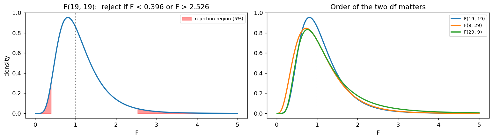
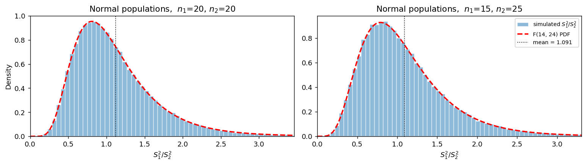
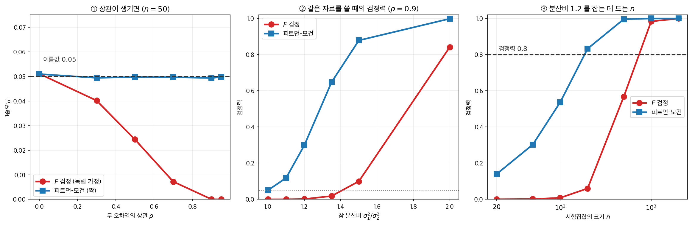
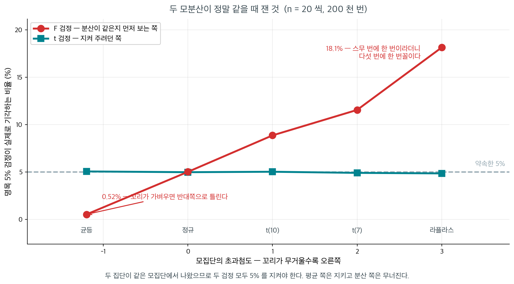

# 두 표본분산의 비 표집분포

## 개요

5.6절에서 표본분산 하나의 표집분포를 보았다. 이 절에서는 **두 표본분산의 비**를 본다. 두 집단의 산포가 같은지 묻는 물음이며, 등분산 가정을 점검할 때와 두 공정의 균일성을 비교할 때 쓴다.

정규모집단에서는 깔끔한 결과가 있다.

$$
\frac{S_1^2/\sigma_1^2}{S_2^2/\sigma_2^2} \sim F_{n_1 - 1,\; n_2 - 1}
$$

5.2절의 네 분포 가운데 $F$ 분포가 쓰이는 자리가 여기다. 분포 자체의 정의와 성질(밀도, 적률, 역수 관계)은 4장 F 분포에서 다뤘으므로, 이 절은 **표본분산의 비가 왜 그 분포를 따르는지, 그리고 그 분포가 어떤 모양인지**에 집중한다.

한 가지 미리 말해 둘 것이 있다. 이 절의 결과는 이 장에서 **정규성에 가장 취약하다.** $S^2$ 하나만으로도 첨도에 매여 있었는데($(\beta_2-1)/2$ 배율), 비를 잡으면 그 취약함이 분자와 분모에 함께 들어간다. 이어지는 쪽에서 그 대가를 수치로 확인한다.

---

## 1. 설정

두 모집단에서 서로 독립인 확률표본을 뽑는다.

$$
X_1, \ldots, X_{n_1} \overset{\text{iid}}{\sim} N(\mu_1, \sigma_1^2), \qquad
Y_1, \ldots, Y_{n_2} \overset{\text{iid}}{\sim} N(\mu_2, \sigma_2^2)
$$

두 표본분산을 각각

$$
S_1^2 = \frac{1}{n_1 - 1}\sum_i (X_i - \bar X)^2, \qquad
S_2^2 = \frac{1}{n_2 - 1}\sum_j (Y_j - \bar Y)^2
$$

로 둔다. 자유도를 $d_1 = n_1 - 1$, $d_2 = n_2 - 1$로 줄여 쓴다.

### 왜 차가 아니라 비인가

두 평균을 견줄 때는 차 $\bar X_1 - \bar X_2$를 보았다. 두 분산을 견줄 때는 차 $S_1^2 - S_2^2$가 아니라 **비** $S_1^2/S_2^2$를 본다. 5.7절과 이 절이 갈라지는 자리이므로 까닭을 적어 둔다.

첫째, **차에는 단위가 남는다.** 분산의 단위는 원자료 단위의 제곱이라, $S_1^2 - S_2^2 = 40$이라는 수는 자료를 센티미터로 쟀는지 미터로 쟀는지에 따라 $40$이 되기도 $0.004$가 되기도 한다. 크다 작다를 말할 기준이 없다. 비는 단위가 약분되어 사라지므로 "$1.5$배"라는 말이 척도와 무관하게 뜻을 갖는다.

둘째, 그리고 더 결정적으로, **차의 분포는 하나로 정해지지 않는다.** $\sigma_1^2 = \sigma_2^2$라는 귀무가설 아래에서도 $S_1^2 - S_2^2$의 분산은 그 공통값 $\sigma^2$에 의존한다. $\sigma$를 모르면 어느 곡선을 기준으로 삼아야 할지조차 정해지지 않는다. 반면 비에서는 $\sigma$가 분자와 분모에서 약분되어 **모르는 양이 남지 않는다.** 바로 다음 절의 「모르는 모수가 사라진다」가 이것을 다시 짚는다.

평균에서 차가 통했던 것은 $\sigma$를 $S$로 바꾸어 나누는 표준화가 이미 척도를 걷어내 주었기 때문이다. 분산에서는 나누는 일 자체가 그 역할을 떠맡는다. **평균은 빼서 견주고 분산은 나누어 견준다**고 외워 두면 된다.

---

## 2. 표집분포 이론

<div class="thmbox" markdown>

### 정리 1. 분산비의 표집분포 { .thm }

두 표본이 독립인 정규모집단에서 나왔으면

$$
F = \frac{S_1^2/\sigma_1^2}{S_2^2/\sigma_2^2} \sim F_{d_1, d_2}
$$

이다. 특히 $\sigma_1^2 = \sigma_2^2$이면 $\sigma$가 약분되어

$$
\frac{S_1^2}{S_2^2} \sim F_{d_1, d_2}
$$

가 된다.

</div>

??? proof "증명"

    5.6절의 정리에 의해 각 표본에서

    $$
    \frac{d_1 S_1^2}{\sigma_1^2} \sim \chi^2_{d_1}, \qquad \frac{d_2 S_2^2}{\sigma_2^2} \sim \chi^2_{d_2}
    $$

    이고, 두 표본이 독립이므로 두 카이제곱도 독립이다. 각각을 자기 자유도로 나눈 뒤 비를 잡으면

    $$
    \frac{\{d_1 S_1^2/\sigma_1^2\}/d_1}{\{d_2 S_2^2/\sigma_2^2\}/d_2} = \frac{S_1^2/\sigma_1^2}{S_2^2/\sigma_2^2}
    $$

    이고, 이것이 바로 $F$ 분포의 정의다. $\square$

    **정규성이 두 번 쓰였다.** 각 표본에서 $dS^2/\sigma^2 \sim \chi^2_d$를 얻는 데 한 번씩이다. 두 번 쓰였다는 것이 이 결과가 특히 취약한 까닭이다.

### 모르는 모수가 사라진다

$\sigma_1^2 = \sigma_2^2$라는 귀무가설 아래에서 $S_1^2/S_2^2$의 분포에 **모르는 모수가 하나도 남지 않는다.** $\sigma$의 공통값이 무엇이든 분포가 $F_{d_1,d_2}$로 같다. 관측 가능한 양만으로 검정이 가능한 이유이며, 추축량(pivotal quantity)이 하는 일이 바로 이것이다.

### 평균이 1이 아니다

4장에서 보았듯 $E[F] = d_2/(d_2 - 2)$이며 이는 **1보다 크다.**

$$
E\!\left[\frac{S_1^2}{S_2^2}\right] = \frac{d_2}{d_2 - 2} \quad (\sigma_1 = \sigma_2,\ d_2 > 2)
$$

두 모분산이 정확히 같아도 관측된 비의 기댓값은 1이 아니다. $n_2 = 10$이면 1.29, $n_2 = 20$이면 1.12다. **분모의 자유도가 작으면 비가 1보다 크게 나오는 것이 정상**이라는 뜻이고, 눈으로 "1.3이나 되니 분산이 다르다"고 판단하면 안 되는 이유다.

### 위아래 꼬리가 역수 관계다

$F$ 분포는 1을 중심으로 대칭이 아니다. 왼쪽으로는 0에서 막히고 오른쪽으로는 끝없이 뻗으므로, 아래쪽 꼬리 2.5%를 이루는 분위수와 위쪽 꼬리 2.5%를 이루는 분위수가 1에서 같은 거리에 있지 않다. 두 끝을 이어 주는 것은 덧셈이 아니라 곱셈이며, 4장에서 본 역수 관계가 그 연결고리다.

$$
F_{\alpha}(d_1, d_2) = \frac{1}{F_{1-\alpha}(d_2, d_1)}
$$

여기에 **자유도의 순서도 함께 바뀐다**는 조건이 붙어 있다. 그래서 $d_1 = d_2$일 때만 한 분포 안에서 양 끝이 서로 역수가 되고, 자유도가 다르면 $F_{d_1,d_2}$의 아래쪽 분위수는 **다른 분포** $F_{d_2,d_1}$의 위쪽 분위수에서 온다. $F_{15,20}$과 $F_{20,15}$는 같은 분포가 아니며, 어느 표본을 분자에 놓았는지가 분포를 바꾼다.

<div class="exbox" markdown>

**보기 1.** <span class="diff easy" title="쉬움"></span> 꼬리가 놓이는 자리와 자유도의 순서. $F_{19,19}$의 양측 5% 기각역을 그리고, 자유도를 맞바꾼 $F_{9,29}$와 $F_{29,9}$를 겹쳐 본다.

**(1)** $n_1 = n_2 = 20$에서 양쪽 꼬리 $2.5\%$의 두 분위수를 구하고, 둘이 **서로 역수**임을 보이시오.

**(2)** $F_{9,29}$와 $F_{29,9}$는 눈으로 보면 폭이 전혀 다르다. 이것이 **분포가 정말 다른 것인지 눈금 탓인지** 가리시오.

</div>

??? success "풀이"

    **(1) 역수 관계는 정의에서 바로 나온다.** $F = U/V$($U, V$는 각각 자유도로 나눈 독립 카이제곱)이면 $1/F = V/U$이므로

    $$
    \frac{1}{F_{d_1,d_2}} \;\overset{d}{=}\; F_{d_2,d_1}
    $$

    이다. 자유도의 **순서가 바뀐다**는 것이 핵심이다. 분위수로 옮기면

    $$
    F_{\alpha}(d_1,d_2) = \frac{1}{F_{1-\alpha}(d_2,d_1)}
    $$

    이고, $d_1 = d_2 = d$일 때만 오른쪽이 같은 분포 안으로 돌아와 $F_{0.025}(d,d) = 1/F_{0.975}(d,d)$가 된다. $d = 19$에서

    $$
    F_{0.025}(19,19) = 0.3958, \qquad F_{0.975}(19,19) = 2.5265,
    \qquad 0.3958 \times 2.5265 = 1.0000
    $$

    이다. 같은 이유로 $F_{d,d}$의 **중앙값은 정확히 1**이다. $F$와 $1/F$가 같은 분포를 따르니 $P(F \le 1) = P(1/F \le 1) = P(F \ge 1)$이기 때문이다. 평균은 $d/(d-2) = 19/17 = 1.1176$으로 1보다 큰데, **중앙값은 1이고 평균은 1보다 크다**는 이 어긋남이 $F$ 분포의 오른쪽 치우침을 한 줄로 말해 준다.

    **(2) 폭이 다른 것이 아니라 눈금이 다르다.** $1/F_{d_1,d_2} \overset{d}{=} F_{d_2,d_1}$을 로그로 옮기면

    $$
    \log F_{d_1,d_2} \;\overset{d}{=}\; -\log F_{d_2,d_1}
    $$

    이다. 곧 **두 분포는 로그 척도에서 서로의 거울상**이고 퍼진 정도가 같아야 한다. 실제로 로그 척도의 분산은 닫힌 꼴로 적히는데(5.2절 [F 분포](../distributions/f_distribution.md) 보기 1)

    $$
    \operatorname{Var}(\log F_{d_1,d_2}) = \psi'\!\left(\frac{d_1}{2}\right) + \psi'\!\left(\frac{d_2}{2}\right)
    $$

    로 두 자유도에 **대칭**이다. 더하기이므로 순서를 바꿔도 값이 변하지 않는다. $(9,29)$와 $(29,9)$ 모두

    $$
    \psi'(4.5) + \psi'(14.5) = 0.2477 + 0.0724 = 0.3201,
    \qquad \text{SD}(\log F) = 0.5658
    $$

    이다. 그러므로 오른쪽 그림에서 보이는 "$F_{29,9}$가 더 넓다"는 인상은 **원래 눈금의 왜곡**이다. 원래 눈금에서는 위쪽으로 뻗을 자리가 무한하고 아래쪽은 0에서 막히므로, 같은 로그 폭이라도 위로 밀린 분포가 더 넓어 보인다.

    **예측을 수로 적어 둔다.** 두 분포의 $2.5\%$ 분위수와 $97.5\%$ 분위수의 **비**가 같아야 한다.

    $$
    \frac{F_{0.975}}{F_{0.025}}: \quad
    (9,29) \to \frac{2.5919}{0.2803} = 9.248,
    \qquad
    (29,9) \to \frac{3.5679}{0.3858} = 9.248
    $$

    **그려서 확인한다.**

    ```python
    import matplotlib.pyplot as plt
    import numpy as np
    from scipy import stats

    fig, (ax1, ax2) = plt.subplots(1, 2, figsize=(12, 3.5))

    # 왼쪽: n1 = n2 = 20 일 때의 양측 5% 기각역.
    # 기각역이 1을 중심으로 대칭이 아니다. F 분포가 오른쪽으로 치우쳐 있기 때문이다.
    d = 19
    lo, hi = stats.f(d, d).ppf([0.025, 0.975])
    x = np.linspace(0.01, 5, 600)
    ax1.plot(x, stats.f(d, d).pdf(x), lw=2)
    xl, xr = x[x <= lo], x[x >= hi]
    ax1.fill_between(xl, stats.f(d, d).pdf(xl), alpha=0.4, color='r')
    ax1.fill_between(xr, stats.f(d, d).pdf(xr), alpha=0.4, color='r',
                     label="rejection region (5%)")
    ax1.axvline(1, color='gray', ls=':', lw=1)
    ax1.set_title(f"F(19, 19):  reject if F < {lo:.3f} or F > {hi:.3f}")
    ax1.set_xlabel("F")
    ax1.set_ylabel("density")
    ax1.legend(fontsize=8)

    # 오른쪽: 자유도의 순서가 바뀌면 완전히 다른 분포가 된다.
    # F(9,29)와 F(29,9)를 견주어 보라. 어느 표본을 분자에 놓느냐가 중요하다.
    for d1, d2 in [(19, 19), (9, 29), (29, 9)]:
        ax2.plot(x, stats.f(d1, d2).pdf(x), lw=2, label=f"F({d1}, {d2})")
    ax2.axvline(1, color='gray', ls=':', lw=1)
    ax2.set_xlabel("F")
    ax2.set_title("Order of the two df matters")
    ax2.legend(fontsize=8)

    plt.tight_layout()
    plt.show()
    ```

    

    왼쪽 그림에서 양쪽 꼬리에 2.5%씩을 칠한 자리가 1을 중심으로 대칭이 아니다. 아래쪽 경계 0.396과 위쪽 경계 2.527은 서로 역수 관계($1/0.396 = 2.527$)인데, 이는 두 자유도가 같을 때만 성립한다. 오른쪽에서는 자유도의 순서만 뒤집어도 분포의 폭이 달라진다. 분모의 자유도가 작은 $F_{29,9}$는 위쪽 2.5% 경계가 3.57까지 뻗는데, 두 자유도를 맞바꾼 $F_{9,29}$에서는 2.59에 그친다. **분포의 폭을 주로 정하는 것은 분모의 자유도**이며, 분모에 놓인 표본이 작을수록 비가 크게 흔들린다.

    절대적인 넓이도 눈여겨볼 만하다. $n_1 = n_2 = 20$이라는 결코 작지 않은 표본에서도 두 꼬리 사이가 0.40에서 2.53까지 벌어져 있다. 등분산인 두 집단에서 관측된 비가 2를 넘는 일이 드물지 않다는 뜻이며, **분산비의 표집분포는 평균차의 표집분포보다 훨씬 넓다.**

    **(1)이 그림에 그대로 있다.** 왼쪽에서 칠한 두 꼬리의 경계가 $0.396$과 $2.527$이고 $1/0.396 = 2.527$이다. 두 경계가 1에서 **같은 거리에 있지 않다.** 아래쪽은 1에서 $0.604$ 떨어져 있고 위쪽은 $1.527$ 떨어져 있어 두 배 반 차이다. 그런데 로그를 취하면 $\log 0.3958 = -0.9268$, $\log 2.5265 = +0.9268$로 **정확히 대칭**이다. 두 끝을 잇는 것이 덧셈이 아니라 곱셈이라는 말이 이것이다.

    **(2)의 판정은 "눈금 탓"이다.** 오른쪽 그림에서 $F_{29,9}$가 위쪽 $2.5\%$ 경계를 $3.57$까지 뻗고 $F_{9,29}$는 $2.59$에 그친다. 원래 눈금만 보면 앞의 것이 훨씬 넓다. 그러나 위아래 분위수의 **비**를 재면 둘 다 $9.248$이고, 로그 척도의 표준편차도 둘 다 $0.5658$이다.

    | 분포 | $F_{0.025}$ | $F_{0.975}$ | $F_{0.975}/F_{0.025}$ | $\operatorname{SD}(\log F)$ | $E[\log F]$ |
    |:---|---:|---:|---:|---:|---:|
    | $F_{19,19}$ | 0.3958 | 2.5265 | 6.383 | 0.4712 | $0.0000$ |
    | $F_{9,29}$ | 0.2803 | 2.5919 | 9.248 | 0.5658 | $-0.0803$ |
    | $F_{29,9}$ | 0.3858 | 3.5679 | 9.248 | 0.5658 | $+0.0803$ |

    **두 줄의 차이는 폭이 아니라 위치다.** $E[\log F]$가 $-0.0803$과 $+0.0803$으로 부호만 다르다. 분모의 자유도가 작은 쪽이 통째로 오른쪽으로 밀린 것이고, 원래 눈금에서는 그 밀림이 "더 넓다"로 보인다. **$F$ 분포를 견줄 때는 로그 척도에서 보는 것이 옳다.**

    그래도 실무에서 중요한 것은 원래 눈금이다. 분모에 작은 표본을 놓으면 $3.57$까지 넘어야 기각하게 되므로 **어느 표본을 분자에 놓느냐가 임계값을 바꾼다.** $F_{15,20}$과 $F_{20,15}$는 다른 분포이고, 표를 읽을 때 순서를 뒤집으면 분위수가 달라진다.

    **첫째 줄과 나머지 두 줄의 차이도 읽어 둘 만하다.** 자유도 합이 $38$로 같은데도 균형 잡힌 $(19,19)$의 로그 표준편차가 $0.4712$로 가장 작다. $\psi'$이 볼록함수이므로 두 자유도를 쪼개 한쪽을 작게 만들면 $\psi'(d_1/2)+\psi'(d_2/2)$가 커지기 때문이다. **같은 관측값 수라면 두 집단에 반씩 나누는 것이 분산비를 가장 정밀하게 잰다.**

정리 1 이 참이라면 그것은 근사가 아니라 **정확한** 결과다. 정확하다는 말이
수치로 어떤 모습인지 먼저 눈에 익혀 둔다. 두 표준정규모집단에서 뽑아

네 가지를 확인할 것이다.

| 확인할 것 | 이론값 |
|---|---|
| 분포 | $F_{d_1,d_2}$ (KS 거리가 0에 가까울 것) |
| 평균 | $d_2/(d_2-2)$, **1이 아니다** |
| 명목 5% 검정의 실제 오류율 | 0.05 |
| 명목 95% 구간의 실제 포함률 | 0.95 |


---

<div class="exbox" markdown>

**보기 2.** <span class="diff easy" title="쉬움"></span> 정규모집단에서 분산비의 표집분포. 두 표준정규모집단에서 $S_1^2/S_2^2$를 10만 번 만들어 $(n_1,n_2) = (20,20)$과 $(15,25)$에서 $F$ 밀도와 겹쳐 그린다.

**(1)** 두 경우의 평균·중앙값·최빈값을 구하고, 세 값이 놓이는 **순서**를 말하시오.

**(2)** 그려서 확인하고, 세로 점선(평균)이 봉우리의 어느 쪽에 서야 하는지 설명하시오.

</div>

??? success "풀이"

    **(1) 세 값이 모두 닫힌 꼴이다.** $F_{d_1,d_2}$의 밀도를 미분해 0으로 두면 최빈값이

    $$
    \text{mode} = \frac{d_1-2}{d_1}\cdot\frac{d_2}{d_2+2} \quad (d_1 > 2)
    $$

    이고, 평균은 $d_2/(d_2-2)$다. 중앙값은 일반적으로 닫힌 꼴이 없지만 $d_1 = d_2$일 때는 **정확히 1**이다. $1/F_{d,d} \overset{d}{=} F_{d,d}$이므로 $P(F \le 1) = P(F \ge 1)$이기 때문이다.

    | $(n_1,n_2)$ | 분포 | 최빈값 | 중앙값 | 평균 |
    |:---|:---|---:|---:|---:|
    | (20, 20) | $F_{19,19}$ | 0.8095 | 1.0000 | 1.1176 |
    | (15, 25) | $F_{14,24}$ | 0.7912 | 0.9799 | 1.0909 |

    **세 값이 최빈값 < 중앙값 < 평균 순으로 선다.** 오른쪽으로 치우친 분포의 표준적인 배열이고, $F$가 아래로는 0에서 막히고 위로는 끝없이 뻗기 때문이다.

    **어느 것도 1이 아니라는 점이 요점이다.** 두 모분산이 **정확히 같은데도** 봉우리는 $0.81$에 있고 평균은 $1.12$에 있다. 분모 $S_2^2$가 작게 나오는 표본에서 비가 크게 튀어 오르고, 그 희귀한 큰 값들이 평균을 끌어올린다. 옌센 부등식으로 말하면 $E[1/V] > 1/E[V] = 1$이다.

    **(2) 그려서 확인한다.**

    ```python
    import matplotlib.pyplot as plt
    import numpy as np
    from scipy import stats

    rng = np.random.default_rng(11)

    fig, axes = plt.subplots(1, 2, figsize=(12, 3.5))
    for ax, (n1, n2) in zip(axes, [(20, 20), (15, 25)]):
        # 두 표본을 따로 뽑아야 독립이 보장된다.
        F = (rng.normal(size=(100_000, n1)).var(axis=1, ddof=1)
             / rng.normal(size=(100_000, n2)).var(axis=1, ddof=1))

        # 오른쪽 꼬리가 길어 99.5백분위에서 자른다.
        h = np.percentile(F, 99.5)
        ax.hist(F, bins=60, range=(0, h), density=True, alpha=0.5,
                edgecolor="white", label="simulated $S_1^2/S_2^2$")

        d1, d2 = n1 - 1, n2 - 1
        g = np.linspace(1e-4, h, 400)
        ax.plot(g, stats.f(d1, d2).pdf(g), "--r", lw=2, label=f"F({d1}, {d2}) PDF")
        # 평균은 1이 아니라 d2/(d2-2) 다. 최빈값보다 오른쪽에 있다.
        ax.axvline(stats.f(d1, d2).mean(), color='k', ls=':', lw=1,
                   label=f"mean = {stats.f(d1, d2).mean():.3f}")
        ax.set_title(f"Normal populations,  $n_1$={n1}, $n_2$={n2}")
        ax.set_xlabel("$S_1^2/S_2^2$")
        ax.set_xlim(0, h)

    axes[0].set_ylabel("Density")
    axes[1].legend(fontsize=8)
    plt.tight_layout()
    plt.show()
    ```

    

    히스토그램과 빨간 곡선이 **거의 구별되지 않는다.** 다음 쪽의 같은 그림과 견주어 보면 차이가 분명해진다.

    **예측한 세 자리가 그림에 그대로 있다.** 히스토그램과 빨간 곡선이 **거의 구별되지 않는다.** 근사가 아니라 정리이므로 $n = 15$에서도 어긋남이 보이지 않는다.

    **세로 점선(평균)은 봉우리의 오른쪽에 선다.** $(20,20)$에서 봉우리가 $0.81$, 점선이 $1.12$이고, $(15,25)$에서는 $0.79$와 $1.09$다. 두 그림 모두 점선이 봉우리보다 $0.3$ 남짓 오른쪽이다. **평균이 꼬리에 끌려간 자리**이며, 분포의 "중심"을 평균 하나로 읽으면 안 되는 자리이기도 하다.

    여기서 실무적인 경고가 하나 나온다. 두 모분산이 같은데도 관측된 $s_1^2/s_2^2$의 **절반은 1보다 작고** 평균은 $1.12$다. $n_2 = 20$에서 $1.3$을 보고 "분산이 30% 다르다"고 말하는 것은 등분산 아래에서 흔히 나오는 값을 차이로 읽는 것이다.

    **두 패널의 폭이 거의 같은 것도 눈여겨볼 만하다.** $\operatorname{SD}(F_{19,19}) = 0.5618$, $\operatorname{SD}(F_{14,24}) = 0.5532$로 $1.5\%$밖에 차이 나지 않는다. 전체 관측값 수가 40개로 같고 자유도를 $19{:}19$로 나누든 $14{:}24$로 나누든 원래 눈금에서는 비슷하다는 뜻이다. 다만 로그 척도에서는 $0.4712$ 대 $0.4903$으로 균형 쪽이 더 좁다(앞 쪽 보기 1). **같은 자료량이면 반씩 나누는 쪽이 조금 낫다.**

    이 쪽에서 본 네 가지 — 분포가 맞고, 평균이 $d_2/(d_2-2)$이고, 봉우리가 1 왼쪽에 있고, 자유도가 달라도 상관없다 — 가 **기준선**이다. 다음 쪽에서 바뀔 것은 모집단의 정규성 하나뿐이다.


<div class="exbox" markdown>

**보기 3.** <span class="diff easy" title="쉬움"></span> 네 가지를 수치로 확인. 세 표본크기 조합에서 KS 거리, 평균, 명목 5% 검정의 오류율, 명목 95% 구간의 포함률을 10만 번씩 잰다.

**(1)** 네 열이 각각 얼마가 되어야 하는지 미리 적으시오. 어느 열이 **정확히** 맞아야 하고 어느 열이 모의오차만큼만 맞아야 하는가.

**(2)** 모의실험으로 확인하시오.

</div>

??? success "풀이"

    **(1) 세 열은 정확하고 한 열은 모의오차다.**

    **평균 열.** $E[F_{d_1,d_2}] = d_2/(d_2-2)$이므로 세 조합에서

    $$
    (20,20) \to \frac{19}{17} = 1.1176, \qquad
    (15,25) \to \frac{24}{22} = 1.0909, \qquad
    (10,40) \to \frac{39}{37} = 1.0541
    $$

    이다. **분자의 자유도는 평균에 들어오지 않는다.** $E[F] = E[U]E[1/V]$에서 $E[U] = 1$이고 $E[1/V] = d_2/(d_2-2)$이므로, 1에서 벗어나는 몫은 전부 **분모의 흔들림**이 만든다. 그러므로 세 줄의 평균이 $1.12 \to 1.09 \to 1.05$로 내려가는 것은 $n_2$가 $20 \to 25 \to 40$으로 커지기 때문이다.

    **오류율과 포함률 열.** 정리 1이 등식이므로 기각역을 $F_{d_1,d_2}$의 분위수로 잡으면 오류율은 **정의상 정확히 $0.05$**이고 포함률은 $0.95$다. 근사가 들어갈 자리가 없다. 표본크기가 작아도, 두 자유도가 달라도 마찬가지다. 10만 번에서 몬테카를로 오차가 $\sqrt{0.05 \times 0.95/100000} = 0.0007$이므로 세 줄 모두 $0.0486 \sim 0.0514$ 안에 들어와야 한다.

    **KS 열만 다르다.** 참 분포와 표본 10만 개의 경험분포 사이의 거리이므로 **$0$이 될 수 없다.** 분포가 정확히 맞더라도 콜모고로프 분포에 따라

    $$
    E[D_B] \approx \frac{0.87}{\sqrt B} = 0.0028,
    \qquad
    D_{B,\,0.95} \approx \frac{1.36}{\sqrt B} = 0.0043
    $$

    쯤이 나온다. **$0.003$ 언저리의 값이 "맞는다"는 증거**이고, $0.0043$을 넘으면 그때 의심해야 한다.

    **(2) 모의실험.**

    ```python
    import numpy as np
    from scipy import stats

    rng = np.random.default_rng(1)
    B = 100_000

    print(f"{'(n1,n2)':>10}{'KS':>9}{'이론평균':>10}{'모의평균':>10}{'오류율':>9}{'포함률':>9}")
    for n1, n2 in [(20, 20), (15, 25), (10, 40)]:
        d1, d2 = n1 - 1, n2 - 1
        F = (rng.normal(size=(B, n1)).var(axis=1, ddof=1)
             / rng.normal(size=(B, n2)).var(axis=1, ddof=1))

        lo, hi = stats.f(d1, d2).ppf([0.025, 0.975])
        ks = stats.kstest(F, 'f', args=(d1, d2)).statistic     # 분포가 맞는가
        err = np.mean((F < lo) | (F > hi))                     # 명목 5% 검정
        cov = np.mean((F / hi <= 1) & (1 <= F / lo))           # 명목 95% 구간
        print(f"{str((n1, n2)):>10}{ks:>9.4f}{stats.f(d1, d2).mean():>10.4f}"
              f"{F.mean():>10.4f}{err:>9.4f}{cov:>9.4f}")
    ```

    출력:

    ```
       (n1,n2)       KS      이론평균      모의평균      오류율      포함률
      (20, 20)   0.0033    1.1176    1.1154   0.0506   0.9494
      (15, 25)   0.0029    1.0909    1.0938   0.0510   0.9489
      (10, 40)   0.0021    1.0541    1.0525   0.0500   0.9500
    ```

    네 열이 모두 이론값과 맞는다. KS 거리가 0.003 수준인데 이는 10만 번 모의실험의 **모의오차 수준**이다($1/\sqrt{B} = 0.0032$). 오류율이 0.050, 포함률이 0.950으로 명목 수준과 일치한다.

    **예측한 네 열이 그대로 나왔다.**

    | $(n_1,n_2)$ | KS | 이론 평균 | 모의 평균 | 오류율 | 포함률 |
    |:---|---:|---:|---:|---:|---:|
    | (20, 20) | 0.0033 | 1.1176 | 1.1154 | 0.0506 | 0.9494 |
    | (15, 25) | 0.0029 | 1.0909 | 1.0938 | 0.0510 | 0.9489 |
    | (10, 40) | 0.0021 | 1.0541 | 1.0525 | 0.0500 | 0.9500 |

    **평균은 세 줄 모두 셋째 자리까지 맞는다.** $F$의 표준편차가 $0.56$ 안팎이므로 평균 추정의 몬테카를로 오차는 $0.56/\sqrt{100000} = 0.0018$이고, 가장 크게 벗어난 $(15,25)$의 $0.0029$가 $1.6$ 오차다.

    **오류율과 포함률은 정확히 명목값이다.** 세 줄이 $0.0500 \sim 0.0510$과 $0.9489 \sim 0.9500$으로, 예측한 구간 $0.0486 \sim 0.0514$ 안에 모두 들어간다. **근사가 아니라 등식이므로 당연한 결과**이며, 이 세 줄이 이 쪽의 존재 이유다.

    **KS 거리도 예측한 자리에 있다.** $0.0033,\ 0.0029,\ 0.0021$로 셋 다 $1.36/\sqrt B = 0.0043$ 아래다. 이 값들은 "분포가 거의 맞는다"가 아니라 **"분포가 맞는다고 할 때 나와야 할 바로 그 크기"**다. 다음 쪽에서 같은 KS를 비정규 모집단에 대고 재면 자릿수가 달라진다.

    **$(10,40)$이 가장 작은 KS를 준 것도 우연이 아니다.** $F_{9,39}$는 분모 자유도가 커서 분포 자체가 더 안정되어 있고, 경험분포가 더 빨리 붙는다. 그러나 이것은 **정확성의 차이가 아니라 모의오차의 차이**다. 오류율 열은 셋 다 똑같이 $0.05$다.

    **불균형이 아무 해도 끼치지 않았다는 점을 눈여겨 두라.** $(10,40)$처럼 네 배 어긋난 설계에서도 네 열이 모두 맞는다. 5.7절에서 같은 불균형이 이분산과 짝을 이루었을 때 오류율이 $0.291$까지 올랐던 것과 정반대다. **여기서 요구하는 것은 정규성뿐이고, 표본크기의 균형은 요구 목록에 없다.** 다음 쪽에서 무너지는 것도 정확히 그 하나, 정규성이다.

---


---

!!! note "주요 관찰"

    1. **분포가 정확히 맞는다.** KS 거리가 모의오차 수준이며, 표본크기를 바꿔도 마찬가지다. 근사가 아니라 정리이므로 $n$이 작아도 성립한다.
    2. **평균은 1이 아니다.** $(20,20)$에서 1.118, $(15,25)$에서 1.091, $(10,40)$에서 1.054다. 분모 자유도가 커질수록 1에 가까워진다. 등분산인데도 비가 1보다 크게 나오는 것이 정상이다.
    3. **명목 수준이 지켜진다.** 오류율 0.050, 포함률 0.950이다. 이것이 "정리가 정확하다"는 말의 실용적 의미다.
    4. **자유도가 달라도 문제없다.** $(10,40)$처럼 불균형해도 결과가 정확하다. 정규성만 있으면 표본크기의 균형은 상관없다. 5.7절의 두 평균 차에서 불균형이 이분산과 짝을 이루어 치명적이었던 것과 대조된다.


---

<div class="aibox" markdown>

**AI로 보는 통계학 1.** 같은 시험집합에서 잰 두 분산

정리 1 이 「두 표본이 **독립인** 정규모집단에서 나왔으면」으로 시작한다.
그 「독립인」이 조건이다.

모형 둘을 견주는 자리에서 그 조건은 거의 언제나 깨진다. **같은 시험집합**에 둘을
걸기 때문이다. 어려운 문항은 양쪽 모두에서 오차가 크고 쉬운 문항은 양쪽 모두에서
작다. 두 오차열이 상관을 갖는다는 뜻이고, 그러면 $S_1^2$ 과 $S_2^2$ 도 함께 움직인다.



**① 어긋나는 방향이 뜻밖이다.** 두 분산이 **같을 때** 양측 $5\%$ 검정이 울리는 비율을
상관을 바꾸며 재면

| 상관 $\rho$ | $0.0$ | $0.5$ | $0.7$ | $0.9$ |
|---|---|---|---|---|
| $F$ 검정 | $0.051$ | $0.027$ | $0.007$ | $\mathbf{0.000}$ |
| 피트먼–모건 | $0.050$ | $0.050$ | $0.050$ | $0.050$ |

$F$ 는 거짓경보를 **덜** 울린다. 두 분산이 함께 움직이니 비가 $1$ 에 붙어 있고,
$F$ 는 그것을 「차이가 없다」로 읽기 때문이다. 틀리긴 틀렸는데 **안전한 쪽으로**
틀렸다. 그래서 그냥 넘어가기 쉽다.

**② 값은 검정력에서 치른다.** $\rho = 0.9$, $n = 50$ 에서

| 참 분산비 | $1.1$ | $1.2$ | $1.35$ | $1.5$ |
|---|---|---|---|---|
| $F$ 검정 | $0.000$ | $\mathbf{0.002}$ | $0.018$ | $0.100$ |
| 피트먼–모건 | $0.118$ | $\mathbf{0.298}$ | $0.648$ | $0.879$ |

**정말로 있는 차이를 $F$ 가 거의 못 잡는다.** 비가 $1$ 에 붙어 있는 것은 상관
때문이지 차이가 없어서가 아닌데, $F$ 에게는 그 둘이 구별되지 않는다.

**③ 표본 수로 치면.** 분산비 $1.2$ 를 검정력 $0.8$ 로 잡으려면

| | $F$ 검정 | 피트먼–모건 |
|---|---|---|
| 드는 시험집합 크기 | $\approx 1{,}000$ | $\approx \mathbf{200}$ |

다섯 배다. 짝지은 구조를 쓰는 쪽이 **같은 자료로 다섯 배 많은 자료 몫**을 한다.

**읽을 것.** 피트먼–모건 검정은 $\operatorname{Var}(X) = \operatorname{Var}(Y)$ 가
$\operatorname{Cov}(X+Y,\,X-Y) = 0$ 과 **같은 말**이라는 데서 나온다. 분산 둘을
직접 견주는 대신 **합과 차의 상관**을 보는 것이고, 상관이 높을수록 그 상관이
또렷해져 힘이 세진다. 짝지은 자료에서 평균을 견줄 때 차를 보는 것과 같은 꼴이고,
같은 이유로 **버려서는 안 되는 구조**다.

이 쪽의 정리는 여전히 참이다. 틀린 것은 정리가 아니라, 같은 시험집합에서 나온 두
열을 「독립인 두 표본」이라 부른 쪽이다.

!!! note "피트먼–모건도 정규를 가정한다"
    위 수는 두 열이 이변량정규일 때의 것이다. 꼬리가 두꺼우면 이 검정도
    [비정규 모집단](var_ratio_nonnormal.md)에서처럼 어긋나므로, 그때는 순열이나
    부트스트랩으로 가는 편이 낫다.

</div>


---

## 3. 이 결과가 기대는 것

정리 1이 서려면 세 가지가 필요하다. 두 표본이 서로 독립이라는 것, 각 표본 안의 관측값이 독립이라는 것, 그리고 두 모집단이 **정규**라는 것이다. 앞의 둘은 설계에서 오지만 마지막 하나는 자료가 정해 준다.

정규성이 쓰인 자리는 증명에서 분명히 보인다. $d_i S_i^2/\sigma_i^2 \sim \chi^2_{d_i}$라는 관계를 각 표본에서 하나씩 얻는 단계다. **정규성이 두 번 쓰였다**는 것이 이 결과가 이 장에서 가장 취약한 까닭이다. 5.6절에서 보았듯 일반 모집단에서 $S^2$의 분산은 첨도 $\beta_2$에 매여 있고, 정규 가정이 믿는 값의 $(\beta_2-1)/2$배가 된다. 비를 잡으면 그 어긋남이 분자와 분모에 한 번씩 들어간다.

그러면 표집분포가 어떻게 달라지는가. 중심은 크게 움직이지 않는다. 두 모집단이 같은 모양이면 분자와 분모가 같은 방향으로 왜곡되어 위치의 편향이 상쇄되기 때문이다. 달라지는 것은 **폭**이다. 로그 척도에서 $\log F = \log S_1^2 - \log S_2^2$이고 두 항이 독립이므로 분산이 더해지며, 꼬리가 무거운 모집단에서는 실제 분포가 $F_{d_1,d_2}$보다 훨씬 넓게 퍼진다.

표본을 키우면 해결되는가. **아니다.** 5.4절의 $\bar X$에서는 정규근사가 수렴의 문제였으므로 $n$이 구해 주었지만, 여기서는 전제 자체가 틀렸다. 게다가 분산비에서는 한 걸음 더 나아가 $n$이 커질수록 어긋남이 **커진다.** $n$이 작을 때는 $F$ 분포 자체가 넓어 왜곡이 가려지는데, $n$이 커지면 그 완충이 사라지고 첨도의 효과만 남기 때문이다.

정규모집단에서 정리가 정확히 맞는 모습은 위의 보기 2와 보기 3에서 보았다. 그 기준선이
무너지는 과정 — 명목 5% 검정이 실제로 26%, 48%가 되는 과정 — 은
[비정규 모집단](var_ratio_nonnormal.md)이 같은 네 수치로 잰다.

<div class="storybox" markdown>

**그림으로 보는 통계학 1.** 날씨를 보려고 보낸 배가 먼저 뒤집혔다

위에서 본 대로 정리 1 은 정규성에 두 번 기댄다. 그런데 이 약점이 **엉뚱한 자리에서**
문제를 일으킨 역사가 있다.

평균을 비교할 때 교과서는 이렇게 가르쳤다. 합동 $t$ 검정은 두 모분산이 같아야 하니,
**먼저 분산이 같은지 검정하고** 통과하면 $t$ 로 가라고. 분산 쪽 검정으로는 $1937$ 년에
바틀릿이 내놓은 것이 널리 쓰였다. 말이 되는 절차처럼 보인다.

$1953$ 년, **조지 박스**가 이 절차를 정면으로 겨냥한 논문을 쓴다. 제목은 「비정규성과
분산에 관한 검정」이었고, 요지는 이러했다 — 지키려는 쪽보다 **지키러 보낸 쪽이 더
약하다.**

<figure markdown>
  { width=940 }
  <figcaption markdown>두 표본을 **같은 모집단**에서 $n = 20$ 씩 뽑았으니 두 검정 모두 $5\%$ 만 기각해야 한다. 평균 쪽 $t$ 는 $4.8$–$5.1\%$ 를 지키는데, 분산 쪽 $F$ 는 꼬리가 무거워지면 $18.1\%$ 까지 오르고 가벼워지면 $0.52\%$ 까지 떨어진다. 자료에서 직접 그렸다.</figcaption>
</figure>

$t$ 가 버티는 까닭은 중심극한정리가 뒤를 받쳐 주기 때문이다. 표본평균은 모집단이
무엇이든 정규로 다가간다. 그러나 **분산비에는 받쳐 줄 것이 없다.** 위 §3 에서 본 대로
첨도의 어긋남이 분자와 분모에 한 번씩 들어가고, $n$ 을 키워도 사라지기는커녕 더
벌어진다.

그래서 이 절차는 거꾸로 선 셈이 된다. $5\%$ 라고 믿고 돌린 예비 검정이 실제로는 다섯
번에 한 번 기각하고 있으면, 그 결과를 보고 $t$ 를 쓸지 말지 고른 선택 자체가 자료에
휘둘린 선택이다. 멀쩡한 $t$ 를 쓰지 않기로 한 결정이 **분산과는 무관한 이유**로 내려진다.

박스가 이 논문에 남긴 한 문장은 지금도 인용된다.

> 예비로 분산 검정을 해 보는 것은, 여객선이 떠나도 좋을 만큼 바다가 잔잔한지 알아보려고
> **노 젓는 조각배를 먼저 내보내는 것**과 비슷하다.

오늘날 권고는 간단하다. 예비 검정을 거치지 말고 처음부터 웰치 $t$ 를 쓰라는 것이다.
분산이 같든 다르든 웰치는 $5\%$ 를 지킨다.

_확인한 곳 — 박스의 $1953$ 년 『바이오메트리카』 논문 「Non-normality and tests on variances」와 거기 실린 조각배 비유, 바틀릿의 $1937$ 년 등분산 검정은 모두 널리 인용되는 것이다(인용문은 뜻을 옮긴 것이다) · 그림의 수치는 $n = 20$ · $20$ 만 번으로 이 쪽이 직접 쟀다_

</div>

---

## 4. 그래서 이 분포로 무엇을 하는가

이 쪽이 답한 것은 여기까지다. **$S_1^2/S_2^2$은 정규모집단에서 $F_{d_1,d_2}$를 따르고, 그 분포는 1을 중심으로 비대칭이며 자유도의 순서에 민감하고 폭이 매우 넓다.** 표집분포를 묻는 이 장의 일은 그것으로 끝난다.

남는 물음은 그 분포로 $\sigma_1^2/\sigma_2^2$를 어떻게 가두고 어떻게 판정하느냐이다. 분포에서 구간을 얻는 쪽은 [8.3절 σ₁²/σ₂²의 신뢰구간](../../ch08/two_sample_intervals/ci_variance_ratio.md)이, 기각역과 $p$값으로 판정하는 쪽은 [9.3절 σ₁²/σ₂²에 대한 F 검정](../../ch09/two_sample_tests/f_test_two_variances.md)이 맡는다. 정규성이 깨졌을 때 무엇으로 갈아탈지는 [15장 로버스트 분산 검정](../../ch15/robust_tests/robust_tests.md)의 몫이다.

---

## 연습문제

<div class="drillbox" markdown>

**연습문제 1.** <span class="diff easy" title="쉬움"></span>
두 모분산이 정확히 같은데도 $E[S_1^2/S_2^2] > 1$인 이유를 설명하라. $n_2 = 10, 20, 50$에서 이 값을 구하라.

</div>

??? success "풀이"
    $E[F] = d_2/(d_2-2)$이며 4장에서 옌센 부등식으로 설명했다. $1/x$가 볼록함수이므로

    $$
    E\!\left[\frac{1}{S_2^2/\sigma^2}\right] > \frac{1}{E[S_2^2/\sigma^2]} = 1
    $$

    이다. **분모가 흔들린다는 사실 자체가 비의 기댓값을 위로 밀어 올린다.**

    | $n_2$ | $d_2$ | $E[F] = d_2/(d_2-2)$ |
    |---|---|---|
    | 10 | 9 | 1.286 |
    | 20 | 19 | 1.118 |
    | 50 | 49 | 1.043 |

    실무적 함의가 있다. 표본이 작을 때 $s_1^2/s_2^2 = 1.3$을 보고 "분산이 30% 다르다"고 말하는 것은 위험하다. $n_2 = 10$이면 등분산 아래에서도 평균적으로 그 정도가 나온다.

---

<div class="drillbox" markdown>

**연습문제 2.** <span class="diff easy" title="쉬움"></span>
모의실험에서 $\mu_1 = \mu_2 = 0$으로 두었다. $\mu_1 = 100$, $\mu_2 = -5$로 바꾸면 결과가 달라지는가?

</div>

??? success "풀이"
    **달라지지 않는다.** $S^2$은 편차 $X_i - \bar X$만 쓰고, 모든 관측값에 같은 상수를 더하면 편차가 변하지 않는다.

    $$
    (X_i + c) - \overline{(X + c)} = X_i + c - (\bar X + c) = X_i - \bar X
    $$

    따라서 $S_1^2, S_2^2$의 분포가 $\mu$에 의존하지 않고 비의 분포도 그대로다.

    이것이 정리 1에 $\mu_1, \mu_2$가 나타나지 않는 이유다. **위치모수는 분산 추론에서 완전히 상쇄된다.** 다만 자유도를 하나 잃는 대가를 치른다. $\mu$를 안다면 $\sum(X_i-\mu)^2/\sigma^2 \sim \chi^2_n$으로 자유도가 $n$이지만, $\bar X$로 갈음하면 $n-1$이 된다.

---

<div class="drillbox" markdown>

**연습문제 3.** <span class="diff easy" title="쉬움"></span>
보기 2에서 KS 거리 0.003이 "모의오차 수준"이라는 말의 뜻을 설명하라. 모의실험 횟수를 100배로 늘리면 이 값이 어떻게 되겠는가?

</div>

??? success "풀이"
    KS 통계량은 경험적 분포함수와 이론 분포함수의 최대 수직 거리다. 표본이 정말로 그 분포에서 나왔다 해도 유한한 $B$개로 그린 경험적 분포함수는 이론값과 정확히 겹치지 않으며, 그 어긋남의 크기가 $O(1/\sqrt{B})$다.

    $B = 100{,}000$이면 $1/\sqrt{B} = 0.0032$이므로 관측된 0.0033은 **이론이 완벽히 맞을 때 나올 만한 값**이다. 실제로 콜모고로프 분포에서 $\sqrt{B} \cdot D$의 95백분위점이 1.36이므로 임계값은 $1.36/\sqrt{B} = 0.0043$이고, 0.0033은 이를 넘지 않는다.

    $B$를 100배(천만)로 늘리면 KS 거리가 $\sqrt{100} = 10$배 줄어 0.0003 수준이 된다. **줄어드는 것이 이론이 맞다는 증거**이고, 줄지 않고 어떤 값에 머문다면 그 값이 진짜 어긋남이다. 다음 쪽의 비정규 모집단이 그런 경우다.

---

<div class="drillbox" markdown>

**연습문제 4.** <span class="diff med" title="중간"></span>
$\sigma_1^2 = \sigma_2^2$일 때 $S_1^2/S_2^2$의 분포에 모르는 모수가 남지 않음을 보이고, 이것이 왜 중요한지 설명하라.

</div>

??? success "풀이"
    정리 1에서

    $$
    \frac{S_1^2/\sigma_1^2}{S_2^2/\sigma_2^2} \sim F_{d_1,d_2}
    $$

    이고 $\sigma_1^2 = \sigma_2^2 = \sigma^2$을 넣으면 $\sigma^2$이 분자와 분모에서 약분되어

    $$
    \frac{S_1^2}{S_2^2} \sim F_{d_1,d_2}
    $$

    가 된다. 오른쪽 분포는 $n_1, n_2$만으로 정해지고 $\sigma^2$이나 $\mu_1, \mu_2$에 의존하지 않는다. $\square$

    **왜 중요한가.** 표집분포를 안다는 것은 그릴 곡선을 하나로 특정할 수 있다는 뜻인데, 분포가 모르는 모수에 의존하면 어느 곡선을 그려야 할지조차 정해지지 않는다. $\sigma$가 약분되기 때문에 그 값을 몰라도 $S_1^2/S_2^2$의 분포가 $F_{d_1,d_2}$ 하나로 정해진다.

    같은 구조가 이 장 곳곳에 있다. $t$ 통계량에서 $\sigma$가 약분되고, 카이제곱 적합도 검정에서 $n$이 상쇄된다. **추축량을 찾는다는 것이 곧 모르는 모수를 약분해 없애는 일이다.**

---

<div class="drillbox" markdown>

**연습문제 5.** <span class="diff med" title="중간"></span>
$n_1 = n_2 = 20$일 때 양쪽 꼬리 2.5%를 이루는 두 분위수가 서로 역수임을 확인하고, 자유도가 다르면 왜 그렇지 않은지 설명하라.

</div>

??? success "풀이"
    $d_1 = d_2 = 19$이면 $F_{0.025}(19,19) = 0.3958$이고 $F_{0.975}(19,19) = 2.5265$다. 곱하면 $0.3958 \times 2.5265 = 1.0000$으로 역수 관계가 성립한다.

    **이유.** 역수 관계 $F_\alpha(d_1,d_2) = 1/F_{1-\alpha}(d_2,d_1)$에서 $d_1 = d_2 = d$이면 오른쪽이 $1/F_{1-\alpha}(d,d)$가 되어 같은 분포의 분위수끼리 묶인다. 즉 $F_{0.025}(d,d) = 1/F_{0.975}(d,d)$다.

    자유도가 다르면 $F_{0.025}(d_1,d_2) = 1/F_{0.975}(d_2,d_1)$이고 오른쪽의 분포가 $F_{d_2,d_1}$이라 **원래 분포와 다르다.** 실제로 $F_{0.025}(15,20) = 0.3629$이고 $F_{0.975}(15,20) = 2.5731$인데 곱이 $0.9337$로 1이 아니다. 대신 $F_{0.975}(20,15) = 2.7559$의 역수가 $0.3629$로 정확히 맞는다. 자유도를 맞바꾸어야 관계가 성립한다는 것이 이렇게 확인된다.

    이 어긋남은 로그 척도에서도 그대로 남는다. $\log F_{d_1,d_2}$의 분포는 $d_1 = d_2$일 때만 0을 중심으로 대칭이고, 자유도가 다르면 두 꼬리가 0에서 같은 거리에 있지 않다.

    그래서 자유도는 늘 순서를 함께 적어야 한다. $F_{15,20}$과 $F_{20,15}$는 다른 분포이고, 표를 읽을 때 순서를 바꾸면 분위수가 달라진다.

---

<div class="drillbox" markdown>

**연습문제 6.** <span class="diff med" title="중간"></span>
$n_1 = n_2 = n$일 때 $S_1^2/S_2^2$의 표준편차가 $n$과 함께 어떻게 줄어드는지 $n = 10, 20, 50, 200$에서 구하고, 큰 $n$에서 $2/\sqrt{n}$에 가까워짐을 확인하라.

</div>

??? success "풀이"
    $F_{d,d}$의 분산은 4장에서 본 공식

    $$
    \text{Var}(F_{d_1,d_2}) = \frac{2d_2^2(d_1+d_2-2)}{d_1(d_2-2)^2(d_2-4)}
    $$

    에 $d_1 = d_2 = d = n-1$을 넣어 얻는다. 계산하면 다음과 같다.

    | $n$ | $E[F]$ | $\text{SD}(F)$ | $2/\sqrt{n}$ |
    |---|---|---|---|
    | 10 | 1.286 | 1.084 | 0.632 |
    | 20 | 1.118 | 0.562 | 0.447 |
    | 50 | 1.043 | 0.308 | 0.283 |
    | 200 | 1.010 | 0.144 | 0.141 |

    $n$이 커질수록 폭이 줄어들고, 큰 $n$에서는 $\sqrt{n}$에 반비례하는 $2/\sqrt{n}$에 수렴한다. 이 극한은 로그 척도에서 바로 나온다. 5.6절의 결과로 $\text{Var}(\log S_i^2) \approx (\beta_2-1)/n$이고 정규모집단에서는 $\beta_2 = 3$이므로 $\text{Var}(\log F) \approx 2(1/n + 1/n) = 4/n$, 즉 $\text{SD}(\log F) \approx 2/\sqrt{n}$이다. $F$가 1 근처에 모이면 $\log F \approx F - 1$이므로 두 척도의 표준편차가 같아진다.

    **작은 $n$에서 표가 극한값보다 훨씬 큰 것**이 요점이다. $n = 10$에서 실제 표준편차 1.08은 $2/\sqrt{10} = 0.63$의 1.7배다. 등분산인 두 집단에서 관측된 비가 2나 3이 되는 일이 예사라는 뜻이며, 분산비가 평균차보다 훨씬 많은 자료를 요구하는 까닭이다.

---

<div class="drillbox" markdown>

**연습문제 7.** <span class="diff med" title="중간"></span>
$F$ 자체는 오른쪽으로 길게 치우쳐 있다. 로그를 씌우면 어떻게 되는가? $n_1 = n_2 = 20$에서 $F$와 $\log F$의 왜도를 견주고, 왜 그렇게 되는지 설명하라.

</div>

??? success "풀이"
    $F_{19,19}$의 왜도는 $1.772$다. 오른쪽 꼬리가 길다는 것을 숫자가 말해 준다. 반면 정규모집단에서 뽑은 두 표본으로 $\log(S_1^2/S_2^2)$를 40만 번 만들어 왜도를 재면 $-0.002$로 사실상 0이고, 평균도 $-0.001$로 0 근처다.

    **이유는 대칭성이다.** $d_1 = d_2 = d$이면 $S_1^2/S_2^2$과 $S_2^2/S_1^2$이 같은 분포를 따른다. 두 표본의 이름을 바꾸어도 상황이 달라지지 않기 때문이다. 로그를 씌우면 이 관계가

    $$
    \log \frac{S_1^2}{S_2^2} \overset{d}{=} -\log \frac{S_1^2}{S_2^2}
    $$

    가 되어 **0을 중심으로 정확히 대칭**인 분포가 된다. 반면 원래 척도에서는 "역수를 취해도 같다"가 "0을 중심으로 대칭"으로 번역되지 않는다. 아래쪽은 0과 1 사이에 갇히고 위쪽은 1부터 무한대까지 뻗기 때문이다.

    이것이 분산비를 다룰 때 로그 척도가 자연스러운 첫 번째 이유다. 두 번째 이유는 $\log F = \log S_1^2 - \log S_2^2$이라는 분해인데, 비정규 모집단에서 어긋남의 크기를 계산할 때 이 분해가 결정적으로 쓰인다.

---

<div class="drillbox" markdown>

**연습문제 8.** <span class="diff med" title="중간"></span>
분산비 대신 **표준편차비** $S_1/S_2$를 보고하는 일이 많다. 단위가 원자료와 같아 읽기 쉽기 때문이다. $n_1=n_2=20$에서 $E[S_1/S_2]$를 구하고, $(E[S_1/S_2])^2$이 $E[S_1^2/S_2^2]$와 **같지 않음**을 확인하라.

</div>

??? success "풀이"
    **독립이므로 기댓값이 쪼개진다.** $E[S_1/S_2] = E[S_1]\cdot E[1/S_2]$이고, 앞 절 카이제곱 문서 연습문제 10에서 $E[S] = c_4\sigma$였다. 역수 쪽도 같은 방식으로

    $$
    E\!\left[\frac1S\right] = \frac{1}{\sigma}\sqrt{\frac{n-1}{2}}\,
    \frac{\Gamma\!\left(\frac{n-2}{2}\right)}{\Gamma\!\left(\frac{n-1}{2}\right)}
    $$

    이 나온다.

    ```python
    import numpy as np
    from scipy.special import gamma as G

    rng = np.random.default_rng(0)
    n1 = n2 = 20
    X = rng.normal(0, 1, (300_000, n1))
    Y = rng.normal(0, 1, (300_000, n2))
    R = X.std(1, ddof=1) / Y.std(1, ddof=1)

    c4   = lambda n: np.sqrt(2/(n-1)) * G(n/2) / G((n-1)/2)
    Einv = lambda n: np.sqrt((n-1)/2) * G((n-2)/2) / G((n-1)/2)

    print(f"  E[S1/S2] 모의 {R.mean():.5f}   이론 {c4(n1)*Einv(n2):.5f}")
    print(f"  (E[S1/S2])^2 = {R.mean()**2:.5f}")
    print(f"  E[S1^2/S2^2] = d2/(d2-2) = {(n2-1)/((n2-1)-2):.5f}")
    ```

    출력:

    ```
      E[S1/S2] 모의 1.02851   이론 1.02815
      (E[S1/S2])^2 = 1.05782
      E[S1^2/S2^2] = d2/(d2-2) = 1.11765
    ```

    **두 값이 다르다**($1.058$ 대 $1.118$). 제곱과 기댓값의 순서를 바꿀 수 없기 때문이며, 옌센 부등식에 의해 언제나

    $$
    (E[S_1/S_2])^2 \;\le\; E\!\left[\frac{S_1^2}{S_2^2}\right]
    $$

    이다. 연습문제 1에서 $E[F] > 1$을 본 것과 같은 현상이 한 겹 더 쌓인 것이다.

    **실무적 함의 셋.**

    - **"분산비의 제곱근"과 "표준편차비"는 다른 양이다.** $\sqrt{E[F]} = 1.057$과 $E[S_1/S_2] = 1.029$가 다르다. 어느 쪽을 보고하는지 밝혀야 한다.
    - **표준편차비도 여전히 위로 편향되어 있다**($1.029 > 1$). 두 모표준편차가 같은데도 그렇다. 편향이 분산비보다 작을 뿐이다.
    - **구간은 분산비에서 만들고 마지막에 제곱근을 취하는 것이 안전하다.** 제곱근은 단조함수라 끝점을 그대로 옮기면 되고(앞 절 $F$ 문서 연습문제 10), 포함확률이 보존된다. 표준편차비의 표집분포를 새로 유도할 필요가 없다.

---

<div class="drillbox" markdown>

**연습문제 9.** <span class="diff med" title="중간"></span>
두 모분산이 **같다고 가정할 때**는 둘을 합쳐 하나의 분산을 추정한다. **합동분산**

$$
S_p^2 = \frac{(n_1-1)S_1^2 + (n_2-1)S_2^2}{n_1+n_2-2}
$$

의 표집분포를 구하고 $n_1=12$, $n_2=8$에서 확인하라. 자유도가 왜 $n_1+n_2-2$인가?

</div>

??? success "풀이"
    **카이제곱의 가법성이 그대로 쓰인다**(앞 절 카이제곱 문서 연습문제 7). $\sigma_1^2 = \sigma_2^2 = \sigma^2$이면

    $$
    \frac{(n_1-1)S_1^2}{\sigma^2} \sim \chi^2_{n_1-1},
    \qquad
    \frac{(n_2-1)S_2^2}{\sigma^2} \sim \chi^2_{n_2-1}
    $$

    이고 두 표본이 독립이므로 합이 $\chi^2_{n_1+n_2-2}$다. 따라서

    $$
    \frac{(n_1+n_2-2)S_p^2}{\sigma^2} \sim \chi^2_{n_1+n_2-2}
    $$

    이다. $\square$

    ```python
    import numpy as np
    from scipy import stats

    rng = np.random.default_rng(0)
    n1, n2, s = 12, 8, 2.0
    X = rng.normal(0, s, (300_000, n1))
    Y = rng.normal(0, s, (300_000, n2))
    sp2 = ((n1-1)*X.var(1, ddof=1) + (n2-1)*Y.var(1, ddof=1)) / (n1+n2-2)
    df = n1 + n2 - 2
    Q = df * sp2 / s**2

    print(f"  KS p (chi2({df})) = {stats.kstest(Q, 'chi2', args=(df,)).pvalue:.4f}")
    print(f"  E[Sp^2] = {sp2.mean():.4f}  (참 {s**2})")
    print(f"  Var     = {sp2.var():.5f}   이론 2*sigma^4/df = {2*s**4/df:.5f}")
    ```

    출력:

    ```
      KS p (chi2(18)) = 0.7483
      E[Sp^2] = 3.9994  (참 4.0)
      Var     = 1.78119   이론 2*sigma^4/df = 1.77778
    ```

    **자유도가 $n_1+n_2-2$인 이유.** 관측이 $n_1+n_2$개인데 평균을 **두 개**($\bar X_1$, $\bar X_2$) 추정했으므로 둘을 잃는다. 한 표본에서 $n-1$이었던 것의 자연스러운 확장이며, 일반적으로 **자유도 = 관측 수 $-$ 추정한 평균의 수**다. 11장의 분산분석에서 집단 내 자유도가 $N-k$인 것이 같은 규칙이다.

    **왜 합치는가 — 자유도를 벌기 위해서다.** $S_1^2$만 쓰면 자유도가 $11$이고 $S_2^2$만 쓰면 $7$인데, 합치면 $18$이다. 자유도가 클수록 $\sigma^2$ 추정이 정밀해지고, 그 결과 두 표본 $t$ 검정의 임계값이 작아져 검정력이 오른다.

    **그러나 $\sigma_1^2 = \sigma_2^2$이 틀리면 대가가 크다.** 합동분산은 두 분산의 **가중평균**이라, 실제로 다르면 어느 쪽도 아닌 값을 추정한다. 게다가 표본크기가 불균형하면 큰 표본 쪽으로 치우쳐, 작은 표본 집단의 분산을 심하게 잘못 잡는다. 이것이 **웰치 방법이 기본값이 된 이유**이며 5.7절과 15장에서 다룬다.

    **이 쪽의 $F$ 검정과의 관계.** $S_1^2/S_2^2$이 $1$에서 멀면 합동분산을 쓰면 안 된다는 신호다. 다만 앞 절 $F$ 문서 연습문제 10에서 본 대로 이 검정의 검정력이 낮아 **"유의하지 않았으니 합쳐도 된다"는 논법은 위험하다.**

---

<div class="drillbox" markdown>

**연습문제 10.** <span class="diff med" title="중간"></span>
연습문제 1에서 $E[S_1^2/S_2^2] = \dfrac{d_2}{d_2-2} > 1$임을 보았다. 이 편향을 **없애는** 추정량을 만들고, $d_2 = 5, 10, 19, 50$에서 확인하라. 이 보정을 실제로 쓰는가?

</div>

??? success "풀이"
    **상수배가 전부다.** $E[F] = d_2/(d_2-2)$이므로

    $$
    \widehat{\left(\frac{\sigma_1^2}{\sigma_2^2}\right)}_{\text{불편}}
    = \frac{d_2-2}{d_2}\cdot\frac{S_1^2}{S_2^2}
    $$

    로 두면 기댓값이 정확히 $\sigma_1^2/\sigma_2^2$가 된다($d_2 > 2$).

    ```python
    import numpy as np
    from scipy import stats

    print(f"{'d2':>5}{'E[F]':>10}{'(d2-2)/d2':>12}{'보정 후':>10}")
    for d2 in (5, 10, 19, 50):
        F = stats.f.rvs(19, d2, size=300_000, random_state=1)
        print(f"{d2:>5}{F.mean():>10.4f}{(d2-2)/d2:>12.4f}{(F*(d2-2)/d2).mean():>10.4f}")
    ```

    출력:

    ```
       d2      E[F]   (d2-2)/d2      보정 후
        5    1.6677      0.6000    1.0006
       10    1.2533      0.8000    1.0026
       19    1.1183      0.8947    1.0006
       50    1.0428      0.9600    1.0011
    ```

    **보정이 정확히 듣는다.** 네 경우 모두 $1.00$으로 맞는다. $d_2=5$에서는 $40\%$나 줄여야 한다는 점이 인상적이다.

    **그런데 실무에서는 거의 쓰지 않는다.** 이유가 셋이다.

    - **검정에는 필요 없다.** 가설검정은 $F$의 **분포**를 쓰지 기댓값을 쓰지 않는다. 임계값이 이미 편향을 포함해 계산되어 있으므로 통계량을 보정하면 오히려 틀린다.
    - **구간에도 필요 없다.** 앞 절 $F$ 문서 연습문제 10의 구간은 분위수를 뒤집어 만든 것이라 편향과 무관하게 정확한 포함확률을 갖는다.
    - **보정해도 다른 편향이 남는다.** $E[F]$를 맞춰도 $E[\log F] \ne \log(\sigma_1^2/\sigma_2^2)$이고, $E[1/F]$는 또 다른 값이다. **어느 척도에서 불편으로 만들지 고를 수 없다.**

    **그래서 점추정을 보고해야 할 때만 의미가 있다.** 메타분석처럼 여러 연구의 분산비를 모아 평균낼 때는 자유도가 작은 연구가 평균을 끌어올리므로 보정이 실질적인 차이를 만든다. 앞 절 $F$ 문서 연습문제 8에서 "$\log F$를 쓰라"고 한 것이 더 나은 대안이며, 로그 척도에서는 편향이 훨씬 작고 대칭적이다.

    **일반 교훈.** **불편성은 척도에 딸린 성질이다.** $\sigma^2$에 대해 불편인 $S^2$이 $\sigma$에 대해서는 불편이 아니었고(카이제곱 문서 연습문제 10), 여기서도 $F$를 보정하면 $\log F$가 어긋난다. 어느 양을 보고할지 정한 다음에 그 척도에서 따져야 한다.

---

<div class="drillbox" markdown>

**연습문제 11.** <span class="diff med" title="중간"></span>
$(n_1, n_2) = (20, 20)$에서 모의평균 1.1154가 이론값 1.1176과 맞는지 판단하라. 모의오차를 감안해 답하라.

</div>

??? success "풀이"
    $F_{19,19}$의 분산은

    $$
    \text{Var}(F) = \frac{2d_2^2(d_1+d_2-2)}{d_1(d_2-2)^2(d_2-4)} = \frac{2(19^2)(36)}{19(17^2)(15)} = 0.3156
    $$

    이므로 표준편차가 0.562다. 10만 번 모의실험한 평균의 표준오차는

    $$
    \frac{0.562}{\sqrt{100{,}000}} = 0.00178
    $$

    이다. 이론값과의 차이가 $|1.1154 - 1.1176| = 0.0022$로 표준오차의 1.2배이므로 **모의오차 범위 안이다.** 맞는다고 판단한다.

    이런 판단을 습관적으로 하는 것이 중요하다. 모의실험 결과가 이론값과 소수 셋째 자리에서 다르다고 "틀렸다"고 말하면 안 되고, 반대로 큰 차이를 "대충 맞는다"고 넘겨서도 안 된다. **모의오차를 계산해 놓고 그 잣대로 재야 한다.**

---

<div class="drillbox" markdown>

**연습문제 12.** <span class="diff med" title="중간"></span>
정규모집단에서 $\sigma_1/\sigma_2 = 1.5, 2, 3$일 때 명목 5% 양측 $F$ 검정의 검정력을 모의실험으로 구했더니 0.402, 0.837, 0.996이었다. $n_1 = n_2 = 20$이다. 이 값들을 해석하고, 검정력 0.8을 얻으려면 분산비가 얼마나 되어야 하는지 답하라.

</div>

??? success "풀이"
    표준편차비 1.5는 **분산비 2.25**인데도 검정력이 0.402에 그친다. 즉 분산이 두 배 이상 차이 나는 두 모집단을 놓고도 절반 넘게 놓친다.

    표준편차비 2(분산비 4)에서 0.837이 되므로, **검정력 0.8의 문턱이 대략 분산비 3.5~4 근처**다. 표준편차로는 1.9배쯤이다.

    | $\sigma_1/\sigma_2$ | 분산비 | 검정력 |
    |---|---|---|
    | 1.5 | 2.25 | 0.402 |
    | 2.0 | 4.00 | 0.837 |
    | 3.0 | 9.00 | 0.996 |

    **실무적 함의.** $n = 20$ 정도의 표본으로 등분산 검정을 해서 기각되지 않았다는 것은 "분산이 같다"는 증거가 거의 되지 못한다. 분산비 2~3의 차이는 잡아내지 못하기 때문이다. 이것이 등분산 검정 결과로 $t$ 검정 방식을 고르는 2단계 절차를 권하지 않는 여러 이유 가운데 하나다. 5.7절에서 Welch $t$를 기본으로 두라고 권한 까닭이 여기에도 있다.

---

<div class="drillbox" markdown>

**연습문제 13.** <span class="diff med" title="중간"></span>
$(n_1, n_2) = (10, 40)$처럼 표본크기가 불균형해도 결과가 정확했다. 5.7절의 두 표본평균 차에서는 불균형이 문제가 되는데, 왜 여기서는 그렇지 않은가?

</div>

??? success "풀이"
    두 상황에서 문제가 되는 것이 다르다.

    **두 평균 차에서의 불균형 문제는 이분산과 짝을 이룰 때만 생긴다.** 합동분산 $S_p^2$은 두 표본분산을 자유도로 가중평균하므로, 분산이 다른데 표본크기까지 다르면 가중치가 잘못 배분되어 표준오차 추정이 편향된다. 등분산이면 불균형해도 문제없다.

    **분산비에서는 두 표본분산을 각각 자기 자유도로만 나눈다.** 두 표본을 섞어 하나의 추정량을 만드는 단계가 없으므로 서로의 자유도가 간섭하지 않는다. $S_1^2$은 $\chi^2_{d_1}$, $S_2^2$은 $\chi^2_{d_2}$이고, 그 비가 $F_{d_1,d_2}$라는 것이 자유도가 얼마든 성립한다.

    **차이의 핵심은 "섞는가"다.** 합동분산은 섞고, 분산비는 섞지 않는다. 섞는 절차는 섞는 비율이 맞아야 하므로 가정에 민감해지고, 섞지 않는 절차는 그 문제가 없다.

    다만 불균형이 아무 대가가 없는 것은 아니다. 검정력이 떨어진다. 전체 관측값 50개를 $(10,40)$으로 나누면 $(25,25)$로 나눌 때보다 분산비를 잡아내는 힘이 약하다. 작은 쪽 자유도가 병목이 되기 때문이다.

---

<div class="drillbox" markdown>

**연습문제 14.** <span class="diff med" title="중간"></span>
연습문제 12는 $n_1=n_2=20$에서의 검정력을 물었다. 뒤집어 묻자. $\sigma_1/\sigma_2 = 1.25, 1.5, 2, 3$을 **검정력 $0.8$로 탐지**하려면 각 집단에 몇 개가 필요한가?

</div>

??? success "풀이"
    ```python
    from scipy import stats

    print(f"{'sigma비':>9}{'필요한 n (양쪽 같게)':>24}")
    for r in (1.25, 1.5, 2.0, 3.0):
        n = 4
        while n <= 3000:
            d = n - 1
            lo, hi = stats.f.ppf(0.025, d, d), stats.f.ppf(0.975, d, d)
            pw = stats.f.sf(hi / r**2, d, d) + stats.f.cdf(lo / r**2, d, d)
            if pw >= 0.8:
                break
            n += 1
        print(f"{r:>9.2f}{n:>24}")
    ```

    출력:

    ```
       sigma비           필요한 n (양쪽 같게)
         1.25                     160
         1.50                      50
         2.00                      19
         3.00                       9
    ```

    **표준편차가 $25\%$ 다른 것을 잡으려면 집단마다 $160$개가 필요하다.** 총 $320$개다. 반면 세 배 차이는 집단마다 $9$개면 잡힌다.

    **필요 표본이 급격히 늘어난다.** 대략 $n \propto 1/(\log r)^2$이다. $\log 1.25 = 0.223$, $\log 1.5 = 0.405$이고 비가 $1.82$인데, 필요 표본의 비는 $160/50 = 3.2 \approx 1.82^2$로 맞는다. 연습문제 6에서 $\operatorname{sd}(\log F) \approx 2/\sqrt{n}$이었으므로, 탐지하려는 신호가 $\log(\sigma_1^2/\sigma_2^2) = 2\log r$인 것을 생각하면 자연스럽다.

    **평균 비교와 견주면 차이가 분명하다.**

    | 탐지 대상 | 필요 표본(집단당, 검정력 $0.8$) |
    |---|---|
    | 평균 차 $0.5\sigma$ | $64$ |
    | 평균 차 $1.0\sigma$ | $17$ |
    | 표준편차비 $1.25$ | $160$ |
    | 표준편차비 $1.5$ | $50$ |

    **분산 비교가 훨씬 비싸다.** 표준편차가 $50\%$ 차이 나는 것(꽤 큰 차이)을 잡는 데 필요한 표본이, 평균이 $0.5\sigma$ 차이 나는 것을 잡는 데 필요한 표본과 비슷하다. 분산이 4차 적률에 기댄다는 5.6절의 주제가 검정력의 언어로 나타난 것이다.

    **실무적 함의.** 논문에서 흔히 보는 "등분산 검정 결과 유의하지 않아 등분산을 가정했다"는 문장은, 표본이 집단당 $20\sim30$개일 때 **거의 아무 정보도 없는 진술**이다. 그 표본크기로는 표준편차가 $1.5$배 달라도 절반쯤밖에 못 잡는다. 연습문제 12의 $0.402$가 그 수치다.

---

<div class="drillbox" markdown>

**연습문제 15.** <span class="diff med" title="중간"></span>
$F$ 검정을 **단측**으로 하면 어떻게 되는가? "1번 집단의 분산이 더 크다"를 대립가설로 할 때의 기각역을 쓰고, 어느 표본을 분자에 놓느냐가 왜 문제가 되는지 설명하라.

</div>

??? success "풀이"
    **단측 기각역.** $H_1: \sigma_1^2 > \sigma_2^2$이면 큰 $F$만 증거가 되므로

    $$
    F = \frac{S_1^2}{S_2^2} > F_{1-\alpha}(n_1-1,\ n_2-1)
    $$

    일 때 기각한다. 양측의 $F_{0.975}$ 대신 $F_{0.95}$를 쓰므로 임계값이 낮아지고, 그 방향의 검정력이 오른다.

    **분자를 무엇으로 놓느냐가 결론을 바꾼다.** 이것이 $F$ 검정의 고약한 점이다.

    - **가설이 먼저 정해져 있으면** 문제없다. "새 공정의 변동이 더 작다"처럼 방향이 사전에 있으면 그에 맞춰 분자를 정하면 된다.
    - **자료를 보고 큰 쪽을 분자에 놓으면** 그 순간 단측검정이 아니게 된다. 두 방향 중 유리한 쪽을 고른 것이므로 실제 유의수준이 $2\alpha$가 된다.

    **두 번째가 교과서에서도 흔히 잘못 설명된다.** "항상 큰 분산을 분자에 놓고 $F_{1-\alpha}$와 비교하라"는 지침을 종종 보는데, 이것은 **$\alpha$ 수준 검정이 아니라 $2\alpha$ 수준 검정**이다. 9장의 다중성 문제와 같은 구조이며, 자료를 본 뒤 검정을 고르는 일에 해당한다.

    **올바른 처리 둘.**

    | 상황 | 방법 |
    |---|---|
    | 방향이 사전에 정해짐 | 그 방향으로 단측, $F_{1-\alpha}$ |
    | 방향을 모름 | **양측**, $F_{\alpha/2}$와 $F_{1-\alpha/2}$ |
    | 큰 쪽을 분자에 놓고 싶다 | $F_{1-\alpha/2}$와 비교(즉 양측과 동치) |

    **세 번째 줄이 실용적인 타협이다.** 큰 쪽을 분자에 놓되 임계값을 $F_{1-\alpha/2}$로 쓰면 양측검정과 정확히 같아진다. 연습문제 5에서 본 역수 관계

    $$
    F_{\alpha}(d_1,d_2) = \frac{1}{F_{1-\alpha}(d_2,d_1)}
    $$

    덕분에 두 표현이 동치임을 확인할 수 있다.

    **등분산 사전검정에서는 대개 양측이 맞다.** 어느 쪽 분산이 클지 모르는 채로 합동분산을 쓸 수 있는지 묻는 것이므로, 양쪽 모두가 문제가 된다. 단측을 쓰면 반대 방향의 위반을 아예 못 잡는다.

---

<div class="drillbox" markdown>

**연습문제 16.** <span class="diff med" title="중간"></span>
정규성이 완벽해도 **표본이 아주 작으면** 어떤 일이 생기는가? $n = 3, 4, 5, 10, 20$에서 양측 $5\%$ 검정의 임계값과 $\sigma_1/\sigma_2=2$에 대한 검정력을 구하고 해석하라.

</div>

??? success "풀이"
    ```python
    from scipy import stats

    print(f"{'n':>5}{'F 임계 상한':>14}{'sigma비 2 의 검정력':>22}")
    for n in (3, 4, 5, 10, 20):
        d = n - 1
        lo, hi = stats.f.ppf(0.025, d, d), stats.f.ppf(0.975, d, d)
        pw = stats.f.sf(hi / 4, d, d) + stats.f.cdf(lo / 4, d, d)
        print(f"{n:>5}{hi:>14.3f}{pw:>22.4f}")
    ```

    출력:

    ```
        n       F 임계 상한        sigma비 2 의 검정력
        3        39.000                0.0994
        4        15.439                0.1517
        5         9.605                0.2104
       10         4.026                0.4964
       20         2.526                0.8375
    ```

    **$n=3$이면 임계값이 $39$다.** 표본분산이 **$39$배** 차이 나야 유의하다는 뜻이다. 표준편차로는 $6.2$배다.

    **검정력이 $0.0994$로 유의수준 $0.05$보다 겨우 두 배 높다.** 모표준편차가 실제로 두 배 차이 나는데도 열 번 중 아홉 번은 못 잡는다. **사실상 아무것도 못 하는 검정**이다.

    | $n$ | 임계 상한 | 필요한 표준편차 비 | 검정력($\sigma$비 $2$) |
    |---:|---:|---:|---:|
    | $3$ | $39.0$ | $6.2$배 | $0.10$ |
    | $5$ | $9.6$ | $3.1$배 | $0.21$ |
    | $10$ | $4.0$ | $2.0$배 | $0.50$ |
    | $20$ | $2.5$ | $1.6$배 | $0.84$ |

    **자유도가 작을 때 $F$ 분포의 꼬리가 극단적으로 길다는 사실이 원인이다.** $F_{2,2}$의 $97.5$ 백분위수가 $39$인 것은 분자와 분모가 각각 자유도 $2$의 카이제곱이라 둘 다 매우 불안정하고, 그 비는 더욱 불안정하기 때문이다.

    **실무적 결론.** 집단당 $n < 10$이면 등분산 검정을 수행하는 것 자체가 의미 없다. 결과가 유의하지 않아도 등분산의 증거가 되지 않고, 유의하다면 오히려 분산비가 극단적이라는 뜻이라 검정이 필요 없을 정도다.

    **그래서 작은 표본에서는 검정 대신 설계로 해결한다.** 등분산을 가정하지 않는 웰치 방법을 기본으로 쓰거나, 분산이 비슷해질 만한 변환(로그 등)을 적용한다. **검정으로 가정을 확인하려는 시도 자체가 표본이 작을 때는 통하지 않는다.** $\square$

---

<div class="drillbox" markdown>

**연습문제 17.** <span class="diff hard" title="어려움"></span>
정리 1의 증명에서 정규성이 정확히 어디에 쓰였는지 짚고, 그 결과 이 표집분포가 5.6절의 $S^2$ 하나짜리 결과보다 더 취약할 것이라고 예상되는 이유를 말하라.

</div>

??? success "풀이"
    **쓰인 곳은 두 군데다.** 각 표본에서 $d_i S_i^2/\sigma_i^2 \sim \chi^2_{d_i}$를 얻는 단계에 한 번씩이다. 이 관계는 5.6절에서 보았듯 정규모집단에서만 정확하고, 일반적으로는 $\text{Var}(S^2)$이 첨도에 의존해 카이제곱 예측과 배율 $(\beta_2-1)/2$만큼 어긋난다.

    (독립성은 두 표본이 서로 독립이라는 설계에서 오므로 정규성과 무관하다. 각 표본 안에서 $\bar X$와 $S^2$의 독립성은 여기서 쓰이지 않는다.)

    **왜 더 취약한가.** 두 가지 이유를 예상할 수 있다.

    첫째, **오차가 두 번 들어간다.** 분자와 분모가 각각 어긋난 분포를 따르므로 비의 분포는 두 어긋남이 합쳐진 결과다. 로그를 씌워 보면 이유가 분명해지는데, $\log F = \log S_1^2 - \log S_2^2$이고 두 항의 분산이 각각 $(\beta_2-1)/n_i$로 부풀어 있으므로 합이 $(\beta_2-1)(1/n_1 + 1/n_2)$가 된다. 정규 가정은 이를 $2(1/n_1+1/n_2)$로 믿으므로 배율이 여전히 $(\beta_2-1)/2$다.

    둘째, **상쇄가 일어나지 않는다.** 두 모집단이 같은 모양이면 분자와 분모의 왜곡이 같은 방향이라 비에서 일부 상쇄될 것 같지만, 로그 척도에서 보면 **분산은 더해질 뿐 상쇄되지 않는다.** 위치의 편향은 상쇄되고 산포의 왜곡은 누적된다.

    다음 쪽에서 이 예상이 수치로 확인된다. 첨도 9인 지수모집단에서 명목 5% 검정의 실제 오류율이 26%까지 오른다.

---

<div class="drillbox" markdown>

**연습문제 18.** <span class="diff hard" title="어려움"></span>
총 표본 $N = n_1+n_2 = 40$을 두 집단에 **어떻게 배분**해야 분산비 검정의 검정력이 가장 높은가? $\sigma_1/\sigma_2 = 2$에서 배분을 바꿔 가며 계산하라. 결과가 대칭인가?

</div>

??? success "풀이"
    ```python
    from scipy import stats

    N, r = 40, 4.0          # r = sigma1^2/sigma2^2 = 2^2
    for n1 in (8, 12, 20, 28, 32):
        n2 = N - n1
        d1, d2 = n1 - 1, n2 - 1
        lo, hi = stats.f.ppf(0.025, d1, d2), stats.f.ppf(0.975, d1, d2)
        pw = stats.f.sf(hi / r, d1, d2) + stats.f.cdf(lo / r, d1, d2)
        print(f"    n1={n1:>3} n2={n2:>3}  검정력 {pw:.4f}")
    ```

    출력:

    ```
        n1=  8 n2= 32  검정력 0.6860
        n1= 12 n2= 28  검정력 0.7888
        n1= 20 n2= 20  검정력 0.8375
        n1= 28 n2= 12  검정력 0.7087
        n1= 32 n2=  8  검정력 0.4942
    ```

    **균등 배분이 최적이다**($0.8375$). 불균형해질수록 검정력이 떨어진다.

    **그런데 대칭이 아니다.** $(8,32)$는 $0.686$인데 $(32,8)$은 $0.494$다. **같은 크기의 불균형인데 방향에 따라 검정력이 $0.19$나 차이 난다.**

    **이유는 어느 쪽 분산이 큰가에 있다.** 여기서는 $\sigma_1 > \sigma_2$로 **1번 집단의 분산이 크다.** $F = S_1^2/S_2^2$에서

    - $n_2$가 크면 **분모가 안정된다.** 분모는 작은 분산을 재는 쪽이고, 그 추정이 정확하면 비가 또렷해진다.
    - $n_1$이 크면 분자만 안정되는데, 분모가 요동치면 비 전체가 요동친다. 앞 절 $F$ 문서 연습문제 8에서 본 **분모의 불안정이 비를 지배한다**는 성질 그대로다.

    **실무 지침.**

    | 상황 | 배분 |
    |---|---|
    | 어느 쪽 분산이 큰지 모른다 | **균등 배분** |
    | 한쪽 분산이 클 것으로 예상된다 | **분산이 작을 집단에 조금 더** |
    | 이미 한쪽 표본이 정해져 있다 | 나머지를 최대한 |

    두 번째 줄이 직관과 어긋난다. "변동이 큰 집단을 더 많이 재야 한다"는 것이 평균 비교에서의 상식인데(5.7절의 최적 배분은 $n_i \propto \sigma_i$), **분산 비교에서는 반대**다. 재는 대상이 분산 자체이고 분모의 안정성이 비를 좌우하기 때문이다.

    **다만 이득이 크지 않다.** 최적 $0.8375$와 균등에서 조금 벗어난 $(12,28)$의 $0.7888$ 차이는 $0.05$ 수준이다. 반면 방향을 잘못 잡으면($32,8$) $0.34$를 잃는다. **얻을 것은 적고 잃을 것은 크므로, 확신이 없으면 균등 배분이 안전하다.** $\square$

---

<div class="drillbox" markdown>

**연습문제 19.** <span class="diff hard" title="어려움"></span>
$F \sim F_{d_1,d_2}$이면 $\log F$의 분포가 거의 대칭이다 — 연습문제 7에서 왜도로 확인했고, 피셔의 $z$ 변환이 쓰는 성질이 이것이다. $n_1 = n_2 = 20$에서 다시 확인하고, 신뢰구간을 로그 척도에서 만드는 것이 왜 자연스러운지 설명하라.

</div>

??? success "풀이"
    $\log F = \log S_1^2 - \log S_2^2$이고 두 항이 독립이며 같은 분포를 따르므로($d_1 = d_2$) **차의 분포는 0을 중심으로 정확히 대칭이다.** 대칭인 이유가 이렇게 간단하다.

    자유도가 다르면 정확한 대칭은 깨지지만 여전히 거의 대칭이다. $\log S^2$의 분포가 $S^2$보다 훨씬 덜 치우쳐 있기 때문인데, 로그가 오른쪽 꼬리를 눌러 주기 때문이다. 피셔는 $z = \frac12\log F$로 두면 근사적으로

    $$
    z \;\dot\sim\; N\!\left(\frac12\left(\frac{1}{d_2} - \frac{1}{d_1}\right),\ \frac12\left(\frac{1}{d_1} + \frac{1}{d_2}\right)\right)
    $$

    임을 보였다.

    **로그 척도가 자연스러운 이유.** 분산비는 곱셈적인 양이다. "두 배 크다"와 "절반이다"는 같은 크기의 차이인데, 원래 척도에서는 $2$와 $0.5$로 1에서의 거리가 다르다. 로그를 씌우면 $+0.69$와 $-0.69$로 같아진다.

    실용적으로도 이점이 있다. $n_1 = 16$, $n_2 = 21$에서 $s_1^2/s_2^2 = 2.5$를 얻었다면 [8.3절의 분산비 구간](../../ch08/two_sample_intervals/ci_variance_ratio.md)이 $[2.5/F_{0.975}(15,20),\ 2.5/F_{0.025}(15,20)] = [0.972, 6.890]$이 되어 관측값 2.5를 중심에 두지 않아 보이는데, 로그 척도에서는 $[-0.028, 1.930]$이고 중심이 0.951, 즉 $e^{0.951} = 2.59$로 관측값 근처다. **곱셈적인 양은 곱셈적인 척도에서 보아야 한다.**

---

<div class="drillbox" markdown>

**연습문제 20.** <span class="diff hard" title="어려움"></span>
정규성이 성립하면 $F$ 검정이 **최량**인가? 등분산에 대한 **우도비 검정**을 유도하고, $F$ 검정과의 관계를 밝혀라.

</div>

??? success "풀이"
    **우도비를 세운다.** 두 정규표본에서 평균과 분산을 모두 모를 때, 제약 없는 최대가능도는 $\hat\sigma_i^2 = \frac{1}{n_i}\sum(x_{ij}-\bar x_i)^2$이고, $\sigma_1^2=\sigma_2^2$ 제약 아래에서는 공통 $\hat\sigma^2 = \frac{1}{N}\sum_i\sum_j(x_{ij}-\bar x_i)^2$($N = n_1+n_2$)이다. 우도비를 정리하면

    $$
    \Lambda = \frac{(\hat\sigma_1^2)^{n_1/2}(\hat\sigma_2^2)^{n_2/2}}{(\hat\sigma^2)^{N/2}}
    $$

    이고, 이것은 $\hat\sigma_1^2/\hat\sigma_2^2$의 **단조함수**다. 따라서 우도비 검정의 기각역은 "$\hat\sigma_1^2/\hat\sigma_2^2$가 너무 크거나 너무 작다"는 형태가 되어, **$F$ 검정과 같은 검정족을 준다.**

    **정확히 같지는 않다.** 두 가지가 다르다.

    | | $F$ 검정 | 우도비 검정 |
    |---|---|---|
    | 분모 | $n_i-1$ | $n_i$ |
    | 기각역의 양쪽 균형 | 꼬리 확률 $\alpha/2$씩 | 우도비가 같은 값이 되는 점 |

    **표본크기가 같으면 두 검정이 일치한다.** $n_1=n_2$이면 $\Lambda$가 $F+1/F$의 단조함수가 되고, 기각역이 $F$와 $1/F$에 대칭이라 꼬리 확률도 같아진다. 연습문제 5에서 본 역수 대칭이 그 이유다.

    **불균형이면 조금 갈린다.** 우도비 검정의 기각역은 꼬리 확률을 정확히 반씩 나누지 않으며, 이론적으로는 우도비 쪽이 약간 더 강력하다. 다만 차이가 미미해 실무에서는 $F$를 쓴다.

    **"최량인가"에 대한 답.** 정규성 아래에서 최량인 검정은 분산비에 근거한 검정이다. 다만 기각역을 어떻게 나누는가에서 한 겹의 미세한 차이가 남는다. 자유도가 같으면 위에서 본 역수 대칭 덕분에 꼬리를 반씩 자른 $F$ 검정이 그대로 **균등최강력 불편검정**이지만, 자유도가 다르면 꼬리 확률을 반씩 나누는 대신 불편성 조건에 맞춰 자른 쪽(우도비 검정이 그 형태에 가깝다)이 균등최강력 불편검정이고 등꼬리 $F$는 그보다 아주 조금 약하다. 어느 쪽이든 이 최적성은 **정규성에 전적으로 의존**한다. 다음 쪽에서 보듯 정규성이 조금만 어긋나도 유의수준 자체가 무너지므로, "가장 강력한 검정"이라는 성질이 아무 위안이 되지 않는다.

    **이것이 강건성과 효율의 맞바꿈이다.** 레빈·브라운–포사이드 검정은 정규성 아래에서 $F$보다 검정력이 낮지만, 가정이 어긋나도 유의수준을 지킨다. **틀린 모형에서의 최적성보다 여러 모형에서의 타당성이 낫다**는 판단이며, 15장에서 이 비교를 본격적으로 다룬다.

---

## 정리하며

- 정규모집단에서 $\dfrac{S_1^2/\sigma_1^2}{S_2^2/\sigma_2^2} \sim F_{d_1,d_2}$이고, $\sigma_1^2 = \sigma_2^2$이면 $\sigma$가 약분되어 $S_1^2/S_2^2$이 그대로 $F$ 분포를 따른다.
- 등분산이어도 $E[S_1^2/S_2^2] = d_2/(d_2-2) > 1$이다. 작은 표본에서 비가 1보다 크게 나오는 것은 정상이다.
- 분포가 1을 중심으로 비대칭이라 위아래 꼬리가 덧셈이 아니라 **곱셈**으로 이어진다. 자유도가 같을 때만 양 끝이 서로 역수이고, 로그를 씌우면 그 대칭이 드러난다.
- 자유도의 **순서**가 분포를 바꾼다. 역수 관계를 쓸 때 자유도도 함께 바꿔야 한다.
- $n_1 = n_2 = n$이면 분포의 표준편차가 $n$이 커질 때 $2/\sqrt{n}$에 가까워지고, 작은 $n$에서는 그보다도 훨씬 넓다. 등분산인 두 집단에서도 관측된 비가 2를 넘는 일이 예사다.
- 정리의 증명에 정규성이 **두 번** 쓰였다. 이어지는 쪽에서 그 대가를 확인한다.


