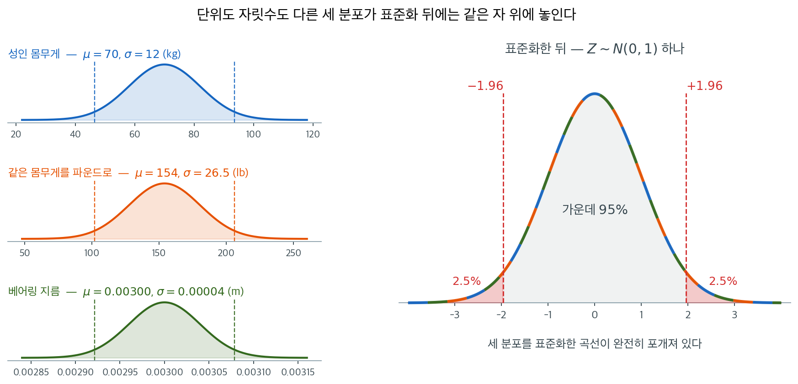
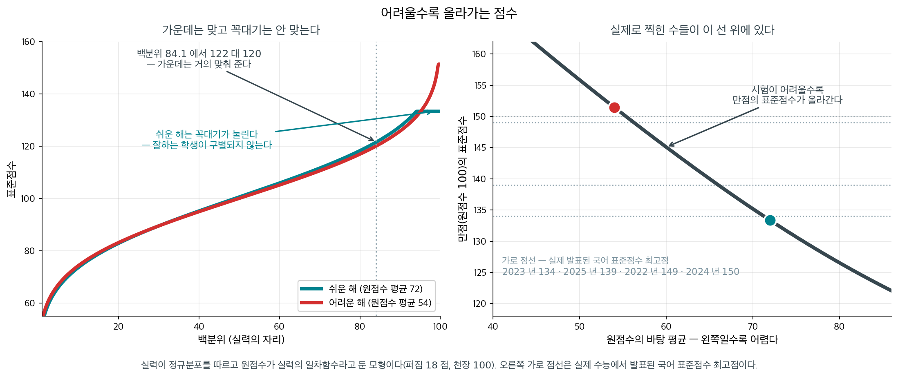
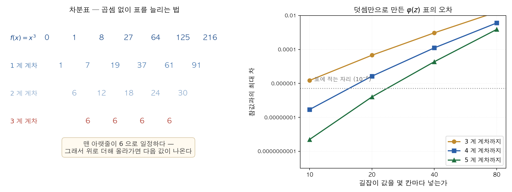

# 정규분포 (표준화의 기준)

## 개요

여론조사 기사 끝에는 늘 "오차한계 ±3%포인트"라는 문구가 붙는다. 그 숫자는 표본비율의 표준오차에 1.96을 곱해서 나온 것이고, 1.96이라는 수는 표준정규분포에서 온다. 어느 조사기관도 이 숫자를 새로 계산하지 않는다. 표에서 읽어 올 뿐이다.

$Z \sim N(0,1)$이 5장에서 맡는 역할이 바로 그것이다. 새로 배울 분포가 아니다. 정의와 성질은 4장에서 이미 다루었다. 이 절에서 물을 것은 이 분포가 **왜 추론의 기준자가 되었는가**이다.

답의 절반은 표준화에 있고 나머지 절반은 중심극한정리에 있다. 차례로 본다.

---

## 1. 표준화는 단위를 지우는 일이다

표준화가 분포를 $N(0,1)$ 로 옮긴다는 것은 [정규분포](../../ch04/continuous_distributions/normal.md) 정리 1 에서, 표본평균의 중심과 폭은 [표본평균](../applications/sample_mean.md) 정리 1 에서 증명한다.

표준정규분포의 밀도는

$$
\varphi(z) = \frac{1}{\sqrt{2\pi}} \exp\!\left(-\frac{z^2}{2}\right), \quad z \in \mathbb{R}
$$

이고 평균이 0, 분산이 1이며 원점에 대해 대칭이다($\varphi(z) = \varphi(-z)$). 적률생성함수는 $M_Z(t) = \exp(t^2/2)$이다. 여기까지는 4장의 복습이다.

이 분포가 쓸모 있는 것은 정규확률변수라면 어느 것이든 중심을 빼고 표준편차로 나누는 순간 이 하나의 분포로 되돌아오기 때문이다. 이 절이 기대는 진술을 못박아 두자.

<div class="thmbox" markdown>

### 정리 1. 표본평균의 Z 통계량 { .thm }

**(가)** $X \sim N(\mu, \sigma^2)$ 이면

$$
Z = \frac{X - \mu}{\sigma} \sim N(0, 1)
$$

이다.

**(나)** $X_1, \dots, X_n \overset{\text{iid}}{\sim} N(\mu, \sigma^2)$ 이면 $\bar X \sim N(\mu,\ \sigma^2/n)$ 이고

$$
Z = \frac{\bar{X} - \mu}{\sigma / \sqrt{n}} \sim N(0, 1)
$$

이다. 이것은 **모든 $n \ge 1$ 에서 정확**하다. 근사가 아니다.

**(다)** 모집단이 정규가 아니어도 평균 $\mu$ 와 **유한한** 분산 $\sigma^2$ 만 있으면 같은 $Z$ 가

$$
\frac{\bar X - \mu}{\sigma/\sqrt n} \;\xrightarrow{\;d\;}\; N(0,1)
$$

로 수렴한다. 이쪽은 **근사**이고, 얼마나 큰 $n$ 이어야 하는지는 모집단이 정한다.

</div>

??? proof "증명"

    **(가)** 적률생성함수로 한 줄이다. $M_X(t) = \exp(\mu t + \sigma^2t^2/2)$ 이므로

    $$
    M_Z(t) = E\!\left[e^{t(X-\mu)/\sigma}\right] = e^{-\mu t/\sigma}M_X(t/\sigma) = e^{t^2/2}
    $$

    이고 이것이 $N(0,1)$ 의 적률생성함수다([정규분포](../../ch04/continuous_distributions/normal.md) 정리 1).

    **(나)** 두 조각이다. 먼저 $\bar X$ 가 **정규**라는 것 — 독립인 정규확률변수의 일차결합은 다시 정규이므로(같은 쪽 정리 3), $\bar X = \frac1n\sum X_i$ 도 정규다. 다음으로 그 중심과 폭 — $E[\bar X] = \mu$ 와 $\operatorname{Var}(\bar X) = \sigma^2/n$ 은 [표본평균](../applications/sample_mean.md) 정리 1 이고, 그쪽은 모집단의 모양을 묻지 않는다. 정규이면서 평균 $\mu$, 분산 $\sigma^2/n$ 이면 $\bar X \sim N(\mu, \sigma^2/n)$ 이고, 여기에 **(가)** 를 적용하면 된다.

    **(다)** 중심극한정리다([표본평균](../applications/sample_mean.md) 정리 2). $\square$

**(나)와 (다)를 가르는 선이 이 절 전체의 지도다.** 둘의 결론은 글자 그대로 같은데 하나는 등식이고 하나는 극한이다. $(나)$ 는 모집단이 정규라는 값을 치르고 모든 $n$ 에서 정확을 얻고, $(다)$ 는 모집단에 대한 요구를 거의 다 버리는 대신 $n$ 이 커야 한다는 조건을 짊어진다. 어느 쪽을 쓰고 있는지 헷갈리면 「표본이 얼마나 커야 하는가」라는 물음이 뜻이 있는지 없는지가 흐려진다 — $(나)$ 에서는 그 물음 자체가 생기지 않는다.

그리고 **$\sigma$ 를 안다**는 것이 (가)–(다) 모두에 깔려 있다. 그것을 $S$ 로 바꾸는 순간 분포가 $t$ 로 옮겨 가며, 그 대가가 [$t$ 분포](student_t.md) 정리 1 이다.

킬로그램으로 재든 파운드로 재든, 평균이 500이든 0.003이든, 표준화를 거치고 나면 모두 같은 자 위에 놓인다. 그래서 통계량마다 새 분포표를 만들 필요가 없어진다. 1.96 하나가 모든 문제에 쓰이는 것이다.



왼쪽 세 분포는 가로축의 단위가 서로 다를 뿐 아니라 눈금의 자릿수까지 다르다. 몸무게를 킬로그램으로 재느냐 파운드로 재느냐는 단위의 문제이고, 베어링 지름은 아예 $10^{-3}$ 자리에서 움직인다. 세 분포를 한 그림에 겹쳐 그리는 일조차 불가능하다.

오른쪽은 세 분포를 각각 표준화한 것이다. **세 곡선이 하나로 포개진다.** 그림에서 색이 번갈아 나타나는 것은 세 곡선이 같은 자리에 겹쳐 있기 때문이다. 표준화가 하는 일이 정확히 이것이며, 중심과 척도를 지우고 나면 남는 것은 **모양**뿐이다.

그래서 $\pm 1.96$이라는 눈금 한 쌍이 세 문제 모두에서 가운데 95%를 가른다. 왼쪽 그림의 파선들이 각 분포에서 그 눈금이 놓이는 자리이며, 단위를 되돌리는 일은 $\mu + 1.96\sigma$를 계산하는 것으로 끝난다.

<div class="aibox" markdown>

**AI로 보는 통계학 1.** 눈금을 맞추지 않으면 큰 눈금만 보게 된다

이 절이 말하는 것은 분포가 서로 다른 두 정규분포에서 나온 값이라도 **표준화 값 하나로 견줄
수 있다**는 것이다. 국어 $75$ 점과 수학 $62$ 점 가운데 어느 쪽이 잘한 것인지는 원점수로는
알 수 없고, $z=\dfrac{x-\mu}{\sigma}$ 로 바꾸어야 비로소 비교가 된다.

기계에게 자료를 주기 전에 거의 언제나 하는 일이 이것이다. 자료의 각 항목을 평균 $0$,
표준편차 $1$ 로 옮겨 놓는다. 그러지 않으면 어떻게 되는지 보자. 점수(표준편차 $10$ 점)와
공부 시간(표준편차 $0.5$ 시간)처럼 **눈금이 스무 배 다른** 두 항목을 놓고, 어떤 사람과
「가장 비슷한 $200$ 명」을 거리로 찾아보는 것이다.

```python
import numpy as np

rng = np.random.default_rng(0)
# (1) 표준화 — 분포가 다른 두 과목의 점수를 견주기
kor = rng.normal(60, 10, 5000)      # 국어 N(60, 10^2)
mat = rng.normal(50,  8, 5000)      # 수학 N(50,  8^2)
a, b = 75.0, 62.0
print(f"원점수     국어 {a:.0f} 점,  수학 {b:.0f} 점  — 국어가 13 점 높다")
print(f"표준화 값  국어 {(a-kor.mean())/kor.std():+.3f},  수학 {(b-mat.mean())/mat.std():+.3f}"
      "  — 같은 자 위에서는 같은 자리")
print(f"백분위     국어 {(kor<=a).mean()*100:.1f}%,  수학 {(mat<=b).mean()*100:.1f}%")

# (2) 눈금이 다른 두 양을 거리로 견줄 때
score = rng.normal(60, 10, 5000)            # 점수 (표준편차 10)
hours = rng.normal(3, 0.5, 5000)            # 공부 시간 (표준편차 0.5) — 눈금이 20 배 다르다
X = np.column_stack([score, hours])
q = np.array([75.0, 3.8])                   # 찾고 싶은 사람
Z = (X - X.mean(0)) / X.std(0)

print("\n가장 가까운 200 명이 어떤 사람들인가 (점수 폭 / 시간 폭)")
for name, data, qq in [("그대로  ", X, q), ("표준화 뒤", Z, (q - X.mean(0)) / X.std(0))]:
    near = X[np.argsort(np.linalg.norm(data - qq, axis=1))[:200]]
    print(f"  {name}  점수 {near[:,0].ptp():5.1f} 점 폭,  시간 {near[:,1].ptp():4.2f} 시간 폭")
print(f"  (전체)     점수 {X[:,0].ptp():5.1f} 점 폭,  시간 {X[:,1].ptp():4.2f} 시간 폭")
```

실행하면 다음이 나온다.

```text
원점수     국어 75 점,  수학 62 점  — 국어가 13 점 높다
표준화 값  국어 +1.511,  수학 +1.482  — 같은 자 위에서는 같은 자리
백분위     국어 93.2%,  수학 93.6%

가장 가까운 200 명이 어떤 사람들인가 (점수 폭 / 시간 폭)
  그대로    점수   3.5 점 폭,  시간 2.36 시간 폭
  표준화 뒤  점수  15.8 점 폭,  시간 0.76 시간 폭
  (전체)     점수  79.7 점 폭,  시간 3.59 시간 폭
```

위 세 줄이 이 절의 그림 그대로다. 원점수로는 $13$ 점이나 차이가 나는데 표준화 값은 $1.511$ 과
$1.482$ 로 거의 같고, 실제 백분위도 $93.2\%$ 와 $93.6\%$ 로 거의 같다. 「몇 점인가」가 아니라
**「제 분포 안에서 어디인가」**가 견줄 수 있는 양이라는 것이다.

아래 세 줄이 기계에게 왜 이것이 필요한지를 보인다. 눈금을 맞추지 않고 거리를 재면, 뽑힌
$200$ 명의 점수 폭은 $3.5$ 점으로 바싹 좁은데 시간 폭은 $2.36$ 시간으로 **전체 폭
$3.59$ 시간의 삼분의 이**나 된다. 공부 시간을 거의 보지 않았다는 뜻이다. 까닭은 간단하다 —
점수에서 $1$ 점 벌어지는 일과 시간에서 $1$ 시간 벌어지는 일을 **같은 크기로 취급**했기
때문이고, 점수 쪽 눈금이 스무 배 크니 거리는 사실상 점수만 재고 있었다. 표준화한 뒤에는
점수 폭 $15.8$ 점, 시간 폭 $0.76$ 시간으로 둘 다 적당히 좁아진다.

그러니 표준화는 자료를 「예쁘게 다듬는」 손질이 아니라 **비교를 가능하게 하는 조건**이다.
거리를 재는 방법, 이웃을 찾는 방법, 그리고 여러 항목을 한 줄로 더해 쓰는 방법은 모두 이
조건 위에서만 뜻을 갖는다.

다만 표준화가 받쳐 주는 범위도 함께 보아야 한다. 같은 $z$ 가 같은 백분위를 뜻하는 것은 두
분포가 **같은 꼴**일 때다 — 위의 셈은 둘 다 정규분포라는 가정 위에 서 있다. 한쪽이 한참
치우쳐 있거나 봉우리가 둘이면 표준화는 눈금만 맞출 뿐 그 어긋남까지 고쳐 주지는 않는다.
바로 다음 절이 중심극한정리로 적용 범위를 넓히는 것도 **평균 꼴의 통계량**에 대해서이지
관측값 하나하나에 대해서가 아니다.

</div>

<div class="storybox" markdown>

**그림으로 보는 통계학 1.** 어려울수록 올라가는 점수

바로 앞 문단이 말한 것 — **표준화는 눈금을 맞출 뿐 분포의 꼴까지 고쳐 주지는 않는다** —
이 해마다 신문에 실리는 나라가 있다.

수능 성적표에 찍히는 **표준점수**가 바로 $z$ 점수다. 국어·수학·영어는

$$
\text{표준점수} = 20 \times \frac{\text{원점수} - \text{평균}}{\text{표준편차}} + 100
$$

이고 탐구 과목은 $10z + 50$ 이다. 해마다 시험의 난이도가 다르니 원점수를 그대로 견줄 수
없고, 그래서 표준화해서 내보낸다. **이 절이 설명한 바로 그 일이다.**

그런데 해마다 기사가 나는 수가 하나 있다 — 표준점수 **최고점**이다.

| | 2022 | 2023 | 2024 | 2025 |
|---|---|---|---|---|
| 국어 | $149$ | $134$ | $150$ | $139$ |
| 수학 | $147$ | $145$ | $148$ | $140$ |

<small>학년도별, 발표된 값.</small>

국어만 보아도 $134$ 에서 $150$ 까지 **열여섯 점**이 움직인다. 같은 만점인데 해마다 다른
수가 찍힌다. 까닭은 식에 그대로 있다. 원점수의 천장이 $100$ 으로 고정되어 있으므로 만점의
표준점수는

$$
20 \times \frac{100 - \text{평균}}{\text{표준편차}} + 100
$$

이고, 시험이 어려워 평균이 내려가면 이 수가 **올라간다.**

<figure markdown>
{ width="900" }
  <figcaption markdown>실력이 정규분포를 따르고 원점수가 실력의 일차함수라고 둔 모형이다(퍼짐 $18$ 점, 천장 $100$).</figcaption>
</figure>

왼쪽이 표준화가 하는 일과 못 하는 일을 한 장에 담고 있다. 두 곡선이 **백분위 $90$ 언저리까지
거의 포개진다.** 같은 실력이면 쉬운 해든 어려운 해든 거의 같은 표준점수가 나온다 — 백분위
$84.1$ 에서 $122$ 대 $120$ 이다. 표준화가 제 일을 한 것이다.

그런데 꼭대기에서 갈라진다. 쉬운 해의 곡선은 $133$ 에서 **평평해진다.** 잘하는 학생들이
원점수 $100$ 에 몰려 더 이상 구별되지 않기 때문이다. 어려운 해는 같은 자리에서 $151$ 까지
올라간다.

오른쪽은 그 관계를 그대로 그린 것이다. 손대지 않은 이 모형이 쉬운 해에 $133.3$,
어려운 해에 $151.3$ 을 내놓는데, 실제로 발표된 범위가 $134$ 에서 $150$ 이다.

그러니 표준점수 최고점은 **그해 시험이 얼마나 어려웠는지를 재는 수**이지 그 학생이 얼마나
잘했는지를 재는 수가 아니다. 그리고 쉬운 해에 최고점이 낮다는 말은 **꼭대기를 가를 눈금이
모자랐다**는 뜻이다 — 분포의 꼴이 달라진 것을 표준화가 고쳐 주지 못한 자리다.

_확인한 곳 — 표준점수가 국어·수학·영어는 $20z + 100$, 탐구는 $10z + 50$ 이라는 것과 위 표의 학년도별 최고점(국어 $149 \cdot 134 \cdot 150 \cdot 139$, 수학 $147 \cdot 145 \cdot 148 \cdot 140$). 두 그림의 수는 원점수의 천장을 $100$ 으로 두고 직접 모의실험한 값이며 실제 수능 자료가 아니다_

</div>

---

## 2. 중심극한정리가 적용 범위를 넓힌다

정리 1의 (가)와 (나)만으로는 정규모집단이라는 좁은 울타리를 벗어나지 못한다. 울타리를 걷어내는 것이 (다), 곧 중심극한정리다. 분산이 유한하기만 하면($\sigma^2 < \infty$) **모집단의 모양이 무엇이든**

$$
\frac{\bar{X} - \mu}{\sigma / \sqrt{n}} \xrightarrow{d} N(0, 1) \quad \text{as } n \to \infty
$$

이 성립한다. 앞 절의 세 모의실험에서 균등·지수·베르누이 어느 모집단에서 출발하든 표본평균이 종 모양으로 모여든 것이 이 정리의 모습이었다.

이 두 경로가 만나는 지점에 $Z$가 있다. 정규모집단에서는 정확한 결과로, 그 밖의 모집단에서는 큰 표본의 근사로. 정규분포가 통계학 전체를 통틀어 유난히 자주 등장하는 까닭이 여기에 있다.

여기서 한 가지를 미리 새겨 둘 만하다. 중심극한정리가 주는 것은 **표본을 키우면 모집단의 모양을 묻지 않아도 된다**는 면허다. 모집단이 균등이든 지수든 베르누이든, $n$을 키우기만 하면 표준화된 표본평균은 같은 자 위로 모여든다. 자료가 정규가 아니라는 사실이 걱정이라면 표본을 늘리는 것이 정직한 해법이고, 대개는 실행 가능한 해법이다. 이 절과 다음 절의 $t$가 다루는 네 통계량이 모두 그 면허 아래 있다. 뒤의 두 절에서 볼 $\chi^2$과 $F$에는 이 면허가 나오지 않는다. 5.2절 네 쪽이 둘씩 갈라지는 자리가 여기다.

---

## 3. 쓸 수 있는 자리와 쓸 수 없는 자리

그렇다면 실제로 $Z$를 꺼내도 좋은 경우는 언제인가. 가장 깨끗한 경우는 모집단이 정규이고 $\sigma$를 아는 경우로, 이때 $Z$ 통계량은 어떤 표본크기에서도 정확하다. 다음으로 표본이 충분히 크면 모집단의 모양을 묻지 않고 중심극한정리에 기대어 근사적으로 쓸 수 있다. 흔히 $n \geq 30$을 기준으로 삼지만, 연습문제 6에서 보듯 이 숫자는 모집단이 얼마나 치우쳤는지를 전혀 보지 않으므로 그대로 믿을 것은 못 된다. 비율 문제에서도 $np$와 $n(1-p)$가 모두 5 이상이면 표본비율 $\hat p$의 모양이 종에 가까워져 근사적으로 정규분포를 따른다.

쓸 수 없는 자리도 분명하다. $\sigma$를 모르는데 $n$까지 작으면 $Z$가 아니라 **스튜던트 $t$ 분포**를 써야 한다. 모르는 $\sigma$를 표본에서 계산한 $S$로 바꿔 끼우는 순간 분모가 함께 흔들리기 때문이며, 그 흔들림의 값을 정확히 매긴 것이 다음 절의 $t$ 분포다.

---

## 4. Z가 받치는 다섯 가지 추론

5장이 다루는 일곱 통계량 가운데 다섯이 $Z$ 위에 놓인다. 5.4절의 $\bar X$, 5.5절의 $\hat p$, 5.7절의 $\bar X_1 - \bar X_2$, 5.8절의 $\hat p_1 - \hat p_2$, 5.9절의 $\bar D$다. 다섯 추축량은 겉보기에 서로 다른 공식이지만 만드는 규칙은 하나다. **추정량에서 그것이 겨냥하는 모수를 빼고 그 추정량의 표준오차로 나눈다.** 달라지는 것은 표준오차 자리에 무엇이 들어가느냐뿐이다.

그러나 이 절에서 물을 것은 공식의 생김새가 아니다. 다섯 자리에서 $Z$가 나온다는 사실은 저절로 주어지지 않는다. 자리마다 그것을 보증해 주는 서로 다른 근거가 있고, 그 근거가 서 있는 조건도 자리마다 다르다. 다섯을 차례로 본다.

### 5.4절 — 표본평균 X̄

가장 단순한 자리다. $\sigma$를 아는 정규모집단이면

$$
Z = \frac{\bar{X} - \mu}{\sigma / \sqrt{n}} \sim N(0, 1)
$$

이고, 이 식을 $\mu$에 대해 풀면 곧바로 $\bar{X} \pm z_{\alpha/2} \cdot \sigma/\sqrt{n}$이라는 신뢰구간이 나온다.

여기서 $Z$를 보증하는 것은 두 가지 중 하나다. 모집단이 정규이면 4.2절에서 본 닫힘 성질이 보증한다. $\bar X$는 독립인 정규확률변수의 선형결합이므로 다시 정규이고, 이 결론은 $n$이 2여도 성립하는 **정확한** 결과다. 모집단이 정규가 아니면 중심극한정리가 대신 보증한다. 이때는 $n$이 커야 한다는 단서가 붙지만, 모집단의 모양은 묻지 않는다.

깨지는 자리도 분명하다. $\sigma$를 모르면 분모가 상수에서 확률변수로 바뀌고 $Z$는 $t_{n-1}$로 옮겨 간다. 중요한 것은 이때 결과가 근사로 내려앉는 것이 아니라는 점이다. 정규모집단이라면 $t_{n-1}$도 모든 $n$에서 정확하다. 정확한 분포의 이름만 바뀔 뿐이며, 그 이름값이 다음 절의 주제다.

### 5.5절 — 표본비율 p̂

$\hat p$는 0과 1만 값으로 갖는 베르누이 관측값의 표본평균이다. 그러므로 5.4절의 이야기가 그대로 반복될 것 같지만, 두 군데가 다르다.

$$
Z = \frac{\hat{p} - p}{\sqrt{p(1-p)/n}} \approx N(0, 1)
$$

첫째, **정확한 경로가 아예 없다.** 베르누이 모집단은 결코 정규가 아니므로 앞 절의 첫째 보증서는 이 자리에서 발급되지 않는다. 남는 것은 중심극한정리 하나뿐이고, 그래서 이 식에는 등호가 아니라 근사기호가 붙는다. 흔히 드는 $np \ge 5$, $n(1-p) \ge 5$라는 느슨한 기준이 바로 그 근사가 쓸 만해지는 문턱이다. 이항분포의 왜도가 $(1-2p)/\sqrt{np(1-p)}$이므로 두 곱이 함께 커야 왜도가 눌린다. 이 문턱이 재는 것은 어디까지나 분포의 **모양**이다. 아래에서 곧 나올 왈드 구간처럼 포함률을 약속해야 하는 자리에서는 같은 문턱으로 모자라 $10$까지 올려 잡으며, 연습문제 8가 그 경우다.

둘째, **$\sigma$를 따로 모르는 문제가 생기지 않는다.** 베르누이 분포에서는 평균 $p$가 분산 $p(1-p)$까지 정해 버리기 때문이다. 모수 하나가 두 자리를 겸하므로 분모에 $\hat p$를 꽂으면 그만이고, 신뢰구간은 $\hat{p} \pm z_{\alpha/2} \cdot \sqrt{\hat{p}(1-\hat{p})/n}$이 된다. 기사 끝의 오차한계가 이것이다. 평균 추론에서 $t$가 하던 역할이 비율 추론에는 없는 까닭이 여기에 있다.

그 대신 다른 곳이 약하다. $\hat p$가 0이나 1에 가까우면 분모 자체가 0으로 잦아들어 이 왈드 구간이 무너진다. 연습문제 8에서 따로 다룬다.

### 5.7절 — 두 표본평균의 차 X̄₁ − X̄₂

두 집단을 견줄 때도 틀은 그대로다. 두 표본이 독립이면 차의 분산이 **더해지므로**, 표준오차만 바꿔 끼우면 된다.

$$
Z = \frac{(\bar{X}_1 - \bar{X}_2) - (\mu_1 - \mu_2)}{\sqrt{\sigma_1^2/n_1 + \sigma_2^2/n_2}} \sim N(0, 1)
$$

$Z$를 보증하는 논리도 5.4절과 같다. 두 표본평균이 각각 정규이면 그 차도 정규이고, 각각이 근사적으로 정규이면 차도 근사적으로 정규다. 다만 보증서가 **두 장** 필요해졌다는 점이 다르다. 중심극한정리가 두 표본에 따로 걸리므로 정규성의 품질은 작은 쪽 표본이 좌우한다. 한쪽이 1000이어도 다른 쪽이 6이면 근사는 6에 맞추어 나쁘다.

$\sigma_1$과 $\sigma_2$를 모르면 여기서도 $t$로 옮겨 가는데, 이 자리에서 처음으로 $t$마저 정확하지 않게 된다. 두 분산이 같다고 볼 수 있으면 합동분산으로 자유도 $n_1 + n_2 - 2$인 정확한 $t$를 얻지만, 두 분산이 다르면 분모가 서로 다른 두 카이제곱의 합이 되어 정확한 $t$가 존재하지 않는다. 웰치의 근사 자유도가 그 자리를 메운다.

### 5.8절 — 두 표본비율의 차 p̂₁ − p̂₂

마지막 자리는 앞의 둘을 포갠 것이다.

$$
Z = \frac{(\hat{p}_1 - \hat{p}_2) - (p_1 - p_2)}{\sqrt{\frac{p_1(1-p_1)}{n_1} + \frac{p_2(1-p_2)}{n_2}}} \approx N(0, 1)
$$

5.5절에서처럼 정확한 경로가 없고, 5.7절에서처럼 보증서가 두 장 필요하다. 네 자리 가운데 중심극한정리에 가장 많이 기대는 곳이며, 그만큼 조건도 까다롭다. $n_1 p_1$, $n_1(1-p_1)$, $n_2 p_2$, $n_2(1-p_2)$ 네 기대도수가 모두 충분히 커야 한다. 두 집단 가운데 어느 한쪽에서 사건이 드물면 그 한 칸 때문에 전체 근사가 무너진다.

### 5.9절 — 대응표본 차의 평균 D̄

마지막 자리는 새로 배울 것이 없다. 짝지어진 두 관측의 차 $D_i = X_i - Y_i$를 **하나의 관측으로 보면** 5.4절의 $\bar X$가 그대로 돌아온다.

$$
Z = \frac{\bar D - \mu_D}{\sigma_D/\sqrt n} \sim N(0, 1), \qquad T = \frac{\bar D - \mu_D}{S_D/\sqrt n} \sim t_{n-1}
$$

짝 안의 상관 $\rho$는 $\sigma_D$ 안에만 들어가고, 표준화할 때 분자와 분모에서 함께 약분되어 사라진다. 그래서 $\rho$가 $-0.9$든 $+0.9$든 분포는 꿈쩍하지 않는다. 같은 두 집단을 다루면서도 5.7절 [두 표본평균의 차](../applications/diff_means.md)은 등분산이 깨지면 바로 무너지는데 이쪽은 그렇지 않은 까닭이 여기에 있다. **짝을 지어 차를 만드는 순간 두 표본 문제가 한 표본 문제로 내려앉는다.**

### 다섯 자리의 공통점

다섯 자리를 나란히 놓으면 왜 하필 이 다섯만 $Z$ 위에 놓이는지가 보인다. 다섯 추정량이 모두 **평균 꼴**이기 때문이다. $\bar X$는 관측값의 평균이고 $\hat p$는 0-1 관측값의 평균이며, $\bar D$는 차를 관측값으로 본 평균이고, 나머지 둘은 그런 평균의 차다. 평균은 자료의 **1차 적률**에 관한 양이고, 중심극한정리가 선물을 주는 곳이 정확히 1차 적률이다.

5.6절의 $S^2$과 5.10절의 $S_1^2/S_2^2$은 사정이 다르다. 편차를 제곱해서 모으는 양, 곧 **2차 적률**에 관한 통계량이다. 표본을 키워도 중심극한정리는 이쪽에 같은 선물을 주지 않으며, 그래서 $\chi^2$과 $F$가 따로 필요해진다. 이 절과 다음 절이 낙관적일 수 있는 이유와 뒤의 두 절이 그럴 수 없는 이유가 모두 이 한 줄에 들어 있다.

---

## 5. 임계값

양측 구간에서 흔히 쓰는 임계값 $z_{\alpha/2}$는 다음과 같다. 세 줄이 전부이고, 실무에서 되풀이해 찾아보게 되는 표다.

| 신뢰수준 | $\alpha$ | $z_{\alpha/2}$ |
|-----------------|----------|----------------|
| 90% | 0.10 | 1.645 |
| 95% | 0.05 | 1.960 |
| 99% | 0.01 | 2.576 |

세 줄이 어떻게 계산되는지는 4.2절 정규분포 쪽의 분위수 절에서 `ppf`로 확인했다. 여기서는 읽어 쓰기만 한다.

<div class="storybox" markdown>

**그림으로 보는 통계학 2.** 그 표를 만든 사람들은 음수를 다룰 줄 몰랐다

<figure markdown>
  { width=880 }
  <figcaption markdown>왼쪽 — 차분표다. 함수값의 차, 그 차의 차를 쌓아 내려가면 $3$ 차식에서는 $3$ 계 계차가 $6$ 으로 **일정하다**. 그러면 거꾸로 맨 아랫줄에서 위로 **더해 올라가며** 다음 값을 만들 수 있다. 오른쪽 — 같은 방법으로 $\varphi(z)$ 의 표를 만들었을 때의 오차로, 길잡이 값을 $10$ 칸마다 하나씩 넣고 $5$ 계 계차까지 쓰면 오차가 $10^{-9}$ 까지 내려간다. *(이 책에서 그렸다)*</figcaption>
</figure>

바로 위 세 줄은 오늘 `ppf` 한 줄이면 나온다. 그러나 $1.645$·$1.960$·$2.576$ 같은 수가
처음 종이에 적히던 때에는 사정이 달랐다. 그 수들이 어디에서 왔는지를 생각해 볼 자리다.

$\varphi(z)=\frac1{\sqrt{2\pi}}e^{-z^2/2}$ 의 값을 소수 여섯째 자리까지, $0.01$ 간격으로
수백 줄 적는 일을 **기계 없이** 한다고 해 보자. $e^{-z^2/2}$ 를 한 줄마다 손으로 구하는 것은
가망이 없다. 그래서 쓰던 것이 사진 왼쪽의 **차분표**다. 함수값 몇 개만 정확히 알면, 그다음
줄부터는 계차를 아래에서 위로 더해 올라가는 것만으로 나온다. **곱셈이 한 번도 들어가지
않는다.**

이 방법으로 실제로 표를 만든 조직이 있었다. $1938$ 년에 대공황기 미국의 공공사업 기구가
뉴욕에서 시작한 **수표 사업**이다. 코넬에서 박사학위를 막 받은 **거트루드 블랜치**가 그해
$2$ 월에 들어가 수학 쪽을 맡았고, 브루클린 칼리지와 예시바 대학에서 수학과 물리를 가르치던
아널드 로언이 사업을 이끌었다. 그 아래 「사람 계산기」가 **$450$ 명**이었는데 셈 실력이
제각각이어서, **대부분은 덧셈만 할 줄 알았고 뺄셈은 그보다 적은 수, 한 자리 곱셈은 더 적은
수, 나눗셈은 한두 사람뿐**이었다.

그러니 이 사업의 진짜 어려움은 수학이 아니라 **일을 쪼개는 방식**이었다. 셈하는 사람들이
음수를 모른다는 것이 가장 큰 벽이어서, 아예 음수를 쓰지 않는 길을 냈다 — **검은 연필과
붉은 연필**을 나누어 주고, 두 수가 어떤 색 조합으로 들어오느냐에 따라 무엇을 어떤 색으로
적을지를 지시로 적어 주었다. 부호는 셈하는 사람의 머리가 아니라 **연필의 색**에 들어가
있었던 셈이다. 차분법이 어울린 까닭도 같다 — 숙련된 몇 사람이 몇 칸마다 하나씩
**길잡이 값**을 정확히 구해 주면, 나머지 사람들은 그 사이를 더하기만으로 메운다. 사진
오른쪽이 그 저울질이다. 길잡이를 $10$ 칸마다 넣고 $5$ 계 계차까지 쓰면 오차가 $10^{-9}$ 이라
표에 적는 자리보다 훨씬 아래지만, $80$ 칸마다로 띄우면 오차가 $10^{-3}$ 까지 올라와 쓸 수
없게 된다. 길잡이를 몇 칸마다 둘 것인가가 곧 **사람을 어떻게 배치할 것인가**였다.

이 사업은 $1943$ 년에 모체인 기구가 해체된 뒤에도 몇 해를 더 살아남았고, 삼각비·로그·지수·
베셀함수 같은 표를 수십 권 펴냈다. 신뢰구간을 셈할 때마다 꺼내 쓰는 $1.96$ 의 조상이 그
종이들이다. 블랜치는 $1897$ 년에 나서 $1996$ 년에 죽었으니, 사람이 손으로 표를 만들던 시절과
계산기가 그 일을 통째로 가져간 시절을 **둘 다** 살았다.

이 절이 「여기서는 읽어 쓰기만 한다」고 할 때 그 표는 이미 거기 있는 것이지만, 거기 있게
만든 것은 수백 명이 몇 해 동안 되풀이한 덧셈이었다. 같은 세 줄을 해마다 다시 읽는 쪽에서
적어 둘 만한 되풀이다.

_확인한 곳 — **셈하는 사람들이 음수를 이해하지 못해 검은 연필과 붉은 연필로 부호를
대신했다**는 것, 「대부분은 덧셈만, 그보다 적은 수가 뺄셈을, 더 적은 수가 한 자리 곱셈을,
나눗셈은 한두 사람만」이라는 실력 분포, 최대 $450$ 명이었다는 것, 로언이 브루클린 칼리지와
예시바 대학에서 수학과 물리를 가르치다 사업을 이끌게 된 것은
[NIST 「Prehistory: The Math Tables Project」](https://www.nist.gov/mathematics-statistics/prehistory-math-tables-project) ·
블랜치가 $1938$ 년 $2$ 월에 그 일에 들어가 수학 책임자를 맡은 것은
[Wikipedia 「Gertrude Blanch」](https://en.wikipedia.org/wiki/Gertrude_Blanch) ·
사업이 $1938$ 년 뉴욕에서 WPA 아래 시작해 $1943$ 년 WPA 해체 뒤에도 이어졌다는 것과
블랜치가 코넬에서 갓 박사를 받은 참이었다는 것, 컬럼비아대 출판부에서 지수·로그·삼각함수
표를 낸 것은
[Wikipedia 「Mathematical Tables Project」](https://en.wikipedia.org/wiki/Mathematical_Tables_Project) ·
블랜치의 생몰년($1897$–$1996$)은
[MacTutor 「Gertrude Blanch」](https://mathshistory.st-andrews.ac.uk/Biographies/Blanch/) ·
**끝난 해는 자료마다 다르다** — 위키백과는 $1948$ 년까지 뉴욕에서 이어졌다고 하고 NIST 는
해군의 지원으로 $1946$ 년까지라고 적는다. 그래서 본문에는 「$1943$ 년 뒤에도 몇 해를 더」로만
적었다. 펴낸 책의 권수도 자료마다 달라(스물여덟 권이라고도 하고 서른일곱 권이라고도 한다)
**「수십 권」으로만 적었다** · 사진의 차분표와 오차 곡선은 직접 계산해 그린 것이다_

</div>

---

## 6. 여기서 갈라지는 세 분포

$Z$ 하나에서 제곱합으로 $\chi^2$이 나오고, $Z$와 $\chi^2$의 비로 $t$가, $\chi^2$ 둘의 비로 $F$가 나온다는 가족도는 4.2절 정규분포 쪽에서 이미 그려 두었다. 네 분포가 따로 있는 것이 아니라 하나의 가족이며, 그래서 정규성이 깨지면 넷이 함께 흔들린다는 것도 그곳에서 보았다.

5.2절에서 물을 것은 다른 것이다. **어느 통계량이 어느 분포를 낳으며, 그 결론을 무엇이 보증하는가.** 방금 본 것처럼 평균 꼴의 통계량에는 중심극한정리라는 보증서가 따라붙어 모집단의 모양을 묻지 않아도 된다. 다음 절의 $t$는 그 보증서를 그대로 물려받되 $\sigma$를 모른다는 조건 하나를 더 얹는다. 그러나 표본분산이 주인공이 되는 뒤의 두 절에서는 사정이 달라진다. 이 네 쪽이 둘씩 짝을 이루는 것은 그 때문이다.

---

## 연습문제

<div class="drillbox" markdown>

**연습문제 1.** <span class="diff easy" title="쉬움"></span>
어떤 기계가 병에 평균 500 mL, 알려진 표준편차 5 mL로 내용물을 채운다(정규분포). $n = 25$개 표본의 표본평균이 498 mL이었다. 표본평균이 498 mL 이하일 확률을 구하라.

</div>

??? success "풀이"
    $\mu = 500$, $\sigma = 5$라는 가정 아래:

    $$
    Z = \frac{498 - 500}{5/\sqrt{25}} = \frac{-2}{1} = -2
    $$

    $$
    P(\bar{X} \leq 498) = P(Z \leq -2) = \mathcal{N}(-2) \approx 0.0228
    $$

    참 평균이 500 mL라면 표본평균이 498 mL 이하로 관측될 확률은 약 2.28%이다.

---

<div class="drillbox" markdown>

**연습문제 2.** <span class="diff easy" title="쉬움"></span>
$n=400$명을 조사해 220명이 찬성했다. 찬성 비율의 95% 신뢰구간을 구하고, 흔히 말하는 "오차한계 ±5%포인트"와 견주어라.

</div>

??? success "풀이"
    $\hat p = 220/400 = 0.55$이고 표준오차는

    $$
    \operatorname{SE} = \sqrt{\frac{\hat p(1-\hat p)}{n}} = \sqrt{\frac{0.55\times0.45}{400}} = 0.02487
    $$

    이다. 따라서

    $$
    0.55 \pm 1.96 \times 0.02487 = 0.55 \pm 0.0488 = (0.501,\ 0.599)
    $$

    이다.

    **오차한계와의 비교.** 여기서 오차한계가 4.88%포인트다. 흔히 인용되는 "±5%포인트"는 $\hat p = 0.5$일 때의 보수적인 값

    $$
    1.96\sqrt{\frac{0.25}{400}} = 0.049
    $$

    를 반올림한 것이다. $p(1-p)$가 $p=0.5$에서 최대이므로 이 값이 어떤 $p$에서든 성립하는 상한이고, 그래서 언론이 $\hat p$와 무관하게 하나의 오차한계를 쓸 수 있다.

    두 가지를 덧붙일 만하다. 첫째, 구간의 하한이 0.501로 0.5를 간신히 넘는다. "과반이 찬성"이라고 단정하기에는 근거가 약하다. 둘째, 이 오차한계는 **표집오차만** 담는다. 무응답 편향이나 질문 문항의 영향은 표본을 늘려도 줄지 않으며, 실제 조사에서는 흔히 표집오차보다 크다.

---

<div class="drillbox" markdown>

**연습문제 3.** <span class="diff med" title="중간"></span>
$X_1, \ldots, X_n$을 i.i.d. $N(\mu, \sigma^2)$이라 하고 $\sigma$를 안다고 하자. $\bar{X}$의 분포와 표준화된 통계량 $Z = \frac{\bar{X} - \mu}{\sigma/\sqrt{n}}$의 분포를 유도하라.

</div>

??? success "풀이"
    각 $X_i \sim N(\mu, \sigma^2)$이고 $X_i$들이 독립이므로 표본평균 $\bar{X} = \frac{1}{n}\sum_{i=1}^n X_i$는 독립인 정규확률변수들의 선형결합이다. 따라서:

    $$
    \bar{X} \sim N\!\left(\mu, \frac{\sigma^2}{n}\right)
    $$

    표준화하면:

    $$
    Z = \frac{\bar{X} - \mu}{\sigma/\sqrt{n}} \sim N(0, 1)
    $$

    정규확률변수에서 평균을 빼고 표준편차로 나누면 언제나 표준정규확률변수가 되기 때문이다.

---

<div class="drillbox" markdown>

**연습문제 4.** <span class="diff med" title="중간"></span>
모집단이 정규가 아닐 때조차 정규분포가 표본이론에서 중심적인 역할을 하는 이유를 설명하라. 어떤 정리가 이를 정당화하며 그 한계는 무엇인가?

</div>

??? success "풀이"
    **중심극한정리(CLT)**가 정규분포의 중심적 역할을 정당화한다. 평균 $\mu$와 분산 $\sigma^2$이 유한한 임의의 모집단에 대해, 원래 모집단의 모양과 무관하게 표준화된 표본평균 $Z_n = \frac{\bar{X}_n - \mu}{\sigma/\sqrt{n}}$이 $n \to \infty$일 때 $N(0,1)$로 분포수렴한다는 것이다.

    **한계:**

    - 중심극한정리는 점근적 결과이다. $n$이 작으면, 특히 심하게 치우쳤거나 꼬리가 두꺼운 분포에서는 근사가 나쁠 수 있다.
    - 모집단의 분산이 유한해야 한다. 분산이 무한한 분포(예: Cauchy)에는 중심극한정리가 적용되지 않는다.
    - Berry–Esseen 정리가 수렴 속도를 정량화한다. 근사 오차는 $O(1/\sqrt{n})$이며, 치우친 분포일수록 더 느리게 수렴한다.
    - (평균이 아니라) 분산에 관한 추론에서 정확한 카이제곱 결과를 얻으려면 모집단의 정규성이 필요하다. 중심극한정리는 분산 기반 추론을 같은 방식으로 구제해 주지 않는다.

---

<div class="drillbox" markdown>

**연습문제 5.** <span class="diff med" title="중간"></span>
두 공정의 제품 무게가 각각 $N(\mu_1, 4)$, $N(\mu_2, 9)$를 따르고 분산은 알려져 있다. $n_1 = 50$, $n_2 = 40$에서 $\bar x_1 = 102.3$, $\bar x_2 = 100.1$을 얻었다. $\mu_1 = \mu_2$를 유의수준 5%로 양측검정하고 차의 95% 신뢰구간을 구하라.

</div>

??? success "풀이"
    두 표본이 독립이므로 차의 분산이 더해진다.

    $$
    \operatorname{Var}(\bar X_1 - \bar X_2) = \frac{\sigma_1^2}{n_1} + \frac{\sigma_2^2}{n_2} = \frac{4}{50}+\frac{9}{40} = 0.08+0.225 = 0.305
    $$

    이므로 $\operatorname{SE} = \sqrt{0.305} = 0.5523$이다.

    **검정.** $H_0: \mu_1-\mu_2 = 0$ 아래에서

    $$
    z = \frac{102.3-100.1}{0.5523} = \frac{2.2}{0.5523} = 3.983
    $$

    $|z| = 3.98 > 1.96$이므로 기각한다. p-값은 $2\Phi(-3.983) = 6.8\times10^{-5}$이다.

    **신뢰구간.**

    $$
    2.2 \pm 1.96 \times 0.5523 = 2.2 \pm 1.082 = (1.118,\ 3.282)
    $$

    0을 담고 있지 않아 검정 결과와 일치한다.

    분산이 알려져 있다는 가정 덕분에 $z$를 쓸 수 있었다. 실제로는 $\sigma$를 모르는 경우가 대부분이고, 그때는 $t$ 분포를 쓰되 두 분산이 다르면 자유도를 웰치 공식으로 근사해야 한다.

---

<div class="drillbox" markdown>

**연습문제 6.** <span class="diff med" title="중간"></span>
평균에 대한 추론에서 $z$를 쓸 때와 $t$를 쓸 때를 정리하고, "$n \ge 30$이면 $z$를 써도 된다"는 관행을 평가하라.

</div>

??? success "풀이"

    | 상황 | 올바른 분포 |
    |---|---|
    | 정규모집단, $\sigma$ 알려짐 | $z$ (모든 $n$에서 **정확**) |
    | 정규모집단, $\sigma$ 모름 | $t_{n-1}$ (모든 $n$에서 **정확**) |
    | 비정규모집단, $\sigma$ 알려짐, $n$ 큼 | $z$ (근사) |
    | 비정규모집단, $\sigma$ 모름, $n$ 큼 | $t_{n-1}$ 또는 $z$ (근사, 둘 다 비슷) |
    | 비정규모집단, $n$ 작음 | 어느 쪽도 곤란 (비모수 검정이나 부트스트랩) |

    **관행의 평가.** 이 규칙은 서로 다른 두 문제를 뭉뚱그려 놓았다. 하나씩 떼어 보아야 한다.

    첫째, **$t$ 대 $z$의 선택 문제로 보면 이 규칙은 쓸 이유가 없다.** $\sigma$를 모르면 $n$이 아무리 커도 정확한 분포는 $t_{n-1}$이고, $t$ 임계값을 얻는 수고는 요즘 0이다. 자유도 30에서 $t$ 임계값이 $z$보다 4.2% 크다는 수렴 속도 자체는 4.2절 [t 분포](../../ch04/continuous_distributions/student_t.md) 쪽의 표에 정리되어 있으니, 여기서는 그 차이가 실무에서 어떤 값을 갖는지만 보면 된다. 정규모집단에 $n=30$인 표본을 놓고 $t_{29}$ 대신 $z=1.96$을 쓰면 명목 95% 신뢰구간의 실제 포함확률이 94.0%로 내려가고, 명목 5% 양측검정의 실제 유의수준은 5.97%로 올라간다. 표본이 30이라는 이유로 $\alpha$를 6% 가까이 써 버리는 셈이다. 작은 차이지만 공짜로 피할 수 있는 차이이므로 피하는 편이 낫다. **$\sigma$를 모르면 언제나 $t$를 쓴다.** $n$이 크면 임계값이 저절로 $z$로 수렴하므로 손해 볼 일도 없다.

    둘째, **정규성 문제로 보면 이 규칙은 위험하다.** 30이라는 숫자는 모집단의 치우침을 전혀 보지 않는다. 지수 모집단에서는 $n=30$에서도 표본평균의 왜도가 0.37이나 남아 신뢰구간의 포함확률이 명목값에 못 미친다. 왜도가 큰 모집단이라면 수백 개가 필요하다. 이쪽 문제는 $t$로 바꿔 쓴다고 해결되지 않는다. $t$가 고쳐 주는 것은 분모의 흔들림이지 모집단의 치우침이 아니기 때문이다.

    한마디로 **$t$를 기본값으로 쓰고, 정규성이 의심스러우면 $n$이 아니라 자료의 치우침을 보아야 한다.** 다음 절의 $t$ 분포 쪽도 같은 결론에 이른다.

---

<div class="drillbox" markdown>

**연습문제 7.** <span class="diff med" title="중간"></span>
$X_i \sim N(\mu_i, \sigma_i^2)$가 독립일 때 $\sum_i a_iX_i + b$의 분포를 구하라. 이 성질이 표본이론에서 왜 그렇게 유용한가?

</div>

??? success "풀이"
    적률생성함수 계산은 4.2절 [정규분포](../../ch04/continuous_distributions/normal.md) 연습문제 4에서 두 변수 경우로 이미 해 두었다. 같은 계산을 $n$개로 되풀이하면

    $$
    \sum_i a_iX_i + b \sim N\!\left(b+\sum_i a_i\mu_i,\ \sum_i a_i^2\sigma_i^2\right)
    $$

    이다. 여기서 볼 것은 이 결과가 표본이론에서 어떻게 쓰이는가이다.

    **왜 유용한가.** 표본이론에서 다루는 통계량 상당수가 정규확률변수의 선형결합이기 때문이다.

    - $\bar X = \sum (1/n)X_i \sim N(\mu, \sigma^2/n)$. 근사가 아니라 **정확**하다. 5.4절이 서 있는 바탕이 이 한 줄이다.
    - $\bar X_1 - \bar X_2$ 역시 정규이며, 5.7절 [두 표본평균의 차](../applications/diff_means.md)와 연습문제 5의 계산이 여기서 나온다.
    - 회귀계수 $\hat{\boldsymbol\beta} = (X^\top X)^{-1}X^\top\mathbf{y}$가 $\mathbf{y}$의 선형결합이므로, 오차가 정규이면 $\hat{\boldsymbol\beta}$도 정규다. 회귀의 $t$ 검정과 $F$ 검정이 모두 이 사실 위에 서 있다.
    - 대비(contrast) $\sum c_i\bar X_i$ 역시 정규이며, 분산분석의 사후검정이 이를 이용한다.

    **정규분포만의 성질**이라는 점도 중요하다. 일반적으로는 두 독립 확률변수의 합이 원래 분포족에 머물지 않는다. 이 닫힘 성질(재생성)을 갖는 분포는 정규, 포아송, 감마(척도 고정), 이항(확률 고정) 등 몇 가지뿐이며, 그중 선형결합 전체에 대해 닫혀 있는 것은 정규와 안정분포족뿐이다.

---

<div class="drillbox" markdown>

**연습문제 8.** <span class="diff med" title="중간"></span>
비율의 **신뢰구간**을 세울 조건으로는 본문의 느슨한 기준 대신 보수적 기준 "$n\hat p \ge 10$이고 $n(1-\hat p) \ge 10$"을 든다. 왜 구간에서는 문턱을 올려야 하는지 설명하고, $\hat p = 0$이 나왔을 때 왈드 구간이 왜 쓸모없는지, 어떻게 대처해야 하는지 적어라.

</div>

??? success "풀이"
    **조건의 근거.** 이항분포의 왜도는

    $$
    \frac{1-2p}{\sqrt{np(1-p)}}
    $$

    이다. $p$가 0.5에서 멀수록, $n$이 작을수록 커진다. 느슨한 기준 $np \ge 5$는 이 왜도를 $1/\sqrt 5 \approx 0.45$ 아래로 묶고, 그 정도면 확률 하나를 어림하는 데 무리가 없다. 구간은 요구가 다르다. 정확한 이항 열거로 재 보면 $np = 5$에서 정규근사 CDF의 최대 오차는 0.024에 그치는데도 왈드 95% 구간의 실제 포함률은 0.879~0.910으로 주저앉는다. 구간은 가운데만이 아니라 꼬리까지 맞아야 하고, 게다가 표준오차에 $p$ 대신 $\hat p$를 꽂는 2차 오차가 얹히기 때문이다. $np \ge 10$으로 올리면 포함률이 0.932~0.959로 회복한다. [이항분포의 정규근사](../../ch04/discrete_distributions/binomial.md#언제-쓸-수-있는가-5와-10)에 표로 정리해 두었다.

    **$\hat p = 0$일 때.** 왈드 구간은

    $$
    \hat p \pm z\sqrt{\frac{\hat p(1-\hat p)}{n}} = 0 \pm 0 = [0, 0]
    $$

    으로 **폭이 0인 구간**을 준다. "참 비율이 정확히 0이라고 95% 확신한다"는 말이 되는데, 명백히 틀렸다. 300명 중 부작용이 한 명도 없었다고 부작용 확률이 0인 것은 아니다.

    이것은 $\hat p = 0$에서만 생기는 예외가 아니다. 왈드 구간은 $\hat p$가 0이나 1에 가까울 때 전반적으로 포함확률이 형편없으며, $p$가 0.5 근처여도 $n$에 따라 포함확률이 들쭉날쭉하게 요동친다.

    **대처.**

    - **윌슨 구간.** $\hat p$ 대신 $\hat p$를 0.5 쪽으로 조금 당긴 중심을 쓰고 분모를 보정한다. 경계 근처에서도 절대 $[0,1]$을 벗어나지 않고 포함확률이 훨씬 안정적이다. 현재 가장 널리 권장된다.
    - **아그레스티–코울 구간.** 성공과 실패를 각각 2씩 더한 뒤($\tilde p = (k+2)/(n+4)$) 왈드 공식을 쓴다. 윌슨 구간의 간단한 근사이며 손계산에 편하다.
    - **클로퍼–피어슨 구간.** 이항분포를 직접 뒤집어 만든 정확 구간이다. 포함확률이 명목값 이상임을 보장하지만 보수적이라 구간이 넓다.

    **"3의 법칙".** $n$번 중 0건이 관측되었을 때 95% 상한은 근사적으로 $3/n$이다. 300명 중 0건이면 부작용률의 상한이 1%다. $(1-p)^n = 0.05$를 풀면 $p \approx -\ln(0.05)/n \approx 3/n$이 나온다. 안전성 자료를 볼 때 유용한 어림이다.

---

<div class="drillbox" markdown>

**연습문제 9.** <span class="diff hard" title="어려움"></span>
관측값이 같은 분포를 따르지 않을 때도 중심극한정리가 성립할 수 있다. **린데베르그 조건**을 서술하고, 이것이 "어느 한 항도 합을 지배하지 않는다"는 뜻임을 설명하라. 조건이 깨지는 예를 하나 들어라.

</div>

??? success "풀이"
    $X_1, X_2, \dots$가 독립이고 $E[X_i]=\mu_i$, $\operatorname{Var}(X_i)=\sigma_i^2 < \infty$이며 $s_n^2 = \sum_{i=1}^n\sigma_i^2$이라 하자. 모든 $\varepsilon>0$에 대해

    $$
    \lim_{n\to\infty}\frac{1}{s_n^2}\sum_{i=1}^n E\left[(X_i-\mu_i)^2\,\mathbb{1}\{|X_i-\mu_i| > \varepsilon s_n\}\right] = 0
    $$

    이면(**린데베르그 조건**)

    $$
    \frac{1}{s_n}\sum_{i=1}^n (X_i-\mu_i) \xrightarrow{d} N(0,1)
    $$

    이다.

    **뜻.** 안쪽 기대값은 "$X_i$의 분산 가운데 전체 산포 $s_n$에 견주어 극단적인 부분이 기여하는 몫"이다. 이것이 0으로 간다는 것은 **어떤 개별 항도 합의 변동을 지배하지 않는다**는 뜻이다. 실제로 린데베르그 조건은

    $$
    \max_{i\le n}\frac{\sigma_i^2}{s_n^2}\to 0
    $$

    을 함의한다. 각 항의 분산 비중이 0으로 잦아든다는 것이다.

    동일분포이고 분산이 유한하면 $s_n^2 = n\sigma^2$이라 문턱 $\varepsilon s_n = \varepsilon\sigma\sqrt n$이 무한대로 가고, 지배수렴정리로 조건이 자동으로 만족된다. 고전적 중심극한정리가 특수한 경우인 셈이다.

    실용적으로 더 쓰기 쉬운 것은 **랴푸노프 조건**이다. 어떤 $\delta>0$에 대해

    $$
    \frac{1}{s_n^{2+\delta}}\sum_{i=1}^n E|X_i-\mu_i|^{2+\delta}\to 0
    $$

    이면 린데베르그 조건이 따라 나온다. 보통 $\delta=1$로 3차 적률을 확인한다.

    **깨지는 예.** $\sigma_i^2 = 4^i$이라 하자. 그러면 $s_n^2 = \sum_{i\le n}4^i \approx \frac43 4^n$이고

    $$
    \frac{\sigma_n^2}{s_n^2} \to \frac34 \ne 0
    $$

    이다. 마지막 한 항이 전체 분산의 75%를 차지하므로 합의 분포가 그 한 항의 분포에 지배되고, 정규분포로 가지 않는다.

    현실의 대응물이 있다. 회귀에서 지렛값이 아주 큰 관측값 하나가 있으면 그 관측값이 $\hat\beta$의 변동을 지배해, 표본이 커져도 $\hat\beta$의 분포가 정규에 가까워지지 않는다. 시장 지수처럼 몇 종목의 시가총액이 압도적인 경우도 마찬가지다.

---

<div class="drillbox" markdown>

**연습문제 10.** <span class="diff hard" title="어려움"></span>
연습문제 7은 정규확률변수의 **선형** 결합이 다시 정규임을 보였다. 그렇다면 $1/\bar X$나 $\log \bar X$처럼 **비선형** 함수는 어떤 분포를 따르는가? **델타 방법**을 유도하고 수치로 확인하라. 이 근사가 무너지는 조건은 무엇인가?

</div>

??? success "풀이"
    **1차 테일러 전개가 전부다.** $\bar X$가 $\mu$ 근처에 몰려 있으므로 $g$를 $\mu$에서 전개하면

    $$
    g(\bar X) \approx g(\mu) + g'(\mu)(\bar X - \mu)
    $$

    이다. 우변은 $\bar X$의 **선형** 함수이고, $\bar X \sim N(\mu, \sigma^2/n)$이므로 연습문제 7에 의해 정규분포를 따른다. 평균과 분산을 읽으면

    $$
    g(\bar X) \;\overset{\text{근사}}{\sim}\; N\!\left(g(\mu),\ \{g'(\mu)\}^2\frac{\sigma^2}{n}\right)
    $$

    이다. 이것이 **델타 방법**이다. $\square$

    ```python
    import numpy as np

    rng = np.random.default_rng(0)
    mu, sig, n = 5.0, 1.0, 50
    xb = rng.normal(mu, sig, (400_000, n)).mean(1)

    print(f"{'g':>10}{'모의 평균':>12}{'g(mu)':>10}{'모의 표준편차':>14}{'델타 이론':>12}")
    for name, g, gp in [("1/x",    lambda t: 1/t,    lambda t: -1/t**2),
                        ("log x",  np.log,           lambda t: 1/t),
                        ("x^2",    lambda t: t**2,   lambda t: 2*t),
                        ("sqrt x", np.sqrt,          lambda t: 0.5/np.sqrt(t))]:
        v = g(xb)
        se = abs(gp(mu)) * sig / np.sqrt(n)
        print(f"{name:>10}{v.mean():>12.5f}{g(mu):>10.5f}{v.std():>14.5f}{se:>12.5f}")
    ```

    출력:

    ```
             g       모의 평균     g(mu)       모의 표준편차       델타 이론
           1/x     0.20016   0.20000       0.00567     0.00566
         log x     1.60905   1.60944       0.02830     0.02828
           x^2    25.02044  25.00000       1.41414     1.41421
        sqrt x     2.23585   2.23607       0.03163     0.03162
    ```

    **네 함수 모두 소수점 셋째 자리까지 맞는다.** 표준편차가 $|g'(\mu)|$에 비례하는 것도 그대로 확인된다. $g = x^2$에서 $g'(5) = 10$이므로 표준오차가 $\bar X$의 $10$배($1.4142$ 대 $0.1414$)다.

    **왜 유용한가.** 우리가 추정하고 싶은 것이 평균 그 자체가 아닌 경우가 많다. 오즈, 비, 로그, 발생률의 역수 같은 것들이다. 델타 방법은 **평균의 표준오차 하나만 알면 그 함수의 표준오차를 바로 준다.** 6장 이후의 최대가능도추정에서 모수의 함수에 대한 표준오차를 구할 때 반복해서 쓰인다.

    **무너지는 조건 셋.**

    | 조건 | 무슨 일이 생기나 |
    |---|---|
    | $g'(\mu) = 0$ | 1차항이 사라져 근사가 무의미. 2차 델타 방법이 필요하고 극한분포가 $\chi^2$가 된다 |
    | $g$가 $\mu$ 근처에서 **심하게 휘어짐** | 1차 전개의 오차가 커진다. $\sigma/\sqrt n$이 작아야 한다 |
    | $\mu$가 **특이점에 가까움** | $g = 1/x$에서 $\mu \approx 0$이면 $g'$가 폭발하고 근사가 완전히 깨진다 |

    **세 번째가 실무에서 가장 흔하다.** 비율의 역수나 오즈를 다룰 때 분모가 $0$에 가까우면 델타 방법의 표준오차를 믿을 수 없다. $\hat p$가 $0$ 근처일 때 왈드 구간이 무너지는 것(연습문제 8)도 같은 현상이다. 그럴 때는 **변환한 척도에서 구간을 만든 뒤 되돌리는 것**이 안전하다. 로그 오즈에서 구간을 만들고 지수를 취하는 로지스틱 회귀의 관행이 정확히 이 대처다.

    **모든 근사가 $n$에 기댄다는 점도 기억하라.** 위 식의 분산이 $\sigma^2/n$에 비례하므로 $n$이 커질수록 $\bar X$가 $\mu$에 몰리고 1차 전개가 정확해진다. $n$이 작으면 델타 방법의 표준오차는 낙관적이다. $\square$

---

## 정리하며

표준정규분포는 표본이론의 초석이다. 분산이 알려진 정규모집단에는 정확한 결과를, 분산이 유한한 임의의 모집단에서 뽑은 대표본에는 중심극한정리를 통한 근사 결과를 준다. 두 길이 같은 곳에 닿기 때문에, 단순하면서도 보편적인 기준자가 된 것이다.

이 절에서 가져갈 것은 분포의 모양이 아니라 **역할**이다. $Z$는 통계량을 재는 자이고, 자를 쓰려면 통계량을 표준화해야 하며, 표준화된 값이 $Z$를 따르는 한 1.96이라는 숫자 하나가 평균에도 비율에도 두 집단의 차에도 그대로 쓰인다. 5.4·5.5·5.7·5.8절의 네 통계량이 모두 이 자 위에서 다루어지며, 네 자리에서 $Z$를 보증하는 근거가 조금씩 다르다는 것이 이 절의 본론이었다. 표본평균에는 정규성과 중심극한정리라는 두 보증서가 있고, 표본비율에는 중심극한정리 하나뿐이며, 두 집단을 견줄 때는 그 보증서가 두 장씩 필요하다.

네 자리 모두에서 마지막 수단은 같다. **표본을 키우는 것이다.** 모집단이 무엇이든, 근사가 나쁘든, $n$을 키우면 넷 다 같은 자 위로 모여든다. 네 추정량이 모두 평균 꼴, 곧 1차 적률에 관한 양이기 때문에 중심극한정리가 그렇게 해 준다. 이 낙관이 어디까지 유효한지를 알아 두는 것이 5장의 절반이다.

나머지 절반은 자가 닿지 않는 곳이다. 그런 곳이 둘 있다. 모르는 $\sigma$를 $S$로 바꿔 끼우면 분모가 함께 흔들려 $Z$가 $t$로 바뀌고, 분산 자체를 추론 대상으로 삼으면 중심극한정리의 보호가 사라져 $\chi^2$과 $F$가 필요해진다. 이어지는 세 절이 차례로 그 이야기다.
