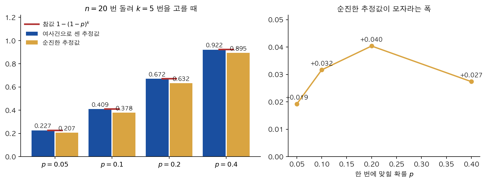
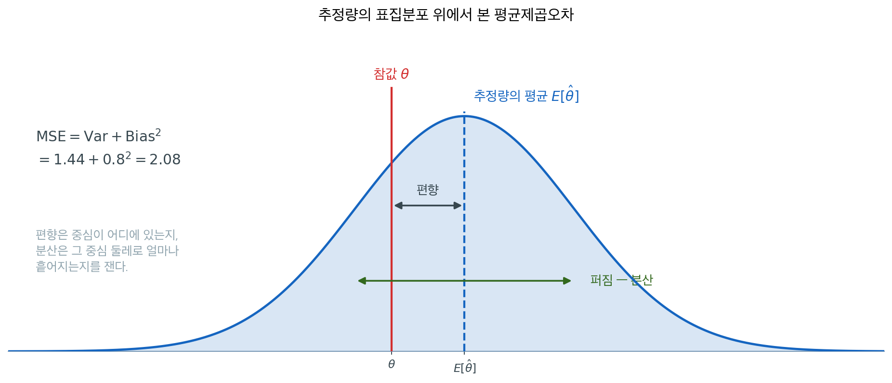
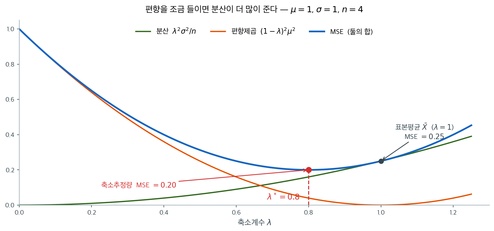
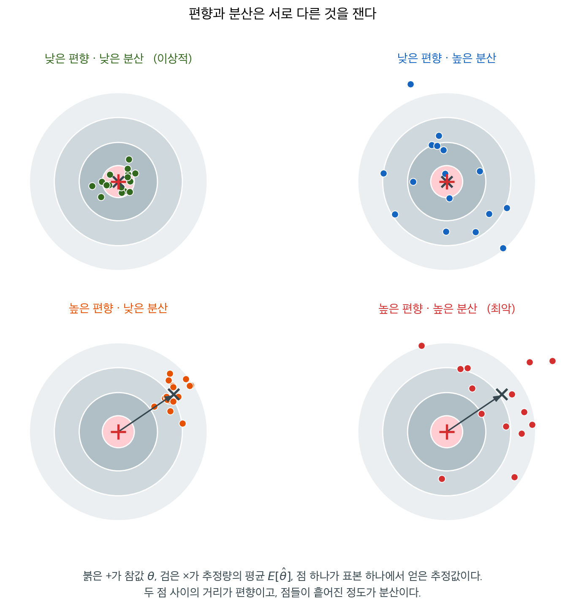
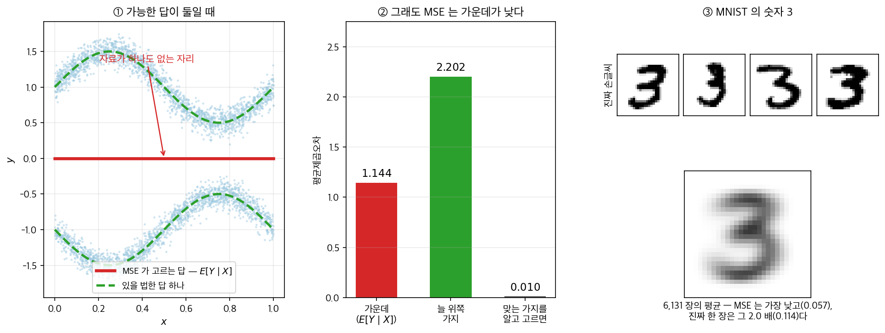

# 편향–분산 분해와 평균제곱오차

## 개요

모든 통계적 추정량은 근본적인 긴장에 놓인다. **단순함 대 유연함**이다. 단순한 추정량은 참 모수값을 체계적으로 빗나갈 수 있고(높은 편향), 유연한 추정량은 어떤 표본이 뽑혔느냐에 지나치게 민감할 수 있다(높은 분산). **편향–분산 맞바꿈**은 이 긴장을 형식화하며, 전체 추정오차를 최소화하려면 서로 경쟁하는 이 두 오차원을 균형 있게 다루어야 함을 드러낸다.

이 맞바꿈을 이해하는 것은 통계학, 기계학습, 계량금융 전반에서 추정량을 고르고 모형의 복잡도를 정하며 정칙화 전략을 설계하는 데 필수적이다.

---

## 1. 편향과 분산과 평균제곱오차

맞바꿈을 말하려면 맞바꿀 두 양을 먼저 따로 세워야 한다. 추정량이 참값에서 **체계적으로** 빗나가는 정도와, 표본이 바뀔 때 **요동치는** 정도다. 둘을 하나로 묶는 일은 다음 절에서 한다.


<div class="defn" markdown>

### 정의 1. 추정량의 편향 { .dfn }

$\hat{\theta}$를 확률표본 $X_1, X_2, \ldots, X_n$에 기반한 모수 $\theta$의 추정량이라 하자. $\hat{\theta}$의 **편향**은 다음과 같이 정의된다:

$$\text{Bias}(\hat{\theta}) = E[\hat{\theta}] - \theta$$

$\text{Bias}(\hat{\theta}) = 0$이면, 즉 $E[\hat{\theta}] = \theta$이면 추정량이 **불편**이라고 한다.

**핵심:**

- 편향은 참 모수로부터의 체계적 이탈을 잰다
- 불편추정량은 가능한 모든 표본에 걸쳐 "평균적으로" 옳다
- 편향은 양수(과대추정)일 수도 음수(과소추정)일 수도 있다
- 어떤 추정량은 유한표본에서는 편향되어 있지만 $n \to \infty$일 때 점근적으로 불편일 수 있다

</div>

<div class="aibox" markdown>

**AI로 보는 통계학 1.** 「한 번만 맞으면 된다」를 재는 법

「$k$ 번 가운데 적어도 한 번」은 반대쪽에서 세는 것이 쉽다. 시도마다 성공할 확률이 $p$ 이고 서로 독립이면 그 꼴이 바로

$$
1-(1-p)^{\,k}
$$

다. 요즘 언어모델의 **문제 풀이 성능**을 재는 자리에서 이 식이 그대로 쓰인다. 모델에게 한 문제를 한 번만 시키면 틀리기 쉬운데 **$k$ 번 시켜서 그중 하나만 맞으면 쓸모가 있는** 일이 많기 때문이다(코드 생성이 그렇다 — 돌려 보면 맞았는지 알 수 있다). 그래서 「$k$ 번 중 적어도 한 번 맞힐 확률」을 성능으로 삼는다.

문제는 $p$ 를 모른다는 것이다. 그래서 한 문제마다 $n$ 번 돌려 $c$ 번 맞은 것을 보고 추정하는데, 여기서 조합이 글자 그대로 쓰인다. $n$ 개 가운데 $k$ 개를 고르는 방법은 $\dbinom nk$ 가지이고, 그 $k$ 개가 **모두 틀린** 경우는 틀린 $n-c$ 개에서만 고르는 $\dbinom{n-c}{k}$ 가지다. 반대를 세어 빼면

$$
1-\frac{\dbinom{n-c}{k}}{\dbinom nk}
$$

가 된다. 성공률을 $c/n$ 으로 어림해 $1-(1-c/n)^{k}$ 에 그냥 넣는 쪽과 견주어 보자. 정의 1 이 재라고 하는 것, 곧 $E[\hat\theta]-\theta$ 를 두 추정량에 대해 각각 재어 보는 일이다.

```python
import numpy as np
from math import comb

rng = np.random.default_rng(20261005)
n, k, trials = 20, 5, 200_000          # 한 문제에 n 번 시켜 보고, 그중 k 번을 고른다

def 여사건(c):                          # 틀린 n-c 개에서만 k 개를 고르는 방법을 세어 뺀다
    return 1.0 - comb(n - c, k) / comb(n, k) if n - c >= k else 1.0

def 순진(c):                            # 성공률을 c/n 으로 보고 1-(1-p)^k 를 그대로 쓴다
    return 1.0 - (1.0 - c / n) ** k

print("   p     참값      여사건     순진")
for p in (0.05, 0.1, 0.2, 0.4):
    c = rng.binomial(n, p, size=trials)          # n 번 가운데 맞은 횟수
    print("%5.2f   %.5f   %.5f   %.5f"
          % (p, 1 - (1 - p) ** k,
             np.mean([여사건(x) for x in c]), np.mean([순진(x) for x in c])))
```

실행하면 다음이 나온다.

```text
   p     참값      여사건     순진
 0.05   0.22622   0.22655   0.20702
 0.10   0.40951   0.40950   0.37784
 0.20   0.67232   0.67209   0.63194
 0.40   0.92224   0.92165   0.89486
```

<figure markdown>
  { width=840 }
  <figcaption markdown>왼쪽 — 붉은 가로선이 참값이고, 여사건으로 센 추정값(파랑)은 그 선에 붙지만 순진한 추정값(주황)은 언제나 아래로 처진다. 오른쪽 — 모자라는 폭은 $p$ 가 $0.2$ 쯤일 때 가장 커서 $4$ 퍼센트포인트에 이른다.</figcaption>
</figure>

여사건으로 센 쪽은 참값과 소수 셋째 자리까지 맞고, 순진한 쪽은 **언제나 아래로 처진다.** 정의 1 의 말로 적으면 여사건 쪽은 불편이고 순진한 쪽은 **편향이 음수**다. 까닭은 $c/n$ 을 $p$ 자리에 넣은 뒤 $(1-\cdot)^k$ 라는 **굽은 함수**를 통과시켰기 때문이다 — 굽은 함수의 평균은 평균의 굽은 값과 같지 않고, 그 어긋남이 고스란히 편향이 된다. 세는 쪽으로 돌아가면 그 굽음을 지나지 않으므로 치우침이 생기지 않는다. 자료가 아니라 **식을 세우는 방식**이 편향을 만들어 낸 보기다.

다만 이 모든 것은 **$k$ 번의 시도가 서로 독립**이라야 한다. 같은 모델을 여러 번 돌리면 틀리는 방식까지 닮기 때문에 실제로는 독립이 아니고, 그만큼 이 수는 실제보다 후하게 나오기 쉽다. 숫자가 큰 것이 반드시 더 나은 모델을 뜻하지는 않는 까닭이 거기에 있다.

</div>

<div class="defn" markdown>

### 정의 2. 추정량의 분산 { .dfn }

추정량 $\hat{\theta}$의 **분산**은 표본이 달라질 때 그것이 얼마나 요동치는지를 잰다:

$$\text{Var}(\hat{\theta}) = E\left[(\hat{\theta} - E[\hat{\theta}])^2\right]$$

**핵심:**

- 분산은 어떤 표본이 뽑혔느냐에 대한 추정량의 민감도를 담아낸다
- 분산이 크다는 것은 표본마다 추정량이 크게 달라진다는 뜻이다
- 분산은 표본크기 $n$이 커질수록 대체로 줄어든다
- 표준편차 $\text{SD}(\hat{\theta}) = \sqrt{\text{Var}(\hat{\theta})}$를 **표준오차**라 부른다

</div>

두 양을 하나의 수로 합치는 자가 하나 더 필요하다.

<div class="defn" markdown>

### 정의 3. 평균제곱오차 { .dfn }

$\hat{\theta}$를 모수 $\theta$의 추정량이라 하자. **평균제곱오차**는:

$$\text{MSE}(\hat{\theta}) = E\left[(\hat{\theta} - \theta)^2\right]$$

이는 추정량과 참 모수의 차를 제곱한 값을 가능한 모든 표본에 걸쳐 평균한 것이다.

</div>

---

## 2. 정리: 편향–분산 분해

위의 세 정의를 하나로 묶는 것이 **편향–분산 분해**다.

<div class="thmbox" markdown>

### 정리 1. 편향–분산 분해 { .thm }

임의의 추정량 $\hat\theta$ 에 대해

$$
\text{MSE}(\hat{\theta}) = \operatorname{Var}(\hat{\theta}) + \bigl[\text{Bias}(\hat{\theta})\bigr]^2
$$

이다. 여기서 $\text{Bias}(\hat\theta) = E[\hat\theta] - \theta$ 다. 두 항이 모두 음이 아니므로

$$
\text{MSE}(\hat\theta) \ge \operatorname{Var}(\hat\theta),
\qquad
\text{MSE}(\hat\theta) \ge \bigl[\text{Bias}(\hat\theta)\bigr]^2
$$

이고, $\hat\theta$ 가 불편이면 $\text{MSE}(\hat\theta) = \operatorname{Var}(\hat\theta)$ 다.

</div>

??? proof "증명"

    $E[\hat\theta]$ 를 **끼워 넣고 빼는 것**이 전부다. $\mu_{\hat\theta} = E[\hat\theta]$ 라 두면

    $$
    \hat\theta - \theta = \underbrace{(\hat\theta - \mu_{\hat\theta})}_{\text{무작위 요동}} + \underbrace{(\mu_{\hat\theta} - \theta)}_{\text{상수 — 편향}}
    $$

    다. 제곱해 기댓값을 취하면 세 항이 나온다.

    $$
    E\bigl[(\hat\theta-\theta)^2\bigr]
    = E\bigl[(\hat\theta - \mu_{\hat\theta})^2\bigr]
    + 2(\mu_{\hat\theta}-\theta)\,\underbrace{E\bigl[\hat\theta - \mu_{\hat\theta}\bigr]}_{=\,0}
    + (\mu_{\hat\theta}-\theta)^2
    $$

    가운데 항이 **편차의 기댓값이 0 이라서** 사라진다. 둘째 항의 $(\mu_{\hat\theta}-\theta)$ 는 상수이므로 기댓값 밖으로 나올 수 있었다. 남은 두 항이 분산과 편향의 제곱이다. $\square$

    **2장에서 본 분해와 같은 꼴이다.** 평균이 제곱편차를 최소화한다는 정리([평균, 중앙값, 최빈값](../../ch02/center/mean_median_mode.md) 정리 1)가 $\sum(x_i-a)^2 = \sum(x_i-\bar x)^2 + n(\bar x - a)^2$ 를 주었는데, 여기서는 표본 대신 추정량의 표집분포 위에서 같은 일을 한다. **"중심에서 벗어난 만큼 제곱으로 손해"** 라는 구조가 되풀이된다.

추정량의 표집분포 위에 두 항을 표시하면 이 식이 무엇을 말하는지 한눈에 보인다.



두 항이 재는 것이 서로 다르다. **편향은 분포의 중심이 어디에 있는지**를 재므로 참값과 중심 사이의 거리 하나로 정해지고, **분산은 그 중심 둘레로 얼마나 흩어지는지**를 재므로 중심이 어디에 있든 상관이 없다. 그래서 한쪽이 0이어도 다른 쪽은 얼마든지 클 수 있다.

평균제곱오차는 이 둘을 하나의 수로 합친다. 합치는 방식이 **제곱의 합**이라는 점이 중요하다. 편향을 조금 늘리고 분산을 많이 줄이면 합이 줄어들 수 있다는 뜻이며, 이 가능성이 아래 절들이 다루는 **맞바꿈**의 출발점이다. 능형회귀·라소·축소추정량이 모두 그 틈을 노린다.


정리를 가장 간단한 추정량에 바로 걸어 보면 분해가 어떻게 쓰이는지 보인다.

<div class="exbox" markdown>

**보기 1.** <span class="diff med" title="중간"></span> 표본평균의 평균제곱오차. $X_1, \ldots, X_n$을 평균 $\mu$, 분산 $\sigma^2$인 i.i.d. 확률변수라 하자. 표본평균은 $\bar{X} = \frac{1}{n}\sum X_i$이다.

</div>

??? success "풀이"
    **편향:** $E[\bar{X}] = \mu$이므로 $\text{Bias}(\bar{X}) = 0$ (불편).

    **분산:** $\text{Var}(\bar{X}) = \sigma^2/n$.

    **MSE:** $\text{MSE}(\bar{X}) = 0 + \sigma^2/n = \sigma^2/n$.

이 쪽이 아래에서 쓰는 것은 결과 하나다. **두 항이 제곱으로 합쳐진다**는 것 — 그래서 한쪽을 조금 늘려 다른 쪽을 많이 줄이면 전체가 줄어들 수 있고, 뒤의 모든 이야기가 그 틈에서 나온다.

---

## 3. 실제로 작동하는 맞바꿈

### 왜 맞바꿈이 존재하는가

많은 추정 문제에서 편향을 줄이면 분산이 커지고 그 반대도 마찬가지이다:

| 전략 | 편향에 대한 효과 | 분산에 대한 효과 |
|----------|---------------|-------------------|
| 더 유연한 모형 | ↓ 감소 | ↑ 증가 |
| 더 경직된 모형 | ↑ 증가 | ↓ 감소 |
| 더 큰 표본크기 | ↓ 감소 (대체로) | ↓ 감소 |
| 정칙화 | ↑ 증가 | ↓ 감소 |

<div class="aibox" markdown>

**AI로 보는 통계학 2.** 대칭을 미리 알려 주면 배울 것이 줄어든다

위 표의 둘째 줄 — **더 경직된 모형** — 은 편향을 늘리고 분산을 줄인다고 적혀 있다. 그런데
경직의 내용이 **참인 성질**이면 편향이 늘지 않는다. 분산만 줄어든다. 맞바꿈이 아니라
공짜 이득이 되는 드문 자리이고, 이름이 붙어 있다 — **귀납 편향**이다.

적분에서 익숙한 보기로 들어가자. $\int_{-a}^{a}$ 에서 기함수의 적분값은 $0$ 이니 아예
계산할 것이 없고, 우함수이면 반쪽만 재서 두 배 하면 된다. 계산을 하기 전에 **대칭만 보고**
답의 절반을 미리 아는 수다. **이미 아는 성질을 식 안에 넣어 두면 할 일이 줄어든다** —
기계에게 무언가를 배우게 할 때도 똑같은 일이 일어난다.

사진을 알아보는 모형을 생각해 보자. 고양이 사진을 몇 칸 옆으로 옮겨도 고양이라는 것은
**우리가 미리 아는 사실**이다. 이 사실을 모형이 수많은 예에서 **스스로 배우게** 할 수도 있고,
처음부터 **구조에 박아 넣어** 옮겨도 답이 변하지 않게 만들 수도 있다. 뒤쪽을 고르면 배워야
할 것이 그만큼 줄어든다. 적분을 반으로 줄이는 것과 같은 절약이다.

얼마나 줄어드는지 작은 보기로 재어 보자. 참 함수를 **우함수**로 두고, 잡음 섞인 표본
몇 개로 다항식을 맞춘다. 한쪽은 모든 차수를 쓰고, 다른 쪽은 **짝수 차수만** 쓴다 — 우함수라는
사실을 식에 박아 넣은 것이다.

```python
import numpy as np

rng = np.random.default_rng(2026)           # 씨앗을 고정해 늘 같은 표가 나오게 한다
deg = 8                                     # 쓸 수 있는 가장 높은 차수
t   = np.linspace(-2, 2, 401)               # 오차를 재는 격자

f = lambda x: np.cos(2*x) + 0.5*x**2        # 참 함수 — 우함수다

def fit(x, y, even_only):
    """표본 (x, y) 로 다항식을 맞추고, 참 함수와의 차를 격자 t 위에서 잰다."""
    ks = list(range(0, deg+1, 2)) if even_only else list(range(deg+1))   # 쓸 차수
    w, *_ = np.linalg.lstsq(np.stack([x**k for k in ks], 1), y, rcond=None)
    err = np.stack([t**k for k in ks], 1) @ w - f(t)   # 격자 위의 오차
    return np.sqrt(np.mean(err**2)), dict(zip(ks, w))

print(' 자료 수   모든 차수를 쓴 모형   짝수 차수만 쓴 모형')
for n in (10, 15, 25, 50, 200):
    a, b = [], []
    for r in range(200):                    # 표본 한 벌에 휘둘리지 않게 200 번 되풀이
        x = rng.uniform(-2, 2, n)
        y = f(x) + 0.1*rng.standard_normal(n)         # 두 모형이 같은 표본을 본다
        ea, wa = fit(x, y, False)
        ee, _  = fit(x, y, True)
        a.append(ea); b.append(ee)
        if n == 25 and r == 0:
            kept = wa                       # 계수를 들여다볼 한 벌
    print(f'{n:6d}{np.median(a):20.4f}{np.median(b):20.4f}')   # 200 번의 가운데 값

print()
print('자료 25 개로 맞춘 「모든 차수」 모형이 배운 홀수 차수 계수 (참값은 모두 0)')
print('  ' + '  '.join(f'x^{k}: {kept[k]:+.3f}' for k in (1, 3, 5, 7)))
```

실행하면 다음이 나온다.

```text
 자료 수   모든 차수를 쓴 모형   짝수 차수만 쓴 모형
    10             12.1625              0.1332
    15              0.5973              0.0779
    25              0.1089              0.0496
    50              0.0534              0.0333
   200              0.0211              0.0154

자료 25 개로 맞춘 「모든 차수」 모형이 배운 홀수 차수 계수 (참값은 모두 0)
  x^1: +0.085  x^3: -0.439  x^5: +0.421  x^7: -0.094
```

자료가 열 개일 때 차이가 **아흔 배를 넘는다**($12.1625\div0.1332=91.3$). 그리고 까닭이 아래 줄에 그대로 보인다 —
모든 차수를 쓴 모형은 홀수 차수 계수를 **$0$ 이 아닌 값으로 배워 버렸다.** 참 함수가
우함수이니 그 값들은 전부 $0$ 이어야 하는데, 모형은 그것을 모르니 **잡음을 홀수 성분으로
읽은 것**이다. 적분의 말로 옮기면, 답에 아무 기여도 하지 않을 기함수 부분을 열심히
맞추고 앉아 있는 셈이다. 표본이 바뀌면 그 계수도 함께 바뀌니, 이것이 고스란히 **분산**이다.

자료가 많아지면 격차가 줄지만 사라지지는 않는다. 이백 개를 주어도 대칭을 아는 쪽이 여전히
낫다. **아는 것을 넣어 주면 자료가 그만큼 덜 든다**는 것이 요지이고, 자료를 모으는 데 값이
드는 일일수록 이 절약이 커진다. 위 표 셋째 줄이 말하는 「더 큰 표본크기」를 돈으로 사는
대신, 아는 성질을 공짜로 넣는 것이다.

다만 넣은 대칭이 **참이 아니면** 반대가 된다. 참 함수가 사실은 우함수가 아니었다면 짝수
차수만 쓰는 모형은 자료를 아무리 많이 주어도 영영 맞추지 못한다 — 틀린 성질을 박아 넣으면
**$n\to\infty$ 에서도 사라지지 않는 편향**이 남고, 배울 길 자체가 막힌다. 적분에서도
우함수가 아닌 것을 우함수로 보면 답이 틀리는 것과 같다. 그래서 **어떤 대칭이 참인지를 아는
것**이 모형을 설계하는 일의 대부분이 된다.

</div>

### 고전적인 예: 모평균 추정

$X_1, \ldots, X_n \sim N(\mu, \sigma^2)$로부터 $\mu$를 추정하는 경우를 생각하자.

**추정량 1: 표본평균** $\bar{X} = \frac{1}{n}\sum_{i=1}^n X_i$

- 편향: $E[\bar{X}] - \mu = 0$ (불편)
- 분산: $\text{Var}(\bar{X}) = \sigma^2/n$
- MSE: $\sigma^2/n$

**추정량 2: 축소추정량** $0 < \lambda < 1$에 대해 $\hat{\mu}_\lambda = \lambda \bar{X}$

- 편향: $E[\hat{\mu}_\lambda] - \mu = (\lambda - 1)\mu \neq 0$ (편향)
- 분산: $\text{Var}(\hat{\mu}_\lambda) = \lambda^2 \sigma^2/n$
- MSE: $\lambda^2 \sigma^2/n + (1-\lambda)^2 \mu^2$

어떤 $\lambda$ 값에서는 축소추정량이 편향되어 있음에도 불편인 표본평균보다 **평균제곱오차가 작을** 수 있다. 이것이 맞바꿈의 핵심이다. 작은 편향을 들여오면 분산을 크게 줄일 수 있고, 그 결과 추정의 정확도가 순전히 좋아진다.

### 최적의 축소

$\hat{\mu}_\lambda$의 평균제곱오차를 $\lambda$에 대해 최소화하면:

$$\frac{d}{d\lambda}\left[\lambda^2 \frac{\sigma^2}{n} + (1-\lambda)^2 \mu^2\right] = 0$$

$$2\lambda \frac{\sigma^2}{n} - 2(1-\lambda)\mu^2 = 0$$

$$\lambda^* = \frac{\mu^2}{\mu^2 + \sigma^2/n} = \frac{n\mu^2}{n\mu^2 + \sigma^2}$$

$|\mu|$가 $\sigma/\sqrt{n}$에 비해 작으면 최적의 $\lambda^*$가 1보다 상당히 작아지며, 이는 0 쪽으로 과감하게 축소하는 것이 최적임을 뜻한다.

$\lambda$를 가로축에 놓고 세 곡선을 함께 그리면 맞바꿈이 어디서 이득으로 바뀌는지 보인다.



$\lambda = 1$이 표본평균이다. 편향이 0이므로 주황 곡선이 바닥에 닿아 있고 평균제곱오차는 분산과 같다. 여기서 $\lambda$를 줄이면 주황 곡선이 올라가기 시작하지만 초록 곡선은 더 빨리 내려간다. **$\lambda = 1$ 근처에서 편향제곱은 $(1-\lambda)^2$으로 이차로 커지는 반면 분산은 $\lambda^2$으로 일차 비율만큼 줄기 때문이다.** 처음 한 걸음은 언제나 이득이라는 뜻이고, 그래서 불편추정량이 평균제곱오차에서 최적인 경우는 오히려 드물다.

두 힘이 균형을 이루는 곳이 $\lambda^*$이며, 이 예에서 평균제곱오차가 $0.25$에서 $0.20$으로 20% 줄어든다. 다만 $\lambda^*$가 참값 $\mu$에 의존한다는 점에 주의해야 한다. 실제로 쓰려면 그 값을 자료에서 추정해야 하고, 그 일을 다차원에서 해내는 것이 James–Stein 추정량이다.

---

## 4. 기하적 해석

편향–분산 맞바꿈에는 직관적인 기하적 그림이 있다:

- **편향** = 추정량 분포의 중심에서 참값까지의 거리(체계적 이동)
- **분산** = 추정량 분포의 퍼짐(무작위 산포)
- **MSE** = 추정량에서 참값까지의 평균 제곱거리

다트판에 비유하면 네 경우가 나온다.



- **낮은 편향, 낮은 분산**: 다트가 과녁 중심 주위에 모여 있다 (이상적)
- **낮은 편향, 높은 분산**: 다트가 흩어져 있지만 중심을 기준으로 퍼져 있다
- **높은 편향, 낮은 분산**: 다트가 모여 있지만 중심에서 벗어나 있다
- **높은 편향, 높은 분산**: 다트가 흩어져 있고 중심에서도 벗어나 있다 (최악)

이 그림에서 꼭 짚어야 할 것은 **왼쪽 위와 오른쪽 아래가 서로 다른 방식으로 나쁘다**는 점이다. 편향이 큰 쪽은 표본을 아무리 늘려도 중심이 제자리로 돌아오지 않는다. 반면 분산이 큰 쪽은 같은 절차를 여러 번 되풀이해 평균을 내면 중심 쪽으로 모인다. 그래서 자료를 더 모으는 일은 분산에는 약이 되지만 편향에는 약이 되지 않는다.

평균제곱오차는 이 두 가지 나쁨을 하나의 수로 합친 것이므로, 어느 쪽이 얼마나 나쁜지는 분해해 보아야 알 수 있다.

---

## 5. 모형 선택에 대한 함의

### 과소적합과 과적합

편향–분산 맞바꿈은 과소적합과 과적합 개념과 직접 연결된다:

- **과소적합** (높은 편향): 모형이 너무 단순해서 참 관계를 담아내지 못한다. 모형의 복잡도를 높이면 편향이 줄지만 분산이 커질 수 있다.
- **과적합** (높은 분산): 모형이 훈련 자료의 잡음까지 적합한다. 복잡도를 낮추거나 정칙화를 더하면 분산이 줄지만 편향이 커질 수 있다.

### "U자 모양"의 MSE 곡선

모형의 복잡도가 커질수록:

1. 편향은 단조 감소한다 (더 유연한 모형이 참값을 더 잘 근사한다)
2. 분산은 단조 증가한다 (더 유연한 모형이 자료에 더 민감하다)
3. MSE는 처음에는 감소하다가(편향 감소가 우세) 최솟값에 이른 뒤 증가한다(분산이 우세)

최적의 복잡도는 편향과 분산의 균형을 맞추는 MSE 최솟값에 있다.

다만 이 $U$ 자가 언제나 끝까지 오르기만 하는 것은 아니다. 모수 수가 표본 크기를 한참 넘어서면 오차가 **다시 내려간다** — 18.1절 [과적합과 편향-분산 절충](../../ch18/motivation/overfitting.md)의 「AI로 보는 통계학 2」가 그 **이중 하강**을 수로 재고, 가로축을 모수 개수 대신 계수의 노름으로 바꾸어 놓으면 맞바꿈이 멀쩡히 살아 있다는 것까지 보인다.

---

## 6. MSE 를 자로 쓸 때

분해는 두 항을 가려 보여 주지만, 추정량 **둘을 견주는** 데 쓰려면 몇 가지를 더 알아야 한다.

**불편이면 MSE 가 곧 분산이다.** $\text{Bias}(\hat\theta) = 0$ 이면 분해의 둘째 항이 사라져 $\text{MSE}(\hat\theta) = \operatorname{Var}(\hat\theta)$ 다. 그래서 **불편추정량끼리는** MSE 로 견주는 것과 분산으로 견주는 것이 같은 일이고, 편향을 허용하는 순간에만 둘이 갈린다.

**MSE 곡선은 교차할 수 있다.** $\text{MSE}(\hat\theta)$ 는 $\theta$ 의 함수이므로, 어떤 $\theta$ 에서는 이쪽이 낫고 다른 $\theta$ 에서는 저쪽이 나을 수 있다. 「어느 추정량이 더 낫다」는 말이 $\theta$ 를 지정하지 않으면 뜻이 불완전하다는 뜻이다.

**분모를 고르는 문제가 가장 깔끔한 보기다.** $\hat\sigma^2_c = \frac1c\sum(X_i-\bar X)^2$ 에서 $c$ 를 바꾸면 편향과 분산이 함께 움직인다. 5.13절 [분산추정량의 평균제곱오차](../variance/mse_comparison.md)가 $c^{*} = n+1$ 을 유도하고 흔히 쓰는 세 분모를 한 표에 모은다 — **불편성이 언제나 최선의 기준이 아니라는 것**이 그 표의 요점이다.

세 가지는 임자 쪽이 따로 있다. **상대효율**로 추정량을 줄 세우는 일은 5.12절 [표본평균의 효율성](../mean/efficiency.md)이, **허용성과 James–Stein 현상**과 **Cramér–Rao 하한**은 7장 [효율성과 Cramér-Rao 하한](../../ch07/theory/efficiency_crlb.md)이, **평균제곱오차 일치성**은 5.12절 [표본평균의 편향과 일치성](../mean/bias_consistency.md)이 다룬다.

### 제곱손실이라는 선택

MSE 는 손실함수를 **제곱**으로 고른 결과다. 절댓값손실을 쓰면 최적해가 평균에서 중앙값으로 옮겨 가고(13장 [회귀 성능 척도](../../ch13/performance/metrics.md)가 MAE 를 다룬다), 의사결정이론에서는 같은 양을 제곱오차 손실 아래의 **위험**이라 부른다. 고른 손실이 답을 정한다는 것을 아래 상자가 그림으로 보인다.

<div class="aibox" markdown>

**AI로 보는 통계학 3.** MSE 가 고르는 답은 「그럴듯한 답」이 아니다

이 절이 손실함수를 바꾸면 최적해가 바뀐다고 적는다 — 제곱손실의 답은 평균이고,
절댓값손실의 답은 중앙값이다. 예측 문제에서 그 문장을 다시 쓰면 이렇다. 입력 $X$ 를
보고 $Y$ 를 맞힐 때 MSE 를 가장 작게 만드는 답은 **조건부 평균** $E[Y \mid X]$ 다.

평균이 늘 그럴듯한 값은 아니다. **가능한 답이 여럿이면 그 평균은 어느 것도 아니다.**



**① 가능한 답이 둘일 때.** $y = \pm(1 + 0.5\sin 2\pi x) + \varepsilon$ 로 자료를 만들었다.
$x$ 를 알아도 $y$ 는 위 가지와 아래 가지 가운데 어느 쪽인지 알 수 없다. 조건부 평균은
$0$ 이고, 붉은 선이 그것이다 — **관측값이 $0.3\%$ 밖에 없는 자리**를 지나간다.

**② 그래도 MSE 는 그쪽이 낮다.**

| 예측 | 평균제곱오차 |
|---|---|
| 가운데 ($E[Y\mid X]$) | $\mathbf{1.144}$ |
| 늘 위쪽 가지 — 언제나 그럴듯한 값 | $2.202$ |
| 맞는 가지를 알고 고르면 | $0.010$ |

**있을 법한 답을 내면 벌이 두 배다.** MSE 로 훈련하면 모형은 당연히 가운데를 배운다.

**③ 그래서 흐릿하다.** 같은 일이 그림에서 눈에 보인다. MNIST 의 숫자 $3$ 을 $6{,}131$ 장
모아 평균을 내면

| 답으로 내는 것 | 평균제곱오차 |
|---|---|
| $6{,}131$ 장의 평균 그림 | $\mathbf{0.057}$ |
| 진짜 손글씨 한 장 | $0.114$ ($2.00$ 배) |

정확히 두 배다 — 두 표본의 차의 분산이 분산의 두 배이기 때문이다. **MSE 로 재면
평균 그림이 어떤 진짜 손글씨보다도 낫다.** 그런데 그 그림은 화소의 $30.6\%$ 가
어중간한 회색이다. 어떤 손글씨에도 없는 값이고, 그것이 **흐릿함의 정체**다.

**읽을 것.** 영상 복원이나 다음 프레임 예측을 MSE 로 훈련하면 결과가 흐릿해진다는
것은 잘 알려져 있는데, 까닭이 모형의 부족이 아니다. **손실함수가 시킨 대로 한
것이다.** $\S 2$ 의 분해로 말하면, 답이 여럿일 때 그 흩어짐은 모형이 줄일 수 있는
분산이 아니라 $Y$ 자체의 조건부 분산이고, 제곱손실은 그것을 **평균으로 뭉개는 것** 말고
달리 다룰 방법이 없다.

그래서 생성모형은 조건부 평균을 내놓는 대신 **조건부 분포에서 뽑는다.** 손실을 바꾸는
것이 아니라 묻는 것을 바꾸는 쪽이다 — 「평균이 얼마인가」 대신 「무엇이 나올 수
있는가」. 위 표가 손실마다 다른 답을 적어 두었듯, **무엇을 최적화하는지가
무엇을 얻는지를 정한다.**

_확인한 곳 — ①②의 수는 직접 모의실험한 값이다 · ③은 `data/MNIST/raw` 의 훈련 영상 $60{,}000$ 장에서 이름표가 $3$ 인 $6{,}131$ 장을 골라 직접 계산했다. MNIST 자료 자체는 저장소에 담지 않는다_

</div>

---

## 7. 금융과의 연결

계량금융에서 편향–분산 맞바꿈은 여러 맥락에서 나타난다:

- **포트폴리오 최적화**: 표본 공분산행렬(불편)과 축소추정량(편향되지만 분산이 작음) 중에서 고르는 문제이다. Ledoit-Wolf 축소추정량이 유명한 응용이다.
- **요인 모형**: 요인 개수를 정하는 문제이다. 너무 적으면 편향이 크고, 너무 많으면 추정된 적재값의 분산이 커진다.
- **변동성 추정**: EWMA(최근 자료 쪽으로 편향)와 역사적 변동성(불편이지만 분산이 큼) 사이의 선택이다.
- **위험 예측**: 더 복잡한 VaR 모형은 편향이 작을 수 있지만, 특히 자료가 제한적일 때 추정 분산이 커진다.
- **예측 평가**: 수익률·변동성·위험 예측을 견주는 표준 지표다. $\text{RMSE} = \sqrt{\text{MSE}}$ 는 오차를 대상과 같은 단위로 돌려 준다.
- **모형 보정**: 모형이 함의하는 옵션 가격과 시장 가격 사이의 평균제곱오차가 변동성 모형 보정의 목적함수가 된다.

## 8. 주요 공식

| 양 | 공식 |
|----------|---------|
| 편향 | $\text{Bias}(\hat{\theta}) = E[\hat{\theta}] - \theta$ |
| 분산 | $\text{Var}(\hat{\theta}) = E[(\hat{\theta} - E[\hat{\theta}])^2]$ |
| MSE 분해 | $\text{MSE} = \text{Var}(\hat{\theta}) + [\text{Bias}(\hat{\theta})]^2$ |
| 불편 조건 | $E[\hat{\theta}] = \theta$ |
| MSE | $E[(\hat{\theta} - \theta)^2]$ |
| $\bar{X}$ 의 MSE | $\sigma^2/n$ |
| 상대효율 | $\text{MSE}(\hat\theta_2)/\text{MSE}(\hat\theta_1)$ |

---

## 연습문제

<div class="drillbox" markdown>

**연습문제 1.** <span class="diff med" title="중간"></span>
$\hat\theta$가 불편이고 $\mathrm{Var}(\hat\theta) = 0$이면 거의 확실하게 $\hat\theta = \theta$임을 증명하라.

</div>

??? success "풀이"
    $\mathrm{Var}(\hat\theta) = 0 \Rightarrow \hat\theta$는 퇴화되어 있다(거의 확실하게 상수이다). 이 상수를 $c$라 하자.

    불편성에 의해 $\mathbb{E}[\hat\theta] = \theta$이다. 그런데 $\mathbb{E}[c] = c$이므로 $c = \theta$이다.

    따라서 거의 확실하게 $\hat\theta = \theta$이다. $\square$

    이는 $\theta$가 퇴화되어 있지 않은 한 유한한 자료로 완벽하게 추정하는 것이 불가능함을 뜻한다. 어느 정도의 분산은 피할 수 없다.

---

<div class="drillbox" markdown>

**연습문제 2.** <span class="diff med" title="중간"></span>
**평균제곱오차가 더 작은 편향추정량.** $N(\mu, \sigma^2)$ 자료에 대해 $\hat\sigma^2_{\mathrm{MLE}} = (1/n)\sum(X_i - \bar X)^2$과 $s^2 = (1/(n-1))\sum(X_i - \bar X)^2$을 비교하라. 각각의 평균제곱오차를 계산하라.

</div>

??? success "풀이"
    $s^2$은 불편이다: $\mathbb{E}[s^2] = \sigma^2$, $\mathrm{Var}(s^2) = 2\sigma^4/(n-1)$, $\mathrm{MSE} = 2\sigma^4/(n-1)$.

    $\hat\sigma^2_{\mathrm{MLE}} = ((n-1)/n) s^2$: $\mathbb{E}[\hat\sigma^2] = (n-1)\sigma^2/n$이므로 편향 = $-\sigma^2/n$.

    $\mathrm{Var}(\hat\sigma^2_{\mathrm{MLE}}) = ((n-1)/n)^2 \cdot 2\sigma^4/(n-1) = 2(n-1)\sigma^4/n^2$.

    $\mathrm{MSE}(\hat\sigma^2_{\mathrm{MLE}}) = 2(n-1)\sigma^4/n^2 + \sigma^4/n^2 = (2n-1)\sigma^4/n^2$.

    **비:** 모든 $n \ge 2$에서 $\mathrm{MSE}_{\mathrm{MLE}}/\mathrm{MSE}_{s^2} = (2n-1)(n-1)/(2n^2) < 1$이다.

    MLE는 편향되어 있음에도 평균제곱오차가 *더 작다*. 편향–분산 맞바꿈의 교과서적인 예이다.

---

<div class="drillbox" markdown>

**연습문제 3.** <span class="diff med" title="중간"></span>
**점근적 불편성.** 점근적으로는 불편이지만 유한표본에서는 편향된 추정량을 정의하고 예를 들라.

</div>

??? success "풀이"
    **점근적으로 불편:** $n \to \infty$일 때 $\mathrm{Bias}(\hat\theta_n) \to 0$이다.

    **예:** $N(\mu, \sigma^2)$에서 $\sigma^2$의 MLE. 편향이 $-\sigma^2/n \to 0$이다. 유한한 $n$에서는 편향되어 있지만 $n$이 크면 그 크기가 사라진다.

    점근분산이 유한한 일치추정량은 *평균의 의미에서* 모두 점근적으로 불편이다. 그 역은 정확히 성립하지는 않는다. 점근적 불편성에 분산의 유계성이 더해지면 Chebyshev에 의해 일치성이 따라 나온다.

    **왜 중요한가:** 점근적 불편성은 약한 조건이어서 "나쁜" 추정량도 점근적으로 불편인 경우가 많다. 의미 있는 점근적 보장을 얻으려면 올바른 속도의 점근정규성이라는 더 강한 조건이 필요하다.

---

<div class="drillbox" markdown>

**연습문제 4.** <span class="diff med" title="중간"></span>
**편향 보정.** $X \sim N(\mu, \sigma^2)$에서 $\sigma$(표준편차)의 MLE는 $\hat\sigma_{\mathrm{MLE}} = \sqrt{(1/n)\sum(X_i - \bar X)^2}$이다. $\mathbb{E}[\hat\sigma_{\mathrm{MLE}}] < \sigma$임을 보이고 편향 보정을 제시하라.

</div>

??? success "풀이"
    $\hat\sigma^2_{\mathrm{MLE}} \sim (\sigma^2/n) \chi^2_{n-1}$일 때 $\hat\sigma_{\mathrm{MLE}} = \sqrt{\hat\sigma^2_{\mathrm{MLE}}}$이다.

    (오목함수 $\sqrt{\cdot}$에 대한) Jensen 부등식에 의해 $\mathbb{E}[\sqrt{\hat\sigma^2_{\mathrm{MLE}}}] \le \sqrt{\mathbb{E}[\hat\sigma^2_{\mathrm{MLE}}]} = \sigma\sqrt{(n-1)/n}$이다. 퇴화된 경우가 아니면 부등호가 엄격하다.

    더 정확히는 $\mathbb{E}[\hat\sigma_{\mathrm{MLE}}] = \sigma \sqrt{2/n} \Gamma(n/2)/\Gamma((n-1)/2)$이다.

    **편향 보정:** $c_n = \sqrt{2/n} \Gamma(n/2)/\Gamma((n-1)/2)$일 때 $\hat\sigma_{\mathrm{corrected}} = \hat\sigma_{\mathrm{MLE}}/c_n$으로 둔다.

    $n$이 크면 $c_n \approx \sqrt{(n-1)/n}$이므로 보정계수는 $\approx \sqrt{n/(n-1)}$이다. 1차 근사에서는 $\hat\sigma$ 대신 $s$를 쓰는 것과 같다.

    관리도 상수에 사용된다(예: Shewhart $\bar X$ 관리도의 $c_4$).

---

<div class="drillbox" markdown>

**연습문제 5.** <span class="diff med" title="중간"></span>
예측모형에서 말하는 **편향-분산 분해**는 추정량의 분해와 무엇이 다른가? 예측오차를

$$
E\left[\left(Y-\hat f(x_0)\right)^2\right] = \sigma^2 + \operatorname{Bias}^2\{\hat f(x_0)\} + \operatorname{Var}\{\hat f(x_0)\}
$$

로 분해하고 각 항을 해석하라.

</div>

??? success "풀이"
    참 관계를 $Y = f(x)+\varepsilon$, $E[\varepsilon]=0$, $\operatorname{Var}(\varepsilon)=\sigma^2$이라 하자. 새 관측 $Y_0 = f(x_0)+\varepsilon_0$을 예측한다.

    $\varepsilon_0$이 훈련자료와 독립이므로

    $$
    E\left[(Y_0-\hat f(x_0))^2\right] = \underbrace{\sigma^2}_{\text{줄일 수 없음}} + E\left[\left(f(x_0)-\hat f(x_0)\right)^2\right]
    $$

    이고, 둘째 항에 추정량의 분해를 적용하면 편향 제곱과 분산이 나온다. $\square$

    **추정량 분해와의 차이.**

    | | 추정량의 MSE | 예측오차 |
    |---|---|---|
    | 항 | 편향$^2$ + 분산 | **$\sigma^2$** + 편향$^2$ + 분산 |
    | 목표 | 고정된 모수 $\theta$ | 확률변수 $Y_0$ |
    | 하한 | 0에 접근 가능 | $\sigma^2$ 아래로 못 감 |

    **$\sigma^2$가 추가된 것이 핵심**이다. 모형이 아무리 완벽해도($\hat f = f$) 예측오차가 $\sigma^2$ 아래로 내려가지 않는다. 이를 **줄일 수 없는 오차**라 하며, 예측 성능의 상한이 자료 자체에 의해 정해져 있다는 뜻이다.

    **실무적 함의.**

    - 예측 $R^2$이 0.6에 머문다고 모형이 나쁜 것이 아니다. $\sigma^2$이 크면 그것이 최선일 수 있다.
    - 훈련오차는 $\sigma^2$보다 작아질 수 있다(잡음까지 맞추므로). **훈련오차가 $\sigma^2$보다 작다는 것이 과적합의 정의에 가깝다.**
    - 모형 복잡도를 올리면 편향은 줄고 분산은 는다. 그 합이 최소가 되는 지점이 최적 복잡도이며, 교차검증이 찾는 것이 바로 그 지점이다.

---

<div class="drillbox" markdown>

**연습문제 6.** <span class="diff med" title="중간"></span>
$k$-최근접이웃 회귀에서 $k$가 커질수록 편향과 분산이 어떻게 변하는지 유도하고, 최적 $k$가 $n$과 함께 어떻게 커져야 하는지 논하라.

</div>

??? success "풀이"
    $x_0$의 $k$개 최근접이웃을 $x_{(1)},\dots,x_{(k)}$라 하면

    $$
    \hat f(x_0) = \frac1k\sum_{j=1}^k y_{(j)}
    $$

    **분산.** 잡음이 독립이므로

    $$
    \operatorname{Var}\{\hat f(x_0)\} = \frac{\sigma^2}{k}
    $$

    $k$가 커질수록 **줄어든다.**

    **편향.**

    $$
    \operatorname{Bias} = \frac1k\sum_j f(x_{(j)}) - f(x_0)
    $$

    $k$가 커지면 더 먼 이웃까지 평균에 들어오므로 $f$가 곡선이면 편향이 **커진다.** 1차원에서 이웃까지의 거리가 대략 $k/n$에 비례하므로, $f$가 매끄러우면

    $$
    |\operatorname{Bias}| \approx O\!\left(\left(\frac kn\right)^2\right)
    $$

    이다(2계 테일러 항).

    **최적 $k$.** 예측오차의 줄일 수 있는 부분이

    $$
    \left(\frac kn\right)^4 + \frac{\sigma^2}{k}
    $$

    꼴이므로 $k$로 미분해 0으로 두면 $k^5 \propto n^4$, 즉

    $$
    k^* \propto n^{4/5}
    $$

    이다. 그때 예측오차의 줄일 수 있는 부분이 $O(n^{-4/5})$로 줄어든다.

    **읽는 법.**

    - **$k$는 $n$과 함께 커져야 하되 $n$보다 느리게 커야 한다.** $k$를 고정하면 분산이 줄지 않아 일치성이 없고, $k=n$으로 두면 전체 평균이 되어 편향이 남는다.
    - $k/n \to 0$과 $k \to \infty$가 일치성의 조건이며, 커널 회귀의 띠폭 조건과 같은 형태다.
    - **차원의 저주.** $d$차원에서는 이웃까지의 거리가 $(k/n)^{1/d}$에 비례하므로 편향이 $O((k/n)^{2/d})$가 되고, 최적 수렴 속도가 $O(n^{-4/(4+d)})$로 급격히 나빠진다. $d=10$이면 $n^{-2/7}$로, 같은 정밀도를 얻으려면 표본이 천문학적으로 필요하다.

---

<div class="drillbox" markdown>

**연습문제 7.** <span class="diff med" title="중간"></span>
정칙화(능형회귀)가 편향-분산 맞바꿈을 어떻게 조절하는지 설명하라. 벌점 $\lambda$가 0에서 $\infty$로 갈 때 편향과 분산의 극한을 적어라.

</div>

??? success "풀이"
    능형 추정량은

    $$
    \hat{\boldsymbol\beta}_\lambda = (X^\top X+\lambda I)^{-1}X^\top\mathbf{y}
    $$

    이다. $X^\top X = \sum_j d_j^2\mathbf{v}_j\mathbf{v}_j^\top$(고유분해)로 쓰면 각 방향의 계수가

    $$
    \frac{d_j^2}{d_j^2+\lambda}
    $$

    배로 **축소**된다. 분산이 작은 방향($d_j$가 작은 방향)일수록 강하게 눌린다.

    **편향.**

    $$
    E[\hat{\boldsymbol\beta}_\lambda] = (X^\top X+\lambda I)^{-1}X^\top X\boldsymbol\beta
    $$

    이므로 $\lambda>0$이면 편향이 있고, $\lambda$와 함께 커진다.

    **분산.**

    $$
    \operatorname{Var}(\hat{\boldsymbol\beta}_\lambda) = \sigma^2(X^\top X+\lambda I)^{-1}X^\top X(X^\top X+\lambda I)^{-1}
    $$

    각 방향의 분산이 $\sigma^2 d_j^2/(d_j^2+\lambda)^2$로 $\lambda$와 함께 **줄어든다.**

    **극한.**

    | $\lambda$ | 편향 | 분산 | 추정량 |
    |---|---|---|---|
    | $0$ | 0 | 최대 | 최소제곱 |
    | $\infty$ | 최대($-\boldsymbol\beta$) | 0 | $\mathbf{0}$ |

    **핵심 결과.** 어떤 $\lambda>0$에서는 능형이 최소제곱보다 **평균제곱오차가 반드시 작다**는 것이 증명되어 있다. 즉 $\lambda=0$이 결코 최적이 아니다. 다중공선성이 있어 $d_j$가 작은 방향이 존재하면 이득이 특히 크다.

    **$\lambda$를 어떻게 고르는가.** 교차검증이 표준이다. 유효 자유도

    $$
    \text{df}(\lambda) = \sum_j \frac{d_j^2}{d_j^2+\lambda}
    $$

    를 복잡도의 척도로 삼으면, $\lambda$를 바꾸는 것이 모형 복잡도를 **연속적으로** 조절하는 일임이 분명해진다. 변수를 넣고 빼는 이산적 선택보다 부드럽고 안정적이다.

---

<div class="drillbox" markdown>

**연습문제 8.** <span class="diff med" title="중간"></span>
편향과 분산을 자료에서 **따로 추정할 수 있는가**? 할 수 있는 경우와 없는 경우를 구분하고, 모의실험으로 확인하는 방법을 적어라.

</div>

??? success "풀이"
    **일반적으로는 할 수 없다.** 편향은 $E[\hat\theta]-\theta$인데 **참값 $\theta$를 모르기 때문**이다. 자료 하나에서 편향과 분산을 분리해 내는 것은 원리적으로 불가능하다. 관측되는 것은 둘의 합(MSE)의 한 실현값뿐이다.

    **할 수 있는 경우.**

    - **모의실험.** 참값을 우리가 정하므로 둘을 정확히 분리할 수 있다.

      ```python
      # verify: noexec — 골격이다. simulate 와 estimate 는 독자가 재는 추정량이고
      # theta_true 와 B 는 독자가 정하는 것이라 이 자리에는 없다.
      thetas = [estimate(simulate(theta_true)) for _ in range(B)]
      bias = np.mean(thetas) - theta_true
      var  = np.var(thetas, ddof=1)
      mse  = np.mean((np.array(thetas) - theta_true)**2)
      # 확인: mse ≈ bias**2 + var
      ```

      이것이 새 추정량을 평가하는 표준적인 방법이다.

    - **이론적으로 편향을 알 때.** $E[\hat\sigma^2_{\text{MLE}}] = \frac{n-1}{n}\sigma^2$처럼 편향의 공식을 알면, $\hat\sigma^2$을 대입해 편향을 추정하고 보정할 수 있다. 잭나이프와 부트스트랩은 이 발상을 일반화해 **편향을 자료에서 추정**한다.

      $$
      \widehat{\text{Bias}}_{\text{boot}} = \frac1B\sum_b \hat\theta^*_b - \hat\theta
      $$

      부트스트랩 세계에서 "참값" 역할을 $\hat\theta$가 맡는다. 다만 이 추정 자체에 잡음이 있어, 보정하면 편향은 줄지만 분산이 늘 수 있다.

    - **분산만 따로.** 분산은 참값을 몰라도 추정할 수 있다. 표준오차 공식, 부트스트랩, 잭나이프가 모두 분산을 겨냥한다. **편향과 분산 중 분산 쪽이 훨씬 다루기 쉽다**는 것이 실무의 현실이다.

    **예측 문제에서는 사정이 낫다.** 참 $f$를 몰라도 **총 예측오차**는 교차검증이나 검증셋으로 추정할 수 있다. 편향과 분산을 따로 알 필요 없이 그 합만 최소로 하면 되므로, 모형 선택의 목적에는 충분하다. 이것이 교차검증이 그토록 널리 쓰이는 이유다.

---

<div class="drillbox" markdown>

**연습문제 9.** <span class="diff hard" title="어려움"></span>
**분산과 일치성.** 편향이 0이지만 분산이 무한한 추정량의 예와, 분산은 유한하지만 일치하지 않는 추정량의 예를 각각 들라.

</div>

??? success "풀이"
    **편향 0, 분산 무한:** 코시분포에서 $\hat\mu = X_1$. 평균은 정의되지 않지만 중앙값은 $\mu$이다. 더 일반적으로는 코시 형태의 모형에서 얻은 MLE가 점근적으로는 불편이면서 분산이 무한할 수 있다.

    **분산 유한, 일치하지 않음:** i.i.d. $X_i \sim N(\theta, 1)$에서 $\theta$를 추정할 때 $\hat\theta = X_1$. 언제나 관측값 하나만 사용한다. 모든 $n$에 대해 분산이 1이고 0으로 가지 않는다. 따라서 일치하지 않는다($\hat\theta$가 $\theta$로 확률수렴하지 않는다).

    **교훈:** 일치성을 가지려면 추정량이 커지는 표본크기를 "활용"해야 한다. $\hat\theta = X_1$은 $n$과 무관하게 첫 관측값을 제외한 모든 것을 무시한다.

---

**연습문제 10.** <span class="diff med" title="중간"></span>
$X_i \sim \mathrm{Uniform}(0, \theta)$가 i.i.d.이다. 두 추정량 $\hat\theta_1 = 2\bar X$와 $\hat\theta_2 = ((n+1)/n) X_{(n)}$을 생각하자. (a) 둘 다 불편인가? (b) 분산은? (c) 어느 쪽이 평균제곱오차가 더 작은가?

</div>

??? success "풀이"
    (a) $\mathbb{E}[X] = \theta/2$이므로 $\mathbb{E}[\hat\theta_1] = \theta$이다.

    $\mathbb{E}[X_{(n)}] = n\theta/(n+1)$이므로 $\mathbb{E}[\hat\theta_2] = ((n+1)/n) \cdot n\theta/(n+1) = \theta$이다.

    둘 다 불편이다. ✓

    (b) $\mathrm{Var}(\hat\theta_1) = 4 \mathrm{Var}(\bar X) = 4 \theta^2/(12n) = \theta^2/(3n)$.

    $\mathrm{Var}(X_{(n)}) = n\theta^2/[(n+1)^2(n+2)]$이므로 $\mathrm{Var}(\hat\theta_2) = \theta^2/[n(n+2)]$.

    (c) 둘 다 불편이므로 MSE = 분산이다. $\hat\theta_2$의 분산은 $\theta^2/[n(n+2)] = O(1/n^2)$이고 $\hat\theta_1$은 $\theta^2/(3n) = O(1/n)$이다.

    **모든 $n \ge 2$에서 $\hat\theta_2$의 평균제곱오차가 더 작으며, 수렴 속도도 (초)선형으로 더 빠르다.** 주목할 만한 예이다. (최댓값에 기반한) MLE 계열 추정량이 $\sqrt n$ 일치가 아니라 $n$ 일치이다. 균등분포의 끝점을 다룰 때는 표본 극단값이 표본평균보다 훨씬 많은 정보를 담는다.

<div class="drillbox" markdown>

**연습문제 11.** <span class="diff med" title="중간"></span>
**$S^2$의 평균제곱오차 최적 척도.** $X_i \sim N(\mu, \sigma^2)$에서 $c \sum(X_i - \bar X)^2$ 형태의 $\sigma^2$ 추정량 중 평균제곱오차를 최소화하는 $c$를 구하라.

</div>

??? success "풀이"
    $T = \sum(X_i - \bar X)^2$이라 하자. 그러면 $T \sim \sigma^2 \chi^2_{n-1}$이므로 $\mathbb{E}[T] = (n-1)\sigma^2$, $\mathrm{Var}(T) = 2(n-1)\sigma^4$이다.

    $\hat\sigma^2_c = c T$에 대해:

    $\mathbb{E}[\hat\sigma^2_c] = c(n-1)\sigma^2$, $\mathrm{Bias} = (c(n-1) - 1)\sigma^2$, $\mathrm{Var} = 2 c^2 (n-1) \sigma^4$.

    $\mathrm{MSE}(c) = 2 c^2(n-1) \sigma^4 + (c(n-1) - 1)^2 \sigma^4$.

    최소화하면: $d \mathrm{MSE}/dc = 4c(n-1)\sigma^4 + 2(c(n-1) - 1)(n-1)\sigma^4 = 0$.

    $4c + 2(c(n-1) - 1) = 0 \Rightarrow 2c + c(n-1) = 1 \Rightarrow c(n+1) = 1 \Rightarrow c^* = 1/(n+1)$.

    따라서 **$\hat\sigma^2_{\text{MSE}} = (1/(n+1))\sum(X_i - \bar X)^2$**이 평균제곱오차를 최소화한다. MLE($c = 1/n$)와 불편추정량($c = 1/(n-1)$) 사이에 있으면서 더 큰 분모, 즉 더 강한 축소 쪽으로 기울어 있다.

    "불편"인 $s^2$의 해석이 더 깔끔하기 때문에 실무에서 잘 쓰이지는 않는다. 다만 평균제곱오차가 최적인 추정량이 MLE와도 불편추정량과도 다를 수 있음을 보여 준다.

<div class="drillbox" markdown>

**연습문제 12.** <span class="diff med" title="중간"></span>
**편향추정량의 평균제곱오차.** $\hat\theta$가 편향되어 있고 $\mathbb{E}[\hat\theta] = \theta + b/n$, $\mathrm{Var}(\hat\theta) = v/n$이다. 평균제곱오차와 그 점근 거동을 구하라.

</div>

??? success "풀이"
    $\mathrm{MSE} = \mathrm{Var} + \mathrm{Bias}^2 = v/n + b^2/n^2$.

    $n$이 크면 $\mathrm{MSE} \approx v/n + O(1/n^2)$이다. 분산이 지배하고 편향은 저차항으로만 기여한다.

    점근적 일치성: $\mathrm{MSE} \to 0 \Rightarrow \hat\theta \to \theta$가 $L^2$에서, 따라서 확률적으로도 성립한다. 유한표본에서 편향이 있어도 추정량은 일치한다.

    **통찰:** $O(1/n)$ 편향은 점근적으로 "보이지 않는다". 잡음보다 빨리 사라지기 때문이다. 이것이 (보통 $O(1/n)$ 편향을 갖는) MLE가 점근적으로 효율적인 이유이다.

    $O(1)$ 편향(상수 추정량 $\hat\theta = c$처럼)을 갖는 추정량은 일치하지 않는다. 평균제곱오차의 편향 항이 줄지 않기 때문이다.

<div class="drillbox" markdown>

**연습문제 13.** <span class="diff med" title="중간"></span>
**Cramér-Rao와 평균제곱오차.** 불편추정량에서는 MSE = 분산이고 CRLB가 분산 $\ge 1/(n I(\theta))$를 준다. 편향추정량에 대응하는 결과를 서술하라.

</div>

??? success "풀이"
    **편향추정량의 CRLB:** 편향 여부와 무관하게 임의의 추정량 $\hat\theta$에 대해:

    $$
    \mathrm{Var}(\hat\theta) \ge \frac{(1 + b'(\theta))^2}{n I(\theta)}
    $$

    여기서 $b(\theta) = \mathbb{E}[\hat\theta] - \theta$는 편향함수이다.

    불편추정량에서는 $b' = 0$이므로 표준 CRLB가 복원된다.

    편향추정량에서 $b'(\theta) = -1$이면(예: 상수 추정량 $\hat\theta = c$) 한계가 0이 되며, 분산이 0인 상수 추정량이 자명하게 이를 달성한다.

    더 일반적으로 편향 CRLB는 MSE = 분산 + 편향$^2 \ge (1 + b')^2/(nI) + b^2$을 준다.

    실용적 의미: 축소추정량(ridge, James-Stein)은 분산을 줄이려고 일부러 편향을 들여와 평균제곱오차를 불편추정량의 CRLB 아래로 낮춘다. 불편추정량에서는 증명 가능하게 불가능한 일이지만 편향추정량에서는 흔한 일이다.

<div class="drillbox" markdown>

**연습문제 14.** <span class="diff med" title="중간"></span>
**실용적인 축소 보기.** $n$명을 조사한 여론조사에서 $\hat p = X/n$을 얻었다. 어떤 목표값 $p_0$(예: 0.5)에 대해 축소추정량 $\hat p_{\text{shr}} = w \hat p + (1 - w) p_0$을 생각하자. (참 $p$가 $p_0$과 같다고 가정하고) 최적의 $w$를 구하라.

</div>

??? success "풀이"
    참 $p = p_0$이면 $\hat p_{\text{shr}}$의 편향은 $w p_0 + (1 - w) p_0 - p_0 = 0$이다. 분산은 $w^2 \mathrm{Var}(\hat p) = w^2 p_0(1 - p_0)/n$이다.

    MSE $= w^2 p_0(1-p_0)/n$이며 $w = 0$에서 최소가 된다(즉 언제나 $p_0$으로 추정한다).

    **더 현실적인 경우:** 참 $p$가 불확실하다($\mathbb{E}[p] = p_0$, $\mathrm{Var}(p) = \tau^2$인 확률변수). 편향의 제곱은 $(1 - w)^2(p - p_0)^2$이고, $p$에 대한 기대 평균제곱오차는:

    $w^2 p_0(1-p_0)/n + (1-w)^2 \tau^2$.

    최소화하면 $w^* = \tau^2/(\tau^2 + p_0(1-p_0)/n)$이다. $\tau^2$이 크면(사전 정보가 불확실하면) 1에 가까워 축소가 약해지고, $\tau^2$이 작으면(사전 정보가 확실하면) 0에 가까워 축소가 강해진다.

    이것이 **경험적 베이즈** 축소추정량이다. 선거 여론조사 통합, 작은 실험이 많은 A/B 테스트, James-Stein 계열의 다변량 축소에 쓰인다.

<div class="drillbox" markdown>

**연습문제 15.** <span class="diff med" title="중간"></span>
**모집단 분포에 따른 $\bar X$의 평균제곱오차.** 다음 각 경우에 $\mu$의 추정량으로서 $\bar X$의 평균제곱오차를 계산하라: (a) $N(\mu, \sigma^2)$; (b) $\mathrm{Exp}(1/\mu)$; (c) 2차 적률이 무한한 모집단.

</div>

??? success "풀이"
    (a) 정규분포: $\mathrm{MSE}(\bar X) = \mathrm{Var}(\bar X) = \sigma^2/n$ (불편). CRLB를 달성하며 UMVUE이다.

    (b) 평균이 $\mu$, 분산이 $\mu^2$인 지수분포: $\bar X$는 불편이고 $\mathrm{Var}(\bar X) = \mu^2/n$이므로 $\mathrm{MSE} = \mu^2/n$이다. CRLB와 비교하면 $I(\mu) = 1/\mu^2$이므로 CRLB $= \mu^2/n$이다. $\bar X$는 지수분포의 평균에 대해 효율적이다.

    (c) 분산이 무한한 경우(예: 형상모수가 $\le 2$인 Pareto): $\mathrm{Var}(\bar X) = \infty$이므로 $\mathrm{MSE} = \infty$이다.

    (유한한 평균이 없는) 코시분포에서는 $\bar X$가 "중심"의 추정량으로서 의미조차 갖지 않는다. 코시분포의 중앙값에 대해 일치하는 표본중앙값을 쓰는 편이 낫다.

    **일반적인 교훈:** $\bar X$는 표준적인 추정량이며 정규분포와 지수분포에서 최적이지만 꼬리가 두꺼운 모집단에서는 무너진다. 평균 기반 추정량을 쓰기 전에 언제나 적률이 유한한지 확인해야 한다.

<div class="drillbox" markdown>

**연습문제 16.** <span class="diff med" title="중간"></span>
평균제곱오차는 **제곱** 손실을 전제한다. 절대오차 손실이나 비대칭 손실을 쓰면 최적 추정량이 어떻게 달라지는지 정리하라.

</div>

??? success "풀이"
    손실함수 $L(\theta,a)$에 대해 위험 $R = E[L(\theta,\hat\theta)]$을 최소로 하는 추정량은 손실의 모양이 정한다. 베이즈 관점에서 사후분포를 $\pi(\theta\mid x)$라 하면 다음이 성립한다.

    | 손실함수 | 최적 추정값 |
    |---|---|
    | 제곱오차 $(\theta-a)^2$ | 사후**평균** |
    | 절대오차 $\lvert \theta-a\rvert$ | 사후**중앙값** |
    | 0-1 손실 | 사후**최빈값**(MAP) |
    | 비대칭 선형(핀볼) $\rho_\tau$ | 사후 **$\tau$ 분위수** |

    **비대칭 손실의 예.** 재고를 과소 예측하면(품절) 손실이 크고 과대 예측하면(재고 비용) 손실이 작다고 하자.

    $$
    L(\theta,a) = \begin{cases} c_u(\theta-a) & a < \theta \ (\text{과소}) \\ c_o(a-\theta) & a \ge \theta\ (\text{과대})\end{cases}
    $$

    이 손실을 최소로 하는 것은 $\tau = c_u/(c_u+c_o)$ 분위수다. 품절 비용이 재고 비용의 4배면 $\tau=0.8$, 즉 **80 분위수**를 예측값으로 삼아야 한다. 신문팔이 문제의 고전적인 해다.

    **함의.**

    - **평균제곱오차로 추정량을 평가하는 것이 언제나 옳지는 않다.** 손실이 비대칭이거나 꼬리가 두꺼우면 다른 기준이 필요하다.
    - 치우친 분포에서는 평균·중앙값·최빈값이 크게 다르므로 **어떤 손실을 쓰느냐가 답을 바꾼다.**
    - 분위수회귀가 핀볼 손실을 쓰는 것이 정확히 이 구조이며, 여러 $\tau$에 대해 적합하면 조건부 분포 전체를 그릴 수 있다.

    **실무에서 놓치기 쉬운 점.** 모형의 손실함수(훈련에 쓰는 것)와 의사결정의 손실함수(실제로 치르는 비용)가 다를 수 있다. 제곱오차로 훈련한 모형의 예측을 비대칭 비용 상황에 그대로 쓰면 체계적으로 손해를 본다.

<div class="drillbox" markdown>

**연습문제 17.** <span class="diff med" title="중간"></span>
**허용 가능성**(admissibility)을 정의하고, 평균제곱오차가 더 작은 추정량이 있다고 해서 반드시 그것을 써야 하는 것은 아닌 이유를 설명하라.

</div>

??? success "풀이"
    **정의.** 추정량 $\hat\theta_1$이 $\hat\theta_2$를 **지배**한다는 것은

    $$
    R(\theta,\hat\theta_1) \le R(\theta,\hat\theta_2)\ \text{ 모든 }\theta\text{에 대해}, \qquad \text{어떤 }\theta\text{에서는 엄격히 작음}
    $$

    을 뜻한다. 어떤 추정량에도 지배되지 않으면 **허용 가능**하다고 한다.

    **핵심은 "모든 $\theta$에 대해"다.** 특정 $\theta$에서만 나은 것은 지배가 아니다.

    **써야 하는 것은 아닌 이유.**

    **(1) 특정 $\theta$에서만 나은 경우.** 극단적인 예로 $\hat\theta \equiv 7$(자료를 무시하고 언제나 7)을 생각하자. $\theta=7$이면 MSE가 0으로 어떤 추정량보다도 낫다. 그러나 다른 곳에서는 형편없다. **허용 가능하지만 쓸모없는 추정량**이며, 허용 가능성이 좋은 추정량의 충분조건이 아님을 보여 준다.

    **(2) 개별 성분이 나빠질 수 있다.** 제임스-스타인은 **총** 제곱오차를 줄이지만 특정 성분의 오차는 커질 수 있다. 각 성분을 따로 보고해야 하는 상황(각 병원의 성과 평가 등)에서는 이것이 문제가 된다.

    **(3) 다른 성질을 잃는다.** 축소 추정량은 편향되어 있고, 성분들이 서로 얽혀 있어 해석이 어렵다. 신뢰구간을 만들기도 까다롭다.

    **(4) 손실함수가 다를 수 있다.** 제곱오차 기준의 지배가 다른 손실에서는 성립하지 않을 수 있다.

    **(5) 개선의 크기가 미미할 수 있다.** $\|\boldsymbol\mu\|$가 크면 제임스-스타인의 이득이 거의 사라진다. 이론적 우위가 실무적 차이를 뜻하지 않는다.

    **정리.** 허용 가능성은 **최소한의 자격 요건**이다. 허용 불가능한 추정량은 개선의 여지가 있다는 신호지만, 그 개선이 실제로 가치 있는지는 상황이 정한다. 최소최대(minimax), 베이즈 위험, 해석 가능성, 계산 비용을 함께 놓고 판단해야 한다.

<div class="drillbox" markdown>

**연습문제 18.** <span class="diff med" title="중간"></span>
$\text{MSE}(\hat\theta)$는 $\theta$의 함수이므로 두 추정량의 MSE 곡선이 **교차**할 수 있다. 이때 어느 쪽을 고를지 정하는 기준 두 가지를 설명하라.

</div>

??? success "풀이"
    **상황.** 예컨대 축소추정량 $\hat p_{\text{shr}} = w\hat p+(1-w)0.5$는 $p$가 0.5 근처면 MLE보다 낫고 0이나 1 근처면 나쁘다. 두 MSE 곡선이 교차한다. **어느 쪽도 다른 쪽을 지배하지 않는다.**

    **기준 1 — 최소최대(minimax).** 최악의 경우를 가장 좋게 만든다.

    $$
    \hat\theta_{\text{minimax}} = \arg\min_{\hat\theta}\ \max_\theta R(\theta,\hat\theta)
    $$

    - **장점**: $\theta$에 대한 사전 정보가 전혀 없어도 쓸 수 있다. 보장이 명확하다.
    - **단점**: 지나치게 비관적이다. 있을 법하지 않은 최악의 $\theta$에 맞추느라 평범한 경우의 성능을 희생한다.
    - **예**: 이항 비율의 최소최대 추정량은 $(X+\sqrt n/2)/(n+\sqrt n)$으로, 상수 MSE를 갖는다. MLE보다 $p$가 0.5 근처일 때 나쁘고 경계에서 낫다.

    **기준 2 — 베이즈 위험.** $\theta$에 사전분포 $\pi$를 두고 평균 위험을 최소로 한다.

    $$
    \hat\theta_{\text{Bayes}} = \arg\min_{\hat\theta}\int R(\theta,\hat\theta)\,\pi(\theta)\,d\theta
    $$

    - **장점**: $\theta$가 어디에 있을 법한지에 대한 정보를 쓸 수 있다. 실무에서는 대개 그런 정보가 있다.
    - **단점**: 사전분포를 정해야 하고, 그 선택이 결과를 좌우한다.
    - **연결**: 최소최대 추정량은 대개 **가장 불리한 사전분포**에 대한 베이즈 추정량이다. 둘이 무관한 개념이 아니다.

    **실무적 절충.** 관심 있는 $\theta$ 범위를 정하고 그 안에서 MSE 곡선을 비교하는 것이 가장 흔하다. "우리 응용에서 $p$는 0.01에서 0.10 사이"라는 정보가 있으면 그 구간의 평균 MSE나 최대 MSE로 고르면 된다. 이는 제한된 범위의 최소최대 또는 절단 사전분포의 베이즈에 해당한다.

<div class="drillbox" markdown>

**연습문제 19.** <span class="diff med" title="중간"></span>
평균제곱오차는 추정량이 **제곱 적분 가능**해야 정의된다. 그렇지 않은 경우가 실제로 있는가? 그때는 무엇으로 성능을 재는가?

</div>

??? success "풀이"
    **있다.** 몇 가지 예를 든다.

    **(1) 코시분포의 표본평균.** 2차 적률은커녕 1차 적률도 없으므로 MSE가 정의되지 않는다($\infty$).

    **(2) 비의 추정.** $\hat\theta = \hat a/\hat b$에서 $\hat b$가 0 근처의 값을 양의 확률로 가지면 $E[\hat\theta^2]=\infty$가 된다. 도구변수 추정량, 약한 도구가 있는 2단계 최소제곱, 연습문제의 $\hat N = Mn/m$이 모두 이 구조다.

    **(3) 지수분포의 $1/\bar X$.** $n=1$이면 $E[1/X] = \infty$다. $n \ge 2$라야 유한하다.

    **(4) 혼합모형의 성분 모수.** 성분이 거의 비어 있으면 그 성분의 모수 추정값이 발산할 수 있다.

    **대안 척도.**

    - **평균 절대오차** $E|\hat\theta-\theta|$. 1차 적률만 있으면 된다. 코시의 표본평균에는 여전히 쓸 수 없지만 중앙값에는 쓸 수 있다.
    - **분위수 기반 척도.** 오차의 중앙값 절대편차나 사분위수 범위. **적률이 전혀 필요 없다**는 것이 최대 장점이다.
    - **집중확률.** $P(|\hat\theta-\theta| < \varepsilon)$. "참값 근처에 있을 확률"로, 해석이 직관적이고 언제나 정의된다.
    - **절단 MSE.** $E[\min\{(\hat\theta-\theta)^2, c\}]$. 극단적인 실패에 상한을 두어 유한하게 만든다.

    **모의실험에서의 주의.** MSE가 무한한 추정량을 모의실험으로 평가하면 **표본 MSE가 반복 횟수와 함께 계속 커진다.** 안정되지 않는 것이 정상이며, 이를 보고 "반복이 부족하다"고 판단해 $B$를 늘리면 값이 더 커질 뿐이다. 이럴 때는 오차의 **중앙값**과 **분위수**를 보고해야 하고, 극단적인 실패가 몇 번 일어났는지도 함께 적어야 한다.

---

## 정리하며

모든 추정량은 **단순함 대 유연함**이라는 긴장 위에 있다.

- **편향** $\mathrm{Bias}(\hat\theta)=\mathbb{E}[\hat\theta]-\theta$ 는 체계적 이탈이다. 반복하면 평균이 맞는가를 묻는다.
- **분산**은 표본이 바뀔 때의 흔들림이다. 이번 표본이 어떤 것이냐에 얼마나 좌우되는가를 묻는다.
- **둘은 대개 반대로 움직인다.** 모형을 단순하게 하면 편향이 늘고 분산이 줄며, 유연하게 하면 반대가 된다. 어느 한쪽만 0 으로 만드는 것은 목표가 아니다.
- **불편성은 목표가 아니라 성질일 뿐이다.** 약간 편향된 추정량이 분산을 크게 줄여 전체 오차를 낮추는 일이 흔하며, 능형회귀·라쏘·축소추정이 모두 이 거래를 의도적으로 한다.
- **유한표본에서 편향되어도 점근적으로 불편일 수 있다.** 최대가능도추정량이 대표적이다.

**"평균적으로 옳다"와 "이번에 가깝다"는 다른 요구다.** 어느 쪽을 중시할지는 추정값을 한 번 쓰는지 여러 번 쓰는지에 달려 있으며, 3장에서 본 두꺼운 꼬리의 예처럼 불편추정량이 세 번 중 두 번 한쪽으로 틀리는 일도 있다.

다음 절 **평균제곱오차**는 이 두 성분을 하나의 수로 합친다. 그 합이 곧 추정량을 고르는 기준이 된다.

