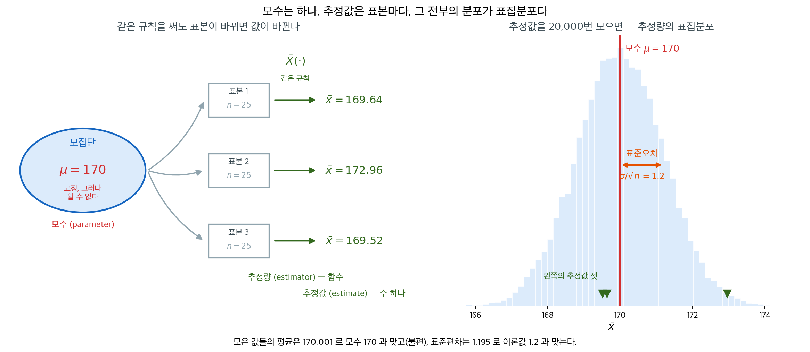
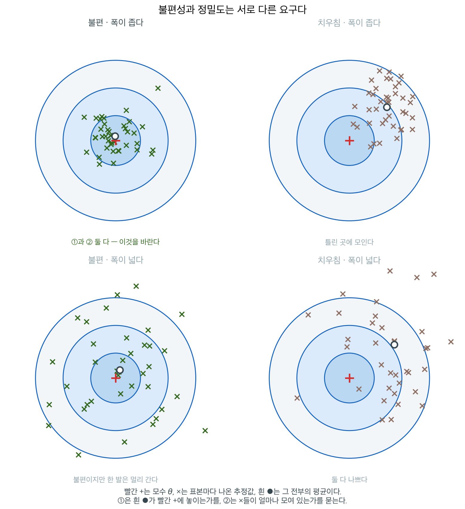
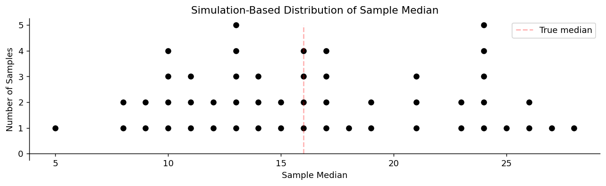
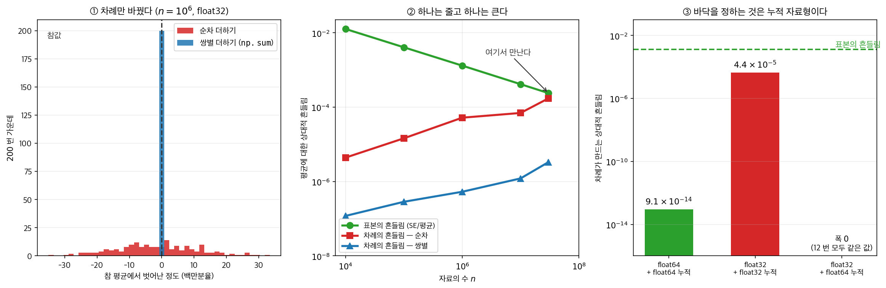

# 확률변수로서의 통계량

## 개요

자료를 하나 받아 평균을 계산하면 숫자 하나가 나온다. 이를테면 68.3이다. 그 숫자를 적어 두고 "이 자료의 평균은 68.3"이라고 말하면 할 일이 끝난 것 같다.

그런데 같은 모집단에서 표본을 **다시** 뽑아 평균을 내면 68.3이 나오지 않는다. 67.9가 나오고, 또 뽑으면 69.1이 나온다. 모집단은 그대로인데 계산한 값이 매번 달라진다. 달라지게 만든 것은 모집단이 아니라 **누가 표본에 뽑혔는가**이다.

이 단순한 관찰이 5장 전체의 출발점이다. 표본에서 계산한 값은 고정된 수가 아니라 **표본이 바뀌면 함께 바뀌는 양**, 곧 확률변수다. 그 값들이 어떻게 흩어지는지를 다루는 것이 표집분포 이론이고, 신뢰구간과 가설검정은 모두 그 위에 서 있다.

---

## 1. 뽑기 전과 뽑은 뒤

절차를 그림으로 적으면 이렇다.

$$
\text{모집단}
\;\xrightarrow{\;\text{표본을 뽑는다}\;}\;
\mathbf{x} = (x_1, x_2, \dots, x_n)
\;\xrightarrow{\;\text{계산한다}\;}\;
T(\mathbf{x})
$$

**통계량**이란 이 그림의 마지막 단계, 곧 표본을 받아 수 하나를 내놓는 함수 $T$를 말한다. 평균도 통계량이고, 분산도, 최댓값도, 중앙값도 통계량이다. 자료로부터 계산할 수만 있으면 무엇이든 통계량이다.

같은 통계량을 두 가지로 읽어야 한다는 점이 처음에는 낯설다.

표본을 뽑기 **전에는** 누가 뽑힐지 정해지지 않았으므로 $T(\mathbf{X})$의 값도 정해지지 않았다. 여러 값을 각각의 확률로 가질 수 있는 상태이며, 이때 $T(\mathbf{X})$는 확률변수다. 표본을 뽑고 난 **뒤에는** 자료가 $\mathbf{x} = (x_1, \ldots, x_n)$으로 확정되었으므로 $T(\mathbf{x})$도 68.3이라는 수 하나다.

그래서 이 책은 뽑기 전의 것을 대문자 $\mathbf{X}$로, 뽑은 뒤의 것을 소문자 $\mathbf{x}$로 적는다. 얼핏 성가신 관례 같지만, "$\bar X$의 분포"라는 말과 "$\bar x = 68.3$"이라는 말을 구별해 주는 장치다. 앞의 것은 아직 일어나지 않은 일에 대한 이야기이고, 뒤의 것은 이미 일어난 일의 기록이다.

---

## 2. 모수는 고정되어 있고 통계량은 흔들린다

무엇을 알아내려고 표본을 뽑는지부터 적어 두자. 모집단이 달라도 알고 싶은 것의 목록은 거의 같다.

| 모집단 | 알고 싶은 것 |
|:---|:---|
| 어떤 질문에 0 또는 1로 답한 전국의 성인 | 1이라고 답한 비율 $p$ |
| 20세 남자의 키 170, 183, 180, 190, 175, … | 평균 키 $\mu$, 그리고 얼마나 흩어져 있는가 $\sigma^2$ |
| 일반적인 모집단 $x_1, x_2, \ldots, x_N$ | $\mu$, $\sigma^2$, $\ldots$, 그리고 **분포 자체** |

앞의 둘은 수 하나로 답이 되지만 마지막 줄은 그렇지 않다. 평균과 분산을 다 알아도 모집단의 **모양**은 아직 모른다. 평균이 같고 분산도 같은데 한쪽은 대칭이고 다른 쪽은 오른쪽으로 길게 늘어진 모집단이 얼마든지 있기 때문이다. 이 책이 균등·지수·정규·베르누이 네 모집단을 거듭 바꿔 가며 같은 모의실험을 되풀이하는 까닭이 그것이고, 5.6절과 5.10절에서 **모양이 결과를 바꿔 버리는** 장면을 보게 된다.

모집단에도 평균이 있다. 그것을 $\mu$라 쓰고 **모수**라 부른다. 표본에서 계산한 $\bar X$와 모집단의 $\mu$는 성격이 정반대다.

$\mu$는 **고정되어 있지만 우리가 모른다.** 전국 성인 남성의 평균 키는 어떤 값으로 정해져 있다. 그 값은 우리가 표본을 뽑든 말든, 몇 번을 뽑든 변하지 않는다. 다만 우리가 그 값을 알지 못할 뿐이다.

$\bar X$는 **우리가 알 수 있지만 흔들린다.** 자료만 있으면 언제든 계산할 수 있다. 그런데 표본을 다시 뽑으면 다른 값이 나온다.

추론이란 이 비대칭을 견디는 일이다. **알고 싶은 것은 고정되어 있으나 볼 수 없고, 볼 수 있는 것은 흔들린다.** 흔들리는 것으로부터 고정된 것을 말하려면 그 흔들림의 크기와 모양을 알아야 하며, 그것이 바로 표집분포다.

여기서 통계량의 정의에 붙는 조건 하나가 중요해진다. **통계량은 미지의 모수를 포함해서는 안 된다.** 예를 들어

$$
\frac{\bar X - \mu}{\sigma/\sqrt n}
$$

은 통계량이 아니다. $\mu$와 $\sigma$를 모르면 이 값을 계산할 수 없기 때문이다. 반면

$$
\frac{\bar X - \mu_0}{S/\sqrt n}
$$

는 통계량이다. $\mu_0$은 우리가 가설로 정해 놓은 **아는 수**이고 $S$는 자료에서 계산되기 때문이다. 이 구별이 사소해 보이지만, 5.2절의 $t$ 분포가 존재하는 이유가 정확히 이것이다. 모르는 $\sigma$를 아는 $S$로 바꾸는 순간 분포가 정규에서 $t$로 바뀐다.

통계량 가운데 특정 모수를 겨냥해 만든 것을 **추정량**이라 하고 $\hat\theta$로 쓴다. $\bar X$는 그 자체로는 통계량이지만, $\mu$를 알아내려는 뜻으로 쓸 때는 $\mu$의 추정량이다. 같은 양을 무엇이라 부를지는 쓰임새가 정한다.

여기서 자주 뒤섞이는 세 낱말을 한 번에 갈라 두는 것이 좋다. 셋은 **성격이 서로 다르다.**

| 낱말 | 무엇인가 | 기호 | 표본이 바뀌면 |
|:---|:---|:---|:---|
| **모수** (parameter) | 모집단이 가진 고정된 수. 알고 싶은 것 | $\theta$, $\mu$, $\sigma^2$ | 변하지 않는다 |
| **추정량** (estimator) | 자료를 받아 수를 내놓는 **함수**, 곧 계산 규칙 | $\hat\theta(\cdot)$, $\bar X$ | 규칙은 그대로다 |
| **추정값** (estimate) | 그 규칙에 자료를 넣어 실제로 나온 **수 하나** | $\hat\theta(\mathbf x)$, $\bar x = 68.3$ | 값이 바뀐다 |

**추정량은 확률변수이고 추정값은 수다.** 앞에서 대문자와 소문자를 갈라 쓴 것이 바로 이 구별이다. "표본평균의 분포"라고 말할 때는 추정량을 가리키고, "표본평균이 $68.3$"이라고 말할 때는 추정값을 가리킨다. 분포를 갖는 것은 앞의 것뿐이다.



$20$세 남자의 키를 $\mu = 170$, $\sigma = 6$인 모집단으로 두고 $n = 25$씩 뽑아 본 것이다. 왼쪽에서 표본 셋을 뽑았더니 추정값이 $169.64$, $172.96$, $169.52$로 제각각 나왔다. **규칙은 하나인데 값은 셋이다.** 추정량과 추정값을 갈라 불러야 하는 이유가 이것이다.

오른쪽은 같은 일을 $20{,}000$번 되풀이해 나온 추정값을 전부 모은 것이다. 이 흩어짐이 **표집분포**이며, 여기서 5장의 두 가지 물음이 곧바로 나온다. **중심이 어디인가**와 **폭이 얼마인가**다. 모은 값들의 평균은 $170.001$로 모수 $170$과 맞고, 표준편차는 $1.195$로 이론값 $\sigma/\sqrt n = 1.2$와 맞는다.

앞의 것이 **불편성**이고 뒤의 것이 [**표준오차**](../applications/standard_error.md)다. 표준오차란 따로 있는 새로운 개념이 아니라 **추정량의 표집분포가 갖는 표준편차**이며, 그림의 주황색 화살표가 그 폭이다.

### 자주 쓰는 통계량

이 장에서 다룰 통계량은 넷이다. 어느 것이나 표본에서 계산되는 확률변수이고, 그 분포는 모집단의 모양과 표본크기 $n$에 따라 정해진다.

| 통계량 | 공식 | 겨냥하는 모수 |
|---|---|---|
| 표본평균 | $\bar{X} = \frac{1}{n}\sum_{i=1}^n X_i$ | 모평균 $\mu$ |
| 표본분산 | $S^2 = \frac{1}{n-1}\sum_{i=1}^n (X_i - \bar{X})^2$ | 모분산 $\sigma^2$ |
| 표본비율 | $\hat{p} = \frac{1}{n}\sum_{i=1}^n X_i$ (0/1 자료) | 모비율 $p$ |
| 표본중앙값 | $\text{Med}(\mathbf{X})$ | 모집단 중앙값 |

---

## 3. 흔들림에도 규칙이 있다

통계량이 표본마다 다르다면 그것으로 무엇을 말할 수 있을까. 아무 값이나 나오는 것이 아니라 흔들림에 규칙이 있다는 것이 답이다. 가장 기본적인 규칙이 **불편성**이다.

<div class="defn" markdown>

### 정의 1. 불편추정량 { .dfn }

$\hat\theta = \hat\theta(X_1, \ldots, X_n)$를 모수 $\theta$의 추정량이라 하자. 모든 $\theta$에 대하여

$$
E[\hat{\theta}(\mathbf{X})] = \theta
$$

이면 $\hat\theta$를 $\theta$의 **불편추정량**이라 한다.

</div>

이 등식이 말이 되려면 왼쪽이 기댓값을 가질 수 있어야 한다. $\hat\theta$에 자료를 넣으면 수 하나가 나오지만, 그 **자료가 확률변수이므로 $\hat\theta(\mathbf X)$도 확률변수**다. 1절에서 대문자와 소문자를 갈라 쓴 것이 여기서 값을 한다. 기댓값을 취할 수 있는 것은 $\hat\theta(\mathbf X)$뿐이고, $\hat\theta(\mathbf x) = 68.3$에는 기댓값이 없다.

불편성은 한 번의 추정이 맞는다는 뜻이 아니다. 어느 한 번은 크게, 다른 한 번은 작게 나오지만 **한쪽으로 치우쳐 빗나가지는 않는다**는 뜻이다. 과녁에 비유하면 명중한다는 말이 아니라 탄착군의 중심이 과녁 한가운데 있다는 말이다.

### 바라는 것은 둘이다

그런데 탄착군의 중심이 한가운데라는 것만으로는 부족하다. 중심이 맞더라도 사방으로 넓게 흩어져 있으면 **한 발을 쏴서 얻은 그 한 발**은 과녁에서 한참 벗어나 있을 수 있다. 우리가 실제로 손에 쥐는 것은 표본 하나에서 나온 추정값 하나뿐이므로, 좋은 추정량에 바라는 것은 둘이다.

| | 바라는 것 | 재는 양 | 다루는 곳 |
|:--:|:---|:---|:---|
| ① | **치우치지 않을 것** — 표집분포의 중심이 $\theta$에 있다 | 편향 $E[\hat\theta] - \theta$ | 이 절 |
| ② | **폭이 좁을 것** — 표집분포가 그 중심 가까이 모여 있다 | 표준오차 $\sqrt{\operatorname{Var}(\hat\theta)}$ | [5.3절](../applications/standard_error.md) |



네 과녁이 보여 주는 것은 **한쪽을 만족해도 다른 쪽은 아무것도 보장되지 않는다**는 것이다. 왼쪽 둘은 중심이 맞아 불편이고 오른쪽 둘은 치우쳤다. 위쪽 둘은 폭이 좁고 아래쪽 둘은 넓다. 쓸 만한 것은 왼쪽 위 하나뿐이며, **왼쪽 아래도 엄연히 불편추정량**이라는 점이 중요하다. 불편성은 좋은 추정량의 필요조건이지 충분조건이 아니다.

5장이 통계량마다 묻는 두 물음 — **중심이 어디인가**와 **폭이 얼마인가** — 가 정확히 이 둘이다. 앞의 물음은 이 절에서 끝나지만 뒤의 물음은 통계량마다 답이 달라서 5.4절부터 5.10절까지가 하나씩 답한다.

둘을 다 알아도 아직 하나가 남는다. **모양이 무엇인가**이다. 중심과 폭만으로는 "참값에서 두 표준오차 넘게 벗어날 확률"을 계산할 수 없고, 그 확률을 읽으려면 표집분포의 곡선 자체를 알아야 한다. 많은 경우 그 답이 중심극한정리가 주는 **점근정규성**이며, 그래서 5장의 물음은 결국 셋이다. 셋째 물음만은 통계량에 따라 답이 갈려서, 어떤 통계량은 $n$을 키우면 정규로 가고 어떤 통계량은 그렇지 않다. [장 개요](../index.md)의 표가 그 갈림을 한눈에 보여 준다.

둘이 맞부딪칠 때 어느 쪽을 얼마나 양보할지는 더 큰 이야기다. 편향을 조금 받아들이고 분산을 크게 줄이는 쪽이 전체 오차를 줄이기도 하며, 그 맞바꿈을 평균제곱오차로 재는 일은 [5.11절 편향–분산 맞바꿈](../estimators/bias_variance.md)이 맡는다. 이 장은 ①을 만족하는 추정량들을 놓고 ②를 재는 데까지만 간다.

그렇다면 이 장에서 쓰는 두 추정량은 ①을 만족하는가. 실제로 그렇고, 증명할 수 있다. 분포를 가정할 필요조차 없고 i.i.d.와 유한한 분산이면 된다.

<div class="thmbox" markdown>

### 정리 1. 표본평균과 표본분산은 불편이다 { .thm }

$X_1, \ldots, X_n$이 평균 $\mu$, 분산 $\sigma^2$인 i.i.d. 확률변수이면

$$
E[\bar X] = \mu,
\qquad
E[S^2] = \sigma^2
$$

이다.

</div>

??? proof "증명"

    **표본평균.** 기댓값의 선형성만으로 끝난다. 독립성조차 쓰지 않는다.

    $$
    E[\bar X] = E\!\left[\frac1n \sum_i X_i\right]
    = \frac1n \sum_i E[X_i] = \frac1n \cdot n\mu = \mu
    $$

    **표본분산.** 편차 $X_i - \bar X$ 안에 $\mu$를 넣었다 빼는 것에서 출발한다. 모르는 $\mu$를 일부러 끌어들이는 이유는 $E[(X_i-\mu)^2] = \sigma^2$이라는 아는 사실을 쓰기 위해서다.

    $$
    \sum_i (X_i - \bar X)^2
    = \sum_i \big((X_i - \mu) - (\bar X - \mu)\big)^2
    = \sum_i (X_i - \mu)^2 - n(\bar X - \mu)^2
    $$

    가운데에서 오른쪽으로 갈 때 교차항이 정리된다. 제곱을 펼치면

    $$
    \sum_i (X_i-\mu)^2 - 2(\bar X - \mu)\sum_i (X_i - \mu) + n(\bar X - \mu)^2
    $$

    인데, $\sum_i (X_i - \mu) = n(\bar X - \mu)$이므로 가운데 항이 $-2n(\bar X-\mu)^2$이 되어 마지막 항과 합쳐져 $-n(\bar X - \mu)^2$ 하나만 남는다.

    기댓값을 취한다. 앞 항은 각 $E[(X_i-\mu)^2] = \sigma^2$이 $n$개이므로 $n\sigma^2$이다.

    뒤 항 $E[(\bar X - \mu)^2]$은 $E[\bar X] = \mu$이므로 $\operatorname{Var}(\bar X)$ 바로 그것이고, 여기서 **독립성이 처음이자 유일하게 쓰인다.**

    $$
    \operatorname{Var}(\bar X)
    = \frac{1}{n^2}\operatorname{Var}\!\left(\sum_i X_i\right)
    = \frac{1}{n^2}\left(\sum_i \operatorname{Var}(X_i) + \sum_{i \ne j} \operatorname{Cov}(X_i, X_j)\right)
    = \frac{n\sigma^2}{n^2}
    = \frac{\sigma^2}{n}
    $$

    독립이면 $i \ne j$일 때 $\operatorname{Cov}(X_i, X_j) = 0$이라 가운데 합이 통째로 사라진다. 그래서 뒤 항은 $n \cdot \sigma^2/n = \sigma^2$이 된다.

    $$
    E\!\left[\sum_i (X_i - \bar X)^2\right] = n\sigma^2 - \sigma^2 = (n-1)\sigma^2
    $$

    양변을 $n-1$로 나누면 $E[S^2] = \sigma^2$이다. $\square$

**$n-1$의 정체가 여기서 드러난다.** 모평균 $\mu$ 대신 표본평균 $\bar X$를 중심으로 쓰는 순간 제곱합이 정확히 $\sigma^2$만큼 줄어든다. $\bar X$가 **자기 자료에 가장 가까이 붙어 있기** 때문이며, 그 모자람을 메우려고 $n$이 아니라 $n-1$로 나눈다.

위 모의실험의 설정 그대로 $\mu = 170$, $\sigma = 6$, $n = 25$로 확인하면 $E[\sum(X_i-\bar X)^2]$의 실측값이 $863.8$로 $(n-1)\sigma^2 = 864$와 맞고, $E[S^2] = 35.99$로 $\sigma^2 = 36$과 맞는다.

같은 논의를 더 자세히 다루는 곳은 [5.6절 분산의 표집분포](../applications/sample_variance.md)와 [5.13절 Bessel 수정](../variance/bessels.md)이다.

!!! warning "추정은 둘째 단계다"
    불편추정량을 아무리 잘 골라도 **자료 자체가 치우쳐 모였으면 소용이 없다.** 위 정리가 요구하는 것은 $X_i$가 모집단에서 i.i.d.로 나왔다는 것이고, 그 조건은 추정 방법이 아니라 **표본을 뽑는 방법**이 지킨다.

    전화를 받는 사람만 조사하거나 자원자만 모으면 $E[\bar X] = \mu$가 애초에 성립하지 않는다. 이때 $\bar X$는 모집단의 $\mu$가 아니라 **뽑힐 가능성이 높았던 부분집단의 평균**을 겨냥하게 되며, 표본을 아무리 키워도 그 치우침은 줄지 않는다. [1장의 편향과 무응답](../../ch01/classical/bias_nonresponse.md)이 선택 편향과 무응답 편향을 나누어 다룬다.

    순서를 기억해 두면 좋다. **먼저 치우치지 않게 모으고, 그다음에 추정한다.** 이 절의 모든 논의는 첫 단계가 지켜졌다는 전제 위에 있다.

위 정리는 평균과 분산을 다루었다. 그렇다면 중앙값은 어떨까. 모집단이 작고 대칭이면 이 물음을 끝까지 손으로 따라갈 수 있다.

<div class="exbox" markdown>

**보기 1.** <span class="diff easy" title="쉬움"></span> 탁구공으로 보는 불편성. 0부터 32까지 번호가 적힌 탁구공 33개가 항아리에 들어 있다. 개수가 홀수라 모집단 중앙값이 정확히 16으로 떨어진다. 여기서 다섯 개를 비복원으로 뽑아 그 중앙값 $\text{Med}$를 적는다.

**(1)** $\text{Med}$가 모집단 중앙값 16의 불편추정량임을 보이고 $\operatorname{sd}(\text{Med})$를 구하시오.

**(2)** 뽑기를 50번 되풀이해 얻은 중앙값들의 평균은 16.44였다. 참값 16과 어긋난다. 이것을 편향의 증거로 읽어야 하는가.

</div>

??? success "풀이"

    **(1) 해석적으로.** 불편성은 **대칭성만으로** 나온다. 공에 적힌 수를 뒤집는 사상 $b \mapsto 32 - b$는 모집단 $\{0, 1, \dots, 32\}$를 자기 자신으로 옮기는 일대일 대응이므로, 어떤 표본 $S$를 뽑을 확률과 뒤집은 표본 $32 - S$를 뽑을 확률이 같다. 그런데 중앙값은 이 뒤집기를 그대로 따라간다.

    $$
    \text{Med}(32 - S) = 32 - \text{Med}(S)
    $$

    따라서 $\text{Med}$와 $32 - \text{Med}$는 **같은 분포**를 갖고, 양변의 기댓값을 취하면 $E[\text{Med}] = 32 - E[\text{Med}]$, 곧

    $$
    E[\text{Med}] = 16
    $$

    이다. 근사가 아니라 정확한 등식이며, 중앙값이라는 사실조차 쓰지 않았다. 뒤집기와 함께 움직이는 통계량이면 무엇이든 같은 논증이 통한다.

    퍼짐은 분포를 직접 적어야 나온다. 중앙값이 $m$이려면 뽑힌 다섯 개 가운데 $m$보다 작은 것이 둘, 큰 것이 둘이어야 하므로

    $$
    P(\text{Med} = m) = \frac{\binom{m}{2}\binom{32-m}{2}}{\binom{33}{5}},
    \qquad m = 2, 3, \dots, 30
    $$

    이다. 이 분포로 계산하면 $\operatorname{Var}(\text{Med}) = 34$가 딱 떨어져

    $$
    \operatorname{sd}(\text{Med}) = \sqrt{34} = 5.8310
    $$

    이다. 견주어 둘 것이 하나 있다. 같은 표본에서 **표본평균**을 쓰면 모분산이 $\sigma^2 = (33^2-1)/12 = 90.67$이고 비복원이므로 유한모집단 수정이 붙어

    $$
    \operatorname{Var}(\bar X) = \frac{\sigma^2}{5}\cdot\frac{33-5}{33-1} = 15.87,
    \qquad \operatorname{sd}(\bar X) = 3.9833
    $$

    이다. 둘 다 불편인데 중앙값 쪽이 $1.46$배 더 흔들린다. **불편성은 추정량을 고르는 기준이 되지 못한다**는 것을 여기서 이미 볼 수 있다.

    **(2) 수치적으로.** 정확한 분포를 완전열거로 얻고, 그 옆에 50번 모의실험을 나란히 둔다.

    ```python
    import matplotlib.pyplot as plt
    import numpy as np
    from math import comb

    plt.rcParams["font.sans-serif"] = ["NanumGothic", "Apple SD Gothic Neo", "Malgun Gothic"]
    plt.rcParams["font.family"] = "sans-serif"
    plt.rcParams["axes.unicode_minus"] = False

    np.random.seed(0)
    num_samples = 50

    def exact_median_pmf():
        """크기 5짜리 비복원표본에서 표본중앙값의 **정확한** 분포.

        중앙값이 m이려면 m보다 작은 공 2개와 큰 공 2개가 함께 뽑혀야 하므로
        확률이 C(m,2)C(32-m,2)/C(33,5)이다. 모의실험이 아니라 완전열거다.
        """
        total = comb(33, 5)
        return {m: comb(m, 2) * comb(32 - m, 2) / total for m in range(2, 31)}

    def main():
        # 모집단: 0부터 32까지 번호가 붙은 공 33개.
        # 개수가 홀수이므로 참 중앙값이 정확히 16으로 딱 떨어진다.
        balls = np.arange(33)
        print(f"모집단 중앙값 = {np.median(balls)}")

        pmf = exact_median_pmf()
        exact_mean = sum(m * q for m, q in pmf.items())
        exact_sd = sum((m - exact_mean) ** 2 * q for m, q in pmf.items()) ** 0.5
        print(f"정확한 E[Med] = {exact_mean:.6f},  sd(Med) = {exact_sd:.6f}")

        # 크기 5짜리 표본을 50번 뽑아 그때마다 표본중앙값을 기록한다.
        # 표본이 달라지면 중앙값도 달라진다는 것,
        # 즉 **통계량이 확률변수라는 것**이 이 보기의 전부다.
        data = []
        for _ in range(num_samples):
            sample = np.random.choice(balls, size=5, replace=False)
            data.append(np.median(sample))

        se = exact_sd / np.sqrt(num_samples)
        print(f"50회 표본중앙값의 평균 = {np.mean(data):.2f}")
        print(f"  그 평균의 표준오차 = {se:.4f},  z = {(np.mean(data) - 16) / se:+.3f}")

        # 되풀이를 20만 번으로 늘려 본다. 같은 표본에서 표본평균도 함께 기록해
        # 중앙값과 평균 가운데 어느 쪽이 덜 흔들리는지 견준다.
        meds, means = [], []
        for _ in range(200_000):
            sample = np.random.choice(balls, size=5, replace=False)
            meds.append(np.median(sample))
            means.append(sample.mean())
        var_pop = (33 ** 2 - 1) / 12                            # 0..32 의 모분산
        sd_mean = (var_pop / 5 * (33 - 5) / (33 - 1)) ** 0.5    # 유한모집단 수정 포함
        print(f"20만회 표본중앙값의 평균   = {np.mean(meds):.6f}")
        print(f"20만회 표본중앙값의 표준편차 = {np.std(meds, ddof=1):.4f}  (정확값 {exact_sd:.4f})")
        print(f"20만회 표본평균의 표준편차   = {np.std(means, ddof=1):.4f}  (정확값 {sd_mean:.4f})")

        # 값마다 몇 번 나왔는지 센다. 표본이 50개뿐이라 히스토그램보다
        # 점그림이 낫다(2.5절에서 본 대로 자료가 적을 때의 선택이다).
        data_dict = {}
        for num in data:
            data_dict[num] = data_dict.get(num, 0) + 1

        fig, ax = plt.subplots(figsize=(12, 3))
        # 같은 값을 세로로 쌓아 점그림을 만든다
        for num, freq in data_dict.items():
            ax.plot([num] * freq, range(1, freq + 1), 'ok')
        # 참 중앙값 16. 점들이 이 선 주위에 흩어지는지 확인한다.
        ax.plot([16, 16], [0, 5], "--r", alpha=0.3, label="True median")
        ax.legend()
        ax.set_title('Simulation-Based Distribution of Sample Median')
        ax.set_xlabel('Sample Median')
        ax.set_ylabel('Number of Samples')
        ax.spines['top'].set_visible(False)
        ax.spines['right'].set_visible(False)
        ax.spines['bottom'].set_position("zero")
        plt.show()

    if __name__ == "__main__":
        main()
    ```

    출력:

    ```
    모집단 중앙값 = 16.0
    정확한 E[Med] = 16.000000,  sd(Med) = 5.830952
    50회 표본중앙값의 평균 = 16.44
      그 평균의 표준오차 = 0.8246,  z = +0.534
    20만회 표본중앙값의 평균   = 16.004935
    20만회 표본중앙값의 표준편차 = 5.8225  (정확값 5.8310)
    20만회 표본평균의 표준편차   = 3.9830  (정확값 3.9833)
    ```

    

    완전열거가 준 $E[\text{Med}] = 16.000000$과 $\operatorname{sd}(\text{Med}) = 5.830952 = \sqrt{34}$가 (1)의 유도와 정확히 맞는다. 20만 번 모의실험의 표준편차 $5.8225$와 $3.9830$도 정확값 $5.8310$, $3.9833$과 맞는다.

    **16.44는 편향의 증거가 아니다.** 되풀이 50번으로 얻은 평균의 표준오차가 $\sqrt{34}/\sqrt{50} = 0.8246$이므로 16.44는 16에서 겨우 $0.53$ 표준오차 떨어져 있다. 50번을 20만 번으로 늘리면 $16.0049$로 내려앉는데, 이때의 표준오차는 $\sqrt{34}/\sqrt{200000} = 0.0130$이니 여전히 참값과 $0.4$ 표준오차 안이다. **되풀이 횟수를 늘려 줄어드는 것은 편향이 아니라 몬테카를로 오차다.** 편향이었다면 20만 번을 돌려도 그 자리에 남아 있었을 것이다.

    그림에서 한 가지 더 눈에 띄는 것이 있다. 점들이 가로축의 아무 데나 찍히지 않고 **정수 자리에만** 찍힌다. 공에 정수만 적혀 있고 다섯 개 중 가운데 값을 고르므로 표본중앙값도 정수일 수밖에 없다. 통계량의 분포는 이렇게 모집단의 성격을 물려받는다.

---

## 4. 추정량은 어디서 오는가

지금까지는 추정량이 **주어져 있다고 보고** 그 성질을 따졌다. $\bar X$ 와 $S^2$ 을 쓰기로 해 놓고 그것들이 불편인지 물었다. 그런데 애초에 무엇을 계산할지는 누가 정하는가. 평균을 추정할 때 표본평균을 쓰는 것은 자연스러워 보이지만, 모집단이 낯선 분포이면 무엇을 계산해야 할지 막막하다.

그 물음은 이 장의 것이 아니다. **어떤 추정량을 쓸 것인가**가 5장의 물음이고, **새 추정량을 어떻게 지어낼 것인가**는 6장의 물음이다. 6장은 세 가지 방법을 다룬다 — 관측된 자료를 가장 그럴듯하게 만드는 모수를 고르는 [최대가능도](../../ch06/mle/likelihood.md), 모집단 적률을 표본 적률에 맞추는 [적률법](../../ch06/estimation_methods/moments_foundations.md), 그리고 사전 지식을 함께 넣는 [베이즈 추정 ★](../../ch06/bayesian/prior_posterior.md)이다. 셋째는 빈도주의 입문의 범위를 넘으므로 ★ 를 달아 두었다.

그렇게 지어낸 추정량도 결국 **이 절의 잣대로** 재게 된다. 최대가능도가 내놓는 정규분산 추정량이 $n-1$ 이 아니라 $n$ 으로 나누어 불편이 아니라는 것이 그 첫 보기이고, 6.1절 [정규분포의 최대가능도](../../ch06/mle/mle_normal.md) 6절이 그것을 정면으로 다룬다. 만드는 법이 달라도 묻는 것은 같다 — 중심이 맞는가, 폭이 좁은가.

<div class="aibox" markdown>

**AI로 보는 통계학 1.** 표본을 다시 뽑지 않았는데도 평균이 달라진다

개요의 첫 줄이 「자료를 하나 받아 평균을 계산하면 숫자 하나가 나온다. 이를테면
$68.3$ 이다」로 시작한다. 그 $68.3$ 이 흔들리는 까닭을 이 쪽은 하나로 둔다 —
**누가 표본에 뽑혔는가.**

기계로 계산할 때는 까닭이 하나 더 있다. 부동소수의 덧셈에는 **결합법칙이 성립하지
않는다.** $(a+b)+c$ 와 $a+(b+c)$ 가 다를 수 있으므로, **같은 수들을 다른 차례로
더하면 다른 평균**이 나온다. 자료를 다시 뽑지 않았는데도 그렇다.



**① 다시 뽑지 않고 흔들어 보기.** 값 $10^6$ 개를 `float32` 로 담아 두고 **차례만
섞어** $200$ 번 평균을 냈다.

| | 서로 다른 값 | 폭 (상대) |
|---|---|---|
| 순차 더하기 | $172$ 개 | $6.8\times10^{-5}$ |
| 쌍별 더하기 (`np.sum`) | $13$ 개 | $9.1\times10^{-7}$ |

$200$ 번 가운데 $172$ 번이 서로 다른 수다. 표본은 처음부터 끝까지 **하나**였다.

**② 두 흔들림이 만나는 곳.** 표본의 흔들림은 $\sigma/\sqrt n$ 으로 **줄고**, 차례의
흔들림은 더할 것이 많아질수록 **큰다.** 그러면 어디선가 만난다.

| $n$ | $10^4$ | $10^6$ | $3\times10^7$ |
|---|---|---|---|
| 표본의 흔들림 | $1.3\times10^{-2}$ | $1.3\times10^{-3}$ | $2.4\times10^{-4}$ |
| 차례의 흔들림 (순차) | $4.4\times10^{-6}$ | $5.2\times10^{-5}$ | $1.7\times10^{-4}$ |

$n$ 이 삼천만을 넘으면 **둘이 같은 자릿수**다. 기계학습에서 토큰 수나 표본 수가
그만큼 되는 것은 드문 일이 아니고, 그 자리에서는 「이 값이 왜 어제와 다른가」의
답이 자료가 아니라 **계산 순서**일 수 있다. 분산 학습에서 어느 일꾼의 결과가 먼저
도착하느냐가 매번 달라지는 것이 바로 그 상황이다.

**③ 고치는 자리는 담는 쪽이 아니라 더하는 쪽이다.** 같은 $n = 10^6$ 에서

| 담기 / 누적 | `float64` / `float64` | `float32` / `float32` | `float32` / `float64` |
|---|---|---|---|
| 차례가 만드는 폭 | $9.1\times10^{-14}$ | $4.4\times10^{-5}$ | $0$ (열두 번 모두 같은 값) |

**자료를 `float32` 로 담아도 누적만 `float64` 로 하면 흔들림이 사라진다.** 메모리는
그대로 쓰면서 바닥만 내린 것이다. `np.sum` 이 이미 쌍별(이진 트리) 더하기를 쓰는
것도 같은 이유다 — 순차 누적의 오차가 $n$ 에 비례해 쌓이는 데 비해 트리는
$\log n$ 으로만 쌓인다.

**이 쪽의 문장을 한 번 더 읽으면.** 「표본에서 계산한 값은 고정된 수가 아니라
표본이 바뀌면 함께 바뀌는 양」이라고 적혀 있다. 기계 위에서는 **표본이 바뀌지
않아도** 바뀔 수 있다. 통계량의 흔들림에는 바닥이 있고, 그 바닥을 정하는 것은
모집단이 아니라 **누적 자료형과 더하는 차례**다.

</div>

---

## 연습문제

<div class="drillbox" markdown>

**연습문제 1.** <span class="diff easy" title="쉬움"></span>
**무엇이 통계량인가.** $X_1, \ldots, X_n$ 이 평균 $\mu$, 분산 $\sigma^2$ 인 모집단에서 나온 확률표본이다. 다음 가운데 통계량인 것을 모두 고르고, 아닌 것은 **왜 아닌지** 밝히시오.

$$
\text{(가) } \bar X \qquad
\text{(나) } \frac{\bar X - \mu}{\sigma/\sqrt n} \qquad
\text{(다) } \frac{\bar X - 170}{S/\sqrt n} \qquad
\text{(라) } \max_i X_i - \min_i X_i \qquad
\text{(마) } \frac{S^2}{\sigma^2}
$$

</div>

??? success "풀이"
    **통계량은 (가), (다), (라)다.**

    기준은 하나다 — **자료만으로 계산할 수 있는가.** 미지의 모수가 식에 남아 있으면 통계량이 아니다.

    - **(가)** $\bar X$ 는 자료의 합을 $n$ 으로 나눈 것이다. ✓
    - **(나)** $\mu$ 와 $\sigma$ 를 모르면 값을 낼 수 없다. **통계량이 아니다.**
    - **(다)** $170$ 은 우리가 정해 놓은 **아는 수**이고 $S$ 는 자료에서 계산된다. ✓
    - **(라)** 범위는 자료의 최댓값과 최솟값의 차다. ✓
    - **(마)** 분모의 $\sigma^2$ 이 미지다. **통계량이 아니다.**

    **(나)와 (다)의 차이가 5장의 절반을 만든다.** (나)는 계산할 수 없지만 분포는 깨끗하다 — 모집단이 정규이면 정확히 $N(0,1)$ 이다. (다)는 계산할 수 있지만 모르는 $\sigma$ 를 아는 $S$ 로 바꾼 대가로 분포가 $t$ 로 옮겨 간다. **계산 가능성을 얻는 값으로 분포가 두꺼워지는 것**이고, 그 교환이 [$t$ 분포](../distributions/student_t.md)가 존재하는 이유다.

    (마)도 같은 종류다. 계산할 수는 없지만 $(n-1)S^2/\sigma^2$ 의 분포를 아는 것이 [분산의 표집분포](../applications/sample_variance.md)의 출발점이 된다. **분포를 아는 양과 계산할 수 있는 양은 다르며, 추론은 그 둘을 잇는 일이다.**

---

<div class="drillbox" markdown>

**연습문제 2.** <span class="diff easy" title="쉬움"></span>
**모수·추정량·추정값.** 어떤 조사에서 성인 $n = 400$ 명의 키를 재어 $\bar x = 168.2$ 를 얻었다. 다음 넷을 모수·추정량·추정값 가운데 하나로 가르고, **분포를 갖는 것**이 어느 것인지 밝히시오.

$$
\text{(가) } \mu \qquad
\text{(나) } \bar X \qquad
\text{(다) } 168.2 \qquad
\text{(라) } \sigma^2
$$

표본을 다시 뽑으면 넷 가운데 무엇이 바뀌는가.

</div>

??? success "풀이"
    | | 무엇인가 | 표본을 다시 뽑으면 | 분포 |
    |:---|:---|:---|:---|
    | (가) $\mu$ | **모수** | 변하지 않는다 | 없다 |
    | (나) $\bar X$ | **추정량** — 자료를 받아 수를 내놓는 규칙 | 규칙은 그대로다 | **있다** |
    | (다) $168.2$ | **추정값** — 규칙에 이번 자료를 넣은 결과 | 값이 바뀐다 | 없다 |
    | (라) $\sigma^2$ | **모수** | 변하지 않는다 | 없다 |

    **분포를 갖는 것은 (나)뿐이다.** $\mu$ 와 $\sigma^2$ 은 고정된 수라 흔들릴 것이 없고, $168.2$ 는 이미 일어난 일의 기록이라 역시 수 하나다. 흔들리는 것은 **규칙에 아직 자료가 들어가지 않은 상태**, 곧 $\bar X$ 다.

    "표본을 다시 뽑으면 무엇이 바뀌는가"에 대한 답이 미묘하다. 바뀌는 것은 **추정값**이지 추정량이 아니다. 계산 규칙은 그대로이고 그 규칙에 들어가는 자료가 바뀐다. 그래서 $\bar X$ 를 두고 "흔들린다"고 말할 때 뜻하는 것은 규칙이 흔들린다는 것이 아니라 **그 규칙이 내놓을 수 있는 값들이 분포를 이룬다**는 것이다.

    $E[\bar X] = \mu$ 라고 쓸 수 있고 $E[168.2]$ 라고는 쓸 수 없는 까닭도 여기 있다. 기댓값은 확률변수에만 붙는다.

---

<div class="drillbox" markdown>

**연습문제 3.** <span class="diff easy" title="쉬움"></span>
**불편인데 쓸모없는 추정량.** $X_1, \ldots, X_n$ 이 i.i.d. 이고 $E[X_i] = \mu$, $\operatorname{Var}(X_i) = \sigma^2$ 이다. 첫 관측값만 쓰는 추정량 $T = X_1$ 을 생각하자.

**(가)** $T$ 가 $\mu$ 의 불편추정량임을 보이시오.

**(나)** $n = 100$ 일 때 $T$ 와 $\bar X$ 의 표준오차를 견주시오.

**(다)** 이 결과를 §3 의 네 과녁 그림에서 어느 칸으로 읽어야 하는가.

</div>

??? success "풀이"
    **(가)** $E[T] = E[X_1] = \mu$ 다. 정의 1 이 요구하는 것은 이것뿐이므로 $T$ 는 불편이다. **관측값을 $99$ 개나 버렸는데도 불편이다.**

    **(나)** $\operatorname{sd}(T) = \sigma$ 이고 $\operatorname{sd}(\bar X) = \sigma/\sqrt{100} = \sigma/10$ 이다. **$T$ 의 표준오차가 열 배 크다.**

    **(다) 왼쪽 아래 칸이다** — 중심은 맞는데 폭이 넓다. $\bar X$ 가 왼쪽 위다.

    이 문제의 요점은 **불편성이 좋은 추정량의 필요조건일 뿐 충분조건이 아니라는 것**이다. 불편성만 기준으로 삼으면 $X_1$ 과 $\bar X$ 를 가릴 수 없다. 둘을 가르려면 §3 이 말한 두 번째 잣대, 곧 **폭**이 필요하고, 그것을 재는 일이 [5.3절 표준오차](../applications/standard_error.md)다.

    실무에서 "이 추정량은 불편이다"라는 말을 칭찬으로 들으면 안 되는 까닭이기도 하다. **불편이라는 말은 아직 아무것도 약속하지 않는다.**

---

<div class="drillbox" markdown>

**연습문제 4.** <span class="diff med" title="중간"></span>
**$E[\bar X] = \mu$ 에는 독립이 필요한가.** 정리 1 은 i.i.d. 를 가정했다. 그런데 증명의 어느 줄에서 독립을 썼는지 되짚어 보면 뜻밖의 답이 나온다.

**(가)** $E[\bar X] = \mu$ 를 보이는 데 독립이 필요한가. 필요하다면 어느 단계인지, 필요 없다면 무엇만 있으면 되는지 밝히시오.

**(나)** $\operatorname{Var}(\bar X) = \sigma^2/n$ 에는 독립이 필요한가.

**(다)** 두 답이 갈린다면, 그 차이가 실무에서 무엇을 뜻하는가.

</div>

??? success "풀이"
    **(가) 필요 없다.** 기댓값의 선형성만 쓴다.

    $$
    E[\bar X] = E\!\left[\frac1n\sum_i X_i\right] = \frac1n\sum_i E[X_i] = \frac1n \cdot n\mu = \mu
    $$

    선형성은 **독립과 무관하게** 성립한다([기댓값과 선형성](../../ch03/rv/expectation.md) 정리 2). 필요한 것은 각 $X_i$ 의 기댓값이 같은 $\mu$ 라는 것뿐이고, 서로 아무리 강하게 엮여 있어도 된다.

    **(나) 필요하다.** 합의 분산에는 교차항이 붙는다.

    $$
    \operatorname{Var}\!\left(\sum_i X_i\right) = \sum_i \operatorname{Var}(X_i) + 2\sum_{i<j}\operatorname{Cov}(X_i, X_j)
    $$

    독립이면(더 약하게는 무상관이면) 교차항이 사라져 $n\sigma^2$ 이 되고 $\operatorname{Var}(\bar X) = \sigma^2/n$ 이 나온다. 양의 상관이 있으면 교차항이 양수라 **분산이 $\sigma^2/n$ 보다 크다.**

    **(다) 중심은 버티고 폭이 무너진다.** 자료에 상관이 있어도 $\bar X$ 는 여전히 불편이므로 추정값 자체는 치우치지 않는다. 그런데 $\sigma^2/n$ 으로 계산한 표준오차는 **실제보다 작다.** 그 표준오차로 신뢰구간을 만들면 폭이 좁게 나오고 포함률이 약속한 값에 못 미친다.

    시계열이나 군집표본에서 흔히 일어나는 일이다. **"평균은 믿을 만한데 오차막대는 믿을 수 없다"**는 상황이며, 추정값보다 그 둘레의 폭이 먼저 틀어진다는 점에서 발견하기 어렵다.

---

<div class="drillbox" markdown>

**연습문제 5.** <span class="diff med" title="중간"></span>
**$n-1$ 은 어디서 오는가.** 정리 1 의 증명 상자는 항등식

$$
\sum_i (X_i - \bar X)^2 = \sum_i (X_i - \mu)^2 - n(\bar X - \mu)^2
$$

에서 출발했다.

**(가)** 이 항등식의 양변에 기댓값을 취해 $E\!\left[\sum_i (X_i-\bar X)^2\right] = (n-1)\sigma^2$ 을 얻으시오.

**(나)** 빼는 항 $n(\bar X-\mu)^2$ 의 기댓값이 정확히 $\sigma^2$ 인 것이 핵심이다. 이것이 **왜 $\sigma^2$ 인지** 한 줄로 설명하시오.

**(다)** 만약 $\mu$ 를 **알고 있다면** $\frac1n\sum_i (X_i-\mu)^2$ 이 $\sigma^2$ 의 불편추정량인가. 이 답과 (가)를 함께 읽으면 $n-1$ 이 무엇을 뜻하는가.

</div>

??? success "풀이"
    **(가)** 첫 항은 각 $E[(X_i-\mu)^2] = \sigma^2$ 이므로 합이 $n\sigma^2$ 이다. 둘째 항은 $E[(\bar X-\mu)^2] = \operatorname{Var}(\bar X) = \sigma^2/n$ 이므로 $n \cdot \sigma^2/n = \sigma^2$ 이다. 따라서

    $$
    E\!\left[\sum_i (X_i - \bar X)^2\right] = n\sigma^2 - \sigma^2 = (n-1)\sigma^2
    $$

    이고 $n-1$ 로 나누어야 $E[S^2] = \sigma^2$ 이 된다.

    **(나)** $(\bar X-\mu)^2$ 의 기댓값이 곧 $\bar X$ 의 분산이고 그 값이 $\sigma^2/n$ 이기 때문이다. $n$ 을 곱하면 $n$ 이 약분되어 $\sigma^2$ 만 남는다. **빼는 양이 표본크기와 무관한 상수라는 것**이 $n-1$ 이 $n$ 에 의존하지 않는 까닭이다.

    **(다) 그렇다.** $\mu$ 를 알면 $E\!\left[\frac1n\sum_i(X_i-\mu)^2\right] = \sigma^2$ 이 바로 나오고 보정이 필요 없다.

    둘을 나란히 놓으면 $n-1$ 의 정체가 드러난다. **$\mu$ 를 몰라 $\bar X$ 로 대신한 대가다.** $\bar X$ 는 자료에 맞추어 정해지므로 편차 $X_i - \bar X$ 가 참 편차 $X_i - \mu$ 보다 **반드시 작고**(제곱합을 가장 작게 만드는 자리가 $\bar X$ 이므로), 그 덜 잰 양의 평균이 정확히 $\sigma^2$ 이다. 하나를 추정하느라 자유도 하나를 잃었다는 말이 이것이다.

---

<div class="drillbox" markdown>

**연습문제 6.** <span class="diff med" title="중간"></span>
**불편추정량은 하나가 아니다.** $X_1, \ldots, X_n$ 이 i.i.d. 이고 $E[X_i] = \mu$, $\operatorname{Var}(X_i) = \sigma^2$ 이다. 가중평균

$$
T_{\mathbf w} = \sum_{i=1}^n w_i X_i, \qquad \sum_{i=1}^n w_i = 1
$$

을 생각하자.

**(가)** 가중치가 무엇이든 $T_{\mathbf w}$ 가 $\mu$ 의 불편추정량임을 보이시오.

**(나)** $\operatorname{Var}(T_{\mathbf w})$ 를 쓰고, 그것을 가장 작게 하는 가중치를 구하시오.

**(다)** 이 결과가 §3 의 두 잣대에 대해 말해 주는 것은 무엇인가.

</div>

??? success "풀이"
    **(가)** 선형성으로 $E[T_{\mathbf w}] = \sum_i w_i E[X_i] = \mu\sum_i w_i = \mu$ 다. 제약은 $\sum w_i = 1$ 하나뿐이므로 **불편추정량이 무한히 많다.** $w = (1,0,\ldots,0)$ 이면 연습문제 3 의 $X_1$ 이고, $w_i = 1/n$ 이면 $\bar X$ 다.

    **(나)** 독립이므로 $\operatorname{Var}(T_{\mathbf w}) = \sigma^2\sum_i w_i^2$ 이다. $\sum w_i = 1$ 아래에서 $\sum w_i^2$ 을 최소화하면 되는데, 코시–슈바르츠로

    $$
    1 = \left(\sum_i w_i\right)^2 \le n\sum_i w_i^2
    \quad\Longrightarrow\quad
    \sum_i w_i^2 \ge \frac1n
    $$

    이고 등호는 모든 $w_i$ 가 같을 때, 곧 $w_i = 1/n$ 일 때다. **$\bar X$ 가 가중평균 가운데 분산이 가장 작다.**

    **(다) 불편성만으로는 아무것도 고를 수 없다.** 후보가 무한히 많은데 그 가운데 어느 것도 불편성으로는 탈락하지 않는다. 고르려면 두 번째 잣대인 **폭**이 있어야 하고, 그 잣대를 넣는 순간 답이 $\bar X$ 하나로 좁혀진다.

    이것이 5장이 "중심이 어디인가"에서 멈추지 않고 "폭이 얼마인가"로 넘어가는 까닭이다. 덧붙여, 여기서 고른 것은 **선형**이고 불편인 것들 가운데 최선일 뿐이다. 선형이라는 울타리를 걷으면 이야기가 더 있고, 그것은 [7장 ★](../../ch07/theory/efficiency_crlb.md)의 몫이다.

---

<div class="drillbox" markdown>

**연습문제 7.** <span class="diff med" title="중간"></span>
**표준오차와 표준편차.** 어떤 모집단의 표준편차가 $\sigma = 12$ 이고 거기서 $n = 36$ 을 뽑는다.

**(가)** $\operatorname{sd}(X_i)$ 와 $\operatorname{sd}(\bar X)$ 를 각각 구하고, 둘이 재는 것이 어떻게 다른지 밝히시오.

**(나)** $\operatorname{sd}(\bar X)$ 를 절반으로 줄이려면 $n$ 을 얼마로 해야 하는가.

**(다)** $n$ 을 키우면 $\operatorname{sd}(\bar X)$ 는 줄어든다. 그렇다면 $n$ 을 키울 때 $\sigma$ 는 어떻게 되는가.

</div>

??? success "풀이"
    **(가)** $\operatorname{sd}(X_i) = \sigma = 12$ 이고 $\operatorname{sd}(\bar X) = \sigma/\sqrt n = 12/6 = 2$ 다.

    앞의 것은 **모집단에서 개체 하나가 얼마나 흩어져 있는가**를 재고, 뒤의 것은 **표본평균이라는 통계량이 표본마다 얼마나 흔들리는가**를 잰다. 재는 대상이 다르다 — 하나는 모집단의 성질이고 하나는 표집분포의 성질이다. 뒤의 것을 **표준오차**라 부르는 까닭이 그것이다.

    **(나) $n = 144$ 다.** $\sigma/\sqrt n$ 을 절반으로 만들려면 $\sqrt n$ 을 두 배로 해야 하므로 $n$ 은 **네 배**가 된다. 정밀도를 두 배로 사는 데 자료는 네 배가 든다 — 5장이 되풀이해 만나는 $\sqrt n$ 의 값이다.

    **(다) 변하지 않는다.** $\sigma$ 는 **모수**이므로 우리가 표본을 몇 개 뽑든 상관이 없다. 줄어드는 것은 표집분포의 폭이지 모집단의 폭이 아니다.

    이 구별이 흐려지면 "자료를 많이 모으면 사람들의 키가 고르게 된다"는 식의 말이 나온다. 많이 모아서 고르게 되는 것은 **키가 아니라 평균의 추정값**이다.

---

<div class="drillbox" markdown>

**연습문제 8.** <span class="diff hard" title="어려움"></span>
**중앙값의 불편성은 무엇에 기대고 있었는가.** 보기 1 에서 표본중앙값이 모집단 중앙값의 불편추정량이었다. 그 성질이 중앙값이라는 통계량 자체에서 오는지, 아니면 그 모집단에서 오는지 가린다. 다음 두 모집단에서 크기 $3$ 인 표본을 **비복원**으로 뽑는다(가능한 표본은 각각 $\binom53 = 10$ 가지이고 모두 같은 확률이다).

$$
A = \{0,\,1,\,2,\,3,\,10\}, \qquad B = \{0,\,1,\,2,\,8,\,9\}
$$

**(가)** 두 모집단의 중앙값은 모두 $2$ 다. 표본중앙값이 모집단의 몇 번째 작은 값이 되는지, 그 확률을 세어 적으시오. 두 모집단에서 그 확률이 같은가.

**(나)** 각각 $E[\text{Med}]$ 를 구하시오.

**(다)** 두 답이 갈리는 까닭을 밝히고, 보기 1 의 불편성이 무엇에서 나온 것이었는지 말하시오.

</div>

??? success "풀이"
    **(가) 두 모집단에서 확률이 **똑같다**.** 표본중앙값이 모집단에서 $k$ 번째로 작은 값이 되려면 그보다 작은 것 하나와 큰 것 하나를 함께 뽑아야 한다. 값이 무엇이든 **순위만으로** 정해지므로

    | 모집단에서 몇 번째 | 1 | 2 | 3 | 4 | 5 |
    |---|---|---|---|---|---|
    | 확률 | $0$ | $\tfrac{1\cdot3}{10} = \tfrac3{10}$ | $\tfrac{2\cdot2}{10} = \tfrac4{10}$ | $\tfrac{3\cdot1}{10} = \tfrac3{10}$ | $0$ |

    다. 가중치 $(0,\ \tfrac3{10},\ \tfrac4{10},\ \tfrac3{10},\ 0)$ 은 **가운데를 중심으로 대칭**이고 모집단의 값과 무관하다.

    **(나)** 그 가중치를 각 모집단의 값에 얹는다.

    $$
    E[\text{Med}_A] = \frac{3\cdot 1 + 4\cdot 2 + 3\cdot 3}{10} = \frac{20}{10} = 2
    \qquad\text{(불편)}
    $$

    $$
    E[\text{Med}_B] = \frac{3\cdot 1 + 4\cdot 2 + 3\cdot 8}{10} = \frac{35}{10} = 3.5
    \qquad\text{(편향 } +1.5\text{)}
    $$

    **(다) 갈리는 것은 통계량이 아니라 모집단이다.** 순위 가중치는 두 경우에 똑같으므로 차이는 오직 **가운데 세 값이 어떻게 놓였느냐**에서 온다. $A$ 에서는 $1, 2, 3$ 이 $2$ 를 중심으로 대칭이라 대칭 가중치와 맞아떨어져 평균이 정확히 $2$ 다. $B$ 에서는 $1, 2, 8$ 로 오른쪽이 멀리 떨어져 있어 평균이 위로 끌려 올라간다.

    그러므로 **보기 1 의 불편성은 중앙값의 성질이 아니라 그 모집단이 대칭이었던 덕분이다.** $\{0,1,\ldots,32\}$ 는 $16$ 을 중심으로 완벽하게 대칭이고, 보기 1 의 풀이가 쓴 뒤집기 $b \mapsto 32-b$ 가 바로 그 대칭이다.

    $A$ 가 **비대칭인데도** 불편이라는 점도 눈여겨볼 만하다. $10$ 이라는 외딴값은 세 개를 뽑았을 때 결코 가운데가 될 수 없으므로 중앙값에 아무 영향을 주지 않는다. **꼬리의 비대칭은 중앙값을 건드리지 못하고, 가운데의 비대칭만이 편향을 만든다.** 이것이 중앙값이 "로버스트하다"는 말의 정확한 내용이며, 동시에 그 로버스트함이 불편성을 보장해 주지는 않는다는 뜻이기도 하다.

    표본평균과 견주면 대비가 선명하다. $E[\bar X] = \mu$ 는 정리 1 에서 보았듯 **모집단의 모양을 전혀 묻지 않는다.** 중앙값은 그렇지 않다.


## 정리하며

표본에서 계산한 값은 고정된 수가 아니다. 표본이 바뀌면 함께 바뀌므로 **확률변수**이며, 이 사실을 받아들이는 것이 추론통계학으로 들어가는 문이다.

모수와 통계량은 성격이 정반대다. 모수는 고정되어 있으나 볼 수 없고, 통계량은 볼 수 있으나 흔들린다. 추론이란 흔들리는 것으로부터 고정된 것을 말하는 일이고, 그러려면 흔들림의 크기와 모양을 알아야 한다. 그것이 다음 절부터 다룰 **표집분포**다.

흔들림에도 규칙이 있다. 되풀이해 얻은 값들의 평균이 참값과 같으면 그 추정량을 불편이라 하며, 이는 한 번의 추정이 맞는다는 뜻이 아니라 한쪽으로 치우쳐 빗나가지 않는다는 뜻이다. 탁구공 실험에서 표본중앙값들이 16을 중심으로 흩어진 것이 그 모습이다.

다만 불편성은 **필요조건일 뿐이다.** 중심이 맞아도 폭이 넓으면 한 번 쥔 추정값은 멀리 빗나갈 수 있고, $\sum w_i = 1$ 인 가중평균이 모두 불편이라는 데서 보듯 불편성만으로는 후보를 하나로 좁히지도 못한다. 그래서 5장의 물음이 둘이 된다 — **중심이 어디인가**와 **폭이 얼마인가**다. 앞의 물음은 이 절에서 끝나고 뒤의 물음에 5.3절부터가 답한다.

추정량을 **지어내는** 일은 이 장이 아니라 6장이 맡는다. 최대가능도·적률법·베이즈가 그 방법들이며, 그렇게 지어낸 추정량도 결국 이 절의 두 잣대로 재게 된다.

앞으로 만날 신뢰구간과 가설검정은 예외 없이 "이 통계량이 어떤 분포를 따르는가"라는 물음에 기대고 있다. 그 물음에 답할 수 있는 통계량이 몇 개나 되는지, 그리고 답이 어떤 가정 위에서만 성립하는지가 5장의 나머지 내용이다.
