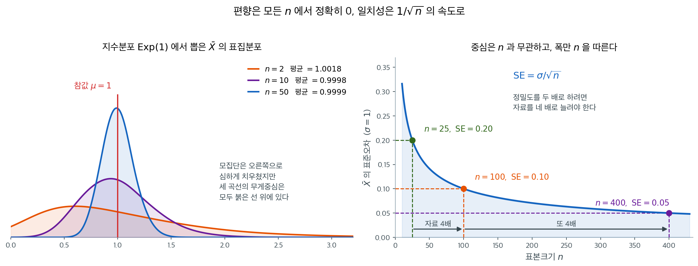
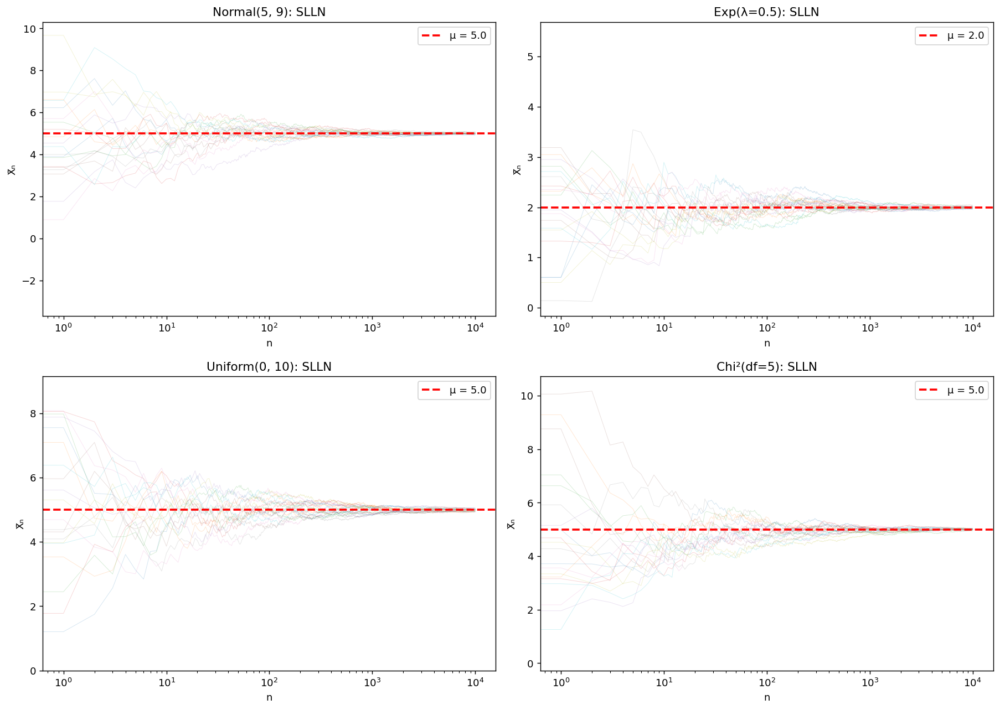
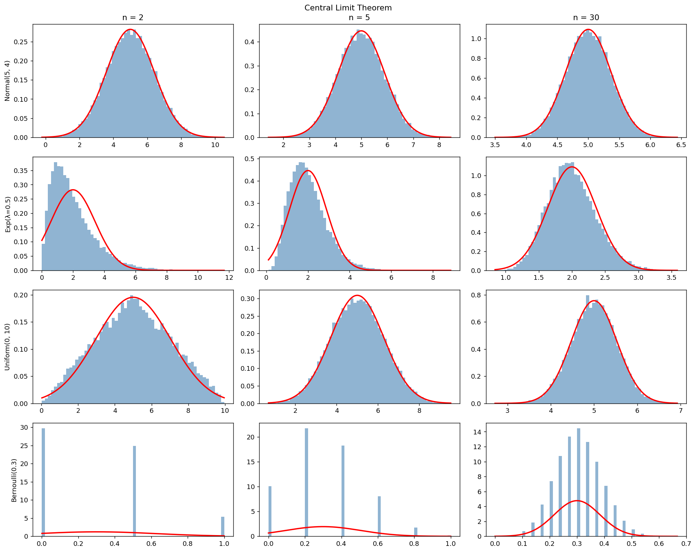
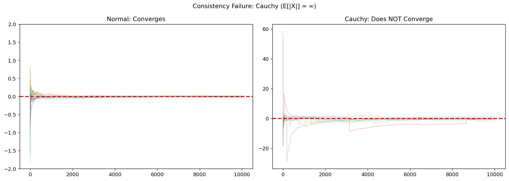

# 표본평균의 편향과 일치성

## 1. 들어가며

어떤 추정량에 대해서든 근본적인 질문 두 가지는 다음과 같다: (1) 참 모수를 체계적으로 과대 또는 과소추정하는가? (**편향**) (2) 표본크기가 커질 때 참값으로 수렴하는가? (**일치성**) 표본평균 $\bar{X}$에 대한 답은 안심할 만큼 단순하다 — 매우 온건한 조건 아래에서 불편이고 일치한다 — 그러나 그 정확한 진술과 함의는 꼼꼼히 살펴볼 가치가 있다.

---

## 2. 표본평균의 편향

<div class="thmbox" markdown>

### 정리. 표본평균의 불편성 { .thm }

모든 $i$에 대해 $E[X_i] = \mu$이면 표본평균 $\bar{X} = \frac{1}{n}\sum_{i=1}^n X_i$은 $\mu$에 대해 **불편**이다. 곧 모든 $n \geq 1$에 대해

$$E[\bar{X}] = \mu$$

이다.

</div>

??? proof "증명"

    기댓값의 선형성에 의해:

    $$E[\bar{X}] = E\left[\frac{1}{n}\sum_{i=1}^n X_i\right] = \frac{1}{n}\sum_{i=1}^n E[X_i] = \frac{1}{n} \cdot n\mu = \mu$$

    이는 최소한의 조건 아래에서 성립한다:

    - 관측값이 동일한 분포를 따를 필요가 없다(모든 $i$에 대해 $E[X_i] = \mu$이기만 하면 된다)
    - 관측값이 독립일 필요가 없다
    - 분포에 대한 가정이 필요 없다
    - 임의의 표본크기 $n \geq 1$에서 유효하다

### 유한표본 편향이 0이다

(분산의 MLE 같은) 많은 추정량과 달리, 표본평균은 모든 유한 표본크기에서 **편향이 정확히 0**이다. 이는 강한 성질이다 — 대부분의 추정량은 유한표본에서 편향이 0이 아니고 점근적으로만 불편이다.

### 편향된 대안과의 비교

모평균의 추정량 중에는 의도적으로 편향된 것도 있다:

| 추정량 | 편향 | 평균제곱오차 |
|-----------|------|-----|
| $\bar{X}$ (표본평균) | $0$ | $\sigma^2/n$ |
| $\lambda\bar{X}$ (축소, $\lambda < 1$) | $(\lambda-1)\mu$ | $\lambda^2\sigma^2/n + (1-\lambda)^2\mu^2$ |
| $c$ (상수) | $c - \mu$ | $(c-\mu)^2$ |

편향–분산 맞바꿈에서 논의했듯이, 특히 $|\mu|$가 $\sigma/\sqrt{n}$에 비해 작을 때 편향추정량이 더 작은 평균제곱오차를 가질 수 있다.

<div class="aibox" markdown>

**AI로 보는 통계학 1.** 지난 것을 잊어 가며 평균 내기

위 표의 대안들은 모두 자료 전체를 한꺼번에 본다. 기계를 학습시키는 자리에서는 사정이 다르다 —
값이 하나씩 들어오고, 전부 쌓아 둘 수도 없으며, 참값 자체가 도중에 변하기도 한다. 그래서
**지난 것을 잊어 가며** 평균을 낸다. 한 줄짜리 되풀이로 적힌다.

$$
m_k=\beta\,m_{k-1}+(1-\beta)\,q_k
$$

새 값과 옛 값을 $(1-\beta):\beta$ 로 섞는 것이니 둘 사이를 벗어나지 않는다. 같은 것을 연속
쪽으로 적으면 적분꼴이 된다. $\beta=e^{-\lambda}$ 로 두면

$$
f(t)=e^{-\lambda t}f(0)+\int_0^{t}e^{-\lambda(t-s)}q(s)\,ds
$$

이고, 지난 값 $q(s)$ 가 **얼마나 오래되었는지에 따라 $e^{-\lambda(t-s)}$ 만큼 깎여서** 더해진다 —
가까운 과거는 거의 그대로, 먼 과거는 거의 $0$ 으로. 눈여겨볼 것은 **앞에 홀로 선 첫 항**
$e^{-\lambda t}f(0)$ 이다. 이것이 이 추정량의 편향이다.

```python
import numpy as np

rng = np.random.default_rng(0)                   # 씨앗을 고정해 늘 같은 값이 나오게
n   = 200
q   = rng.normal(1.0, 0.5, n)                    # 참 평균이 1 인 값이 차례로 들어온다

def recur(beta):                                 # 기계가 쓰는 꼴 — 되풀이 한 줄
    m, acc = np.empty(n), 0.0
    for k in range(n):
        acc  = beta*acc + (1 - beta)*q[k]        # m_k = β m_{k-1} + (1-β) q_k
        m[k] = acc
    return m

def integral(beta):                              # 적분꼴을 눈금으로 옮긴 것
    lam, j = -np.log(beta), np.arange(n)         # e^{-lam} = beta 로 두었다
    return np.array([np.sum(np.exp(-lam*(k - j[:k+1])) * (1 - beta) * q[:k+1])
                     for k in range(n)])         # Σ e^{-λ(k-j)}(1-β)q_j — 적분을 눈금으로

print("되풀이 식과 적분꼴의 최대 차이:",
      f"{np.max(np.abs(recur(0.99) - integral(0.99))):.2e}")
print("\n  beta    기억하는 길이 1/(1-beta)   처음 10 걸음의 평균   참값 1 과의 차")
for beta in (0.5, 0.9, 0.99):
    m = recur(beta)[:10].mean()                  # 처음 열 걸음의 평균
    print(f"  {beta:.2f}  {1/(1-beta):15.1f}  {m:19.4f}  {m-1:13.4f}")
```

실행하면 다음이 나온다.

```text
되풀이 식과 적분꼴의 최대 차이: 5.55e-16

  beta    기억하는 길이 1/(1-beta)   처음 10 걸음의 평균   참값 1 과의 차
  0.50              2.0               0.9726        -0.0274
  0.90             10.0               0.4519        -0.5481
  0.99            100.0               0.0582        -0.9418
```

두 꼴의 차이가 $10^{-16}$ 이니 **같은 식을 두 가지로 적은 것**이 맞다. 그리고 $\beta$ 가
정하는 것은 **얼마나 오래 기억하는가**다 — $\frac1{1-\beta}$ 걸음쯤이고, 연속 쪽으로 보면
$\frac1\lambda$ 다.

마지막 칸이 요점이다. 들어오는 값의 참 평균이 $1$ 인데, $\beta=0.99$ 로 누르면
처음 열 걸음의 평균이 $0.058$ 밖에 안 된다. **거의 $1$ 만큼 낮게 나온다.** 까닭이 적분꼴의
첫 항에 그대로 있다 — $e^{-\lambda t}f(0)$ 이고, 시작을 $f(0)=0$ 으로 잡았으니 **없던
과거를 $0$ 으로 세어** 평균을 끌어내린 것이다. 위 정리가 보장하는 표본평균의 $0$ 과는 딴판으로,
이 추정량의 편향은 $-\beta^{k}\mu$ 다 — **유한표본에서는 치우쳐 있고 $k\to\infty$ 에서만
불편**인, 절 $2$ 머리가 말한 바로 그 종류다.

고치는 법도 그 식에서 나온다. 처음 $k$ 걸음에서 실제로 쌓인 무게는 $1$ 이 아니라
$1-\beta^{k}$ 뿐이므로($\sum_{j=1}^{k}(1-\beta)\beta^{k-j}=1-\beta^{k}$) 그만큼 나누어 주면 된다.

```python
m = recur(0.99)                                  # 위 코드에 이어서 — β = 0.99 로 누른 눈금판
for k in (1, 2, 3, 5):
    print(f"   k={k}:  그대로 {m[k-1]:.4f}   (1-beta^k) 로 나누면 {m[k-1]/(1-0.99**k):.4f}")
```

실행하면 다음이 나온다.

```text
   k=1:  그대로 0.0106   (1-beta^k) 로 나누면 1.0629
   k=2:  그대로 0.0199   (1-beta^k) 로 나누면 0.9981
   k=3:  그대로 0.0329   (1-beta^k) 로 나누면 1.1065
   k=5:  그대로 0.0500   (1-beta^k) 로 나누면 1.0192
```

$0.01$ 에서 $0.05$ 쯤이던 값이 단번에 $1$ 언저리로 돌아온다. 실제 학습 절차에도 이 나눗셈이 들어 있고,
그것이 하는 일은 **적분꼴의 첫 항을 지우는 것**뿐이다. 편향을 식으로 알고 있으면 그대로 나누어
없앨 수 있다는 것 — [베셀 보정](../variance/bessels.md)이 분산에 하는 일과 같은 수법이다.

다만 $\beta$ 를 얼마로 할지는 식이 말해 주지 않는다. 길게 기억하면 잡음은 잘 지워지지만
**값이 변했을 때 따라가는 데도 그만큼 오래 걸린다.** 잊는 빠르기와 따라가는 빠르기가 같은
수 하나에 묶여 있어서, 그 수는 여전히 손으로 고른다.

</div>

---

## 3. 일치성

### 확률수렴 의미의 일치성

표본평균은 $\mu$에 대해 **일치**한다:

$$\bar{X}_n \xrightarrow{p} \mu \quad (n \to \infty)$$

즉, 임의의 $\epsilon > 0$에 대해

$$\lim_{n \to \infty} P\left(|\bar{X}_n - \mu| > \epsilon\right) = 0$$

### Chebyshev 부등식을 통한 증명

$\bar{X}$의 알려진 분산과 함께 Chebyshev 부등식을 쓰면:

$$P(|\bar{X} - \mu| > \epsilon) \leq \frac{\text{Var}(\bar{X})}{\epsilon^2} = \frac{\sigma^2}{n\epsilon^2} \to 0$$

여기에는 $\sigma^2 < \infty$(유한한 분산)만 필요하다.

### 약대수의법칙(WLLN)을 통한 증명

$\bar{X}$의 일치성은 바로 **약대수의법칙**의 진술이다: $X_1, X_2, \ldots$가 i.i.d.이고 $E[X_i] = \mu$, $\text{Var}(X_i) = \sigma^2 < \infty$이면,

$$\bar{X}_n \xrightarrow{p} \mu$$

**Khintchine의 WLLN**은 조건을 약화한다: $E[|X|] < \infty$만 있으면 된다(분산이 유한할 필요가 없다).

### 거의 확실한 수렴 (강일치성)

같은 조건 아래에서 **강대수의법칙(SLLN)**은 더 강한 결과를 준다:

$$P\left(\lim_{n \to \infty} \bar{X}_n = \mu\right) = 1$$

즉 $\bar{X}_n \to \mu$가 확률수렴을 넘어 거의 확실하게 성립한다.

### 수렴 속도

$\bar{X}_n$은 얼마나 빨리 $\mu$로 수렴하는가?

**평균제곱오차의 수렴 속도:**

$$\text{MSE}(\bar{X}_n) = \frac{\sigma^2}{n} = O(1/n)$$

**표준오차의 수렴 속도:**

$$\text{SE}(\bar{X}_n) = \frac{\sigma}{\sqrt{n}} = O(1/\sqrt{n})$$

이 $O(1/\sqrt{n})$ 속도는 근본적이다 — 다음을 뜻한다:

- 정확도를 두 배로 하려면 자료가 4배 필요하다
- 정확도를 10배로 하려면 자료가 100배 필요하다
- 추가 가정 없이는 (일반적으로) 이 속도를 개선할 수 없다

이 절의 두 주장 — **중심은 모든 $n$ 에서 $\mu$ 에 정확히 놓이고, 폭만 $n$ 을 따라 줄어든다** — 을 한 그림에 나란히 놓으면 둘이 서로 다른 이야기라는 것이 분명해진다.



왼쪽은 평균이 1인 지수분포 $\text{Exp}(1)$ 에서 크기 $n$ 인 표본을 20만 번 뽑아 $\bar{X}$ 의 표집분포를 그린 것이다. 모집단이 오른쪽으로 심하게 치우쳐 있으므로 $n = 2$ 일 때 $\bar{X}$ 의 분포도 치우쳐 있다 — 봉우리는 $0.6$ 근처에 있고 절반이 넘는 표본에서 $\bar{X} < 1$ 이 나온다. 그런데도 20만 번의 평균은 $1.0018$ 이다. $n = 10$ 에서는 $0.9998$, $n = 50$ 에서는 $0.9999$ 이다. **모양이 어떻게 생겼든 무게중심은 붉은 선 위에 있다**는 것이 $E[\bar{X}] = \mu$ 가 말하는 전부이다. 정규성도, 큰 $n$ 도, 대칭성도 쓰이지 않았다.

동시에 이 그림은 불편성이 무엇을 보장하지 *않는지*도 보여 준다. $n = 2$ 의 주황색 곡선에서 한 번 뽑은 $\bar{X}$ 는 $0.3$ 일 수도 $2.5$ 일 수도 있다. 편향이 0이라는 말은 **여러 번 반복했을 때의 평균**에 대한 것이지 **이번 한 번**에 대한 것이 아니다. 이번 한 번을 통제하는 것은 오른쪽 그림의 폭이다.

오른쪽은 $\sigma = 1$ 일 때의 표준오차 $\sigma/\sqrt{n}$ 이다. $n = 25$ 에서 $0.20$, $n = 100$ 에서 $0.10$, $n = 400$ 에서 $0.05$ — 표준오차를 절반으로 줄일 때마다 자료가 네 배씩 든다. 곡선이 빠르게 평평해진다는 점에 주목하라. 25에서 100으로 갈 때는 관측값 75개를 더 써서 $0.10$ 을 벌지만, 100에서 400으로 갈 때는 관측값 300개를 더 쓰고도 $0.05$ 밖에 못 번다. 일치성은 "언젠가 도착한다"고만 말할 뿐, **도착에 드는 비용이 갈수록 비싸진다**는 사실은 이 곡선의 모양에 들어 있다. 뒤에 나오는 30년치 월별 수익률($n = 360$)에서 표준오차가 여전히 $\sigma_{\text{월별}}/19$ 에 머무는 것도 같은 이유다.

### 평균제곱오차 일치성

$\text{MSE}(\hat{\theta}_n) \to 0$이면 추정량이 **평균제곱오차 일치**라고 한다. $\bar{X}$에 대해서는:

$$\text{MSE}(\bar{X}_n) = \underbrace{[\text{Bias}(\bar{X}_n)]^2}_{= 0} + \underbrace{\text{Var}(\bar{X}_n)}_{= \sigma^2/n \to 0} \to 0$$

평균제곱오차 일치성은 (Markov 부등식에 의해) 확률수렴 의미의 일치성을 함의한다.

---

## 4. 일치성의 조건

### X-bar가 일치하는 경우
표본평균은 i.i.d. 가정을 여러 방식으로 완화해도 일치한다:

1. **독립이지만 동일 분포가 아닌 경우**: 모든 $i$에 대해 $E[X_i] = \mu$이고 $\frac{1}{n^2}\sum_{i=1}^n \text{Var}(X_i) \to 0$이면 $\bar{X}_n \xrightarrow{p} \mu$이다.

2. **종속 관측값**: 정상 에르고딕 과정에서는 에르고딕 정리에 의해 $\bar{X}_n \to \mu$가 거의 확실하게 성립한다.

3. **약종속 시계열**: 자기상관이 충분히 빨리 감쇠하면(예: $\sum_{k=0}^\infty |\rho_k| < \infty$) $\bar{X}_n$은 일치한다.

### X-bar가 일치하지 않는 경우
1. **무한한 분산** (예: 자유도 2인 스튜던트-t): $\text{Var}(X)$가 존재하지 않더라도 $E[|X|] < \infty$이면 (Khintchine의 WLLN에 의해) $\bar{X}_n$은 여전히 일치한다.

2. **무한한 평균** (예: Cauchy): $E[X]$가 존재하지 않으므로 $\bar{X}$가 수렴할 $\mu$ 자체가 없다. 표본평균은 심하게 요동치며 수렴하지 않는다.

3. **비정상 자료**: 평균이 시간에 따라 변하면 $\bar{X}$는 변하는 평균들의 평균으로 수렴할 뿐, 어떤 하나의 "참"값으로 수렴하지 않는다.

---
<div class="aibox" markdown>

**AI로 보는 통계학 2.** 줄 수는 억인데 서로 다른 것은 백만일 때

위 조건 1 이 요구하는 것은 $\frac{1}{n^2}\sum_i \mathrm{Var}(X_i) \to 0$ 이다. 독립이면
저절로 성립하므로 보통은 지나치는 줄인데, **오늘의 자료가 바로 이 줄에서 걸린다.**
웹에서 긁어 모은 자료는 같은 것이 여러 번 들어 있다 — 같은 글이 여러 사이트에,
같은 문장이 여러 글에, 같은 상품평이 여러 페이지에.

복제는 **평균을 바꾸지 않는다.** 그래서 $\bar X$ 는 여전히 불편이고, 눈으로 보면
아무 문제가 없다. 바뀌는 것은 **그 평균을 얼마나 믿을 것인가**다.

```python
import numpy as np
rgd = np.random.default_rng(11)
MU, SDV, NREP = 0.0, 1.0, 20_000

print("  서로 다른 관측 mm 개를 kk 번씩 복제해 n = mm*kk 줄을 만든다")
print("    mm    kk       n     X̄ 의 실제 표준편차   σ/√n 로 믿은 값   몇 배 좁게 믿나")
for mm, kk in ((1000, 1), (1000, 10), (1000, 100), (100, 100)):
    base = rgd.normal(MU, SDV, size=(NREP, mm))
    real = float(base.mean(1).std(ddof=1))        # 복제는 평균을 바꾸지 않는다
    naive = SDV / np.sqrt(mm * kk)
    print(f"  {mm:5d} {kk:5d} {mm*kk:8d}      {real:.5f}            {naive:.5f}         {real/naive:5.1f}")

print("\n  복제 횟수가 값과 엮이면 평균 자체가 틀어진다 (큰 값일수록 자주 등장)")
base = rgd.normal(MU, SDV, size=(NREP, 2000))
w = np.exp(base)
print(f"    그냥 평균   {base.mean(1).mean():+.4f}   (참값 {MU:+.1f})")
print(f"    복제 반영   {((base*w).sum(1)/w.sum(1)).mean():+.4f}   (참값 +1.0)")
```

출력:

```
  서로 다른 관측 mm 개를 kk 번씩 복제해 n = mm*kk 줄을 만든다
    mm    kk       n     X̄ 의 실제 표준편차   σ/√n 로 믿은 값   몇 배 좁게 믿나
   1000     1     1000      0.03154            0.03162           1.0
   1000    10    10000      0.03149            0.01000           3.1
   1000   100   100000      0.03173            0.00316          10.0
    100   100    10000      0.10021            0.01000          10.0

  복제 횟수가 값과 엮이면 평균 자체가 틀어진다 (큰 값일수록 자주 등장)
    그냥 평균   +0.0003   (참값 +0.0)
    복제 반영   +0.9993   (참값 +1.0)
```

윗 토막의 둘째 열이 전부다. 줄이 $1{,}000$ 에서 $100{,}000$ 으로 **백 배** 늘어도
$\bar X$ 의 실제 흔들림은 $0.0315$ 에서 꿈쩍도 하지 않는다. 서로 다른 관측이 여전히
$1{,}000$ 개이기 때문이다. 그런데 $\sigma/\sqrt n$ 을 그대로 쓰면 $0.00316$ 이라
적게 되어 **열 배 좁은** 구간을 보고하게 된다. 좁게 믿는 배수가 정확히 $\sqrt{kk}$ 다.

곧 일치성은 **줄 수가 아니라 서로 다른 것의 개수**를 따라간다. 조건 1 의 분모가
$n^2$ 인데 분자의 분산들이 복제 때문에 함께 움직이면 $\frac{1}{n^2}\sum \to 0$ 이
느려지거나 아예 멈춘다. 「자료가 억 줄이다」가 「표본이 억이다」를 뜻하지 않는 까닭이고,
요즘 자료를 만들 때 **중복 제거**가 첫 손질인 까닭이기도 하다.

아랫 토막은 더 나쁜 경우다. 복제 횟수가 값과 **엮여 있으면** — 인기 있는 것일수록
여러 번 퍼지므로 흔한 일이다 — 불편성마저 깨진다. 큰 값이 자주 등장하게 두었더니
평균이 $0$ 에서 $+1.0$ 으로 통째로 옮겨 갔다. 이 경우 참값이 정확히 $1$ 인데,
가중치 $e^X$ 가 정규분포를 평균 $1$ 만큼 기울이기 때문이다. **이것은 표본이 작아서
생기는 흔들림이 아니라 어떤 $n$ 에서도 남는 치우침**이고, 줄을 더 모을수록 그 틀린
값으로 더 단단히 수렴한다.

</div>

---


## 5. 점근분포

일치성을 넘어, 중심극한정리는 점근분포를 준다:

$$\sqrt{n}(\bar{X}_n - \mu) \xrightarrow{d} N(0, \sigma^2)$$

이로부터 신뢰구간과 가설검정을 구성할 수 있다:

$$\bar{X} \pm z_{\alpha/2} \frac{\sigma}{\sqrt{n}} \quad (\sigma \text{를 아는 경우})$$

$$\bar{X} \pm t_{n-1,\alpha/2} \frac{S}{\sqrt{n}} \quad (\sigma \text{를 모르는 경우})$$

---

## 6. 금융과의 연결

평균의 편향과 일치성을 이해하는 것은 금융에서 결정적이다:

- **수익률 추정**: $\bar{X}$가 일치하기는 하지만 수렴 속도 $O(1/\sqrt{n})$은 실제 수익률 예측에 쓰기에는 너무 느리다. 30년치 월별 자료($n = 360$)에서도 $\text{SE} \approx \sigma_{\text{월별}} / 19$로 여전히 상당하다.

- **정상성에 대한 우려**: 금융 수익률 분포는 시간에 따라 변하므로(국면 전환, 구조적 단절) 정상성 가정이 깨진다. 과거 수익률의 표본평균이 *현재의* 기대수익률을 추정하지 못할 수 있다.

- **평균회귀 검정**: 자산가격이 평균회귀하는지 검정하려면 여러 종속 구조 아래에서 $\bar{X}$의 수렴 성질에 세심한 주의가 필요하다.

- **고빈도 추정**: 고빈도 자료에서는 미시구조 잡음이 편향을 만든다. 틱 단위 가격의 "실현" 평균은 매수–매도 호가 튐 효과로 편향된다.

## 7. 핵심 공식

| 성질 | 결과 | 조건 |
|----------|--------|-----------|
| 불편성 | $E[\bar{X}] = \mu$ | $E[X_i] = \mu$ |
| 일치성 (WLLN) | $\bar{X}_n \xrightarrow{p} \mu$ | i.i.d., $E[\lvert X \rvert] < \infty$ |
| 강일치성 (SLLN) | $\bar{X}_n \to \mu$ a.s. | i.i.d., $E[\lvert X \rvert] < \infty$ |
| 평균제곱오차 속도 | $O(1/n)$ | $\text{Var}(X) < \infty$ |
| 표준오차 속도 | $O(1/\sqrt{n})$ | $\text{Var}(X) < \infty$ |
| 중심극한정리 | $\sqrt{n}(\bar{X}-\mu)/\sigma \to N(0,1)$ | i.i.d., $\text{Var}(X) < \infty$ |

## 8. 수렴을 눈으로 보기

절 $3$~$5$ 가 세운 것 — 강대수의 법칙, 일치성의 조건, 그리고 점근정규성 — 을
경로와 히스토그램으로 확인한다. 코시에서 무너지는 자리와 자기상관이 표준오차에
하는 일까지 함께 본다.

<div class="exbox" markdown>

**보기 1.** <span class="diff easy" title="쉬움"></span> 여러 경로로 보는 강대수의 법칙. 모양이 저마다 다른 네 모집단 $N(5, 9)$, $\text{Exp}(\lambda = 0.5)$, $\text{Uniform}(0, 10)$, $\chi^2_5$에서 $n$을 1에서 1만까지 키우며 누적평균 $\bar X_n$을 그리는 일을 모집단마다 20개 경로씩 되풀이한다.

**(1)** $n$이 정해졌을 때 20개 경로가 **얼마나 넓게 흩어져 있어야 하는지** 네 모집단마다 이론으로 적으시오.

**(2)** 모의실험으로 (1)을 확인하시오. 경로가 20개뿐일 때 그 확인이 얼마나 정밀할 수 있는가.

</div>

??? success "풀이"

    **(1) 이론값.** 강대수의 법칙이 요구하는 것은 $E|X| < \infty$ 하나이므로 **넷 다 수렴한다.** 그러나 법칙은 수렴만 말하고 폭은 말하지 않는다. 폭을 알려면 2차 적률이 필요하고, 그때 $\bar X_n$의 표준편차는

    $$
    \operatorname{sd}(\bar X_n) = \frac{\sigma}{\sqrt n}
    $$

    이다. 네 모집단의 $\mu$와 $\sigma$를 적어 두면 된다. $\text{Exp}(\lambda)$는 $\mu = \sigma = 1/\lambda$라 평균과 표준편차가 같고, $\chi^2_d$는 $\mu = d$, $\sigma^2 = 2d$다.

    | 모집단 | $\mu$ | $\sigma$ | $n = 10$ | $n = 100$ | $n = 10^4$ |
    |:---|---:|---:|---:|---:|---:|
    | $N(5, 9)$ | $5$ | $3$ | $0.9487$ | $0.3000$ | $0.0300$ |
    | $\text{Exp}(\lambda = 0.5)$ | $2$ | $2$ | $0.6325$ | $0.2000$ | $0.0200$ |
    | $\text{Uniform}(0, 10)$ | $5$ | $10/\sqrt{12} = 2.8868$ | $0.9129$ | $0.2887$ | $0.0289$ |
    | $\chi^2_5$ | $5$ | $\sqrt{10} = 3.1623$ | $1.0000$ | $0.3162$ | $0.0316$ |

    **가로축을 로그로 두는 까닭이 이 표에 있다.** $n$이 100배 되면 폭이 10배 줄어든다. 선형 축에서는 $n \le 100$ 구간이 왼쪽 벽에 눌려 보이지 않지만, 로그 축에서는 $n$이 10배 될 때마다 폭이 $\sqrt{10} = 3.16$배씩 줄어드는 **깔때기**가 일정한 비율로 좁아지는 모습으로 나타난다.

    **(2) 모의실험.** 그림을 그리면서 각 눈금에서 경로 20개의 표준편차를 함께 재어 둔다.

    ```python
    import numpy as np
    import matplotlib.pyplot as plt

    plt.rcParams["font.sans-serif"] = ["NanumGothic", "Apple SD Gothic Neo", "Malgun Gothic"]
    plt.rcParams["font.family"] = "sans-serif"
    plt.rcParams["axes.unicode_minus"] = False

    def consistency_visualization(seed=42):
        """표본크기를 키워 가며 표본평균이 참 평균으로 수렴하는 경로를 그린다.

        네 모집단은 모양이 저마다 다르지만 강대수의 법칙은 유한한 평균만
        요구하므로 넷 다 같은 결론에 이른다.
        """
        rng = np.random.default_rng(seed)
        N = 10_000
        n_runs = 20

        distributions = {
            'Normal(5, 9)':    (lambda: rng.normal(5, 3, N), 5.0),
            'Exp(λ=0.5)':      (lambda: rng.exponential(2, N), 2.0),
            'Uniform(0, 10)':  (lambda: rng.uniform(0, 10, N), 5.0),
            'Chi²(df=5)':      (lambda: rng.chisquare(5, N), 5.0),
        }
        # (1) 의 표에 적은 모표준편차. 모의값과 견주려고 들고 있는다.
        sd_true = {'Normal(5, 9)': 3.0, 'Exp(λ=0.5)': 2.0,
                   'Uniform(0, 10)': 10 / np.sqrt(12), 'Chi²(df=5)': np.sqrt(10)}
        checkpoints = [10, 100, 10_000]

        fig, axes = plt.subplots(2, 2, figsize=(14, 10))
        for ax, (name, (sampler, true_mu)) in zip(axes.flat, distributions.items()):
            # 같은 분포에서 20개의 **경로**를 그린다.
            # 큰수의 법칙은 "평균이 참값에 가까워진다"가 아니라
            # "거의 모든 경로가 참값으로 수렴한다"를 말하므로,
            # 한 경로가 아니라 여러 경로를 겹쳐 그려야 그 뜻이 드러난다.
            paths = []
            for _ in range(n_runs):
                data = sampler()
                # cumsum을 1, 2, 3, ... 으로 나누면 각 시점까지의 평균이 된다
                running_mean = np.cumsum(data) / np.arange(1, N + 1)
                paths.append(running_mean)
                ax.plot(running_mean, alpha=0.2, linewidth=0.5)
            ax.axhline(true_mu, color='red', linestyle='--', linewidth=2,
                       label=f'μ = {true_mu}')
            # 가로축을 로그로 둔다. n=1..100 구간의 극심한 흔들림과
            # n=1000 이후의 안정을 한 화면에 담으려면 로그가 필요하다.
            ax.set_xscale('log')
            ax.set_xlabel('n')
            ax.set_ylabel('X̄ₙ')
            ax.set_title(f'{name}: SLLN')
            ax.legend()

            # 깔때기의 폭을 눈이 아니라 수로 잰다. 다만 같은 경로를 여러 n 에서
            # 재는 것이므로 세 줄은 서로 독립인 확인이 아니다.
            P = np.array(paths)
            print(f"{name:>16}  sigma = {sd_true[name]:.4f}")
            for n in checkpoints:
                emp = P[:, n - 1].std(ddof=1)
                print(f"{'':>16}    n={n:>5}: 경로 20개의 표준편차 {emp:.4f}"
                      f"   sigma/sqrt(n) = {sd_true[name] / np.sqrt(n):.4f}")
        plt.tight_layout()
        plt.show()
    consistency_visualization()
    ```

    출력:

    ```
        Normal(5, 9)  sigma = 3.0000
                        n=   10: 경로 20개의 표준편차 1.0949   sigma/sqrt(n) = 0.9487
                        n=  100: 경로 20개의 표준편차 0.3027   sigma/sqrt(n) = 0.3000
                        n=10000: 경로 20개의 표준편차 0.0381   sigma/sqrt(n) = 0.0300
          Exp(λ=0.5)  sigma = 2.0000
                        n=   10: 경로 20개의 표준편차 0.4706   sigma/sqrt(n) = 0.6325
                        n=  100: 경로 20개의 표준편차 0.1596   sigma/sqrt(n) = 0.2000
                        n=10000: 경로 20개의 표준편차 0.0177   sigma/sqrt(n) = 0.0200
      Uniform(0, 10)  sigma = 2.8868
                        n=   10: 경로 20개의 표준편차 0.8658   sigma/sqrt(n) = 0.9129
                        n=  100: 경로 20개의 표준편차 0.3322   sigma/sqrt(n) = 0.2887
                        n=10000: 경로 20개의 표준편차 0.0341   sigma/sqrt(n) = 0.0289
          Chi²(df=5)  sigma = 3.1623
                        n=   10: 경로 20개의 표준편차 0.8246   sigma/sqrt(n) = 1.0000
                        n=  100: 경로 20개의 표준편차 0.3097   sigma/sqrt(n) = 0.3162
                        n=10000: 경로 20개의 표준편차 0.0202   sigma/sqrt(n) = 0.0316
    ```

    

    **크기는 맞지만 자릿수까지 맞지는 않는다.** $n = 100$ 줄은 네 모집단 모두 이론값과 몇 퍼센트 안에서 맞는다. 그런데 $n = 10^4$ 줄을 보면 $\chi^2_5$가 $0.0202$로 이론값 $0.0316$의 $0.64$배이고, $N(5,9)$는 $0.0381$로 $1.27$배다. **이것은 이론이 틀린 것이 아니라 표준편차를 20개로 재었기 때문이다.** 표본 20개로 추정한 표준편차의 상대오차는 대략

    $$
    \frac{1}{\sqrt{2(n_{\text{runs}} - 1)}} = \frac{1}{\sqrt{38}} = 0.162
    $$

    이므로 $16\%$다. $0.64$배는 $-2.2$, $1.27$배는 $+1.7$ 상대오차 거리에 있다. 열두 칸 가운데 하나가 $2$를 넘는 것은 흔한 일이다.

    **(2)의 둘째 물음에 답하자면, 20개 경로로는 폭을 $\pm 16\%$ 밖에 못 잡는다.** 되풀이를 2000개로 늘려 다시 재면 이론값이 또렷하게 드러난다.

    ```python
    # 위 그림의 경로는 20개뿐이라 퍼짐 자체의 몬테카를로 오차가 1/sqrt(2*19) = 16%다.
    # 되풀이를 2000개로 늘려 sigma/sqrt(n) 이 정말 맞는지 다시 잰다.
    rng = np.random.default_rng(7)
    specs = {
        'Normal(5, 9)':   (lambda m, n: rng.normal(5, 3, (m, n)),      3.0),
        'Exp(λ=0.5)':     (lambda m, n: rng.exponential(2, (m, n)),    2.0),
        'Uniform(0, 10)': (lambda m, n: rng.uniform(0, 10, (m, n)),    10 / np.sqrt(12)),
        'Chi²(df=5)':     (lambda m, n: rng.chisquare(5, (m, n)),      np.sqrt(10)),
    }
    reps = 2_000
    print(f"{'분포':>14}  {'n':>6}  {'모의 sd':>9}  {'σ/√n':>9}   비")
    for name, (draw, sd) in specs.items():
        for n in (10, 100, 10_000):
            emp = draw(reps, n).mean(axis=1).std(ddof=1)
            print(f"{name:>14}  {n:>6}  {emp:>9.4f}  {sd / np.sqrt(n):>9.4f}"
                  f"   {emp / (sd / np.sqrt(n)):.3f}")
    ```

    출력:

    ```
                분포       n      모의 sd       σ/√n   비
      Normal(5, 9)      10     0.9499     0.9487   1.001
      Normal(5, 9)     100     0.3073     0.3000   1.024
      Normal(5, 9)   10000     0.0293     0.0300   0.976
        Exp(λ=0.5)      10     0.6337     0.6325   1.002
        Exp(λ=0.5)     100     0.2003     0.2000   1.001
        Exp(λ=0.5)   10000     0.0200     0.0200   0.998
    Uniform(0, 10)      10     0.9104     0.9129   0.997
    Uniform(0, 10)     100     0.2898     0.2887   1.004
    Uniform(0, 10)   10000     0.0287     0.0289   0.996
        Chi²(df=5)      10     0.9927     1.0000   0.993
        Chi²(df=5)     100     0.3190     0.3162   1.009
        Chi²(df=5)   10000     0.0316     0.0316   0.998
    ```

    **열두 칸의 비가 모두 $0.976$에서 $1.024$ 사이다.** 이론값 $\sigma/\sqrt n$이 네 모집단에서 그대로 성립한다. 되풀이를 100배 늘려 상대오차를 $16\%$에서 $1.6\%$로 줄인 것이고, 앞 표의 어긋남이 **체계적 편향이 아니라 몬테카를로 오차**였음이 이로써 확인된다.

    한 가지 더. 깔때기의 **폭**은 $\sigma/\sqrt n$ 하나로 정해지지만 **모양**은 그렇지 않다. $\bar X_n$의 왜도는 모집단 왜도 $\gamma$를 $\sqrt n$으로 나눈 $\gamma/\sqrt n$이고, 네 모집단의 $\gamma$가 각각 $0$, $2$, $0$, $\sqrt{8/5} = 1.2649$다. 그래서 $n = 10$에서 $\text{Exp}$ 쪽은 왜도가 $0.63$, $\chi^2_5$ 쪽은 $0.40$으로 남아 있고, 그림에서도 $\chi^2_5$ 판의 왼쪽 끝에 $\mu = 5$ 위로 $10$까지 치솟은 경로가 보이는 반면 아래쪽은 $0$에 막혀 있다. 위아래가 고른 $N(5,9)$·$\text{Uniform}(0,10)$ 판과 견주어 보라. **폭이 같아도 모양은 다르며**, 그 모양이 언제 정규가 되는지가 다음 절의 주제다.

!!! tip "그림에서 보이는 양상"
    모집단 분포와 무관하게, $n$이 커지면 20개의 표본경로가 모두 빨간 점선($\mu$)으로 수렴한다. 강대수의법칙이 작동하는 모습이다.

<div class="exbox" markdown>

**보기 2.** <span class="diff easy" title="쉬움"></span> 모집단 넷으로 보는 중심극한정리. $N(5, 4)$, $\text{Exp}(\lambda = 0.5)$, $\text{Uniform}(0, 10)$, $\text{Bernoulli}(0.3)$에서 $n = 2, 5, 30$씩 뽑아 $\bar X_n$을 2만 번 기록하고 $N(\mu, \sigma^2/n)$ 곡선을 겹쳐 그린다.

**(1)** 열두 칸 각각에서 $\bar X_n$의 표준편차와 왜도가 **얼마가 되어야 하는지** 적으시오. 왜도만 보면 $n = 30$에서 어느 모집단이 가장 나쁜가.

**(2)** 모의실험으로 (1)을 확인하시오. 베르누이 행이 다른 세 행과 다른 방식으로 정규에서 벗어나는데, 그것은 왜도로 설명되지 않는다. 무엇인가.

</div>

??? success "풀이"

    **(1) 이론값.** 표준편차는 모집단의 모양과 무관하게 $\sqrt{\sigma^2/n}$이고, 이것은 근사가 아니라 **정확한 값**이다. 왜도도 정확히 계산된다. $\bar X_n$의 3차 중심적률은 독립성에서 $n \cdot E[(X-\mu)^3]/n^3$이므로

    $$
    \operatorname{skew}(\bar X_n)
    = \frac{E[(\bar X_n - \mu)^3]}{\operatorname{sd}(\bar X_n)^3}
    = \frac{n\,E[(X-\mu)^3]/n^3}{(\sigma/\sqrt n)^3}
    = \frac{\gamma}{\sqrt n}
    $$

    이다. 네 모집단의 $\gamma$는 정규와 균등이 $0$, 지수가 $2$, $\text{Bernoulli}(p)$가 $(1-2p)/\sqrt{p(1-p)}$이므로 $p = 0.3$에서

    $$
    \gamma = \frac{0.4}{\sqrt{0.21}} = 0.8729
    $$

    다. 표로 적으면 이렇다.

    | 모집단 | $\sigma^2$ | $\gamma$ | $\operatorname{sd}$, $n = 2/5/30$ | $\operatorname{skew}$, $n = 2/5/30$ |
    |:---|---:|---:|:---|:---|
    | $N(5, 4)$ | $4$ | $0$ | $1.4142 / 0.8944 / 0.3651$ | $0 / 0 / 0$ |
    | $\text{Exp}(\lambda = 0.5)$ | $4$ | $2$ | $1.4142 / 0.8944 / 0.3651$ | $1.414 / 0.894 / 0.365$ |
    | $\text{Uniform}(0, 10)$ | $8.3333$ | $0$ | $2.0412 / 1.2910 / 0.5270$ | $0 / 0 / 0$ |
    | $\text{Bernoulli}(0.3)$ | $0.21$ | $0.8729$ | $0.3240 / 0.2049 / 0.0837$ | $0.617 / 0.390 / 0.159$ |

    **$n = 30$에서 왜도가 가장 큰 것은 지수분포다.** $0.365$로 베르누이의 $0.159$보다 두 배 이상 크다. 흔히 쓰는 어림 $n \ge (\gamma/0.1)^2$으로 재면 지수분포는 $n \ge 400$, 베르누이$(0.3)$는 $n \ge 76$이 필요하다. **"$n \ge 30$이면 된다"는 규칙은 왜도를 보지 않는다**(아래 연습문제 5).

    **(2) 모의실험.** 그림을 그리면서 칸마다 모의 표준편차·왜도를, 그리고 $\bar X_n$이 실제로 몇 가지 값을 가졌는지를 함께 센다.

    ```python
    from scipy import stats

    plt.rcParams["font.sans-serif"] = ["NanumGothic", "Apple SD Gothic Neo", "Malgun Gothic"]
    plt.rcParams["font.family"] = "sans-serif"
    plt.rcParams["axes.unicode_minus"] = False

    def clt_demonstration(seed=42):
        """모집단 넷과 표본크기 셋을 격자로 놓고 중심극한정리를 확인한다.

        대수의 법칙이 X-bar 가 어디로 가는지를 말한다면, 중심극한정리는 그
        주변에서 어떤 모양으로 흩어지는지를 말한다.
        """
        rng = np.random.default_rng(seed)
        n_sim = 20_000

        populations = {
            'Normal(5, 4)':     (lambda n: rng.normal(5, 2, n), 5.0, 4.0),
            'Exp(λ=0.5)':       (lambda n: rng.exponential(2, n), 2.0, 4.0),
            'Uniform(0, 10)':   (lambda n: rng.uniform(0, 10, n), 5.0, 100/12),
            'Bernoulli(0.3)':   (lambda n: rng.binomial(1, 0.3, n), 0.3, 0.21),
        }
        # (1) 에서 적은 모집단 왜도. skew(X-bar_n) = gamma / sqrt(n) 을 확인하려고 둔다.
        skew_pop = {'Normal(5, 4)': 0.0, 'Exp(λ=0.5)': 2.0,
                    'Uniform(0, 10)': 0.0, 'Bernoulli(0.3)': 0.4 / np.sqrt(0.21)}

        sample_sizes = [2, 5, 30]
        fig, axes = plt.subplots(len(populations), len(sample_sizes), figsize=(15, 12))

        # 행 = 모집단(넷), 열 = 표본 크기(2, 5, 30).
        # 가로로 읽으면 "n이 커지면 종 모양이 된다",
        # 세로로 읽으면 "모집단이 달라도 결과가 같다"가 보인다.
        # 다만 치우침이 심한 모집단일수록 정규가 되는 데 더 큰 n이 필요하다.
        # 베르누이(0.3) 행에서 n=2, 5 가 여전히 이산적인 것이 그 예다.
        print(f"{'모집단':>14} {'n':>3} {'모의 sd':>8} {'√(σ²/n)':>8} "
              f"{'모의 왜도':>8} {'γ/√n':>7} {'서로 다른 값':>8}")
        for i, (pop_name, (sampler, mu, sigma2)) in enumerate(populations.items()):
            for j, n in enumerate(sample_sizes):
                x_bars = np.array([sampler(n).mean() for _ in range(n_sim)])
                ax = axes[i, j]
                ax.hist(x_bars, bins=60, density=True, alpha=0.6, color='steelblue')
                x = np.linspace(x_bars.min(), x_bars.max(), 200)
                # 참 모수로 계산한 이론적 표준오차. 표본에서 추정한 값이 아니다.
                # 붉은 곡선이 히스토그램과 얼마나 맞는지가 곧 근사의 품질이다.
                se = np.sqrt(sigma2 / n)
                ax.plot(x, stats.norm.pdf(x, mu, se), 'r-', linewidth=2)
                if i == 0:
                    ax.set_title(f'n = {n}')
                if j == 0:
                    ax.set_ylabel(pop_name)
                # 히스토그램과 붉은 곡선이 맞는지를 눈이 아니라 수로 재어 둔다.
                print(f"{pop_name:>14} {n:>3} {x_bars.std(ddof=1):>8.4f} {se:>8.4f} "
                      f"{stats.skew(x_bars):>8.3f} {skew_pop[pop_name] / np.sqrt(n):>7.3f} "
                      f"{len(np.unique(x_bars)):>8}")
        plt.suptitle('Central Limit Theorem')
        plt.tight_layout()
        plt.show()
    clt_demonstration()
    ```

    출력:

    ```
               모집단   n    모의 sd  √(σ²/n)    모의 왜도    γ/√n  서로 다른 값
      Normal(5, 4)   2   1.4223   1.4142    0.012   0.000    20000
      Normal(5, 4)   5   0.8958   0.8944    0.018   0.000    20000
      Normal(5, 4)  30   0.3638   0.3651   -0.000   0.000    20000
        Exp(λ=0.5)   2   1.4118   1.4142    1.372   1.414    20000
        Exp(λ=0.5)   5   0.8935   0.8944    0.872   0.894    20000
        Exp(λ=0.5)  30   0.3647   0.3651    0.360   0.365    20000
    Uniform(0, 10)   2   2.0596   2.0412    0.017   0.000    20000
    Uniform(0, 10)   5   1.2940   1.2910    0.013   0.000    20000
    Uniform(0, 10)  30   0.5260   0.5270   -0.017   0.000    20000
    Bernoulli(0.3)   2   0.3244   0.3240    0.634   0.617        3
    Bernoulli(0.3)   5   0.2060   0.2049    0.406   0.390        6
    Bernoulli(0.3)  30   0.0837   0.0837    0.146   0.159       21
    ```

    

    **표준편차 열두 칸이 모두 맞는다.** 가장 크게 어긋난 $\text{Uniform}$의 $n = 2$ 칸도 $2.0596$ 대 $2.0412$로 $0.9\%$ 차이이며, 2만 번 되풀이로 표준편차를 잴 때의 몬테카를로 오차 $1/\sqrt{2 \times 20000} = 0.5\%$의 두 배 안이다. **$n$이 2일 때도 맞는다**는 점이 중요하다. $\operatorname{sd}(\bar X_n) = \sigma/\sqrt n$은 중심극한정리가 아니라 분산의 가법성에서 나오므로 $n$의 크기와 무관하게 정확하다.

    **왜도도 맞는다.** 지수분포 행이 $1.372 / 0.872 / 0.360$으로 이론값 $1.414 / 0.894 / 0.365$를 따라가고, 베르누이 행이 $0.634 / 0.406 / 0.146$으로 $0.617 / 0.390 / 0.159$를 따라간다. 모의 왜도는 2만 개로 재어도 표준오차가 $\sqrt{6/20000} = 0.017$이라 셋째 자리까지는 믿을 수 없고, 어긋남이 모두 그 범위 안이다. 정규와 균등 행이 $\pm 0.02$ 안에 머무는 것도 같은 까닭이다.

    **(2)의 둘째 물음에 대한 답이 마지막 열에 있다.** 다른 세 모집단은 2만 개의 $\bar X_n$이 모두 서로 다른 값인데, 베르누이는 $n = 2$에서 **단 3개**($0$, $0.5$, $1$), $n = 5$에서 6개, $n = 30$에서 21개뿐이다. $\bar X_n = K/n$이고 $K \sim \text{Binomial}(n, p)$라 가질 수 있는 값이 $n+1$개로 **이산**이기 때문이다. 이것은 왜도와 무관한 결함이며, 왜도를 $0$으로 만들어 주는 $p = 0.5$에서도 그대로 남는다.

    **그래서 정규근사가 깨지는 방식이 둘이다.** 하나는 치우침이고 다른 하나는 이산성이다. 히스토그램에서 베르누이 행의 $n = 2$ 칸이 막대 세 개로 서 있는 것이 뒤의 것이고, 지수 행의 $n = 2$ 칸이 오른쪽으로 길게 끌리는 것이 앞의 것이다. 이산성을 다루는 표준 처방이 **연속성 수정**이며, 같은 $p = 0.3$에서 그 효과를 재어 본 곳이 [5.5절 $\hat p$의 표집분포와 $n$](../../ch05/applications/phat_n.md)이다. 치우침 쪽에는 그런 값싼 처방이 없다.

!!! note "정규성으로의 수렴 속도"
    대칭인 분포(Normal, Uniform)는 정규성에 빨리 도달한다. 치우친 분포(Exponential, $p$가 0.5에서 먼 Bernoulli)는 더 큰 $n$이 필요하다. $n = 30$쯤이면 대부분의 분포에서 정규근사가 충분하다.

<div class="exbox" markdown>

**보기 3.** <span class="diff easy" title="쉬움"></span> 코시분포에서 무너지는 수렴. 표준정규와 표준코시에서 각각 누적평균 $\bar X_n$의 경로를 10개씩 $n = 1$만까지 그린다.

**(1)** 코시에서 $\bar X_n$은 어떤 분포를 따르는가. 그로부터 $\bar X_n$의 사분위수 범위와 $P(|\bar X_n| > 1)$을 $n$의 함수로 적으시오.

**(2)** (1)이 예측하는 값을 모의실험으로 확인하고, 같은 양을 정규분포에서 잰 것과 나란히 두시오. 코시의 표본평균을 두고 "수렴이 느리다"고 말해도 되는가.

</div>

??? success "풀이"

    **(1) 해석적으로.** 먼저 큰수의 법칙이 **적용되지 않는다**는 점을 분명히 해야 한다. 표준코시의 밀도는 $f(x) = 1/(\pi(1+x^2))$이고 $|x|f(x) \sim 1/(\pi |x|)$라

    $$
    E|X| = \int_{-\infty}^{\infty} \frac{|x|}{\pi(1+x^2)}\,dx = \infty
    $$

    이다. 평균이 **없으므로** $\bar X_n$이 수렴할 값 자체가 없다.

    그런데 코시에서는 그보다 강한 말을 할 수 있다. 표준코시의 특성함수는 $\varphi(t) = e^{-|t|}$이고, 독립이면 합의 특성함수가 곱이므로

    $$
    \varphi_{\bar X_n}(t) = \left[\varphi\!\left(\tfrac{t}{n}\right)\right]^n
    = \left(e^{-|t|/n}\right)^n = e^{-|t|} = \varphi(t)
    $$

    이다. 즉 **모든 $n$에서**

    $$
    \bar X_n \sim \text{Cauchy}(0, 1)
    $$

    이다(아래 연습문제 10가 같은 계산이다). 1만 개를 평균한 것이 한 개와 **똑같은 분포**를 갖는다. 표준코시의 분포함수가 $F(x) = \tfrac12 + \tfrac{1}{\pi}\arctan x$이므로 사분위수는 $F(x) = 0.25, 0.75$에서 $\arctan x = \mp\pi/4$, 곧 $x = \mp 1$이다. 따라서 모든 $n$에서

    $$
    \mathrm{IQR}(\bar X_n) = 2,
    \qquad
    P(|\bar X_n| > 1) = \tfrac12,
    \qquad
    P(|\bar X_n| > 10) = 1 - \frac{2}{\pi}\arctan 10 = 0.0635
    $$

    이다. **$n$이 어디에도 들어오지 않는다.** 견주어 둘 것은 정규 쪽이다. $\bar X_n \sim N(0, 1/n)$이므로 $\mathrm{IQR}(\bar X_n) = 2 z_{0.75}/\sqrt n = 1.3490/\sqrt n$으로 $\sqrt n$에 반비례해 줄어든다.

    **(2) 모의실험.** 먼저 그림으로 경로를 본다.

    ```python
    plt.rcParams["font.sans-serif"] = ["NanumGothic", "Apple SD Gothic Neo", "Malgun Gothic"]
    plt.rcParams["font.family"] = "sans-serif"
    plt.rcParams["axes.unicode_minus"] = False

    def cauchy_failure(seed=42):
        """평균이 없는 분포에서는 대수의 법칙이 무너짐을 보인다.

        코시분포는 E[|X|] 가 무한이라 법칙의 전제부터 성립하지 않는다.
        표본을 아무리 늘려도 표본평균은 자리를 잡지 못한다.
        """
        rng = np.random.default_rng(seed)
        N = 10_000
        n_runs = 10

        fig, axes = plt.subplots(1, 2, figsize=(14, 5))

        # 왼쪽: 정규분포. 경로들이 빠르게 0 으로 모여 붙는다.
        ax = axes[0]
        for _ in range(n_runs):
            data = rng.standard_normal(N)
            running_mean = np.cumsum(data) / np.arange(1, N + 1)
            ax.plot(running_mean, alpha=0.4, linewidth=0.7)
        ax.axhline(0, color='red', linestyle='--', linewidth=2)
        ax.set_ylim(-2, 2)
        ax.set_title('Normal: Converges')

        # 오른쪽: 코시분포. 잠잠하다가도 큰 값 하나가 나오면 평균이 통째로 튄다.
        # 이미 쌓인 n 개의 평균을 관측값 하나가 끌고 갈 만큼 꼬리가 두껍다.
        ax = axes[1]
        for _ in range(n_runs):
            data = rng.standard_cauchy(N)
            running_mean = np.cumsum(data) / np.arange(1, N + 1)
            ax.plot(running_mean, alpha=0.4, linewidth=0.7)
        ax.axhline(0, color='red', linestyle='--', linewidth=2)
        ax.set_title('Cauchy: Does NOT Converge')

        plt.suptitle('Consistency Failure: Cauchy (E[|X|] = ∞)')
        plt.tight_layout()
        plt.show()
    cauchy_failure()
    ```

    

    왼쪽 판은 $\pm 2$로 잘라 놓았는데도 경로들이 금세 빨간 선에 붙는다. 오른쪽 판은 세로 눈금이 $-30$에서 $+60$까지 벌어지고, 잠잠하던 경로가 어느 순간 **계단처럼 꺾인 뒤 그 자리에 머문다.** $n \approx 3200$에서 한 경로가 $-1$ 언저리에서 $-8$로 내려앉는 것이 그 예다. 관측값 하나가 이미 쌓인 $n$개의 평균을 통째로 끌고 간 것이다.

    **그런데 이 그림은 혼자 두면 사람을 속인다.** 가로축이 선형이라 $n = 2000$ 뒤의 경로들은 모두 $0$ 가까이에 눌려 보이고, 초기의 큰 값들이 눈금을 잡아당겨 놓은 탓에 "결국 안정된다"는 인상을 준다. 그림만으로는 **"느린 수렴"과 "수렴하지 않음"을 가를 수 없다.** (1)이 예측한 수를 직접 재야 한다.

    ```python
    # 코시의 X-bar_n 은 **모든 n 에서** Cauchy(0,1) 이다. 퍼짐이 n 과 무관해야 한다.
    rng = np.random.default_rng(0)

    def sample_means(draw, n, reps, chunk=1_000):
        """크기 n 짜리 표본평균을 reps 개 만든다. 한꺼번에 뽑으면 메모리가 터지므로 쪼갠다."""
        return np.concatenate([draw((chunk, n)).mean(axis=1)
                               for _ in range(reps // chunk)])

    reps = 40_000
    print(f"{'n':>6} | {'코시 IQR':>9} {'P(|X̄|>1)':>10} {'P(|X̄|>10)':>11} | "
          f"{'정규 IQR':>9} {'1.349/√n':>9}")
    for n in (1, 10, 100, 1_000, 10_000):
        cm = sample_means(rng.standard_cauchy, n, reps)
        nm = sample_means(rng.standard_normal, n, reps)
        cq1, cq3 = np.percentile(cm, [25, 75])
        nq1, nq3 = np.percentile(nm, [25, 75])
        print(f"{n:>6} | {cq3 - cq1:>9.3f} {np.mean(np.abs(cm) > 1):>10.4f} "
              f"{np.mean(np.abs(cm) > 10):>11.4f} | "
              f"{nq3 - nq1:>9.4f} {1.34898 / np.sqrt(n):>9.4f}")
    print("이론 (코시): IQR = 2,  P(|X̄|>1) = 0.5,  P(|X̄|>10) = 0.0635  — 모두 n 과 무관")
    ```

    출력:

    ```
         n |    코시 IQR  P(|X̄|>1)  P(|X̄|>10) |    정규 IQR  1.349/√n
         1 |     2.015     0.5020      0.0616 |    1.3488    1.3490
        10 |     2.023     0.5038      0.0634 |    0.4283    0.4266
       100 |     1.992     0.4988      0.0623 |    0.1342    0.1349
      1000 |     1.993     0.4986      0.0616 |    0.0421    0.0427
     10000 |     2.021     0.5031      0.0655 |    0.0134    0.0135
    이론 (코시): IQR = 2,  P(|X̄|>1) = 0.5,  P(|X̄|>10) = 0.0635  — 모두 n 과 무관
    ```

    **코시 세 열이 $n$을 1에서 1만까지 키우는 동안 꼼짝도 하지 않는다.** IQR이 $1.99$–$2.02$를 오가며 이론값 $2$ 둘레에 머물고, $P(|\bar X_n| > 1)$이 $0.499$–$0.504$로 $1/2$ 둘레에 머물며, $P(|\bar X_n| > 10)$도 $0.062$–$0.066$으로 $0.0635$ 둘레에 머문다. 흔들림은 모두 몬테카를로 오차 범위다. 되풀이 4만 번에서 비율의 표준오차가 $\sqrt{0.5 \times 0.5/40000} = 0.0025$이고 $\sqrt{0.0635 \times 0.9365/40000} = 0.0012$이므로, 가장 크게 벗어난 $n = 10^4$의 $0.0655$도 $1.7$ 표준오차 안이다.

    같은 자리에서 정규 쪽은 IQR이 $1.3488 \to 0.0134$로 **100배 줄었고**, 다섯 줄 모두 $1.349/\sqrt n$과 셋째 자리까지 맞는다.

    **그러므로 "수렴이 느리다"는 틀린 말이다.** 느린 수렴이란 $n$을 키우면 폭이 줄기는 줄되 더디게 준다는 뜻인데, 여기서는 폭이 **조금도 줄지 않는다.** 코시 관측값 1만 개의 평균을 내는 것은 그 가운데 아무거나 하나를 고르는 것과 통계적으로 구별되지 않는다. **표본을 모으는 수고가 통째로 버려지는 것**이고, 이것이 유한한 기댓값이 없다는 가정 위반의 대가다.

    평균 대신 **중앙값**을 쓰면 사정이 달라진다. 코시의 표본중앙값은 위치모수에 대해 일치하며 점근분산이 $\pi^2/(4n)$으로 $n$에 반비례해 줄어든다. 꼬리가 두꺼운 자료에서 중앙값으로 갈아타는 까닭이 이것이고, 5.12절 [오염을 늘리면 어느 평균이 먼저 무너지는가](./robust_means.md)의 주제다.

!!! warning "대수의법칙에는 유한한 평균이 필요하다"
    코시의 표본평균은 $n$이 아무리 커도 불규칙하게 떠돈다. 그러나 표본 **중앙값**은 유한한 평균을 요구하지 않으므로 코시 위치모수에 대해 일치한다.

<div class="exbox" markdown>

**보기 4.** <span class="diff easy" title="쉬움"></span> 자기상관이 표준오차에 미치는 영향. 주변분산을 $\sigma^2 = 1$로 고정한 정상 AR(1) 과정에서 $n = 100$짜리 평균을 3만 번 내고, $\operatorname{Var}(\bar X)$를 독립일 때의 $\sigma^2/n$과 견준다.

**(1)** 비 $\operatorname{Var}(\bar X_n)\big/(\sigma^2/n)$을 $n$과 $\rho$의 **정확한 함수**로 구하시오. 본문의 $\frac{1+\rho}{1-\rho}$는 그것의 무엇인가.

**(2)** 모의실험으로 확인하시오. $\rho = 0.95$에서 모의값이 $31.2$인데 $\frac{1+\rho}{1-\rho} = 39$다. 둘 중 무엇이 틀렸는가.

</div>

??? success "풀이"

    **(1) 해석적으로.** 정상 AR(1)의 자기공분산은 $\gamma_h = \sigma^2\rho^{|h|}$이므로

    $$
    \operatorname{Var}(\bar X_n)
    = \frac{1}{n^2}\sum_{i=1}^n\sum_{j=1}^n \gamma_{i-j}
    = \frac{\sigma^2}{n^2}\left(n + 2\sum_{h=1}^{n-1}(n-h)\rho^h\right)
    $$

    이다. 격자 $\{(i,j)\}$에서 $|i-j| = h$인 칸이 $2(n-h)$개라는 것 하나만 썼다. 양변을 $\sigma^2/n$으로 나누면 찾는 비가 나온다.

    $$
    R_n(\rho) = 1 + \frac{2}{n}\sum_{h=1}^{n-1}(n-h)\rho^h
    $$

    유한 등비급수 둘을 정리하면 닫힌 꼴이 된다.

    $$
    R_n(\rho) = \frac{1+\rho}{1-\rho} \;-\; \frac{2\rho\,(1-\rho^{\,n})}{n\,(1-\rho)^2}
    \qquad (\rho \ne 1)
    $$

    **본문의 $\frac{1+\rho}{1-\rho}$는 $R_n$의 $n \to \infty$ 극한이지 $R_n$ 자체가 아니다.** 빠진 둘째 항은 항상 뺄셈 방향이 $\rho$의 부호를 따르며, 크기가 대략 $\frac{2\rho}{n(1-\rho)^2}$다. $1/(1-\rho)^2$이 들어 있으므로 $\rho$가 $1$에 가까우면 $n$으로 나누어도 작아지지 않는다. $n = 100$에서

    $$
    \rho = 0.8:\;\frac{2(0.8)}{100(0.2)^2} = 0.40,
    \qquad
    \rho = 0.95:\;\frac{2(0.95)}{100(0.05)^2}(1-0.95^{100}) = 7.56
    $$

    이다. 앞의 것은 $9$에서 $0.4$를 깎지만 뒤의 것은 $39$에서 $7.6$을 깎는다. 정확한 값은

    $$
    R_{100}(0.8) = 8.600, \qquad R_{100}(0.95) = 31.445
    $$

    다. 눈금을 잡아 두면 $\rho$의 **상관 시간**이 $1/(1-\rho)$ 관측값쯤인데, $\rho = 0.95$에서 그것이 $20$이라 $n = 100$은 사실상 독립인 덩어리 다섯 개에 지나지 않는다. 극한식을 쓸 만큼 긴 계열이 아니다.

    **(2) 모의실험.**

    ```python
    def autocorrelation_effect(n=100, n_sim=30_000, seed=42):
        """관측값이 서로 독립이 아니면 sigma^2/n 공식이 얼마나 빗나가는지 본다.

        시계열 자료는 이웃한 값끼리 닮아 있다. 그 정도를 rho 로 조절해 가며
        표본평균의 실제 분산을 독립일 때의 값과 견준다.
        """
        rng = np.random.default_rng(seed)
        sigma = 1.0
        rho_values = [-0.5, -0.2, 0.0, 0.2, 0.5, 0.8, 0.95]

        for rho in rho_values:
            x_bars = []
            # 잡음의 크기를 이렇게 잡아야 x 의 주변분산이 rho 와 무관하게 sigma^2 로
            # 유지된다. 그래야 달라진 것이 오직 상관뿐이라고 말할 수 있다.
            innov_sig = sigma * np.sqrt(max(1 - rho**2, 0.01))
            for _ in range(n_sim):
                # AR(1) 과정: 오늘 값은 어제 값의 rho 배에 새 잡음을 더한 것이다.
                x = np.zeros(n)
                x[0] = rng.normal(0, sigma)
                for t in range(1, n):
                    x[t] = rho * x[t - 1] + rng.normal(0, innov_sig)
                x_bars.append(x.mean())

            # 비가 1 보다 크면 독립을 가정한 표준오차가 실제보다 작다는 뜻이다.
            # 곧 신뢰구간이 실제보다 좁게, 검정이 실제보다 후하게 나온다.
            var_emp = np.var(x_bars)
            var_iid = sigma**2 / n
            ratio = var_emp / var_iid
            print(f"ρ={rho:>5.2f}  Var(X̄)={var_emp:.6f}  σ²/n={var_iid:.6f}  Ratio={ratio:.2f}")
    autocorrelation_effect()
    ```

    출력:

    ```
    ρ=-0.50  Var(X̄)=0.003387  σ²/n=0.010000  Ratio=0.34
    ρ=-0.20  Var(X̄)=0.006796  σ²/n=0.010000  Ratio=0.68
    ρ= 0.00  Var(X̄)=0.010030  σ²/n=0.010000  Ratio=1.00
    ρ= 0.20  Var(X̄)=0.015012  σ²/n=0.010000  Ratio=1.50
    ρ= 0.50  Var(X̄)=0.029373  σ²/n=0.010000  Ratio=2.94
    ρ= 0.80  Var(X̄)=0.086491  σ²/n=0.010000  Ratio=8.65
    ρ= 0.95  Var(X̄)=0.311792  σ²/n=0.010000  Ratio=31.18
    ```

    모의 비는 출력의 $\operatorname{Var}(\bar X)$를 $0.01$로 나눈 값이다. (1)의 두 식과 나란히 놓고 읽는다.

    | $\rho$ | 모의 $\operatorname{Var}(\bar X)/(\sigma^2/n)$ | 정확한 $R_{100}(\rho)$ | 상대오차 | 극한 $\frac{1+\rho}{1-\rho}$ |
    |---:|---:|---:|---:|---:|
    | $-0.50$ | $0.3387$ | $0.3378$ | $+0.3\%$ | $0.3333$ |
    | $-0.20$ | $0.6796$ | $0.6694$ | $+1.5\%$ | $0.6667$ |
    | $0.00$ | $1.0030$ | $1.0000$ | $+0.3\%$ | $1.0000$ |
    | $0.20$ | $1.5012$ | $1.4938$ | $+0.5\%$ | $1.5000$ |
    | $0.50$ | $2.9373$ | $2.9600$ | $-0.8\%$ | $3.0000$ |
    | $0.80$ | $8.6491$ | $8.6000$ | $+0.6\%$ | $9.0000$ |
    | $0.95$ | $31.1792$ | $31.4450$ | $-0.8\%$ | $39.0000$ |

    **(2)의 물음에 답하면, 둘 다 틀리지 않았고 극한식이 쓰일 자리가 아니었을 뿐이다.** 모의값 일곱 개가 모두 정확한 $R_{100}$과 맞는다. 상대오차가 가장 큰 $\rho = -0.2$에서도 $1.5\%$인데, 3만 번으로 분산을 잴 때의 몬테카를로 오차가 $\sqrt{2/30000} = 0.82\%$이므로 $1.9$ 표준오차다. $\rho = 0.95$의 $-0.8\%$는 $1$ 표준오차 거리다. 반면 극한식 $39$는 모의값에서 $(39 - 31.18)/(31.18 \times 0.0082) = 31$ 표준오차 떨어져 있다. **우연으로 설명되는 거리가 아니다.**

    $\rho$가 $0.5$ 이하인 줄에서는 두 이론값이 거의 겹치므로 어느 것을 써도 좋다. **차이가 벌어지는 것은 $\rho$가 $1$에 다가갈 때이고, 하필 그때가 보정이 가장 필요한 때다.** $n = 100$에서 극한식은 분산 팽창을 $24\%$ 과대평가했다. 표준오차로 바꾸면 $\sqrt{39/31.445} = 1.11$배이니 신뢰구간을 $11\%$ 넓게 잡는 셈이고, 방향이 보수적이라는 점은 다행이다.

    유효표본크기로 옮겨 적으면 체감이 분명하다. $n_{\text{eff}} = n/R_n$이므로 $\rho = 0.95$에서 $100/31.445 = 3.2$다. **100개를 모았지만 독립인 관측값 3개와 같은 정보밖에 없다.** 반대로 $\rho = -0.5$에서는 $100/0.3378 = 296$으로 오히려 셋 배쯤 이득을 본다. 음의 자기상관은 이웃한 값이 서로를 되돌려 놓아 평균을 **안정시킨다.**

!!! danger "금융 시계열"
    금융 수익률은 변동성에 양의 자기상관을 보이는 경우가 많다(수익률 자체에도 약한 자기상관이 있을 때가 있다). 이 종속성을 무시하면 표본평균의 불확실성을 낮춰 잡게 되어 신뢰구간이 너무 좁아지고 가설검정이 너무 관대해진다.

<div class="exbox" markdown>

**보기 5.** <span class="diff easy" title="쉬움"></span> 초과수익을 확인하는 데 필요한 기간. 참 기대수익률이 연 $6\%$, 무위험이자율이 연 $3\%$, 변동성이 연 $20\%$인 주식을 $T$년 보유한다.

**(1)** 관측된 평균 초과수익이 양수가 될 확률이 $80\%$, $90\%$, $95\%$를 넘으려면 $T$가 얼마여야 하는지 해석적으로 구하시오.

**(2)** 아래 코드는 $T = 1, \dots, 100$을 훑어 같은 답을 찾는다. 그런데 $95\%$ 줄에 **1년**이 찍혔다. 수식이 틀렸는가, 코드가 틀렸는가.

</div>

??? success "풀이"

    **(1) 해석적으로.** 연수익률이 i.i.d.라고 보면 $T$년 평균 $\bar X_T \sim N(\mu, \sigma^2/T)$이므로

    $$
    P(\bar X_T > r_f)
    = \Phi\!\left(\frac{\mu - r_f}{\sigma/\sqrt T}\right)
    \ \ge\ q
    \quad\Longleftrightarrow\quad
    \frac{(\mu - r_f)\sqrt T}{\sigma} \ \ge\ z_q
    $$

    이고, 정리하면

    $$
    T \;\ge\; \left(\frac{z_q\,\sigma}{\mu - r_f}\right)^2
    = \left(\frac{z_q \times 0.20}{0.03}\right)^2
    = \left(6.667\,z_q\right)^2
    $$

    이다. **$T$가 $(\sigma/(\mu-r_f))^2$에 비례한다**는 것이 요점이다. 신호 대 잡음 비가 $0.03/0.20 = 0.15$라 그 역수의 제곱 $44.4$가 그대로 연수로 들어온다.

    | $q$ | $z_q$ | $T \ge$ | 필요한 햇수 |
    |---:|---:|---:|---:|
    | $0.80$ | $0.84162$ | $31.48$ | $32$ |
    | $0.90$ | $1.28155$ | $72.99$ | $73$ |
    | $0.95$ | $1.64485$ | $120.25$ | $121$ |

    **$95\%$를 보려면 121년이 필요하다.** 한 사람의 투자 기간은 말할 것도 없고, 믿을 만한 주식 수익률 자료가 존재하는 기간보다도 길다.

    ($90\%$ 줄의 경계값이 $72.99$로 $73$에 아슬아슬하게 못 미친다. $z_{0.90}$을 $1.282$로 반올림해 쓰면 $73.1$이 나와 $74$년이라는 답이 나오는데, 정확한 $z_{0.90} = 1.281552$로는 $T = 73$에서 이미 $P = 0.90001$이다.)

    **(2) 수치적으로.**

    ```python
    def estimation_horizon_analysis(seed=42):
        """주식이 무위험자산보다 낫다는 것을 확인하려면 몇 년치 자료가 필요한가.

        수익률의 표준오차는 sigma/sqrt(T) 로 줄지만 sigma 가 워낙 커서 잘 줄지
        않는다. 그래서 "장기적으로 주식이 낫다"는 말은 한 사람의 투자 기간
        안에서는 확인하기 어려운 주장이다.
        """
        mu_annual = 0.06     # 기대수익률 연 6%
        sigma_annual = 0.20  # 변동성 연 20%
        rf = 0.03            # 무위험이자율 연 3%

        # T 년치를 모았을 때 초과수익이 양수로 관측될 확률. 검정력에 해당한다.
        years = np.arange(1, 101)
        prob_detect = [stats.norm.cdf((mu_annual - rf) / (sigma_annual / np.sqrt(T)))
                       for T in years]

        for target in [0.80, 0.90, 0.95]:
            idx = np.argmax(np.array(prob_detect) >= target)
            print(f"  {target*100:.0f}% power: ~{years[idx]} years of data needed")
    estimation_horizon_analysis()
    ```

    출력:

    ```
      80% power: ~32 years of data needed
      90% power: ~73 years of data needed
      95% power: ~1 years of data needed
    ```

    앞 두 줄은 (1)의 표와 정확히 맞는다. **셋째 줄은 코드가 틀렸다.** 그것도 "격자가 성겨서"가 아니라 조용히 거짓을 내놓는 방식으로 틀렸다.

    까닭은 두 가지가 겹친 것이다. 첫째, 격자가 $T = 100$에서 끊기는데 $95\%$에 필요한 $T$는 $121$이다. 그래서 `np.array(prob_detect) >= 0.95`가 **100칸 모두 `False`**다. 둘째, `np.argmax`는 모두 거짓인 불리언 배열에서 "없다"고 말하지 않고 **첫 칸의 번호인 0을 돌려준다.** 그 0이 `years[0] = 1`로 읽혀 "1년이면 된다"가 되었다. 격자에서 $T$를 다 훑어 $P$의 최댓값을 보면 $\Phi(0.03\sqrt{100}/0.20) = \Phi(1.5) = 0.9332$로 $0.95$에 닿지 못한다.

    **$0.80$과 $0.90$이 맞았기 때문에 더 위험한 결함이다.** 두 줄이 옳으니 셋째 줄도 옳으려니 하고 읽게 되는데, 하필 그 줄이 가장 극적인 답("1년")이라 눈에 먼저 들어온다. `np.argmax`로 "조건을 처음 만족하는 자리"를 찾을 때는 **조건을 만족하는 칸이 하나라도 있는지 먼저 확인해야 한다.** `np.any(cond)`를 앞에 두거나, 애초에 이 문제처럼 닫힌 꼴이 있을 때는 격자를 쓰지 말고 $T = \lceil (z_q\sigma/(\mu-r_f))^2 \rceil$을 바로 계산하는 편이 낫다.

    [베르누이분포의 최대가능도](../../ch06/mle/mle_bernoulli.md) 보기 1 에서 격자가 해석적 답을 한 칸 비껴갔던 것과 견주어 보라. 거기서는 틀린 정도가 격자 간격만큼이었지만, 여기서는 **답이 격자 밖에 있었기 때문에 틀린 정도에 한계가 없다.** $121$을 $1$이라고 답한 것이다.

### 읽는 법

- **일치성**은 표본평균이 결국 $\mu$에 가까워짐을 보장하지만 수렴 속도 $1/\sqrt{n}$은 느리다.
- **중심극한정리**는 표집분포의 모양(근사적으로 정규)을 주어, 모집단이 정규가 아니어도 추론을 가능하게 한다.
- 코시 예는 **대수의법칙과 중심극한정리에 유한한 적률이 필요하다**는 것을 극명하게 상기시킨다. 평균이 유한하지 않으면 표본평균은 쓸모가 없다.
- **자기상관**은 실제 자료에서 흔하며 유효표본크기를 크게 부풀리거나 줄일 수 있다.
- 금융에서는 기대수익률의 **신호 대 잡음 비**가 워낙 나빠서 실력과 운을 구분하려면 수십 년치 자료가 필요하다.

---

---

## 연습문제

<div class="drillbox" markdown>

**연습문제 1.** <span class="diff easy" title="쉬움"></span>
$X_1, \ldots, X_n$이 $\mathbb{E}[X_i] = \mu$를 만족한다. $\bar X$가 불편임을 보여라. 여기에 독립성이 필요한가?

</div>

??? success "풀이"
    선형성에 의해(독립성 불필요): $\mathbb{E}[\bar X] = (1/n)\sum \mathbb{E}[X_i] = \mu$. $\square$

    불편성에는 평균이 같다는 것만 필요하다. 추정량의 *분산*은 독립성에 의존하지만 *기댓값*은 그렇지 않다.

<div class="drillbox" markdown>

**연습문제 2.** <span class="diff med" title="중간"></span>
상관된 자료: $X_i$가 공통 평균 $\mu$, 분산 $\sigma^2$, 쌍별 상관계수 $\rho$를 갖는다. (a) $\mathrm{Var}(\bar X)$를 유도하라. (b) $\bar X$는 일치하는가? (c) 헤지펀드 20개로 이루어진 펀드, 변동성 15%, $\rho = 0.4$일 때 표준오차를 구하라.

</div>

??? success "풀이"
    (a) $\mathrm{Var}(\bar X) = (1/n^2)[n\sigma^2 + n(n-1)\rho\sigma^2] = \sigma^2[1 + (n-1)\rho]/n$.

    (b) $n \to \infty$일 때 $\mathrm{Var}(\bar X) \to \rho\sigma^2$(양의 극한). $\rho = 0$이 아닌 한 $\bar X$는 **일치하지 않는다**. 양의 상관은 줄일 수 없는 분산의 바닥을 만든다.

    (c) $\mathrm{Var}(\bar X) = 0.15^2 \cdot 8.6/20 = 0.00968$. $\mathrm{SE} \approx 0.098$ (9.8%). 유효 독립 표본크기가 $\approx 2.4$ — 상관이 높아 펀드 20개에서 얻는 이득이 거의 없다.

<div class="drillbox" markdown>

**연습문제 3.** <span class="diff med" title="중간"></span>
**일치성의 정의.** 약대수의법칙과 강대수의법칙을 진술하고, 각각으로부터 $\bar X$가 $\mu$에 대해 일치함을 보여라.

</div>

??? success "풀이"
    **일치성:** $n \to \infty$일 때 어떤 수렴 방식으로 $\hat\theta_n \to \theta$.

    **약일치성**(확률수렴): $\bar X \xrightarrow{P} \mu$. **WLLN**에서 따라 나온다: 평균이 유한한 i.i.d. 자료에서 $P(|\bar X - \mu| > \varepsilon) \to 0$.

    **강일치성**(거의 확실하게): 확률 1로 $\bar X \to \mu$. **SLLN**에서 따라 나온다.

    증명 개요(Chebyshev를 통한 WLLN): 분산 $\sigma^2$이 유한하면 $P(|\bar X - \mu| > \varepsilon) \le \mathrm{Var}(\bar X)/\varepsilon^2 = \sigma^2/(n\varepsilon^2) \to 0$. $\square$

<div class="drillbox" markdown>

**연습문제 4.** <span class="diff med" title="중간"></span>
중앙값의 **편향–분산 맞바꿈.** 정규 자료에서 표본중앙값이 $\mu$에 대해 **불편**이지만 그 **평균제곱오차가 점근적으로** 표본평균의 평균제곱오차를 **초과**함을 보여라.

</div>

??? success "풀이"
    정규분포처럼 대칭인 분포에서는 모평균 = 모중앙값이고 둘 다 $\mu$이다. 표본중앙값은 (표집분포의 대칭성에 의해) $\mu$에 대해 불편이다.

    표본중앙값의 점근분산은 $\pi\sigma^2/(2n)$이고 평균은 $\sigma^2/n$이다. 비는 $\pi/2 \approx 1.57$이다.

    MSE(중앙값) $>$ MSE(평균), 인자는 $\pi/2$ — 로버스트성의 대가이다.

    대칭이 아닌 분포에서는 모평균 $\ne$ 모중앙값이므로 둘은 서로 다른 양을 겨냥한다. 서로를 비교하지 말고 각자의 목표와 비교해야 한다.

<div class="drillbox" markdown>

**연습문제 5.** <span class="diff med" title="중간"></span>
**유한모집단 표본추출의 효과.** 크기 $N$, 평균 $\mu$인 유한모집단에서 비복원으로 $X_i$를 뽑는다. $\mathrm{Var}(\bar X)$를 유도하라.

</div>

??? success "풀이"
    $\mathrm{Var}(\bar X) = (\sigma^2/n) \cdot (N - n)/(N - 1)$.

    유도: 서로 다른 두 추출의 공분산은 $-\sigma^2/(N-1)$이다(비복원 추출). 모든 쌍과 개별 분산을 더하고 $n^2$으로 나눈다.

    인자 $(N-n)/(N-1)$이 **유한모집단 수정(FPC)**이다:

    - $n = N$ (전수조사): FPC = 0, $\mathrm{Var}(\bar X) = 0$. 모두를 측정했다.
    - $n \ll N$: FPC $\approx 1$, $\mathrm{Var}(\bar X) \approx \sigma^2/n$. 표준 공식.

    $n/N < 5\%$이면 흔히 무시한다. 감사, 재검표, 소규모 모집단 조사에서는 중요하다.

<div class="drillbox" markdown>

**연습문제 6.** <span class="diff med" title="중간"></span>
**적률법 추정량의 편향.** $[1, \infty)$ 위의 Pareto$(\alpha)$에서 $\mathbb{E}[X] = \alpha/(\alpha - 1)$이다. 적률법: $\hat\alpha = \bar X/(\bar X - 1)$. 불편인가? 일치하는가?

</div>

??? success "풀이"
    **일치성:** 대수의법칙에 의해 $\bar X \to \mu = \alpha/(\alpha - 1)$. 따라서 $\hat\alpha \to \mu/(\mu - 1) = \alpha$. 일치한다.

    **불편성:** $\mathbb{E}[\hat\alpha] = \mathbb{E}[\bar X/(\bar X - 1)]$. ($g(x) = x/(x-1)$이 $x > 1$에서 볼록이므로) Jensen 부등식에 의해 $\mathbb{E}[g(\bar X)] > g(\mathbb{E}[\bar X]) = \alpha$이다. 따라서 **적률법 추정량은 위쪽으로 편향**되어 있다.

    큰 $n$에서는 $\bar X \to \mu$이고 Jensen 간격 $\to 0$이므로 편향 $\to 0$이다. 점근적으로는 불편이지만 유한표본에서는 편향되어 있다.

    대부분의 적률법 추정량이 이 양상을 보인다: (대수의법칙에 의해) 일치하지만 유한표본에서는 편향된다. 편향은 $O(1/n)$으로, 표준편차의 $O(1/\sqrt n)$보다 빨리 사라진다.

<div class="drillbox" markdown>

**연습문제 7.** <span class="diff med" title="중간"></span>
과거 성과가 좋은 전략을 **골라서** 그 수익률의 평균을 보고하면 편향이 생긴다. 여러 전략 중 최고를 고를 때 기대되는 과대평가 크기를 어림하라.

</div>

??? success "풀이"
    **설정.** 실력이 전혀 없는 전략 $K$개가 있고 각각의 표본 샤프비율이 독립적으로 $N(0, \sigma_{\text{SR}}^2)$을 따른다 하자($\sigma_{\text{SR}} \approx 1/\sqrt T$).

    **최댓값의 기대값.** 표준정규 $K$개의 최댓값은 근사적으로

    $$
    E\left[\max_{k\le K} Z_k\right] \approx \sqrt{2\ln K}
    $$

    이다. 따라서 골라낸 전략의 기대 샤프비율이

    $$
    E[\widehat{\text{SR}}_{\max}] \approx \frac{\sqrt{2\ln K}}{\sqrt T}
    $$

    **수치.** $K=100$개 전략을 $T=10$년 자료로 시험했다면

    $$
    \frac{\sqrt{2\ln 100}}{\sqrt{10}} = \frac{\sqrt{9.21}}{3.162} = 0.96
    $$

    **실력이 전혀 없는데도 샤프비율 0.96짜리 전략이 하나쯤 나온다.** $K=1000$이면 1.18이다.

    **깨진 가정.** 표본평균의 불편성은 **추정하려는 대상을 자료와 무관하게 미리 정했을 때** 성립한다. 자료를 보고 최고를 고르면 그 선택 자체가 자료의 함수이므로 $E[\bar X_{\text{선택}}] \ne \mu_{\text{선택}}$이다. **승자의 저주**이며, 앞서 본 선택 편향의 한 형태다.

    **대처.**

    - **시험한 전략의 수 $K$를 보고한다.** 이것 없이는 결과를 해석할 수 없다. 백테스트 과적합 연구들이 강조하는 첫 번째 요구다.
    - **다중검정 보정.** 디플레이티드 샤프비율처럼 $K$를 반영해 문턱을 높인다.
    - **표본 밖 검증.** 선택에 쓰지 않은 기간이나 시장에서 성과를 확인한다. 가장 확실한 방법이다.
    - **축소.** 계층모형으로 여러 전략의 성과를 함께 추정하면 극단값이 자동으로 당겨진다.

<div class="drillbox" markdown>

**연습문제 8.** <span class="diff med" title="중간"></span>
**지수가중이동평균(EWMA)** $\hat\mu_t = (1-\lambda)\sum_{j\ge0}\lambda^j x_{t-j}$의 분산과 **유효 표본크기**를 구하라. 표본평균 대신 EWMA를 쓰는 이유는 무엇인가?

</div>

??? success "풀이"
    **가중치의 성질.** $w_j = (1-\lambda)\lambda^j$이고 $\sum_j w_j = 1$이다.

    **분산.** 관측이 독립이고 분산이 $\sigma^2$이면

    $$
    \operatorname{Var}(\hat\mu_t) = \sigma^2\sum_{j\ge0}w_j^2 = \sigma^2(1-\lambda)^2\cdot\frac{1}{1-\lambda^2} = \sigma^2\cdot\frac{1-\lambda}{1+\lambda}
    $$

    **유효 표본크기.** $\operatorname{Var} = \sigma^2/n_{\text{eff}}$로 두면

    $$
    n_{\text{eff}} = \frac{1+\lambda}{1-\lambda}
    $$

    | $\lambda$ | 0.90 | 0.94 | 0.97 | 0.99 |
    |---|---|---|---|---|
    | $n_{\text{eff}}$ | 19 | 32 | 66 | 199 |

    리스크메트릭스가 일별 변동성에 쓰는 $\lambda=0.94$는 대략 32개 관측에 해당한다.

    **왜 표본평균 대신 쓰는가.**

    - **모수가 변할 때.** 참 평균이 시간에 따라 움직이면 오래된 자료는 오히려 방해가 된다. 표본평균은 100년 전 자료와 어제 자료에 같은 가중치를 준다. EWMA는 최근을 중시한다.
    - **갱신이 간단하다.** $\hat\mu_t = (1-\lambda)x_t+\lambda\hat\mu_{t-1}$로 **직전 값 하나만 저장**하면 된다. 실시간 시스템에 적합하다.
    - **창의 경계가 부드럽다.** 이동평균은 오래된 관측이 창을 벗어날 때 추정값이 갑자기 튀지만, EWMA는 매끄럽게 감쇠한다.

    **맞바꿈.** $\lambda$가 작으면 반응이 빠르지만 잡음이 크고($n_{\text{eff}}$ 작음), 크면 안정적이지만 변화에 늦게 반응한다. **편향-분산 맞바꿈이 시간 축에서 나타난 것**이며, $\lambda$를 고르는 것이 평활 정도를 고르는 일이다.

<div class="drillbox" markdown>

**연습문제 9.** <span class="diff med" title="중간"></span>
같은 지수를 추종하는 펀드 20개의 수익률을 평균하면 관측이 20개지만 정보는 훨씬 적다. 공통 요인 모형으로 **유효 표본크기**를 구하고, 분산투자의 한계를 정량화하라.

</div>

??? success "풀이"
    **모형.** 펀드 $i$의 수익률을

    $$
    R_i = \alpha + \beta F + \varepsilon_i, \qquad \operatorname{Var}(F)=\sigma_F^2,\ \operatorname{Var}(\varepsilon_i)=\sigma_\varepsilon^2
    $$

    로 두자($\varepsilon_i$는 서로 독립). 그러면

    $$
    \operatorname{Var}(R_i) = \beta^2\sigma_F^2+\sigma_\varepsilon^2, \qquad \operatorname{Cov}(R_i,R_j) = \beta^2\sigma_F^2
    $$

    이고 상관계수가

    $$
    \rho = \frac{\beta^2\sigma_F^2}{\beta^2\sigma_F^2+\sigma_\varepsilon^2}
    $$

    이다.

    **평균의 분산.** 앞서 본 등상관 공식에서

    $$
    \operatorname{Var}(\bar R) = \frac{\sigma^2}{n}\left\{1+(n-1)\rho\right\}
    $$

    이고 유효 표본크기가

    $$
    n_{\text{eff}} = \frac{n}{1+(n-1)\rho}
    $$

    **수치.** $n=20$, $\rho=0.8$(같은 지수를 추종하므로 높다)이면

    $$
    n_{\text{eff}} = \frac{20}{1+19(0.8)} = \frac{20}{16.2} = 1.23
    $$

    **펀드 20개가 사실상 1.2개다.**

    **분산투자의 한계.** $n\to\infty$로 보내면

    $$
    \operatorname{Var}(\bar R) \to \rho\sigma^2 = \beta^2\sigma_F^2
    $$

    로 **체계적 위험만 남는다.** 개별 위험 $\sigma_\varepsilon^2/n$은 사라지지만 공통 요인은 아무리 분산해도 제거되지 않는다.

    | $n$ | 분산 감소율($\rho=0.8$) |
    |---|---|
    | 1 | 100% |
    | 10 | 82% |
    | 20 | 81% |
    | $\infty$ | 80% |

    **10개를 넘으면 이득이 거의 없다.** 앞서 본 금융위기 사례의 "체계적 위험은 지워지지 않는다"가 여기서 구체적인 수치로 나타난다.

<div class="drillbox" markdown>

**연습문제 10.** <span class="diff med" title="중간"></span>
표본평균의 **수렴을 눈으로 확인하는** 진단 그림을 설계하라. 무엇을 그리고 어떤 모양이면 문제인가?

</div>

??? success "풀이"
    **누적평균 그림.** $\bar x_k = \frac1k\sum_{i\le k}x_i$를 $k$에 대해 그린다.

    ```python
    import numpy as np
    import matplotlib.pyplot as plt

    # 출력 없음: 그림만 그린다. x 자리에 자기 자료를 넣으면 된다
    x = np.random.default_rng(0).standard_normal(500)      # 보기용 자료

    running = np.cumsum(x) / np.arange(1, len(x) + 1)
    plt.plot(running)
    plt.axhline(x.mean(), ls="--")
    ```

    **함께 그리면 좋은 것.**

    - **$\pm2\hat\sigma/\sqrt k$ 띠.** 수렴 속도의 이론적 기준선이다. 누적평균이 이 띠 안에서 좁아지면 정상이다.
    - **가로축을 $\log k$로.** 초기 구간의 요동과 후기의 안정을 같은 그림에서 보기 좋다.
    - **자료 순서를 섞은 판본.** 원래 순서와 섞은 순서의 그림이 다르면 **자료에 시간 구조(추세, 자기상관)가 있다**는 뜻이다.

    **문제 있는 모양.**

    | 모양 | 진단 |
    |---|---|
    | 안정되다가 갑자기 계단처럼 뛴다 | 꼬리가 두껍다. 적률이 없을 가능성. 분산 무한 |
    | 띠보다 느리게 좁아진다 | 자기상관이 있다. 유효 표본크기가 작다 |
    | 한 방향으로 표류한다 | 평균이 시간에 따라 변한다(비정상). 평균 자체가 무의미 |
    | 전혀 좁아지지 않는다 | 평균이 존재하지 않는다(코시류) |

    **함께 볼 것.**

    - **누적표준편차 그림.** $\hat\sigma_k$가 안정되는지 본다. 계속 커지면 2차 적률이 없다.
    - **관측값을 뺐을 때의 변화.** 최댓값 하나를 빼고 다시 그려 본다. 그림이 크게 달라지면 그 관측값이 평균을 지배하고 있다.

    **이 그림이 왜 유용한가.** 표준오차 $s/\sqrt n$은 숫자 하나로 "이만큼 정밀하다"고 말하지만, 그 숫자가 성립할 조건(적률 존재, 독립, 정상성)이 깨졌는지는 알려 주지 않는다. **누적평균 그림은 그 조건들을 한꺼번에 눈으로 점검하게 해 준다.** 비용이 한 줄이므로 습관으로 삼을 만하다.

<div class="drillbox" markdown>

**연습문제 11.** <span class="diff easy" title="쉬움"></span>
어떤 펀드의 참 연간 기대초과수익률이 3%, 연간 변동성이 20%이다. 표본평균 초과수익률이 양수일 확률이 90%를 넘으려면 몇 년치 자료가 필요한가?

</div>

??? success "풀이"
    $\mu = 0.03$, $\sigma = 0.20$인 $\bar{X}_T \sim N(\mu, \sigma^2/T)$에서 $P(\bar{X}_T > 0) \geq 0.90$이 필요하다.

    $$P(\bar{X}_T > 0) = P\left(Z > \frac{-\mu}{\sigma/\sqrt{T}}\right) = \mathcal{N}\left(\frac{\mu\sqrt{T}}{\sigma}\right) \geq 0.90$$

    $\mathcal{N}^{-1}(0.90) = 1.282$이므로:

    $$\frac{0.03\sqrt{T}}{0.20} \geq 1.282 \implies \sqrt{T} \geq \frac{1.282 \times 0.20}{0.03} = 8.547 \implies T \geq 73.1$$

    따라서 약 **74년**치 자료가 필요하다. 금융에서 운용자의 실력과 운을 구분하는 일이 왜 그토록 어려운지를 극명하게 보여준다. $\square$

---


<div class="drillbox" markdown>

**연습문제 12.** <span class="diff med" title="중간"></span>
약대수의법칙(WLLN)을 진술하고 강대수의법칙(SLLN)과 어떻게 다른지 설명하라. 각각에 필요한 최소한의 적률 조건은 무엇인가?

</div>

??? success "풀이"
    **WLLN:** $E[X_i] = \mu$이고 $\text{Var}(X_i) = \sigma^2 < \infty$인 i.i.d. $X_1, X_2, \ldots$에 대해:

    $$\bar{X}_n \xrightarrow{P} \mu \quad \text{(확률수렴)}$$

    즉 모든 $\epsilon > 0$에 대해 $n \to \infty$일 때 $P(|\bar{X}_n - \mu| > \epsilon) \to 0$이다.

    **SLLN:** 더 약한 조건 $E[|X_i|] < \infty$(1차 적률만 유한하고 분산은 필요 없음) 아래에서:

    $$\bar{X}_n \xrightarrow{\text{a.s.}} \mu \quad \text{(거의 확실한 수렴)}$$

    거의 확실한 수렴은 $P(\lim_{n\to\infty} \bar{X}_n = \mu) = 1$을 뜻한다.

    SLLN이 더 강하다: 거의 확실한 수렴은 확률수렴을 함의하지만 역은 성립하지 않는다. SLLN에는 $E[|X|] < \infty$만 필요한 반면, Chebyshev 부등식을 통한 WLLN의 간단한 증명에는 유한한 분산이 필요하다. $\square$

---


<div class="drillbox" markdown>

**연습문제 13.** <span class="diff med" title="중간"></span>
$|\rho| < 1$이고 $\epsilon_t \sim N(0, \sigma_\epsilon^2)$인 AR(1) 과정 $X_t = \rho X_{t-1} + \epsilon_t$에서 $\bar{X}_n$의 분산을 유도하고, 큰 $n$에서 $\frac{\sigma^2}{n}\cdot\frac{1+\rho}{1-\rho}$($\sigma^2 = \sigma_\epsilon^2/(1-\rho^2)$)에 근사함을 보여라.

</div>

??? success "풀이"
    정상 분산은 $\gamma_0 = \text{Var}(X_t) = \sigma_\epsilon^2/(1-\rho^2)$이다. 시차 $h$에서의 자기공분산은 $\gamma_h = \gamma_0 \rho^{|h|}$이다.

    $$\text{Var}(\bar{X}_n) = \frac{1}{n^2}\sum_{i=1}^n\sum_{j=1}^n \text{Cov}(X_i, X_j) = \frac{1}{n^2}\sum_{i=1}^n\sum_{j=1}^n \gamma_0 \rho^{|i-j|}$$

    $$= \frac{\gamma_0}{n^2}\left(n + 2\sum_{h=1}^{n-1}(n-h)\rho^h\right)$$

    큰 $n$에서 $\sum_{h=1}^{n-1}(n-h)\rho^h \approx n\sum_{h=1}^{\infty}\rho^h = \frac{n\rho}{1-\rho}$이다. 따라서:

    $$\text{Var}(\bar{X}_n) \approx \frac{\gamma_0}{n}\left(1 + \frac{2\rho}{1-\rho}\right) = \frac{\gamma_0}{n}\cdot\frac{1+\rho}{1-\rho}$$

    $\gamma_0 = \sigma^2$이므로 $\text{Var}(\bar{X}_n) \approx \frac{\sigma^2}{n}\cdot\frac{1+\rho}{1-\rho}$를 얻는다.

    $\rho = 0.8$이면 팽창인자가 $1.8/0.2 = 9$이므로 유효표본크기는 $n/9$에 불과하다. $\square$

---


<div class="drillbox" markdown>

**연습문제 14.** <span class="diff med" title="중간"></span>
중심극한정리가 코시분포에 적용되지 않는 이유를 설명하라. 그렇다면 코시 표본평균에는 아무런 극한정리도 적용되지 않는가?

</div>

??? success "풀이"
    중심극한정리는 $\text{Var}(X) < \infty$를 요구한다. 코시분포는 분산이 유한하지 않으므로(사실 평균도 유한하지 않다) 중심극한정리가 적용되지 않는다.

    그러나 다른 극한정리는 적용된다. (안정분포에 대한) **일반화 중심극한정리**에 의해, i.i.d. 코시 변수의 정규화된 부분합은 코시분포로 수렴한다. 사실 이 결과는 정확하다: 모든 유한한 $n$에서 $\bar{X}_n$이 관측값 하나와 같은 코시분포를 갖는다.

    더 넓게 보면 코시분포는 안정지수 $\alpha = 1$인 **안정분포**족에 속한다. 지수 $\alpha < 2$인 안정분포에서는 중심극한정리가 실패하지만 일반화 중심극한정리가 비Gaussian 안정법칙으로의 수렴을 준다. 정규은 $\alpha = 2$인 특수한 경우이다. $\square$

---


<div class="drillbox" markdown>

**연습문제 15.** <span class="diff med" title="중간"></span>
**베리-에세인 정리**를 서술하고, 중심극한정리의 근사오차가 표본크기와 모집단 왜도에 어떻게 의존하는지 정량화하라.

</div>

??? success "풀이"
    **정리.** $E|X-\mu|^3 = \rho < \infty$이면 모든 $x$에서

    $$
    \left|P\!\left(\frac{\bar X_n-\mu}{\sigma/\sqrt n}\le x\right)-\Phi(x)\right| \le \frac{C\rho}{\sigma^3\sqrt n}
    $$

    이고 $C \le 0.4748$이다(현재 알려진 최선의 상수).

    **읽는 법.**

    - **오차가 $O(n^{-1/2})$**이다. 중심극한정리가 성립한다는 사실만으로는 $n$이 얼마여야 하는지 알 수 없는데, 이 정리가 그 속도를 준다.
    - **$\rho/\sigma^3$이 표준화된 3차 절대적률**이며, 왜도와 밀접하다. 대칭분포에서도 0이 아니지만(절댓값이므로), 치우친 분포에서 훨씬 크다.

    **수치 예.** 지수분포는 $\sigma=1/\lambda$이고 $E|X-\mu|^3 = 2.415/\lambda^3$이므로 $\rho/\sigma^3 = 2.415$다.

    | $n$ | 오차 상한 |
    |---|---|
    | 25 | 0.229 |
    | 100 | 0.115 |
    | 400 | 0.057 |
    | 10000 | 0.011 |

    **$n=100$에서도 상한이 0.115다.** 양쪽 꼬리에 각각 적용되므로 명목 5% 양측검정의 실제 오류율이 최악의 경우 28%까지 갈 수 있다는 뜻이다.

    **상한은 상한일 뿐.** 실제 오차는 대개 이보다 훨씬 작다. 그러나 **어느 $x$에서 최악이 되는지 모르므로** 보수적으로 읽어야 하고, 특히 꼬리에서 상대오차가 크다는 점이 중요하다. $\Phi(x)=0.001$인 영역에서 절대오차 0.01은 상대오차 1000%다.

    **함의.** "$n\ge30$" 같은 규칙은 **왜도를 전혀 보지 않는다.** 베리-에세인의 형태를 보면 필요한 $n$이 $(\rho/\sigma^3)^2$에 비례해야 하므로, 치우친 분포에서는 훨씬 커야 한다. 앞서 본 $n \ge (\text{왜도}/0.1)^2$ 규칙과 같은 이야기다.

---


<div class="drillbox" markdown>

**연습문제 16.** <span class="diff med" title="중간"></span>
시계열의 표본평균이 언제 수렴하는가? **에르고딕 정리**를 서술하고, 정상성만으로는 부족한 경우를 예로 들어라.

</div>

??? success "풀이"
    **에르고딕 정리(버코프).** $\{X_t\}$가 정상이고 **에르고딕**이며 $E|X_t|<\infty$이면

    $$
    \bar X_n \xrightarrow{\text{a.s.}} E[X_1]
    $$

    이다. 독립을 요구하지 않는다는 점이 큰수의 법칙과의 차이다.

    **에르고딕성이란.** 대략 "시간 평균이 공간 평균과 같다"는 성질이다. 형식적으로는 이동에 불변인 사건의 확률이 0 또는 1이어야 한다. **한 경로가 충분히 오래 관측되면 전체 분포를 훑는다**는 뜻이다.

    **정상성만으로는 부족한 예.**

    $$
    X_t = Z, \qquad Z\sim N(0,1)\ \text{한 번 뽑아 영원히 고정}
    $$

    - **정상이다.** 모든 $t$에서 $X_t\sim N(0,1)$이고 결합분포가 시간 이동에 불변이다.
    - **그러나 $\bar X_n = Z$로 $n$과 무관하다.** $E[X_1]=0$으로 수렴하지 않고 $Z$에 머문다.
    - **에르고딕이 아니다.** $\{Z>0\}$이 이동 불변 사건이고 확률이 1/2이다.

    직관적으로, 이 과정은 **경로 하나가 분포 전체를 훑지 못한다.** 한 번 뽑힌 $Z$에 영원히 갇힌다.

    **현실의 대응물.**

    - **확률적 추세.** 단위근 과정 $X_t = X_{t-1}+\varepsilon_t$는 정상도 에르고딕도 아니며, 표본평균이 수렴하지 않는다.
    - **체제 전환.** 흡수 상태가 있는 마르코프 연쇄. 한 체제에 갇히면 다른 체제를 영원히 보지 못한다.
    - **개체 간 이질성.** 각 개체가 고유한 수준을 갖고 그 수준이 변하지 않으면, 한 개체를 오래 관측해도 모집단 평균을 알 수 없다. 패널자료에서 고정효과를 다뤄야 하는 이유다.

    **실무 진단.** 앞서 본 **누적평균 그림**이 가장 유용하다. 수렴하지 않고 표류하면 에르고딕성이 의심스럽다. 자료를 전반부·후반부로 나눠 평균을 비교하는 것도 간단한 점검이다.

---


<div class="drillbox" markdown>

**연습문제 17.** <span class="diff med" title="중간"></span>
꼬리가 두꺼운 분포에서 표본평균의 수렴 속도가 어떻게 달라지는지, 파레토 $\alpha$로 나누어 정리하라.

</div>

??? success "풀이"
    파레토 $P(X>x)=x^{-\alpha}$($x\ge1$)를 기준으로 본다.

    | $\alpha$ | 평균 | 분산 | 수렴 여부 | 속도 | 극한분포 |
    |---|---|---|---|---|---|
    | $>2$ | 유한 | 유한 | ✓ | $n^{-1/2}$ | 정규 |
    | $(1,2]$ | 유한 | **무한** | ✓ | $n^{1-1/\alpha}$ | 안정분포 |
    | $\le1$ | **무한** | 무한 | ✗ | — | — |

    **$\alpha\in(1,2)$의 경우가 미묘하다.** 큰수의 법칙은 성립해 $\bar X_n\to\mu$이지만, 중심극한정리가 성립하지 않는다.

    $$
    n^{1-1/\alpha}(\bar X_n-\mu)\xrightarrow{d} S_\alpha
    $$

    으로 극한이 **지수 $\alpha$인 안정분포**다. $\alpha=1.5$면 속도가 $n^{1/3}$으로, 표준 $n^{1/2}$보다 훨씬 느리다.

    **실무적 귀결.**

    - **표준오차 $s/\sqrt n$이 무의미하다.** $s$ 자체가 수렴하지 않고 $n$과 함께 커진다.
    - **신뢰구간과 검정을 쓸 수 없다.** 극한분포가 정규가 아니고 꼬리가 두꺼우므로 $\pm1.96\operatorname{SE}$가 성립하지 않는다.
    - **부트스트랩도 실패한다.** 표준 부트스트랩이 일치하지 않으며, $m$-out-of-$n$ 같은 변형이 필요하다.

    **진단.**

    1. **로그-로그 생존함수 그림.** $\ln\hat S(x)$를 $\ln x$에 대해 그려 직선이면 거듭제곱 꼬리이고 기울기가 $-\alpha$다.
    2. **힐 추정량.** 상위 $k$개 관측값으로 $\alpha$를 추정한다. $k$에 대한 민감도를 힐 그림으로 확인한다.
    3. **누적 $s$ 그림.** 표본표준편차가 $n$과 함께 안정되는지 본다.

    **대처.** $\alpha\le2$로 판단되면 **평균 기반 추론을 포기**한다. 중앙값이나 분위수는 $\alpha$와 무관하게 $\sqrt n$ 속도로 정규수렴하므로 안전하다. 꼬리 자체가 관심이면 극단값 이론의 도구(일반화파레토 적합)를 쓴다.

---


<div class="drillbox" markdown>

**연습문제 18.** <span class="diff med" title="중간"></span>
**마팅게일 차분**에 대한 큰수의 법칙을 서술하고, 독립이 아닌데도 표본평균이 수렴하는 구조를 설명하라.

</div>

??? success "풀이"
    **마팅게일 차분 수열.** $\{D_t\}$가 필터레이션 $\{\mathcal{F}_t\}$에 대해

    $$
    E[D_t\mid\mathcal{F}_{t-1}] = 0
    $$

    을 만족하면 마팅게일 차분이라 한다. 독립보다 훨씬 약한 조건이다. **과거를 알아도 다음 값의 조건부 평균이 0**이면 된다.

    **큰수의 법칙.** $\sum_t E[D_t^2]/t^2 < \infty$이면

    $$
    \frac1n\sum_{t=1}^n D_t \xrightarrow{\text{a.s.}} 0
    $$

    이다. 분산이 유계이면 이 조건은 자동으로 만족된다.

    **중심극한정리도 성립한다.** 조건부 분산이 안정되고 린데베르그 조건이 성립하면

    $$
    \frac{1}{\sqrt n}\sum_t D_t \xrightarrow{d} N(0,\sigma^2)
    $$

    이다.

    **왜 독립이 아닌데 되는가.** 핵심은 **조건부 평균이 0**이라는 것이다. 그러면 서로 다른 시점의 항들이 **무상관**이 된다.

    $$
    E[D_sD_t] = E\left[D_s\,E[D_t\mid\mathcal{F}_{t-1}]\right] = 0 \quad (s<t)
    $$

    분산이 더해지는 데 필요한 것은 독립이 아니라 무상관이며, 마팅게일 구조가 그것을 보장한다.

    **어디에 나타나는가.**

    - **최대가능도의 점수함수.** 시계열 모형에서 점수 $s_t = \partial\ln f(x_t\mid\mathcal{F}_{t-1})/\partial\theta$가 마팅게일 차분이다. 그래서 시계열 MLE의 점근이론이 i.i.d.와 비슷한 모양을 갖는다.
    - **회귀 오차.** $E[\varepsilon_t\mid\mathcal{F}_{t-1}]=0$이면 최소제곱의 일치성이 따라 나온다. 완전 외생성보다 약한 조건이다.
    - **효율적 시장 가설.** 초과수익률이 마팅게일 차분이라는 것이 그 형식적 표현이다. 예측 가능한 부분이 없다는 뜻이다.
    - **확률적 경사법.** 갱신의 잡음이 마팅게일 차분이며, 그래서 수렴이 보장된다.

    **중요한 단서.** 마팅게일 차분은 **무상관이지만 독립은 아니다.** $D_t$의 **분산**이 과거에 의존할 수 있으며, 이것이 바로 GARCH 같은 변동성 군집 모형이다. 수익률이 예측 불가능하면서도 변동성은 예측 가능한 현상이 이 구조로 설명된다.

---


<div class="drillbox" markdown>

**연습문제 19.** <span class="diff med" title="중간"></span>
$\bar X_n$의 수렴을 실무에서 판정하는 절차를 정리하라. 어떤 그림과 수치를 보고, 어떤 결과이면 평균 기반 추론을 포기해야 하는가?

</div>

??? success "풀이"
    **절차.**

    1. **누적평균 그림.** $\bar x_k$를 $k$에 대해 그리고 $\pm2s/\sqrt k$ 띠를 얹는다. 띠 안에서 좁아지면 정상이다.

    2. **누적표준편차 그림.** $s_k$가 안정되는지 본다. **계속 커지면 2차 적률이 없다는 강한 신호**이며, 이 경우 $s/\sqrt n$ 자체가 무의미하다.

    3. **꼬리 진단.** 로그-로그 생존함수 그림의 기울기로 $\alpha$를 어림한다. $\hat\alpha\le2$이면 경고, $\le1$이면 평균이 아예 없다.

    4. **영향력 점검.** 상위 1%를 빼고 평균을 다시 계산한다. 크게 달라지면 소수가 지배하고 있다.

    5. **자기상관 점검.** ACF를 그린다. 유의한 자기상관이 있으면 유효 표본크기를 계산해 표준오차를 보정한다.

    6. **블록 비교.** 자료를 앞뒤로 나눠 평균을 비교한다. 크게 다르면 정상성이 의심스럽다.

    **포기해야 하는 경우.**

    | 관측 | 판단 | 대안 |
    |---|---|---|
    | $s_k$가 수렴하지 않음 | 분산 무한 | 중앙값, 분위수 |
    | 누적평균이 계단처럼 뜀 | 꼬리 극도로 두꺼움 | 절사평균, 강건 추정 |
    | 누적평균이 표류 | 비정상 | 차분, 국소 추정, 체제 모형 |
    | $\hat\alpha \le 1$ | 평균 자체가 없음 | 중앙값이 유일한 선택 |
    | 상위 1% 제거로 평균이 두 배 변함 | 소수가 지배 | 원인 확인 후 강건 방법 |

    **핵심 메시지.** **표본평균과 그 표준오차를 계산하는 것은 언제나 가능하지만, 그것이 의미를 갖는지는 별개의 문제다.** 위 진단은 각각 몇 줄이면 되며, 계산 비용에 견주어 얻는 안전이 크다. 특히 금융 수익률, 보험 청구액, 네트워크 트래픽, 소득처럼 꼬리가 두꺼운 것으로 알려진 자료에서는 습관으로 삼아야 한다.

---


<div class="drillbox" markdown>

**연습문제 20.** <span class="diff hard" title="어려움"></span>
i.i.d. 코시 확률변수의 $\bar{X}_n$이 코시 관측값 하나와 같은 분포를 가짐을 보여라. (힌트: 특성함수를 쓰라.)

</div>

??? success "풀이"
    표준 코시 확률변수의 특성함수는 $\varphi_X(t) = e^{-|t|}$이다.

    i.i.d. Cauchy $X_1, \ldots, X_n$에 대해 $S_n = \sum X_i$의 특성함수는:

    $$\varphi_{S_n}(t) = \left(e^{-|t|}\right)^n = e^{-n|t|}$$

    $\bar{X}_n = S_n/n$의 특성함수는:

    $$\varphi_{\bar{X}_n}(t) = \varphi_{S_n}(t/n) = e^{-n|t/n|} = e^{-|t|}$$

    이는 정확히 표준 코시의 특성함수이다. 특성함수가 분포를 유일하게 결정하므로 모든 $n$에 대해 $\bar{X}_n \sim \text{Cauchy}(0,1)$이다.

    즉 표본평균이 관측값 하나보다 조금도 더 집중되어 있지 않다 — 평균을 내는 일이 무의미하다. $\square$


---

## 정리하며

표본평균은 **모든 $n$ 에서 정확히 불편**이며 온건한 조건에서 일치한다.

- **유한표본 편향이 정확히 0 이다.** 이것은 강한 성질이다. 대부분의 추정량은 점근적으로만 불편하며, 정규분포의 $\hat\sigma^2$ 이 그 대표적인 반례다.
- **일치성은 큰수의 법칙에서 나온다.** $\mathbb{E}|X|<\infty$ 이기만 하면 되고 **분산은 필요 없다**. 3장에서 본 파레토 $\alpha=1.5$ 가 그런 경우다 — 분산이 무한해도 $\bar X_n\to\mu$ 가 성립한다.
- **다만 속도가 달라진다.** 분산이 유한하면 $n^{-1/2}$, $1<\alpha<2$ 인 파레토에서는 $n^{1/\alpha-1}$ 로 느려진다. 일치성은 "간다"만 말하고 "얼마나 빨리"는 말하지 않는다.
- **일치성에도 강약이 있다.** 큰수의 약법칙은 확률수렴을, 강법칙은 거의 확실한 수렴을 준다. 약법칙은 "각 $n$ 에서 멀리 있을 확률이 작다"만 말하고, 강법칙은 **하나의 표본열을 끝까지 따라가도 결국 $\mu$ 에 가 붙는다**고 말한다. 뒤의 것이 더 강하며, 그 차이가 왜 중요한지는 7장에서 다룬다.
- **평균이 없으면 전부 무너진다.** 코시분포에서는 $\bar X_n$ 이 아무 데도 수렴하지 않으며, 이 장 마지막 절에서 다시 다룬다.
- **불편성이 만능은 아니다.** 두꺼운 꼬리에서는 불편추정량이 세 번 중 두 번 한쪽으로 틀릴 수 있다(3장 참조). 평균의 평균은 맞지만 **전형적인 한 번**은 그렇지 않다.

다음 절 **표본평균의 효율성**으로 넘어간다. 불편이라는 조건 아래에서 분산을 얼마나 줄일 수 있는지를 묻는다.

