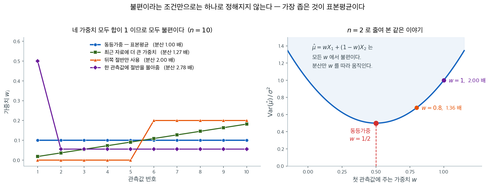
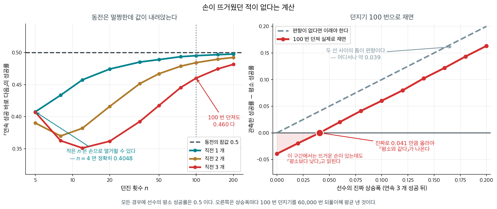
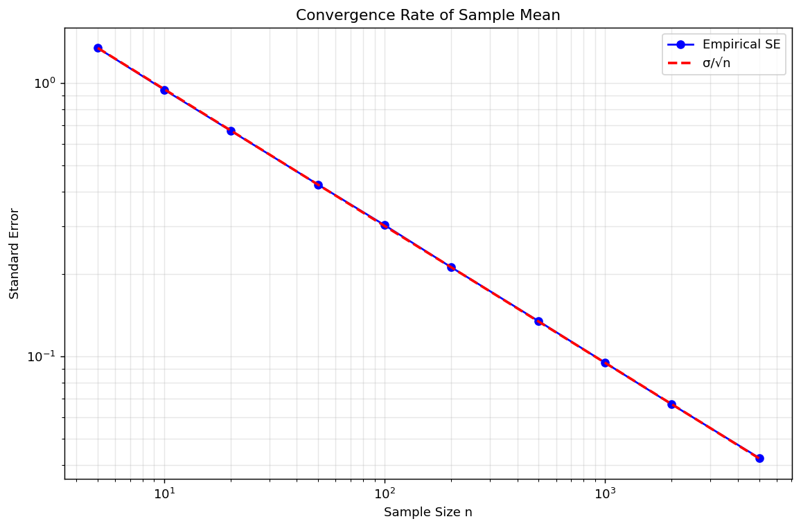

# 추정량으로서의 표본평균

## 1. 들어가며

**표본평균** $\bar{X} = \frac{1}{n}\sum_{i=1}^n X_i$은 통계학 전체에서 가장 근본적인 추정량이다. 모평균 $\mu = E[X]$의 자연스러운 추정량 역할을 하며, 추정이론, 가설검정, 그리고 응용통계와 금융의 거의 모든 분야에서 중심적인 자리를 차지한다. 그 성질 — 왜 잘 작동하는지, 언제 최적으로 작동하는지, 언제 실패하는지 — 을 이해하는 것은 통계 실무에 필수적이다.

<div class="defn" markdown>

### 정의 1. 표본평균 { .dfn }

평균이 $\mu$이고 분산이 $\sigma^2$인 모집단에서 뽑은 확률표본 $X_1, X_2, \ldots, X_n$이 주어졌을 때 **표본평균**은:

$$\bar{X} = \frac{1}{n}\sum_{i=1}^n X_i$$

표본평균은 **통계량**(자료의 함수)이며 따라서 확률변수이다. 표본을 뽑을 때마다 값이 달라진다.

</div>

---

## 2. 성질 — 어디서 세운 것인가

이 쪽이 쓰는 표본평균의 성질 넷은 모두 다른 곳에서 세워져 있다. 여기서는 어디서 왔는지만 적고, 절 $8$ 에서 그 값들을 **직접 재어** 확인한다.

| 성질 | 값 | 세운 곳 |
|---|---|---|
| 기댓값 | $E[\bar X] = \mu$ — 모집단 모양과 $n$ 에 무관하다 | 5.12절 [표본평균의 편향과 일치성](bias_consistency.md) 정리 |
| 분산 | $\operatorname{Var}(\bar X) = \sigma^2/n$, $\operatorname{SE} = \sigma/\sqrt n$ | 5.4절 [평균의 표집분포](../applications/sample_mean.md) 정리 1 |
| 평균제곱오차 | 불편이므로 $\operatorname{MSE}(\bar X) = \sigma^2/n$ | 5.11절 [편향–분산 분해와 평균제곱오차](../estimators/bias_variance.md) 보기 1 |
| 분포 | 정규모집단이면 정확히 $N(\mu, \sigma^2/n)$, 일반 모집단이면 중심극한정리로 근사 | 5.4절의 네 쪽이 모집단마다 따로 본다 |

표준오차를 절반으로 줄이려면 표본을 **네 배**로 늘려야 한다는 것이 둘째 줄의 따름이고, 절 $8$ 의 보기 $4$ 가 그 $1/\sqrt n$ 을 $n = 5$ 에서 $5000$ 까지 재어 본다.

---

## 3. 최적성

표본평균이 **왜** 기본값인지는 두 갈래로 답할 수 있다. 하나는 정보의 한계에 닿는다는 것이고(정규모집단에서 $\bar X$ 는 최소분산불편추정량이며 충분통계량이다 — 7장 [효율성과 Cramér-Rao 하한](../../ch07/theory/efficiency_crlb.md)이 다룬다), 다른 하나는 **선형이라는 틀 안에서는 분포를 묻지 않고도** 최선이라는 것이다. 뒤쪽을 여기서 본다.

### Gauss-Markov 정리

선형회귀 맥락 $Y = X\beta + \epsilon$에서 OLS 추정량($X = \mathbf{1}$인 특수한 경우로 $\bar{X}$를 포함한다)은 **최량선형불편추정량(BLUE)**이다. 오차의 분포와 무관하게 모든 선형 불편추정량 중에서 분산이 가장 작다.

이 정리가 정확히 무엇을 골라내는지 보려면 경쟁자들을 한자리에 놓아 보면 된다. 선형추정량 $\hat{\mu} = \sum_i w_i X_i$ 는 $\sum_i w_i = 1$ 이기만 하면 **모두** 불편이고, 그 분산은 i.i.d. 아래에서

$$\operatorname{Var}(\hat{\mu}) = \sigma^2 \sum_{i=1}^n w_i^2$$

이다. 불편성은 가중치의 **합**만 붙잡고, 분산은 가중치의 **제곱합**이 정한다. 제약이 걸린 제곱합을 최소로 만드는 것은 모든 성분이 같을 때이므로, 답은 $w_i = 1/n$ — 표본평균이다.



왼쪽에 $n = 10$ 일 때의 가중치 네 벌을 그렸다. 네 벌 모두 합이 정확히 1이므로 **넷 다 불편이다** — 불편성만으로는 이 중에서 하나를 고를 수 없다. 그런데 분산은 제각각이다. 동등가중을 $1$ 배로 놓으면, 최근 자료에 선형으로 더 큰 가중치를 주는 방식이 $1.27$ 배, 뒤쪽 절반만 쓰는 방식이 $2.00$ 배, 한 관측값에 절반을 몰아주는 방식이 $2.78$ 배다. 마지막 것은 관측값 10개를 들고도 사실상 $n = 3.6$ 개만큼의 정밀도밖에 내지 못한다는 뜻이다.

오른쪽은 같은 이야기를 $n = 2$ 로 줄여 본 것이다. $\hat{\mu} = wX_1 + (1-w)X_2$ 의 분산은 $\sigma^2[w^2 + (1-w)^2]$ 으로 $w = 1/2$ 에서 바닥을 친다. 골짜기가 바닥 근처에서 평평하다는 점도 읽어 둘 만하다. $w = 0.8$ 로 꽤 치우쳐도 분산은 $1.36$ 배에 그치지만, $w = 1$ 로 관측값 하나를 완전히 버리면 $2.00$ 배가 된다. **약간의 불균형은 싸고, 관측값을 버리는 것은 비싸다.** 가중평균이 유용해지는 경우는 관측값들의 정밀도가 실제로 다를 때뿐이며, 그때의 최적 가중치는 뒤에 나오는 역분산 가중이다.

정규 자료에서 $\bar X$ 가 대안들을 얼마나 앞서는지를 수로 줄 세우는 일은 5.12절 [표본평균의 효율성](efficiency.md)이 맡는다 — 중앙값이 $2/\pi \approx 0.637$, $10\%$ 절사평균이 $0.95$ 쯤이고, 꼬리가 두꺼워지면 그 서열이 뒤집힌다.

---

## 4. i.i.d.가 아닌 자료에서의 표본평균

### 상관된 관측값

관측값이 상관되어 있으면(시계열에서 흔하다) 분산 공식이 달라진다:

$$\text{Var}(\bar{X}) = \frac{1}{n^2}\sum_{i=1}^n\sum_{j=1}^n \text{Cov}(X_i, X_j)$$

자기상관이 $\rho_k = \text{Corr}(X_t, X_{t+k})$인 정상 자료에 대해:

$$\text{Var}(\bar{X}) = \frac{\sigma^2}{n}\left(1 + 2\sum_{k=1}^{n-1}\left(1 - \frac{k}{n}\right)\rho_k\right)$$

자기상관이 양수이면 $\text{Var}(\bar{X}) > \sigma^2/n$이다 — 유효표본크기가 $n$보다 작다. 그 비가 실제로 얼마가 되는지는 5.12절 [표본평균의 편향과 일치성](bias_consistency.md) 보기 $2$ 가 AR(1) 에서 재어 본다.

### 가중평균

관측값의 신뢰도가 서로 다를 때는 **가중평균**을 쓴다:

$$\bar{X}_w = \frac{\sum_{i=1}^n w_i X_i}{\sum_{i=1}^n w_i}$$

$\text{Var}(X_i) = \sigma_i^2$이고 관측값이 독립이면 최적 가중치는 $w_i = 1/\sigma_i^2$(역분산 가중)이고, 이때

$$\text{Var}(\bar{X}_w) = \frac{1}{\sum_{i=1}^n 1/\sigma_i^2}$$

---

## 5. 표본평균이 실패할 때

$\bar X$ 가 언제나 최선인 것은 아니고, 무너지는 네 자리에는 각각 전담 쪽이 있다. 5.14절이 그 절을 통째로 쓴다.

- **꼬리가 두꺼운 분포** — [꼬리가 두꺼운 분포](../non_normal/heavy_tails.md)와 [코시분포에서 큰수의 법칙의 실패](../non_normal/cauchy_lln_failure.md). 분산이 무한하거나 평균이 아예 없을 수 있다.
- **오염된 자료** — [오염을 늘리면 어느 평균이 먼저 무너지는가](robust_means.md). 극단값 하나가 $\bar X$ 를 얼마든지 옮긴다.
- **치우친 분포** — [치우친 분포](../non_normal/skewed.md). 평균이 가장 쓸모 있는 요약이 아닐 수 있다.
- **비정규 모집단의 작은 표본** — 5.4절의 네 쪽이 모집단마다 중심극한정리가 어디서부터 믿을 만한지를 잰다.

---

## 6. 금융과의 연결

표본평균은 금융에서 어디에나 쓰이지만, 그 한계가 특히 중요하다:

- **기대수익률 추정**: 과거 수익률의 표본평균이 기대수익률의 표준적인 추정량이지만, 악명 높을 만큼 부정확하다. 연간 수익률 변동성이 20%이고 자료가 50년치라는 전형적인 설정에서 $\text{SE}(\bar{X}) \approx 20\%/\sqrt{50} \approx 2.8\%$인데, 이는 전형적인 위험프리미엄에 비해 크다.

- **Sharpe 비율**: $\hat{SR} = \bar{X}/S$는 $\bar{X}$의 부정확성을 그대로 물려받는다. 분자의 추정오차가 지배한다.

- **시계열 종속성**: 금융 수익률은 변동성 군집을 비롯한 여러 형태의 종속성을 보이므로, 표준적인 $\sigma/\sqrt{n}$ 공식은 불확실성을 과소평가한다.

- **포트폴리오 최적화**: 평균-분산 최적화가 추정된 평균에 민감하다는 사실은 잘 알려져 있다(추정오차가 지배하여 극단적인 가중치가 나온다). 축소추정량과 Bayes 접근이 이를 다룬다.

<div class="aibox" markdown>

**AI로 보는 통계학 1.** 더해서 재는 평균과 곱해서 재는 평균

위 첫 줄의 「기대수익률 추정」에는 표준오차 말고 또 하나의 함정이 있다. 정의 1 의 표본평균은
**더해서 재는** 평균인데, 투자자에게 실제로 남는 것은 **곱해서 쌓인** 것이다. 두 평균의
관계는 한 줄로 적힌다 — $\dfrac{x+y}{2}\ge\sqrt{xy}$ 이고 등호는 $x=y$ 일 때뿐이다. 두
평균이 **언제나 같은 쪽으로만** 벌어지고, 벌어진 양이 곧 $x$ 와 $y$ 가 **얼마나 다른가**라는
뜻이다.

한 걸음마다 값이 어떤 배율로 곱해지는 일을 생각해 보자. 배율이 번갈아 $1.5$ 와 $0.6$ 이면
**평균 배율은 $\frac{1.5+0.6}{2}=1.05$** 로 $1$ 보다 크다. 그런데 실제로 남는 것은 곱이다.
네 쌍을 나란히 놓고 두 평균과, 그 배율을 번갈아 스무 번 곱한 결과를 함께 찍어 본다.

```python
from math import sqrt                     # 기하평균을 재는 데 제곱근만 있으면 된다

pairs = [(1.50, 0.60), (1.20, 0.85), (1.10, 0.95), (1.05, 1.05)]

print("  두 배율 x, y    산술평균 (x+y)/2   기하평균 √(xy)   차     20 번 되풀이한 뒤")
for x, y in pairs:
    am, gm = (x + y) / 2, sqrt(x * y)     # 산술평균은 기하평균보다 작지 않다
    after = (x * y) ** 10                 # x, y 를 번갈아 20 번 곱하면 (xy)^10 이다
    print(f"   {x:.2f}, {y:.2f}       {am:.4f}          {gm:.4f}      {am-gm:.4f}        {after:.4f}")
```

실행하면 다음이 나온다.

```text
  두 배율 x, y    산술평균 (x+y)/2   기하평균 √(xy)   차     20 번 되풀이한 뒤
   1.50, 0.60       1.0500          0.9487      0.1013        0.3487
   1.20, 0.85       1.0250          1.0100      0.0150        1.2190
   1.10, 0.95       1.0250          1.0223      0.0027        1.5530
   1.05, 1.05       1.0500          1.0500      0.0000        2.6533
```

첫 줄이 요점이다. **평균 배율이 $1.05$ 인데 스무 걸음 뒤에 남은 것은 $0.35$ 다.** 쌓이는 것은
산술평균이 아니라 기하평균이고, 기하평균은 $0.9487$ 로 $1$ 보다 작기 때문이다. 계속 가면

```python
# 첫 줄(1.5, 0.6)만 더 멀리 끌고 가 본다 — 기하평균 0.9487 이 그대로 쌓인다
for n in (10, 20, 50, 100):
    print(f"    {n:3d} 번: {0.9 ** (n // 2):.6f}", end="")   # (1.5*0.6)^(n/2) = 0.9^(n/2)
print()
```

```text
     10 번: 0.590490     20 번: 0.348678     50 번: 0.071790    100 번: 0.005154
```

로 $0$ 에 붙는다. 마지막 줄과 견주어 보면 더 또렷하다 — 배율이 **늘 $1.05$** 이면 같은
스무 걸음에 $2.65$ 가 된다. 평균이 같은데 결과가 **일곱 배 넘게** 갈리고, 그 차이를 만든
것이 두 평균 사이의 간격 $0.1013$ 하나다. **흔들리는 것은 그 자체로 값을 깎는다.** 수익률을
표본평균으로 요약해 보고할 때, 변동성이 큰 자산일수록 그 수가 투자자가 실제로 겪은 것보다
후하게 나오는 까닭이 이것이다.

기계를 다룰 때 이것이 어디서 나타나는가. 낱말을 하나씩 이어 붙여 문장을 만드는 모형에서
문장 전체의 확률은 낱말마다의 확률을 **곱한 것**이다. 그러니 「한 낱말당 평균 확률」을 말할
때 산술평균을 쓰면 실제보다 훨씬 좋아 보인다. 그래서 이런 자리에서는 **로그를 씌워 더한 뒤
되돌리는 것** — 곧 기하평균 — 으로 적는다. 층을 겹겹이 쌓은 모형에서 각 층의 배율이 곱해지는
것도, 한 걸음마다 가중치가 곱해지며 커지거나 사그라드는 것도 모두 같은 꼴이다. **곱으로
쌓이는 자리에서는 산술평균이 거짓말을 한다.**

다만 이 부등식이 말해 주는 것은 **방향뿐**이다. 기하평균이 더 작다는 것은 언제나 참이지만,
얼마나 작은지는 흩어진 정도에 달려 있고 그것을 미리 알 길이 없다. 그래서 실제로는 흔들림을
줄이는 쪽으로 — 배율이 한쪽으로 쏠리지 않게, 값의 크기를 층마다 다시 맞추는 쪽으로 — 손을
쓰고, 얼마나 줄여야 하는지는 해 보고 안다.

</div>

## 7. 핵심 공식

| 양 | 공식 |
|----------|---------|
| 표본평균 | $\bar{X} = \frac{1}{n}\sum X_i$ |
| $E[\bar{X}]$ | $\mu$ (불편) |
| $\text{Var}(\bar{X})$ | $\sigma^2/n$ |
| 표준오차 | $\sigma/\sqrt{n}$ |
| 정규일 때 정확한 분포 | $\bar{X} \sim N(\mu, \sigma^2/n)$ |
| 중심극한정리 | $\sqrt{n}(\bar{X} - \mu)/\sigma \to N(0,1)$ |
| Cramér-Rao 하한 | $\sigma^2/n$ (달성됨) |

## 8. 성질을 수로 확인하기

절 $2$ 의 표가 **어디서 세웠는지**만 적은 성질들 — 불편성,
$\operatorname{Var}(\bar X) = \sigma^2/n$, 그리고 $1/\sqrt n$ 수렴 — 을 여기서
모의실험으로 하나씩 짚는다. 모양이 제각각인 모집단에서 같은 결과가 나오는지가
요점이고, 역분산 가중은 절 $3$ 의 논증이 예고한 것을 수로 받는다.

<div class="exbox" markdown>

**보기 1.** <span class="diff easy" title="쉬움"></span> 분포를 바꿔 가며 확인하는 불편성. 모양이 제각각인 여섯 모집단에서 $n = 20$씩 뽑아 $\bar X$를 10만 번 기록하고 그 평균을 참값과 견준다.

**(1)** 모의실험으로 얻은 "편향"이 **0 이 되리라 기대해서는 안 된다.** 각 분포에서 그 값이 얼마만큼 흔들릴지 미리 적으시오.

**(2)** 출력의 여섯 편향을 (1)의 자로 재어, 불편성이 확인되었다고 말할 수 있는지 판정하시오.

</div>

??? success "풀이"

    **(1) 이론값.** $E[\bar X] = \mu$는 기댓값의 선형성만으로 나오는 **정확한 등식**이다. 그런데 모의실험이 내놓는 것은 $E[\bar X]$가 아니라 10만 개의 $\bar X$를 다시 평균한 값이고, 그것 역시 확률변수다. 되풀이 횟수를 $B$라 하면

    $$
    \operatorname{sd}\!\left(\frac1B\sum_{b=1}^B \bar X^{(b)}\right)
    = \frac{\operatorname{sd}(\bar X)}{\sqrt B}
    = \frac{\sigma}{\sqrt{nB}}
    $$

    이다. $n = 20$, $B = 10^5$이므로 $\sqrt{nB} = \sqrt{2 \times 10^6} = 1414.2$이고, 모의 편향의 표준오차는 **모집단 표준편차를 $1414$로 나눈 값**이다.

    | 모집단 | $\sigma$ | 몬테카를로 표준오차 |
    |:---|---:|---:|
    | $N(10, 3^2)$ | $3$ | $0.002121$ |
    | $\text{Exp}(\lambda = 0.5)$ | $2$ | $0.001414$ |
    | $\text{Poisson}(3.7)$ | $\sqrt{3.7} = 1.9235$ | $0.001360$ |
    | $\text{Uniform}(2, 8)$ | $6/\sqrt{12} = 1.7321$ | $0.001225$ |
    | $\text{Bernoulli}(0.4)$ | $\sqrt{0.24} = 0.4899$ | $0.000346$ |
    | $\chi^2_5$ | $\sqrt{10} = 3.1623$ | $0.002236$ |

    **자가 분포마다 다르다는 점이 중요하다.** 베르누이의 자는 $\chi^2_5$의 자보다 $6.5$배 촘촘하므로, 같은 $0.0009$라도 한쪽에서는 큰 수이고 다른 쪽에서는 작은 수다.

    **(2) 수치적으로.**

    ```python
    import numpy as np

    def verify_unbiasedness(mu=10.0, sigma=3.0, n=20, n_sim=100_000, seed=42):
        """표본평균이 모집단 모양과 무관하게 불편임을 모의실험으로 확인한다.

        E[X-bar] = mu 는 정규성을 쓰지 않고 기댓값의 선형성만으로 나오는 결과다.
        그래서 치우친 분포든 이산분포든 똑같이 성립해야 한다.
        """
        rng = np.random.default_rng(seed)

        # 모양이 제각각인 여섯 모집단. 값은 (표본을 뽑는 함수, 참 평균) 짝이다.
        distributions = {
            f'Normal({mu}, {sigma}²)': (lambda: rng.normal(mu, sigma, n), mu),
            'Exp(λ=0.5)':             (lambda: rng.exponential(2, n), 2.0),
            'Poisson(3.7)':           (lambda: rng.poisson(3.7, n), 3.7),
            'Uniform(2, 8)':          (lambda: rng.uniform(2, 8, n), 5.0),
            'Bernoulli(0.4)':         (lambda: rng.binomial(1, 0.4, n), 0.4),
            'Chi²(df=5)':             (lambda: rng.chisquare(5, n), 5.0),
        }

        for name, (sampler, true_mu) in distributions.items():
            # 크기 n 인 표본을 10만 번 뽑아 그때마다 표본평균을 기록한다.
            estimates = np.array([sampler().mean() for _ in range(n_sim)])
            # 그 10만 개의 평균이 참 평균에 얼마나 가까운지가 편향이다.
            bias = estimates.mean() - true_mu
            print(f"{name:<22} True μ={true_mu:.4f}  E[X̄]={estimates.mean():.4f}  Bias={bias:.6f}")
    verify_unbiasedness()
    ```

    출력:

    ```
    Normal(10.0, 3.0²)     True μ=10.0000  E[X̄]=10.0017  Bias=0.001681
    Exp(λ=0.5)             True μ=2.0000  E[X̄]=1.9992  Bias=-0.000795
    Poisson(3.7)           True μ=3.7000  E[X̄]=3.7002  Bias=0.000242
    Uniform(2, 8)          True μ=5.0000  E[X̄]=4.9996  Bias=-0.000395
    Bernoulli(0.4)         True μ=0.4000  E[X̄]=0.4009  Bias=0.000895
    Chi²(df=5)             True μ=5.0000  E[X̄]=5.0006  Bias=0.000617
    ```

    (1)의 자로 재면 이렇다.

    | 모집단 | 모의 편향 | 몬테카를로 표준오차 | $z$ |
    |:---|---:|---:|---:|
    | $N(10, 3^2)$ | $+0.001681$ | $0.002121$ | $+0.79$ |
    | $\text{Exp}(\lambda = 0.5)$ | $-0.000795$ | $0.001414$ | $-0.56$ |
    | $\text{Poisson}(3.7)$ | $+0.000242$ | $0.001360$ | $+0.18$ |
    | $\text{Uniform}(2, 8)$ | $-0.000395$ | $0.001225$ | $-0.32$ |
    | $\text{Bernoulli}(0.4)$ | $+0.000895$ | $0.000346$ | $+2.58$ |
    | $\chi^2_5$ | $+0.000617$ | $0.002236$ | $+0.28$ |

    **다섯 줄은 $1$ 표준오차 안이고 한 줄이 $2.58$이다.** 겉보기 수만 보면 베르누이의 $0.0009$는 여섯 가운데 가장 작은 축인데, 자로 재면 가장 멀다. $\sigma = 0.49$로 모집단 자체가 가장 좁아 그만큼 모의실험이 정밀해졌기 때문이다.

    $z = 2.58$은 우연으로 설명되는가. 한 번만 보면 양측 $p = 0.0099$로 드물지만, **여섯 줄 가운데 가장 큰 것을 골라 보고 있다.** 여섯 개가 독립이므로 최댓값이 $2.58$을 넘을 확률은 $1 - (1-0.0099)^6 = 0.058$이고, 스무 번에 한 번쯤 일어나는 일이다. 더구나 $E[\bar X] = \mu$는 **증명된 등식**이라 모의실험이 반증할 수 있는 종류의 주장이 아니다. 되풀이를 늘리면 $z$는 머물고 편향 자체가 $1/\sqrt B$로 줄어든다.

    **그러므로 (2)의 답은 "확인되었다"이다.** 다만 확인의 뜻이 "편향이 0 으로 나왔다"가 아니라 **"편향이 몬테카를로 잡음과 구별되지 않는다"**임을 분명히 해야 한다. 되풀이가 유한한 모의실험은 그 이상을 말해 줄 수 없다.

!!! tip "핵심"
    모든 편향이 (몬테카를로 잡음 범위 안에서) 무시할 만큼 작아, 시험한 모든 분포에서 $E[\bar{X}] = \mu$임이 확인된다.

<div class="storybox" markdown>

**그림으로 보는 통계학 1.** 손이 뜨거웠던 적이 없다는 계산

$E[\bar X] = \mu$ 는 증명된 등식이다. 다만 그 증명에는 조용한 전제가 하나 있다 — **평균 낼
것을 미리 정해 두었다**는 것이다. 어느 관측을 평균에 넣을지 자료를 보고 고르면 등식이
무너진다. 그것도 생각보다 훨씬 크게.

길로비치와 발론과 트버스키는 1985 년에 농구의 **뜨거운 손**을 쟀다. 연달아 몇 개를 넣은
바로 다음의 성공률이 그 선수의 평소 성공률보다 높은가. 답은 「높지 않다」였다. 이 결과는
사람이 무작위에서 없는 무늬를 본다는 이야기의 대표 보기가 되어 삼십 년 넘게 인용되었다.

2018 년에 밀러와 산후르호가 『이코노메트리카』에 그 계산 자체에 편향이 있다고 적었다.
이렇게 하면 보인다. 공평한 동전을 $n$ 번 던지고, **앞면이 나온 바로 다음 던지기들만 모아**
앞면 비율을 낸다. 그 값의 기댓값은 $1/2$ 이 아니라 **$1/2$ 보다 작다.**

$n = 4$ 면 손으로 열거할 수 있다. $16$ 가지 가운데 앞면 다음이 한 번도 없는 두 가지를
빼면 $14$ 가지가 남고, 그 $14$ 개 비율의 평균이 정확히 $0.4048$ 이다. 동전은 멀쩡하다.
**「앞면 다음」이라는 조건으로 자리를 고르는 행위**가 편향을 만든다. 앞면 다음이 뒷면이면
그 뒷면은 다시 조건이 되지 못하고 수열이 거기서 끊기므로, 고른 자리들에 뒷면이 과하게
담긴다.

<figure markdown>
{ width="900" }
  <figcaption markdown>선수의 평소 성공률은 모두 $0.5$ 다. 왼쪽 곡선이 $0.5$ 에 닿지 못하는 것이 편향이고, 조건으로 거는 연속 횟수가 늘수록 깊어진다.</figcaption>
</figure>

$n$ 이 커지면 편향이 줄지만 느리다. 그리고 조건을 **연속 $3$ 개**로 걸면 — 길로비치 등이
실제로 쓴 조건이다 — 훨씬 느려진다. 던지기 $100$ 번, 연속 $3$ 개 조건에서 뜨거운 손이
**전혀 없는** 선수의 관측값이 $0.461$ 이다. 평소보다 $0.039$ 낮다.

오른쪽이 그 뜻이다. 선수의 진짜 상승폭을 $0$ 에서 $0.20$ 까지 바꾸어 가며 관측값을 재면,
관측된 상승폭이 참값보다 어디서나 약 $0.039$ 아래에 있다. 그래서 관측값이 평소 성공률과
**같아 보이려면 선수가 진짜로 $0.041$ 만큼 올라야 한다.** 뒤집어 말하면 — 1985 년 자료에서
나온 「평소와 다르지 않다」는 뜨거운 손이 없다는 증거가 아니라 **$0.04$ 쯤 있다는 증거**였다.

이 쪽 $1$ 절이 모의실험으로 확인한 것은 「미리 정한 것들의 평균은 불편이다」이다. 어느 것을
평균 낼지가 자료에 달려 있으면 그 결론은 더 이상 적용되지 않는다. 이 책 곳곳에
같은 모양이 나온다 — 고르는 데 자료를 한 번 쓰고, 고른 뒤의 계산은 그 사실을 모른다.

_확인한 곳 — 길로비치·발론·트버스키의 $1985$ 년 뜨거운 손 연구와, 밀러·산후르호의 「Surprised by the Hot Hand Fallacy? A Truth in the Law of Small Numbers」(『Econometrica』 $86$ 권 $6$ 호 $2019$–$2047$ 쪽, $2018$)가 **연속 선택 편향**을 보여 원 연구의 결론을 뒤집었다는 것. 그 논문도 같은 동전 보기를 드는데, 연속 $3$ 개 조건에서 기대 비율이 $0.5$ 가 아니라 $0.4167$ 쯤이라고 적었다. 위의 $n=4$ 짜리 열거값 $17/42 = 0.40476$ 과 나머지 수는 모두 직접 계산하거나 모의실험한 값이다_

</div>

<div class="exbox" markdown>

**보기 2.** <span class="diff easy" title="쉬움"></span> 분산과 평균제곱오차. $N(10, 3^2)$에서 $n$을 $5$에서 $500$까지 바꾸며 $\bar X$를 10만 번씩 기록하고, 분산·평균제곱오차·표준오차를 이론값과 나란히 적는다.

**(1)** $\operatorname{Var}(\bar X) = \sigma^2/n$과 $\operatorname{MSE}(\bar X) = \operatorname{Var}(\bar X)$를 유도하시오. 출력에서 $\operatorname{Var}$ 열과 $\operatorname{MSE}$ 열이 **완전히 같지는 않을** 터인데, 그 차이는 얼마여야 하는가.

**(2)** 여섯 줄의 어긋남이 몬테카를로 오차로 설명되는지 재시오.

</div>

??? success "풀이"

    **(1) 해석적으로.** 독립이면 분산이 더해진다. $\operatorname{Var}(aX) = a^2\operatorname{Var}(X)$를 함께 쓰면

    $$
    \operatorname{Var}(\bar X)
    = \operatorname{Var}\!\left(\frac1n\sum_i X_i\right)
    = \frac{1}{n^2}\sum_i \operatorname{Var}(X_i)
    = \frac{n\sigma^2}{n^2}
    = \frac{\sigma^2}{n}
    $$

    이다. 둘째 등호에서만 독립성을 썼다. 평균제곱오차는 편향제곱과 분산의 합인데 보기 1에서 편향이 $0$이므로

    $$
    \operatorname{MSE}(\bar X) = \underbrace{(E[\bar X]-\mu)^2}_{=\,0} + \operatorname{Var}(\bar X) = \frac{\sigma^2}{n}
    $$

    이다. **$\operatorname{MSE}$와 $\operatorname{Var}$가 같다는 것은 불편성의 따름정리**이지 따로 증명할 일이 아니다.

    그런데 코드가 재는 것은 둘이 조금 다르다. $\operatorname{Var}$ 열은 $\frac1B\sum_b(\bar X^{(b)} - \overline{\bar X})^2$이고 $\operatorname{MSE}$ 열은 $\frac1B\sum_b(\bar X^{(b)} - \mu)^2$이다. **중심을 표본평균으로 잡았느냐 참값으로 잡았느냐**가 다르고, 그 차이는 정확히

    $$
    \operatorname{MSE}_{\text{모의}} - \operatorname{Var}_{\text{모의}} = (\overline{\bar X} - \mu)^2
    $$

    곧 **모의 편향의 제곱**이다. 보기 1에서 보았듯 그 편향은 $\sigma/\sqrt{nB}$ 규모이므로 차이는 $\sigma^2/(nB)$ 규모, 곧 이론 분산의 $1/B = 10^{-5}$배다. $n = 5$ 줄에서 $1.8 \times 10^{-5}$쯤 되어야 한다.

    표준오차 열은 분산 열의 제곱근일 뿐 새 정보가 아니다. 이론값만 적어 두면

    | $n$ | $\sigma^2/n$ | $\sigma/\sqrt n$ |
    |---:|---:|---:|
    | $5$ | $1.800000$ | $1.341641$ |
    | $10$ | $0.900000$ | $0.948683$ |
    | $25$ | $0.360000$ | $0.600000$ |
    | $50$ | $0.180000$ | $0.424264$ |
    | $100$ | $0.090000$ | $0.300000$ |
    | $500$ | $0.018000$ | $0.134164$ |

    이고, 모의 분산의 상대 몬테카를로 오차는 $\sqrt{2/B} = \sqrt{2/10^5} = 0.447\%$다.

    **(2) 수치적으로.**

    ```python
    def verify_variance_and_mse(mu=10.0, sigma=3.0, n_sim=100_000, seed=42):
        """Var(X-bar) = sigma^2/n 을 표본크기를 바꿔 가며 확인한다.

        불편추정량이므로 MSE 와 분산이 같아야 한다. 표에서 두 값이 같은 자리에
        오는지 보면 된다.
        """
        rng = np.random.default_rng(seed)
        sample_sizes = [5, 10, 25, 50, 100, 500]

        for n in sample_sizes:
            # (n_sim, n) 배열이므로 행 하나가 표본 하나다. axis=1 로 접으면
            # 표본마다 평균이 하나씩 나온다. 반복문 없이 한 번에 끝난다.
            samples = rng.normal(mu, sigma, (n_sim, n))
            x_bars = samples.mean(axis=1)

            var_xbar   = x_bars.var(ddof=0)
            theory_var = sigma**2 / n
            mse        = np.mean((x_bars - mu)**2)
            se         = x_bars.std(ddof=0)
            theory_se  = sigma / np.sqrt(n)

            print(f"n={n:>4}  Var(X̄)={var_xbar:.6f}  σ²/n={theory_var:.6f}  "
                  f"MSE={mse:.6f}  SE={se:.6f}  σ/√n={theory_se:.6f}")
    verify_variance_and_mse()
    ```

    출력:

    ```
    n=   5  Var(X̄)=1.807662  σ²/n=1.800000  MSE=1.807665  SE=1.344493  σ/√n=1.341641
    n=  10  Var(X̄)=0.892618  σ²/n=0.900000  MSE=0.892629  SE=0.944785  σ/√n=0.948683
    n=  25  Var(X̄)=0.361480  σ²/n=0.360000  MSE=0.361485  SE=0.601232  σ/√n=0.600000
    n=  50  Var(X̄)=0.180013  σ²/n=0.180000  MSE=0.180013  SE=0.424279  σ/√n=0.424264
    n= 100  Var(X̄)=0.090037  σ²/n=0.090000  MSE=0.090038  SE=0.300062  σ/√n=0.300000
    n= 500  Var(X̄)=0.018063  σ²/n=0.018000  MSE=0.018063  SE=0.134397  σ/√n=0.134164
    ```

    모의 분산을 이론값으로 나눈 비와, 그 비의 몬테카를로 표준오차 $0.447\%$로 잰 거리를 적으면 이렇다.

    | $n$ | 모의 $\operatorname{Var}$ | $\sigma^2/n$ | 비 | $z$ | $\operatorname{MSE} - \operatorname{Var}$ |
    |---:|---:|---:|---:|---:|---:|
    | $5$ | $1.807662$ | $1.800000$ | $1.00426$ | $+0.95$ | $3 \times 10^{-6}$ |
    | $10$ | $0.892618$ | $0.900000$ | $0.99180$ | $-1.83$ | $11 \times 10^{-6}$ |
    | $25$ | $0.361480$ | $0.360000$ | $1.00411$ | $+0.92$ | $5 \times 10^{-6}$ |
    | $50$ | $0.180013$ | $0.180000$ | $1.00007$ | $+0.02$ | $0$ |
    | $100$ | $0.090037$ | $0.090000$ | $1.00041$ | $+0.09$ | $1 \times 10^{-6}$ |
    | $500$ | $0.018063$ | $0.018000$ | $1.00350$ | $+0.78$ | $0$ |

    **여섯 줄 모두 $2$ 표준오차 안이다.** 가장 멀리 간 $n = 10$이 $-1.83$이고, 나머지는 $1$ 안팎이다. 이론값을 $0.447\%$ 자로 재어 확인한 것이므로, "$0.8926$이 $0.9$와 다르다"를 결함으로 읽어서는 안 된다.

    **$\operatorname{MSE}$ 열과 $\operatorname{Var}$ 열의 차이도 (1)이 예측한 그대로다.** $n = 5$에서 $1.807665 - 1.807662 = 3 \times 10^{-6}$이고, (1)이 어림한 $\sigma^2/(nB) = 1.8 \times 10^{-5}$와 같은 자릿수다(그 어림은 편향제곱의 **기댓값**이고 실제는 한 번 뽑은 값이라 들쭉날쭉하다). $n = 50$과 $n = 500$ 줄에서는 둘이 소수 여섯째 자리까지 완전히 같아 차이가 보이지 않는다.

    **요점은 두 열이 같다는 사실 자체가 아니라 같아야 하는 까닭이다.** $\operatorname{MSE} = \text{편향}^2 + \operatorname{Var}$에서 편향이 $0$이기 때문이고, 편향이 있는 추정량에서는 두 열이 갈라진다. 바로 그 갈라짐을 보는 것이 6.1절 [정규분포의 최대가능도](../../ch06/mle/mle_normal.md) 6절의 주제다.

<div class="exbox" markdown>

**보기 3.** <span class="diff easy" title="쉬움"></span> 역분산 가중평균. 같은 양 $\mu = 5$를 정밀도가 다른 기계 다섯 대로 한 번씩 잰다. 표준편차는 $(1, 2, 5, 10, 0.5)$다.

**(1)** 단순평균의 분산과, 가중치를 최적으로 골랐을 때의 분산을 구하시오. 최적 가중치가 $w_i \propto 1/\sigma_i^2$임을 유도하시오.

**(2)** 분산이 몇 퍼센트 줄어드는지 예측하고 모의실험으로 확인하시오. 가장 정밀한 기계 하나가 가중치를 얼마나 가져가는가.

</div>

??? success "풀이"

    **(1) 해석적으로.** 관측값이 독립이고 $\operatorname{Var}(X_i) = \sigma_i^2$, $E[X_i] = \mu$다. 가중평균 $\sum_i w_i X_i$가 불편이려면 $\sum_i w_i = 1$이어야 하고, 그때

    $$
    \operatorname{Var}\!\left(\sum_i w_i X_i\right) = \sum_i w_i^2 \sigma_i^2
    $$

    이다. 제약 $\sum w_i = 1$ 아래 이것을 최소화한다. 라그랑주 함수 $\sum_i w_i^2\sigma_i^2 - \lambda(\sum_i w_i - 1)$을 $w_i$로 미분하면

    $$
    2w_i\sigma_i^2 - \lambda = 0
    \quad\Longrightarrow\quad
    w_i = \frac{\lambda}{2\sigma_i^2} \;\propto\; \frac{1}{\sigma_i^2}
    $$

    이다. 목적함수가 $w$에 대해 볼록(해세가 $\operatorname{diag}(2\sigma_i^2) \succ 0$)하고 제약이 선형이므로 이 정류점이 유일한 최소다. 정규화하면

    $$
    w_i = \frac{1/\sigma_i^2}{\sum_j 1/\sigma_j^2},
    \qquad
    \operatorname{Var}_{\min} = \sum_i w_i^2\sigma_i^2 = \frac{1}{\sum_j 1/\sigma_j^2}
    $$

    이다. **최소 분산의 역수가 정밀도의 합**이라는 깔끔한 꼴이다.

    수를 넣는다. $\sigma^2 = (1, 4, 25, 100, 0.25)$이므로

    $$
    \operatorname{Var}(\bar X) = \frac{1}{5^2}\sum_i \sigma_i^2 = \frac{130.25}{25} = 5.21
    $$

    $$
    \sum_i \frac{1}{\sigma_i^2} = 1 + 0.25 + 0.04 + 0.01 + 4 = 5.3,
    \qquad
    \operatorname{Var}_{\min} = \frac{1}{5.3} = 0.188679
    $$

    **(2) 예측.** 분산 감소율은

    $$
    1 - \frac{0.188679}{5.21} = 0.9638 = 96.38\%
    $$

    다. 가중치는

    $$
    w = \frac{(1,\ 0.25,\ 0.04,\ 0.01,\ 4)}{5.3}
    = (0.1887,\ 0.0472,\ 0.0075,\ 0.0019,\ 0.7547)
    $$

    이고, **가장 정밀한 다섯째 기계가 $75.5\%$를 가져간다.** 가장 엉성한 넷째 기계는 $0.19\%$로 사실상 무시된다. 단순평균은 그 넷째에게도 $20\%$를 주었고, 그래서 $\operatorname{Var}(\bar X) = 5.21$ 가운데 $\sigma_4^2/25 = 4$가, 곧 $77\%$가 그 기계 하나에서 왔다.

    되풀이 5만 번이므로 모의 분산의 상대 몬테카를로 오차는 $\sqrt{2/50000} = 0.63\%$다.

    모의실험으로 확인한다.

    ```python
    def weighted_mean_demo(mu=5.0, n_sim=50_000, seed=42):
        """정밀도가 다른 관측값 다섯 개를 어떻게 합칠지 견준다.

        같은 양을 서로 다른 기계 다섯 대로 잰 상황이다. 정밀도가 다른데도
        똑같이 더해 나누면 가장 엉성한 기계에 끌려간다.
        """
        rng = np.random.default_rng(seed)

        # 다섯 관측값의 표준편차. 마지막 하나가 가장 정밀하고 넷째가 가장 엉성하다.
        sigmas = np.array([1.0, 2.0, 5.0, 10.0, 0.5])

        # 분산의 역수를 가중값으로 쓰면 합의 분산이 가장 작아진다.
        # 합이 1 이 되도록 고르면 가중평균이 여전히 불편추정량으로 남는다.
        optimal_weights = 1 / sigmas**2
        optimal_weights /= optimal_weights.sum()

        unweighted, weighted = [], []
        for _ in range(n_sim):
            obs = rng.normal(mu, sigmas)
            unweighted.append(obs.mean())
            weighted.append(np.sum(optimal_weights * obs))

        unweighted = np.array(unweighted)
        weighted   = np.array(weighted)

        print(f"Unweighted:  Var={unweighted.var():.6f}  MSE={np.mean((unweighted-mu)**2):.6f}")
        print(f"IV-Weighted: Var={weighted.var():.6f}  MSE={np.mean((weighted-mu)**2):.6f}")
        print(f"Variance reduction: {(1 - weighted.var()/unweighted.var())*100:.1f}%")
    weighted_mean_demo()
    ```

    출력:

    ```
    Unweighted:  Var=5.182967  MSE=5.183045
    IV-Weighted: Var=0.190153  MSE=0.190153
    Variance reduction: 96.3%
    ```

    | 양 | 이론 | 모의 | 상대오차 |
    |:---|---:|---:|---:|
    | 단순평균의 분산 | $5.210000$ | $5.182967$ | $-0.52\%$ |
    | 역분산 가중의 분산 | $0.188679$ | $0.190153$ | $+0.78\%$ |
    | 분산 감소율 | $96.38\%$ | $96.3\%$ | — |

    **두 분산 모두 $0.63\%$ 자로 재어 $1$ 표준오차 안이고, 감소율이 소수 첫째 자리까지 맞는다.**

    **$96\%$라는 수의 정체를 (1)이 설명한다.** 단순평균이 나쁜 것은 $\sigma_4 = 10$짜리 기계에 $1/5$의 가중치를 준 탓이고, 그 한 대가 $\operatorname{Var}(\bar X) = 5.21$의 $77\%$를 혼자 만든다. 역분산 가중은 그 기계의 몫을 $0.19\%$로 깎고 $\sigma_5 = 0.5$짜리에게 $75.5\%$를 몰아 준다. **정밀도가 서로 많이 다를수록 가중이 주는 이득이 커지며**, 반대로 다섯 대의 $\sigma$가 모두 같으면 $w_i = 1/5$가 되어 두 방법이 완전히 일치한다.

    되풀이가 아니라 관측 하나하나에 쓰는 기법이라는 점도 적어 둘 만하다. 같은 식이 메타분석에서 연구별 결과를 합칠 때, 칼만 필터에서 예측과 측정을 합칠 때, 가중최소제곱에서 이분산을 다룰 때 그대로 나타난다. **"정밀도의 역수로 가중한다"는 한 줄이 그 모두의 뿌리다.**

<div class="exbox" markdown>

**보기 4.** <span class="diff easy" title="쉬움"></span> 표준오차의 수렴 속도. $N(5, 3^2)$에서 $n$을 $5$에서 $5000$까지 열 단계로 키우며 $\bar X$를 5만 번씩 뽑아 그 표준편차를 재고, 양로그 축에 그린다.

**(1)** 양로그 축에서 점들이 **직선**이 되는 까닭과, 그 직선의 기울기·절편이 무엇인지 적으시오.

**(2)** 모의실험한 점들에 직선을 맞춰 기울기와 절편을 재고 (1)과 견주시오.

</div>

??? success "풀이"

    **(1) 해석적으로.** $\operatorname{SE}(\bar X_n) = \sigma n^{-1/2}$의 양변에 로그를 씌우면

    $$
    \log \operatorname{SE} = \log\sigma - \tfrac12 \log n
    $$

    이다. **거듭제곱 관계가 로그-로그 평면에서 직선이 된다**는 일반 사실의 한 보기이고, 여기서

    $$
    \text{기울기} = -\tfrac12,
    \qquad
    \text{세로절편} = \log\sigma = \log 3
    $$

    이다. 절편을 지수로 되돌리면 $e^{\log 3} = 3$으로 **모표준편차 자체**가 나온다. 로그-로그 그림은 그래서 두 가지를 한 번에 재는 도구다. 기울기가 **속도**를, 절편이 **상수**를 준다.

    기울기 $-1/2$를 읽는 실용적인 방법은 이렇다. $n$을 $100$배 키우면 $\log n$이 $\log 100$만큼 늘고 $\log \operatorname{SE}$는 그 절반만큼 줄어든다. 곧 **표준오차가 $10$배 줄어든다.** 뒤집으면 표준오차를 절반으로 하려면 $n$을 네 배로 해야 한다.

    **(2) 수치적으로.** 그림을 그린 뒤 같은 점들에 1차 다항식을 맞춘다.

    ```python
    import matplotlib.pyplot as plt

    plt.rcParams["font.sans-serif"] = ["NanumGothic", "Apple SD Gothic Neo", "Malgun Gothic"]
    plt.rcParams["font.family"] = "sans-serif"
    plt.rcParams["axes.unicode_minus"] = False

    def convergence_rate_plot(mu=5.0, sigma=3.0, n_sim=50_000, seed=42):
        """표준오차가 1/sqrt(n) 으로 줄어듦을 양로그 축에서 직선으로 확인한다.

        SE = sigma * n^(-1/2) 의 양변에 로그를 씌우면 기울기 -1/2 인 직선이 된다.
        양로그 축을 쓰는 이유가 이것이다.
        """
        rng = np.random.default_rng(seed)
        sample_sizes = [5, 10, 20, 50, 100, 200, 500, 1000, 2000, 5000]

        empirical_se = []
        for n in sample_sizes:
            estimates = np.array([rng.normal(mu, sigma, n).mean() for _ in range(n_sim)])
            empirical_se.append(estimates.std())

        theoretical_se = [sigma / np.sqrt(n) for n in sample_sizes]

        fig, ax = plt.subplots(figsize=(9, 6))
        ax.loglog(sample_sizes, empirical_se, 'bo-', label='Empirical SE')
        ax.loglog(sample_sizes, theoretical_se, 'r--', label='σ/√n', linewidth=2)
        ax.set_xlabel('Sample Size n')
        ax.set_ylabel('Standard Error')
        ax.set_title('Convergence Rate of Sample Mean')
        ax.legend()
        ax.grid(True, alpha=0.3, which='both')
        plt.tight_layout()
        plt.show()

        # 점들이 정말 기울기 -1/2 인 직선 위에 있는지 로그-로그에서 회귀로 잰다.
        slope, intercept = np.polyfit(np.log(sample_sizes), np.log(empirical_se), 1)
        print(f"로그-로그 적합:  기울기 = {slope:.5f}  (이론 -0.5),  "
              f"절편 exp = {np.exp(intercept):.5f}  (이론 σ = {sigma})")
        print(f"{'n':>6} {'모의 SE':>10} {'σ/√n':>10} {'비':>8}")
        for n, e, t in zip(sample_sizes, empirical_se, theoretical_se):
            print(f"{n:>6} {e:>10.6f} {t:>10.6f} {e / t:>8.4f}")
    convergence_rate_plot()
    ```

    출력:

    ```
    로그-로그 적합:  기울기 = -0.49937  (이론 -0.5),  절편 exp = 2.99282  (이론 σ = 3.0)
         n      모의 SE       σ/√n        비
         5   1.340949   1.341641   0.9995
        10   0.944543   0.948683   0.9956
        20   0.669372   0.670820   0.9978
        50   0.424503   0.424264   1.0006
       100   0.302078   0.300000   1.0069
       200   0.212241   0.212132   1.0005
       500   0.134616   0.134164   1.0034
      1000   0.094911   0.094868   1.0005
      2000   0.066962   0.067082   0.9982
      5000   0.042612   0.042426   1.0044
    ```

    

    **기울기 $-0.49937$이 $-1/2$와 셋째 자리까지 맞고, 절편 $2.99282$가 $\sigma = 3$과 둘째 자리까지 맞는다.** 열 점의 비도 $0.9956$에서 $1.0069$ 사이에 모두 들어온다. 표준편차를 5만 번으로 잴 때의 몬테카를로 오차가 $1/\sqrt{2 \times 50000} = 0.32\%$이므로, 가장 멀리 간 $n = 100$의 $+0.69\%$가 $2.2$ 표준오차다.

    그림에서는 파란 점들과 붉은 점선이 거의 겹쳐 하나처럼 보인다. **겹치는 것 자체가 결과**이지만, 그래서 겹침의 품질을 눈으로는 가늠할 수 없다. 위의 "비" 열과 적합 기울기가 그 몫을 한다. **그림은 모양을, 수는 정밀도를 말한다.**

    기울기가 $-1/2$라는 사실의 쓴맛도 함께 적어 두자. 열 점 사이에서 $n$이 $1000$배 커지는 동안 표준오차는 $1.34$에서 $0.0426$으로 $31.5$배 줄었을 뿐이다. $\sqrt{1000} = 31.6$과 맞는 수이고, **자료를 천 배 모아야 오차가 서른 배 줄어든다**는 뜻이다. 5.12절 앞에서 본 "초과수익을 확인하려면 121년"이 바로 이 기울기의 값이다.

### 읽는 법

- **불편성**은 분포와 무관하다: 평균이 유한한 임의의 모집단에서 성립한다.
- **분산**은 $1/n$으로 줄어들므로 **표준오차**는 $1/\sqrt{n}$으로 줄어든다. 표준오차를 절반으로 줄이려면 관측값이 네 배 필요하다.
- 편향이 0이므로 **평균제곱오차가 곧 분산**이다. 편향–분산 맞바꿈의 가장 단순한 경우이다.
- **효율**은 모집단의 모양에 달려 있다. 정규 자료에서는 평균이 최적이고, 꼬리가 두꺼운 자료에서는 절사평균과 중앙값의 평균제곱오차가 더 작을 수 있다.
- **역분산 가중**은 정밀도가 다른 관측값을 결합하는 올바른 방법이며, 단순 평균에 비해 분산을 크게 줄일 수 있다.

---

---

## 연습문제

<div class="drillbox" markdown>

**연습문제 1.** <span class="diff easy" title="쉬움"></span>
어떤 전략의 연평균 수익률이 5%, 변동성이 18%이다. (a) 10년 자료에서의 표준오차. (b) 95% 신뢰구간이 0을 배제하기까지 필요한 햇수. (c) 월별 자료를 쓰면 도움이 되는가?

</div>

??? success "풀이"
    (a) $\mathrm{SE} = 0.18/\sqrt{10} \approx 0.057$. 점추정값 0.05보다 크다.

    (b) $|\mu|/\mathrm{SE} > 1.96$이 필요하다: $\sqrt n > 1.96 \cdot 0.18/0.05 \approx 7.06 \Rightarrow n \ge 50$년.

    (c) i.i.d. 가정 아래에서 월별 자료로 바꾸면 평균도 ($1/12$배로) 분산도 ($1/12$배로) 함께 축소된다. $t$-통계량은 그대로다 — 같은 달력 구간 안에서 더 자주 표본을 뽑아도 도움이 되지 않는다. 금융의 "추세 추정 문제"는 근본적으로 자료의 밀도가 아니라 *시간 범위*의 문제이다.

<div class="drillbox" markdown>

**연습문제 2.** <span class="diff med" title="중간"></span>
분산이 유한한 임의의 분포에서 **$\bar X$가 $\mu$의 BLUE**(최량선형불편추정량)임을 증명하라.

</div>

??? success "풀이"
    (불편성을 위해) $\sum w_i = 1$인 선형 불편추정량 $\hat\mu = \sum w_i X_i$를 생각하자.

    $\mathrm{Var}(\hat\mu) = \sum w_i^2 \sigma^2 = \sigma^2 \sum w_i^2$이고, 제약은 $\sum w_i = 1$이다.

    Cauchy-Schwarz 또는 Lagrange 승수법에 의해 $\sum w_i^2$은 $w_i = 1/n$(균등 가중)에서 최소가 된다. 따라서 $\bar X = (1/n)\sum X_i$는 선형 불편추정량 중 분산이 최소이다.

    분산이 유한한 i.i.d. 표본에서 $\bar X$는 분포의 모양과 무관하게 BLUE이다. 정규성 아래에서는 $\bar X$가 UMVUE이기도 하다(선형에 한하지 않고 *모든* 불편추정량 중에서 균일하게 분산이 최소).

<div class="drillbox" markdown>

**연습문제 3.** <span class="diff med" title="중간"></span>
**로버스트성의 실패.** 표본에 이상점 하나를 추가하면 $\bar X$가 얼마든지 이동함을 보여라.

</div>

??? success "풀이"
    표본 $\{X_1, \ldots, X_n, M\}$에서 $M$이 이상점 하나라고 하자. 새 평균은 $(\sum X_i + M)/(n + 1)$이다. $M \to \infty$이면 새 평균 $\to \infty$이다.

    따라서 $\bar X$의 **붕괴점**은 $1/(n+1) \to 0$이다: 오염된 관측값 하나만으로도 $\bar X$를 얼마든지 멀리 옮길 수 있다. 점근 붕괴점이 0이다.

    중앙값과 비교하면 붕괴점이 $\approx 1/2$이다 — 자료의 절반이 오염되어야 한다. 중앙값의 대가는 정규성 아래에서의 낮은 효율이다(평균 대비 약 64%).

    이상점이 있을 수 있는 실제 자료에서는 $\bar X$보다 로버스트한 위치추정량(중앙값, 절사평균, M-추정량)을 택하라.

<div class="drillbox" markdown>

**연습문제 4.** <span class="diff med" title="중간"></span>
**Bessel 수정.** $S^2 = \sum(X_i - \bar X)^2/(n-1)$의 분모가 왜 $n - 1$인가?

</div>

??? success "풀이"
    두 가지 관점이 있다:

    **대수적 관점:** $\sum(X_i - \bar X)^2 = \sum X_i^2 - n\bar X^2$. 기댓값을 취하면:

    $\mathbb{E}[\sum X_i^2] = n(\sigma^2 + \mu^2)$, $\mathbb{E}[n\bar X^2] = \sigma^2 + n\mu^2$. 빼면 $(n-1)\sigma^2$.

    $n - 1$로 나누면 $\mathbb{E}[S^2] = \sigma^2$. 불편이다.

    **기하적 관점(자유도):** 관측값 $X_i$는 제약이 없지만($n$ 자유도) 잔차 $X_i - \bar X$는 $\sum(X_i - \bar X) = 0$을 만족한다 — 선형 제약 하나. 따라서 유효 자유도는 $n - 1$이다. 분산추정은 유효 자유도로 나눈다.

    $\mu$가 알려져 있으면(예: 중심화된 자료) $\sum X_i^2/n$을 쓴다 — 소모된 자유도가 없으므로 수정도 없다.

<div class="drillbox" markdown>

**연습문제 5.** <span class="diff med" title="중간"></span>
**종속 자료의 표본평균.** $X_1, \ldots, X_n$이 AR(1)이다: $X_t = \rho X_{t-1} + \varepsilon_t$. $\rho$, $n$, $\sigma^2_\varepsilon$으로 $\mathrm{Var}(\bar X)$를 유도하라.

</div>

??? success "풀이"
    정상 AR(1)에서 $X_t = \sum_{k=0}^\infty \rho^k \varepsilon_{t-k}$이고, $\mathrm{Var}(X_t) = \sigma^2_\varepsilon/(1 - \rho^2)$, $\mathrm{Cov}(X_s, X_t) = \rho^{|s-t|} \sigma^2_\varepsilon/(1-\rho^2)$이다.

    $\mathrm{Var}(\bar X) = (1/n^2)\sum_{s, t} \mathrm{Cov}(X_s, X_t)$. 계산을 정리하면:

    $\mathrm{Var}(\bar X) \approx \frac{\sigma^2_X}{n} \cdot \frac{1 + \rho}{1 - \rho}$ (큰 $n$에 대해, $\sigma^2_X = \sigma^2_\varepsilon/(1-\rho^2)$).

    **팽창인자** $(1+\rho)/(1-\rho)$는 $\rho > 0$이면 1보다 크다. $\rho = 0.5$이면 인자가 3 — 독립 관측값 $n/3$개를 쓰는 것과 같다.

    **함의:** 종속 자료는 명목 표본크기가 같은 i.i.d. 자료보다 정보량이 적다. AR(1)의 **유효표본크기**는 $n_{\text{eff}} = n(1-\rho)/(1+\rho)$이다.

    이는 시계열 분석에서 결정적이다: 자기상관된 자료에 대해 $\mathrm{SE} = \sigma/\sqrt n$을 소박하게 계산하면 불확실성을 과소평가한다.

<div class="drillbox" markdown>

**연습문제 6.** <span class="diff med" title="중간"></span>
**가중 표본평균.** 관측값의 분산이 서로 다를 때($\mathrm{Var}(X_i) = \sigma_i^2$), $w_i \propto 1/\sigma_i^2$인 역분산 가중평균 $\hat\mu = \sum w_i X_i$가 분산을 최소화한다. 최적 $w_i$를 유도하라.

</div>

??? success "풀이"
    제약: 불편성을 위해 $\sum w_i = 1$. 분산: $\mathrm{Var}(\hat\mu) = \sum w_i^2 \sigma_i^2$.

    $\sum w_i = 1$ 아래에서 $\sum w_i^2 \sigma_i^2$을 최소화한다. Lagrangian: $L = \sum w_i^2 \sigma_i^2 - \lambda(\sum w_i - 1)$.

    $\partial L/\partial w_i = 2 w_i \sigma_i^2 - \lambda = 0 \Rightarrow w_i = \lambda/(2\sigma_i^2)$.

    정규화하면 $\lambda = 2/\sum(1/\sigma_i^2)$이므로 $w_i^* = (1/\sigma_i^2)/\sum_j(1/\sigma_j^2)$이다.

    **역분산 가중.** 최적 추정량의 분산: $\mathrm{Var}(\hat\mu^*) = 1/\sum(1/\sigma_i^2)$.

    메타분석(정밀도가 다른 연구들의 결합), Kalman 필터링(센서 측정값의 결합), 가중최소제곱 회귀에서 쓰인다.

<div class="drillbox" markdown>

**연습문제 7.** <span class="diff med" title="중간"></span>
연간 수익률의 **산술평균**과 **기하평균**의 관계를 구하고, 어느 쪽을 언제 써야 하는지 밝혀라. 산술평균 8%, 변동성 20%인 전략의 기하평균을 어림하라.

</div>

??? success "풀이"
    **관계.** 수익률 $r_t$의 기하평균은

    $$
    g = \left\{\prod_t(1+r_t)\right\}^{1/T}-1
    $$

    이고, $\ln(1+r) \approx r - r^2/2$로 전개해 평균을 취하면

    $$
    g \approx \bar r - \frac{s^2}{2}
    $$

    을 얻는다. **기하평균은 산술평균보다 분산의 절반만큼 작다.**

    **수치.** $\bar r = 0.08$, $s = 0.20$이면

    $$
    g \approx 0.08 - \frac{0.04}{2} = 0.06
    $$

    으로 6%다. **변동성만으로 2%포인트가 깎인다.** 변동성이 40%라면 8%가 깎여 기하평균이 0이 된다. 산술평균이 양수인데 장기 자산가치가 제자리인 것이다.

    **어느 쪽을 쓰는가.**

    | 목적 | 사용 |
    |---|---|
    | **한 기간의 기대수익률** | 산술평균 |
    | **장기 누적 성장률** | 기하평균 |
    | 포트폴리오 최적화의 기대수익 입력 | 산술평균 |
    | 과거 성과의 요약 보고 | 기하평균(CAGR) |

    **왜 다른가.** 산술평균은 $E[r]$의 불편추정량이고 한 기간 예측에 옳다. 그러나 **자산가치는 곱셈적으로 누적**되므로 여러 기간의 성장은 $E[\ln(1+r)]$이 지배한다. 옌센 부등식에서 $E[\ln(1+r)] < \ln(1+E[r])$이므로 기하평균이 언제나 작다.

    **실무의 함정.** 펀드 광고가 산술평균을 쓰고 실제 투자자 경험은 기하평균을 따른다. 변동성이 큰 전략일수록 이 격차가 커지므로, **변동성을 밝히지 않은 평균 수익률은 해석할 수 없다.**

<div class="drillbox" markdown>

**연습문제 8.** <span class="diff med" title="중간"></span>
**샤프비율** $\text{SR}=\mu/\sigma$의 추정 불확실성을 구하라. $\widehat{\text{SR}}=0.5$를 10년 자료로 얻었을 때 표준오차와 95% 신뢰구간은?

</div>

??? success "풀이"
    **표준오차.** 수익률이 독립이고 정규라 가정하면 델타 방법으로

    $$
    \operatorname{SE}(\widehat{\text{SR}}) \approx \sqrt{\frac{1+\text{SR}^2/2}{n}}
    $$

    이다($\hat\mu$와 $\hat\sigma$의 불확실성이 모두 반영된 결과다).

    **수치.** $\text{SR}=0.5$, $n=10$(연 단위 관측)이면

    $$
    \operatorname{SE} = \sqrt{\frac{1+0.125}{10}} = \sqrt{0.1125} = 0.335
    $$

    이고 95% 신뢰구간이

    $$
    0.5 \pm 1.96(0.335) = (-0.157,\ 1.157)
    $$

    이다.

    **구간이 0을 담는다.** 10년 동안 샤프비율 0.5를 기록한 전략도 **아무 실력이 없는 전략과 통계적으로 구별되지 않는다.**

    **필요한 기간.** $\text{SR}$이 0과 다르다고 말하려면 $\text{SR}\sqrt n > 1.96$, 즉

    $$
    n > \left(\frac{1.96}{\text{SR}}\right)^2
    $$

    이 필요하다. $\text{SR}=0.5$면 **16년**, $\text{SR}=0.3$이면 43년이다.

    **자료 빈도를 높이면?** 월별 자료를 쓰면 관측이 120개가 되지만, **월별 샤프비율이 $\text{SR}/\sqrt{12}$로 작아져** 상쇄된다. $\text{SR}\sqrt n$이 결국 같은 값이므로 이득이 없다. **표준오차를 줄이는 것은 관측 수가 아니라 기간의 길이다.**

    **덧붙일 주의.** 위 공식은 독립·정규를 전제한다. 실제 수익률은 꼬리가 두껍고 자기상관이 있으므로 표준오차가 더 크다. 로의 보정식이 첨도와 자기상관을 반영한 식을 준다.

<div class="drillbox" markdown>

**연습문제 9.** <span class="diff med" title="중간"></span>
살아남은 펀드만 모아 평균 수익률을 계산하면 **생존 편향**이 생긴다. 그 크기를 모형으로 어림하고, 표본평균의 어떤 가정이 깨진 것인지 밝혀라.

</div>

??? success "풀이"
    **구조.** 펀드 $i$의 수익률이 $R_i \sim N(\mu,\sigma^2)$이고, 성과가 나쁘면 청산되어 자료에서 사라진다고 하자. 단순화해 $R_i > c$인 펀드만 관측된다면

    $$
    E[R\mid R>c] = \mu+\sigma\lambda\!\left(\frac{c-\mu}{\sigma}\right), \qquad \lambda(z) = \frac{\varphi(z)}{1-\Phi(z)}
    $$

    로 **역밀스비**만큼 위로 치우친다.

    **수치.** $\mu=6\%$, $\sigma=15\%$, 하위 20%가 청산된다면 $c$가 20 분위수이므로 $z=-0.842$이고 $\lambda(-0.842) = 0.35$이므로

    $$
    E[R\mid\text{생존}] = 6\% + 15\%\times0.35 = 11.2\%
    $$

    **5%포인트 넘게 부풀려진다.** 실증 연구들이 보고하는 생존 편향의 크기(연 1~3%포인트)보다 크지만, 청산 기준을 강하게 잡았기 때문이다.

    **깨진 가정.** 표본평균이 불편이려면 **관측값이 모집단의 무작위 표본**이어야 한다. 여기서는 **결과값 자체가 표본에 포함될지를 결정**하므로 이 조건이 깨진다. 절단표본이며, 앞서 본 절단분포의 가능도 논의와 같은 구조다.

    **다른 이름들.** 생존 편향은 **선택 편향**의 한 형태다. 같은 논리가

    - 구인공고의 평균 연봉(성사된 것만 보임),
    - 임상시험 결과의 출판 편향(유의한 것만 출판),
    - 전쟁에서 돌아온 비행기의 탄흔(월드의 유명한 사례)

    에 나타난다.

    **대처.** 청산된 펀드를 포함한 자료를 쓰거나(생존 편향 없는 데이터베이스), 절단을 모형에 넣거나(헤크먼 보정, 토빗), 최소한 편향의 방향과 크기를 어림해 보고한다. **"우리 자료는 생존 편향이 있다"고 밝히는 것만으로도 독자가 결과를 올바르게 할인할 수 있다.**

<div class="drillbox" markdown>

**연습문제 10.** <span class="diff med" title="중간"></span>
같은 10년 기간을 일별·월별·연별로 관측할 때 $\bar r$의 표준오차가 어떻게 되는지 비교하라. 자료 빈도를 높이는 것이 도움이 되는가?

</div>

??? success "풀이"
    **설정.** 연 변동성이 $\sigma_a$이고 수익률이 독립이라 하자. 빈도 $k$(연간 관측 수)로 관측하면 한 기간 변동성이 $\sigma_a/\sqrt k$이고 관측 수가 $n = kT$다($T$는 연수).

    **연율화된 평균의 표준오차.** 한 기간 평균의 표준오차가 $(\sigma_a/\sqrt k)/\sqrt{kT}$이고, 연율화하려면 $k$를 곱하므로

    $$
    \operatorname{SE}(\hat\mu_{\text{연율}}) = k\cdot\frac{\sigma_a/\sqrt k}{\sqrt{kT}} = \frac{\sigma_a}{\sqrt T}
    $$

    **빈도 $k$가 완전히 사라진다.**

    | 빈도 | 관측 수($T=10$) | 연율 표준오차($\sigma_a=20\%$) |
    |---|---|---|
    | 연별 | 10 | 6.32% |
    | 월별 | 120 | 6.32% |
    | 일별 | 2520 | 6.32% |

    **도움이 되지 않는다.** 자료를 250배로 늘려도 평균 추정의 정밀도가 그대로다. **평균에 관한 정보는 관측 횟수가 아니라 기간의 길이에만 들어 있다.**

    직관적으로, $\hat\mu_{\text{연율}} = (r_{\text{누적}})/T$인데 누적 수익률은 어떤 빈도로 쪼개 보든 같은 값이다. 중간을 잘게 나누어도 시작과 끝은 변하지 않는다.

    **그럼에도 고빈도 자료가 유용한 곳.** **변동성 추정**이다. $\hat\sigma^2$의 상대 표준오차가 $\sqrt{2/n}$이므로 관측 수에 직접 의존한다. 일별 자료로 연 변동성을 추정하면 연별 자료보다 $\sqrt{250}=15.8$배 정밀하다. 실현변동성 개념이 여기서 나온다.

    **교훈.** **평균은 기간이, 변동성은 빈도가 정한다.** 이 비대칭이 금융 계량의 근본적인 제약이며, "기대수익률은 추정하기 어렵고 위험은 상대적으로 쉽다"는 실무의 통념을 정량적으로 설명한다.

<div class="drillbox" markdown>

**연습문제 11.** <span class="diff easy" title="쉬움"></span>
기댓값의 선형성만 써서, 평균이 유한한 임의의 분포에서 $E[\bar{X}] = \mu$임을 해석적으로 증명하라.

</div>

??? success "풀이"
    $X_1, \ldots, X_n$이 i.i.d.이고 $E[X_i] = \mu$라 하자. 그러면:

    $$E[\bar{X}] = E\left[\frac{1}{n}\sum_{i=1}^n X_i\right] = \frac{1}{n}\sum_{i=1}^n E[X_i] = \frac{1}{n} \cdot n\mu = \mu$$

    첫 등호는 $\bar{X}$의 정의, 둘째는 기댓값의 선형성, 셋째는 모든 $i$에 대해 $E[X_i] = \mu$라는 사실을 쓴다. $\square$


<div class="drillbox" markdown>

**연습문제 12.** <span class="diff med" title="중간"></span>
i.i.d. 관측값에 대해 $\text{Var}(\bar{X}) = \sigma^2/n$임을 보여라. 그다음 표준오차를 절반으로 줄이려면 왜 표본크기를 네 배로 해야 하는지 설명하라.

</div>

??? success "풀이"
    $\text{Var}(X_i) = \sigma^2$인 i.i.d. $X_1, \ldots, X_n$에 대해:

    $$\text{Var}(\bar{X}) = \text{Var}\left(\frac{1}{n}\sum_{i=1}^n X_i\right) = \frac{1}{n^2}\sum_{i=1}^n \text{Var}(X_i) = \frac{1}{n^2}\cdot n\sigma^2 = \frac{\sigma^2}{n}$$

    두 번째 단계는 독립성을 쓴다(합의 분산이 분산의 합이 된다). 표준오차는 $\text{SE} = \sigma/\sqrt{n}$이다. 이를 절반으로 줄이려면:

    $$\frac{\sigma}{\sqrt{n'}} = \frac{1}{2}\cdot\frac{\sigma}{\sqrt{n}} \implies \sqrt{n'} = 2\sqrt{n} \implies n' = 4n$$

    $\square$


<div class="drillbox" markdown>

**연습문제 13.** <span class="diff med" title="중간"></span>
표준편차가 $\sigma_1 = 1, \sigma_2 = 2, \sigma_3 = 5, \sigma_4 = 10, \sigma_5 = 0.5$인 출처에서 얻은 관측값 다섯 개를 생각하자. 최적 역분산 가중치와 가중평균의 분산을 계산하라. 가중하지 않은 평균의 분산과 비교하라.

</div>

??? success "풀이"
    정규화하지 않은 가중치는 $w_i^* = 1/\sigma_i^2$이다:

    $$w_1^* = 1, \quad w_2^* = 0.25, \quad w_3^* = 0.04, \quad w_4^* = 0.01, \quad w_5^* = 4$$

    합은 $W = 1 + 0.25 + 0.04 + 0.01 + 4 = 5.3$이다. 정규화한 가중치는 $w_i = w_i^*/W$이다.

    가중평균의 분산은:

    $$\text{Var}(\bar{X}_w) = \sum_{i=1}^5 w_i^2 \sigma_i^2 = \frac{1}{W^2}\sum_{i=1}^5 \frac{\sigma_i^2}{\sigma_i^4} = \frac{1}{W^2}\sum_{i=1}^5 \frac{1}{\sigma_i^2} = \frac{W}{W^2} = \frac{1}{W} = \frac{1}{5.3} \approx 0.1887$$

    가중하지 않은 평균의 분산은:

    $$\text{Var}(\bar{X}) = \frac{1}{25}\sum_{i=1}^5 \sigma_i^2 = \frac{1 + 4 + 25 + 100 + 0.25}{25} = \frac{130.25}{25} = 5.21$$

    역분산 가중평균의 분산이 약 $5.21/0.189 \approx 27.6$배 작다. $\square$


<div class="drillbox" markdown>

**연습문제 14.** <span class="diff med" title="중간"></span>
정규모집단에서 표본평균은 Cramer-Rao 하한 $\sigma^2/n$을 달성한다. 표본평균 대비 표본중앙값의 점근 상대효율이 $2/\pi \approx 0.637$임을 보여라.

</div>

??? success "풀이"
    $X_i \sim N(\mu, \sigma^2)$에서 표본평균의 분산은 $\sigma^2/n$이다. 표본중앙값 $\tilde{X}$의 점근분산은:

    $$\text{Var}(\tilde{X}) \approx \frac{1}{4n[f(\mu)]^2}$$

    여기서 $f$는 모집단 밀도이다. 정규분포에서 $f(\mu) = \frac{1}{\sigma\sqrt{2\pi}}$이므로:

    $$\text{Var}(\tilde{X}) \approx \frac{1}{4n \cdot \frac{1}{2\pi\sigma^2}} = \frac{2\pi\sigma^2}{4n} = \frac{\pi\sigma^2}{2n}$$

    점근 상대효율은:

    $$\text{ARE}(\tilde{X}, \bar{X}) = \frac{\text{Var}(\bar{X})}{\text{Var}(\tilde{X})} = \frac{\sigma^2/n}{\pi\sigma^2/(2n)} = \frac{2}{\pi} \approx 0.637$$

    모집단이 실제로 정규일 때 중앙값은 평균에 비해 자료의 약 36%를 "낭비"한다는 뜻이다. $\square$


<div class="drillbox" markdown>

**연습문제 15.** <span class="diff med" title="중간"></span>
$X_1 \sim N(\mu, 1)$과 $X_2 \sim N(\mu, 9)$를 독립적으로 관측한다고 하자. 분산을 최소화하는 가중추정량 $\hat{\mu} = aX_1 + bX_2$($a + b = 1$)를 구하라. 그 분산은 얼마인가?

</div>

??? success "풀이"
    $b = 1 - a$로 두면 분산은:

    $$\text{Var}(\hat{\mu}) = a^2 \cdot 1 + (1-a)^2 \cdot 9 = a^2 + 9(1-a)^2$$

    미분하여 0으로 놓으면:

    $$\frac{d}{da}\left[a^2 + 9(1-a)^2\right] = 2a - 18(1-a) = 2a - 18 + 18a = 20a - 18 = 0$$

    따라서 $a = 9/10$, $b = 1/10$이다. 이는 역분산 가중치와 일치한다: $w_1 \propto 1/1 = 1$, $w_2 \propto 1/9$를 정규화하면 $(9/10, 1/10)$이다.

    최소 분산은:

    $$\text{Var}(\hat{\mu}) = \left(\frac{9}{10}\right)^2 + 9\left(\frac{1}{10}\right)^2 = \frac{81}{100} + \frac{9}{100} = \frac{90}{100} = \frac{9}{10}$$

    가중하지 않은 평균과 비교하면 $\text{Var}\!\left(\frac{X_1+X_2}{2}\right) = \frac{1+9}{4} = 2.5$로 훨씬 크다. $\square$


<div class="drillbox" markdown>

**연습문제 16.** <span class="diff med" title="중간"></span>
표본평균의 **영향함수**가 $\text{IF}(x) = x-\mu$임을 보이고, 이것이 유계가 아니라는 사실이 실무에서 어떤 결과를 낳는지 정량적으로 설명하라.

</div>

??? success "풀이"
    **유도.** 분포 $F$를 $(1-\varepsilon)F+\varepsilon\delta_x$로 오염시키면 평균이

    $$
    \mu_\varepsilon = (1-\varepsilon)\mu+\varepsilon x
    $$

    이므로

    $$
    \text{IF}(x) = \lim_{\varepsilon\to0}\frac{\mu_\varepsilon-\mu}{\varepsilon} = x-\mu
    $$

    이다. $\square$

    **유계가 아니다.** $|x|\to\infty$이면 영향도 무한대로 간다.

    **정량적 결과 1 — 한 관측값의 이동.** $n$개 표본에서 관측값 하나를 $\delta$만큼 옮기면 평균이 $\delta/n$만큼 움직인다. $n=50$이고 어떤 값이 원래보다 100 크게 기록되었다면 평균이 2만큼 밀린다. 자료의 표준편차가 5라면 **0.4 표준편차의 이동**이다.

    **정량적 결과 2 — 붕괴점 0.** 관측값 **하나**만 무한대로 보내면 평균도 무한대가 된다. 오염 비율이 $1/n \to 0$이므로 붕괴점이 0이다. 표본이 클수록 개별 관측값의 영향은 작아지지만, **붕괴점은 여전히 0**이다.

    **정량적 결과 3 — 분산의 폭발.** 점근분산이 $E[\text{IF}^2]/n = \sigma^2/n$인데, 꼬리가 두꺼워 $\sigma^2=\infty$이면 이 값이 무한이다. 영향함수가 유계가 아니라는 사실과 "분산이 없으면 표본평균을 쓸 수 없다"는 사실이 같은 이야기다.

    **대비.** 중앙값의 영향함수는

    $$
    \text{IF}(x) = \frac{\text{sgn}(x-m)}{2f(m)}
    $$

    로 **유계**다. 관측값이 얼마나 멀리 있든 영향의 크기가 같다. 그 대가로 정규분포에서 효율을 36% 잃는다.

    **실무 권고.** 자료를 다루기 전에 **최댓값과 최솟값을 확인**하고, 평균을 계산한 뒤 **극단값 하나를 빼고 다시 계산**해 본다. 두 값이 크게 다르면 평균이 소수의 관측값에 지배되고 있는 것이다.


<div class="drillbox" markdown>

**연습문제 17.** <span class="diff med" title="중간"></span>
**층화 표집**에서 전체 평균의 추정량과 그 분산을 구하라. 단순무작위표집보다 나아지는 조건은 무엇인가?

</div>

??? success "풀이"
    **설정.** 모집단이 $H$개 층으로 나뉘고 층 $h$의 비중이 $W_h$, 평균이 $\mu_h$, 분산이 $\sigma_h^2$이다. 층 $h$에서 $n_h$개를 뽑는다.

    **추정량.**

    $$
    \hat\mu_{\text{st}} = \sum_{h=1}^H W_h\bar X_h, \qquad \operatorname{Var}(\hat\mu_{\text{st}}) = \sum_h W_h^2\frac{\sigma_h^2}{n_h}
    $$

    **비례배분**($n_h = nW_h$)이면

    $$
    \operatorname{Var}(\hat\mu_{\text{st}}) = \frac{1}{n}\sum_h W_h\sigma_h^2 = \frac{\sigma_W^2}{n}
    $$

    로 **층 내 분산의 가중평균**이 나온다.

    **단순무작위와의 비교.** 전체 분산을 분해하면

    $$
    \sigma^2 = \underbrace{\sum_h W_h\sigma_h^2}_{\text{층 내}}+\underbrace{\sum_h W_h(\mu_h-\mu)^2}_{\text{층 간}}
    $$

    이므로

    $$
    \operatorname{Var}(\bar X_{\text{SRS}})-\operatorname{Var}(\hat\mu_{\text{st}}) = \frac{1}{n}\sum_h W_h(\mu_h-\mu)^2 \ge 0
    $$

    **층화는 결코 나빠지지 않는다**(비례배분에서). 이득의 크기가 정확히 **층 간 분산**이다.

    **나아지는 조건.** 층 간 평균 차이가 클수록 이득이 크다. 층 내가 동질적이고 층 간이 이질적이도록 나누는 것이 좋은 층화다.

    - **효과적**: 성별·연령으로 층화한 소득 조사, 업종으로 층화한 기업 조사, 지역으로 층화한 선거 조사.
    - **효과 없음**: 층 평균이 모두 같으면 이득이 0이다.

    **네이만 배분.** $n_h \propto W_h\sigma_h$로 배분하면 비례배분보다 더 줄어든다. **변동이 큰 층에 표본을 더 준다.** 다만 $\sigma_h$를 알아야 하고, 여러 변수를 동시에 추정할 때는 한 변수에 최적인 배분이 다른 변수에 나쁠 수 있다.


<div class="drillbox" markdown>

**연습문제 18.** <span class="diff med" title="중간"></span>
**군집 표집**에서 표본평균의 분산이 왜 커지는지 설명하고, 설계효과를 이용해 필요한 표본크기를 조정하는 방법을 적어라.

</div>

??? success "풀이"
    **구조.** 층화가 모집단을 나눠 **각 층에서 뽑는** 것이라면, 군집은 **군집 전체를 통째로 뽑는다.** 학교를 뽑아 그 학교 학생을 모두 조사하는 식이다.

    **왜 분산이 커지는가.** 같은 군집의 개체들이 서로 닮아 있다(급내상관 $\rho > 0$). 한 군집에서 20명을 조사해도 20개의 독립적인 정보를 얻지 못한다.

    **설계효과.** 군집 크기가 $m$으로 같으면

    $$
    \text{DEFF} = 1+(m-1)\rho, \qquad \operatorname{Var}_{\text{군집}} = \text{DEFF}\times\frac{\sigma^2}{n}
    $$

    **표본크기 조정.** 단순무작위로 $n_{\text{SRS}}$가 필요하다고 계산했다면, 군집 설계에서는

    $$
    n_{\text{군집}} = n_{\text{SRS}}\times\text{DEFF}
    $$

    가 필요하다. $m=20$, $\rho=0.05$면 DEFF가 1.95이므로 **표본을 두 배 가까이 늘려야** 같은 정밀도를 얻는다.

    **그럼에도 군집을 쓰는 이유.** **비용**이다. 학교 50곳에서 20명씩 조사하는 것이 전국에서 무작위로 1000명을 찾아가는 것보다 훨씬 싸다. 통계적 효율을 잃는 대신 같은 예산으로 훨씬 많은 표본을 얻는다.

    **최적 군집 크기.** 군집 하나를 추가하는 비용 $c_1$과 군집 내 개체 하나를 추가하는 비용 $c_2$가 주어지면

    $$
    m^* = \sqrt{\frac{c_1}{c_2}\cdot\frac{1-\rho}{\rho}}
    $$

    이 비용 대비 정밀도를 최적화한다. $\rho$가 클수록 군집을 작게 하고 군집 수를 늘려야 한다.

    **분석에서의 주의.** 군집 자료를 단순무작위처럼 분석하면 **표준오차를 심하게 과소평가**한다. 군집 표준오차, 혼합효과 모형, 또는 설계 가중치를 반영하는 조사 분석 패키지를 써야 한다. 이것을 놓치는 것이 교육학·역학 논문에서 가장 흔한 통계 오류 중 하나다.


<div class="drillbox" markdown>

**연습문제 19.** <span class="diff med" title="중간"></span>
자료에 결측이 있을 때 **완전 관측만 쓰는 평균**이 언제 불편이고 언제 아닌지, 결측 기제(MCAR·MAR·MNAR)로 나누어 설명하라.

</div>

??? success "풀이"
    **세 가지 기제.**

    | 기제 | 뜻 | 완전 관측 평균 |
    |---|---|---|
    | **MCAR** (완전 무작위 결측) | 결측이 관측값·미관측값 어느 것과도 무관 | **불편** |
    | **MAR** (무작위 결측) | 관측된 다른 변수로 결측을 설명할 수 있음 | 편향 |
    | **MNAR** (비무작위 결측) | 결측이 그 값 자체에 의존 | 편향, 보정 불가 |

    **MCAR.** 설문지를 나눠 주다 몇 장을 잃어버린 경우. 남은 표본이 여전히 무작위 표본이므로 $E[\bar X_{\text{obs}}] = \mu$다. 표본크기만 줄어 정밀도를 잃는다.

    **MAR.** 고소득자가 소득을 덜 답하지만, 그 경향이 **관측된 직업·학력으로 설명되는** 경우. 완전 관측 평균은 편향되지만, 직업·학력으로 가중하거나 다중대체로 보정할 수 있다. "결측이 무작위"라는 이름이 오해를 부르는데, 정확히는 **"관측된 변수를 조건으로 걸면 무작위"**다.

    **MNAR.** 소득이 높을수록 답하지 않는데 그것을 설명할 관측 변수가 없는 경우. **자료만으로는 보정할 수 없다.** 결측 기제를 모형화하는 선택모형이나 패턴혼합모형이 필요하며, 검증 불가능한 가정에 의존한다.

    **편향의 크기.** 결측률이 $1-r$이고 응답자와 무응답자의 평균 차이가 $d$이면

    $$
    \text{편향} = (1-r)\,d
    $$

    다. 앞서 본 무응답 편향 공식과 같다. **결측률이 높을수록, 두 집단이 다를수록 크다.**

    **실무 권고.**

    1. **결측률을 반드시 보고한다.** 변수별, 패턴별로.
    2. **MCAR을 검정해 본다.** 리틀의 MCAR 검정이 있지만 검정력이 낮다. 결측 여부를 다른 변수에 회귀해 보는 것이 더 유용하다.
    3. **완전 관측 분석은 기본값이 아니다.** MAR이면 다중대체나 최대가능도(FIML)를 쓴다.
    4. **MNAR 가능성을 민감도 분석으로 다룬다.** "무응답자의 평균이 응답자보다 $d$만큼 낮다면 결론이 어떻게 되는가"를 여러 $d$에 대해 보인다.


<div class="drillbox" markdown>

**연습문제 20.** <span class="diff med" title="중간"></span>
$\bar X$와 표본중앙값 $\tilde X$의 **상관**을 구하라(정규모집단). 둘을 결합해 더 나은 추정량을 만들 수 있는가?

</div>

??? success "풀이"
    **점근 공분산.** 정규모집단에서 알려진 결과로

    $$
    \operatorname{Cov}(\bar X,\tilde X) \approx \frac{\sigma^2}{n}
    $$

    이다. 한편 $\operatorname{Var}(\bar X)=\sigma^2/n$, $\operatorname{Var}(\tilde X)\approx\pi\sigma^2/(2n)$이므로

    $$
    \operatorname{Corr}(\bar X,\tilde X) \approx \frac{\sigma^2/n}{\sqrt{(\sigma^2/n)\cdot(\pi\sigma^2/2n)}} = \sqrt{\frac{2}{\pi}} = 0.798
    $$

    **상관이 매우 높다.** 두 추정량이 대부분 같은 정보를 쓴다는 뜻이다.

    **결합해 보면.** $\hat\mu_w = w\bar X+(1-w)\tilde X$의 분산을 최소로 하는 $w$는

    $$
    w^* = \frac{\operatorname{Var}(\tilde X)-\operatorname{Cov}}{\operatorname{Var}(\bar X)+\operatorname{Var}(\tilde X)-2\operatorname{Cov}}
    $$

    이고, 위 값을 넣으면

    $$
    w^* = \frac{\pi/2-1}{1+\pi/2-2} = \frac{0.5708}{0.5708} = 1
    $$

    **$w^*=1$, 즉 표본평균 그 자체다.** 중앙값에 어떤 가중치를 주어도 나아지지 않는다.

    **왜 그런가.** $\bar X$가 정규모집단에서 **최소분산불편추정량**이므로, 다른 어떤 불편추정량과 결합해도 개선의 여지가 없다. 사실 이것은 일반 원리다. 효율적 추정량 $\hat\theta_e$와 임의의 불편추정량 $\hat\theta$에 대해

    $$
    \operatorname{Cov}(\hat\theta_e,\ \hat\theta-\hat\theta_e) = 0
    $$

    이 성립한다(하우스만의 보조정리). 효율적 추정량은 다른 추정량과의 **차이와 무상관**이며, 그래서 결합의 이득이 없다.

    **뒤집어 읽으면.** $\operatorname{Var}(\hat\theta-\hat\theta_e) = \operatorname{Var}(\hat\theta)-\operatorname{Var}(\hat\theta_e)$이므로, **두 추정량의 차이의 분산을 쉽게 계산할 수 있다.** 이것이 앞서 본 하우스만 검정의 분모이며, 효율적 추정량과 강건한 추정량을 비교해 모형 오설정을 검정하는 근거다.

    **모집단이 정규가 아니면.** $\bar X$가 더 이상 효율적이지 않으므로 결합이 이득일 수 있다. $t_3$에서는 중앙값 쪽에 큰 가중치를 주는 것이 낫다. 그러나 **어느 쪽에 가중할지는 모집단을 알아야 정할 수 있고**, 모른다면 절사평균처럼 넓은 범위에서 무난한 추정량을 쓰는 편이 실용적이다.


---

## 정리하며

표본평균은 이 책에서 가장 많이 등장하는 추정량이며, 그 성질은 놀랄 만큼 적은 가정에서 나온다.

- **$\mathbb{E}[\bar X]=\mu$ 에는 독립성도 동일분포도 필요 없다.** 기댓값의 선형성만 쓰므로 각 $X_i$ 의 평균이 $\mu$ 이기만 하면 된다.
- **$\mathrm{Var}(\bar X)=\sigma^2/n$ 에는 독립성이 필요하다.** 여기서 비로소 공분산 항이 사라져야 하며, 상관이 있으면 이 공식이 깨진다.
- **$\bar X$ 는 통계량이므로 확률변수다.** 표본마다 값이 달라지고, 그 흩어짐이 5장에서 본 표집분포다.
- **선형성이 모든 편의의 원천이다.** 합의 기댓값이 기댓값의 합이라는 3장의 성질 하나로 불편성이 나오고, 표본평균을 다루기 쉬운 통계량으로 만든다.

가정을 더 얹으면 더 많은 것을 말할 수 있다. **정규모집단에서는 모든 잣대에서 최적이다** — 불편이고, 불편추정량 가운데 분산이 최소이며, 충분하고, 효율적이다. 정규성을 버리고 분산이 유한하다는 것만 남겨도 일치성과 근사정규성은 남는다.

**그래서 약점이 어디인지도 분명하다.** 이상점과 두꺼운 꼬리에 민감하고, 수렴이 $1/\sqrt{n}$ 이라 정밀도를 두 배로 올리려면 표본을 네 배로 키워야 한다. 정밀도가 귀한 자리에서는 그 느림이 곧 비용이며, 그래서 절사평균 같은 대안을 알고 골라 쓰는 일이 이 절 뒤쪽과 5.14절의 몫이 된다.

**이 절부터는 표본평균을 여러 각도에서 다시 본다.** 편향과 일치성(다음 절), 효율성, 그리고 가정이 깨질 때의 대안들이다.

다음 절 **편향과 일치성**부터 시작한다.

