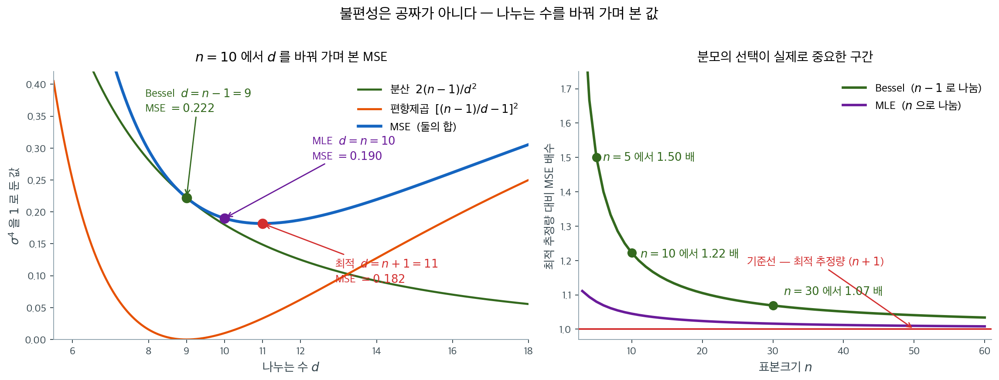
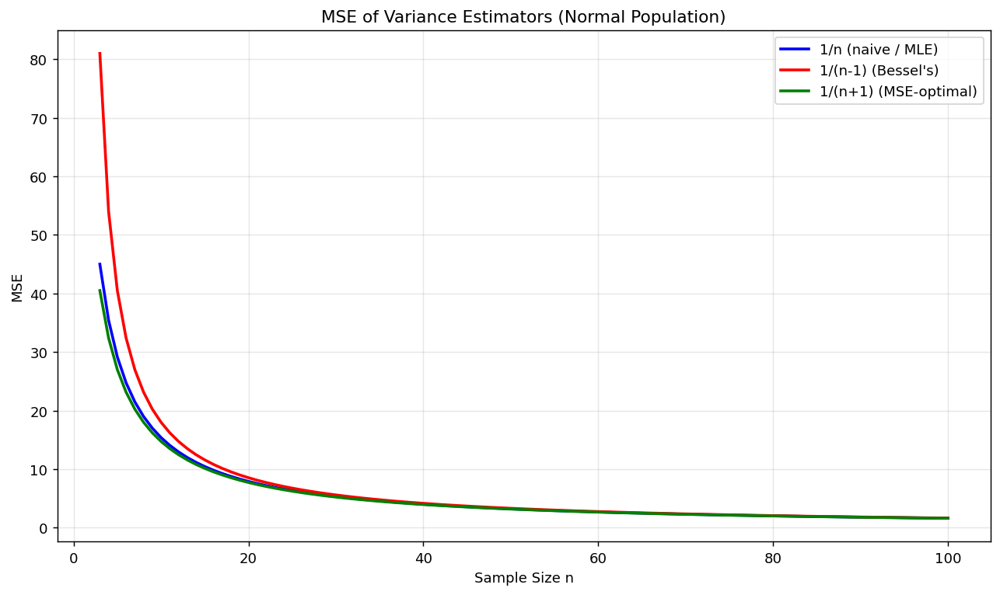
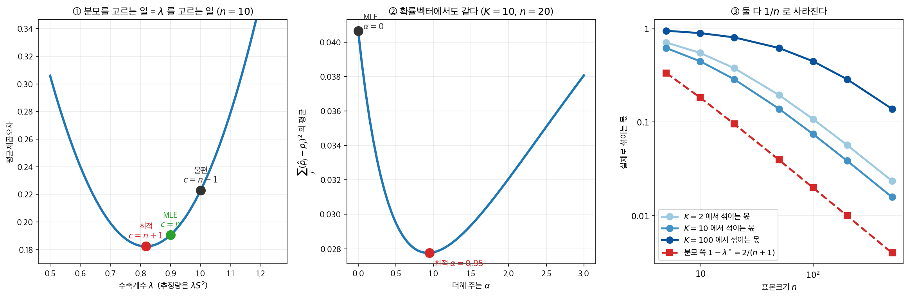

# 분산추정량의 평균제곱오차

## 1. 편향과 분산 가운데 무엇을 줄일 것인가

$n = 3$ 인 정규표본에서 세 추정량의 평균제곱오차를 $\sigma^4 = 1$ 로 재면 $1/(n+1)$ 쪽이 $0.500000$, $1/n$ 쪽이 $0.555556$, 베셀의 $1/(n-1)$ 쪽이 $1.000000$ 이다. 편향을 $0$ 으로 맞춘 추정량이 셋 가운데 꼴찌이고, 최적인 쪽의 꼭 두 배다. $n$ 을 키우면 셋이 모여들지만 순서는 끝까지 뒤집히지 않는다. 그런데 모든 소프트웨어의 기본값은 여전히 $n-1$ 이다. 평균제곱오차로 가장 나쁜 쪽을 기본값으로 두는 것이 어째서 틀린 선택이 아닌가.

앞 절들에서 모분산의 자연스러운 추정량 둘을 만났다: $n$으로 나누기(MLE)와 $n-1$로 나누기(Bessel 수정). MLE는 편향되어 있지만 분산이 작고, Bessel 추정량은 불편이지만 변동이 크다. 평균제곱오차(MSE)는 편향과 분산을 함께 저울질하는 하나의 기준을 주므로 이렇게 물을 수 있다: 전체 추정오차를 최소화하는 분모가 존재하는가?

---

## 2. 편차제곱합 하나로 셋을 함께 적는다

$X_1, X_2, \ldots, X_n \overset{iid}{\sim} N(\mu, \sigma^2)$이라 하자. 편차제곱합을 다음과 같이 정의한다.

$$
Q = \sum_{i=1}^n (X_i - \bar{X})^2
$$

정규성 아래에서 $Q / \sigma^2 \sim \chi^2_{n-1}$이다. 이 분포 결과가 필요한 적률을 준다.

$$
E[Q] = (n-1)\sigma^2, \quad \text{Var}(Q) = 2(n-1)\sigma^4
$$

상수 $c > 0$에 대해 $\hat{\sigma}^2 = cQ$ 형태인 $\sigma^2$의 추정량은 다음을 만족한다.

$$
\text{Bias}(cQ) = E[cQ] - \sigma^2 = [c(n-1) - 1]\,\sigma^2
$$

$$
\text{Var}(cQ) = c^2 \,\text{Var}(Q) = 2c^2(n-1)\,\sigma^4
$$

$$
\text{MSE}(cQ) = \text{Var}(cQ) + \text{Bias}^2(cQ) = \left[2c^2(n-1) + \bigl(c(n-1)-1\bigr)^2\right]\sigma^4
$$

---

## 3. 세 가지 추정량

위 공식에 흔히 쓰는 세 가지 $c$를 대입하면 다음 비교를 얻는다.

| 추정량 | 나누는 수 | 편향 | 평균제곱오차 |
|---|---|---|---|
| MLE | $n$ | $-\sigma^2/n$ | $\dfrac{2n-1}{n^2}\,\sigma^4$ |
| Bessel 수정 | $n-1$ | $0$ | $\dfrac{2}{n-1}\,\sigma^4$ |
| 평균제곱오차 최적 | $n+1$ | $-\dfrac{2\sigma^2}{n+1}$ | $\dfrac{2}{n+1}\,\sigma^4$ |

각 항목은 위에서 유도한 일반 MSE 공식에 $c = 1/n$, $c = 1/(n-1)$, $c = 1/(n+1)$을 대입한 결과이다.

---

## 4. 최적 분모의 유도

$cQ$ 형태의 모든 추정량 중에서 어느 $c$가 평균제곱오차를 최소화하는가? MSE 식을 전개하면 이렇게 된다.

$$
\text{MSE}(c) = \left[2c^2(n-1) + c^2(n-1)^2 - 2c(n-1) + 1\right]\sigma^4
$$

$c$에 대해 미분하고 0으로 놓으면 이렇게 된다.

$$
\frac{d}{dc}\,\text{MSE}(c) = \left[4c(n-1) + 2c(n-1)^2 - 2(n-1)\right]\sigma^4 = 0
$$

$2(n-1)$을 묶어내면 이렇게 된다.

$$
2(n-1)\left[2c + c(n-1) - 1\right] = 0
$$

$n \geq 2$이므로 $2(n-1)$로 나눌 수 있고, $c(n+1) = 1$에서

$$
c^* = \frac{1}{n+1}
$$

이 형태의 모든 추정량 중에서 $n+1$로 나눌 때 평균제곱오차가 가장 작음이 확인된다.

---

## 5. 수치 보기

실질적인 차이를 보기 위해 $n = 10$, $\sigma^2 = 1$을 생각하자. 세 추정량의 평균제곱오차는 다음과 같다.

| 추정량 | MSE 공식 | MSE 값 |
|---|---|---|
| MLE ($c = 1/10$) | $(2 \cdot 10 - 1)/100$ | $0.190$ |
| Bessel ($c = 1/9$) | $2/9$ | $0.222$ |
| 평균제곱오차 최적 ($c = 1/11$) | $2/11$ | $0.182$ |

평균제곱오차 최적 추정량은 MLE보다 약 4%, Bessel 수정보다 약 18% 평균제곱오차를 줄인다. MLE 대비 개선이 크지 않은 것은 MLE가 이미 거의 최적이기 때문이다 — 편향이 살짝 클 뿐이다. Bessel 수정은 불편이지만 의미 있는 분산 대가를 치른다.

표의 세 줄은 연속적인 곡선 위의 세 점일 뿐이다. 나누는 수 $d$를 자유롭게 움직이며 그려 보면 세 추정량이 어디에 앉아 있는지가 한눈에 보인다.



왼쪽이 $n = 10$에서의 그림이다. 초록색 분산 $2(n-1)/d^2$은 $d$가 커질수록 단조감소한다 — 크게 나눌수록 추정값이 덜 흔들린다. 주황색 편향제곱은 $d = 9$에서 정확히 $0$이 되고 양쪽으로 커진다. 파란 MSE는 이 둘의 합이므로, **분산이 내려가는 속도가 편향제곱이 올라가는 속도보다 빠른 동안은 계속 내려간다.** 그 두 속도가 같아지는 지점이 $d = n+1 = 11$이고, 이것이 앞에서 미분으로 구한 $c^* = 1/(n+1)$이다.

$d = 9$(Bessel)에서 $d = 11$로 옮겨 가면서 편향제곱이 $0$에서 $0.033$으로 늘어나지만 분산이 $0.222$에서 $0.149$로 그보다 많이 줄어든다. 결과가 $0.222 \to 0.182$이다. 불편성은 주황 곡선을 $0$에 붙들어 두려는 요구인데, 그 자리는 파란 곡선의 바닥이 아니다.

오른쪽은 이 차이가 $n$에 따라 어떻게 변하는지를 최적 추정량 대비 배수로 그린 것이다. Bessel 추정량의 MSE 배수는 정확히 $(n+1)/(n-1)$로, $n = 5$에서 $1.50$배, $n = 10$에서 $1.22$배, $n = 30$에서 $1.07$배다. MLE는 훨씬 납작해서 $n = 5$에서도 $1.08$배에 그친다. **$n$이 $30$을 넘어가면 세 곡선이 사실상 한 줄이 된다.** 분모 논쟁이 실제로 의미를 갖는 구간은 왼쪽 끝, 관측값이 열 개 남짓인 영역뿐이다.

---

## 6. 핵심 통찰

평균제곱오차 최적 분모 $n+1$은 편향–분산 맞바꿈을 깔끔한 닫힌 형태로 보여준다. $-2\sigma^2/(n+1)$이라는 작은 편향을 받아들이는 대가로 그 이상을 보상하는 분산 감소를 얻는다. 표본크기 $n$이 커지면 세 추정량이 모두 같은 값으로 수렴하고 평균제곱오차의 차이도 무시할 만해진다 — 그러나 작은 표본에서는 분모의 선택이 중요하다.

!!! tip "어느 추정량을 언제 쓸 것인가"
    실무에서는 Bessel 수정($n-1$로 나누기)이 여전히 기본이다. 불편성이 이론적 분석을 단순하게 하고 $t$-검정 같은 후속 절차가 이를 전제하기 때문이다. 평균제곱오차 최적 추정량은 주로 이론적 관심의 대상으로, 불편성이 언제나 최선의 기준은 아님을 보여준다.

## 7. 세 분모를 수로 견주기

절 $4$ 가 최적 분모를 $n+1$ 로 유도했다. 세 추정량의 MSE 를 모의실험으로 재어
그 결과를 확인한다.

<div class="exbox" markdown>

**보기 1.** <span class="diff easy" title="쉬움"></span> 세 추정량의 MSE. 정규모집단에서 $\mathrm{SS}/n$, $\mathrm{SS}/(n-1)$, $\mathrm{SS}/(n+1)$의 평균제곱오차를 $n = 3$부터 $100$까지 그린다.

**(1)** 분모를 **아무 수 $c$**로 두고 $\operatorname{MSE}(\mathrm{SS}/c)$를 구한 뒤, 그것을 가장 작게 하는 $c$를 미분으로 찾으시오. 정말 $c = n+1$인가.

**(2)** 세 추정량의 평균제곱오차를 가장 간단한 꼴로 적고, 그림이 보이는 순서를 설명하시오.

</div>

??? success "풀이"

    **(1) 해석적으로.** 정규모집단에서 $\mathrm{SS}/\sigma^2 \sim \chi^2_{n-1}$이므로 $k = n-1$로 두면

    $$
    E[\mathrm{SS}] = k\sigma^2,
    \qquad
    \operatorname{Var}(\mathrm{SS}) = 2k\sigma^4
    $$

    이다. 분모를 $c$로 둔 추정량의 평균제곱오차는 편향제곱과 분산의 합이다.

    $$
    \operatorname{MSE}\!\left(\frac{\mathrm{SS}}{c}\right)
    = \left(\frac{k\sigma^2}{c} - \sigma^2\right)^2 + \frac{2k\sigma^4}{c^2}
    = \frac{\sigma^4}{c^2}\Big[(k - c)^2 + 2k\Big]
    $$

    $c$로 미분해 $0$으로 둔다. $f(c) = \big[(k-c)^2 + 2k\big]/c^2$라 하면

    $$
    f'(c) = \frac{-2(k-c)c^2 - 2c\big[(k-c)^2 + 2k\big]}{c^4} = 0
    \;\Longrightarrow\;
    -(k-c)c - (k-c)^2 - 2k = 0
    $$

    인데, 앞의 두 항이 $-(k-c)\big[c + (k-c)\big] = -k(k-c)$이므로 조건이

    $$
    -k(k-c) = 2k
    \quad\Longleftrightarrow\quad
    k - c = -2
    \quad\Longleftrightarrow\quad
    c = k + 2 = n + 1
    $$

    로 깔끔하게 떨어진다. **$n+1$은 어림이 아니라 정확한 최소점이다.** 이것이 최소임은 $f(c) \to \infty$ $(c \to 0^+)$이고 $f(c) \to 1$ $(c \to \infty)$인데 $f(n+1) = 2/(n+1) < 1$이며 정류점이 하나뿐이라는 데서 나온다.

    **(2) 세 값.** 위 식에 $c = n$, $n-1$, $n+1$을 차례로 넣는다. $k = n-1$이다.

    $$
    c = n:\quad \frac{\sigma^4}{n^2}\big[1 + 2(n-1)\big] = \frac{(2n-1)\sigma^4}{n^2}
    $$

    $$
    c = n-1:\quad \frac{\sigma^4}{(n-1)^2}\big[0 + 2(n-1)\big] = \frac{2\sigma^4}{n-1}
    $$

    $$
    c = n+1:\quad \frac{\sigma^4}{(n+1)^2}\big[4 + 2(n-1)\big] = \frac{(2n+2)\sigma^4}{(n+1)^2} = \frac{2\sigma^4}{n+1}
    $$

    **마지막 것이 $2\sigma^4/(n+1)$로 줄어든다는 점이 예쁘다.** 쪽 머리의 표에 적힌 $\frac{2(n-1)\sigma^4 + 4\sigma^4}{(n+1)^2}$과 같은 값이며, 베셀의 $2\sigma^4/(n-1)$과 분모만 두 칸 다르다. 세 값을 나란히 적으면

    $$
    \frac{2\sigma^4}{n+1}
    \;<\;
    \frac{(2n-1)\sigma^4}{n^2}
    \;<\;
    \frac{2\sigma^4}{n-1}
    $$

    이고, **부등호가 모든 $n \ge 2$에서 성립한다.** 가운데 항이 $\frac{2\sigma^4}{n} \cdot \frac{2n-1}{2n}$이라 $2\sigma^4/n$보다 조금 작고, 양 끝은 $2\sigma^4/(n\pm1)$이기 때문이다.

    **그림은 세 곡선이 이 순서로 포개져 있고 $n$이 커지면서 하나로 합쳐지는 모습이어야 한다.** 셋의 비를 보면 $n = 3$에서 $0.500 : 0.556 : 1.000$으로 두 배까지 벌어지지만 $n = 100$에서 $0.019802 : 0.019900 : 0.020202$로 $2\%$ 안에 모인다. **불편추정량이 평균제곱오차로는 셋 중 꼴찌**이고, 편향을 $0$으로 만든 값을 분산으로 치른 것이다.

    그림으로 확인한다.

    ```python
    import numpy as np
    import matplotlib.pyplot as plt

    plt.rcParams["font.sans-serif"] = ["NanumGothic", "Apple SD Gothic Neo", "Malgun Gothic"]
    plt.rcParams["font.family"] = "sans-serif"
    plt.rcParams["axes.unicode_minus"] = False

    def three_estimators_mse(sigma=3.0, n_sim=100_000, seed=42):
        """나누는 수만 다른 세 추정량의 MSE 를 표본크기의 함수로 그린다."""
        rng = np.random.default_rng(seed)
        sigma2, sigma4 = sigma**2, sigma**4

        fig, ax = plt.subplots(figsize=(10, 6))
        ns = np.arange(3, 101)
        # 정규모집단에서 세 추정량의 MSE를 닫힌 식으로 그린다.
        # 나누는 수만 다른 세 추정량인데 MSE 순서가 뚜렷하다.
        #   1/(n+1) < 1/n < 1/(n-1)
        # 즉 **불편추정량(베셀)이 MSE로는 셋 중 가장 나쁘다.**
        # 편향을 0으로 만드는 대가로 분산을 더 키웠기 때문이다.
        # n이 커지면 셋의 차이가 사라진다(모두 2*sigma^4/n 으로 수렴).
        ax.plot(ns, (2*ns-1)/ns**2 * sigma4, 'b-', lw=2, label='1/n (naive / MLE)')
        ax.plot(ns, 2/(ns-1) * sigma4, 'r-', lw=2, label="1/(n-1) (Bessel's)")
        ax.plot(ns, (2*(ns-1)+4)/(ns+1)**2 * sigma4, 'g-', lw=2, label='1/(n+1) (MSE-optimal)')
        ax.set_xlabel('Sample Size n')
        ax.set_ylabel('MSE')
        ax.set_title('MSE of Variance Estimators (Normal Population)')
        ax.legend()
        ax.grid(True, alpha=0.3)
        plt.tight_layout()
        plt.show()
    three_estimators_mse()
    ```

    

    ```python
    import numpy as np
    # (1) 의 최소점이 정말 n+1 인지, 분모 c 를 훑어 직접 찾는다.
    for n in (3, 10, 100):
        k = n - 1
        cs = np.linspace(1, n + 6, 200001)          # c 를 촘촘히 훑는다
        mse = ((k - cs)**2 + 2*k) / cs**2           # σ⁴ = 1 로 두었다
        print(f"n={n:>4}  격자 최소점 c = {cs[mse.argmin()]:.4f}  (이론 n+1 = {n+1})"
              f"   MSE: 1/n={(2*n-1)/n**2:.6f}  1/(n-1)={2/(n-1):.6f}  1/(n+1)={2/(n+1):.6f}")
    ```

    출력:

    ```
    n=   3  격자 최소점 c = 4.0000  (이론 n+1 = 4)   MSE: 1/n=0.555556  1/(n-1)=1.000000  1/(n+1)=0.500000
    n=  10  격자 최소점 c = 11.0000  (이론 n+1 = 11)   MSE: 1/n=0.190000  1/(n-1)=0.222222  1/(n+1)=0.181818
    n= 100  격자 최소점 c = 100.9999  (이론 n+1 = 101)   MSE: 1/n=0.019900  1/(n-1)=0.020202  1/(n+1)=0.019802
    ```

    **격자 탐색이 세 번 모두 $n+1$을 집는다.** $n = 100$에서 $100.9999$가 나온 것은 격자 간격이 $5.3\times10^{-4}$이라 $101$이 후보에 정확히 들어 있지 않았기 때문이고, 해석적 답 쪽이 정확하다. 그리고 세 평균제곱오차가 (2)에서 손으로 구한 값과 소수 여섯째 자리까지 같다.

    **$n = 3$ 줄이 가장 극적이다.** 베셀의 평균제곱오차가 $1.000$인데 $1/(n+1)$ 쪽은 $0.500$으로 **정확히 절반**이다. 그런데도 실무가 베셀을 쓰는 데에는 까닭이 있다.

    - **$1/(n+1)$의 최적성은 정규모집단에서만 성립한다.** 일반 분포에서는 최적 분모가 4차 적률에 달려 있어 미리 알 수 없다. 반면 $E[S^2] = \sigma^2$은 분산만 유한하면 언제나 참이다.
    - **분산추정값은 대개 그 자체가 목적이 아니다.** $t$ 검정, 신뢰구간, 분산분석이 모두 $(n-1)S^2/\sigma^2 \sim \chi^2_{n-1}$ 위에 서 있고, 그 분포가 성립하는 것은 분모가 $n-1$일 때다.
    - **편향은 쌓이고 분산은 지워진다.** 여러 자료에 걸쳐 평균을 내는 상황에서 $1/(n+1)$의 아래쪽 편향은 사라지지 않는다.

    **그래서 "평균제곱오차가 작은 쪽이 좋은 추정량"이라고 말할 수 없다.** 무엇에 쓸 것인지가 기준을 정한다.

!!! info "편향–분산 맞바꿈"
    평균제곱오차 최적 추정량은 편향되어 있음에도 모든 $n$에서 평균제곱오차가 가장 작다. 편향–분산 맞바꿈을 깔끔하게 보여주는 예이다: 때로는 작은 편향을 받아들이는 편이 전체 추정오차를 줄인다.

---

<div class="aibox" markdown>

**AI로 보는 통계학 1.** 분모를 고르는 일은 수축을 고르는 일이다

$\S 4$ 가 $\sum(X_i-\bar X)^2$ 를 무엇으로 나눌지 묻고 $n+1$ 을 답으로 얻는다. 같은
추정량을 이렇게 다시 쓰면 묻는 것이 달라 보인다.

$$
\frac{1}{c}\sum (X_i-\bar X)^2 \;=\; \lambda S^2,
\qquad \lambda = \frac{n-1}{c}
$$

**분모를 고르는 일은 $S^2$ 을 얼마나 줄일지 고르는 일**이고, $\lambda$ 는 $0$ 쪽으로
얼마나 **수축**시킬지를 적은 수다. 같은 모양의 물음이 분류 확률을 추정하는 자리에
그대로 다시 나온다.



**① 세 분모는 세 $\lambda$ 다.** $n = 10$, $\sigma^2 = 1$ 에서

| | 불편 ($c = n-1$) | MLE ($c = n$) | 최적 ($c = n+1$) |
|---|---|---|---|
| $\lambda$ | $1.000$ | $0.900$ | $\mathbf{0.818}$ |
| MSE | $0.223$ | $0.191$ | $\mathbf{0.182}$ |

$\lambda$ 를 연속으로 쓸어 찾은 최솟값이 $0.820$ 으로 식이 주는
$(n-1)/(n+1) = 0.818$ 과 맞는다. $\S 6$ 이 말하는 「편향을 조금 받아들이고 분산을
많이 줄인다」가 **$\lambda < 1$** 이라는 한 글자다.

**② 확률을 추정할 때도 같은 물음이 나온다.** class $K$ 개의 확률을 $n$ 개로 추정할
때 최대가능도는 $\hat p_j = x_j/n$ 인데, 실무에서는 흔히 $\alpha$ 를 더해 쓴다.

$$
\hat p_j^{(\alpha)} = \frac{x_j + \alpha}{n + K\alpha}
$$

이것도 **균등분포 쪽으로의 수축**이다. $K = 10$, $n = 20$ 에서 MSE 를 재면

| $\alpha$ | $0$ (MLE) | $0.5$ | $0.95$ | $2$ |
|---|---|---|---|---|
| MSE | $0.0407$ | $0.0295$ | $\mathbf{0.0278}$ | $0.0321$ |

$\alpha = 0$ 이 최선이 아니다. 최적값에서 MLE 보다 MSE 가 **$31.7\%$ 낮다.**
$\S 4$ 가 분산추정에서 찾은 것과 **같은 꼴의 답**이다.

**③ 둘 다 $n$ 이 커지면 사라진다.** 분모 쪽에서 수축의 크기는
$1-\lambda^{*} = 2/(n+1)$ 이다. 확률 쪽에서 최적 $\alpha^{*}$ 자체는 $0$ 으로 가지
않고 참 $p$ 가 정하는 값 둘레에 머무는데, **실제로 섞이는 몫**
$K\alpha/(n+K\alpha)$ 는 $1/n$ 로 줄어든다.

| $n$ | $10$ | $50$ | $200$ | $500$ |
|---|---|---|---|---|
| 분모 쪽 $1-\lambda^{*}$ | $0.182$ | $0.039$ | $0.010$ | $0.004$ |
| $K=10$ 에서 섞이는 몫 | $0.444$ | $0.138$ | $0.039$ | $0.016$ |

**라벨 평활은 바로 이 몫을 손으로 못 박는 일이다.** 참 라벨에 $1$ 대신 $1-\varepsilon$
을 주고 나머지를 $K$ 갈래에 고르게 뿌리면, 섞이는 몫이 $n$ 과 무관하게 $\varepsilon$
으로 고정된다. $\S 6$ 의 표현을 빌리면 **편향을 사고 분산을 파는 거래를, 자료가
얼마나 많든 같은 값으로 계속 치르기로 하는 것**이다.

그래서 라벨 평활이 좋은지 나쁜지는 이 쪽이 답할 수 있는 물음이 아니다. 이 쪽이
답할 수 있는 것은 **그것이 무엇인가**이고, 답은 $\S 4$ 가 분모를 고를 때 한 일과
같다 — $\lambda$ 를 $1$ 에서 떼어 놓는 일.

</div>

## 연습문제

<div class="drillbox" markdown>

**연습문제 1.** <span class="diff med" title="중간"></span>
정규 자료에서 $\hat\sigma^2_c = (1/c)\sum(X_i - \bar X)^2$에 대해: (a) $\mathrm{MSE}$를 유도하라. (b) 최적 $c^*$를 구하라. (c) $n = 10$에서 확인하라.

</div>

??? success "풀이"
    (a) $W = \sum(X_i - \bar X)^2 \sim \sigma^2 \chi^2_{n-1}$일 때: $\mathbb{E}[\hat\sigma^2_c] = (n-1)\sigma^2/c$, $\mathrm{Var}(\hat\sigma^2_c) = 2(n-1)\sigma^4/c^2$.

    $\mathrm{MSE}(c) = (\sigma^4/c^2)[(n-1-c)^2 + 2(n-1)]$.

    (b) 미분하여 0으로 놓으면 $c^* = n + 1$.

    (c) $n = 10$, $\sigma = 1$: $\mathrm{MSE}(9) \approx 0.222$, $\mathrm{MSE}(10) = 0.190$, $\mathrm{MSE}(11) \approx 0.182$. $c^* = 11$이 이긴다.

---

<div class="drillbox" markdown>

**연습문제 2.** <span class="diff med" title="중간"></span>
분산추정에서 **세 가지 분모**(n, n-1, n+1)를 **비교**하라.

</div>

??? success "풀이"
    | 추정량 | 나누는 수 | 편향 | $\mathrm{Var}/\sigma^4$ | $\mathrm{MSE}/\sigma^4$ |
    |---|---|---|---|---|
    | $\hat\sigma^2_{\text{MLE}}$ | $n$ | $-\sigma^2/n$ | $2(n-1)/n^2$ | $(2n-1)/n^2$ |
    | $S^2$ (불편) | $n-1$ | 0 | $2/(n-1)$ | $2/(n-1)$ |
    | $\hat\sigma^2_{c^*}$ | $n+1$ | $-2\sigma^2/(n+1)$ | $2(n-1)/(n+1)^2$ | $2/(n+1)$ |

    **최소 평균제곱오차:** 분모 $n+1$이 MLE와 불편추정량을 모두 이긴다. 맞바꿈은 이렇다: 작은 편향을 받아들여 더 큰 분산 감소를 얻는다.

    평균제곱오차에서 이기는데도 $n+1$ 분모가 거의 쓰이지 않는 이유는 $S^2$의 해석이 더 깔끔하고(불편) 적당한 $n$에서는 평균제곱오차 차이가 작기 때문이다.

---

<div class="drillbox" markdown>

**연습문제 3.** <span class="diff med" title="중간"></span>
**평균제곱오차는 손실함수에 따라 달라진다.** 평균제곱오차가 표준이 된 이유는 무엇이며 어떤 대안이 있는가?

</div>

??? success "풀이"
    MSE는 제곱오차 손실 $L(\hat\theta, \theta) = (\hat\theta - \theta)^2$이다. 널리 쓰이는 이유:

    - 수학적으로 다루기 쉽다(기댓값의 선형성, 편향 + 분산으로의 분해).
    - 어디서나 미분 가능하다 — 해석적 최적화가 가능하다.
    - 큰 오차에 큰 벌점을 준다(제곱).

    **대안:**

    - **절대오차:** $|\hat\theta - \theta|$. 사후 중앙값에서 최소가 되며 이상점에 더 로버스트하다.
    - **분위 손실:** $\rho_\tau(\hat\theta - \theta) = (\hat\theta - \theta)(\tau - \mathbf 1\{\hat\theta < \theta\})$. 분위회귀에서 쓰인다.
    - **0-1 손실:** $\mathbf 1\{\hat\theta \ne \theta\}$. 분류에서 쓰인다.
    - **로그 손실 / KL 발산:** 밀도추정, 확률적 예측에서 쓰인다.

    손실의 선택은 어떤 종류의 오차에 벌점을 줄지를 반영한다. MSE는 *기본값*이지만 언제나 *옳은* 선택은 아니다.

---

<div class="drillbox" markdown>

**연습문제 4.** <span class="diff med" title="중간"></span>
**표본크기와 평균제곱오차.** $S^2$에 대해 $n$을 네 배로 하면 $\sqrt{\mathrm{MSE}}$가 대략 절반이 됨을 보여라.

</div>

??? success "풀이"
    $\mathrm{MSE}(S^2) = 2\sigma^4/(n-1)$. 제곱근을 취하면 $\sqrt{\mathrm{MSE}} = \sigma^2 \sqrt{2/(n-1)}$.

    $n' = 4n$이면 $\sqrt{\mathrm{MSE}'} = \sigma^2 \sqrt{2/(4n - 1)} \approx \sigma^2 \sqrt{2/(n-1)}/2 = \sqrt{\mathrm{MSE}}/2$.

    $n$이 네 배가 되면 절반이 된다. $\bar X$에서와 같은 $\sqrt n$ 축척이며, 여기서는 분산추정의 RMSE에 적용된 것이다.

---

<div class="drillbox" markdown>

**연습문제 5.** <span class="diff med" title="중간"></span>
**점근적 최적성.** $n \to \infty$일 때 세 추정량(분모 $n$, $n-1$, $n+1$)의 점근 평균제곱오차가 같음을 보여라.

</div>

??? success "풀이"
    세 가지 모두:

    - $\mathrm{MSE}(\hat\sigma^2_{\text{MLE}})/\sigma^4 = (2n-1)/n^2 \to 2/n$.
    - $\mathrm{MSE}(S^2)/\sigma^4 = 2/(n-1) \to 2/n$.
    - $\mathrm{MSE}(\hat\sigma^2_{c^*})/\sigma^4 = 2/(n+1) \to 2/n$.

    점근적으로 동등하다 — $1/n$의 1차 항까지 보면 셋 모두 MSE $\approx 2\sigma^4/n$이다.

    **함의:** 분모의 선택은 유한표본에서만 중요하다. 큰 $n$에서는 편한 것을 쓰면 된다. 차이가 무시할 수 없는 작은 $n$에서는 손실함수에 따라 고르라: 불편성($n-1$), MLE의 편의($n$), 최소 평균제곱오차($n+1$).

---

<div class="drillbox" markdown>

**연습문제 6.** <span class="diff med" title="중간"></span>
분산추정에서 **축소(shrinkage)** 를 쓰면 평균제곱오차가 더 줄어들 수 있다. 목표값 $\sigma_0^2$을 향한 축소추정량 $\hat\sigma^2_w = wS^2+(1-w)\sigma_0^2$의 최적 $w$를 구하라.

</div>

??? success "풀이"
    **평균제곱오차.**

    $$
    \text{MSE}(w) = w^2\operatorname{Var}(S^2)+\left\{w\sigma^2+(1-w)\sigma_0^2-\sigma^2\right\}^2 = w^2 V+(1-w)^2\Delta^2
    $$

    여기서 $V = \operatorname{Var}(S^2) = 2\sigma^4/(n-1)$이고 $\Delta = \sigma^2-\sigma_0^2$이다.

    **최적화.** $w$로 미분해 0으로 두면

    $$
    2wV-2(1-w)\Delta^2 = 0 \implies w^* = \frac{\Delta^2}{V+\Delta^2}
    $$

    **읽는 법.**

    - **$\Delta=0$**(목표가 정확히 맞음): $w^*=0$으로 **자료를 전혀 쓰지 않는다.** 목표값이 참값이면 그것을 쓰는 것이 당연하다.
    - **$\Delta$가 크면** $w^*\to1$로 표본분산을 그대로 쓴다.
    - **$V$가 크면**($n$이 작으면) $w^*$가 작아져 **더 많이 축소**한다.

    **최소 MSE.**

    $$
    \text{MSE}(w^*) = \frac{V\Delta^2}{V+\Delta^2} < \min(V,\Delta^2)
    $$

    **언제나 $S^2$보다 낫다**($V$가 $S^2$의 MSE이므로). 다만 $w^*$가 미지의 $\Delta$에 의존해 직접 쓸 수 없다.

    **실무의 해법.**

    - **$\Delta$를 추정한다.** $\hat\Delta^2 = \max(0,\ (S^2-\sigma_0^2)^2-V)$ 같은 추정값을 넣는다. 제임스–스타인의 발상과 같다.
    - **경험 베이즈.** 여러 분산을 동시에 추정할 때 그들의 흩어짐에서 $\Delta$를 추정한다. 유전자 발현 분석의 `limma`가 정확히 이 방식으로 유전자별 분산을 전체 평균 쪽으로 축소한다.
    - **르두아–울프.** 공분산행렬에서 표본공분산을 구조화된 목표(대각행렬이나 등상관 행렬)로 축소하며, 최적 $w$를 자료에서 해석적으로 추정한다. 자산 수가 관측 수에 가까울 때 필수적이다.

---

<div class="drillbox" markdown>

**연습문제 7.** <span class="diff med" title="중간"></span>
$\sigma^2$ 대신 $1/\sigma^2$(정밀도)이나 $\ln\sigma^2$을 추정할 때 최적 분모가 달라지는가? 델타 방법으로 확인하라.

</div>

??? success "풀이"
    **문제의 성격.** 평균제곱오차는 **척도에 의존**한다. $\sigma^2$의 MSE를 최소로 하는 추정량이 $\ln\sigma^2$의 MSE도 최소로 하리라는 보장이 없다.

    **$\ln\sigma^2$의 경우.** $\hat\sigma^2_c = \text{SS}/c$에 대해 $\ln\hat\sigma^2_c = \ln\text{SS}-\ln c$이므로, **$c$를 바꾸는 것은 상수를 더하는 것**이다. 따라서

    - **분산은 $c$와 무관**하다.
    - **편향만 $c$가 결정한다.** $E[\ln\text{SS}] = \ln(2\sigma^2)+\psi\{(n-1)/2\}$이므로, 불편이 되려면

      $$
      \ln c = \ln 2+\psi\!\left(\frac{n-1}{2}\right)
      $$

      즉 $c^* = 2\exp\{\psi((n-1)/2)\}$다.

    $n=10$이면 $\psi(4.5)=1.3888$이므로 $c^* = 2e^{1.3888} = 8.01$로, **$n-1=9$보다도 작다.**

    **$1/\sigma^2$의 경우.** $E[1/\text{SS}]$를 역카이제곱 적률로 계산하면

    $$
    E\left[\frac{c}{\text{SS}}\right] = \frac{c}{(n-3)\sigma^2}
    $$

    이므로 불편이 되려면 $c = n-3$이다. MSE를 최소로 하려면 더 작은 값이 나온다.

    **정리.**

    | 추정 대상 | 불편이 되는 $c$ | MSE 최적 $c$ |
    |---|---|---|
    | $\sigma^2$ | $n-1$ | $n+1$ |
    | $\sigma$ | $(n-1)/c_4^2$ 꼴 | 더 큼 |
    | $\ln\sigma^2$ | $2e^{\psi((n-1)/2)}$ | 같음(분산 불변) |
    | $1/\sigma^2$ | $n-3$ | 더 작음 |

    **교훈.** **"최적 분모"는 무엇을 추정하느냐에 따라 달라진다.** 이것이 불편성과 MSE 최적성이 모두 모수화에 의존한다는 사실의 구체적인 예다. $\ln\sigma^2$ 척도에서 분산이 $c$에 무관하다는 점이 흥미로운데, 이는 로그 척도가 분산안정화 변환이기 때문이다.

---

<div class="drillbox" markdown>

**연습문제 8.** <span class="diff med" title="중간"></span>
**여러 분산을 동시에 추정**할 때 각각 따로 $S_i^2$을 쓰는 것보다 나은 방법이 있는가? 제임스–스타인의 발상이 분산에도 적용되는지 논하라.

</div>

??? success "풀이"
    **상황.** $k$개 집단에서 각각 $S_i^2$을 얻었다. 참 분산 $\sigma_i^2$들이 서로 다를 수 있다.

    **세 가지 선택.**

    | 방법 | 추정량 | 성격 |
    |---|---|---|
    | 완전 분리 | $S_i^2$ | 불편, 분산 큼 |
    | 완전 결합 | $s_p^2$ | 분산 작음, $\sigma_i^2$가 다르면 편향 |
    | **축소** | $w_iS_i^2+(1-w_i)s_p^2$ | 그 사이 |

    **축소가 이득인 조건.** 앞 연습문제의 결과에서 $w_i^*$가 $\Delta_i^2/(V_i+\Delta_i^2)$이므로

    - $n_i$가 작으면($V_i$가 크면) 더 많이 축소한다.
    - 집단 간 분산의 차이가 작으면 더 많이 축소한다.

    **제임스–스타인의 적용.** 로그 척도에서 하면 깔끔하다. $\ln S_i^2$이 근사적으로 정규이고 분산이 $2/(n_i-1)$로 **$\sigma_i$에 무관**하므로, 정규 평균의 축소 문제로 환원된다. 따라서 $k\ge3$이면 제임스–스타인류의 축소가 **모든 $\{\sigma_i^2\}$에서 총 손실을 줄인다.**

    실제로 이것이 **분산의 계층모형**이며

    $$
    \ln\sigma_i^2 \sim N(\mu_0,\tau^2)
    $$

    를 두고 경험 베이즈로 $(\mu_0,\tau^2)$을 추정한 뒤 각 $\sigma_i^2$을 축소한다.

    **대표적 응용.** 유전자 발현 분석이다. 유전자가 2만 개인데 표본이 6개뿐이면 유전자별 $S_i^2$이 극도로 불안정하다. 우연히 작게 나온 분산이 $t$ 통계량을 폭발시켜 **거짓 발견을 양산한다.** `limma`의 조절 $t$ 통계량은 분산을 전체 쪽으로 축소해 이 문제를 해결하며, 실질적으로 자유도를 빌려 온다.

    **주의.** 축소는 **개별 $\sigma_i^2$의 추정을 나쁘게 할 수 있다.** 총 손실이 줄어드는 것이지 모든 집단이 개선되지는 않는다. 특정 집단의 분산 자체가 관심사라면 신중해야 한다.

---

<div class="drillbox" markdown>

**연습문제 9.** <span class="diff med" title="중간"></span>
분산추정량을 비교하는 **모의실험**을 설계하라. 정규·균등·지수·$t_5$ 네 모집단에서 무엇을 비교하고 어떻게 공정하게 맞출 것인가?

</div>

??? success "풀이"
    **공정한 비교의 전제.** **네 모집단의 참 분산을 같게 맞춰야** MSE를 직접 비교할 수 있다. 모두 $\sigma^2=1$로 표준화한다.

    | 모집단 | 표준화 방법 | 초과첨도 |
    |---|---|---|
    | 정규 | $N(0,1)$ | 0 |
    | 균등 | $U(-\sqrt3,\sqrt3)$ | $-1.2$ |
    | 지수 | $\text{Exp}(1)$ | 6 |
    | $t_5$ | $t_5/\sqrt{5/3}$ | 6 |

    **비교할 추정량.** $\text{SS}/c$ 계열($c=n-1,n,n+1$)과 강건 대안(MAD 기반, IQR 기반, 절사분산).

    **설계.**

    ```python
    import numpy as np
    # 출력 없음: 독자가 돌려 볼 탐구 과제다. 아래 「볼 것」 네 항목에 맞춰
    #             c 를 연속으로 바꾼 MSE 곡선을 그리는 것이 목적이다.
    rng = np.random.default_rng(0)
    B = 50_000

    # 참 분산을 1 로 맞춘 네 모집단. 자기 모집단으로 바꿔 넣어도 된다.
    populations = {
        "normal":   lambda k: rng.normal(0, 1, k),
        "uniform":  lambda k: rng.uniform(-np.sqrt(3), np.sqrt(3), k),
        "exp":      lambda k: rng.exponential(1, k) - 1,
        "t5":       lambda k: rng.standard_t(5, k) / np.sqrt(5 / 3),
    }

    for n in [5, 10, 30, 100]:
        for name, draw in populations.items():
            ss = np.empty(B)
            for b in range(B):
                x = draw(n)
                ss[b] = ((x - x.mean()) ** 2).sum()
            for c in [n - 1, n, n + 1]:
                est = ss / c
                print(n, name, c, est.mean() - 1, est.var(), np.mean((est - 1) ** 2))
    ```

    **볼 것.**

    1. **편향과 MSE를 따로.** $n-1$이 모든 모집단에서 불편인지 확인한다(그래야 한다. 불편성은 분포에 무관하다).
    2. **최적 $c$가 어떻게 변하는지.** $c$를 연속적으로 바꿔 MSE 곡선을 그려 최소점을 찾는다. 이론값 $c^*\approx n+1+n\gamma_2/2$와 맞는지 확인한다.
    3. **강건 추정량과의 비교.** $t_5$에서 MAD 기반 추정량이 $S^2$보다 나은지 본다.
    4. **$n$에 따른 수렴.** $n$이 커지면 세 분모의 차이가 사라지는지 확인한다.

    **주의할 점.**

    - **$B$를 충분히.** MSE 추정값의 상대 표준오차가 $\sqrt{2/B}$ 수준이므로, 5% 차이를 구별하려면 $B\ge10^4$이 필요하다.
    - **공통난수.** 같은 표본에서 여러 $c$를 계산하면 차이의 분산이 크게 줄어 훨씬 적은 $B$로 구별할 수 있다. 위 코드가 그렇게 되어 있다.
    - **$t_5$의 4차 적률.** $t_5$는 4차 적률이 유한하지만($\nu>4$) 아슬아슬하다. MSE 추정값이 잘 수렴하는지 확인해야 하며, $t_3$을 넣으면 4차 적률이 없어 MSE 자체가 무한임을 기억한다.

---

<div class="drillbox" markdown>

**연습문제 10.** <span class="diff hard" title="어려움"></span>
**축소와 James-Stein.** 다변량 정규 평균의 MLE는 각 성분의 표본평균이다. James-Stein은 $p \ge 3$일 때 이것이 **허용 불가능**함을 보였다. 그 아이디어를 스케치하라.

</div>

??? success "풀이"
    (관측값 하나로) $\mathbf X \sim N(\boldsymbol\mu, I_p)$에서 $\boldsymbol\mu \in \mathbb{R}^p$를 추정한다. MLE: $\hat{\boldsymbol\mu} = \mathbf X$. 평균제곱오차: $\mathbb{E}[\|\mathbf X - \boldsymbol\mu\|^2] = p$.

    **James-Stein 추정량:** $\hat{\boldsymbol\mu}_{\text{JS}} = (1 - (p-2)/\|\mathbf X\|^2) \mathbf X$ (0 쪽으로 축소).

    Stein(1956)이 보인 것: $p \ge 3$일 때 **모든** $\boldsymbol\mu$에 대해 $\mathrm{MSE}(\hat{\boldsymbol\mu}_{\text{JS}}) < p$이다. MLE가 **지배당한다** — 언제나 더 나은 추정량이 있다.

    직관: *임의의* 점 쪽으로 축소하더라도 JS 추정량이 평균제곱오차에서 MLE보다 낫다. 고차원에서는 도입된 편향보다 분산 감소가 더 크다.

    현대 통계학: 고차원 문제에서 축소추정량(능형, 라소, James-Stein)이 평균제곱오차 기준으로 MLE를 일상적으로 이긴다. 경험적 Bayes와 계층 모형이 이를 형식화한다.

---

## 정리하며

MSE 를 기준으로 삼으면 **$n-1$ 도 $n$ 도 최선이 아니다.**

- **정규모집단에서 최적 분모는 $n+1$ 이다.** $Q/(n+1)$ 이 $\sigma^2$ 추정의 MSE 를 최소화하며, 이는 $n$ 으로 나눈 것보다도 더 작게 만드는 셈이다.
- **편향을 더 들여 분산을 줄이는 거래다.** $Q\sim\sigma^2\chi^2_{n-1}$ 이므로 분모를 키우면 편향이 커지지만 분산이 더 빨리 줄어, 합인 MSE 가 내려간다.
- **세 추정량의 순서.** MSE 기준으로 $n+1$ < $n$ < $n-1$ 이다. **불편추정량이 셋 중 가장 나쁘다.**
- **그런데도 실무는 $n-1$ 을 쓴다.** 이유는 세 가지다. 최적성이 **정규성에 의존**하고, 분산이 다른 계산(분산분석, $t$ 검정, 신뢰구간)에 들어갈 때 불편성이 편하며, 차이가 $O(1/n)$ 로 작기 때문이다.
- **교훈은 기준이 답을 정한다는 것이다.** "좋은 추정량"이라는 말은 어떤 손실함수를 쓰느냐를 정하기 전에는 뜻이 없다.

다음 절 **[로버스트 분산추정량](robust_variance.md)**으로 넘어간다. 분모를 고르는 문제보다 훨씬 큰 위험이 이상치에 있다.
