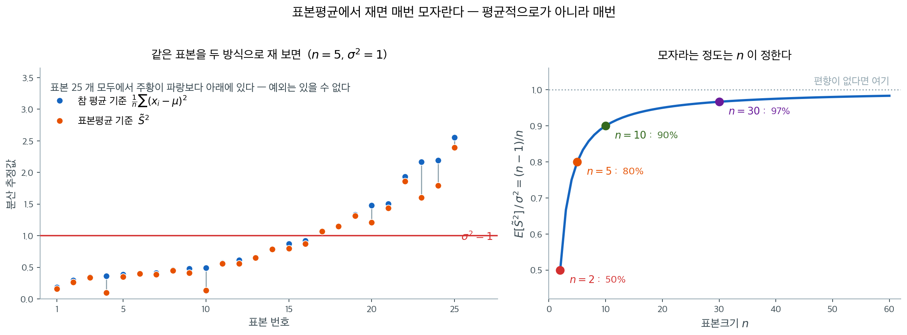
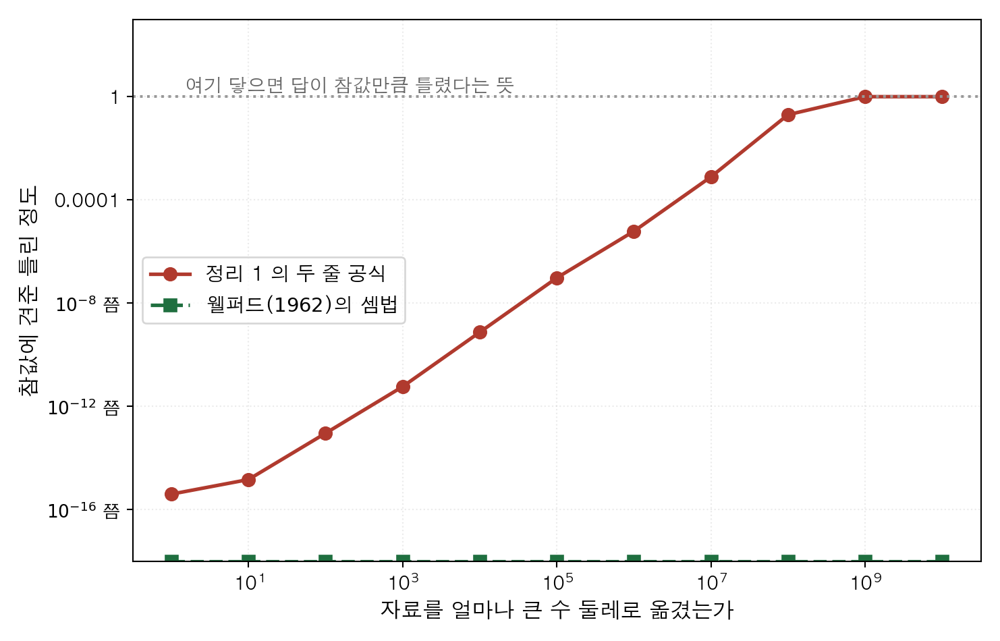

# 소박한 분산추정량

## 1. 들어가며

**소박한 분산추정량**은 편차제곱합을 $n-1$이 아니라 $n$(표본크기)으로 나눈다. 표본평균으로부터의 편차제곱을 그냥 평균하는 것이니 가장 직관적인 접근이지만, 알고 보면 편향되어 있다. *왜* 편향되는지를 이해하면 추정의 본질에 대한 깊은 통찰을 얻고 Bessel 수정의 동기를 알게 된다.

<div class="defn" markdown>

### 정의 1. 소박한 분산추정량 { .dfn }

표본평균이 $\bar{X}$인 확률표본 $X_1, X_2, \ldots, X_n$이 주어졌을 때 **소박한 분산추정량**은:

$$\tilde{S}^2 = \frac{1}{n}\sum_{i=1}^n (X_i - \bar{X})^2$$

이는 **모분산 공식을 표본에 적용한 것**, **편향 표본분산**, 또는 (정규모집단에서) **분산의 MLE**라고도 불린다.

</div>

---

## 2. 편향의 유도

편향 계산의 바탕이 되는 근본적인 항등식은 다음과 같다.

<div class="thmbox" markdown>

### 정리 1. 제곱합의 핵심 항등식 { .thm }

임의의 실수 $X_1, \ldots, X_n$과 임의의 $\mu$에 대해

$$\sum_{i=1}^n (X_i - \bar{X})^2 = \sum_{i=1}^n (X_i - \mu)^2 - n(\bar{X} - \mu)^2$$

이다.

</div>

??? proof "증명"

    $(X_i - \bar{X})^2 = (X_i - \mu - (\bar{X} - \mu))^2$을 전개하면:

    $$\sum_{i=1}^n (X_i - \bar{X})^2 = \sum_{i=1}^n(X_i - \mu)^2 - 2(\bar{X} - \mu)\sum_{i=1}^n(X_i - \mu) + n(\bar{X} - \mu)^2$$

    $\sum(X_i - \mu) = n(\bar{X} - \mu)$이므로 가운데 항은 $-2n(\bar{X} - \mu)^2$이 되어:

    $$= \sum_{i=1}^n(X_i - \mu)^2 - n(\bar{X} - \mu)^2$$

### 기댓값의 계산

기댓값을 취하면:

$$E\left[\sum_{i=1}^n (X_i - \bar{X})^2\right] = \sum_{i=1}^n E[(X_i - \mu)^2] - nE[(\bar{X} - \mu)^2]$$

$$= n\sigma^2 - n \cdot \frac{\sigma^2}{n} = n\sigma^2 - \sigma^2 = (n-1)\sigma^2$$

따라서:

$$E[\tilde{S}^2] = E\left[\frac{1}{n}\sum_{i=1}^n(X_i - \bar{X})^2\right] = \frac{n-1}{n}\sigma^2$$

### 편향

$$\text{Bias}(\tilde{S}^2) = E[\tilde{S}^2] - \sigma^2 = \frac{n-1}{n}\sigma^2 - \sigma^2 = -\frac{\sigma^2}{n}$$

소박한 추정량은 참 분산을 $(n-1)/n$배만큼 **과소추정**한다.

---

## 3. 직관: 편향이 생기는 이유

편향은 제곱합에서 $\mu$ 대신 $\bar{X}$를 쓰기 때문에 생긴다. $\bar{X}$는 모든 상수 $c$에 대해 $\sum(X_i - c)^2$을 최소화하는 값이므로:

$$\sum_{i=1}^n (X_i - \bar{X})^2 \leq \sum_{i=1}^n (X_i - \mu)^2$$

$\bar{X}$로부터의 편차제곱합은 **항상** 참 평균 $\mu$로부터의 제곱합보다 작거나 같다. $\bar{X}$를 사용함으로써 변동성을 체계적으로 적게 세게 되고, 이것이 아래쪽 편향으로 이어진다.

"항상"이라는 말의 무게를 느끼려면 표본을 여러 개 뽑아 두 방식으로 각각 재 보면 된다.



왼쪽은 $N(0,1)$에서 $n = 5$짜리 표본을 $25$개 뽑아, 표본마다 두 값을 세로선으로 이어 그린 것이다. 파란 점은 참 평균 $\mu = 0$을 알고 있다고 치고 계산한 $\frac{1}{n}\sum(x_i-\mu)^2$이고, 주황 점이 소박한 추정값 $\tilde{S}^2$이다. **스물다섯 번 모두 주황이 파랑보다 아래에 있다.** 운이 아니다. 위 부등식이 각 표본에서 항등적으로 성립하므로 예외가 나올 방법이 없다.

두 방식의 성격 차이도 그림에서 읽힌다. 파란 점들은 붉은 선($\sigma^2 = 1$)의 위아래로 고르게 흩어진다 — 불편이라는 말이 이 모습이다. 주황 점들은 그 파란 점을 매번 조금씩 아래로 끌어내린 자리에 있다. 이 $25$개의 평균은 파랑이 $0.945$, 주황이 $0.841$이었다(표본 스물다섯 개만 평균 낸 값이라 이론값 $1.00$과 $0.80$ 주변에서 흔들린다).

오른쪽은 그 "조금"이 얼마인지를 $n$의 함수로 그린 것이다. $E[\tilde{S}^2]/\sigma^2 = (n-1)/n$이므로 $n = 2$에서는 참 분산의 **절반**밖에 되지 않고, $n = 5$에서 $80\%$, $n = 10$에서 $90\%$, $n = 30$이면 $97\%$로 올라온다. 곡선이 빠르게 $1$에 붙는다는 점이 중요하다. 소박한 추정량이 문제가 되는 것은 표본이 작을 때뿐이며, 큰 표본에서 $n$으로 나눌지 $n-1$로 나눌지를 두고 다투는 것은 실익이 거의 없다.

다르게 보는 방법도 있다: $\bar{X}$를 계산하는 데 자료의 정보 한 조각이 "소모된다". $n$개의 편차 $(X_i - \bar{X})$는 $\sum(X_i - \bar{X}) = 0$을 만족하므로 자유롭게 변할 수 있는 것은 $n-1$개뿐이다. **자유도**가 $n$이 아니라 $n-1$이다.

---

## 4. 성질

### S-tilde-squared의 분산
정규모집단에서:

$$\text{Var}(\tilde{S}^2) = \frac{2(n-1)}{n^2}\sigma^4$$

### S-tilde-squared의 평균제곱오차

$$\text{MSE}(\tilde{S}^2) = \text{Var}(\tilde{S}^2) + [\text{Bias}(\tilde{S}^2)]^2 = \frac{2(n-1)}{n^2}\sigma^4 + \frac{\sigma^4}{n^2} = \frac{2n-1}{n^2}\sigma^4$$

### 일치성

편향되어 있음에도 $\tilde{S}^2$은 **일치**한다:

$$\tilde{S}^2 = \frac{n-1}{n} S^2 \xrightarrow{p} \sigma^2$$

$(n-1)/n \to 1$이고 $S^2 \xrightarrow{p} \sigma^2$이기 때문이다.

### 점근적 동등성

큰 $n$에서 $\tilde{S}^2$과 $S^2$은 사실상 같다:

$$\tilde{S}^2 = \frac{n-1}{n}S^2 \approx S^2 \quad (\text{큰 } n \text{에 대해})$$

편향 $-\sigma^2/n \to 0$이고 비 $(n-1)/n \to 1$이다.

---

## 5. 비교: n, n-1, n+1로 나누기
| 추정량 | 나누는 수 | 편향 | 평균제곱오차 (정규) | 비고 |
|-----------|---------|------|--------------|-------|
| $\tilde{S}^2$ | $n$ | $-\sigma^2/n$ | $\frac{2n-1}{n^2}\sigma^4$ | MLE, 편향됨 |
| $S^2$ | $n-1$ | $0$ | $\frac{2}{n-1}\sigma^4$ | 불편 (Bessel) |
| $\hat{S}^2$ | $n+1$ | $-\frac{2}{n+1}\sigma^2$ | $\frac{2(n-1)}{(n+1)^2}\sigma^4 + \frac{4}{(n+1)^2}\sigma^4$ | 평균제곱오차 최적 (정규) |

**놀라운 사실:** 모든 $n$에 대해 $\text{MSE}(\tilde{S}^2) < \text{MSE}(S^2)$이다. 편향추정량이 불편추정량보다 평균제곱오차가 작다! 편향–분산 맞바꿈의 교과서적 예이다.

---

## 6. μ를 아는 경우
참 평균 $\mu$가 알려져 있다면(실무에서는 드물다) 다음을 쓸 수 있다:

$$\hat{\sigma}^2_\mu = \frac{1}{n}\sum_{i=1}^n (X_i - \mu)^2$$

이 추정량은 불편이며($E[\hat{\sigma}^2_\mu] = \sigma^2$) $S^2$보다 분산이 작다:

$$\text{Var}(\hat{\sigma}^2_\mu) = \frac{2\sigma^4}{n} < \frac{2\sigma^4}{n-1} = \text{Var}(S^2)$$

---

## 7. MLE와의 연결

정규모집단에서 $\tilde{S}^2$은 $\sigma^2$의 MLE이다. MLE는 유한표본에서 편향되지만 점근적으로 불편이다. 이는 흔한 양상이다: MLE는 유한표본에서 편향되는 경우가 많지만 일치한다.

---

## 8. 금융과의 연결

- **변동성 추정**: 일별 수익률의 실현분산은 ($\mu \approx 0$으로 두고) $\frac{1}{n}\sum r_i^2$ 공식을 쓰는데, 이는 평균을 0으로 놓은 소박한 추정량이다.
- **위험 지표**: 큰 표본($n > 250$ 일별 관측값)으로 위험관리용 포트폴리오 분산을 계산할 때는 $n$으로 나누느냐 $n-1$로 나누느냐의 차이가 무시할 만하다.
- **편향 보정**: 작은 표본(예: 몇 년치 월별 자료)에서는 편향이 실질적일 수 있으므로 Bessel 수정을 써야 한다.

---

## 9. 요약

소박한 분산추정량 $\tilde{S}^2 = \frac{1}{n}\sum(X_i - \bar{X})^2$은 참 평균 대신 표본평균을 쓰면 변동성을 체계적으로 과소추정하기 때문에 $\sigma^2/n$만큼 아래로 편향된다. 이 편향에도 불구하고 불편추정량 $S^2$보다 평균제곱오차가 작고 일치한다. 또한 정규모집단에서 MLE이기도 하다. 큰 표본에서는 편향이 무시할 만하지만, 작은 표본에서는 Bessel 수정($n-1$로 나누기)이 표준이다.

---

## 10. 핵심 공식

| 양 | 공식 |
|----------|---------|
| 소박한 추정량 | $\tilde{S}^2 = \frac{1}{n}\sum(X_i - \bar{X})^2$ |
| 기댓값 | $E[\tilde{S}^2] = \frac{n-1}{n}\sigma^2$ |
| 편향 | $-\sigma^2/n$ |
| 평균제곱오차 (정규) | $\frac{2n-1}{n^2}\sigma^4$ |
| 핵심 항등식 | $\sum(X_i - \bar{X})^2 = \sum(X_i - \mu)^2 - n(\bar{X}-\mu)^2$ |

## 11. 편향을 수로 확인하기

절 $2$ 가 유도한 편향 $-\sigma^2/n$ 과 절 $6$ 의 「$\mu$ 를 알 때」를 모의실험으로
짚는다. 마지막으로 그 편향이 금융의 변동성 추정에서 어떤 크기로 나타나는지 본다.

<div class="exbox" markdown>

**보기 1.** <span class="diff easy" title="쉬움"></span> 편향이 정확히 얼마인지 확인하기. $N(0, 3^2)$에서 $n$을 $3$에서 $500$까지 바꾸며 $\tilde S^2 = \mathrm{SS}/n$을 20만 번 기록한다.

**(1)** $E[\tilde S^2] = \frac{n-1}{n}\sigma^2$을 보이고 편향을 적으시오. 그 편향이 **상대적으로** 얼마나 큰가.

**(2)** 모의로 잰 편향이 참값 주위로 얼마만큼 흔들릴지 구하고, 일곱 줄을 그 자로 재시오.

</div>

??? success "풀이"

    **(1) 해석적으로.** $\tilde S^2 = \frac{n-1}{n}S^2$이고 [5.1절의 증명 상자](../../ch05/foundations/statistics_as_rv.md)가 $E[S^2] = \sigma^2$을 주므로

    $$
    E[\tilde S^2] = \frac{n-1}{n}\sigma^2,
    \qquad
    \operatorname{Bias} = \frac{n-1}{n}\sigma^2 - \sigma^2 = -\frac{\sigma^2}{n}
    $$

    다. **상대편향이 $-1/n$으로 $\sigma$에 의존하지 않는다**는 점이 중요하다. $n = 3$이면 참값의 $33\%$를 깎고, $n = 100$이면 $1\%$를 깎는다. 분포에도 의존하지 않는다. 정규성은 어디에도 쓰이지 않았다.

    편향이 **아래 방향**인 까닭도 한 줄이다. $\bar X$는 제곱합을 가장 작게 만드는 점이므로 $\sum(X_i - \bar X)^2 \le \sum(X_i - \mu)^2$이 **언제나** 성립하고, 그 모자람의 기댓값이 정확히 $\sigma^2$이다(보기 3이 이것을 한 표본에서 눈으로 보인다).

    **(2) 흔들림의 크기.** 정규모집단이면 $\mathrm{SS}/\sigma^2 \sim \chi^2_{n-1}$이므로

    $$
    \operatorname{Var}(\tilde S^2) = \frac{\sigma^4}{n^2}\cdot 2(n-1) = \frac{2(n-1)\sigma^4}{n^2}
    $$

    이고, 20만 번 평균의 표준오차는 그 제곱근을 $\sqrt{2\times10^5}$로 나눈 값이다. $\sigma^2 = 9$에서

    | $n$ | $\operatorname{Var}(\tilde S^2)$ | 몬테카를로 표준오차 |
    |---:|---:|---:|
    | $3$ | $36.000$ | $0.0134$ |
    | $5$ | $25.920$ | $0.0114$ |
    | $10$ | $14.580$ | $0.0085$ |
    | $20$ | $7.695$ | $0.0062$ |
    | $50$ | $3.175$ | $0.0040$ |
    | $100$ | $1.604$ | $0.0028$ |
    | $500$ | $0.323$ | $0.0013$ |

    모의실험과 맞춰 본다.

    ```python
    import numpy as np

    def bias_verification(sigma=3.0, n_sim=200_000, seed=42):
        """n으로 나누는 추정량의 편향이 정확히 -sigma^2/n 임을 확인한다."""
        rng = np.random.default_rng(seed)
        sigma2 = sigma**2
        sample_sizes = [3, 5, 10, 20, 50, 100, 500]

        for n in sample_sizes:
            samples = rng.normal(0, sigma, (n_sim, n))
            # ddof=0 이 n으로 나누는 판본이다(numpy 기본값이자 MLE).
            # 편차를 참 평균이 아니라 표본평균에서 재기 때문에
            # 제곱합이 체계적으로 작아지고, 그만큼 아래로 편향된다.
            # 그 크기가 정확히 sigma^2/n 이라는 것이 아래 출력의 요점이다.
            s_tilde2 = np.var(samples, axis=1, ddof=0)
            print(f"n={n:>4}  E[S̃²]={s_tilde2.mean():.4f}  "
                  f"(n-1)/n·σ²={(n-1)/n*sigma2:.4f}  "
                  f"Bias={s_tilde2.mean()-sigma2:.4f}  -σ²/n={-sigma2/n:.4f}")
    bias_verification()
    ```

    출력:

    ```
    n=   3  E[S̃²]=6.0004  (n-1)/n·σ²=6.0000  Bias=-2.9996  -σ²/n=-3.0000
    n=   5  E[S̃²]=7.1938  (n-1)/n·σ²=7.2000  Bias=-1.8062  -σ²/n=-1.8000
    n=  10  E[S̃²]=8.0936  (n-1)/n·σ²=8.1000  Bias=-0.9064  -σ²/n=-0.9000
    n=  20  E[S̃²]=8.5449  (n-1)/n·σ²=8.5500  Bias=-0.4551  -σ²/n=-0.4500
    n=  50  E[S̃²]=8.8173  (n-1)/n·σ²=8.8200  Bias=-0.1827  -σ²/n=-0.1800
    n= 100  E[S̃²]=8.9087  (n-1)/n·σ²=8.9100  Bias=-0.0913  -σ²/n=-0.0900
    n= 500  E[S̃²]=8.9833  (n-1)/n·σ²=8.9820  Bias=-0.0167  -σ²/n=-0.0180
    ```

    둘째 열과 셋째 열이 소수 둘째 자리까지 맞는다. 편향 쪽을 (2)의 자로 재면 이렇다.

    | $n$ | 모의 편향 | $-\sigma^2/n$ | 차이 | 몬테카를로 표준오차 | $z$ |
    |---:|---:|---:|---:|---:|---:|
    | $3$ | $-2.9996$ | $-3.0000$ | $+0.0004$ | $0.0134$ | $+0.03$ |
    | $5$ | $-1.8062$ | $-1.8000$ | $-0.0062$ | $0.0114$ | $-0.54$ |
    | $10$ | $-0.9064$ | $-0.9000$ | $-0.0064$ | $0.0085$ | $-0.75$ |
    | $20$ | $-0.4551$ | $-0.4500$ | $-0.0051$ | $0.0062$ | $-0.82$ |
    | $50$ | $-0.1827$ | $-0.1800$ | $-0.0027$ | $0.0040$ | $-0.68$ |
    | $100$ | $-0.0913$ | $-0.0900$ | $-0.0013$ | $0.0028$ | $-0.46$ |
    | $500$ | $-0.0167$ | $-0.0180$ | $+0.0013$ | $0.0013$ | $+1.00$ |

    **일곱 줄 모두 $1$ 표준오차 안이다.** 다섯 줄이 같은 음의 방향으로 쏠려 있어 눈에 걸릴 수 있으나, 일곱 줄이 **같은 난수열에서** 나왔으므로 서로 독립이 아니다. 같은 모의실험을 다른 씨앗으로 돌리면 쏠리는 방향이 바뀐다.

    **$n$이 커질 때 두 가지가 동시에 작아진다는 점을 혼동하지 말아야 한다.** 편향 자체도 $-3.0$에서 $-0.018$로 줄고, 그것을 재는 자도 $0.0134$에서 $0.0013$으로 줄었다. 그래서 $n = 500$에서 편향 $-0.0167$은 **여전히 $0$과 확실히 구별된다.** $-0.018$을 $0.0013$으로 나누면 $-13.8$ 표준오차다. **편향은 작아질 뿐 사라지지 않는다.**

!!! note "편향은 n이 커지면 줄어든다"
    $n = 3$에서 편향은 $-\sigma^2/3 = -3.0$으로 참 분산의 33%이다. $n = 500$이면 편향이 $-0.018$로 무시할 만하다. 편향은 작은 표본에서 가장 중요하다.

<div class="exbox" markdown>

**보기 2.** <span class="diff easy" title="쉬움"></span> 평균을 알 때와 모를 때. $N(5, 3^2)$에서 $\hat\sigma^2_{\text{known}} = \frac1n\sum(X_i-\mu)^2$과 $\tilde S^2 = \frac1n\sum(X_i-\bar X)^2$의 평균제곱오차를 10만 번 되풀이로 재어 비를 본다.

**(1)** 두 평균제곱오차를 해석적으로 구하고 그 비를 $n$의 함수로 적으시오.

**(2)** 본문은 평균을 알면 **더 좋은** 추정량을 얻는다고 했는데 출력의 비가 셋째 줄까지 모두 $1$보다 **작다.** 어느 쪽이 틀렸는가.

</div>

??? success "풀이"

    **(1) 해석적으로.** 평균을 아는 쪽은 자유도를 잃지 않는다. $\sum(X_i-\mu)^2/\sigma^2 \sim \chi^2_n$이므로

    $$
    E\big[\hat\sigma^2_{\text{known}}\big] = \sigma^2,
    \qquad
    \operatorname{Var} = \frac{2\sigma^4}{n}
    \;\Longrightarrow\;
    \operatorname{MSE}_{\text{known}} = \frac{2\sigma^4}{n}
    $$

    다. 불편이므로 평균제곱오차가 곧 분산이다.

    모르는 쪽은 보기 2에서 이미 구했다. 코드가 쓴 것은 $\texttt{ddof=0}$, 곧 분모가 $n$인 쪽이므로

    $$
    \operatorname{MSE}_{\tilde S^2} = \frac{(2n-1)\sigma^4}{n^2}
    $$

    이다. 비를 적으면 **$\sigma$가 약분되고 $n$만 남는다.**

    $$
    \frac{\operatorname{MSE}_{\tilde S^2}}{\operatorname{MSE}_{\text{known}}}
    = \frac{(2n-1)\sigma^4/n^2}{2\sigma^4/n}
    = \frac{2n-1}{2n}
    = 1 - \frac{1}{2n}
    $$

    **$1$보다 작다. 그것도 모든 $n$에서.** $n = 5$에서 $0.900$, $n = 10$에서 $0.950$, $n = 25$에서 $0.980$, $n = 50$에서 $0.990$, $n = 100$에서 $0.995$다.

    **(2) 어느 쪽도 틀리지 않았다. 두 문장이 서로 다른 것을 견주고 있을 뿐이다.**

    본문이 말한 것은 **분산**이고 견주는 상대는 **불편추정량 $S^2$**($\texttt{ddof=1}$)이다.

    $$
    \operatorname{Var}\big(\hat\sigma^2_{\text{known}}\big) = \frac{2\sigma^4}{n}
    \;<\;
    \operatorname{Var}(S^2) = \frac{2\sigma^4}{n-1}
    $$

    **둘 다 불편이므로 분산만 견주면 되고, 평균을 아는 쪽이 이긴다.** $\mu$를 추정하느라 자유도 하나를 내주지 않았기 때문이다.

    코드가 견주는 것은 **평균제곱오차**이고 상대는 **편향된 $\tilde S^2$**($\texttt{ddof=0}$)이다. $\tilde S^2$은 $S^2$을 $\frac{n-1}{n}$만큼 **축소**한 것이라, 아래쪽 편향을 떠안는 대신 분산을 더 많이 깎는다. 보기 2에서 본 편향–분산 맞바꿈이 여기서 이긴 것이고, 그 이득이 정확히 $1/(2n)$이다.

    **그러니 둘을 공평하게 견주려면 같은 분모를 써야 한다.** $\mu$를 아는 쪽도 같은 축소를 적용해 $\frac{n}{n+2}\hat\sigma^2_{\text{known}}$으로 두면(이것이 $\chi^2_n$에 대한 평균제곱오차 최적 축소다) 평균제곱오차가 $\frac{2\sigma^4}{n+2}$가 되어 $\tilde S^2$보다 다시 작아진다. **정보를 더 가진 쪽이 지는 일은 없다. 다만 비교의 짝을 맞추어야 한다.**

    모의실험과 맞춰 본다.

    ```python
    def known_vs_unknown_mean(sigma=3.0, n_sim=100_000, seed=42):
        """평균을 아는 경우와 모르는 경우의 분산 추정을 견준다.

        n-1 로 나누는 까닭은 평균을 몰라서 표본평균으로 대신했기 때문이다.
        평균을 알면 그 대가를 치를 일이 없다는 것을 숫자로 확인한다.
        """
        rng = np.random.default_rng(seed)
        mu, sigma2 = 5.0, sigma**2
        sample_sizes = [5, 10, 25, 50, 100]

        for n in sample_sizes:
            samples = rng.normal(mu, sigma, (n_sim, n))
            # mu를 아는 경우: 참 평균에서 편차를 재므로 자유도를 잃지 않는다.
            # n으로 나눠도 불편이며 분산이 더 작다.
            est_known   = np.mean((samples - mu)**2, axis=1)
            # mu를 모르는 경우: 표본평균으로 대신한다(여기서는 n으로 나눈 판본).
            est_unknown = np.var(samples, axis=1, ddof=0)
            mse_k = np.mean((est_known - sigma2)**2)
            mse_u = np.mean((est_unknown - sigma2)**2)
            print(f"n={n:>4}  MSE(known μ)={mse_k:.4f}  "
                  f"MSE(unknown)={mse_u:.4f}  Ratio={mse_u/mse_k:.3f}")
    known_vs_unknown_mean()
    ```

    출력:

    ```
    n=   5  MSE(known μ)=32.7043  MSE(unknown)=29.3561  Ratio=0.898
    n=  10  MSE(known μ)=16.2469  MSE(unknown)=15.4447  Ratio=0.951
    n=  25  MSE(known μ)=6.4207  MSE(unknown)=6.3067  Ratio=0.982
    n=  50  MSE(known μ)=3.2328  MSE(unknown)=3.2001  Ratio=0.990
    n= 100  MSE(known μ)=1.6033  MSE(unknown)=1.5968  Ratio=0.996
    ```

    | $n$ | 모의 $\operatorname{MSE}_{\text{known}}$ | 이론 $2\sigma^4/n$ | 모의 $\operatorname{MSE}_{\tilde S^2}$ | 이론 $(2n-1)\sigma^4/n^2$ | 모의 비 | 이론 $1-\frac{1}{2n}$ |
    |---:|---:|---:|---:|---:|---:|---:|
    | $5$ | $32.704$ | $32.400$ | $29.356$ | $29.160$ | $0.898$ | $0.900$ |
    | $10$ | $16.247$ | $16.200$ | $15.445$ | $15.390$ | $0.951$ | $0.950$ |
    | $25$ | $6.421$ | $6.480$ | $6.307$ | $6.350$ | $0.982$ | $0.980$ |
    | $50$ | $3.233$ | $3.240$ | $3.200$ | $3.208$ | $0.990$ | $0.990$ |
    | $100$ | $1.603$ | $1.620$ | $1.597$ | $1.612$ | $0.996$ | $0.995$ |

    **다섯 줄의 비가 $1 - 1/(2n)$을 소수 셋째 자리까지 따라간다.** 평균제곱오차 자체는 그만큼 정확하지 않아 $0.9$–$1.1\%$씩 벗어나 있다. 10만 번에서 평균제곱오차 추정의 상대 표준오차가 $0.5$–$0.65\%$이므로 $1.4$–$2.3$ 표준오차 거리다.

    **비가 두 값 각각보다 훨씬 정확한 데에는 까닭이 있다.** 두 추정량을 **같은 표본**에서 계산하므로 오차가 함께 움직이고, 나눌 때 상당 부분이 상쇄된다. 짝지은 비교가 짝짓지 않은 비교보다 정밀하다는 일반 원리의 한 보기다.

    **$n$이 커지면 비가 $1$로 올라간다.** $\mu$를 아느냐 모르느냐의 차이가 $n = 100$에서 평균제곱오차의 $0.5\%$에 지나지 않는다. **자유도 하나는 $n$이 작을 때만 값나간다.** 뒤집어 말하면 $n = 5$처럼 짧은 자료에서는 참 평균을 아는 것이 평균제곱오차를 $10\%$ 바꿀 만큼 큰 정보다.

    실무에서 $\mu$를 아는 경우가 아예 없지는 않다. **금융 수익률의 변동성을 잴 때 $\mu = 0$으로 두는 관행**이 그 예다. 일별 기대수익률이 $0.08/252 = 0.03\%$로 일별 변동성 $1.26\%$의 $1/40$에 지나지 않아, 추정하느니 $0$으로 놓고 자유도를 아끼는 편이 낫다는 판단이다. 보기 3 이 그 자리를 다룬다.

<div class="exbox" markdown>

**보기 3.** <span class="diff easy" title="쉬움"></span> 금융 응용 — 변동성 추정. 참 연변동성 $20\%$인 일별 수익률을 창 길이 $w = 5$–$252$로 잘라 연율화 변동성을 $\texttt{ddof=0}$ 과 $\texttt{ddof=1}$ 로 각각 추정하고 3만 번 평균 낸다.

**(1)** 출력의 마지막 열(두 값의 상대 차이)을 **모의실험 없이** $w$만으로 구하시오.

**(2)** 두 추정값 모두 참값 $20\%$에 못 미친다. $\texttt{ddof=1}$ 은 불편 아니었는가.

</div>

??? success "풀이"

    **(1) 해석적으로.** 두 추정량은 **같은 자료에서 같은 제곱합을 쓰고 분모만 다르다.** 그러므로 표본마다

    $$
    \widehat{\mathrm{vol}}_{\texttt{ddof=0}}
    = \sqrt{\frac{\mathrm{SS}}{w}\cdot 252}
    = \sqrt{\frac{w-1}{w}}\;\widehat{\mathrm{vol}}_{\texttt{ddof=1}}
    $$

    이 **항등식으로** 성립한다. 기댓값을 취해도 비가 그대로이므로

    $$
    \text{상대 차이}
    = \frac{E[\widehat{\mathrm{vol}}_{\texttt{ddof=1}}] - E[\widehat{\mathrm{vol}}_{\texttt{ddof=0}}]}{E[\widehat{\mathrm{vol}}_{\texttt{ddof=0}}]}
    = \sqrt{\frac{w}{w-1}} - 1
    $$

    다. **모수도, 되풀이 횟수도, 분포도 들어오지 않는다.** $c_4$조차 약분된다. 수를 넣으면

    | $w$ | $\sqrt{w/(w-1)} - 1$ |
    |---:|---:|
    | $5$ | $11.80\%$ |
    | $10$ | $5.41\%$ |
    | $21$ | $2.47\%$ |
    | $63$ | $0.80\%$ |
    | $126$ | $0.40\%$ |
    | $252$ | $0.20\%$ |

    $w$가 크면 $\sqrt{w/(w-1)} - 1 \approx 1/(2w)$라 **창을 두 배 늘릴 때마다 차이가 절반이 된다.**

    **(2) 불편인 것은 $S^2$이지 $S$가 아니다.** 변동성은 분산의 **제곱근**이고, [Bessel 수정](./bessels.md) 보기 5에서 보았듯 옌센 부등식에서

    $$
    E[S] = c_4(w)\,\sigma < \sigma
    $$

    다. 그러므로 $\texttt{ddof=1}$ 쪽의 기댓값은 $20\%$가 아니라 $c_4(w) \times 20\%$여야 하고, $\texttt{ddof=0}$ 쪽은 거기에 $\sqrt{(w-1)/w}$를 더 곱한 값이어야 한다.

    | $w$ | $c_4(w)$ | $E[\widehat{\mathrm{vol}}_{\texttt{ddof=1}}]$ | $E[\widehat{\mathrm{vol}}_{\texttt{ddof=0}}]$ |
    |---:|---:|---:|---:|
    | $5$ | $0.93999$ | $18.80\%$ | $16.81\%$ |
    | $10$ | $0.97266$ | $19.45\%$ | $18.45\%$ |
    | $21$ | $0.98758$ | $19.75\%$ | $19.28\%$ |
    | $63$ | $0.99598$ | $19.92\%$ | $19.76\%$ |
    | $126$ | $0.99800$ | $19.96\%$ | $19.88\%$ |
    | $252$ | $0.99900$ | $19.98\%$ | $19.94\%$ |

    **두 열 모두 $20\%$ 아래다.** 분모를 $w-1$로 고쳐도 제곱근이 다시 아래로 끌어내리기 때문이고, $w = 5$에서는 그 두 번째 편향이 $-6\%$나 된다.

    모의실험과 맞춰 본다.

    ```python
    def volatility_estimation_finance(seed=42):
        """관측 창이 짧을 때 ddof 선택이 변동성 추정에 남기는 차이를 본다."""
        rng = np.random.default_rng(seed)
        annual_vol = 0.20
        daily_vol = annual_vol / np.sqrt(252)
        daily_mu = 0.08 / 252
        n_sim = 30_000

        windows = [5, 10, 21, 63, 126, 252]

        # 관측 창을 5일부터 252일(1년)까지 바꿔 가며 본다.
        for w in windows:
            vol_n, vol_n1 = [], []
            for _ in range(n_sim):
                r = rng.normal(daily_mu, daily_vol, w)
                # 일간 분산에 252를 곱해 연율화한 뒤 제곱근을 취한다.
                # 분산이 시간에 비례한다는 가정(독립 수익률)에서 나오는 관행이다.
                vol_n.append(np.sqrt(np.var(r, ddof=0) * 252))
                vol_n1.append(np.sqrt(np.var(r, ddof=1) * 252))
            # 창이 짧을수록 두 분모의 차이가 커진다.
            # w=5 면 n과 n-1 의 비가 5/4 라 변동성 추정이 10% 넘게 갈린다.
            # 반면 w=252 면 무시할 만하다.
            print(f"Window={w:>4}  Vol(1/n)={np.mean(vol_n)*100:.2f}%  "
                  f"Vol(1/(n-1))={np.mean(vol_n1)*100:.2f}%  "
                  f"Diff={(np.mean(vol_n1)-np.mean(vol_n))/np.mean(vol_n)*100:.2f}%")
    volatility_estimation_finance()
    ```

    출력:

    ```
    Window=   5  Vol(1/n)=16.89%  Vol(1/(n-1))=18.88%  Diff=11.80%
    Window=  10  Vol(1/n)=18.43%  Vol(1/(n-1))=19.43%  Diff=5.41%
    Window=  21  Vol(1/n)=19.28%  Vol(1/(n-1))=19.76%  Diff=2.47%
    Window=  63  Vol(1/n)=19.75%  Vol(1/(n-1))=19.91%  Diff=0.80%
    Window= 126  Vol(1/n)=19.87%  Vol(1/(n-1))=19.95%  Diff=0.40%
    Window= 252  Vol(1/n)=19.94%  Vol(1/(n-1))=19.98%  Diff=0.20%
    ```

    **마지막 열 여섯 개가 (1)의 표와 소수 둘째 자리까지 모두 같다.** $11.80$, $5.41$, $2.47$, $0.80$, $0.40$, $0.20$이다. 두 추정값이 표본마다 고정된 상수배로 묶여 있으므로 모의실험의 잡음이 비에서 완전히 사라지며, **되풀이를 $3$번만 해도 같은 수가 나온다.**

    앞의 두 열도 (2)의 표와 맞는다. $\texttt{ddof=1}$ 쪽이 $18.88 / 19.43 / 19.76 / 19.91 / 19.95 / 19.98$로 예측 $18.80 / 19.45 / 19.75 / 19.92 / 19.96 / 19.98$을 따라간다. 3만 번에서 이 평균의 몬테카를로 표준오차는 $w = 5$에서 $0.039\%$p, $w = 252$에서 $0.005\%$p이므로 대부분 $1$–$2$ 표준오차 안이다.

    **$w = 5$ 줄을 세 수로 읽어 보라.** 참값이 $20\%$인데 $\texttt{ddof=0}$ 은 $16.89\%$, $\texttt{ddof=1}$ 은 $18.88\%$다. 분모를 고쳐 $2$%p를 되찾았지만 아직 $1.1$%p가 남아 있고, 그 남은 것은 분모와 무관한 **제곱근의 편향**이다. 완전히 없애려면 $\widehat{\mathrm{vol}}_{\texttt{ddof=1}}/c_4(5) = 18.88/0.93999 = 20.09\%$로 한 번 더 나누어야 한다.

    **그러니 짧은 창에서 변동성을 재면 세 단계로 아래로 치우친다.**

    1. $n$으로 나누면 분산이 $\frac{w-1}{w}$배로 작아진다($w = 5$에서 $-20\%$).
    2. 제곱근을 취하면 그 절반이 남는다($-11\%$).
    3. 분모를 $w-1$로 고쳐도 $c_4$만큼은 그대로 남는다($-6\%$).

    **실무에서 $5$일 변동성을 믿지 않는 까닭이 여기에 있다.** 편향만 $6\%$인데 그 위에 흔들림이 더해진다. $\operatorname{sd}(\widehat{\mathrm{vol}})= \sigma\sqrt{1-c_4^2}$가 $w = 5$에서 $20\sqrt{1-0.884} = 6.8\%$p이므로, **참값 $20\%$인 자산의 $5$일 변동성이 한 표준편차 폭으로만 재어도 $12\%$에서 $26\%$ 사이에 흩어진다.**

!!! warning "짧은 구간은 차이를 키운다"
    5일 구간에서는 Bessel 수정 변동성이 소박한 추정값보다 대략 12% 높다. 분기(63일) 이상의 구간에서는 차이가 무시할 만하다. 실무에서는 많은 금융 응용이 기본적으로 $n-1$을 쓴다.

---

---

## 연습문제

<div class="drillbox" markdown>

**연습문제 1.** <span class="diff med" title="중간"></span>
$\mathbb{E}[(1/n)\sum(X_i - \bar X)^2] = (n-1)\sigma^2/n$임을 증명하라.

</div>

??? success "풀이"
    항등식 $\sum(X_i - \bar X)^2 = \sum(X_i - \mu)^2 - n(\bar X - \mu)^2$을 쓴다.

    $\mathbb{E}[\sum(X_i - \mu)^2] = n\sigma^2$. $\mathbb{E}[n(\bar X - \mu)^2] = n \cdot \sigma^2/n = \sigma^2$.

    $\mathbb{E}[\sum(X_i - \bar X)^2] = (n-1)\sigma^2$. $n$으로 나누면 $(n-1)\sigma^2/n$. $\square$

    소박한 추정량은 $\sigma^2/n$만큼 아래로 편향된다. Bessel 수정은 $n/(n-1)$을 곱해 이를 바로잡는다.

<div class="drillbox" markdown>

**연습문제 2.** <span class="diff med" title="중간"></span>
**평균을 아는 경우의 분산.** $\mu$가 알려져 있으면 $\hat\sigma^2 = (1/n)\sum(X_i - \mu)^2$이다. (a) 불편인가? (b) 정규성 아래에서의 분산. (c) $S^2$ 대비 효율 이득.

</div>

??? success "풀이"
    (a) $\mathbb{E}[\hat\sigma^2] = (1/n) \cdot n\sigma^2 = \sigma^2$. **불편**이다($\mu$를 추정하느라 소모한 자유도가 없으므로 Bessel 수정이 필요 없다).

    (b) $n\hat\sigma^2/\sigma^2 \sim \chi^2_n$(표준정규 제곱 $n$개의 합). $\mathrm{Var}(\hat\sigma^2) = 2\sigma^4/n$.

    (c) $\mathrm{Var}(S^2) = 2\sigma^4/(n-1)$(자유도가 하나 적다). 효율 이득: $(n-1)/n$.

    $n = 10$이면 이득이 10%이다($\mu$를 아는 것이 관측값 약 1개의 가치가 있다). $n = 100$이면 1%로 무시할 만하다.

<div class="drillbox" markdown>

**연습문제 3.** <span class="diff med" title="중간"></span>
**편향은 왜 생기는가?** 직관적으로, 소박한 추정량이 $\sigma^2$을 과소추정하는 이유는?

</div>

??? success "풀이"
    $\bar X$는 $c$에 대해 $\sum(X_i - c)^2$을 최소화한다. 따라서 항상 $\sum(X_i - \bar X)^2 \le \sum(X_i - \mu)^2$이다.

    기댓값을 취하면 $\mathbb{E}[\sum(X_i - \bar X)^2] \le \mathbb{E}[\sum(X_i - \mu)^2] = n\sigma^2$이다. 구체적으로는 정확히 $\sigma^2$만큼 작다($\mathbb{E}[n(\bar X - \mu)^2] = \sigma^2$).

    **개념적으로:** $\bar X$를 자료에 맞추었기 때문에 잔차 $(X_i - \bar X)$는 "참값으로부터의 편차보다 작다" — $\bar X$가 표본에 적응했기 때문이다. 이는 통계학 전반에서 자유도 보정을 낳는 것과 같은 "이중 계산" 문제이다(회귀의 $R^2$, AIC 벌점 등).

<div class="drillbox" markdown>

**연습문제 4.** <span class="diff med" title="중간"></span>
**추정량 $\hat\sigma^2_{c}$ 계열.** $c = n, n-1, n+1$에 대해 $\hat\sigma^2_c = (1/c)\sum(X_i - \bar X)^2$의 편향을 구하라.

</div>

??? success "풀이"
    $\mathbb{E}[\sum(X_i - \bar X)^2] = (n-1)\sigma^2$을 쓰면:

    - $c = n$ (MLE): 편향 = $(n-1)\sigma^2/n - \sigma^2 = -\sigma^2/n$. 과소추정.
    - $c = n - 1$ (불편): 편향 = 0.
    - $c = n + 1$ (평균제곱오차 최적): 편향 = $(n-1)\sigma^2/(n+1) - \sigma^2 = -2\sigma^2/(n+1)$. MLE보다 더 과소추정.

    맞바꿈: 나누는 수가 작을수록 편향은 작아지지만 분산은 커진다. 나누는 수가 클수록 편향은 커지지만 분산은 작아진다(더 강한 축소).

<div class="drillbox" markdown>

**연습문제 5.** <span class="diff med" title="중간"></span>
**평균을 아는 표본분산이 모르는 경우보다 낫다.** 구체적으로, 이 분산추정량은 보정 없이도 불편이다. 이것이 카이제곱분포를 보존함을 보여라.

</div>

??? success "풀이"
    $\mu$를 아는 경우: $(X_i - \mu)/\sigma \sim N(0, 1)$이므로 $(X_i - \mu)^2/\sigma^2 \sim \chi^2_1$이고 $\sum(X_i - \mu)^2/\sigma^2 \sim \chi^2_n$이다.

    $\mu$를 추정하는 경우: $\sum(X_i - \bar X)^2/\sigma^2 \sim \chi^2_{n-1}$이다($\bar X$ 때문에 자유도 하나를 잃는다).

    자유도 하나의 차이가 Bessel 수정에 담겨 있다. 더 깊은 이유는 $\bar X$로부터의 잔차가 합이 0이라는 제약을 받아 자유도 하나가 사라지기 때문이다.

<div class="drillbox" markdown>

**연습문제 6.** <span class="diff med" title="중간"></span>
**회귀 맥락에서의 소박한 분산.** 선형회귀가 $\mathrm{SSE}/n$이나 $\mathrm{SSE}/(n-1)$이 아니라 **잔차분산** $\hat\sigma^2 = \mathrm{SSE}/(n - p)$를 보고하는 이유는?

</div>

??? success "풀이"
    모수가 $p$개인 선형회귀는 $\mathrm{SSE} = \sum(Y_i - \hat Y_i)^2$으로부터 잔차분산을 추정한다.

    적합된 모수 하나마다 자유도 하나가 사라진다. (절편을 포함하여) 모수가 $p$개이면 잔차의 유효 자유도는 $n - p$이다.

    $\hat\sigma^2 = \mathrm{SSE}/(n - p)$는 불편이다: $\mathbb{E}[\mathrm{SSE}/\sigma^2] = n - p$.

    **경계 사례:**

    - $p = 1$ (절편만): Bessel 수정을 한 표본분산과 같아 $n - 1$로 나눈다.
    - $p = n$ (완벽한 적합): 남은 자유도가 없어 분산이 정의되지 않는다. 과적합을 반영한다.

    자유도 보정은 Bessel 수정을 다중모수 상황으로 일반화한 것이다 — 원리는 같고, 빼야 할 모수가 더 많을 뿐이다.

<div class="drillbox" markdown>

**연습문제 7.** <span class="diff med" title="중간"></span>
소박한 추정량 $\tilde S^2 = \frac1n\sum(X_i-\bar X)^2$은 편향되어 있지만 **최대가능도추정량**이다. 왜 MLE가 편향될 수 있는지, 그리고 이 편향이 어디서 오는지 자유도로 설명하라.

</div>

??? success "풀이"
    **MLE인 이유.** 정규 로그가능도를 $\sigma^2$으로 미분해 0으로 두면

    $$
    -\frac{n}{2\sigma^2}+\frac{\sum(x_i-\hat\mu)^2}{2\sigma^4} = 0 \implies \hat\sigma^2 = \frac1n\sum(x_i-\bar x)^2
    $$

    로 분모가 $n$이다.

    **왜 편향되는가.** MLE는 **가능도를 최대로 하는 값**을 고를 뿐, 불편성을 겨냥하지 않는다. 두 기준이 다르므로 일치할 이유가 없다.

    더 구체적으로, MLE는 $\mu$를 $\bar X$로 대체하는데 **$\bar X$가 바로 그 제곱합을 최소로 하는 값**이다. 따라서 $\sum(x_i-\bar x)^2$이 $\sum(x_i-\mu)^2$보다 체계적으로 작고, 그 차이가

    $$
    \sum_i(x_i-\mu)^2-\sum_i(x_i-\bar x)^2 = n(\bar x-\mu)^2
    $$

    이며 기대값이 $\sigma^2$이다. 자유도 하나를 잃은 것이다.

    $$
    E\left[\sum_i(X_i-\bar X)^2\right] = n\sigma^2-\sigma^2 = (n-1)\sigma^2
    $$

    **일반 원리.** **MLE는 모수를 추정하면서 "자료에 최적으로 맞추므로" 잔차를 과소평가한다.** 회귀에서 $\text{RSS}/n$이 $\sigma^2$을 과소평가하는 것, 훈련오차가 검정오차보다 낙관적인 것이 모두 같은 현상이다.

    **크기.** 편향이 $-\sigma^2/n$으로 $O(1/n)$이다. $p$개 모수를 추정하는 회귀에서는 $-p\sigma^2/n$으로 **모수가 많을수록 커진다.** $p/n=0.3$이면 30% 과소평가다.

    **그래도 MLE를 쓰는 경우.** 정보기준(AIC, BIC)을 계산할 때는 MLE를 써야 한다. 벌점 항이 바로 이 낙관성을 보정하도록 설계되었기 때문이며, 불편추정량을 넣으면 이중 보정이 된다.

<div class="drillbox" markdown>

**연습문제 8.** <span class="diff med" title="중간"></span>
평균 $\mu$를 아는 경우와 모르는 경우의 분산추정을 **정보량** 관점에서 비교하라. $\mu$를 모르는 대가가 얼마인가?

</div>

??? success "풀이"
    **$\mu$를 아는 경우.**

    $$
    \hat\sigma^2_{\text{known}} = \frac1n\sum_i(X_i-\mu)^2, \qquad \frac{n\hat\sigma^2_{\text{known}}}{\sigma^2}\sim\chi^2_n
    $$

    불편이고 $\operatorname{Var} = 2\sigma^4/n$이다.

    **$\mu$를 모르는 경우.**

    $$
    S^2 = \frac{1}{n-1}\sum_i(X_i-\bar X)^2, \qquad \operatorname{Var}(S^2) = \frac{2\sigma^4}{n-1}
    $$

    **대가.**

    $$
    \frac{\operatorname{Var}(S^2)}{\operatorname{Var}(\hat\sigma^2_{\text{known}})} = \frac{n}{n-1}
    $$

    으로 **관측 하나를 잃은 것과 같다.**

    | $n$ | 분산 증가 |
    |---|---|
    | 5 | 25% |
    | 10 | 11% |
    | 50 | 2% |
    | 100 | 1% |

    **정보량으로 보면.** 정규분포의 정보행렬이 대각이었음을 떠올리면

    $$
    I(\mu,\sigma^2) = \begin{pmatrix}1/\sigma^2 & 0\\0&1/(2\sigma^4)\end{pmatrix}
    $$

    이고 **비대각이 0**이다. 앞서 본 대로 이는 두 모수가 직교한다는 뜻이며, $\mu$를 모르는 것이 $\sigma^2$의 **점근분산**을 전혀 키우지 않음을 함의한다.

    실제로 $2\sigma^4/(n-1)$과 $2\sigma^4/n$의 차이는 $O(1/n^2)$로, 점근적으로는 같다. **직교성이 보장하는 것이 바로 이것이다.**

    **직교하지 않는 경우와의 대비.** 감마분포의 $(\alpha,\beta)$는 직교하지 않아서, 앞서 본 대로 $\beta$를 모르는 대가로 $\alpha$의 점근분산이 2.5배 이상 커졌다. **정규분포에서 그 대가가 $O(1/n)$에 그치는 것은 특별한 일**이다.

    **실무적 함의.** $\mu$를 아는 경우는 드물지만, 평균이 0으로 알려진 경우가 있다. 금융 수익률의 일별 평균, 잔차, 차분한 시계열이 그렇다. 그때는 $\sum x_i^2/n$을 쓰는 것이 옳고, 굳이 평균을 빼면 자유도를 공짜로 잃는다.

<div class="drillbox" markdown>

**연습문제 9.** <span class="diff med" title="중간"></span>
제곱합을 계산하는 세 가지 방법을 비교하라. 수치적으로 어느 것이 안전한가?

</div>

??? success "풀이"
    **방법 1 — 간편식.**

    $$
    \text{SS} = \sum_i x_i^2 - n\bar x^2
    $$

    한 번만 훑으면 되지만 **거의 같은 두 큰 수를 뺀다.** 앞서 본 대로 $x$의 평균이 표준편차에 비해 크면 유효숫자가 모두 날아간다. $x = 10^8+\{1,2,3\}$에서 참값 1 대신 0이 나온다.

    **방법 2 — 두 번 훑기.**

    $$
    \text{SS} = \sum_i(x_i-\bar x)^2
    $$

    평균을 먼저 구하고 편차를 제곱한다. **상쇄가 없어 안전**하다. NumPy의 `var`가 이 방식이며, 자료를 메모리에 담을 수 있으면 최선이다.

    **방법 3 — 웰퍼드 갱신.**

    $$
    \bar x_k = \bar x_{k-1}+\frac{x_k-\bar x_{k-1}}{k}, \qquad M_k = M_{k-1}+(x_k-\bar x_{k-1})(x_k-\bar x_k)
    $$

    한 번만 훑으면서도 안정적이다. 갱신량이 편차 규모라 상쇄가 없다.

    **비교.**

    | | 훑는 횟수 | 수치 안정성 | 스트리밍 |
    |---|---|---|---|
    | 간편식 | 1 | **나쁨** | 가능 |
    | 두 번 훑기 | 2 | 좋음 | 불가 |
    | 웰퍼드 | 1 | 좋음 | **가능** |

    **권고.** 자료를 저장할 수 있으면 두 번 훑기, 스트리밍이면 웰퍼드. **간편식은 쓰지 않는다.**

    **개선된 두 번 훑기.** 더 정확하게 하려면 보정항을 더한다.

    $$
    \text{SS} = \sum_i(x_i-\bar x)^2 - \frac{1}{n}\left\{\sum_i(x_i-\bar x)\right\}^2
    $$

    수학적으로 둘째 항은 0이지만, 부동소수점에서는 $\bar x$의 반올림오차를 보정해 준다.

    **병렬 계산.** 자료를 여러 조각으로 나눠 각각 $(n_j,\bar x_j, M_j)$를 계산한 뒤 채의 결합 공식으로 합칠 수 있다.

    $$
    M_{AB} = M_A+M_B+\frac{n_An_B}{n_A+n_B}(\bar x_A-\bar x_B)^2
    $$

    분산분석의 제곱합 분해와 같은 구조임을 알아볼 수 있다.

<div class="storybox" markdown>

**그림으로 보는 통계학 1.** 손에게 좋은 공식이 기계에게는 나쁜 공식이다

<figure markdown>
  { width=720 }
  <figcaption markdown>자료 $1,\ 2,\ \dots,\ 9$ 를 통째로 큰 수만큼 옮겨 가며 분산을 구한 것이다. 옮겨도 분산은 $\frac{20}{3}$ 로 변하지 않아야 하는데, 간편식(방법 1)의 두 줄 공식(빨강)은 옮긴 자리가 커질수록 틀린 정도가 치솟아 **$10^9$ 둘레에서는 참값만큼 틀린다.** 웰퍼드의 셈법(초록)은 바닥에 붙어 있다. *(이 책에서 그렸다)*</figcaption>
</figure>

위 풀이의 **방법 1** 은 분산을 $\mathrm E(X^2)-\{\mathrm E(X)\}^2$ 으로 구한다. 분포표에 줄
둘만 더 얹으면 끝나니 손으로 셈할 때는 정의식보다 훨씬 낫다. 그런데 이 좋은 공식이
**기계에서는 가장 먼저 손봐야 하는 자리**로 꼽힌다.

까닭은 뺄셈에 있다. 자료가 모두 $10^9$ 둘레에 모여 있고 퍼짐이 $1$ 쯤이라고 하자. 그러면

$$
\mathrm E(X^2)\approx10^{18},\qquad \{\mathrm E(X)\}^2\approx10^{18},\qquad
\text{그 차}\approx1
$$

이다. $10^{18}$ 짜리 두 수를 빼서 $1$ 을 얻으라는 것인데, 기계가 들고 다니는 실수는 **맞는
자리가 열여섯 자리쯤**뿐이라 $10^{18}$ 에서 마지막으로 믿을 수 있는 자리가 이미 $10^{2}$ 언저리다.
빼고 나면 답에는 맞는 자리가 **하나도 남지 않는다.** 큰 수끼리 빼서 작은 수를 만드는 일이
위험하다는 것을 두고 「자리가 쓸려 나간다」고 말한다.

말로만 들으면 와닿지 않으니 실제로 옮겨 보았다. 자료는 $1$ 부터 $9$ 까지이고 참값은 언제나
$\frac{20}{3}=6.6667$ 이다.

```text
     옮긴 자리            두 줄 공식            웰퍼드
       1e+00              6.666667        6.6666666667
       1e+03              6.666667        6.6666666667
       1e+06              6.666626        6.6666666667
       1e+08              8.000000        6.6666666667
       1e+09              0.000000        6.6666666667
       1e+10              0.000000        6.6666666667
```

$10^8$ 둘레에서 벌써 $6.67$ 이 $8$ 로 바뀌고, $10^9$ 둘레에서는 아예 $0$ 이 된다. 자료는
그대로 퍼져 있는데 **「퍼짐이 없다」고 답한 것**이다. 분산이 $0$ 이라는 말은 그 확률변수가
상수라는 뜻이니, 이보다 더 틀릴 수가 없다.

고치는 길을 낸 것이 **$1962$ 년에 B. P. 웰퍼드**가 『Technometrics』에 낸 두 쪽짜리 짧은
글이다. 제목이 「제곱합과 곱의 합을 바로잡아 구하는 방법에 관한 노트」인데, 문제를 이렇게
적어 두었다 — 제곱합을 거칠게 구한 다음 보정항을 빼는 보통의 방식은 **유효숫자를 잃게 하고,
값이 많을 때 컴퓨터가 지닌 자리보다 훨씬 적은 자리만 맞는 답을 준다.** 그의 처방은 큰 수를
아예 만들지 않는 것이다. 평균을 들고 가다가 값 하나가 올 때마다 조금씩 옮기고, 제곱합에는
$(\text{새 값}-\text{옛 평균})(\text{새 값}-\text{새 평균})$ 을 더한다 — 위 풀이의 **방법 3** 에
적힌 두 줄이 그것이다. 빼는 두 수가 늘 비슷한 크기라 쓸려 나갈 자리가 없다.

그러니 간편식이 틀린 것은 아니다. 수학으로는 완전히 같은 식이고, 손으로 셈할 때는
여전히 가장 빠른 길이다. 다만 **같은 식이 종이 위에서와 기계 안에서 다르게 행동한다**는
것이고, 그 차이는 수학이 아니라 「자리가 몇 개뿐인가」에서 온다. 위 표의 권고가
「간편식은 쓰지 않는다」인 까닭이자, 분산을 구하는 자리마다 웰퍼드의 이름이 따라다니는
까닭이다.

_확인한 곳 — 웰퍼드의 글(B. P. Welford, 「Note on a Method for Calculating Corrected Sums of
Squares and Products」, 『Technometrics』 제$4$ 권, $1962$, $419$–$420$ 쪽)과, 거기서 그가 짚은
문제(제곱합을 거칠게 구한 뒤 보정항을 빼면 유효숫자를 잃고, 값이 많을 때 컴퓨터가 지닌
자리보다 훨씬 적은 자리만 맞는 답이 나온다)와 처방(새 값이 올 때마다 $S_{n-1}$ 에서 $S_n$ 을
만드는 되풀이 식)은
[Semantic Scholar 의 논문 쪽](https://www.semanticscholar.org/paper/Note-on-a-Method-for-Calculating-Corrected-Sums-of-Welford/946c0b839e5dcca3fcf5a39d07d9f6f7d67887e3) ·
위 표의 값과 사진의 두 곡선은 **직접 돌려 보았다**.
$10^9$ 둘레에서 두 줄 공식이 내놓은 값은 음수가 아니라 정확히 $0$ 이었다_

</div>

<div class="drillbox" markdown>

**연습문제 10.** <span class="diff med" title="중간"></span>
가중 자료에서 분산의 **불편추정량**은 무엇인가? 빈도 가중과 신뢰도 가중을 구분해 설명하라.

</div>

??? success "풀이"
    **두 종류의 가중치를 구분해야 한다.**

    **(1) 빈도 가중.** $w_i$가 "이 값이 $w_i$번 관측되었다"는 뜻이다. 정수이며, 실질 표본크기가 $\sum_i w_i$다.

    $$
    \bar x_w = \frac{\sum_i w_ix_i}{\sum_i w_i}, \qquad s_w^2 = \frac{\sum_i w_i(x_i-\bar x_w)^2}{\sum_i w_i-1}
    $$

    **분모가 $\sum w_i - 1$**이다. 자료를 풀어 쓴 것과 정확히 같으므로 자연스럽다.

    **(2) 신뢰도 가중.** $w_i$가 관측의 정밀도를 나타낸다(예: $w_i\propto1/\sigma_i^2$, 또는 표본조사의 설계 가중치). **실질 표본크기가 $\sum w_i$가 아니다.**

    이때 불편추정량은

    $$
    s_w^2 = \frac{\sum_i w_i(x_i-\bar x_w)^2}{\sum_i w_i-\dfrac{\sum_i w_i^2}{\sum_i w_i}}
    $$

    이다. 분모가 **유효 자유도**이며, 모든 $w_i$가 같으면 $n-1$로 돌아온다.

    **유효 표본크기.** 분모의 첫 항을 정리하면 커시의 유효 표본크기가 나온다.

    $$
    n_{\text{eff}} = \frac{\left(\sum_i w_i\right)^2}{\sum_i w_i^2}
    $$

    가중치가 고르면 $n_{\text{eff}}=n$이고, 몇몇에 몰려 있으면 훨씬 작아진다. 가중치가 극단적으로 불균등한 조사에서 **유효 표본크기가 명목의 절반 이하**로 떨어지는 일이 흔하다.

    **실무의 함정.** 소프트웨어가 어느 가중치를 가정하는지 반드시 확인해야 한다.

    - NumPy의 `np.average(x, weights=w)`는 평균만 주고 분산은 주지 않는다.
    - `statsmodels`의 `DescrStatsW`는 `ddof`와 가중치 해석을 인자로 받는다.
    - R의 `weighted.mean`과 조사 패키지(`survey`)가 다른 규약을 쓴다.

    **잘못 쓰면** 표준오차가 크게 어긋난다. 설계 가중치를 빈도 가중으로 취급하면 유효 표본크기를 과대평가해 신뢰구간이 부당하게 좁아진다. 복잡한 조사 자료에서는 **전용 조사 분석 도구**를 쓰는 것이 안전하다.

<div class="drillbox" markdown>

**연습문제 11.** <span class="diff med" title="중간"></span>
항등식 $\sum(X_i - \bar{X})^2 = \sum(X_i - \mu)^2 - n(\bar{X} - \mu)^2$을 써서 $\tilde{S}^2 = \frac{1}{n}\sum_{i=1}^n(X_i - \bar{X})^2$에 대해 $E[\tilde{S}^2] = \frac{n-1}{n}\sigma^2$임을 증명하라.

</div>

??? success "풀이"
    항등식에서 출발한다:

    $$\sum_{i=1}^n(X_i - \bar{X})^2 = \sum_{i=1}^n(X_i - \mu)^2 - n(\bar{X} - \mu)^2$$

    기댓값을 취하면:

    $$E\left[\sum_{i=1}^n(X_i - \bar{X})^2\right] = \sum_{i=1}^n E[(X_i - \mu)^2] - nE[(\bar{X} - \mu)^2] = n\sigma^2 - n\cdot\frac{\sigma^2}{n} = (n-1)\sigma^2$$

    따라서:

    $$E[\tilde{S}^2] = E\left[\frac{1}{n}\sum_{i=1}^n(X_i - \bar{X})^2\right] = \frac{(n-1)\sigma^2}{n} = \frac{n-1}{n}\sigma^2$$

    편향은 $E[\tilde{S}^2] - \sigma^2 = -\sigma^2/n$이다. $\square$


<div class="drillbox" markdown>

**연습문제 12.** <span class="diff med" title="중간"></span>
$(n-1)S^2/\sigma^2 \sim \chi^2_{n-1}$이라는 사실을 이용하여, 정규 자료에서 Bessel 수정 추정량 $S^2 = \frac{1}{n-1}\sum(X_i - \bar{X})^2$의 평균제곱오차를 계산하라.

</div>

??? success "풀이"
    $Q = (n-1)S^2/\sigma^2 \sim \chi^2_{n-1}$이라 하자. 그러면 $S^2 = Q\sigma^2/(n-1)$이다.

    $S^2$이 불편이므로 $\text{MSE}(S^2) = \text{Var}(S^2)$이다.

    $$\text{Var}(S^2) = \frac{\sigma^4}{(n-1)^2}\text{Var}(Q) = \frac{\sigma^4}{(n-1)^2}\cdot 2(n-1) = \frac{2\sigma^4}{n-1}$$

    여기서 $k = n - 1$인 $\text{Var}(\chi^2_k) = 2k$를 썼다. $\square$


<div class="drillbox" markdown>

**연습문제 13.** <span class="diff med" title="중간"></span>
$d > 0$에 대해 $\text{MSE}(\text{SS}/d)$를 최소화하여, 정규성 아래에서 $\sigma^2$ 추정의 평균제곱오차 최적 분모가 $n + 1$임을 보여라.

</div>

??? success "풀이"
    추정량을 $\hat{\sigma}^2 = \text{SS}/d$라 하자. 여기서 $\text{SS} = \sum(X_i - \bar{X})^2$이고 $\text{SS}/\sigma^2 \sim \chi^2_{n-1}$이다.

    그러면 $E[\text{SS}] = (n-1)\sigma^2$이고 $\text{Var}(\text{SS}) = 2(n-1)\sigma^4$이다.

    $$\text{Bias} = \frac{(n-1)\sigma^2}{d} - \sigma^2 = \sigma^2\left(\frac{n-1}{d} - 1\right)$$

    $$\text{Var}\left(\frac{\text{SS}}{d}\right) = \frac{2(n-1)\sigma^4}{d^2}$$

    $$\text{MSE} = \text{Bias}^2 + \text{Var} = \sigma^4\left(\frac{n-1}{d} - 1\right)^2 + \frac{2(n-1)\sigma^4}{d^2}$$

    $\text{MSE}/\sigma^4$을 $d$에 대해 미분하여 0으로 놓으면:

    $$2\left(\frac{n-1}{d} - 1\right)\left(-\frac{n-1}{d^2}\right) - \frac{4(n-1)}{d^3} = 0$$

    양변에 $d^3$을 곱하여 정리하면:

    $$-2(n-1)\left[(n-1) - d\right] - 4(n-1) = 0$$

    $$(n-1) - d + 2 = 0 \implies d = n + 1$$

    $\square$


<div class="drillbox" markdown>

**연습문제 14.** <span class="diff med" title="중간"></span>
어떤 포트폴리오 매니저가 거래일 21일(한 달)치 수익률로 일별 변동성을 추정한다. 참 일별 변동성이 1.26%라면 $1/n$과 $1/(n-1)$ 분모 각각으로 얻는 연율화 변동성 추정값의 기댓값을 계산하라. 어느 쪽이 참 연율화 변동성 20%에 더 가까운가?

</div>

??? success "풀이"
    참 일별 변동성: $\sigma_d = 0.0126$. 참 연율화 변동성: $\sigma_a = 0.0126 \times \sqrt{252} \approx 0.20$ (20%).

    자료가 21일치일 때:

    **$1/n$을 쓰면:** $E[\tilde{S}^2] = \frac{n-1}{n}\sigma_d^2 = \frac{20}{21}\sigma_d^2$. 연율화 변동성의 기댓값은:

    $$\sqrt{\frac{20}{21}} \times 20\% \approx \sqrt{0.9524} \times 20\% \approx 0.976 \times 20\% = 19.52\%$$

    **$1/(n-1)$을 쓰면:** $E[S^2] = \sigma_d^2$이다. 다만 (제곱근이 오목하므로) Jensen 부등식에 의해 $E[S] < \sigma_d$임에 유의하라. 연율화 변동성의 기댓값은:

    $$E[\sqrt{S^2 \times 252}] = \sqrt{252}\cdot E[S] < \sqrt{252}\cdot \sigma_d = 20\%$$

    따라서 ($\sigma^2$이 아니라) $\sigma$에 대해서는 어느 추정량도 불편이 아니다. 그래도 $1/(n-1)$ 추정량이 참값에 더 가깝다. $S$의 편향은 카이제곱분포에서 나오는 $c_4$ 인자로 보정할 수 있다. $\square$


<div class="drillbox" markdown>

**연습문제 15.** <span class="diff med" title="중간"></span>
참 평균 $\mu$를 알면 분산추정의 평균제곱오차가 줄어드는 이유를 설명하라. $n = 5$에서 개선 정도를 정량화하라.

</div>

??? success "풀이"
    $\mu$를 알면 $\hat{\sigma}^2 = \frac{1}{n}\sum(X_i - \mu)^2$을 쓰는데, 이는 불편이며:

    $$\text{Var}(\hat{\sigma}^2) = \frac{1}{n^2}\text{Var}\left(\sum(X_i-\mu)^2\right) = \frac{1}{n^2}\cdot n\cdot\text{Var}((X-\mu)^2)$$

    정규 자료에서 $(X-\mu)^2/\sigma^2 \sim \chi^2_1$이므로 $\text{Var}((X-\mu)^2) = 2\sigma^4$이고, 따라서:

    $$\text{MSE}(\hat{\sigma}^2_{\text{known}}) = \frac{2\sigma^4}{n}$$

    $\mu$를 모르면 최량 불편추정량은:

    $$\text{MSE}(S^2) = \frac{2\sigma^4}{n-1}$$

    $n = 5$에서:

    $$\frac{\text{MSE}(S^2)}{\text{MSE}(\hat{\sigma}^2_{\text{known}})} = \frac{2\sigma^4/4}{2\sigma^4/5} = \frac{5}{4} = 1.25$$

    $\mu$를 알면 평균제곱오차가 20% 줄어든다. 분산추정에 자유도를 $n-1$이 아니라 $n$개 모두 쓰기 때문이다. $n$이 커지면 이 비는 1에 가까워진다. $\square$


<div class="drillbox" markdown>

**연습문제 16.** <span class="diff med" title="중간"></span>
표본분산을 **온라인으로 갱신**하는 웰퍼드 알고리즘을 유도하고, 병렬 계산에서 두 조각의 결과를 합치는 공식을 적어라.

</div>

??? success "풀이"
    **평균 갱신.**

    $$
    \bar x_k = \bar x_{k-1}+\frac{x_k-\bar x_{k-1}}{k}
    $$

    양변에 $k$를 곱해 확인하면 $k\bar x_k = (k-1)\bar x_{k-1}+x_k$로 자명하다.

    **제곱합 갱신.** $M_k = \sum_{i\le k}(x_i-\bar x_k)^2$이라 두면

    $$
    M_k = M_{k-1}+(x_k-\bar x_{k-1})(x_k-\bar x_k)
    $$

    **유도 개요.** $M_k-M_{k-1}$을 전개하고 $\bar x_k-\bar x_{k-1} = (x_k-\bar x_{k-1})/k$를 대입하면 위 식이 나온다. 두 인수가 **갱신 전후의 편차**라는 점이 기억하기 좋다.

    마지막에 $s^2 = M_n/(n-1)$이다.

    **왜 안정적인가.** 갱신량이 언제나 **편차 규모**다. 간편식처럼 큰 수의 뺄셈이 없어 상쇄가 일어나지 않는다.

    **병렬 결합(채의 공식).** 두 조각 $A$, $B$의 결과 $(n_A,\bar x_A,M_A)$, $(n_B,\bar x_B,M_B)$를 합치면

    $$
    n = n_A+n_B, \qquad \delta = \bar x_B-\bar x_A
    $$

    $$
    \bar x = \bar x_A+\delta\cdot\frac{n_B}{n}, \qquad M = M_A+M_B+\delta^2\cdot\frac{n_An_B}{n}
    $$

    **마지막 항의 의미.** 두 조각의 **평균 차이**가 만드는 추가 변동이다. 이것이 정확히 분산분석의 **집단 간 제곱합**이며, 제곱합 분해

    $$
    \text{SST} = \text{SSW}+\text{SSB}
    $$

    가 여기 그대로 나타난다.

    **쓰임.** 맵리듀스나 분산 처리에서 각 노드가 $(n,\bar x,M)$ 세 수만 주고받으면 전체 분산을 정확히 계산할 수 있다. 자료를 옮길 필요가 없다. 스파크 같은 프레임워크의 통계 함수가 이 방식으로 구현되어 있다.


<div class="drillbox" markdown>

**연습문제 17.** <span class="diff med" title="중간"></span>
**변동성 군집**이 있는 시계열에서 표본분산은 무엇을 추정하는가? GARCH 같은 조건부 분산 모형이 필요한 이유를 설명하라.

</div>

??? success "풀이"
    **무엇을 추정하는가.** 조건부 분산 $\sigma_t^2$이 시간에 따라 변해도, 과정이 정상이면 표본분산은 **비조건부(장기) 분산**

    $$
    \sigma^2 = E[\sigma_t^2]
    $$

    을 일치추정한다. 즉 "평균적인 변동성"을 준다.

    **문제.** 실무의 질문은 대개 "**지금** 변동성이 얼마인가"이지 "평균적으로 얼마인가"가 아니다.

    - 위험관리: 내일의 VaR가 필요하다.
    - 옵션 가격: 만기까지의 예상 변동성이 필요하다.
    - 포지션 조절: 현재 시장 상태에 맞춰야 한다.

    변동성이 군집하므로(조용한 기간과 요동치는 기간이 뭉쳐 있다) **장기 평균은 어느 시점에도 맞지 않는다.**

    **GARCH(1,1).**

    $$
    \sigma_t^2 = \omega+\alpha\varepsilon_{t-1}^2+\beta\sigma_{t-1}^2
    $$

    - **$\alpha$**: 어제의 충격이 오늘 변동성에 미치는 영향.
    - **$\beta$**: 변동성의 지속성.
    - $\alpha+\beta$가 1에 가까울수록 군집이 오래간다. 주식 일별 자료에서 흔히 0.95~0.99다.

    장기 분산이 $\omega/(1-\alpha-\beta)$이고, 조건부 분산이 그 값으로 **평균회귀**한다.

    **표본분산의 문제를 정량화하면.** 변동성이 0.5%와 2% 사이를 오가는 시장에서 표본분산은 대략 1.2% 근처의 값을 준다. 조용한 기간에는 위험을 **과대평가**하고 요동치는 기간에는 **과소평가**한다. 후자가 특히 위험하다.

    **EWMA와의 관계.** 리스크메트릭스의 EWMA

    $$
    \sigma_t^2 = (1-\lambda)\varepsilon_{t-1}^2+\lambda\sigma_{t-1}^2
    $$

    는 $\omega=0$, $\alpha=1-\lambda$, $\beta=\lambda$인 GARCH의 특수한 경우다. $\alpha+\beta=1$이라 장기 평균으로 회귀하지 않는다는 점이 차이이며, 그래서 IGARCH라 부른다.

    **실무 권고.** 변동성을 **한 숫자로 요약하는 것 자체가 문제**일 수 있다. 조건부 변동성의 시계열을 그려 보고, 예측이 필요하면 GARCH나 실현변동성 기반 모형(HAR-RV)을 쓴다.


<div class="drillbox" markdown>

**연습문제 18.** <span class="diff med" title="중간"></span>
$k$개 집단의 분산이 같은지 검정하는 방법들을 정리하고, 각각의 정규성 의존도를 비교하라.

</div>

??? success "풀이"

    | 검정 | 통계량의 착상 | 정규성 의존 | 권장 |
    |---|---|---|---|
    | $F$ 검정(2집단) | $s_1^2/s_2^2$ | **매우 높음** | 쓰지 말 것 |
    | 바틀렛 | 분산들의 로그 가중합 | **매우 높음** | 정규 확신 시에만 |
    | 르빈 | $\lvert x_{ij}-\bar x_i\rvert$에 분산분석 | 낮음 | 좋음 |
    | 브라운-포사이드 | $\lvert x_{ij}-\tilde x_i\rvert$에 분산분석 | **가장 낮음** | **기본값** |
    | 플리그너-킬린 | 순위 기반 | 매우 낮음 | 비모수 대안 |

    **왜 $F$와 바틀렛이 취약한가.** 둘 다 $\operatorname{Var}(S^2)=2\sigma^4/(n-1)$을 전제하는데, 앞서 본 대로 실제 분산은 $(\gamma_2+2)/2$배다. 첨도가 6이면 네 배이므로 검정통계량이 그만큼 부풀려진다.

    구체적으로, 초과첨도 6인 모집단에서 명목 5% 바틀렛 검정의 실제 오류율이 **30%를 넘는** 경우가 보고되어 있다. **분산이 같아도 다르다고 판정하는 것이다.**

    **왜 르빈류가 강건한가.** 절대편차 $z_{ij}=|x_{ij}-c_i|$를 만든 뒤 그 **평균**을 비교한다. 평균 비교는 중심극한정리의 보호를 받으므로, 원자료의 첨도가 커도 $z$의 평균 비교는 안정적이다.

    **중앙값이 평균보다 나은 이유.** $c_i$로 집단 중앙값을 쓰면 치우친 분포에서도 $z$의 분포가 덜 왜곡된다. 브라운-포사이드가 가장 강건하다는 평가가 여기서 나온다.

    **더 중요한 권고.** 등분산 검정을 **하지 않는 것**이 대체로 낫다.

    - 두 표본 평균 비교라면 **처음부터 웰치 검정**을 쓴다. 등분산 검정을 거치는 이단계 절차는 전체 오류율을 통제하지 못한다.
    - 분산분석이라면 **웰치 분산분석**이나 브라운-포사이드 조정 $F$를 쓴다.
    - 등분산 여부 자체가 관심사일 때만(공정의 일관성 평가 등) 검정한다.


<div class="drillbox" markdown>

**연습문제 19.** <span class="diff med" title="중간"></span>
표본분산이 **음수가 될 수 없는데** 그 추정량인 분산성분은 음수가 나올 수 있다. 왜 그런지 설명하고 대처법을 적어라.

</div>

??? success "풀이"
    **상황.** 일원배치 변량효과 모형

    $$
    y_{ij} = \mu+a_i+\varepsilon_{ij}, \qquad a_i\sim N(0,\sigma_a^2),\ \varepsilon_{ij}\sim N(0,\sigma_e^2)
    $$

    에서 분산분석식 추정량은

    $$
    \hat\sigma_e^2 = \text{MSW}, \qquad \hat\sigma_a^2 = \frac{\text{MSB}-\text{MSW}}{n}
    $$

    이다($n$은 집단당 관측 수).

    **음수가 되는 경우.** $\text{MSB}<\text{MSW}$이면 $\hat\sigma_a^2<0$이다. **분산인데 음수**다.

    **왜 생기는가.** $E[\text{MSB}] = \sigma_e^2+n\sigma_a^2$이고 $E[\text{MSW}]=\sigma_e^2$이므로 위 추정량이 **불편**이다. 그런데 불편성을 얻으려고 두 확률변수의 차를 썼고, $\sigma_a^2$이 0에 가까우면 표집변동 때문에 차가 음수가 될 수 있다.

    **확률.** $\sigma_a^2=0$이면 $\text{MSB}/\text{MSW}\sim F_{k-1,\,k(n-1)}$이고 $P(F<1)$이 대략 0.5다. **$\sigma_a^2$이 정말 0이면 절반의 확률로 음수가 나온다.**

    **대처.**

    1. **0으로 자른다.** $\hat\sigma_a^2 = \max(0,\cdot)$. 간단하지만 편향이 생기고, 그 값의 표준오차를 어떻게 할지 애매하다.
    2. **REML을 쓴다.** 제한최대가능도는 모수공간 안에서 최적화하므로 음수가 나오지 않는다. **현재 표준적인 방법**이며, 고정효과를 제거해 편향도 줄인다. 다만 경계해($\hat\sigma_a^2=0$)가 나올 수 있고, 그때는 표준 추론이 성립하지 않는다.
    3. **베이즈.** $\sigma_a$에 반코시 같은 사전분포를 두면 사후분포가 자동으로 양수 영역에 놓이고, 0 근처의 불확실성도 제대로 표현된다. 집단 수가 적을 때 특히 유용하다.
    4. **음수를 정보로 읽는다.** 음수가 나왔다는 것은 **집단 간 변동이 거의 없다는 증거**다. 무리해서 양수로 만들기보다 "집단 효과가 검출되지 않았다"고 보고하는 것이 정직할 수 있다.

    **경계해의 추론.** $H_0:\sigma_a^2=0$을 우도비로 검정하면 모수가 경계에 있으므로 $\chi^2_1$이 아니라 $\frac12\chi^2_0+\frac12\chi^2_1$을 따른다. $\chi^2_1$을 쓰면 보수적이 되어 검정력을 잃는다.


<div class="drillbox" markdown>

**연습문제 20.** <span class="diff med" title="중간"></span>
분산추정량을 고르는 **의사결정 흐름**을 정리하라. 어떤 질문을 순서대로 던져야 하는가?

</div>

??? success "풀이"
    **1단계 — 무엇을 추정하려는가.**

    - **모집단의 산포** → 아래로.
    - **추정량의 불확실성**(표준오차) → 다른 문제다. 부트스트랩이나 해석적 공식으로.
    - **조건부 분산**(시점·집단별) → GARCH, 혼합효과 모형, 이분산 회귀.

    **2단계 — 자료를 본다.**

    - 히스토그램, 상자그림, Q-Q 그림.
    - **이상치가 보이는가?** → 5단계로.
    - **꼬리가 매우 두꺼운가?** → 4차 적률 존재 여부 확인.
    - **깨끗하고 대칭인가?** → 3단계로.

    **3단계 — 표준 추정량.**

    - $S^2 = \text{SS}/(n-1)$을 쓴다.
    - 여러 분산을 결합하거나 분산분석에 넣을 것이면 반드시 $n-1$(불편).
    - 단일 추정이고 $n$이 작고 정규성을 확신하면 $\text{SS}/(n+1)$도 고려.

    **4단계 — 정규성 점검.**

    - **초과첨도를 추정한다.** $\hat\gamma_2$가 2를 넘으면 카이제곱 기반 구간·검정을 쓰지 않는다.
    - 신뢰구간은 **부트스트랩이나 로그 척도**로.
    - 등분산 검정이 필요하면 브라운-포사이드.

    **5단계 — 이상치가 있으면.**

    - **원인을 먼저 조사한다.** 기록 오류면 고친다.
    - 오염으로 판단되면 $Q_n$이나 MAD 기반 추정량.
    - **보정 인수를 반드시 적용**한다(MAD에 1.4826 등).
    - 다변량이면 MCD.

    **6단계 — 차원이 높으면.**

    - $p/n$이 0.1을 넘으면 표본공분산행렬을 그대로 쓰지 않는다.
    - 르두아-울프 축소, 요인모형, 또는 제약을 건 최적화.

    **7단계 — 언제나.**

    - **여러 방법을 계산해 비교**한다. 크게 다르면 그 이유를 조사한다.
    - **무엇을 왜 썼는지 보고**한다.
    - 분산 추정의 불확실성이 크다는 점을 기억한다. $n=30$에서도 $\sigma$의 상대 표준오차가 13%다.


---

## 정리하며

$n$ 으로 나누는 소박한 추정량은 **체계적으로 과소추정한다.**

$$
\mathbb{E}[\tilde S^2] = \frac{n-1}{n}\,\sigma^2 < \sigma^2
$$

- **원인은 $\mu$ 가 아니라 $\bar X$ 로부터의 편차를 재기 때문이다.** $\bar X$ 는 정의상 자료에 가장 가까운 점이므로 $\sum(X_i-\bar X)^2$ 이 $\sum(X_i-\mu)^2$ 보다 **언제나 작거나 같다.**
- **자유도로 읽으면 더 분명하다.** 편차 $n$ 개가 $\sum(X_i-\bar X)=0$ 이라는 제약 하나를 받으므로 자유롭게 움직이는 방향이 $n-1$ 개뿐이다.
- **편향의 크기는 $-\sigma^2/n$** 으로 $n$ 이 커지면 사라진다. $n=10$ 이면 $10\%$ 과소추정이고 $n=100$ 이면 $1\%$ 다. **소표본에서만 문제가 된다.**
- **이것이 정규분포에서 $\sigma^2$ 의 최대가능도추정량이다.** 최대가능도가 불편성을 보장하지 않는다는 사실의 가장 익숙한 예다.
- **$\mu$ 를 안다면 $n$ 으로 나누는 것이 옳다.** $\frac1n\sum(X_i-\mu)^2$ 은 불편이며, 문제는 나눗수가 아니라 **중심을 추정했다는 사실**에 있다.

다음 절 **베셀 수정**은 이 편향을 정확히 되돌리는 방법을 다룬다.
