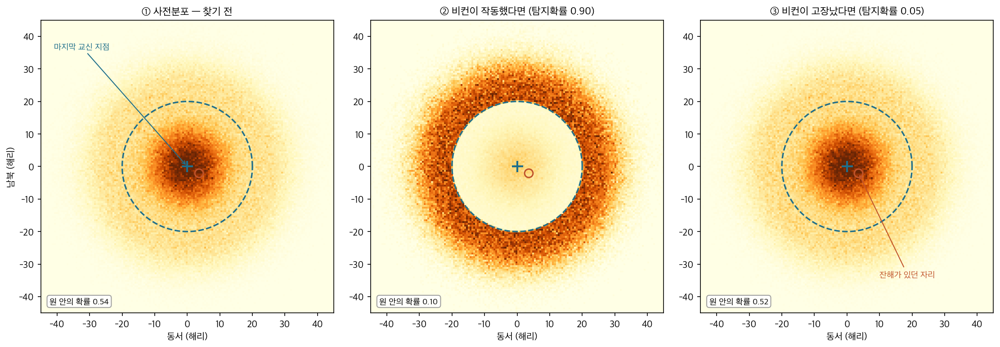
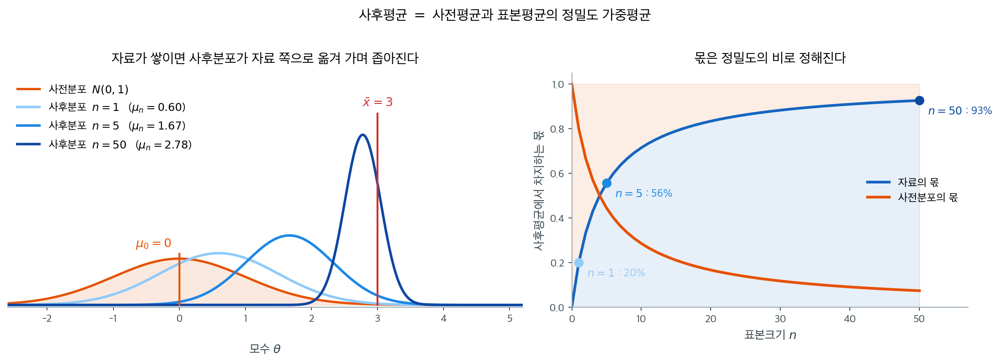

# 정규–정규 켤레 모형

## 개요

평균 $\mu$ 를 베이즈로 추정한다. 분산 $\sigma^2$ 은 안다고 두고 사전분포를
$\mu \sim N(\mu_0, \tau_0^2)$ 으로 잡으면 사후분포도 **정규**가 되며, 두 모수가
**정밀도의 덧셈**으로 갱신된다. 베타–이항과 함께 가장 많이 쓰이는 켤레 쌍이고,
축소추정량·능형회귀·칼만 필터가 모두 이 갱신식의 변형이다.

이 쪽은 그 한 쌍만 다룬다. 베이즈 정리와 점추정의 기초는 6.3절
[사전분포, 가능도, 사후분포](prior_posterior.md), 켤레성의 정의와 어느 가능도에 어느
사전분포가 켤레인지는 6.3절 [켤레 사전분포](conjugate_priors.md), 베타–이항 쌍은 6.3절
[베타–이항 켤레 갱신](bayesian_beta_conjugate.md)이 맡는다.

---

## 1. 갱신의 규칙

자료 $\mathbf{x} = (x_1, \ldots, x_n)$ 과 모수 $\theta$ 에 대해 사후분포는 가능도와
사전분포의 곱에 비례한다.

$$
p(\theta \mid \mathbf{x}) = \frac{f(\mathbf{x} \mid \theta)\, \pi(\theta)}{\int f(\mathbf{x} \mid \theta)\, \pi(\theta)\, d\theta}
\;\propto\; f(\mathbf{x} \mid \theta)\, \pi(\theta)
$$

이 식에서 읽을 것과 사후분포에서 점추정값을 어떻게 뽑는지(사후평균·MAP·사후중앙값)는
[사전분포, 가능도, 사후분포](prior_posterior.md)가 세워 둔다. 여기서는 그 가운데 한 가지,
**가능도가 무엇일 수 있는가**만 보고 넘어간다.

<div class="storybox" markdown>

**그림으로 보는 통계학 1.** 찾지 못했다는 사실도 자료다

위 식의 $f(\mathbf x \mid \theta)$ 가 늘 「무엇을 보았다」일 필요는 없다. **아무것도 보지
못했다**는 것도 가능도를 갖는다. 그 한 줄로 바다 밑에서 비행기를 찾은 일이 있다.

$2009$ 년 $6$ 월 $1$ 일 새벽, 리우데자네이루에서 파리로 가던 에어프랑스 $447$ 편이
$228$ 명을 태운 채 대서양 한가운데 폭풍 속에서 사라졌다. 엿새째에 잔해와 희생자 일부가
떠 있는 채 발견되었지만, 기체와 비행기록장치는 바다 밑 어딘가에 있었다. **두 해 동안
찾지 못했다.** 그러자 프랑스 사고조사국(BEA)은 통계학자들에게 다른 것을 부탁했다 —
잔해 위치에 대한 **확률분포**를 만들어 달라고.

그들이 쓴 갱신식은 이 쪽의 식과 같은 것이다. 바다를 입자 수십만 개로 흩뿌려 놓고,
각 입자의 가중치를 이렇게 고친다.

$$
\tilde w_n = \frac{\bigl(1 - p_d(n)\bigr)\, w_n}{\sum_{m} \bigl(1 - p_d(m)\bigr)\, w_m}
$$

여기서 $p_d(n)$ 은 **잔해가 바로 그 자리에 있었다면 지난 수색이 그것을 찾아냈을 확률**이다.
찾지 못했다는 사실의 가능도가 $1 - p_d$ 이고, 나머지는 베이즈 정리 그대로다.

문제는 $p_d$ 였다. $2009$ 년의 음향 수색은 비행기록장치의 **수중 위치 발신기**(비컨)
소리를 듣는 방식이었고, 추락 지점 둘레를 꼼꼼히 훑고도 아무 소리를 듣지 못했다. 비컨이
정상이었다면 그 침묵은 **「여기엔 없다」**는 강한 증거다. 비컨이 추락 때 부서졌다면 같은
침묵이 **아무 뜻도 없다.**



- **①** 직접 만든 사전분포다. 마지막 교신 지점 둘레의 추락 가설과, 더 멀리 활공했을
  가설이 만드는 고리를 섞었다. 반지름 $20$ 해리 원 안에 확률 $0.54$ 가 들어 있다.
- **②** 비컨이 작동했다고 보면($p_d = 0.90$) 실패한 수색 한 번이 원 안의 확률을
  $0.54 \to 0.10$ 으로 깎는다. **한가운데가 비워지고 분포가 바깥 고리로 밀려난다.**
  수색을 거기서부터 다시 하게 된다.
- **③** 비컨이 고장났다고 보면($p_d = 0.05$) 같은 실패가 거의 아무것도 바꾸지 못한다
  ($0.54 \to 0.52$). 잔해가 있던 자리 둘레의 작은 상자에 주는 확률이 ② 에서는 $0.016$,
  ③ 에서는 $0.080$ — **$5$ 배**다. 같은 자료, 같은 베이즈 정리인데 **가능도를 어떻게
  적느냐**가 수색선을 어디로 보낼지 정한다.

실제로 일어난 일이 ③ 이다. $2011$ 년 $1$ 월에 공개된 분석은 원의 **한가운데** 가까이에
잔해가 있을 가능성이 높다고 적었고, 그해 $4$ 월 BEA 국장은 이렇게 말했다 — **「바로 그
지역에서, 탐색 일주일 만에 실제로 발견되었다.」** 비행기록장치가 회수되었고, 많은
희생자가 가족에게 돌아갔다.

논문의 결론은 두 문장으로 닫힌다. 잔해가 **음향 수색이 샅샅이 훑은 구역 안에** 있었다는
사실과 회수된 비컨에 대한 시험을 함께 놓고 보면, **두 비컨이 모두 작동하지 않았던 것으로
보인다.** 그리고 — **「$2010$ 년 수색을 계획할 때 베이즈 접근을 쓰지 않은 것이 잔해 발견을
최대 일 년 늦추었다.」**

_확인한 곳 — L. D. Stone, C. M. Keller, T. M. Kratzke, J. P. Strumpfer, "Search for the
Wreckage of Air France Flight AF 447", 『Statistical Science』 $29$ 권 $1$ 호 $69$–$80$ 쪽
($2014$). $2009$ 년 $6$ 월 $1$ 일 $228$ 명을 태우고 사라진 일, 두 해 동안의 수색 실패 뒤
BEA 가 위치 확률분포를 의뢰한 일, 입자 가중치 갱신식 $(4.1)$, 「$2011$ 년 수색은 분포의
한가운데에서 시작해 금세 잔해를 찾았다」, $2011$ 년 $4$ 월 $8$ 일 BEA 국장의 「바로 그
지역에서 탐색 일주일 만에 실제로 발견되었다」, 잔해가 음향 수색 구역 안에 있었고 두 비컨이
모두 작동하지 않은 것으로 보인다는 결론, 그리고 「$2010$ 년 수색에 베이즈 접근을 쓰지 않은
것이 발견을 최대 일 년 늦추었다」를 이 글에서 확인했다. 그림의 사전분포·수색 반경·탐지확률은
이야기의 구조를 본떠 **직접 만든 것**이며(실제 수색 자료가 아니다), 수는 모두 직접 계산한
값이다_

</div>

---

## 2. 정규–정규 켤레성

### 설정

분산 $\sigma^2$이 알려진 상태에서 평균 $\mu$를 추정할 때:

- **사전분포:** $\mu \sim N(\mu_0, \tau_0^2)$
- **자료:** $X_1, \ldots, X_n \sim N(\mu, \sigma^2)$
- **사후분포:** $\mu \mid \mathbf{x} \sim N(\mu_n, \tau_n^2)$

여기서:

$$
\frac{1}{\tau_n^2} = \frac{1}{\tau_0^2} + \frac{n}{\sigma^2}
$$

$$
\mu_n = \tau_n^2 \left(\frac{\mu_0}{\tau_0^2} + \frac{n\bar{x}}{\sigma^2}\right)
$$

사후평균은 사전평균과 표본평균의 **정밀도 가중평균**이다:

$$
\mu_n = \frac{\tau_0^{-2}\,\mu_0 + n\sigma^{-2}\,\bar{x}}{\tau_0^{-2} + n\sigma^{-2}}
$$

### 시연

<div class="exbox" markdown>

**보기 1.** <span class="diff easy" title="쉬움"></span> 정규-정규 켤레모형으로 평균 추정하기. $\sigma = 2$가 알려진 상태에서 $n = 25$를 뽑고 사전분포 $N(0, 10^2)$을 쓴다.

**(1)** 사후평균이 표본평균을 사전평균 쪽으로 얼마나 당기는지, 그리고 사후표준편차 $\tau_n$이 $\sigma/\sqrt{n}$과 얼마나 다른지 **수로** 예측하시오.

**(2)** 확인하고, 이때 베이즈 신용구간과 빈도주의 신뢰구간을 견주시오. 두 구간이 거의 같다면 베이즈로 푼 보람은 어디에 있는가.

</div>

??? success "풀이"

    **(1) 해석적으로.** 정밀도(분산의 역수)로 생각하면 식이 한눈에 들어온다. 사전분포의 정밀도가 $1/\tau_0^2$, 자료의 정밀도가 $n/\sigma^2$이고 **정밀도는 더해진다.**

    $$
    \frac{1}{\tau_n^2} = \frac{1}{\tau_0^2} + \frac{n}{\sigma^2}
    = \frac{1}{100} + \frac{25}{4} = 0.01 + 6.25 = 6.26
    $$

    따라서 $\tau_n^2 = 1/6.26 = 0.159744$, $\tau_n = 0.39968$이다.

    **당김.** 사후평균은 정밀도를 가중치로 한 평균이므로

    $$
    w_{\text{사전}} = \frac{1/\tau_0^2}{1/\tau_n^2} = \frac{0.01}{6.26} = 0.001597,
    \qquad
    w_{\text{자료}} = \frac{6.25}{6.26} = 0.998403
    $$

    이다. 사전평균이 $\mu_0 = 0$이므로

    $$
    \mu_n - \bar x = w_{\text{사전}}\left(\mu_0 - \bar x\right) = -0.001597\,\bar x
    $$

    곧 표본평균을 $0$ 쪽으로 **$0.16\%$만** 당긴다. $\bar x \approx 4.93$이면 $-0.0079$ 정도다.

    **$\tau_n$과 $\sigma/\sqrt n$.** 빈도주의의 표준오차는 $\sigma/\sqrt n = 2/5 = 0.4$이고

    $$
    \frac{\tau_n}{\sigma/\sqrt n} = \sqrt{\frac{n/\sigma^2}{1/\tau_0^2 + n/\sigma^2}}
    = \sqrt{\frac{6.25}{6.26}} = 0.9992
    $$

    이다. $\tau_n$이 $0.08\%$ 작다. 사전분포가 정보를 **조금** 보태므로 사후가 조금 더 좁은데, 그 조금이 소수 넷째 자리에서야 보인다.

    **까닭은 $\tau_0 = 10$이 지나치게 크다는 데 있다.** 사전분포의 정밀도 $0.01$이 자료의 정밀도 $6.25$의 $0.16\%$라 사실상 아무 말도 하지 않는 사전분포다. $\tau_0 \to \infty$로 보내면 $w_{\text{사전}} \to 0$이고 사후분포가 $N(\bar x, \sigma^2/n)$으로 가능도와 완전히 같아진다.

    **(2) 수치적으로.**

    ```python
    import numpy as np
    from scipy import stats

    def demo_normal_normal():
        """정규-정규 켤레모형으로 평균을 추정한다."""
        sigma = 2.0        # known population std
        mu_true = 5.0      # true mean
        mu_0, tau_0 = 0, 10  # prior parameters

        rng = np.random.default_rng(42)
        n = 25
        data = rng.normal(mu_true, sigma, n)
        x_bar = data.mean()

        # 사후분포의 모수. 켤레사전분포라 형태가 그대로 유지된다.
        tau_n_sq = 1 / (1 / tau_0**2 + n / sigma**2)
        mu_n = tau_n_sq * (mu_0 / tau_0**2 + n * x_bar / sigma**2)
        tau_n = np.sqrt(tau_n_sq)

        print(f"Prior:      N({mu_0}, {tau_0}^2)")
        print(f"Data:       n={n}, x_bar={x_bar:.3f}")
        print(f"Posterior:  N({mu_n:.3f}, {tau_n:.3f}^2)")
        print(f"95% credible interval: [{mu_n - 1.96*tau_n:.3f}, {mu_n + 1.96*tau_n:.3f}]")

        # (1) 의 예측과 견준다.
        w_prior = (1 / tau_0**2) / (1 / tau_0**2 + n / sigma**2)
        se = sigma / np.sqrt(n)
        print(f"\n정밀도: 사전 {1 / tau_0**2:.4f} + 자료 {n / sigma**2:.4f} "
              f"= 사후 {1 / tau_n_sq:.4f}")
        print(f"가중치: 사전 {w_prior:.6f}, 자료 {1 - w_prior:.6f}")
        print(f"당김  mu_n - x_bar = {mu_n - x_bar:.6f}  "
              f"(예측 {w_prior * (mu_0 - x_bar):.6f})")
        print(f"tau_n = {tau_n:.6f},  sigma/sqrt(n) = {se:.6f},  "
              f"비 {tau_n / se:.6f}")
        print(f"빈도주의 신뢰구간: [{x_bar - 1.96*se:.4f}, {x_bar + 1.96*se:.4f}]")
        print(f"베이즈   신용구간: [{mu_n - 1.96*tau_n:.4f}, {mu_n + 1.96*tau_n:.4f}]")

    demo_normal_normal()
    ```

    출력:

    ```
    Prior:      N(0, 10^2)
    Data:       n=25, x_bar=4.929
    Posterior:  N(4.921, 0.400^2)
    95% credible interval: [4.138, 5.705]

    정밀도: 사전 0.0100 + 자료 6.2500 = 사후 6.2600
    가중치: 사전 0.001597, 자료 0.998403
    당김  mu_n - x_bar = -0.007874  (예측 -0.007874)
    tau_n = 0.399680,  sigma/sqrt(n) = 0.400000,  비 0.999201
    빈도주의 신뢰구간: [4.1452, 5.7132]
    베이즈   신용구간: [4.1380, 5.7047]
    ```

    **예측한 수가 모두 그대로 나왔다.** 정밀도가 $0.01 + 6.25 = 6.26$으로 더해지고, 가중치가 $(0.001597,\ 0.998403)$이며, 당김이 $-0.007874$로 예측값과 소수 여섯째 자리까지 같다. $\tau_n/(\sigma/\sqrt n) = 0.999201$도 $\sqrt{6.25/6.26} = 0.9992$와 맞는다.

    **두 구간이 거의 같다.** 폭이 $1.5668$ 대 $1.5680$으로 $0.08\%$ 다르고 중심이 $0.0079$ 어긋날 뿐이다. 소수 둘째 자리까지 보고하면 구별되지 않는다. $\tau_0 = 10$이라는 막연한 사전분포 아래에서 사후분포가 사실상 가능도 그 자체이므로 당연한 결과다.

    **그렇다면 보람은 어디에 있는가. 두 가지다.**

    **첫째, 말할 수 있는 것이 다르다.** 베이즈 구간은 "$\mu$가 이 구간에 있을 확률이 $0.95$다"라고 **그대로 읽는다.** 빈도주의 구간은 $\mu$가 상수이므로 그런 진술을 할 수 없고, "이 절차를 되풀이하면 구간의 $95\%$가 $\mu$를 덮는다"가 전부다. 숫자가 같아도 해석은 같지 않다.

    **둘째, 사전분포를 바꿀 자리가 열려 있다.** 지금은 $\tau_0 = 10$이라 사전분포가 거의 아무 말도 하지 않았지만, 과거 자료나 물리적 제약에서 온 정보가 있으면 $\tau_0$를 줄여 그 몫을 키울 수 있다. $\tau_0 = 1$이면 사전 정밀도가 $1$이 되어 가중치가 $\left(\tfrac{1}{7.25},\ \tfrac{6.25}{7.25}\right) = (0.138,\ 0.862)$로 뛰고 당김이 $-0.68$로 여든여섯 배가 된다. **같은 틀 안에서 "정보를 얼마나 믿을 것인가"를 숫자 하나로 조절할 수 있다**는 것이 켤레 모형의 쓸모다.

    거꾸로 말하면, **막연한 사전분포를 쓰면서 베이즈의 이점을 기대해서는 안 된다.** 그때 얻는 것은 해석의 편의뿐이고 숫자는 빈도주의와 같다.

---

## 3. 자료가 쌓이면 사후분포가 자료 쪽으로 간다

$n$이 커질수록 사후평균은 MLE로 수렴하고 사후분산은 0으로 줄어든다. 사전분포는 무의미해진다:

$$
\mu_n \to \bar{x} \quad \text{and} \quad \tau_n^2 \to \frac{\sigma^2}{n} \quad \text{as } n \to \infty
$$

이는 핵심적인 점근적 성질을 보여 준다. 대표본에서는 가능도가 사후분포를 지배하며 베이즈 추정값과 빈도주의 추정값이 일치한다.



왼쪽에서 사후분포가 $n$이 커질수록 두 가지를 동시에 한다. **자료 쪽으로 옮겨 가고, 좁아진다.** $n = 1$에서는 사전평균 $0$과 표본평균 $3$ 사이의 $0.6$에 머물러 사전분포에 가깝지만, $n = 50$에서는 $2.78$로 표본평균에 거의 닿는다.

오른쪽이 그 이동을 몫으로 나타낸 것이다. 사후평균은

$$
\mu_n = \underbrace{\frac{\sigma^2}{\sigma^2 + n\tau_0^2}}_{\text{사전분포의 몫}} \mu_0
\;+\; \underbrace{\frac{n\tau_0^2}{\sigma^2 + n\tau_0^2}}_{\text{자료의 몫}} \bar{x}
$$

로 쓸 수 있고, 두 몫의 비가 정확히 **두 정보원의 정밀도 비**다. 자료의 정밀도 $n/\sigma^2$은 $n$에 비례해 자라는 반면 사전분포의 정밀도 $1/\tau_0^2$은 고정되어 있으므로, 표본이 커지면 자료가 이긴다.

**사전분포가 사라지는 것이 아니라 묻히는 것**이라는 점이 중요하다. 그림에서 주황 곡선의 몫은 $n = 50$에서도 7%가 남아 있으며 0이 되지는 않는다. 그래서 소표본에서는 사전분포의 선택이 결과를 좌우하고, 대표본에서는 그 선택을 걱정할 필요가 줄어든다.

---

## 연습문제


<div class="drillbox" markdown>

**연습문제 1.** <span class="diff med" title="중간"></span> 정규-정규 모형에서 $\tau_0 \to \infty$(막연한 사전분포)일 때 사후평균이 표본평균으로, 사후분산이 $\sigma^2/n$으로 수렴함을 보여라.

</div>

??? success "풀이"
    $\tau_0 \to \infty$이면 $1/\tau_0^2 \to 0$이다. 그러면:

    $$
    \frac{1}{\tau_n^2} = \frac{1}{\tau_0^2} + \frac{n}{\sigma^2} \to \frac{n}{\sigma^2}
    $$

    따라서 $\tau_n^2 \to \sigma^2/n$이다.

    사후평균에 대해서는:

    $$
    \mu_n = \tau_n^2\left(\frac{\mu_0}{\tau_0^2} + \frac{n\bar{x}}{\sigma^2}\right)
    $$

    $\tau_0 \to \infty$일 때 첫 항 $\mu_0/\tau_0^2 \to 0$이므로:

    $$
    \mu_n \to \frac{\sigma^2}{n} \cdot \frac{n\bar{x}}{\sigma^2} = \bar{x}
    $$

    막연한(무정보) 사전분포에서는 베이즈 사후분포가 빈도주의 결과로 환원된다. $\square$

---

<div class="drillbox" markdown>

**연습문제 2.** <span class="diff med" title="중간"></span>
손실함수에 따라 베이즈 추정값이 사후평균·중앙값·최빈값으로 갈린다. 각각을 유도하고, 치우친 사후분포에서 셋이 얼마나 다를 수 있는지 예로 보여라.

</div>

??? success "풀이"
    **사후위험** $E[L(\theta,a)\mid x]$를 최소로 하는 $a$를 찾는다.

    **(1) 제곱오차 손실 $(\theta-a)^2$.**

    $$
    \frac{d}{da}E[(\theta-a)^2\mid x] = -2E[\theta-a\mid x] = 0 \implies a = E[\theta\mid x]
    $$

    **사후평균**이다.

    **(2) 절대오차 손실 $|\theta-a|$.**

    $$
    E[|\theta-a|\mid x] = \int_{-\infty}^a (a-\theta)\pi + \int_a^\infty(\theta-a)\pi
    $$

    를 $a$로 미분하면 $\Pi(a\mid x)-\{1-\Pi(a\mid x)\} = 0$, 즉 $\Pi(a\mid x)=1/2$이므로 **사후중앙값**이다.

    **(3) 0-1 손실 $\mathbb{1}\{|\theta-a|>\varepsilon\}$.** $\varepsilon\to0$의 극한에서 사후밀도가 가장 큰 점, 즉 **사후최빈값(MAP)** 이다.

    **치우친 예.** $\text{Beta}(2, 8)$ 사후분포를 보자.

    | 요약값 | 값 |
    |---|---|
    | 사후평균 | $2/10 = 0.200$ |
    | 사후중앙값 | $0.180$ |
    | MAP | $(2-1)/(10-2) = 0.125$ |

    **최빈값이 평균의 63%**에 지나지 않는다. 치우침이 심할수록 격차가 벌어지며, $\text{Beta}(1, 9)$처럼 극단적이면 MAP가 0인데 평균은 0.1이다.

    **실무 권고.** 어느 것을 보고할지는 **손실 구조**가 정한다. 그리고 셋이 크게 다르면 그 자체가 **사후분포가 심하게 치우쳤다는 신호**이므로, 요약값 하나가 아니라 사후분포 전체(밀도 그림이나 분위수)를 보여 주는 것이 옳다.

---

<div class="drillbox" markdown>

**연습문제 3.** <span class="diff med" title="중간"></span>
$\sigma^2$이 알려진 정규 모형에서 $\mu \sim N(\mu_0,\tau^2)$ 사전분포를 쓸 때 사후분포를 유도하고, **정밀도의 덧셈** 구조를 확인하라.

</div>

??? success "풀이"
    가능도가 $\bar x \mid \mu \sim N(\mu, \sigma^2/n)$이고 사전분포가 $N(\mu_0,\tau^2)$이다. 지수의 $\mu$ 이차식을 완전제곱으로 정리하면(앞서 본 두 정규밀도의 곱)

    $$
    \mu \mid x \sim N(\mu_n, \tau_n^2)
    $$

    이고

    $$
    \frac{1}{\tau_n^2} = \frac{1}{\tau^2}+\frac{n}{\sigma^2}, \qquad \mu_n = \tau_n^2\left(\frac{\mu_0}{\tau^2}+\frac{n\bar x}{\sigma^2}\right)
    $$

    이다.

    **정밀도의 덧셈.** 정밀도를 $\rho = 1/\text{분산}$으로 쓰면

    $$
    \rho_{\text{사후}} = \rho_{\text{사전}} + \rho_{\text{자료}}
    $$

    **정보가 더해진다.** 그리고 사후평균은

    $$
    \mu_n = \frac{\rho_{\text{사전}}}{\rho_{\text{사후}}}\mu_0 + \frac{\rho_{\text{자료}}}{\rho_{\text{사후}}}\bar x
    $$

    로 **정밀도 가중평균**이다. 앞서 본 역분산 가중, 메타분석, 칼만 필터와 완전히 같은 구조다.

    **극한.**

    - **$\tau^2\to\infty$**(무정보 사전분포): $\mu_n\to\bar x$, $\tau_n^2\to\sigma^2/n$. 빈도주의 결과와 일치한다.
    - **$\tau^2\to0$**(확신하는 사전분포): $\mu_n\to\mu_0$. 자료가 아무 영향을 못 준다.
    - **$n\to\infty$**: $\mu_n\to\bar x$. 사전분포의 영향이 $O(1/n)$로 사라진다.

    **사전 표본크기.** $n_0 := \sigma^2/\tau^2$으로 두면

    $$
    \mu_n = \frac{n_0\mu_0+n\bar x}{n_0+n}
    $$

    으로, 사전분포가 "$\mu_0$ 근처의 관측 $n_0$개"에 해당함이 드러난다. 베타-이항에서의 $a+b$와 같은 해석이다.

---

<div class="drillbox" markdown>

**연습문제 4.** <span class="diff med" title="중간"></span>
사후분포가 닫힌 형태가 아닐 때 쓰는 계산 방법 세 가지를 들고, 각각 언제 적절한지 적어라.

</div>

??? success "풀이"
    **(1) 마르코프 연쇄 몬테카를로(MCMC).** 사후분포를 정상분포로 갖는 마르코프 연쇄를 만들어 표본을 얻는다.

    - **메트로폴리스-헤이스팅스**: 가장 일반적. 제안분포만 있으면 된다.
    - **깁스 표집**: 조건부분포에서 뽑을 수 있을 때. 켤레 구조가 부분적으로 있으면 효율적이다.
    - **해밀턴 몬테카를로(HMC/NUTS)**: 기울기를 써서 고차원에서 훨씬 효율적. Stan이나 PyMC의 기본값이다.
    - **적절한 때**: 사실상 모든 경우. 다만 수렴 진단($\hat R$, 유효표본크기, 추적 그림)이 필수이고, 고차원이거나 사후분포가 다봉이면 느리다.

    **(2) 변분추론.** 사후분포를 다루기 쉬운 족 $q$로 근사하되 $D_{\text{KL}}(q\|\pi)$를 최소로 한다.

    - **장점**: MCMC보다 훨씬 빠르고 대규모 자료에 확장된다. 최적화 문제로 바뀌므로 수렴 판정도 명확하다.
    - **단점**: 근사이며, 대개 **사후분산을 과소평가**한다(KL의 방향 때문에 $q$가 사후분포의 한 봉우리에 몰린다). 점추정에는 괜찮아도 불확실성 정량화에는 주의가 필요하다.
    - **적절한 때**: 자료가 아주 크고 점추정이 주목적일 때, 또는 MCMC의 초기 탐색용.

    **(3) 라플라스 근사.** 사후분포를 최빈값 둘레에서 정규분포로 근사한다.

    $$
    \pi(\theta\mid x) \approx N\!\left(\hat\theta_{\text{MAP}},\ \left\{-\nabla^2\ln\pi(\hat\theta\mid x)\right\}^{-1}\right)
    $$

    - **장점**: 최적화 한 번이면 끝나 가장 빠르다. 주변가능도의 근사도 함께 준다.
    - **단점**: 사후분포가 단봉이고 대략 정규여야 한다. $n$이 작거나 치우쳤으면 나쁘다.
    - **적절한 때**: $n$이 충분히 크고 모형이 단순할 때. INLA가 이를 정교화한 방법이다.

    **고르는 순서.** 빠른 것부터 시도해 보고 필요하면 무거운 쪽으로 간다. 라플라스로 대략 보고, 변분으로 확인하고, 최종 결과는 MCMC로 내는 식이 흔하다. **여러 방법의 결과가 일치하는지 확인하는 것 자체가 좋은 진단**이다.

---

<div class="drillbox" markdown>

**연습문제 5.** <span class="diff med" title="중간"></span>
베이즈 추정량의 **빈도주의 성질**을 논하라. 사후평균이 언제 허용 가능하며, 왜 베이즈 추정량이 최소최대와 연결되는가?

</div>

??? success "풀이"
    **허용 가능성.** **유일한 베이즈 추정량은 언제나 허용 가능하다.**

    증명 개요: 베이즈 추정량 $\delta_\pi$를 지배하는 $\delta'$이 있다면 $\delta'$의 베이즈 위험이 더 작거나 같은데, $\delta_\pi$가 베이즈 위험을 최소로 하므로 같아야 하고, 유일성에서 $\delta'=\delta_\pi$다. 모순이다.

    따라서 **정상 사전분포에서 나온 베이즈 추정량은 개선의 여지가 없다.** 이것이 베이즈 방법의 강력한 빈도주의적 정당화다.

    **역방향(완비류 정리).** 적당한 조건 아래에서 **허용 가능한 추정량은 모두 베이즈 추정량이거나 그 극한**이다. 즉 좋은 추정량을 찾으려면 베이즈 추정량들을 훑으면 충분하다.

    **최소최대와의 연결.** 베이즈 추정량 $\delta_\pi$의 위험이 **$\theta$에 무관하게 상수**이면, $\delta_\pi$는 최소최대이고 $\pi$는 가장 불리한 사전분포다.

    직관: 상수 위험이면 최악의 경우가 곧 평균이고, 베이즈 위험이 최소이므로 최악도 최소다.

    **예.** 이항 비율에서 $\text{Beta}(\sqrt n/2,\sqrt n/2)$ 사전분포의 사후평균

    $$
    \hat p = \frac{X+\sqrt n/2}{n+\sqrt n}
    $$

    는 MSE가 $p$에 무관한 상수 $\frac{1}{4(1+\sqrt n)^2}$이다. 따라서 **최소최대 추정량**이다. MLE는 $p=1/2$ 근처에서 더 낫고 경계에서 나쁘므로 최소최대가 아니다.

    **함의.** 베이즈와 빈도주의는 철학적으로 대립하지만 **기술적으로는 깊이 얽혀 있다.** 좋은 빈도주의적 성질을 갖는 추정량을 찾는 체계적인 방법이 베이즈 틀 안에 있으며, 반대로 베이즈 추정량의 빈도주의적 성능을 확인하는 것이 사전분포를 고르는 한 기준이 된다.

---

## 정리하며

분산을 아는 정규 모형에서 평균의 사후분포는 **정규**이고, 갱신은 정밀도를 더하는 일이다.

$$
\frac{1}{\tau_n^2} = \frac{1}{\tau_0^2} + \frac{n}{\sigma^2},
\qquad
\mu_n = \frac{\tau_0^{-2}\mu_0 + n\sigma^{-2}\bar x}{\tau_0^{-2} + n\sigma^{-2}}
$$

- **사후평균은 정밀도로 가중한 절충이다.** 사전평균과 표본평균을 각자의 정밀도
  $1/\tau_0^2$ 과 $n/\sigma^2$ 으로 가중한다. 자료의 정밀도만 $n$ 과 함께 자라므로
  표본이 커지면 자료가 이긴다.
- **사전분포는 사라지지 않고 묻힌다.** $\S 3$ 에서 보듯 $n = 50$ 에서도 사전분포의
  몫이 $7\%$ 남아 있다. 소표본에서 사전분포의 선택이 결론을 좌우하는 까닭이고,
  대표본에서 그 걱정이 줄어드는 까닭이다.
- **$\tau_0 \to \infty$ 면 빈도주의와 만난다.** 사후평균이 $\bar x$ 로, 사후분산이
  $\sigma^2/n$ 으로 가서 표본평균의 표집분포와 모양이 같아진다(연습문제 1). 다만
  **읽는 법이 다르다** — 한쪽은 모수에 대한 확률이고 한쪽은 되풀이했을 때의 비율이다.
- **가능도는 「무엇을 보았다」가 아니어도 된다.** $\S 1$ 의 상자가 그 보기다. 찾아서
  없었다는 사실이 가능도를 갖고, 그것으로 사후분포를 갱신할 수 있다.

다음 절 **베타–이항 켤레 갱신**으로 넘어간다. 켤레 쌍 가운데 가장 많이 쓰이는 쪽이며,
비율 하나를 두고 사전분포를 바꿔 가며 결론이 얼마나 흔들리는지까지 따라간다. 여기의
정규–정규가 **정밀도의 덧셈**이었다면 그쪽은 **성공·실패 횟수의 덧셈**이다.
