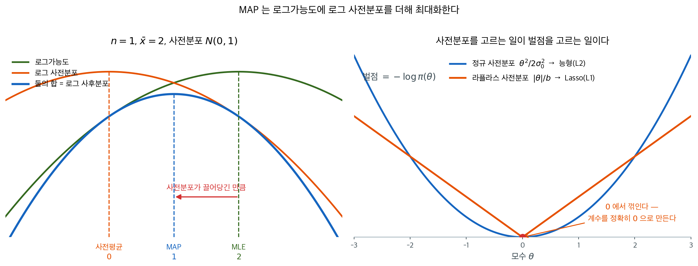
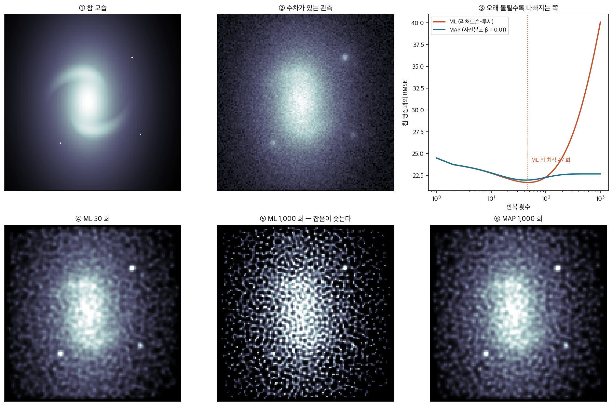

# 최대사후확률 추정

## 개요

사후분포 $\pi(\theta \mid \mathbf{x})$를 계산한 뒤에는 갱신된 믿음을 요약하는 하나의 점추정값이 필요한 경우가 많다. 사후평균과 사후중앙값도 흔히 쓰이지만, 사후최빈값인 **최대사후확률(MAP)** 추정값에는 특별한 매력이 있다. 베이즈 추론을 벌점 최적화와 직접 연결하여 베이즈적 사고와 빈도주의적 사고 사이의 다리를 놓기 때문이다.

### 정의 1. MAP 추정량 { .dfn }

MAP 추정량은 사후밀도를 최대화하는 모수값을 고른다.

$$
\hat{\theta}_{\text{MAP}} = \arg\max_{\theta}\; \pi(\theta \mid \mathbf{x})
$$

### 정리 1. MAP 는 로그가능도에 로그 사전분포를 더해 최대화한다 { .thm }

$$
\hat{\theta}_{\text{MAP}}
= \arg\max_{\theta}\; \bigl[\log f(\mathbf{x} \mid \theta) + \log \pi(\theta)\bigr]
$$

이다. 특히 사전분포가 **평평하면**($\pi(\theta)$ 가 상수) $\hat\theta_{\text{MAP}} = \hat\theta_{\text{MLE}}$ 다.

??? proof "증명"

    베이즈 정리에서

    $$
    \pi(\theta \mid \mathbf x) = \frac{f(\mathbf x \mid \theta)\,\pi(\theta)}{f(\mathbf x)}
    $$

    인데 **분모 $f(\mathbf x)$ 는 $\theta$ 를 담지 않는다.** 양수인 상수로 나누는 일은 최대점을 바꾸지 않으므로

    $$
    \arg\max_\theta \pi(\theta \mid \mathbf x) = \arg\max_\theta f(\mathbf x \mid \theta)\,\pi(\theta)
    $$

    다. 로그는 강증가 함수이므로 역시 최대점을 보존하고, 곱이 합으로 바뀐다.

    $$
    = \arg\max_\theta \bigl[\log f(\mathbf x \mid \theta) + \log\pi(\theta)\bigr]
    $$

    사전분포가 상수이면 둘째 항이 $\theta$ 와 무관하므로 최대점이 첫 항만으로 정해지고, 그것이 MLE 의 정의다. $\square$

    **주변가능도를 계산하지 않아도 된다는 것이 실무적으로 결정적이다.** $f(\mathbf x) = \int f(\mathbf x\mid\theta)\pi(\theta)d\theta$ 는 대개 닫힌 꼴이 없는데, 점추정값만 원한다면 그 적분을 아예 피할 수 있다.

    **이 덧셈 구조가 MAP·MLE·정칙화를 잇는 열쇠다.** 로그 사전분포에 음수를 붙이면 벌점이 되므로 **사전분포를 고르는 일과 벌점을 고르는 일이 같은 일**이 된다. 정규 사전분포는 $\ell_2$ 벌점(능형)이 되고 라플라스 사전분포는 $\ell_1$ 벌점(라소)이 된다 — 18장에서 그 대응을 다룬다.

    **MAP 는 사후분포를 한 점으로 요약하는 여러 방식 가운데 하나일 뿐이다.** 사후평균은 제곱손실을, 사후중앙값은 절대손실을 최소화하는데(2장 정리 1·2 가 표본에서 한 일과 같다), MAP 는 $0$–$1$ 손실에 대응한다. 사후분포가 치우쳐 있으면 세 값이 꽤 벌어진다.

왼쪽이 그 덧셈이다. 초록 곡선의 꼭대기가 MLE이고 주황 곡선의 꼭대기가 사전평균인데, 둘을 더한 파란 곡선의 꼭대기는 그 사이에 온다. **MAP는 자료가 가리키는 자리에서 사전분포가 가리키는 자리 쪽으로 끌려간 값**이며, 얼마나 끌려가는지는 두 곡선의 휘어짐(정밀도)이 정한다.

오른쪽이 같은 덧셈을 벌점으로 읽은 것이다. 로그 사전분포에 음수를 붙이면 벌점이 되므로, 사전분포를 고르는 일과 벌점을 고르는 일이 같은 일이 된다. 두 벌점의 모양 차이가 결과의 차이를 그대로 설명한다. 포물선은 어디서나 매끄러워 계수를 0 쪽으로 밀기만 하지만, 뾰족한 V는 원점에서 미분이 꺾여 있어 계수를 **정확히 0**으로 만든다. Lasso가 변수를 골라 주고 능형회귀는 그러지 못하는 이유가 이 모서리 하나다.

---

## 1. MLE와의 관계

MAP 목적함수는 MLE와 $\log \pi(\theta)$가 더해진 것만 다르다. 표본크기 $n$이 크면 로그가능도 $\log f(\mathbf{x} \mid \theta) = \sum_{i=1}^n \log f(x_i \mid \theta)$는 $n$에 비례해 커지는 반면 로그 사전분포는 $\theta$의 고정된 함수로 남는다. 그 결과, 표준적인 정칙 조건 아래에서 사전분포가 참 모수값 근방에서 양수이기만 하면 사전분포의 영향이 사라지고 MAP 추정값이 MLE로 수렴한다.

$$
\hat{\theta}_{\text{MAP}} \to \hat{\theta}_{\text{MLE}} \quad \text{as } n \to \infty
$$

!!! example "정규분포 평균에서의 MAP와 MLE"
    사전분포가 $\mu \sim N(0, \sigma_0^2)$인 $X_1, \ldots, X_n \overset{iid}{\sim} N(\mu, 1)$이라 하자. MAP 추정값은

    $$
    \hat{\mu}_{\text{MAP}} = \frac{n\sigma_0^2}{n\sigma_0^2 + 1}\,\bar{X}
    $$

    $n = 1$이고 $\sigma_0^2 = 1$이면 MAP 추정값은 $\bar{X}/2$로 사전평균 $0$과 자료 사이의 절충이다. $n = 100$이면 MAP 추정값이 약 $0.99\,\bar{X}$로 MLE $\hat{\mu}_{\text{MLE}} = \bar{X}$와 거의 같다.

---

## 2. 정칙화와의 관계

로그 사전분포 항 $\log \pi(\theta)$는 특정 모수값을 억제하는 벌점 역할을 한다. 사전분포족이 다르면 벌점의 구조도 달라진다.

**정규 사전분포와 L2 정칙화.** $\theta_j \overset{iid}{\sim} N(0, \sigma_0^2)$이면 로그 사전분포는

$$
\log \pi(\theta) = \text{const} - \frac{1}{2\sigma_0^2}\sum_j \theta_j^2
$$

따라서 $\log f(\mathbf{x} \mid \theta) + \log \pi(\theta)$를 최대화하는 것은 음의 로그가능도에 $\lambda = 1/(2\sigma_0^2)$인 L2 벌점 $\lambda \|\theta\|_2^2$을 더해 최소화하는 것과 동등하다. 이것이 정확히 능형회귀이다.

**라플라스 사전분포와 L1 정칙화.** $\theta_j \overset{iid}{\sim} \text{Laplace}(0, b)$이면 로그 사전분포는

$$
\log \pi(\theta) = \text{const} - \frac{1}{b}\sum_j |\theta_j|
$$

이를 최대화하는 것은 음의 로그가능도에 $\lambda = 1/b$인 L1 벌점 $\lambda \|\theta\|_1$을 더해 최소화하는 것과 동등하다. 이것이 정확히 Lasso 회귀이며, L1 벌점이 일부 계수를 정확히 0으로 만들기 때문에 희소성을 촉진한다.

| 사전분포 | 로그 사전분포 벌점 | 정칙화 |
|---|---|---|
| $N(0, \sigma_0^2)$ | $-\frac{1}{2\sigma_0^2}\|\theta\|_2^2$ | Ridge (L2) |
| Laplace$(0, b)$ | $-\frac{1}{b}\|\theta\|_1$ | Lasso (L1) |

이 대응은 흔히 과적합에 관한 순수 빈도주의 논증으로 동기가 부여되는 정칙화 추정에 자연스러운 베이즈적 해석이 있음을 드러낸다. 벌점은 모수의 크기에 대한 사전 믿음을 담고 있는 것이다.

**그림으로 보는 통계학 1.** 거울을 못 고치는 동안

벌점이 사전분포라는 이 대응이 **우주망원경을 세 해 반 동안 쓸 수 있게** 한 적이 있다.

$1990$ 년 $4$ 월에 올라간 허블 우주망원경이 보내온 첫 영상은 흐렸다. 원인은 주경이었다.
연마할 때 곡면을 검사하던 장치(널 보정기)의 렌즈 간격이 $1.3$ 밀리미터 어긋나 있었고,
그 바람에 거울의 **가장자리가 약 $2.2$ 마이크로미터 평평하게** 깎였다 — 머리카락 굵기의
$1/50$ 이다. 그 정도로 구면수차가 생겼고, 별빛의 상당 부분이 심(core)을 벗어나 넓은
무리로 퍼졌다. 보정광학(COSTAR)을 넣는 수리는 $1993$ 년 $12$ 월에야 이루어졌다.

그 사이에 천문학자들이 한 일이 **통계적 복원**이다. 우주망원경과학연구소는 $1990$ 년
$8$ 월과 $1993$ 년 $11$ 월 두 차례 「허블 영상과 스펙트럼의 복원」 워크숍을 열었고,
거기서 가장 널리 쓰인 것이 **리처드슨–루시** 반복이었다 — 「드는 계산에 견주어 복원의
품질이 뛰어나다」는 평과 함께 표준 분석 패키지에 들어갔다. 그 반복의 정체는 이 쪽의
말로 하면 분명하다. **광자가 포아송을 따른다고 보고 가능도를 최대화하는 EM**, 곧 MLE 다.

MLE 이므로 이 쪽이 경고한 일이 그대로 일어난다.

- **①②** 직접 만든 자료다. 은하 하나와 별 셋을 심 $0.30$ · 무리 $0.70$ 짜리 점퍼짐함수로
  흐리고 포아송 잡음을 얹었다. 나선 팔은 관측에서 거의 보이지 않는다.
- **③** 리처드슨–루시를 돌리면 오차가 **$47$ 회에서 최소**(RMSE $21.7$)가 되고 그 뒤로는
  **되레 커진다.** $1{,}000$ 회에서 $40.1$ 로, 흐린 관측 그대로의 $24.0$ 보다도 나쁘다.
  가능도를 더 높이는 일이 참값에서 멀어지는 일이 된 것이다.
- **④⑤** 눈으로 보면 까닭이 분명하다. $50$ 회에서는 나선 팔이 드러나지만, $1{,}000$ 회의
  영상은 **잡음이 점점이 솟아** 있다. 빈 구석의 표준편차가 참값 $1.13$, 관측 $1.91$ 인데
  ML $1{,}000$ 회에서는 $5.91$ 이다. 가능도는 그 반점들을 **진짜 별로 여긴다.**
- **⑥** 로그 사전분포 한 항 — 이웃 화소와 많이 다르면 벌한다 — 을 더해 MAP 로 바꾼 것이다
  ($\beta = 0.01$). 오차 곡선이 **올라가지 않고 평평해지고**($1{,}000$ 회 RMSE $22.7$),
  빈 구석의 표준편차도 $2.45$ 에 머문다. 같은 자료, 같은 반복, 더한 것은 **믿음 한 줄**이다.

이 쪽의 표가 적은 「정규 사전분포 $\to$ L2, 라플라스 $\to$ L1」과 같은 자리에 ⑥ 이 있다.
이웃끼리 비슷하리라는 믿음이 벌점이 되고, 그 벌점이 ML 을 멈춰 세운다. **거울은 $1993$ 년
겨울에 고쳐졌지만, 그 전에 나온 논문들은 이 한 항 덕분에 쓸 수 있었다.**

_확인한 곳 — 허블 주경의 가장자리가 약 $2.2$ 마이크로미터(머리카락 굵기의 $1/50$) 평평하게
깎였다는 것과 그 원인이 널 보정기의 $1.3$ 밀리미터 렌즈 간격 오차였다는 것, $1990$ 년
$4$ 월 발사와 $1993$ 년 $12$ 월 STS-$61$ 에서의 COSTAR 설치는 NASA 와 스미스소니언의
공개 자료에서 확인했다. 우주망원경과학연구소가 $1990$ 년 $8$ 월과 $1993$ 년 $11$ 월
$18$–$19$ 일에 「허블 영상과 스펙트럼의 복원」 워크숍을 열었다는 것, 리처드슨–루시가
「드는 계산에 견주어 복원의 품질이 뛰어나다」는 평과 함께 IRAF/STSDAS 에 들어갔다는 것,
수차가 있는 영상이 일상적으로 복원되어 쓰였다는 것은 그 워크숍 자료집에서 확인했다.
그림의 영상과 수는 모두 **직접 만든 자료**로 계산한 값이며, 실제 허블 관측이 아니다_

---

## 연습문제

**연습문제 1.** 
**사후평균과 MAP.** $\pi(\theta \mid x) = \mathrm{Beta}(20, 5)$에 대해 둘을 모두 계산하라. 왜 서로 다를 수 있는가?

??? success "풀이"
    $\mathrm{Beta}(\alpha, \beta)$에서:

    - 평균: $\alpha/(\alpha + \beta) = 20/25 = 0.80$.
    - 최빈값: $(\alpha - 1)/(\alpha + \beta - 2) = 19/23 \approx 0.826$.

    $\mathrm{Beta}(20, 5)$가 비대칭이기 때문에 둘이 다르다. 질량이 1 쪽에 몰려 있고 왜도는 음수이다(왼쪽으로 치우쳐 있다). 대칭인 사후분포(예: 정규분포)에서는 평균 = 최빈값 = 중앙값이다. 치우친 사후분포에서는 세 값이 갈라지며, 이 경우처럼 왜도가 음수이면 평균 < 중앙값 < 최빈값의 순서가 된다.

    **어느 것을 쓸 것인가?**

    - **제곱오차 손실:** 사후평균이 최적이다(기대 제곱오차를 최소화한다).
    - **0-1 손실:** 사후최빈값(MAP)이 최적이다.
    - **절대오차 손실:** 사후중앙값이 최적이다.

    손실함수에 맞추어 점추정량을 고르면 된다. 실무에서는 어떤 점 요약보다 사후 **분포** 자체가 더 많은 정보를 담으므로, 가능하면 사후분포 전체를 보고해야 한다.

---

**연습문제 2.** 
베르누이에 대한 베이즈적 추정량 $\hat\theta_B = (\sum X_i + a)/(n + a + b)$를 생각하자. (a) 편향과 분산. (b) $a = b = \sqrt n/2$일 때 편향되어 있지만 일치함을 보여라. (c) $\theta = 0.5, n = 10$에서 MLE와 평균제곱오차를 비교하라.

??? success "풀이"
    (a) $S = \sum X_i$라 하면 $\mathbb{E}[S] = n\theta$, $\mathrm{Var}(S) = n\theta(1-\theta)$이다.

    $\mathbb{E}[\hat\theta_B] = (n\theta + a)/(n + a + b)$. $\mathrm{Bias}(\hat\theta_B) = (a - (a+b)\theta)/(n + a + b)$.

    $\mathrm{Var}(\hat\theta_B) = n\theta(1-\theta)/(n + a + b)^2$.

    (b) $a = b = \sqrt n/2$이면 $\mathrm{Bias} = \sqrt n(0.5 - \theta)/(n + \sqrt n) \to 0$이고 분산도 $\to 0$이므로 일치한다.

    (c) $\theta = 0.5, n = 10$에서 편향은 0이다(사전분포의 중심이 $0.5$이고 실제 $\theta$도 그 값이다). $\mathrm{Var}(\hat\theta_B) \approx 0.0144$이고 MLE는 $\mathrm{Var}(\hat p) = 0.025$이다. $\theta = 0.5$에서 베이즈 추정량의 평균제곱오차가 더 작다. 사전분포 쪽으로의 축소가 다른 곳에서의 편향을 대가로 분산을 줄인다.

---

**연습문제 3.** 
$\mathrm{Beta}(\alpha, \beta)$ 사전분포를 쓴 $X \sim \mathrm{Binomial}(n, p)$에 대해 **MAP 추정량을 유도하라.**

??? success "풀이"
    사후분포: $\pi(p \mid x) \propto p^x(1-p)^{n-x} \cdot p^{\alpha-1}(1-p)^{\beta-1} = p^{x+\alpha-1}(1-p)^{n-x+\beta-1}$.

    이는 (켤레성에 의해) $\mathrm{Beta}(x + \alpha, n - x + \beta)$이다.

    Beta$(\alpha', \beta')$의 최빈값은 둘 다 $> 1$일 때 $(\alpha' - 1)/(\alpha' + \beta' - 2)$이다.

    $\hat p_{\mathrm{MAP}} = (x + \alpha - 1)/(n + \alpha + \beta - 2)$.

    **특수한 경우:**

    - $\alpha = \beta = 1$ (균등 사전분포): $\hat p_{\mathrm{MAP}} = x/n = \hat p_{\mathrm{MLE}}$. 평평한 사전분포는 MLE를 복원한다.
    - $\alpha = \beta = 0.5$ (Jeffreys 사전분포): 0.5 쪽으로 약한 축소.
    - $\alpha = \beta$가 클 때: $\alpha/(\alpha + \beta) = 0.5$ 쪽으로 강한 축소.

    MAP 점추정량은 사후평균과 다르다: $\hat p_{\mathrm{Bayes,mean}} = (x + \alpha)/(n + \alpha + \beta)$. 대칭 손실(제곱오차)에는 평균이, 0-1 손실에는 최빈값이 선호된다.

---

**연습문제 4.** 
**MAP와 MLE.** MAP가 MLE와 같아지는 때는 언제인가? 같지 않은 때는?

??? success "풀이"
    MAP는 $\pi(\theta \mid x) \propto L(\theta) \pi(\theta)$를 최대화하고 MLE는 $L(\theta)$만 최대화한다.

    **MAP = MLE**일 필요충분조건은 $\pi(\theta)$가 지지집합에서 상수인 것, 즉 평평한(비정상) 사전분포인 것이다. 달리 말하면 사전분포가 무정보인 경우이다.

    **MAP $\ne$ MLE**인 것은 사전분포에 모양이 있을 때이다. 예를 들어 Beta(2, 2)는 경계보다 0.5 근처에 더 많은 질량을 두므로 MLE에 비해 MAP를 0.5 쪽으로 끌어당긴다.

    정보가 있는 사전분포에서 MAP는 **사전평균/최빈값 쪽으로의 축소**를 들여온다. 축소의 강도는 $1/n$에 비례한다. 소표본에서는 정보가 있는 사전분포가 지배하고 대표본에서는 자료가 지배한다.

    **실용적 활용:** $n$이 매우 작거나 관측된 계수가 극단적일 때 약한 정보의 사전분포를 쓴 MAP가 MLE보다 안정적이다. 예를 들어 $n$번 던져 앞면이 $X = 0$번 나왔을 때 $p$의 MLE는 $\hat p = 0$인데(정확히 0일 수는 없다), Beta(1.5, 1.5)를 쓴 MAP는 $\hat p = 0.5/(n + 1)$로 작지만 0이 아니다.

---

**연습문제 5.** 
**켤레 사전분포.** 켤레 사전분포가 계산상 편리한 이유는 무엇인가? 베타–베르누이 외의 예를 하나 들라.

??? success "풀이"
    가능도족 $L(\theta; X)$에 대한 **켤레 사전분포**란 사후분포 $\pi(\theta \mid X)$가 같은 족에 속하게 하는 사전분포 $\pi(\theta)$이다.

    **편리함:**

    - 사후분포를 해석적으로 계산할 수 있어 수치적분이 필요 없다.
    - 새 자료로 갱신하는 것이 초모수를 갱신하는 것으로 끝난다(예: Beta $\to$ 모수가 이동한 Beta).
    - 순차적/온라인 갱신이 아주 쉽다.

    **예:**

    | 가능도 | 켤레 사전분포 | 사후분포 |
    |---|---|---|
    | Bernoulli$(p)$ | Beta$(\alpha, \beta)$ | Beta$(\alpha + x, \beta + n - x)$ |
    | Poisson$(\lambda)$ | Gamma$(\alpha, \beta)$ | Gamma$(\alpha + \sum X_i, \beta + n)$ |
    | Normal$(\mu, \sigma^2)$, $\sigma$ 알려짐 | Normal$(\mu_0, \tau_0^2)$ | Normal (갱신됨) |
    | Exponential$(\lambda)$ | Gamma$(\alpha, \beta)$ | Gamma$(\alpha + n, \beta + \sum X_i)$ |

    **현대적 단서:** MCMC와 HMC를 쓸 수 있게 되면서 켤레성은 더 이상 필수가 아니다. 임의의 사전분포와 가능도를 쓰고 사후분포를 수치적으로 표본추출할 수 있다. 켤레성은 교육적으로 다루기 쉽다는 점과 기준선 역할로서 여전히 가치가 있다.

---

**연습문제 6.** 
MAP 추정은 **모수화에 불변이 아니다.** $\theta$에서 MAP를 구한 뒤 변환한 값과 $g(\theta)$에서 직접 구한 MAP가 다른 예를 들고, 왜 그런지 설명하라.

??? success "풀이"
    **왜 다른가.** 밀도를 변환하면 야코비안이 붙는다. $\phi=g(\theta)$일 때

    $$
    \pi_\Phi(\phi) = \pi_\Theta(g^{-1}(\phi))\left|\frac{d\theta}{d\phi}\right|
    $$

    이므로 **최댓값의 위치가 야코비안 때문에 옮겨진다.** 최빈값은 밀도의 값에 의존하고 밀도는 척도에 의존하기 때문이다.

    **예.** $\theta\mid x \sim \text{Beta}(3,2)$라 하자.

    - $\theta$ 척도의 MAP: $(3-1)/(3+2-2) = 2/3 = 0.667$.
    - 로짓 척도 $\phi = \ln\{\theta/(1-\theta)\}$로 옮겨 보자. $\pi_\Theta(\theta)\propto\theta^2(1-\theta)$이고 야코비안이 $d\theta/d\phi = \theta(1-\theta)$이므로

      $$
      \pi_\Phi(\phi) = \pi_\Theta(\theta)\left|\frac{d\theta}{d\phi}\right| \propto \theta^3(1-\theta)^2
      $$

      이다. 로그를 미분해 $3/\theta - 2/(1-\theta) = 0$을 풀면 $\theta = 3/5 = 0.6$이다.

    **$0.667$과 $0.6$으로 다르다.** 같은 사후분포인데 어느 척도에서 최빈값을 찾느냐에 따라 답이 달라진다.

    **함의.**

    - **MAP는 "베이즈 추정량"으로서 어색하다.** 손실함수 관점에서 0-1 손실에 대응하는데, 연속 모수에서 그 손실은 자연스럽지 않다(한 점을 정확히 맞힐 확률이 0이므로).
    - **사후평균과 사후중앙값은 이 문제가 없다.** 중앙값은 단조변환에 완전히 불변이고, 평균은 불변은 아니지만 최소한 밀도의 척도에 의존하지 않는다.
    - **벌점 가능도와 정칙화에서 같은 문제가 생긴다.** 능형회귀의 $\lambda\|\boldsymbol\beta\|^2$가 어느 척도에서 정의된 것인지에 따라 답이 달라진다. 변수를 표준화하는 관행이 이 때문이다.

    **권고.** 보고할 요약값으로는 **사후중앙값이나 사후평균**이 낫다. MAP를 쓴다면 어느 모수화에서 구했는지 반드시 밝힌다.

---

**연습문제 7.** 
MAP 추정이 **벌점 가능도**와 같음을 보이고, 능형·라소가 각각 어떤 사전분포에 대응하는지 밝혀라.

??? success "풀이"
    **동치.** 사후밀도가 $\pi(\boldsymbol\theta\mid x)\propto L(\boldsymbol\theta)\pi(\boldsymbol\theta)$이므로

    $$
    \hat{\boldsymbol\theta}_{\text{MAP}} = \arg\max\left\{\ell(\boldsymbol\theta)+\ln\pi(\boldsymbol\theta)\right\} = \arg\min\left\{-\ell(\boldsymbol\theta)-\ln\pi(\boldsymbol\theta)\right\}
    $$

    이고, $-\ln\pi$가 곧 벌점이다.

    **능형회귀.** 벌점이 $\lambda\|\boldsymbol\beta\|_2^2$이므로

    $$
    -\ln\pi(\boldsymbol\beta) = \lambda\|\boldsymbol\beta\|^2 \implies \pi(\boldsymbol\beta)\propto e^{-\lambda\|\boldsymbol\beta\|^2}
    $$

    로 **평균 0, 분산 $\sigma^2/(2\lambda)$인 정규 사전분포**다(오차분산이 $\sigma^2$일 때 $\lambda = \sigma^2/(2\tau^2)$).

    $\lambda$가 클수록 $\tau^2$이 작아 계수가 0 근처에 있다는 강한 믿음이 된다.

    **라소.** 벌점이 $\lambda\|\boldsymbol\beta\|_1$이므로

    $$
    \pi(\boldsymbol\beta)\propto e^{-\lambda\sum_j|\beta_j|}
    $$

    로 **라플라스(이중지수) 사전분포**다. 0에서 뾰족한 봉우리를 가지므로 계수를 정확히 0으로 밀어내는 성질이 여기서 나온다.

    | 벌점 | 사전분포 | 효과 |
    |---|---|---|
    | $\|\boldsymbol\beta\|_2^2$ | 정규 | 매끄러운 축소, 0이 되지 않음 |
    | $\|\boldsymbol\beta\|_1$ | 라플라스 | 희소화(정확히 0) |
    | 엘라스틱넷 | 정규+라플라스 혼합 | 둘의 절충 |
    | $\|\boldsymbol\beta\|_0$ | 스파이크–슬랩 | 진짜 변수 선택 |

    **중요한 단서.** 이 대응은 **점추정에 대해서만** 성립한다. 라소 추정값이 라플라스 사전분포의 MAP인 것은 맞지만, **사후분포 전체는 전혀 다르다.** 라플라스 사후분포에서 계수가 정확히 0일 확률은 0이다. 따라서 "라소는 베이즈다"라는 말로 라소의 불확실성을 사후분포로 정당화하면 안 된다.

    진짜 베이즈 희소화를 원하면 스파이크–슬랩이나 말굽(horseshoe) 사전분포를 쓴다.

---

**연습문제 8.** 
MAP 추정값만 보고할 때 놓치는 것을 정리하고, 사후분포를 어떻게 요약해 보고해야 하는지 적어라.

??? success "풀이"
    **놓치는 것.**

    - **불확실성.** MAP는 점 하나다. 사후분포가 뾰족한지 평평한지 전혀 알 수 없다.
    - **비대칭.** 사후분포가 치우쳐 있으면 MAP가 대표값으로 부적절하다. 앞 절의 $\text{Beta}(2,8)$에서 MAP 0.125와 평균 0.2가 크게 다르다.
    - **다봉성.** 봉우리가 둘이면 MAP는 높은 쪽 하나만 가리키고, 다른 봉우리의 존재를 감춘다. 혼합모형이나 비선형 모형에서 실질적인 문제다.
    - **경계.** MAP가 경계에 있으면(분산 0, 비율 0) 그것이 "정말 그렇다"는 뜻이 아니라 "밀도가 거기서 최대"라는 뜻일 뿐이다.
    - **고차원에서의 전형성.** 고차원에서는 **최빈값이 전형적인 점이 아니다.** 사후질량의 대부분이 최빈값에서 멀리 떨어진 얇은 껍질에 있다. 고차원 MAP는 사후분포를 대표하지 못한다.

    **권장하는 보고 방식.**

    1. **중심 요약값과 구간.** 사후평균(또는 중앙값)과 95% 신용구간. 구간은 **등꼬리 구간**(2.5·97.5 분위수)이나 **최고사후밀도(HPD) 구간** 중 하나를 쓰되 어느 쪽인지 밝힌다.
    2. **사후밀도 그림.** 모수가 몇 개면 각각의 주변 사후밀도를 그린다. 비대칭과 다봉성이 한눈에 드러난다.
    3. **모수가 많으면.** 숲그림(forest plot)으로 여러 모수의 구간을 나란히 보이거나, 핵심 모수 몇 개만 그림으로 보이고 나머지는 표로 정리한다.
    4. **사후 예측 점검.** 사후분포에서 자료를 생성해 실제 자료와 비교한다. 모형이 자료의 주요 특징을 재현하는지 보는 것이 모수 요약보다 중요한 경우가 많다.
    5. **의사결정과 관련된 확률.** $P(\theta>0\mid x)$처럼 실제 질문에 답하는 양을 직접 계산한다. 베이즈 틀의 큰 장점이며, 신용구간보다 해석이 명확하다.

---

**연습문제 9.** 
**경험 베이즈**를 설명하고, 완전 베이즈와의 차이를 밝혀라. 언제 쓰며 무엇을 주의해야 하는가?

??? success "풀이"
    **경험 베이즈.** 사전분포의 초모수를 사전 정보로 정하지 않고 **자료에서 추정**한다.

    예컨대 계층 베타–이항에서 $p_j\sim\text{Beta}(a,b)$일 때, $(a,b)$를 주변가능도

    $$
    m(\mathbf{k};a,b) = \prod_j\int_0^1\binom{n_j}{k_j}p^{k_j}(1-p)^{n_j-k_j}\pi(p;a,b)\,dp
    $$

    를 최대로 하도록 고른 뒤, 그 $(\hat a,\hat b)$를 마치 주어진 것처럼 써서 각 $p_j$의 사후분포를 구한다.

    **완전 베이즈와의 차이.** 완전 베이즈는 $(a,b)$에도 초사전분포를 두고 함께 적분한다.

    | | 경험 베이즈 | 완전 베이즈 |
    |---|---|---|
    | 초모수 | 점추정 $(\hat a,\hat b)$ | 사후분포로 적분 |
    | 계산 | 가볍다(최적화) | 무겁다(MCMC) |
    | 초모수 불확실성 | **무시** | 반영 |
    | 신용구간 | 좁게 나옴 | 적절 |

    **언제 쓰는가.**

    - 집단 수 $J$가 **많을 때**. $J$가 크면 $(\hat a,\hat b)$가 정밀하게 추정되어 그 불확실성을 무시해도 무해하다.
    - 계산 비용이 문제일 때. 유전체학처럼 모수가 수만 개인 경우 완전 베이즈가 비현실적이다.
    - 사전분포를 정당화하기 어려울 때. "자료가 사전분포를 말하게 한다"는 점이 설득에 유리하다.

    **주의할 점.**

    1. **자료를 두 번 쓴다.** 같은 자료로 사전분포를 정하고 그 사전분포로 추론한다. 원리적으로 베이즈 규칙 위반이며, 신용구간의 포함확률이 명목값에 못 미친다. $J$가 작으면 심각하다.
    2. **$J$가 작으면 쓰면 안 된다.** 대략 $J \ge 10$은 되어야 하고, $J<5$면 완전 베이즈나 고정된 사전분포를 쓴다.
    3. **초모수 불확실성 보정.** 모리스의 보정처럼 구간을 넓혀 주는 방법이 제안되어 있다.
    4. **경계해.** 집단 간 분산이 0으로 추정되면 모든 집단이 완전히 결합되어 개별 차이가 사라진다. 완전 베이즈는 초사전분포가 이를 막아 준다.

    **대표적 응용.** 스타인 추정의 경험 베이즈 해석(에프론–모리스), 유전자 발현 분석의 `limma`, 야구 타율 추정, 소지역 추정이 모두 이 틀을 쓴다.

---

**연습문제 10.** 
**비정상 사전분포.** $\int \pi(\theta) d\theta = \infty$인 사전분포(예: $\mathbb{R}$ 위의 $\pi(\mu) = 1$)를 **비정상(improper)**이라 한다. 그래도 타당한 사후분포를 계산할 수 있는가? 언제 그러한가?

??? success "풀이"
    그렇다. *사후분포*가 정상(proper)이기만 하면 된다. 조건은 분자 $L(\theta) \pi(\theta)$가 $\theta$에 대해 유한한 적분을 갖는 것이다:

    $$
    \int L(\theta) \pi(\theta) d\theta < \infty
    $$

    그러면 $\pi(\theta \mid x) \propto L(\theta) \pi(\theta)$를 정규화할 수 있다.

    **흔한 비정상 사전분포:**

    - 위치모수에 대한 $\pi(\mu) = 1$ ($\mathbb{R}$ 위의 Lebesgue 측도).
    - 분산/척도 모수에 대한 $\pi(\sigma) = 1/\sigma$ (척도에 대한 Jeffreys).
    - 베르누이에 대한 $\pi(p) \propto 1/\sqrt{p(1-p)}$ (베르누이에 대한 Jeffreys).

    **비정상 사전분포의 문제:**

    - 자료가 정보를 주지 못하면 사후분포도 비정상이 될 수 있다.
    - 베이즈 인자와 모형 비교가 깨질 수 있다(주변가능도가 정의되지 않는다).
    - 직관에 반하는 역설이 생길 수 있다(Lindley 역설).

    **현대적 관행:** 비정상 사전분포를 근사하면서도 정상성을 유지하는 약한 정보의 *정상* 사전분포(예: 위치모수에 대한 $N(0, 10^4)$)를 쓴다. "사전 정보를 최소화한다"는 의도를 유지하면서 함정을 피한다.

---

**연습문제 11.** 
적률법, 최대가능도, 최소제곱(11.2절 [최소제곱](../../ch11/estimation_inference/least_squares.md)), 베이즈 네 가지 추정 방법을 **무엇을 최적화하는가**의 관점에서 한 표로 정리하고, 각각이 필요로 하는 가정을 적어라.

??? success "풀이"

    | 방법 | 최적화 대상 | 필요한 가정 |
    |---|---|---|
    | 적률법 | 표본적률 = 모형적률 (방정식 풀이) | 적률이 존재하고 모수를 결정할 것 |
    | 최대가능도 | $\ell(\theta) = \sum\ln f(x_i;\theta)$ 최대화 | **분포 전체**를 지정 |
    | 최소제곱 | $\sum(y_i-f(x_i;\theta))^2$ 최소화 | 평균 구조만 지정, 등분산이면 효율적 |
    | 베이즈 | 사후위험 최소화(손실에 따라 평균·중앙값·최빈값) | 분포 전체 + **사전분포** |

    **가정의 강도 순서.** 적률법·최소제곱 < 최대가능도 < 베이즈.

    적률법과 최소제곱은 **분포를 지정하지 않는다.** 처음 몇 개의 적률이나 평균 구조만 맞으면 된다. 그래서 모형 오설정에 강건하지만 효율을 잃는다.

    최대가능도는 분포 전체를 쓰므로 **가정이 맞으면 가장 효율적**이고, 틀리면 유사참값으로 수렴한다.

    베이즈는 사전분포까지 요구하지만, 그 대가로 소표본에서의 안정성과 불확실성의 완결된 표현(사후분포)을 얻는다.

    **서로 겹치는 지점.**

    - **정규 오차 아래에서 최소제곱 = 최대가능도**다.
    - **일모수 지수족에서 적률법 = 최대가능도**인 경우가 많다(지수, 포아송, 베르누이).
    - **평평한 사전분포에서 MAP = 최대가능도**다.
    - **$n\to\infty$이면 베이즈 사후평균과 MLE가 같아진다**(베른슈타인–폰 미제스).

    **고르는 기준.** 분포를 믿을 수 있고 표본이 적당하면 최대가능도, 분포가 미덥지 않으면 적률법·최소제곱에 강건 표준오차, 표본이 아주 작거나 사전 정보가 있으면 베이즈가 자연스러운 선택이다.

---

**연습문제 12.** 
같은 자료에 네 방법을 적용했더니 추정값이 서로 꽤 달랐다. 이것이 문제인지 판단하는 절차를 적어라.

??? success "풀이"
    **먼저 나눠 볼 것.** 차이가 **표집변동 수준인가, 그 이상인가.**

    각 추정값의 표준오차를 계산해 차이가 표준오차의 몇 배인지 본다. $\hat\theta_1-\hat\theta_2$가 각각의 표준오차보다 작으면 우연으로 설명된다. 두 추정량이 상관되어 있으므로 차의 표준오차를 정확히 구하려면 부트스트랩으로 함께 재표집하는 것이 낫다.

    **차이가 크다면 원인을 좁힌다.**

    1. **모형이 틀렸는가.** 적률법과 최대가능도가 크게 다르면 **분포 가정이 의심스럽다**는 강한 신호다. 모형이 맞으면 둘 다 같은 참값으로 수렴하기 때문이다. 이 아이디어를 형식화한 것이 **하우스만 검정**이다.

       $$
       H = \frac{(\hat\theta_{\text{eff}}-\hat\theta_{\text{rob}})^2}{\operatorname{Var}(\hat\theta_{\text{rob}})-\operatorname{Var}(\hat\theta_{\text{eff}})}\ \sim\ \chi^2
       $$

       효율적이지만 가정에 민감한 추정량과, 덜 효율적이지만 강건한 추정량을 비교한다.

    2. **이상치가 있는가.** 최대가능도(정규 가정)만 크게 움직이면 몇몇 관측값이 끌고 있을 가능성이 높다. 관측값을 하나씩 빼 보는 영향력 진단을 한다.

    3. **사전분포가 지배하는가.** 베이즈 추정값만 다르면 사전분포의 영향이다. 사전분포를 바꿔 가며 사후분포가 얼마나 움직이는지 보는 **민감도 분석**이 필요하다. 자료가 적을수록 이 영향이 크다.

    4. **최적화가 수렴했는가.** 최대가능도만 이상하면 국소해에 빠졌을 수 있다. 여러 초기값에서 다시 돌린다.

    **결론을 내는 법.** 원인을 특정했으면 그에 맞는 방법을 고르고 **왜 골랐는지 밝힌다.** 특정하지 못했다면 여러 추정값을 모두 보고하는 것이 정직하다. "모형 선택에 따라 결과가 $x$에서 $y$까지 달라진다"는 진술이 하나의 값을 자신 있게 보고하는 것보다 나은 경우가 많다.

---

## 정리하며

최대사후확률 추정은 사후분포의 **최빈값**을 고른다.

$$
\hat\theta_{\text{MAP}} = \arg\max_\theta\; f(\mathbf x\mid\theta)\,\pi(\theta)
$$

- **로그를 취하면 정체가 드러난다.** $\log f(\mathbf x\mid\theta)+\log\pi(\theta)$ 를 최대화하는 것이며, 첫 항이 로그가능도이고 **둘째 항이 벌점**이다. 즉 MAP 는 **벌점 최대가능도**다.
- **정칙화가 사전분포의 다른 이름이다.** 정규 사전분포를 두면 $L_2$ 벌점(능형회귀)이 되고, 라플라스 사전분포를 두면 $L_1$ 벌점(라쏘)이 된다. 18장의 정칙화 회귀가 이 사실 위에 서 있다.
- **평평한 사전분포면 최대가능도와 같아진다.** 베이즈와 빈도주의가 만나는 지점이다.
- **사후평균·사후중앙값과 다르다.** 사후분포가 치우쳐 있으면 셋이 갈리며, 최빈값은 **손실함수의 관점에서 0–1 손실에 대응**한다. 제곱손실이면 사후평균, 절대손실이면 사후중앙값이 최적이다.
- **점추정은 사후분포를 버리는 일이다.** MAP 값 하나만 보고하면 불확실성 정보가 사라진다. 베이즈의 장점은 분포 전체에 있다.

**이것으로 6장이 끝난다.** 최대가능도(6.1), 적률법과 GMM(6.2), 베이즈(6.3)를 차례로 보았다 — 추정량을 **만드는** 세 전략이다.

다음 장 **[추정의 이론 ★](../../ch07/index.md)**으로 넘어간다. 여기까지 추정량을 **만드는** 세 방법을 보았다면, 그 추정량이 **왜 좋은지**를 증명하는 것이 그 장의 일이다. 입문 과정의 범위를 넘으므로 건너뛰고 8장으로 가도 된다.
