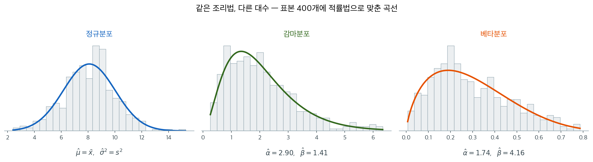

# 흔한 분포에 대한 적률법

## 개요

적률법은 적률을 모수로 나타낼 수 있는 임의의 분포에서 모수를 추정하는 체계적인 방법을 제공한다. 처음 $p$개의 모집단 적률을 대응하는 표본 적률과 같다고 두고 그 연립방정식을 풀면 직관적이고 계산하기 쉬운 닫힌 형태의 추정량을 얻는다. 이 페이지에서는 정규분포, 감마분포, 베타분포라는 세 가지 중요한 분포족에 대해 적률법 추정량을 유도하며, 대수적 복잡도가 커지는 순서로 일반적인 절차를 보인다.

이 페이지에서 표본 적률을 다음과 같이 정의한다:

$$
M_1 = \bar{X} = \frac{1}{n}\sum_{i=1}^n X_i, \quad M_2 = \frac{1}{n}\sum_{i=1}^n (X_i - \bar{X})^2
$$

$M_2$가 ($1/(n-1)$이 아니라) $1/n$을 분모로 쓴다는 점에 유의하라. 적률법은 **모집단** 적률을 그 **표본 대응물**과 맞추는데, 모집단의 2차 중심적률 $E[(X - \mu)^2] = \sigma^2$에 대응하는 것은 Bessel 수정된 표본분산 $S^2 = \frac{1}{n-1}\sum(X_i - \bar{X})^2$이 아니라 $M_2$이기 때문이다.

아래 세 분포에 같은 절차를 적용해 본다. 결과를 먼저 보면 이렇다.



세 경우 모두 **쓰는 정보는 같다.** 표본평균과 표본분산, 그 둘뿐이다. 달라지는 것은 그 둘에서 모수로 건너가는 대수뿐이며, 정규분포에서는 건너갈 것도 없이 바로 답이 나오고 감마·베타에서는 두 식을 풀어야 한다.

베타분포의 추정값이 참값 $(2, 5)$에서 조금 떨어진 $(1.74, 4.16)$으로 나온 것도 눈여겨보라. 표본 400개에서도 이 정도는 흔들린다. 적률법이 **일치추정량이지만 효율적이지는 않다**는 말의 실제 모습이다.

---

## 1. 정규분포

정규분포는 모수가 곧 처음 두 적률이기 때문에 적률법에서 가장 단순한 경우이다. $X \sim N(\mu, \sigma^2)$에 대해 모집단 적률은:

$$
E[X] = \mu, \quad E[(X - \mu)^2] = \sigma^2
$$

**적률방정식 세우기.** 모집단 적률을 대응하는 표본 적률과 같다고 둔다:

$$
\mu = M_1 = \bar{X}
$$

$$
\sigma^2 = M_2 = \frac{1}{n}\sum_{i=1}^n (X_i - \bar{X})^2
$$

**풀기.** 이 연립방정식은 이미 풀려 있다. 각 방정식이 곧바로 추정량을 준다:

$$
\hat{\mu}_{\text{MoM}} = \bar{X}, \quad \hat{\sigma}^2_{\text{MoM}} = \frac{1}{n}\sum_{i=1}^n (X_i - \bar{X})^2
$$

!!! note "정규분포에서 적률법과 MLE"
    정규분포의 적률법 추정량은 MLE와 동일하다. 둘 다 $\hat{\mu} = \bar{X}$와 $\hat{\sigma}^2 = \frac{1}{n}\sum(X_i - \bar{X})^2$을 준다. 적률법의 분산추정량은 편향되어 있지만(기댓값이 $\frac{n-1}{n}\sigma^2$이다) $n \to \infty$일 때 일치한다.

??? example "수치 보기"
    $n = 5$개의 값 $2, 4, 6, 8, 10$을 관측했다고 하자.

    $$
    \hat{\mu}_{\text{MoM}} = \bar{X} = \frac{2 + 4 + 6 + 8 + 10}{5} = 6
    $$

    $$
    \hat{\sigma}^2_{\text{MoM}} = \frac{(2-6)^2 + (4-6)^2 + (6-6)^2 + (8-6)^2 + (10-6)^2}{5} = \frac{16 + 4 + 0 + 4 + 16}{5} = 8
    $$

    적률법 추정값은 $\hat{\mu} = 6$, $\hat{\sigma}^2 = 8$이다(Bessel 수정된 $S^2 = 10$과 비교된다).

---

## 2. 감마분포

감마분포는 대기 시간, 강우량, 보험 청구액처럼 양수이고 오른쪽으로 치우친 자료를 모형화하는 데 널리 쓰인다. 적률법 추정에 두 방정식의 연립을 풀어야 하므로 정규분포보다 배울 것이 많은 예이다.

**형상–척도 모수화**를 사용한다. $X \sim \text{Gamma}(\alpha, \beta)$에서 $\alpha > 0$은 형상모수이고 $\beta > 0$은 척도모수이다. 모집단 적률은:

$$
E[X] = \alpha\beta, \quad \text{Var}(X) = \alpha\beta^2
$$

**적률방정식 세우기.** 모집단 적률을 표본 적률과 같다고 둔다:

$$
\alpha\beta = M_1 = \bar{X}
$$

$$
\alpha\beta^2 = M_2 = \frac{1}{n}\sum_{i=1}^n (X_i - \bar{X})^2
$$

**풀기.** 두 번째 식을 첫 번째 식으로 나누어 $\beta$를 분리한다:

$$
\frac{\alpha\beta^2}{\alpha\beta} = \frac{M_2}{M_1} \implies \beta = \frac{M_2}{M_1} = \frac{M_2}{\bar{X}}
$$

이를 첫 번째 식에 대입하여 $\alpha$를 구한다:

$$
\alpha = \frac{M_1}{\beta} = \frac{\bar{X}}{M_2/\bar{X}} = \frac{\bar{X}^2}{M_2}
$$

적률법 추정량은:

$$
\hat{\beta}_{\text{MoM}} = \frac{M_2}{\bar{X}}, \quad \hat{\alpha}_{\text{MoM}} = \frac{\bar{X}^2}{M_2}
$$

!!! tip "추정량의 해석"
    형상 추정값 $\hat{\alpha}$는 변동계수의 제곱을 뒤집은 것이다: $\hat{\alpha} = (\bar{X}/\sqrt{M_2})^2 = 1/\hat{CV}^2$. 형상모수가 클수록 평균에 비해 변동이 작은 분포이다.

??? example "수치 보기"
    대기 시간(분)을 관측하여 $3.2, 5.1, 4.7, 6.3, 2.8, 4.9$를 얻었다고 하자.

    $$
    \bar{X} = \frac{3.2 + 5.1 + 4.7 + 6.3 + 2.8 + 4.9}{6} = \frac{27.0}{6} = 4.5
    $$

    $$
    M_2 = \frac{(3.2-4.5)^2 + (5.1-4.5)^2 + (4.7-4.5)^2 + (6.3-4.5)^2 + (2.8-4.5)^2 + (4.9-4.5)^2}{6}
    $$

    $$
    = \frac{1.69 + 0.36 + 0.04 + 3.24 + 2.89 + 0.16}{6} = \frac{8.38}{6} \approx 1.397
    $$

    $$
    \hat{\beta}_{\text{MoM}} = \frac{1.397}{4.5} \approx 0.310, \quad \hat{\alpha}_{\text{MoM}} = \frac{4.5^2}{1.397} = \frac{20.25}{1.397} \approx 14.50
    $$

    추정값은 형상 $\hat{\alpha} \approx 14.5$, 척도 $\hat{\beta} \approx 0.31$인 감마분포를 시사한다.

---

## 3. 베타분포

베타분포는 구간 $(0, 1)$ 위의 자료를 모형화하므로 비율, 비율값, 베이즈 사전분포 설정에 유용하다. 적률법 추정에는 조금 더 복잡한 대수 조작이 필요하다.

$a, b > 0$인 $X \sim \text{Beta}(a, b)$에 대해 모집단 적률은:

$$
E[X] = \frac{a}{a + b}, \quad \text{Var}(X) = \frac{ab}{(a+b)^2(a+b+1)}
$$

**적률방정식 세우기.** $\mu = E[X]$, $\sigma^2 = \text{Var}(X)$라 하고 표본 적률과 같다고 둔다:

$$
\frac{a}{a+b} = M_1 = \bar{X}
$$

$$
\frac{ab}{(a+b)^2(a+b+1)} = M_2
$$

**풀기.** 첫 번째 식에서 $a = \bar{X}(a + b)$이므로 $b = a(1 - \bar{X})/\bar{X}$이고 $a + b = a/\bar{X}$이다. 편의상 $s = a + b$라 두면 $a = s\bar{X}$, $b = s(1 - \bar{X})$이다.

분산 방정식에 대입하면:

$$
\frac{s\bar{X} \cdot s(1 - \bar{X})}{s^2(s + 1)} = M_2 \implies \frac{\bar{X}(1 - \bar{X})}{s + 1} = M_2
$$

$s$에 대해 풀면:

$$
s + 1 = \frac{\bar{X}(1 - \bar{X})}{M_2} \implies s = \frac{\bar{X}(1 - \bar{X})}{M_2} - 1
$$

$a = s\bar{X}$이고 $b = s(1 - \bar{X})$이므로:

$$
\hat{a}_{\text{MoM}} = \bar{X}\left(\frac{\bar{X}(1 - \bar{X})}{M_2} - 1\right)
$$

$$
\hat{b}_{\text{MoM}} = (1 - \bar{X})\left(\frac{\bar{X}(1 - \bar{X})}{M_2} - 1\right)
$$

!!! warning "타당성 조건"
    베타분포의 적률법 추정량은 $M_2 < \bar{X}(1 - \bar{X})$를 요구하며, 이 조건이 $s > 0$을, 따라서 $\hat{a}, \hat{b} > 0$을 보장한다. 표본분산이 $\bar{X}(1 - \bar{X})$를 넘으면 적률법이 실패한다. 그 평균을 갖는 어떤 베타분포로도 담아낼 수 없을 만큼 자료가 퍼져 있기 때문이다.

??? example "수치 보기"
    비율값 $0.3, 0.5, 0.4, 0.6, 0.35, 0.55$를 관측했다고 하자.

    $$
    \bar{X} = \frac{0.3 + 0.5 + 0.4 + 0.6 + 0.35 + 0.55}{6} = \frac{2.70}{6} = 0.45
    $$

    $$
    M_2 = \frac{(0.3-0.45)^2 + \cdots + (0.55-0.45)^2}{6} = \frac{0.0225 + 0.0025 + 0.0025 + 0.0225 + 0.01 + 0.01}{6} = \frac{0.07}{6} \approx 0.01167
    $$

    타당성 확인: $\bar{X}(1-\bar{X}) = 0.45 \times 0.55 = 0.2475 > 0.01167$ (충족).

    $$
    s = \frac{0.2475}{0.01167} - 1 = 21.21 - 1 = 20.21
    $$

    $$
    \hat{a}_{\text{MoM}} = 0.45 \times 20.21 \approx 9.09, \quad \hat{b}_{\text{MoM}} = 0.55 \times 20.21 \approx 11.12
    $$

    적률법 추정값은 $\text{Beta}(9.1, 11.1)$ 분포를 시사하며, 이는 단봉이고 (평균이 0.45로) 오른쪽으로 약간 치우쳐 있다.

---

## 4. 독일 탱크 문제

앞의 셋은 모두 연속분포의 모수를 맞추었다. 적률을 맞춘다는 발상이 **개수를 세는 문제**에도 그대로 듣는다는 것을 보여 주는 고전적인 예가 있다.

제2차 세계대전 중 연합군은 독일의 전차 생산량을 알고 싶어 했다. 첩보로 얻은 추정치는 실제와 크게 어긋났는데, 노획한 전차에 찍힌 **일련번호**를 쓰자 사정이 달라졌다. 어떤 생산 묶음의 일련번호가 연속한 정수 $N$개로 매겨져 있다면, 노획한 몇 대의 번호는 그 $N$개에서 비복원으로 뽑은 표본이다. 알고 싶은 묶음의 크기 $N$이 바로 모수다.

!!! warning "양 끝을 아는가 모르는가"
    여기서 전제를 분명히 해 두어야 한다. 노획한 전차의 번호가 $369, 373, \ldots$처럼 큰 수부터 시작한다면, 그 묶음의 번호가 $a$번에서 시작해 $b$번에서 끝난다고 할 때 **우리는 $a$도 $b$도 모른다.** 알고 싶은 것은 그 둘의 간격 $N = b - a + 1$이다.

    그래서 관측값만으로 셀 수 있는 것은 관측값 **사이**의 간격뿐이다. 맨 앞 구간의 길이는 $a$를 알아야 적을 수 있고 맨 뒤 구간의 길이는 $b$를 알아야 적을 수 있는데, 둘 다 모르기 때문이다.

    아래 적률법은 바로 이 경우에 쓰는 것이다. 시작이 $1$이라고 알려져 있으면 맨 앞 구간을 셀 수 있게 되어 사정이 달라지며, 그때 무엇이 더 가능해지는지는 이 절 끝에서 따로 다룬다.

**무엇을 맞출 것인가.** 번호 $k$개를 관측하면 그 번호들이 묶음 전체를 $k+1$개의 구간으로 가른다. 맨 앞 구간, 관측값 사이의 $k-1$개 구간, 맨 뒤 구간이다. 관측되지 않은 $N - k$개의 번호가 이 $k+1$개 구간에 나뉘어 들어가는데, 어느 구간도 특별할 이유가 없으므로 **교환가능성**에 의해 각 구간에 빠진 개수의 기댓값이 모두 같다.

$$
E[\text{한 구간에 빠진 개수}] = \frac{N - k}{k + 1}
$$

관측값 **사이**의 간격은 시작 번호를 몰라도 눈으로 셀 수 있다. 그 $k-1$개의 평균을 $\bar G$라 두고 위 기댓값과 같다고 놓는 것이 적률방정식이다.

$$
\bar G = \frac{N - k}{k + 1}
\qquad\Longrightarrow\qquad
\hat{N}_{\text{MoM}} = (k + 1)\bar G + k
$$

<div class="thmbox" markdown>

### 정리 1. 간격 추정량은 불편이다 { .thm }

연속한 정수 $N$개에서 비복원으로 뽑은 $k \ge 2$개의 번호에 대해, 이웃한 관측값 사이에 빠진 개수 $k-1$개의 평균을 $\bar G$라 하면

$$
E\bigl[(k+1)\bar G + k\bigr] = N
$$

이다. **시작 번호를 몰라도 계산할 수 있다.**

</div>

??? proof "증명"

    $k+1$개 구간에 빠진 개수를 $G_0, G_1, \ldots, G_k$라 하자($G_0$은 맨 앞, $G_k$는 맨 뒤). 정의상 이들의 합이 관측되지 않은 번호 전부이므로

    $$
    \sum_{j=0}^{k} G_j = N - k
    $$

    이다. 비복원추출에서 $k$개의 번호가 놓이는 자리는 모든 조합이 똑같이 나올 수 있고, 그 대칭성 아래 $G_0, \ldots, G_k$는 **교환가능**하다. 따라서 $E[G_j]$가 $j$와 무관하게 같고, 합의 기댓값을 $k+1$로 나누면

    $$
    E[G_j] = \frac{N - k}{k + 1}
    $$

    이다. 눈으로 세는 $\bar G$는 **내부 구간** $G_1, \ldots, G_{k-1}$의 평균이다. 이것은 $k-1$개이지 $k+1$개가 아니지만, 교환가능성에서 **각각의 기댓값이 모두 같은 값**이므로 몇 개를 평균 내든 기댓값은 달라지지 않는다.

    $$
    E[\bar G] = \frac{1}{k-1}\sum_{j=1}^{k-1} E[G_j] = \frac{N-k}{k+1}
    $$

    이다. 양변에 $k+1$을 곱하고 $k$를 더하면 $E[(k+1)\bar G + k] = (N - k) + k = N$이다. $\square$

    **관측할 수 없는 둘을 빼고도 불편이라는 점이 요점이다.** 맨 앞 구간 $G_0$과 맨 뒤 구간 $G_k$는 시작 번호와 $N$을 알아야 셀 수 있어 쓸 수 없는데, 교환가능성 덕분에 나머지 $k-1$개만으로도 같은 기댓값을 얻는다. 다만 평균 내는 항이 적을수록 **분산은 커진다.**

<div class="storybox" markdown>

**그림으로 보는 통계학 1.** 전차를 세지 않고 전차 수를 센 사람들

<figure markdown>
  { width=560 }
  <figcaption markdown>$1944$ 년 여름 노르망디, 연합군이 노획해 한곳에 모아 둔 독일 전차들. 포탑에 칠해진 $425$·$898$ 은 부대에서 붙인 표시이고, 셈에 쓰인 것은 차대·변속기·바퀴 같은 **부품에 찍힌 제조 일련번호**다. *(Archives Normandie, Wikimedia Commons, PD)*</figcaption>
</figure>

정리 1 의 셈이 실제로 쓰인 자리가 사진이다. 포탑에 큼직하게 칠한 숫자는 아무 쓸모가 없다 —
부대에서 붙인 표시여서 $1$ 부터 $N$ 까지 고르게 매겨진 것이 아니기 때문이다. 셈이 기댄 것은
독일이 **차대·변속기·엔진·바퀴**에 차례로 찍어 넣은 제조 일련번호였다. 노획하거나 격파한
전차에서 그 번호를 적어 두면 그것이 곧 연속한 정수에서 비복원으로 뽑은 표본이 되고,
위에서 본 간격 셈이 그대로 돈다.

수가 어떻게 갈렸는지가 이 이야기의 전부다. 첩보를 모아 내린 추정은 **월 $1{,}400$ 대
가량**이었다. 같은 기간에 일련번호로 얻은 값은 **월 $246$ 대**였다. 전쟁이 끝나고 슈페어
군수부의 생산 기록이 나왔는데, 실제는 **월 $245$ 대**였다. 첩보는 다섯 배 넘게 빗나갔고,
위의 한 줄짜리 식은 **한 대 차이**였다.

바퀴로도 따로 세어 보았다고 한다. 전차 두 대의 도로바퀴 $64$ 개에 찍힌 번호에서 거푸집의
개수를 어림하고, 거푸집 하나가 찍어 낼 수 있는 바퀴 수를 영국 제조업자에게 물어 월
$270$ 대라는 값을 얻었다. 같은 방법을 V-$2$ 로켓에도 썼다. **무엇에 일련번호가 찍혀
있는가만 보면 되지, 그것이 전차일 필요는 없다는 뜻이다.**

_확인한 곳 — [Wikipedia 「German tank problem」](https://en.wikipedia.org/wiki/German_tank_problem) — 「차대·변속기·엔진·바퀴에 오름차순 일련번호를 붙이던 제조 관행을 이용했다」, 「첩보 추정은 $1940$ 년 $6$ 월–$1942$ 년 $9$ 월에 월 약 $1{,}400$ 대였는데 공식으로 얻은 값은 월 $246$ 대였고, 전후 슈페어 군수부의 노획 생산 기록이 보인 실제 수는 월 $245$ 대였다」, 바퀴 $64$ 개에서 월 $270$ 대를 얻은 것과 V-$2$ 로켓에 같은 분석을 쓴 것이 모두 여기 있다 · 최댓값 추정량 $\hat N=M+\frac Mk-1$ 이 불편이라는 것은 $N=245$ 로 $20$ 만 번 모의해 $k=4,\ 10,\ 20$ 에서 추정값의 평균이 각각 $245.04$, $245.01$, $244.95$ 로 나오는 것으로 확인했다 · 사진은 [Commons 파일 쪽](https://commons.wikimedia.org/wiki/File:Panther_tanks_Normandy_P013441.jpg)_

</div>

??? example "수치 보기"
    노획한 전차 다섯 대의 일련번호가 $369, 373, 385, 387, 399$였다고 하자. 이웃한 둘 사이에 **빠진** 번호의 개수를 센다.

    $$
    369 \underset{3}{\longrightarrow} 373 \underset{11}{\longrightarrow} 385 \underset{1}{\longrightarrow} 387 \underset{11}{\longrightarrow} 399
    $$

    $$
    \bar G = \frac{3 + 11 + 1 + 11}{4} = \frac{26}{4} = 6.5
    $$

    $k = 5$이므로

    $$
    \hat{N}_{\text{MoM}} = (5 + 1) \times 6.5 + 5 = 39 + 5 = 44
    $$

    곧 이 생산 묶음이 전차 **44대**짜리라고 본다. 관측한 다섯 대와 그 사이사이에 숨어 있을 서른아홉 대를 합한 셈이다.

    번호가 $369$에서 시작하는 것이 아님을 눈여겨보라. 묶음이 어느 번호에서 시작하는지 우리는 모르고, 위 계산은 그것을 **묻지 않는다.** 쓴 것은 간격 $3, 11, 1, 11$뿐이다.

    **답이 말이 되는지는 따로 확인해야 한다.** 크기 $44$인 묶음 $[a,\ a+43]$이 관측값 $369 \sim 399$를 모두 담으려면 $a \le 369$이고 $a + 43 \ge 399$여야 하므로

    $$
    356 \le a \le 369
    $$

    이다. 모두 양수라 탈이 없다.

!!! warning "일련번호가 커야 이 방법이 제값을 한다"
    위에서 $a$의 범위가 넉넉히 양수였던 것이 자료의 성질과 무관하지 않다. 같은 방법을 **작은 번호**에 쓰면 사정이 달라진다.

    노획한 번호가 $7, 28, 53, 82$였다고 하자. 내부 간격이 $20, 24, 28$이므로 $\bar G = 24$, $k = 4$이고 $\hat N = 5 \times 24 + 4 = 124$다. 크기 $124$인 묶음이 $7 \sim 82$를 담으려면 $a \le 7$이고 $a + 123 \ge 82$, 곧 $-41 \le a \le 7$이어야 한다.

    여기서 **일련번호는 $1$ 아래로 내려갈 수 없다**는 현실의 제약이 끼어든다. 그렇다고 답이 불가능해지는 것은 아니다. 범위가 $1 \le a \le 7$로 잘릴 뿐이고 그 안의 $a$는 모두 멀쩡하다. 문제는 다른 데 있다.

    **제약이 답을 거의 다 정해 버린다는 것이 문제다.** 원래 $48$칸이던 $a$의 범위가 $7$칸으로 줄었으니, 이 묶음이 사실상 $1$ 언저리에서 시작한다는 말이 된다. 그런데 적률법은 그 사실을 **쓰지 않았다.** 시작 번호를 모른다고 가정하고 내부 간격만 평균 냈기 때문이다.

    곧 번호가 작으면 "시작 번호를 모른다"는 가정 자체가 사실과 어긋난다. 우리는 사실상 시작이 $1$ 근처임을 알고 있고, 그렇다면 바로 아래의 **최댓값 추정량**을 쓰는 편이 맞다. 반대로 번호가 $369$처럼 크면 $a \ge 1$이 전혀 구속하지 않아 "모른다"는 가정이 정직해지고, 간격 추정량이 제값을 한다. 실제 사례의 번호가 큰 수인 것은 우연이 아니다.

**시작 번호를 알면 간격 하나를 더 쓸 수 있다.** 번호가 $1$부터 매겨진다는 것이 알려져 있으면 맨 앞 구간도 셀 수 있다. $G_0 = X_{(1)} - 1$이기 때문이다. 관측 가능한 간격이 $k-1$개에서 $k$개로 늘어나고, 그 $k$개를 평균 내어 같은 적률방정식에 넣으면 놀랍게도 식이 하나로 정리된다. 최솟값부터 최댓값까지 빠진 개수의 합이 $M - k$이므로

$$
\hat N = (k+1)\cdot\frac{M-k}{k} + k = \frac{(k+1)M}{k} - 1 = M + \frac{M}{k} - 1
$$

이고, 이것이 흔히 **최댓값 추정량**이라 부르는 바로 그 식이다. 최댓값 추정량은 적률법과 다른 방법이 아니라, **시작 번호를 아는 덕분에 간격 하나를 더 넣은 같은 적률법**이다. 이것 역시 불편이다.

둘 다 불편이면 무엇으로 고르는가. **분산이다.** 그리고 간격을 더 많이 평균 낸 쪽이 이길 것이라고 미리 짐작할 수 있다.

```python
import numpy as np

# 노획한 탱크의 일련번호
serials = np.array([369, 373, 385, 387, 399])
k = len(serials)

gaps = np.diff(np.sort(serials)) - 1      # 이웃한 둘 사이에 빠진 개수
gbar = gaps.mean()

print(f"관측한 일련번호 {k}개: {sorted(serials)}")
print(f"사이에 빠진 개수  : {list(gaps)}  (합 {gaps.sum()}, 평균 {gbar})")
print(f"간격 추정량 N_hat = ({k}+1) x {gbar} + {k} = {(k + 1) * gbar + k:.0f}")


# 두 추정량을 모의실험으로 견준다. 참값 N 을 알고 있으므로 편향과 폭을 직접 잴 수 있다.
def simulate(N, k, B=40000, seed=2026):
    rng = np.random.default_rng(seed)
    draws = np.array([rng.choice(N, size=k, replace=False) + 1 for _ in range(B)])
    draws.sort(axis=1)
    g = (np.diff(draws, axis=1) - 1).mean(axis=1)   # 내부 간격의 평균
    m = draws[:, -1]                                # 최댓값
    return (k + 1) * g + k, m + m / k - 1


for N, k in [(44, 5), (100, 10)]:
    gap_est, max_est = simulate(N, k)
    print(f"\nN = {N}, k = {k}  (40,000 번)")
    for name, est in [("간격 추정량", gap_est), ("최댓값 추정량", max_est)]:
        print(f"  {name:8s}  평균 {est.mean():7.2f}  편향 {est.mean()-N:+6.2f}"
              f"  표준편차 {est.std():6.2f}")
```

```
관측한 일련번호 5개: [369, 373, 385, 387, 399]
사이에 빠진 개수  : [3, 11, 1, 11]  (합 26, 평균 6.5)
간격 추정량 N_hat = (5+1) x 6.5 + 5 = 44

N = 44, k = 5  (40,000 번)
  간격 추정량    평균   44.05  편향  +0.05  표준편차  11.18
  최댓값 추정량   평균   44.01  편향  +0.01  표준편차   7.10

N = 100, k = 10  (40,000 번)
  간격 추정량    평균  100.01  편향  +0.01  표준편차  12.99
  최댓값 추정량   평균   99.96  편향  -0.04  표준편차   8.73
```

**두 줄을 가로로 읽어야 한다.** 편향 열은 둘 다 $0$ 근처라 우열이 없다. 갈리는 것은 표준편차 열로, $N = 44$에서 $11.18$ 대 $7.10$이다. **둘 다 불편인데 한쪽이 분명히 낫다.** 불편성이 추정량을 고르는 기준으로는 모자라고 분산을 함께 봐야 한다는 것이 여기서 수치로 드러나며, [5.1절](../../ch05/foundations/statistics_as_rv.md)의 과녁 넷이 말한 것이 바로 이것이다.

**그런데 둘의 차이는 방법의 차이가 아니라 정보의 차이다.** 앞에서 보았듯 최댓값 추정량은 같은 적률법에 맨 앞 간격 $G_0$을 하나 더 넣은 것이고, 그 하나를 넣을 수 있는 까닭은 오직 **시작 번호를 $1$로 알고 있기 때문**이다. 표의 표준편차 차이는 그 앎의 값어치를 수치로 적은 것이다.

그러므로 둘 가운데 고르는 일은 취향이 아니라 **무엇을 아느냐**가 정한다. 시작 번호를 모르면 최댓값 추정량은 애초에 쓸 수 없고 간격 추정량이 유일한 선택이다. 시작 번호를 알면서도 간격 추정량을 쓰는 것은 손에 쥔 정보를 버리는 일이다.

끝점을 추정하는 문제에서 **표본의 극단값이 가운데 값들보다 훨씬 많은 정보를 담는다**는 일반적인 사실도 같은 이야기다. [평균제곱오차](../estimator_quality/mse.md)가 균등분포의 끝점을 두고 이 현상을 다시 다룬다.

!!! note "역사의 뒷이야기"
    전후에 공개된 독일의 생산 기록과 맞춰 보니 일련번호 추정이 첩보 추정보다 훨씬 정확했다. 1940년 6월 한 달의 전차 생산량을 두고 첩보는 1,000대로, 일련번호 분석은 169대로 추정했는데 실제 기록은 **122대**였다. 자료가 적어도 **올바른 모형**이 있으면 자료가 많고 모형이 없는 쪽을 이긴다.

---

## 연습문제

<div class="drillbox" markdown>

**연습문제 1.** <span class="diff med" title="중간"></span>
감마분포를 따르는 청구액 자료: 2.1, 0.8, 3.5, 1.2, 5.7, 0.4, 2.8, 1.9, 4.3, 0.6. (a) $\alpha, \beta$의 적률법 추정값. (b) scipy를 이용한 MLE. (c) 시각적 비교.

</div>

??? success "풀이"
    (a) 표본 적률: $\bar x = 2.33$, $m_2 \approx 2.77$.

    $\mathbb{E}[X] = \alpha\beta$, $\mathrm{Var}(X) = \alpha\beta^2$인 Gamma$(\alpha, \beta)$에 대해:

    $\hat\beta = m_2/\bar x \approx 1.19$, $\hat\alpha = \bar x^2/m_2 \approx 1.96$.

    (b) `scipy.stats.gamma.fit(x, floc=0)`으로 구한 MLE: 전형적인 출력은 $\hat\alpha \approx 1.69$, $\hat\beta \approx 1.38$.

    (c) 히스토그램에 두 밀도를 겹쳐 그린다. $n = 10$에서는 두 추정량 모두 분산이 크고 곡선이 비슷하지만 동일하지는 않다. 구별하려면 자료가 더 필요하다.

---

<div class="drillbox" markdown>

**연습문제 2.** <span class="diff med" title="중간"></span>
**Uniform$(a, b)$의 적률법.** $\mathbb{E}[X], \mathbb{E}[X^2]$을 사용하여 적률법 추정량을 유도하라.

</div>

??? success "풀이"
    모집단 적률: $\mathbb{E}[X] = (a+b)/2$, $\mathrm{Var}(X) = (b-a)^2/12$. 따라서 $\mathbb{E}[X^2] = (a+b)^2/4 + (b-a)^2/12$이다.

    표본을 모집단과 같다고 두면 $\bar X = (a+b)/2$이고 $m_2 = (b-a)^2/12$이며, $m_2$는 ($n$을 쓴) 표본분산이다.

    두 번째 식에서 $b - a = \sqrt{12 m_2}$이다. $a + b = 2\bar X$와 결합하면:

    $\hat a_{\text{MoM}} = \bar X - \sqrt{3 m_2}$, $\hat b_{\text{MoM}} = \bar X + \sqrt{3 m_2}$.

    **문제점:** 어떤 관측값이 $[\hat a, \hat b]$ 밖에 있으면 이 추정값은 불가능하다. MLE는 순서통계량으로 이를 처리한다: $\hat a_{\text{MLE}} = \min X_i$, $\hat b_{\text{MLE}} = \max X_i$로 언제나 실현 가능하다.

    MLE가 지키는 경계 제약을 적률법이 어길 수 있음을 보여 준다.

---

<div class="drillbox" markdown>

**연습문제 3.** <span class="diff med" title="중간"></span>
**Beta$(\alpha, \beta)$의 적률법.** $\mathbb{E}[X], \mathrm{Var}(X)$로부터 유도하라.

</div>

??? success "풀이"
    Beta$(\alpha, \beta)$: $\mathbb{E}[X] = \alpha/(\alpha+\beta)$, $\mathrm{Var}(X) = \alpha\beta/[(\alpha+\beta)^2(\alpha+\beta+1)]$.

    $m = \bar X$, $v = m_2$(표본분산)라 하고 풀면:

    $\alpha + \beta = m(1 - m)/v - 1$. 따라서 $\hat\alpha = m \cdot (m(1-m)/v - 1)$, $\hat\beta = (1-m)(m(1-m)/v - 1)$.

    **타당성:** $v < m(1-m)$이 필요하다(베타분포의 분산은 같은 평균을 갖는 베르누이분포의 분산으로 위에서 유계이다). 표본에서 $v > m(1-m)$이면 적률법이 실패한다(맞는 베타분포가 없다). 과대산포가 심한 자료에는 적률법을 쓸 수 없다는 뜻이다.

---

<div class="drillbox" markdown>

**연습문제 4.** <span class="diff med" title="중간"></span>
**로그정규분포의 적률법.** $Y \sim N(\mu, \sigma^2)$일 때 $X = e^Y$가 주어졌을 때 $\mu, \sigma$의 적률법 추정량을 유도하라.

</div>

??? success "풀이"
    $\mathbb{E}[X] = e^{\mu + \sigma^2/2}$, $\mathrm{Var}(X) = (e^{\sigma^2} - 1) e^{2\mu + \sigma^2}$.

    변동계수의 제곱을 계산하면 $\mathrm{CV}^2 = \mathrm{Var}(X)/(\mathbb{E}[X])^2 = e^{\sigma^2} - 1$이다.

    따라서 $\hat\sigma^2_{\text{MoM}} = \ln(1 + \mathrm{CV}^2_{\text{sample}}) = \ln(1 + s^2/\bar X^2)$이다.

    $\hat\mu_{\text{MoM}} = \ln \bar X - \hat\sigma^2_{\text{MoM}}/2$.

    **더 쉬운 대안 (MLE 방식):** 먼저 변환한다. $Y_i = \ln X_i$가 i.i.d. $N(\mu, \sigma^2)$이므로 표준적으로 $\hat\mu = \bar Y$, $\hat\sigma^2 = s_Y^2$이다. 적률법보다 깔끔하고 효율적이다. 원래 척도에서 적률법을 쓰면 편리한 로그변환을 포기하는 셈이다.

---

<div class="drillbox" markdown>

**연습문제 5.** <span class="diff med" title="중간"></span>
**적률법이 비효율적일 수 있는 이유.** Uniform$(0, \theta)$에서 적률법과 MLE를 비교하라.

</div>

??? success "풀이"
    적률법: $\bar X = \theta/2 \Rightarrow \hat\theta_{\text{MoM}} = 2\bar X$. $\mathrm{Var}(\hat\theta_{\text{MoM}}) = 4 \mathrm{Var}(\bar X) = 4 \theta^2/(12n) = \theta^2/(3n)$.

    MLE: $\hat\theta_{\text{MLE}} = X_{(n)}$. 편향 보정한 $((n+1)/n) X_{(n)}$은 $\mathrm{Var} = \theta^2/[n(n+2)]$이다.

    비: $\mathrm{Var}(\hat\theta_{\text{MoM}})/\mathrm{Var}(\hat\theta_{\text{MLE}}) = (n+2)/3 \to \infty$.

    이 문제에서 $n \to \infty$일 때 적률법은 MLE보다 *무한히* 나쁘다. 표본평균은 최댓값에 관한 정보를 버리지만 MLE는 그것을 활용한다.

    **일반적인 교훈:** 적률법은 소박하며 저차 적률만 사용한다. MLE는 완전한 가능도를 사용하므로, 분포가 적률 너머의 "구조"를 가질 때, 특히 지지집합이 유계이거나(균등분포의 끝점) 꼬리가 두꺼울 때 훨씬 효율적일 수 있다.

    적률법은 MLE를 다루기 어렵거나 반복적 MLE 최적화의 출발점이 필요할 때 여전히 유용하다.

---

<div class="drillbox" markdown>

**연습문제 6.** <span class="diff med" title="중간"></span>
$\text{Weibull}(k,\lambda)$의 적률법 추정량을 유도하라. 왜 닫힌 해가 없으며 어떻게 푸는가?

</div>

??? success "풀이"
    **적률.** 앞서 본 대로

    $$
    E[X] = \lambda\Gamma\!\left(1+\frac1k\right), \qquad E[X^2] = \lambda^2\Gamma\!\left(1+\frac2k\right)
    $$

    이다.

    **$\lambda$를 소거한다.** 변동계수를 만들면 $\lambda$가 약분된다.

    $$
    \frac{s^2}{\bar x^2} = \frac{\Gamma(1+2/k)}{\Gamma(1+1/k)^2}-1 =: h(k)
    $$

    **닫힌 해가 없는 이유.** 우변이 **감마함수의 비**라 $k$에 대해 대수적으로 풀리지 않는다. $h$는 $k$의 순감소함수($k$가 크면 분포가 덜 퍼진다)이므로 해는 유일하다.

    **푸는 방법.**

    1. 표본에서 $\hat c = s/\bar x$(변동계수)를 계산한다.
    2. $h(k) = \hat c^2$을 수치적으로 푼다. 이분법이나 뉴턴법이면 충분하며, $h$가 단조라 수렴이 안정적이다.
    3. 그다음 $\hat\lambda = \bar x/\Gamma(1+1/\hat k)$로 얻는다.

    ```python
    import numpy as np
    from scipy.optimize import brentq
    from scipy.special import gamma

    rng = np.random.default_rng(6)

    # 참값을 아는 자료를 만들어 그 값을 되찾아 본다.
    k_true, lam_true = 2.5, 10.0
    x = lam_true * rng.weibull(k_true, size=5000)

    xbar = x.mean()
    s = x.std()                      # 이 쪽의 M_2 와 같게 1/n 로 나눈다
    c_hat = s / xbar                 # 1단계: 변동계수

    h = lambda k: gamma(1 + 2/k) / gamma(1 + 1/k)**2 - 1   # k 의 순감소함수
    k_hat = brentq(lambda k: h(k) - c_hat**2, 0.1, 50)     # 2단계: 수치해
    lam_hat = xbar / gamma(1 + 1/k_hat)                    # 3단계

    print(f"변동계수 c_hat = {c_hat:.4f}")
    print(f"k      : 참값 {k_true}   적률법 {k_hat:.4f}   어림공식 {c_hat**-1.086:.4f}")
    print(f"lambda : 참값 {lam_true}  적률법 {lam_hat:.4f}")
    ```

    ```
    변동계수 c_hat = 0.4214
    k      : 참값 2.5   적률법 2.5432   어림공식 2.5562
    lambda : 참값 10.0  적률법 9.9197
    ```

    **어림 공식.** $\hat k \approx \hat c^{-1.086}$이라는 근사가 널리 쓰인다($0.1 < \hat c < 1$ 범위에서 꽤 정확하다). 위 출력에서 $\hat c = 0.4214$가 그 범위 안에 있고, 어림값 $2.5562$가 수치해 $2.5432$와 소수 둘째 자리에서 갈린다. 수치해의 좋은 초기값이 되는 까닭이다.

    **모양모수가 더 어렵다.** $n = 5000$에서도 $\hat k = 2.5432$로 참값에서 $1.7\%$ 어긋나는 반면 $\hat\lambda = 9.9197$은 $0.8\%$다. 같은 자료를 $n = 500$으로 줄이면 $\hat k$가 $2.72$까지 튄다. **척도모수는 평균 하나로 거의 정해지지만 모양모수는 둘째 적률에 기대므로 훨씬 흔들린다.**

    **덧붙임.** 와이불의 MLE도 닫힌 해가 없어 수치적으로 풀어야 하므로, 적률법의 "계산이 쉽다"는 장점이 여기서는 크지 않다. 그래도 **MLE 반복의 초기값**으로 쓰기에 좋고, 중도절단이 없는 완전 자료에서는 결과가 크게 다르지 않다.

---

<div class="drillbox" markdown>

**연습문제 7.** <span class="diff med" title="중간"></span>
관측값 10개짜리 감마 자료에서 적률법과 MLE가 꽤 다른 값을 주었다. 어느 쪽을 믿을지 판단하는 절차를 적어라.

</div>

??? success "풀이"
    **1단계 — 차이가 표집변동 수준인가.** 부트스트랩으로 두 추정값을 함께 재표집해 차이 $\hat\alpha_{\text{MoM}}-\hat\alpha_{\text{MLE}}$의 분포를 본다. 그 분포가 0을 넉넉히 담으면 우연으로 설명된다. $n=10$이면 두 추정값의 표준오차가 모두 커서 대개 이 경우에 해당한다.

    **2단계 — 모형 적합도를 본다.** 두 추정값으로 각각 감마 밀도를 그려 히스토그램이나 경험분포와 겹쳐 본다. Q-Q 그림이 더 예민하다. 한쪽이 뚜렷이 나쁘면 그쪽을 버린다.

    **3단계 — 이상치를 확인한다.** 적률법은 $s^2$을 쓰므로 큰 값 하나에 크게 흔들린다. 최댓값을 빼고 다시 계산해 보아 적률법 추정값만 크게 움직이면 그것이 원인이다.

    **4단계 — 원칙적으로는 MLE.** 감마 모형이 맞다면 MLE가 점근효율적이고, $n=10$처럼 작은 표본에서도 대개 적률법보다 MSE가 작다. 다만 MLE도 소표본에서 $\alpha$를 과대추정하는 편향이 알려져 있어, 편향 보정($\hat\alpha_{\text{corr}} = \hat\alpha(n-3)/n$ 꼴)을 고려할 만하다.

    **5단계 — 그러나 모형을 의심한다.** 두 방법의 차이가 크고 적합도도 나쁘면 **감마분포 자체가 틀렸을** 가능성이 높다. 로그정규, 와이불, 역가우스를 함께 적합해 AIC로 비교한다.

    **보고.** $n=10$에서는 어느 방법을 쓰든 추정값의 신뢰구간이 매우 넓다. **점추정값의 차이를 논하기 전에 구간을 먼저 보여 주는 것**이 정직하다. 두 구간이 크게 겹친다면 "방법에 따라 다르다"는 논의 자체가 과잉 해석이다.

---

<div class="drillbox" markdown>

**연습문제 8.** <span class="diff med" title="중간"></span>
**혼합분포**의 모수를 적률법으로 추정하는 방법을 두 성분 정규혼합에서 설명하라. 피어슨이 이 문제를 어떻게 풀었는지와 현대적 방법을 비교하라.

</div>

??? success "풀이"
    **모형.** $f(x) = \pi\phi(x;\mu_1,\sigma_1^2)+(1-\pi)\phi(x;\mu_2,\sigma_2^2)$로 모수가 **5개**($\pi,\mu_1,\mu_2,\sigma_1^2,\sigma_2^2$)다.

    **적률법.** 5개 모수이므로 1차부터 5차까지의 적률을 맞춰야 한다.

    $$
    m_k = \pi\,E[X_1^k]+(1-\pi)E[X_2^k], \qquad k=1,\dots,5
    $$

    **피어슨의 방법(1894).** 그는 이 연립방정식을 대수적으로 정리해 **9차 다항방정식** 하나로 줄였다. 게의 이마 너비 자료가 두 종의 혼합인지를 판정하려는 것이 동기였고, 손으로 그 방정식을 풀었다. 통계사에서 혼합모형의 출발점으로 꼽히는 작업이다.

    **문제점.**

    - **5차 적률을 써야 한다.** 표집변동이 엄청나서 추정값이 극도로 불안정하다. $n$이 수백이어도 믿기 어렵다.
    - **9차 방정식의 실근이 여럿**일 수 있고, 그중 유효한 것을 고르는 기준이 명확하지 않다.
    - **모수공간을 벗어나기 쉽다.** 음의 분산이나 $\pi \notin [0,1]$이 흔히 나온다.

    **현대적 방법 — EM 알고리즘.**

    - **E 단계**: 각 관측값이 성분 1에 속할 사후확률 $\gamma_i = \dfrac{\pi\phi(x_i;\mu_1,\sigma_1^2)}{f(x_i)}$를 계산한다.
    - **M 단계**: $\gamma_i$를 가중치로 삼아 가중평균·가중분산으로 모수를 갱신하고 $\hat\pi = \bar\gamma$로 둔다.

    **비교.**

    | | 피어슨 적률법 | EM |
    |---|---|---|
    | 안정성 | 매우 나쁨 | 좋음 |
    | 고차 적률 | 5차까지 필요 | 불필요 |
    | 다봉성 | 근 선택 문제 | 초기값 문제(비슷한 성격) |
    | 성분 수 확장 | 사실상 불가능 | 용이 |

    **그래도 적률법의 쓸모.** EM의 **초기값**으로 쓸 수 있고, 성분이 잘 분리된 경우에는 빠르게 합리적인 답을 준다. 또 고차 적률을 쓰지 않는 변형(분위수 기반, 특성함수 기반)이 계산 통계에서 다시 연구되고 있다.

---

<div class="drillbox" markdown>

**연습문제 9.** <span class="diff med" title="중간"></span>
적률법을 **모의실험으로 검증**하는 절차를 적어라. 특히 편향과 분산이 표본크기와 함께 어떻게 변하는지 보려면 무엇을 그려야 하는가?

</div>

??? success "풀이"
    **절차.**

    ```python
    rng = np.random.default_rng(0)
    alpha_true, beta_true = 2.0, 3.0
    ns = [10, 20, 50, 100, 200, 500, 1000]
    B = 5000
    for n in ns:
        est = np.empty((B, 2))
        for b in range(B):
            x = rng.gamma(alpha_true, beta_true, n)
            m, v = x.mean(), x.var(ddof=1)
            est[b] = [m**2 / v, v / m]          # (alpha_hat, beta_hat)
        bias = est.mean(axis=0) - [alpha_true, beta_true]
        sd = est.std(axis=0, ddof=1)
        print(n, bias, sd)
    ```

    **그려야 할 것.**

    1. **$\log n$ 대 $\log|\text{편향}|$.** 기울기가 편향의 수렴 속도를 준다. 적률법의 편향은 보통 $O(1/n)$이므로 **기울기 $-1$인 직선**이 나와야 한다. 그렇지 않으면 일치성이 의심스럽다.
    2. **$\log n$ 대 $\log(\text{표준편차})$.** 기울기가 $-1/2$이어야 한다. 정칙 문제의 표준 속도다.
    3. **$n\cdot\operatorname{Var}$ 대 $n$.** 이 값이 상수로 안정되면 그 상수가 점근분산이고, 이론값과 맞는지 확인할 수 있다. 가장 예민한 진단이다.
    4. **각 $n$에서의 추정값 분포.** 상자그림이나 히스토그램. 치우침이 언제 사라지는지, 정규근사가 언제부터 통하는지를 눈으로 본다.
    5. **MLE와의 MSE 비.** $n$에 대해 그리면 점근상대효율로 수렴하는지 볼 수 있다.

    **주의할 점.**

    - **모수공간을 벗어난 추정값을 어떻게 처리했는지 반드시 기록한다.** 버리면 편향이 왜곡되고, 자르면 그것도 하나의 추정량이다.
    - **$B$를 충분히 크게.** 편향은 분산보다 작은 양이므로 정밀하게 재려면 $B$가 커야 한다. 편향의 표준오차가 $\operatorname{SD}/\sqrt B$임을 기억한다.
    - **여러 참값에서 반복한다.** $\alpha=2$에서의 결론이 $\alpha=0.5$나 $\alpha=20$에서도 성립하는지 확인한다. 감마분포는 $\alpha$에 따라 모양이 크게 달라진다.

---

<div class="drillbox" markdown>

**연습문제 10.** <span class="diff hard" title="어려움"></span>
**일반화 적률법 (GMM).** 모수보다 적률 조건이 많을 때 이들을 결합하는 가중 방식을 제안하라.

</div>

??? success "풀이"
    $\theta \in \mathbb{R}^k$이고 $j = 1, \ldots, m$에 대해 $m \ge k$개의 적률 조건 $\mathbb{E}[g_j(X; \theta)] = 0$이 있다고 하자.

    **GMM 추정량:**

    $$
    \hat\theta = \arg\min_\theta \left[\sum_i \mathbf g(X_i; \theta)\right]^\top W \left[\sum_i \mathbf g(X_i; \theta)\right]
    $$

    여기서 $W$는 양의 정부호 $m \times m$ 가중행렬이다.

    **최적 $W$:** 적률 조건의 공분산행렬의 역행렬 $W^* = \Omega^{-1}$이다. 이것이 점근분산을 최소화한다.

    **2단계 GMM:**

    1. $W = I$(단위행렬)로 초기 $\hat\theta^{(1)}$을 구한다.
    2. $\hat\theta^{(1)}$에서 $\Omega$를 추정하고 $W = \hat\Omega^{-1}$로 둔다.
    3. 다시 최적화한다.

    GMM은 실증경제학의 토대이며(Hansen의 1982년 논문은 노벨상을 받았다) 내생변수보다 도구변수가 많을 때의 도구변수 추정을 떠받친다.

---

## 정리하며

세 분포에 적률법을 적용하며 **대수적 난이도가 올라가는 순서**를 보았다.

- **정규분포**가 가장 쉽다. 모수가 곧 처음 두 적률이라 $\hat\mu=\bar X$, $\hat\sigma^2=M_2$ 가 바로 나온다.
- **감마분포**는 평균 $\alpha\theta$ 와 분산 $\alpha\theta^2$ 을 연립해 풀면 $\hat\theta=M_2/\bar X$, $\hat\alpha=\bar X^2/M_2$ 를 얻는다. 최대가능도는 디감마함수가 들어가 수치해가 필요하므로, **여기서 적률법의 계산 이점이 뚜렷하다.**
- **베타분포**는 대수가 가장 번거롭지만 여전히 닫힌 형태가 나온다.
- **$M_2$ 가 $1/n$ 로 나눈다는 점이 중요하다.** 적률법은 모집단 적률 $\mathbb{E}[(X-\mu)^2]$ 에 대응하는 표본량을 맞추는 것이므로, 베셀 보정한 $S^2$ 이 아니라 $M_2$ 를 쓴다. **따라서 적률법 분산추정량은 편향되어 있다.**
- **추정값이 모수공간을 벗어날 수 있다.** 감마·베타에서 표본 적률 조합에 따라 음수 형상모수가 나올 수 있으며, 최대가능도에서는 생기지 않는 문제다.

다음 절 **일반화 적률법**으로 넘어간다. 적률 조건이 모수보다 많을 때 그 정보를 버리지 않고 모두 쓰는 방법이다.
