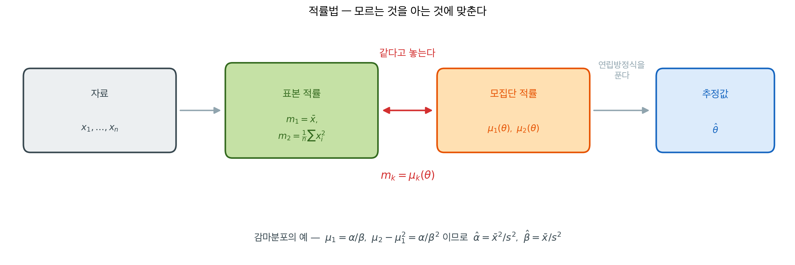
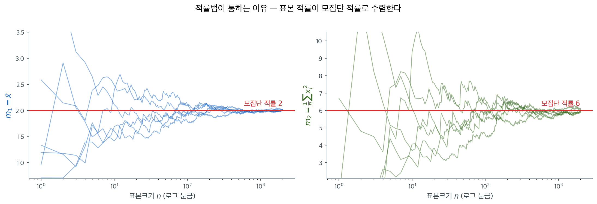
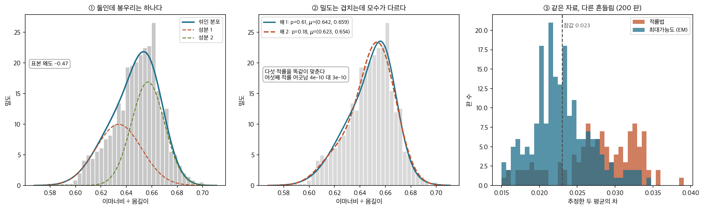
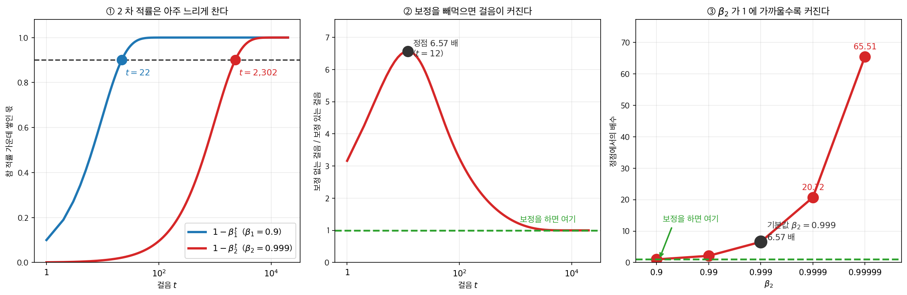

# 적률법의 기초

## 개요

Ronald Fisher가 1920년대에 최대가능도추정을 형식화하기 전에도 통계학자들은 자료에 모수적 모형을 맞추는 체계적인 방법이 필요했다. Karl Pearson이 1894년에 **적률법(MoM)**을 도입하면서 모수 추정에 대한 가장 오래되고 직관적인 접근 중 하나가 자리 잡았다. 핵심 착상은 놀랄 만큼 단순하다. 큰수의 법칙에 의해 표본 적률이 모집단 적률로 수렴하므로, (미지 모수에 의존하는) 이론적 적률을 관측된 표본 적률과 일치시키고 그 방정식을 풀어 모수를 추정할 수 있다는 것이다. MLE가 기본 추정 방법의 자리를 대체로 차지했지만, 적률법은 빠르고 닫힌 형태의 출발점으로서 여전히 가치가 있으며, 계량경제학과 실증금융에서 지배적인 추정 틀인 일반화 적률법(GMM)의 토대가 된다.

---

## 1. 모집단 적률과 표본 적률

### 정의 1. 모집단 적률 { .dfn }

분포가 $f(x; \theta)$인 확률변수 $X$의 $k$차 **모집단 적률**(원적률)은 다음과 같다.

$$\mu_k' = E[X^k] = \int x^k f(x; \theta) \, dx$$

$k$차 **중심적률**은 다음과 같다.

$$\mu_k = E[(X - \mu)^k]$$

여기서 $\mu = E[X] = \mu_1'$이다.

이 적률들은 미지 모수 $\theta$의 함수이다.

- $\mu_1'(\theta) = E_\theta[X]$ (평균)
- $\mu_2'(\theta) = E_\theta[X^2]$ (2차 원적률)
- $\mu_2(\theta) = \text{Var}_\theta(X)$ (분산)
- $\mu_3(\theta)$는 왜도와 관련된다
- $\mu_4(\theta)$는 첨도와 관련된다

### 정의 2. 표본 적률 { .dfn }

$k$차 **표본 적률**(원적률)은 다음과 같다.

$$m_k' = \frac{1}{n}\sum_{i=1}^n X_i^k$$

$k$차 **표본 중심적률**은 다음과 같다.

$$m_k = \frac{1}{n}\sum_{i=1}^n (X_i - \bar{X})^k$$

큰수의 법칙에 의해 $n \to \infty$일 때 $m_k' \xrightarrow{P} \mu_k'$이다.

---

## 2. 적률법 절차

절차 전체는 한 줄로 그릴 수 있다.

왼쪽 끝에서 오른쪽 끝으로 가는 길에 실제로 어려운 곳은 가운데 한 군데뿐이다. 표본 적률은 자료에서 그냥 계산하면 되고, 모집단 적률은 가정한 분포에서 적분으로 나온다. **두 줄을 같다고 놓고 $\theta$에 대해 푸는 것**이 적률법의 전부다.

그래서 이 방법에는 최적화가 없다. 가능도를 세우지도, 봉우리를 찾지도 않는다. 연립방정식을 푸는 일뿐이며, 표준적인 분포에서는 그 해가 닫힌 형태로 나온다.

어떤 분포에 $p$개의 미지 모수 $\theta = (\theta_1, \ldots, \theta_p)^\top$가 있고 처음 $p$개의 모집단 원적률을 이 모수의 함수로 쓸 수 있다고 하자.

$$
\mu_k'(\theta) = E_\theta[X^k], \quad k = 1, \ldots, p
$$

적률법 추정량 $\hat{\theta}_{\text{MoM}}$은 다음 연립방정식을 풀어 얻는다.

$$
\mu_k'(\hat{\theta}) = M_k', \quad k = 1, \ldots, p
$$

즉 각 모집단 적률을 대응하는 표본 적률과 같다고 두고 $p$개의 미지 모수에 대해 푼다.

!!! note "적률법 알고리즘"
    **1단계.** 처음 $p$개의 모집단 적률을 모수의 함수로 나타낸다: $\mu_1'(\theta), \mu_2'(\theta), \ldots, \mu_p'(\theta)$.

    **2단계.** 처음 $p$개의 표본 적률을 계산한다: $M_1' = \bar{X}$, $M_2' = \frac{1}{n}\sum X_i^2$ 등.

    **3단계.** $k = 1, \ldots, p$에 대해 $\mu_k'(\theta) = M_k'$로 둔다.

    **4단계.** 미지수가 $p$개인 이 $p$개의 방정식을 풀어 $\hat{\theta}_{\text{MoM}}$을 얻는다.

??? example "지수분포의 적률법"
    $X \sim \text{Exp}(\lambda)$에서는 모수가 $p = 1$개이다. 1차 모집단 적률은:

    $$
    \mu_1' = E[X] = \frac{1}{\lambda}
    $$

    $\mu_1' = M_1'$으로 두면:

    $$
    \frac{1}{\lambda} = \bar{X} \implies \hat{\lambda}_{\text{MoM}} = \frac{1}{\bar{X}}
    $$

    자료가 $\{2.1, 0.8, 1.5, 3.2, 0.4\}$이면 $\bar{X} = 1.6$이므로 $\hat{\lambda}_{\text{MoM}} = 1/1.6 = 0.625$이다.

---

## 3. 원적률과 중심적률

위의 절차는 원적률을 사용하지만 중심적률을 써도 동등하다. 두 모수를 갖는 위치–척도 족에서는 흔히 다음 방식을 쓴다.

- 첫 번째 방정식: $E[X] = M_1'$ (1차 원적률)
- 두 번째 방정식: $\text{Var}(X) = M_2$ (2차 중심적률)

분산 공식이 2차 원적률 공식보다 간단한 경우가 많으므로($\text{Var}(X) = E[X^2] - (E[X])^2$임을 떠올리자) 이 혼합 방식이 편리하다. 정규분포 같은 위치–척도 족에서는 두 방식이 같은 추정량을 준다. 다른 모수화에서는 선택이 결과를 바꿀 수 있으며, 원적률 방식이 표준적인 것이다.

---

## 4. 적률법 추정량의 성질

### 일치성

적률법 추정량은 온건한 정칙 조건 아래에서 **일치한다** — 표본크기가 커지면 참값으로 확률수렴한다는 뜻이다. 7.1절 [일치성과 점근정규성](../../ch07/theory/consistency.md) ★ 가 이것을 일반 추정량에 대해 형식적으로 다룬다. 논증은 두 단계로 진행된다.

1. 큰수의 법칙에 의해 각 표본 적률이 대응하는 모집단 적률로 확률수렴한다: $M_k' \xrightarrow{p} \mu_k'(\theta_0)$.

2. 적률에서 모수로 가는 사상 $h: (\mu_1', \ldots, \mu_p') \mapsto (\theta_1, \ldots, \theta_p)$가 참 적률값에서 연속이면 **연속사상정리**에 의해 이렇게 된다.

$$
\hat{\theta}_{\text{MoM}} = h(M_1', \ldots, M_p') \xrightarrow{p} h(\mu_1'(\theta_0), \ldots, \mu_p'(\theta_0)) = \theta_0
$$

적률방정식의 해가 유일하고 적률에 따라 매끄럽게 변하기만 하면 연속성 조건이 만족되며, 표준적인 분포 대부분이 이를 충족한다.

### 점근정규성

추가적인 매끄러움 조건 아래에서 적률법 추정량은 점근적으로 정규이다. 다변량 중심극한정리에 의해 이렇게 된다.

$$
\sqrt{n}\begin{pmatrix} M_1' - \mu_1' \\ \vdots \\ M_p' - \mu_p' \end{pmatrix} \xrightarrow{d} N(\mathbf{0}, \boldsymbol{\Sigma})
$$

여기서 $\boldsymbol{\Sigma}$는 $(X, X^2, \ldots, X^p)$의 공분산행렬이다. 사상 $h$를 통해 델타 방법을 적용하면 이렇게 된다.

$$
\sqrt{n}(\hat{\theta}_{\text{MoM}} - \theta_0) \xrightarrow{d} N\!\left(\mathbf{0}, \nabla h \cdot \boldsymbol{\Sigma} \cdot \nabla h^\top\right)
$$

이 결과 덕분에 적률법 추정량에 기반한 신뢰구간과 가설검정을 구성할 수 있다. 1차 적률로
단일 모수를 추정하는 가장 단순한 경우 이것은

$$\sqrt{n}(\hat{\theta}_{\text{MoM}} - \theta_0) \xrightarrow{d} N(0, V)$$

로 줄고, 점근분산 $V$ 는 위 식의 $\nabla h$ 가 스칼라가 된 것이다.

### 단순함

적률법은 기초적인 대수만으로 닫힌 형태의 추정량을 주는 경우가 많다. 지수분포에서는 $\hat{\lambda} = 1/\bar{X}$이고, 정규분포에서는 $\hat{\mu} = \bar{X}$, $\hat{\sigma}^2 = M_2$이다. 수치 최적화가 필요 없으므로, 닫힌 형태의 MLE를 구할 수 없을 때 MLE 같은 반복 절차의 출발점으로 특히 매력적이다.

### 있을 수 있는 단점

단순함에도 불구하고 적률법에는 실무자가 알아 두어야 할 한계가 몇 가지 있다.

- **반드시 효율적이지는 않다.** 적률법 추정량은 일반적으로 Cramér-Rao 하한을 달성하지 못한다. 특히 분포의 모양이 처음 몇 개의 적률보다 고차 적률로 결정될 때 MLE보다 분산이 상당히 클 수 있다.

- **허용되지 않는 추정값을 낼 수 있다.** 적률법은 모수 제약을 강제하지 않고 대수방정식을 풀기 때문에 모수공간 밖의 추정값을 낼 수 있다. 예를 들어 표본이 작거나 이례적일 때 어떤 분포에서는 음의 분산 추정값이 나올 수 있다.

- **고차 적률에 민감하다.** $p$가 크면 적률법은 고차 표본 적률($M_3', M_4', \ldots$)을 맞추어야 하는데, 이들은 표본추출 변동성이 크다. $M_k'$의 추정오차가 $k$와 함께 빠르게 커져 대응하는 모수 추정값의 정밀도를 떨어뜨린다.

!!! warning "적률법이 실패할 때"
    적률법은 처음 $p$개의 모집단 적률이 존재하고 적률에서 모수로 가는 사상이 역함수를 가질 것을 요구한다. (평균이 존재하지 않는) 코시분포처럼 꼬리가 두꺼운 분포에는 적률법을 적용할 수 없다. 그런 경우에는 MLE나 다른 방법을 써야 한다.

여섯 개의 표본 경로를 $n$을 늘려 가며 그린 것이다. $n$이 작을 때는 제멋대로지만 결국 붉은 선으로 모여든다. **적률법이 옳은 답에 다가가는 이유가 이 그림 하나**이며, 그래서 적률법의 일치성은 가능도나 분포의 모양이 아니라 대수의 법칙에만 기댄다.

오른쪽 칸도 함께 보아 두자. 2차 적률은 1차 적률보다 **훨씬 늦게** 자리를 잡는다. 제곱이 큰 값을 더 크게 키워 꼬리의 영향을 받기 때문이며, 고차 적률을 쓰는 추정량일수록 표본이 많이 필요한 이유가 이것이다. 적률법이 MLE보다 덜 효율적인 경우가 많은 까닭도 여기에 닿아 있다.

### 효율성

적률법 추정량은 일반적으로 MLE보다 **덜 효율적**이다. 점근 상대효율은 다음과 같다.

$$\text{ARE}(\hat{\theta}_{\text{MoM}}, \hat{\theta}_{\text{MLE}}) = \frac{\text{Var}_{\text{asymp}}(\hat{\theta}_{\text{MLE}})}{\text{Var}_{\text{asymp}}(\hat{\theta}_{\text{MoM}})} \leq 1$$

효율 손실은 (적률법 = MLE인 정규분포처럼) 무시할 만한 수준부터 (꼬리가 두꺼운 일부 분포처럼) 상당한 수준까지 다양하다.

### MLE와의 비교

| 성질 | 적률법 | MLE |
|----------|------------------|-----|
| 계산 | 흔히 닫힌 형태 | 수치 최적화가 필요할 수 있음 |
| 효율성 | (일반적으로) 덜 효율적 | 점근적으로 효율적 |
| 일치성 | 예 (정칙 조건 아래) | 예 (정칙 조건 아래) |
| 불변성 | 일반적으로 불변이 아님 | 재모수화에 불변 |
| 로버스트성 | 고차 적률의 이상점에 민감 | 모형 설정 오류에 민감 |
| 유일성 | 언제나 유일하지는 않음 | 대개 유일 (정칙 조건 아래) |

---

## 5. 존재성과 유일성

적률법 추정량은 다음 조건에서 존재하고 유일하다.

1. 처음 $p$개의 모집단 적률이 존재한다(즉 $E[|X|^p] < \infty$).
2. 사상 $\theta \mapsto (\mu_1'(\theta), \ldots, \mu_p'(\theta))$가 모수공간에서 일대일(단사)이다.
3. 표본 적률 $(M_1', \ldots, M_p')$이 이 사상의 치역 안에 들어간다.

조건 2가 결정적이다. 서로 다른 두 모수값이 같은 처음 $p$개의 적률을 만든다면 적률만으로는 식별할 수 없다. 표준적인 분포 대부분(정규, 감마, 베타, Poisson, Exponential)에서 조건 1과 2가 만족되어 적률법 추정량이 잘 정의된다.

**그림으로 보는 통계학 1.** 손으로 푼 $9$ 차 방정식

개요가 한 줄로 적은 「피어슨이 $1894$ 년에 적률법을 도입했다」에는 게 $1{,}000$ 마리가
딸려 있다.

$1892$ 년 여름, 동물학자 **W. F. R. 웰던**이 나폴리 만에서 게를 잡아 몸의 여러 곳을
쟀다. 그 가운데 **이마너비를 몸길이로 나눈 비**의 분포가 한쪽으로 치우쳐 있었다. 웰던은
그것이 단순한 잡음이 아니라 **한 집단이 두 갈래로 갈라지는 중**이라는 신호일지 모른다고
의심했다. 갈라진 둘이 각각 정규분포라면, 보이는 것은 그 **섞임**일 터였다. 그는 자료를
칼 피어슨에게 보냈다.

피어슨이 $1894$ 년에 내놓은 답이 이 쪽의 방법이다. 섞인 분포의 모수는 다섯이다 —
섞이는 비율 하나, 평균 둘, 표준편차 둘. 그러니 **표본적률 다섯 개에 맞추면 된다.** 그
연립방정식을 정리하면 하나의 **$9$ 차 방정식**으로 줄어드는데, 뿌리가 여럿이라 각각이
다섯 적률을 똑같이 맞추는 후보가 된다. 피어슨은 남은 후보들 가운데 **여섯째 적률이 가장
가까운 것**을 골랐다. $1893$ 년에 손으로 한 계산이다.

그 셈을 같은 모양의 자료로 다시 해 보면 이 절의 조건 $2$ 와 $3$ 이 무슨 뜻인지 보인다.

- **①** 평균이 $0.634$ 와 $0.657$, 표준편차가 $0.018$ 과 $0.013$ 인 두 정규를
  $0.45:0.55$ 로 섞어 $1{,}000$ 개를 뽑았다. **봉우리는 하나**다. 둘로 갈라져 있다는 것은
  눈으로 보이지 않고, 보이는 것은 왜도 $-0.47$ 짜리 **치우침**뿐이다. 웰던이 본 것이
  그것이다.
- **②** 다섯 적률을 맞추는 해를 무작위 출발점으로 찾으면 **둘**이 나온다. 하나는
  $p = 0.61$, $\mu = (0.642,\ 0.659)$ 이고 다른 하나는 $p = 0.18$,
  $\mu = (0.623,\ 0.654)$ 다. **모수는 전혀 다른데 밀도 곡선은 거의 포개진다.** 피어슨의
  수법대로 여섯째 적률을 보면 어긋남이 각각 $4 \times 10^{-10}$ 과 $3 \times 10^{-10}$ —
  **둘을 가르기에는 너무 가깝다.** 조건 $2$ 가 아슬아슬하다는 것이 이런 모습이다.
- **③** 조건 $3$ 도 자주 깨진다. $200$ 판을 돌려 보니 **$87$ 판에서는 쓸 만한 뿌리를
  아예 찾지 못했다**(무작위 출발 $120$ 번씩). 뿌리를 찾은 판만 모아 두 평균의 차를 보면
  적률법의 중앙값이 $0.0283$ 으로 참값 $0.0230$ 을 넘고 가운데 $80\%$ 가
  $[0.0193,\ 0.0336]$ 인 반면, 같은 자료에 EM 으로 최대가능도를 구하면 중앙값 $0.0226$,
  가운데 $80\%$ 가 $[0.0181,\ 0.0279]$ 다. 폭으로 **$1.5$ 배**다.

$4$ 절이 「단순함」과 「있을 수 있는 단점」으로 적어 둔 것이 ②③ 이다. 그래도 순서를
뒤집지는 말아야 한다. 가능도를 최대화하는 일반적인 방법은 피어슨의 계산보다 $30$ 년 뒤에
왔고, 섞인 분포의 EM 은 그보다도 $80$ 년 뒤에 왔다. **적률법은 그때 쓸 수 있었던 유일한
방법이었고, 그것으로 사람들은 한 봉우리 안에서 두 집단을 보았다.**

_확인한 곳 — K. Pearson, "Contributions to the Mathematical Theory of Evolution",
『Philosophical Transactions of the Royal Society A』 $185$ 권 $71$–$110$ 쪽($1894$).
웰던이 $1892$ 년 여름 나폴리에서 잰 게 $1{,}000$ 마리의 「이마너비 ÷ 몸길이」 자료라는 것,
웰던이 그 치우침을 한 집단이 두 갈래로 갈라지는 신호로 의심했다는 것, 피어슨이 모수
다섯을 표본적률 다섯에 맞추어 $9$ 차 방정식을 얻고 그 실근들 가운데 **여섯째 적률**이
가장 가까운 것을 골랐다는 것을 확인했다. 그림의 자료는 그 이야기의 모양을 본떠 **직접
만든 것**이며(실제 게 자료가 아니다), ①②③ 의 수는 모두 직접 계산한 값이다_

## 6. 금융과의 연결

적률법과 GMM은 계량금융에서 폭넓게 쓰인다.

- **자산가격결정**: GMM은 자산가격결정 모형(CAPM, Fama-French)을 추정하고 검정하는 표준 방법이다. $m_t$가 확률적 할인요인일 때 Euler 방정식 조건 $E[m_t R_t - 1] = 0$이 적률 조건을 제공한다.
- **GARCH 추정**: 준최대가능도가 표준이지만, 적률법은 무조건분산과 제곱수익률의 자기상관을 맞추어 $(\omega, \alpha, \beta)$의 닫힌 형태 초기 추정값을 준다.
- **분포 적합**: 수익률 자료에 꼬리가 두꺼운 분포(스튜던트-$t$, 안정분포)를 맞출 때, 가능도가 복잡하거나 평가가 느리면 적률법이 빠른 추정값을 준다.
- **수익률곡선 모형화**: 수익률 수준이나 변화의 적률을 사용한 아핀 기간구조 모형의 GMM 추정.
- **실현변동성**: 고빈도 수익률 적률에 기반한 적률법 추정량이 적분변동성과 그 성질을 추정하는 데 쓰인다.
- **포트폴리오 이론**: 표본 적률로 기대수익률과 공분산을 추정하는 것이 포트폴리오 최적화에 대한 가장 단순한 적률법 접근이다.

---

## 7. 심화 주제

### L-적률법

**L-적률**은 순서통계량의 선형결합으로 통상적인 적률의 대안을 제공한다. 특징은 다음과 같다.

- 통상적인 적률보다 이상점에 로버스트하다
- (꼬리가 두꺼운 분포에서 존재하지 않을 수 있는 통상적인 적률과 달리) 언제나 분포를 유일하게 결정한다
- 위험관리에서 극단값 분포를 적합할 때 특히 유용하다

### 고차 적률 맞추기

모수가 셋 이상인 분포에서는 고차 적률(왜도, 첨도)을 맞춘다.

- $\hat\gamma_1 = m_3/m_2^{3/2}$가 모집단 왜도를 맞춘다
- 표본첨도 $m_4/m_2^2$가 모집단 첨도를 맞춘다(이 쪽에서는 $\beta$가 감마·베타분포의 모수라 첨도 기호 $\beta_2$를 쓰지 않는다)

다만 고차 표본 적률일수록 잡음이 커지며 이것이 실용적인 한계이다. $k$차 표본 적률의 추정 분산은 분포의 $2k$차 적률을 포함한다.

### 모의 적률법 (SMM)

이론적 적률 $\mu_k'(\theta)$를 해석적으로 계산할 수는 없지만 모형을 모의실험할 수 있을 때, **SMM**은 모집단 적률을 모의 적률로 대체한다.

1. 후보 $\theta$에 대해 모형에서 크기 $n$인 표본을 $S$개 모의실험한다
2. 평균 모의 적률 $\tilde{m}_k'(\theta)$를 계산한다
3. 표본 적률과 모의 적률 사이의 거리를 최소화하는 $\theta$를 고른다

SMM은 가능도를 다루기 어려운 복잡한 금융 모형(예: 행위자 기반 모형, 복잡한 파생상품 가격결정 모형)에 쓰인다.

**AI로 보는 통계학 1.** 이름에 「적률 추정」이 들어 있는 최적화기

이 절의 도구가 금융에만 가 있는 것은 아니다. **오늘 돌아가는 거의 모든 신경망이
$1$ 차·$2$ 차 표본 적률을 걸음마다 다시 계산하고 있다.**

$2015$ 년 킹마와 바가 발표한 Adam 이 그것이다. 이름부터가 그렇다.

> **「이 방법은 기울기의 $1$ 차·$2$ 차 적률 추정값으로부터 매개변수마다 적응적인
> 학습률을 계산한다. **Adam 이라는 이름은 적응적 적률 추정(adaptive moment
> estimation)에서 왔다.**」**

무엇을 적률로 삼는지도 분명히 적어 두었다.

> **「이 이동평균들 자체가 기울기의 $1$ 차 적률(평균)과 $2$ 차 원적률(중심화하지 않은
> 분산)의 추정값이다. 그런데 이 이동평균들은 $0$ 벡터로 초기화되므로, 특히 초기
> 단계에서, 그리고 특히 감쇠율이 작을 때($\beta$ 가 $1$ 에 가까울 때) **$0$ 쪽으로
> 치우친 적률 추정값**을 낳는다.」**

이것이 이 장이 내내 다루는 **추정량의 편향**이고, 그들은 나눗셈 한 번으로 고친다.
기울기가 상수 $g$ 로 일정하다고 두면 $t$ 걸음째의 이동평균이

$$
m_t = (1-\beta_1^t)\,g, \qquad v_t = (1-\beta_2^t)\,g^2
$$

이므로 쌓인 몫이 각각 $1-\beta_1^t$, $1-\beta_2^t$ 다. 그것으로 나누면 불편이 된다.
논문의 기본값 $\beta_1 = 0.9$, $\beta_2 = 0.999$ 로 그 몫이 얼마인지 재어 보았다.

- **①** $1$ 차 적률은 $22$ 걸음이면 참값의 $90\%$ 에 닿는다. $2$ 차 적률은
  **$2{,}302$ 걸음**이 걸린다. 첫 걸음에서 $2$ 차 적률은 참값의 $0.001$, 곧
  **$1{,}000$ 분의 $1$** 밖에 쌓이지 않았다. 표본 하나로 분산을 추정하는 것과 같은
  사정이되, 여기서는 그 「표본 크기」가 걸음 수다.
- **②** 보정을 빼먹으면 걸음 크기가 어떻게 되는가. Adam 의 갱신이
  $\hat m/\sqrt{\hat v}$ 꼴이므로 보정을 뺀 쪽은 $(1-\beta_1^t)/\sqrt{1-\beta_2^t}$
  배가 된다. 첫 걸음에서 $3.16$ 배, $t = 12$ 에서 **정점 $6.57$ 배**다. 두 적률이
  서로 다른 속도로 차기 때문에 생기는 일이고, 수천 걸음이 지나야 $1$ 로 돌아온다.
- **③** 논문은 「$\beta_2$ 가 $1$ 에 가까우면 초기화 편향이 더 커진다」고 적는다.
  수로 보면 $\beta_2 = 0.99$ 에서 $2.13$ 배, 기본값 $0.999$ 에서 $6.57$ 배,
  $0.9999$ 에서 $20.72$ 배, $0.99999$ 에서 **$65.51$ 배**다.

적률법이 **낡은 방법**으로 읽히기 쉽다. 그런데 이 절의 두 걸음 — 표본 적률을 구하고,
그것이 모집단 적률의 편향된 추정량임을 알아 고치는 것 — 이 초당 수십억 번 돌아가고
있다. 다른 점은 모집단이 분포가 아니라 **그 순간의 기울기**라는 것뿐이다.

_확인한 곳 — D. P. Kingma, J. Ba (2015) *Adam: A Method for Stochastic Optimization*,
ICLR (arXiv:1412.6980). 인용한 두 대목, 알고리즘 $1$ 의 편향 보정 두 줄
($\hat m_t = m_t/(1-\beta_1^t)$, $\hat v_t = v_t/(1-\beta_2^t)$), 기본값
$\alpha = 0.001$·$\beta_1 = 0.9$·$\beta_2 = 0.999$·$\epsilon = 10^{-8}$, 그리고
$\beta_2$ 가 $1$ 에 가까우면 초기화 편향이 커져 보정 항이 중요해진다는 서술이 모두
거기 있다. 그림과 표의 수는 기울기가 일정하다고 둔 위 식으로 직접 계산한 값이며
논문의 측정값이 아니다_

---

## 연습문제

**연습문제 1.** 
$\text{Uniform}(0, \theta)$에서 얻은 표본에 대해 $\theta$의 적률법 추정량을 유도하라.

??? success "풀이"
    1차 모집단 적률은:

    $$
    E[X] = \frac{\theta}{2}
    $$

    1차 표본 적률을 모집단 적률과 같다고 두면:

    $$
    \bar{X} = \frac{\hat{\theta}}{2} \implies \hat{\theta}_{\text{MOM}} = 2\bar{X}
    $$

    예를 들어 표본에서 $\bar{X} = 3.5$이면 $\hat{\theta}_{\text{MOM}} = 7.0$이다.

---

**연습문제 2.** 
$E[X] = \alpha/\beta$이고 $\text{Var}(X) = \alpha/\beta^2$인 $\text{Gamma}(\alpha, \beta)$에서 얻은 표본에 대해 처음 두 적률을 사용하여 $\alpha$와 $\beta$의 적률법 추정량을 유도하라.

??? success "풀이"
    처음 두 모집단 적률은:

    $$
    E[X] = \frac{\alpha}{\beta}, \quad E[X^2] = \text{Var}(X) + (E[X])^2 = \frac{\alpha}{\beta^2} + \frac{\alpha^2}{\beta^2} = \frac{\alpha(\alpha + 1)}{\beta^2}
    $$

    표본 적률을 모집단 적률과 같다고 두면 $\bar{X} = \alpha/\beta$이고 $\overline{X^2} = \alpha(\alpha+1)/\beta^2$이다.

    첫 방정식에서 $\beta = \alpha/\bar{X}$이다. 표본분산은 $S^2 = \overline{X^2} - \bar{X}^2 = \alpha/\beta^2$이다. $\beta = \alpha/\bar{X}$를 대입하면:

    $$
    S^2 = \frac{\alpha}{\alpha^2/\bar{X}^2} = \frac{\bar{X}^2}{\alpha} \implies \hat{\alpha}_{\text{MOM}} = \frac{\bar{X}^2}{S^2}
    $$

    $$
    \hat{\beta}_{\text{MOM}} = \frac{\hat{\alpha}}{\bar{X}} = \frac{\bar{X}}{S^2}
    $$

---

**연습문제 3.** 
베르누이분포의 모수 $p$에 대해 적률법 추정량과 MLE를 비교하라. 둘은 같은가? 그 이유를 설명하라.

??? success "풀이"
    두 추정량 모두 $\hat{p} = \bar{X}$(표본비율)을 주므로 베르누이분포에서는 동일하다.

    **적률법:** $E[X] = p$이므로 $\bar{X} = \hat{p}$로 두면 $\hat{p}_{\text{MOM}} = \bar{X}$이다.

    **MLE:** $k = \sum X_i$일 때 로그가능도는 $\ell(p) = k\log p + (n-k)\log(1-p)$이다. $\ell'(p) = 0$으로 두면 $\hat{p}_{\text{MLE}} = k/n = \bar{X}$이다.

    이는 우연이 아니다. 단일모수 지수족에서 MLE는 언제나 **충분통계량**($\sum X_i$ 처럼 자료에서 모수에 대한 정보를 남김없이 담은 요약 — 7.1절 [충분성과 최소충분성](../../ch07/theory/sufficiency.md) ★)의 함수이고, 1차 적률에 기반한 적률법 추정량도 $\sum X_i$의 함수이다. 적률방정식과 점수방정식의 해가 같으면 두 추정량이 일치한다.

---

**연습문제 4.** 
적률법은 **대입 원리**(plug-in principle)의 한 예다. 이 원리를 일반적으로 서술하고, 부트스트랩·경험분포함수와의 관계를 밝혀라.

??? success "풀이"
    **대입 원리.** 관심 모수가 분포 $F$의 **범함수**로 표현되면

    $$
    \theta = T(F)
    $$

    $F$ 자리에 경험분포 $\hat F_n$을 넣어 추정한다.

    $$
    \hat\theta = T(\hat F_n)
    $$

    **적률법이 그 예다.** $\theta = g^{-1}(E_F[X])$이고 $E_{\hat F_n}[X] = \bar X$이므로 $\hat\theta = g^{-1}(\bar X)$가 정확히 대입 추정량이다.

    **다른 예들.**

    | 모수 | 범함수 $T(F)$ | 대입 추정량 |
    |---|---|---|
    | 평균 | $\int x\,dF$ | $\bar X$ |
    | 분위수 | $F^{-1}(\tau)$ | 표본 분위수 |
    | 중앙값 | $F^{-1}(1/2)$ | 표본중앙값 |
    | 상관계수 | 적률의 조합 | 표본상관계수 |
    | 지니계수 | $F$의 적분 범함수 | 표본 지니계수 |

    **부트스트랩과의 관계.** 부트스트랩은 **같은 원리를 한 단계 더 적용**한 것이다.

    - 대입 원리: $\theta = T(F) \to \hat\theta = T(\hat F_n)$.
    - 부트스트랩: $\hat\theta$의 표집분포 $= G(F) \to$ 추정값 $= G(\hat F_n)$.

    둘 다 "모르는 $F$ 자리에 $\hat F_n$을 넣는다"는 같은 착상이며, 부트스트랩이 그것을 **분포 수준**에서 한다는 점만 다르다.

    **일치성의 근거.** 글리벤코–칸텔리 정리가 $\hat F_n \to F$를 보장하고, $T$가 (하다마르 미분 가능한 의미로) **연속**이면 $T(\hat F_n)\to T(F)$가 따라 나온다. **$T$의 매끄러움이 핵심 조건**이며, 앞서 본 최댓값처럼 매끄럽지 않은 범함수에서 부트스트랩이 실패하는 이유도 같다.

    **실무적 가치.** 이 관점에서는 **모형을 가정하지 않고도** 추정할 수 있다. 분포족을 정하지 않고 "모집단 중앙값"을 추정하는 것이 그 예다. 모수적 방법이 효율을 주는 대신 모형 위험을 지는 것과 대비된다.

---

**연습문제 5.** 
**표본적률의 점근성질**을 정리하라. $\sqrt n(m_k-\mu_k)$의 극한분포는 무엇이며, 여러 적률의 **결합** 분포는 어떻게 되는가?

??? success "풀이"
    **한 적률.** $m_k = \frac1n\sum_i X_i^k$는 $X_i^k$의 표본평균이므로, $E[X^{2k}]<\infty$이면 중심극한정리에서

    $$
    \sqrt n\left(m_k-\mu_k\right) \xrightarrow{d} N\!\left(0,\ \mu_{2k}-\mu_k^2\right)
    $$

    이다($\mu_j = E[X^j]$). **$2k$차 적률이 필요하다**는 점이 중요하다. 4차 적률을 쓰려면 8차 적률이 유한해야 한다.

    **결합 분포.** 다변량 중심극한정리에서

    $$
    \sqrt n\begin{pmatrix}m_1-\mu_1\\ \vdots\\ m_p-\mu_p\end{pmatrix} \xrightarrow{d} N_p(\mathbf{0}, \Sigma), \qquad \Sigma_{jk} = \mu_{j+k}-\mu_j\mu_k
    $$

    이다. **적률들이 서로 상관되어 있다.** 예컨대 $\operatorname{Cov}(m_1,m_2) = \mu_3-\mu_1\mu_2$로, 3차 적률이 들어온다.

    **함의.**

    - **적률법의 점근분산을 구하려면 이 결합 공분산이 필요하다.** 각 적률을 따로 다루면 틀린 답이 나온다. 델타 방법의 다변량 판을 써야 한다.
    - **고차 적률일수록 분산이 폭발한다.** $\operatorname{Var}(m_4) = \mu_8-\mu_4^2$인데 정규분포에서 $\mu_8 = 105\sigma^8$이라 $\operatorname{Var}(m_4) = 96\sigma^8$이다. $\operatorname{Var}(m_1)=\sigma^2$과 견주면 자릿수가 다르다.
    - **적률이 존재해야 한다는 조건이 이중이다.** $k$차 적률을 추정하려면 $2k$차 적률이 유한해야 하고, 이것이 꼬리가 두꺼운 분포에서 적률법을 막는다.

    **중심적률.** 실무에서는 $m_k' = \frac1n\sum(X_i-\bar X)^k$를 더 자주 쓴다. $\bar X$가 확률변수라 계산이 복잡해지지만, 델타 방법으로 처리할 수 있고 결과의 구조는 비슷하다.

---

**연습문제 6.** 
분포가 **적률로 결정되는가**(적률 문제)를 논하라. 적률이 모두 같은데 분포가 다른 예를 들고, 이것이 적률법에 어떤 함의를 갖는지 적어라.

??? success "풀이"
    **적률 문제.** 모든 적률 $\{\mu_k\}$가 주어졌을 때 그 적률을 갖는 분포가 유일한가?

    **일반적으로는 아니다.** 유명한 반례가 **로그정규분포**다. $f(x)$를 로그정규밀도라 할 때

    $$
    f_a(x) = f(x)\left\{1+a\sin(2\pi\ln x)\right\}, \qquad |a|\le1
    $$

    는 모든 $a$에 대해 유효한 밀도이며 **모든 적률이 $f$와 같다.** 적률이 분포를 결정하지 못하는 무한히 많은 분포족이 존재하는 것이다.

    **유일성의 충분조건.**

    - **카를레만 조건**: $\sum_k \mu_{2k}^{-1/(2k)} = \infty$이면 유일하다.
    - **적률생성함수가 0 근처에서 존재**하면 유일하다. 이것이 가장 쓰기 쉬운 기준이다. 정규, 감마, 포아송, 이항이 모두 여기 속한다.
    - **유계 지지집합**이면 언제나 유일하다(하우스도르프 적률 문제).

    로그정규분포는 적률생성함수가 존재하지 않아($E[e^{tX}]=\infty$, $t>0$) 이 조건들을 비껴간다.

    **적률법에 대한 함의.**

    - **원리적 한계.** 적률을 아무리 많이 맞춰도 분포를 특정하지 못할 수 있다. 다만 실무에서는 **분포족을 이미 고정해 두고** 그 안에서 모수만 찾으므로 이 문제가 직접 생기지는 않는다.
    - **적률 기반 진단의 한계.** "표본 적률이 이론 적률과 맞으니 모형이 맞다"는 논증이 성립하지 않는다. 적합도는 적률이 아니라 분포함수 수준에서 확인해야 하며, 콜모고로프–스미르노프나 Q-Q 그림이 필요한 이유다.
    - **꼬리가 두꺼운 분포에서 특히 주의.** 적률 문제가 생기는 분포들이 대개 꼬리가 두껍고, 그런 분포에서는 적률 자체가 불안정하다. 두 문제가 함께 온다.

---

**연습문제 7.** 
적률법 추정량의 **유한표본 편향**이 어디서 오는지 설명하라. 잭나이프로 이를 줄이는 방법을 적어라.

??? success "풀이"
    **편향의 원천.** 적률법은 $\hat\theta = g^{-1}(\bar X)$ 꼴인데, $g^{-1}$이 **비선형**이면 옌센 부등식에서

    $$
    E[\hat\theta] = E\left[g^{-1}(\bar X)\right] \ne g^{-1}(E[\bar X]) = \theta
    $$

    이다. $g^{-1}$이 볼록이면 위로, 오목이면 아래로 치우친다.

    **크기.** 테일러 전개로

    $$
    E[\hat\theta] \approx \theta + \frac{(g^{-1})''(\mu)}{2}\operatorname{Var}(\bar X) = \theta + \frac{(g^{-1})''(\mu)\sigma^2}{2n}
    $$

    으로 **$O(1/n)$**이다. 곡률이 클수록, $n$이 작을수록 크다.

    **잭나이프 편향 보정.**

    1. 관측값 $i$를 뺀 추정값 $\hat\theta_{(-i)}$를 $n$번 계산한다.
    2. 평균 $\bar\theta_{(\cdot)} = \frac1n\sum_i\hat\theta_{(-i)}$를 구한다.
    3. 편향 추정값이

       $$
       \widehat{\text{bias}} = (n-1)\left(\bar\theta_{(\cdot)}-\hat\theta\right)
       $$

    4. 보정된 추정량은

       $$
       \hat\theta_{\text{jack}} = n\hat\theta - (n-1)\bar\theta_{(\cdot)}
       $$

    **왜 작동하는가.** 편향이 $a/n + b/n^2 + \cdots$ 꼴이라 하면, $\hat\theta$의 편향이 $a/n$이고 $\hat\theta_{(-i)}$의 편향이 $a/(n-1)$이다. 위 조합이 $1/n$ 항을 정확히 상쇄해 편향을 $O(1/n^2)$으로 낮춘다.

    **대가.** 편향이 줄어드는 대신 **분산이 조금 는다.** 편향이 분산에 비해 작으면 오히려 MSE가 나빠질 수 있다. 그리고 $\hat\theta$가 매끄러운 범함수가 아니면(중앙값 등) 잭나이프가 제대로 작동하지 않는다.

    **대안.** 부트스트랩 편향 보정도 같은 일을 하며, 잭나이프보다 일반적이지만 계산이 무겁다. 편향의 해석적 공식을 알 수 있으면 그것을 쓰는 것이 가장 좋다(감마 $\hat\alpha$의 $(n-3)/n$ 보정 등).

---

**연습문제 8.** 
적률법에서 **표준오차와 신뢰구간**을 어떻게 얻는지 세 가지 방법으로 설명하라.

??? success "풀이"
    **(1) 델타 방법(해석적).** 앞서 유도한 점근분산

    $$
    \operatorname{Var}(\hat\theta) \approx \frac{\sigma^2}{n\{g'(\theta)\}^2}
    $$

    에 $\hat\theta$와 표본분산을 대입한다.

    - **장점**: 빠르고, 어떤 요인이 정밀도를 좌우하는지 식으로 보인다.
    - **단점**: $g'$을 구해야 하고, 다모수면 야코비안 행렬과 적률의 결합공분산이 필요해 번거롭다. 소표본에서 근사가 나쁠 수 있다.

    **(2) 부트스트랩.** 자료를 재표집해 매번 적률법을 적용하고 그 분포를 쓴다.

    - **장점**: 미분이 필요 없고, 비대칭 구간(BCa)을 얻을 수 있다. 다모수 문제도 똑같이 처리된다.
    - **단점**: 계산이 무겁다. 적률이 존재하지 않으면 여전히 작동하지 않는다.
    - **실무에서 기본값으로 삼을 만하다.**

    **(3) 잭나이프.** $\hat\theta_{(-i)}$들의 흩어짐으로 분산을 추정한다.

    $$
    \widehat{\operatorname{Var}} = \frac{n-1}{n}\sum_i\left(\hat\theta_{(-i)}-\bar\theta_{(\cdot)}\right)^2
    $$

    - **장점**: 계산이 $n$번으로 결정적이고, 편향 보정을 함께 얻는다.
    - **단점**: 매끄럽지 않은 통계량에서 실패한다.

    **권고.** 셋 중 둘 이상을 계산해 비교한다. 크게 다르면 점근근사가 나쁘거나 추정량이 불안정하다는 신호이므로, 그 사실 자체를 보고해야 한다.

    **한 가지 주의.** 어느 방법이든 **모수공간 경계 근처에서는 믿기 어렵다.** 연습문제에서 본 대로 적률법 추정값이 경계를 넘나들면 구간도 무의미해진다. 그때는 모형을 바꾸거나 제약을 명시적으로 다루는 방법으로 옮겨야 한다.

---

**연습문제 9.** 
적률법이 오늘날에도 쓰이는 분야를 세 가지 들고, 각각에서 왜 최대가능도보다 선호되는지 설명하라.

??? success "풀이"
    **(1) 계량경제학의 GMM.** 구조모형에서 가능도를 쓰려면 오차의 분포를 완전히 지정해야 하는데, 이론이 그 정도까지 말해 주지 않는다. 이론이 주는 것은 **조건부 적률 조건**(예: 합리적 기대에서 $E[\varepsilon_t\mid\mathcal{F}_{t-1}]=0$)뿐이다.

    - 분포 가정 없이 이론적 제약만 쓸 수 있다.
    - 과대식별 검정으로 이론을 검정할 수 있다.
    - 한센이 이 공로로 2013년 노벨 경제학상을 받았다.

    **(2) 수문학·기후학의 극단값 분석.** L-적률이 표준 도구다.

    - 표본이 짧고(관측 연수가 30~50년) 꼬리가 두껍다.
    - 이런 조건에서 MLE는 불안정하고 때로 수렴하지 않는다. L-적률은 언제나 답을 주고 소표본 성능이 더 낫다는 것이 모의실험으로 확인되어 있다.
    - 여러 관측소의 결과를 지역적으로 결합하는 절차(지역빈도해석)가 L-적률 위에 세워져 있다.

    **(3) 계산이 불가능한 모형의 근사 베이즈 계산(ABC).** 가능도를 평가할 수 없지만 모의실험은 할 수 있는 모형(개체기반 모형, 유전학의 합쳐짐 모형, 확률적 동역학계)에서 쓴다.

    - 모의자료와 관측자료의 **요약통계량**(대개 적률)을 비교해 가까우면 그 모수를 받아들인다.
    - 요약통계량을 고르는 것이 사실상 적률 조건을 고르는 것이며, 충분통계량에 가까울수록 좋다.

    **공통점.** 세 경우 모두 **가능도를 쓸 수 없거나 쓰기에 가정이 너무 강하다.** 적률법은 "모형을 덜 믿는 대신 효율을 내준다"는 거래이며, 그 거래가 유리한 상황이 현실에 적지 않다.

---

**연습문제 10.** 
적률법 추정량이 일치하지 않는 예를 들라. 적률방정식에 어떤 조건이 있어야 일치성이 보장되는가?

??? success "풀이"
    적률법 추정량은 모집단 적률에서 모수로 가는 함수가 연속이고 적률방정식의 해가 유일할 때 일치한다. 일치성은 큰수의 법칙($\bar{X}^k \xrightarrow{p} E[X^k]$)과 연속사상정리를 결합하면 따라 나온다.

    실패할 수 있는 예: 분포의 꼬리가 두꺼워 필요한 모집단 적률이 존재하지 않으면(예: 유한한 분산이 없는 코시분포에 $E[X^2]$를 쓰려 하면) 표본 적률이 수렴하지 않아 적률법 추정량이 일치하지 않는다.

    또 다른 실패 양상: 적률방정식의 해가 여럿이면 적률법 추정량이 잘못된 근으로 수렴할 수 있다. 일치성의 조건은 (1) 필요한 모집단 적률이 존재하고, (2) 적률에서 모수로 가는 사상이 연속이며, (3) 해가 유일한 것이다.

**연습문제 11.** 
정규분포 분산의 적률법 추정량은 $\hat{\sigma}^2_{\text{MoM}} = \frac{1}{n}\sum(X_i - \bar{X})^2$이고 불편추정량은 $n-1$로 나눈다. 적률법 추정량이 편향되어 있음을 보이고 그 편향을 계산하라.

??? success "풀이"
    적률법 추정량의 기댓값은:

    $$
    E[\hat{\sigma}^2_{\text{MoM}}] = E\!\left[\frac{1}{n}\sum_{i=1}^n (X_i - \bar{X})^2\right] = \frac{1}{n} \cdot (n-1)\sigma^2 = \frac{n-1}{n}\sigma^2
    $$

    편향은:

    $$
    \text{Bias} = E[\hat{\sigma}^2_{\text{MoM}}] - \sigma^2 = \frac{n-1}{n}\sigma^2 - \sigma^2 = -\frac{\sigma^2}{n}
    $$

    적률법 추정량은 참 분산을 $\sigma^2/n$만큼 과소추정한다. 이 편향은 $n \to \infty$일 때 사라지므로 추정량은 점근적으로 불편이다.

**연습문제 12.** 
적률법 추정량의 **점근분포**를 델타 방법으로 유도하라. 일반적으로 최대가능도보다 분산이 큰 이유를 설명하라.

??? success "풀이"
    **한 모수인 경우.** 적률방정식이 $m_1 := \bar X = g(\theta)$이고 $g$가 미분가능하며 $g'(\theta)\ne0$이면

    $$
    \hat\theta = g^{-1}(\bar X)
    $$

    이다. 중심극한정리에서 $\sqrt n(\bar X-\mu) \xrightarrow{d} N(0,\sigma^2)$이고($\mu = g(\theta)$), $g^{-1}$에 델타 방법을 적용하면

    $$
    \sqrt n(\hat\theta-\theta) \xrightarrow{d} N\!\left(0,\ \frac{\sigma^2}{\{g'(\theta)\}^2}\right)
    $$

    **여러 모수인 경우.** 적률 벡터 $\mathbf{m}$과 사상 $\mathbf{g}$에 대해

    $$
    \sqrt n(\hat{\boldsymbol\theta}-\boldsymbol\theta) \xrightarrow{d} N\!\left(\mathbf{0},\ (G')^{-1}\Sigma_m (G')^{-\top}\right)
    $$

    이고 $G' = \partial\mathbf{g}/\partial\boldsymbol\theta^\top$, $\Sigma_m$은 표본적률의 점근공분산이다.

    **왜 MLE보다 나쁜가.**

    - **정보를 버린다.** 적률법은 처음 $p$개의 적률만 쓴다. 자료의 나머지 구조(모양, 고차 적률, 순서 정보)는 사용하지 않는다. MLE는 밀도 전체를 통해 모든 관측값의 위치를 반영한다.
    - **충분통계량을 쓰지 않는다.** $\bar X$나 $s^2$이 충분통계량인 경우(정규, 포아송, 지수)에는 두 방법이 일치한다. 그렇지 않으면 적률법이 충분통계량을 재구성하지 못한다.
    - **고차 적률은 불안정하다.** 모수가 셋 이상이면 3차·4차 적률을 써야 하는데, 이들의 표집변동이 매우 커서 추정값이 흔들린다.

    **정량적으로.** 점근상대효율

    $$
    \text{ARE}(\hat\theta_{\text{MoM}},\hat\theta_{\text{MLE}}) = \frac{1/\{nI(\theta)\}}{\operatorname{Var}_{\text{asym}}(\hat\theta_{\text{MoM}})} \le 1
    $$

    이며, 등호는 적률법이 충분통계량의 함수일 때만 성립한다. 감마분포에서 $\alpha$를 추정하면 ARE가 $\alpha$에 따라 0.3~0.8 수준으로, 표본을 두세 배 더 써야 같은 정밀도를 얻는다.

**연습문제 13.** 
적률법 추정값이 **모수공간을 벗어나는** 예를 들고, 그때 어떻게 대처해야 하는지 적어라.

??? success "풀이"
    **예 1 — 베타분포.** $\text{Beta}(\alpha,\beta)$에서 적률법은

    $$
    \hat\alpha = \bar x\left\{\frac{\bar x(1-\bar x)}{s^2}-1\right\}, \qquad \hat\beta = (1-\bar x)\left\{\frac{\bar x(1-\bar x)}{s^2}-1\right\}
    $$

    이다. $s^2 > \bar x(1-\bar x)$이면 괄호가 음수가 되어 **$\hat\alpha, \hat\beta$가 음수**로 나온다. 베타분포의 분산이 $\bar x(1-\bar x)$를 넘을 수 없는데 표본분산이 그보다 크게 나온 경우다. $n$이 작으면 충분히 일어난다.

    **예 2 — 음이항분포.** 산포모수 추정에서 $s^2 < \bar x$(과소산포)이면 $\hat k$가 음수가 된다. 음이항은 과대산포만 표현할 수 있기 때문이다.

    **예 3 — 분산성분.** 분산분석식 추정에서 집단 간 평균제곱이 집단 내보다 작으면 **음의 분산 추정값**이 나온다.

    **대처.**

    1. **경계로 자른다.** 음수면 0(또는 아주 작은 양수)으로 둔다. 간단하지만 편향이 생기고, 그 값의 표준오차를 어떻게 할지가 애매하다.
    2. **최대가능도로 옮긴다.** MLE는 모수공간 안에서 최적화하므로 벗어날 수 없다. 다만 경계해가 나올 수 있고, 그때는 표준 추론이 성립하지 않는다.
    3. **모형을 의심한다.** 이 현상 자체가 **모형이 자료에 맞지 않는다는 신호**일 수 있다. 베타 예에서 $s^2$이 이론적 상한을 넘었다면 분포가 이봉이거나 오염되었을 가능성이 있다. 히스토그램을 먼저 본다.
    4. **베이즈로 옮긴다.** 사전분포가 모수공간을 자동으로 강제하고, 사후분포가 경계 근처의 불확실성을 자연스럽게 표현한다.

    **교훈.** **적률법은 모수공간을 존중하지 않는다.** 적률방정식이 대수적 관계일 뿐 제약을 모르기 때문이다. 이것이 MLE에 견주어 갖는 근본적인 약점 중 하나다.

**연습문제 14.** 
적률법에서 **어느 적률을 쓸지**는 선택의 문제다. 같은 모수를 다른 적률로 추정하면 결과가 달라지는 예를 들고, 고르는 기준을 적어라.

??? success "풀이"
    **예 — 지수분포의 $\lambda$.** 여러 방법이 가능하다.

    | 사용 적률 | 추정량 |
    |---|---|
    | $E[X]=1/\lambda$ | $\hat\lambda_1 = 1/\bar X$ |
    | $E[X^2]=2/\lambda^2$ | $\hat\lambda_2 = \sqrt{2/\overline{X^2}}$ |
    | $\operatorname{Var}(X)=1/\lambda^2$ | $\hat\lambda_3 = 1/s$ |
    | $P(X>1)=e^{-\lambda}$ | $\hat\lambda_4 = -\ln\hat p$ |

    넷 다 일치추정량이지만 유한표본에서 값이 다르고 점근분산도 다르다. 델타 방법으로 계산하면 $\hat\lambda_1$이 가장 효율적이며(사실 MLE와 같다), 고차 적률을 쓸수록 나빠진다.

    **고르는 기준.**

    1. **낮은 차수부터.** 1차, 2차 적률이 고차보다 훨씬 안정적이다. 4차 적률은 관측값 하나의 영향이 네제곱으로 들어가 이상치에 극도로 민감하다.
    2. **충분통계량에 대응하는 것.** 지수족이면 자연통계량의 적률을 쓰는 것이 MLE와 일치한다.
    3. **적률이 존재하는 범위.** 꼬리가 두꺼운 분포에서는 고차 적률이 아예 없을 수 있다. 파레토 $\alpha=1.5$면 2차 적률이 무한이라 분산 기반 적률법을 쓸 수 없다.
    4. **모수에 대한 민감도.** $\partial g/\partial\theta$가 클수록 좋다. 앞서 본 점근분산 공식의 분모가 그것이다.

    **더 나은 접근.** 모수보다 적률 조건을 **많이** 두고 GMM으로 최적 가중해 결합하면, 어느 하나를 고르는 대신 정보를 모두 쓸 수 있다. 그것이 GMM이 적률법의 자연스러운 확장인 이유다.

**연습문제 15.** 
**L-적률**이 보통의 적률을 대체할 수 있다. 정의와 장점을 설명하고, 어떤 상황에서 특히 유용한지 적어라.

??? success "풀이"
    **정의.** L-적률은 **순서통계량의 선형결합**의 기대값이다.

    $$
    \lambda_1 = E[X_{(1:1)}], \qquad \lambda_2 = \tfrac12 E\left[X_{(2:2)}-X_{(1:2)}\right], \qquad \lambda_3 = \tfrac13 E\left[X_{(3:3)}-2X_{(2:3)}+X_{(1:3)}\right],\ \dots
    $$

    $\lambda_1$은 평균, $\lambda_2$는 산포(평균 절대차의 절반), $\lambda_3/\lambda_2$는 L-왜도, $\lambda_4/\lambda_2$는 L-첨도다.

    **장점.**

    - **1차 적률만 있으면 존재한다.** 보통의 $k$차 적률은 $E|X|^k<\infty$를 요구하지만 L-적률은 $E|X|<\infty$면 모두 존재한다. 꼬리가 두꺼운 분포에서 결정적이다.
    - **이상치에 훨씬 강건하다.** 관측값을 제곱하거나 세제곱하지 않고 선형으로만 결합한다.
    - **표집변동이 작다.** L-왜도·L-첨도의 표준오차가 보통의 왜도·첨도보다 훨씬 작아, 소표본에서도 분포의 모양을 가늠할 수 있다.
    - **범위가 유계다.** L-왜도가 $[-1,1]$, L-첨도가 $[-1/4,1]$에 갇혀 있어 해석이 쉽고 L-모먼트 비 도표로 분포족을 시각적으로 고를 수 있다.

    **특히 유용한 상황.**

    - **수문학·기상학의 극단값 분석.** 홍수위나 강수량은 꼬리가 두껍고 표본이 짧다. 일반화극단값분포나 일반화파레토의 모수를 L-적률로 추정하는 것이 표준이다.
    - **표본이 작을 때.** $n < 50$이면 보통의 왜도·첨도 추정값이 거의 잡음이다.
    - **분포족 선택.** L-왜도 대 L-첨도 산점도에 여러 분포족의 이론 곡선을 겹쳐 그려 어느 족이 자료에 맞는지 본다.

    **대가.** 계산이 조금 더 복잡하고(순서통계량이 필요) 이론이 덜 익숙하며, 최대가능도만큼 효율적이지는 않다. 그래도 **꼬리가 두꺼운 소표본에서는 MLE보다 안정적인 경우가 많다.**

**연습문제 16.** 
적률법이 **일치하지 않는** 조건을 정리하고, 실무에서 이를 어떻게 점검할지 적어라.

??? success "풀이"
    **일치성의 조건.** $\hat{\boldsymbol\theta}_{\text{MoM}}$이 일치하려면 세 가지가 필요하다.

    1. **적률이 존재한다.** 쓰는 적률이 유한해야 한다. $E[X^k]=\infty$이면 표본적률이 수렴하지 않는다.
    2. **사상 $\mathbf{g}$가 가역이다.** 적률에서 모수로 되돌아가는 대응이 유일해야 한다. 그렇지 않으면 적률방정식의 해가 여럿이거나 없다.
    3. **$\mathbf{g}^{-1}$이 연속이다.** 연속사상정리를 쓰려면 필요하다.

    **깨지는 예.**

    - **적률 부재.** 코시분포의 위치모수를 $\bar X$로 추정하면 $\bar X$가 수렴하지 않아 일치성이 없다. 파레토 $\alpha \le 2$에서 분산 기반 적률법도 마찬가지다.
    - **식별 실패.** 대칭분포의 위치를 3차 적률로 추정하려 하면 $E[(X-\mu)^3]=0$이 $\mu$에 대한 정보를 주지 않는다.
    - **경계에서의 불연속.** $\mathbf{g}^{-1}$이 경계에서 정의되지 않으면(연습문제 6의 베타분포) 그 근처에서 추정이 불안정하다.

    **점검 방법.**

    - **꼬리 지수를 어림한다.** 로그–로그 생존함수 그림의 기울기로 $\alpha$를 추정한다. 쓰려는 최고차 적률의 차수보다 $\alpha$가 크지 않으면 그 적률을 쓸 수 없다.
    - **표본적률의 안정성을 본다.** $\bar x$와 $s^2$을 $n$의 함수로 그려 안정되는지 확인한다. 계속 커지면 적률이 무한하다는 신호다.
    - **적률방정식의 해를 직접 확인한다.** 해가 유일한지, 모수공간 안에 있는지 본다.
    - **부트스트랩.** 추정값의 부트스트랩 분포가 극도로 퍼지거나 봉우리가 여럿이면 문제가 있다.

    **대안.** 적률이 미덥지 않으면 **L-적률이나 분위수 기반 추정**으로 옮긴다. 분위수는 언제나 존재하고 유한하므로 적률 부재 문제가 없다.

**연습문제 17.** 
**분위수 적합법**(분위수를 맞추는 방식)을 설명하고, 적률법과 견주어 장단점을 적어라. 어떤 분포에서 특히 자연스러운가?

??? success "풀이"
    **방법.** 모수가 $p$개면 $p$개의 분위수를 골라 표본 분위수와 이론 분위수를 맞춘다.

    $$
    \hat q_{\tau_j} = F^{-1}(\tau_j;\boldsymbol\theta), \qquad j=1,\dots,p
    $$

    예컨대 위치–척도 분포라면 $\tau = 0.25, 0.75$를 써서

    $$
    \hat\mu = \frac{\hat q_{0.75}+\hat q_{0.25}}{2}, \qquad \hat\sigma = \frac{\hat q_{0.75}-\hat q_{0.25}}{F^{-1}(0.75)-F^{-1}(0.25)}
    $$

    로 둔다. 정규분포면 분모가 $1.349$다.

    **적률법과 비교.**

    | | 적률법 | 분위수 적합 |
    |---|---|---|
    | 존재 조건 | 적률이 유한해야 함 | **언제나 존재** |
    | 이상치 | 매우 민감 | 강건 |
    | 효율(정규) | 높음 | 낮음(사분위수 기반은 ARE 0.37 수준) |
    | 계산 | 닫힌 해가 흔함 | 분위수함수가 필요 |

    **특히 자연스러운 분포.**

    - **분위수함수는 닫힌 형태인데 밀도는 아닌 분포.** 터키의 람다 분포, 일반화 람다 분포가 대표적이다. 이런 분포는 $F^{-1}$로 정의되므로 가능도를 쓰기 어렵고, 분위수 적합이 사실상 유일한 실용적 방법이다.
    - **꼬리가 두꺼운 분포.** 코시, 안정분포처럼 적률이 없는 경우. 안정분포의 모수 추정에 매퀄런의 분위수 방법이 고전적으로 쓰인다.
    - **극단값 분포.** 일반화극단값분포에서 분위수가 곧 재현기간에 대응하는 양이므로 해석이 직접적이다.

    **효율을 높이는 법.** 분위수를 $p$개보다 **많이** 쓰고 가중최소제곱으로 맞추면 효율이 올라간다. 분위수들의 점근공분산을 가중행렬로 쓰면 GMM과 같은 구조가 되며, 실제로 이를 분위수 GMM이라 부른다.

---

## 정리하며

적률법은 가장 오래되고 가장 단순한 추정 전략이다. **표본 적률을 모집단 적률과 맞추고 푼다.**

- **근거는 큰수의 법칙이다.** $\frac1n\sum X_i^k \to \mathbb{E}[X^k]$ 이므로, 이론적 적률을 표본 적률과 같다고 놓은 방정식의 해는 참값으로 수렴한다. **일치성이 거의 공짜로 따라온다.**
- **모수가 $p$ 개면 방정식도 $p$ 개다.** 대개 처음 $p$ 개의 적률을 쓴다.
- **원적률과 중심적률을 구별하라.** $\mu_k'=\mathbb{E}[X^k]$ 와 $\mu_k=\mathbb{E}[(X-\mu)^k]$ 는 다르며, 어느 쪽을 맞추느냐에 따라 대수가 달라진다.
- **장점은 계산이다.** 닫힌 형태가 나오는 경우가 많아 반복 최적화가 필요 없고, 분포 전체를 지정하지 않아도 된다.
- **대가는 효율성이다.** 적률 몇 개만 쓰므로 가능도가 담은 정보를 다 쓰지 못한다. 일반적으로 최대가능도보다 분산이 크다.
- **적률이 존재해야 쓸 수 있다.** 코시분포처럼 평균조차 없는 분포에서는 출발점이 없다.

다음 절 **[흔한 분포에 대한 적률법](moments_examples.md)**에서 정규·감마·베타분포에 이 절차를 실제로 적용한다.
