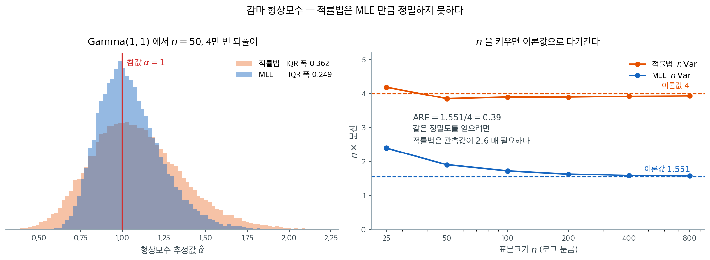
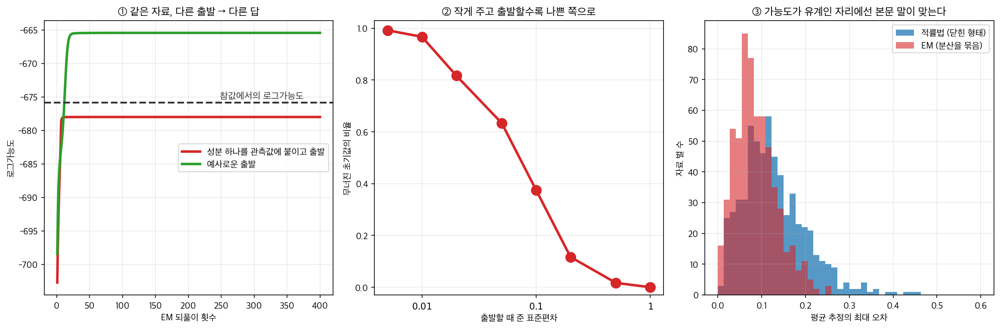

# 적률법과 최대가능도의 비교

## 개요

적률법(MoM)과 최대가능도추정(MLE)을 각각의 틀로 살펴보았으니 자연스러운 물음이 떠오른다. 언제 어느 쪽을 선호해야 하는가? 두 접근 모두 적절한 조건에서 일치추정량을 주지만 계산 복잡도, 통계적 효율성, 모형 가정에 대한 민감도가 다르다. 이 맞바꿈을 이해하는 것이 실무에서 원리 있는 선택을 하는 데 필수적이다.

---

## 1. 나란히 놓고 보기

다음 표는 적률법과 MLE의 주요 차이를 요약한다. 각 기준은 이어지는 절에서 자세히 다룬다.

| 기준 | 적률법 | MLE |
|---|---|---|
| 계산 | 흔히 닫힌 형태 | 수치 최적화가 필요할 수 있음 |
| 효율성 | 일반적으로 덜 효율적 | 점근적으로 효율적 (CRLB 달성) |
| 일치성 | 예 (식별 가능성 + 유한한 적률) | 예 (정칙 조건 아래) |
| 불변성 | 일반적으로 아니오 | 예 (함수적 불변성) |
| 로버스트성 | 분포 설정 오류에 덜 민감 | 모형 설정 오류에 민감 |

---

## 2. 상세 비교

### 적률법은 연립방정식, MLE 는 최적화

적률법 추정량은 표본 적률을 모집단 적률과 맞추는 연립방정식을 풀어 얻는다. 표준적인 분포 다수에서 닫힌 형태의 표현이 나온다. 반면 MLE는 로그가능도함수를 최대화해야 하므로 Newton-Raphson이나 EM 알고리즘 같은 반복적 수치 방법이 필요한 경우가 많다.

실무에서는 적률법 추정값이 반복적인 MLE 알고리즘의 출발값으로 자주 쓰이며, 적률법의 계산 편의와 MLE의 통계적 최적성을 결합한다.

### 효율성

이론적으로 가장 중요한 차이는 **점근 효율성**이다. 표준적인 정칙 조건 아래에서 MLE는 $n \to \infty$일 때 Cramér-Rao 하한(CRLB)을 달성하며, 이는 다른 어떤 일치추정량도 더 작은 점근분산을 가질 수 없음을 뜻한다. 반면 적률법 추정량은 일반적으로 이 한계를 달성하지 못한다.

**점근 상대효율(ARE)**이 이 격차를 정량화한다. 추정량 $\hat{\theta}_{\text{MoM}}$과 $\hat{\theta}_{\text{MLE}}$에 대해 ARE는 다음과 같이 정의된다.

$$
\text{ARE}(\hat{\theta}_{\text{MoM}}, \hat{\theta}_{\text{MLE}}) = \frac{\text{Var}_{\text{asy}}(\hat{\theta}_{\text{MLE}})}{\text{Var}_{\text{asy}}(\hat{\theta}_{\text{MoM}})}
$$

ARE가 1보다 작으면 MLE가 더 효율적이라는 뜻이다.

!!! example "지수분포: ARE 비교"

    $X_1, \ldots, X_n \overset{\text{iid}}{\sim} \text{Exp}(\lambda)$라 하자. 적률법과 MLE 모두 같은 추정량 $\hat{\lambda} = 1/\bar{X}$를 주므로 ARE는 1이다. 적률법이 완전히 효율적인 사례이다.

!!! example "감마분포: ARE 비교"

    $X_1, \ldots, X_n \overset{\text{iid}}{\sim} \text{Gamma}(\alpha, \beta)$라 하자. 적률법 추정량은

    $$
    \hat{\alpha}_{\text{MoM}} = \frac{\bar{X}^2}{S^2}, \qquad \hat{\beta}_{\text{MoM}} = \frac{S^2}{\bar{X}}
    $$

    이며 $S^2$은 표본분산이다. MLE는 digamma 함수를 포함하는 연립방정식을 풀어야 하고
    닫힌 형태가 없다.

    그런데 형상모수 $\alpha$에 대한 ARE 는 닫힌 꼴로 적힌다. 아래 보기 1 이 두 점근분산을
    유도하는데, $n$ 과 $\beta$ 가 모두 약분되어

    $$
    \text{ARE}(\hat\alpha_{\text{MoM}}, \hat\alpha_{\text{MLE}})
    = \frac{1}{2(\alpha+1)\left[\alpha\,\psi'(\alpha) - 1\right]}
    $$

    만 남는다($\psi'$ 은 삼감마함수). **$\alpha$ 하나가 모든 것을 정한다.**

    | $\alpha$ | $1$ | $3$ | $10$ |
    |---|---|---|---|
    | ARE | $0.388$ | $0.676$ | $0.880$ |
    | 적률법이 더 필요한 표본 | $2.58$ 배 | $1.48$ 배 | $1.14$ 배 |

    **$\alpha$ 가 작을 때 격차가 크다.** $\alpha = 1$ 은 감마가 지수분포가 되는 자리인데,
    바로 위 보기에서 본 대로 거기서 **비율모수** $\lambda$ 를 재면 두 방법이 같은 추정량을
    준다(ARE $= 1$). 같은 분포에서 **형상모수**를 재면 적률법이 관측값을 $2.58$ 배
    필요로 한다. **무엇을 추정하는지가 ARE 를 가른다.**



왼쪽이 이 격차를 눈으로 본 것이다. 두 추정량 모두 참값 주위에 모이지만 **적률법 쪽이 더 넓게 퍼진다.** 어느 쪽도 틀린 답을 주지 않는다는 점이 중요하다. 둘 다 일치추정량이므로 차이는 옳고 그름이 아니라 **정밀도**에 있다.

오른쪽은 $n$을 키우며 $n \times$ 분산을 잰 것이다. 이 값이 각각 $4$와 $1.551$로 자리를 잡으며, 위에서 계산한 두 점근분산과 맞는다. 적률법이 왜 손해를 보는지는 $\hat\alpha_{\text{MoM}} = \bar X^2 / S^2$을 보면 짐작할 수 있다. 분모에 표본분산이 들어 있어 4차 적률의 요동을 그대로 물려받는 반면, MLE는 $\log X$의 평균이라는 훨씬 안정된 통계량을 쓴다.

<div class="exbox" markdown>

**보기 1.** <span class="diff easy" title="쉬움"></span> 감마분포에서 MLE와 적률법 비교. $\text{Gamma}(\alpha = 3, \beta = 2)$에서 $n = 200$을 뽑아 형상모수 $\alpha$를 두 방법으로 추정하는 일을 $5000$번 되풀이한다.

**(1)** 두 추정량의 점근분산을 구하고 그 비(점근 상대효율)를 $\alpha$의 식으로 쓰시오. $\alpha = 3$, $n = 200$에서 수는 얼마인가.

**(2)** 모의실험의 MSE 비가 (1)의 예측과 맞는지 확인하시오.

</div>

??? success "풀이"

    **(1) 해석적으로.**

    **MLE.** 감마분포의 피셔 정보행렬은

    $$
    I_n(\alpha, \beta) = n\begin{pmatrix} \psi'(\alpha) & 1/\beta \\ 1/\beta & \alpha/\beta^2\end{pmatrix}
    $$

    이고($\psi'$은 삼감마함수) 역행렬의 $(1,1)$ 성분이 $\alpha$의 점근분산이다.

    $$
    \operatorname{AVar}(\hat\alpha_{\text{MLE}})
    = \frac{\alpha/\beta^2}{n\left[\psi'(\alpha)\,\alpha/\beta^2 - 1/\beta^2\right]}
    = \frac{\alpha}{n\left[\alpha\psi'(\alpha) - 1\right]}
    $$

    $\beta$가 약분되어 사라진다. $\alpha = 3$에서 $\psi'(3) = \pi^2/6 - 1 - 1/4 = 0.394934$이므로 $\alpha\psi'(\alpha) - 1 = 0.184802$이고

    $$
    \operatorname{AVar}(\hat\alpha_{\text{MLE}}) = \frac{3}{200 \times 0.184802} = 0.081168
    $$

    **적률법.** $\hat\alpha = g(\bar X, \overline{X^2}) = \bar X^2/(\overline{X^2} - \bar X^2)$에 델타법을 쓴다. 참값에서

    $$
    \frac{\partial g}{\partial m_1} = \frac{2(\alpha+1)}{\beta}, \qquad
    \frac{\partial g}{\partial m_2} = -\frac{1}{\beta^2}
    $$

    이고 감마의 적률 $E[X^k] = \beta^k\alpha(\alpha+1)\cdots(\alpha+k-1)$에서

    $$
    \operatorname{Var}(X) = \alpha\beta^2,\quad
    \operatorname{Cov}(X, X^2) = 2\alpha(\alpha+1)\beta^3,\quad
    \operatorname{Var}(X^2) = \alpha(\alpha+1)(4\alpha+6)\beta^4
    $$

    이다. 셋을 모으면 $\beta$가 모두 지워지고

    $$
    4\alpha(\alpha+1)^2 - 8\alpha(\alpha+1)^2 + \alpha(\alpha+1)(4\alpha+6)
    = \alpha(\alpha+1)\left[-4\alpha - 4 + 4\alpha + 6\right] = 2\alpha(\alpha+1)
    $$

    만 남아

    $$
    \operatorname{AVar}(\hat\alpha_{\text{MoM}}) = \frac{2\alpha(\alpha+1)}{n}
    = \frac{2\times3\times4}{200} = 0.12
    $$

    **점근 상대효율.** 두 분산의 비는

    $$
    \text{ARE} = \frac{\operatorname{AVar}(\hat\alpha_{\text{MLE}})}{\operatorname{AVar}(\hat\alpha_{\text{MoM}})}
    = \frac{1}{2(\alpha+1)\left[\alpha\psi'(\alpha) - 1\right]}
    $$

    로 $n$과 $\beta$가 모두 사라지고 $\alpha$만 남는다. $\alpha = 3$이면

    $$
    \text{ARE} = \frac{1}{2\times4\times0.184802} = 0.6764
    $$

    곧 **MLE의 MSE가 적률법의 약 $68\%$**가 될 것으로 예상된다. 위 표의 $\alpha = 3$ 칸이 이 수다. 뒤집어 말하면 적률법으로 같은 정밀도를 얻으려면 표본이 $1/0.6764 = 1.48$배 필요하다.

    **(2) 수치적으로.**

    ```python
    import numpy as np
    from scipy import stats

    def mle_vs_mom_gamma(alpha_true=3, beta_true=2, n=200, n_sim=5000):
        rng = np.random.default_rng(42)
        mle_alpha, mom_alpha = [], []

        for _ in range(n_sim):
            data = rng.gamma(alpha_true, beta_true, n)

            # 적률법: 표본의 1차·2차 적률을 이론값과 맞춘다.
            # E[X] = a*b, Var(X) = a*b^2 이므로 a = E[X]^2 / Var(X) 다.
            # 닫힌 식이라 계산이 즉시 끝나는 것이 장점이다.
            m1 = data.mean()
            v = data.var(ddof=0)
            mom_alpha.append(m1 ** 2 / v)

            # MLE: 감마분포는 닫힌 해가 없어 scipy가 수치적으로 푼다.
            # floc=0 은 위치모수를 0으로 **고정**한다는 뜻이다.
            # 이것을 빼면 scipy가 위치까지 추정해 모수가 셋이 되고,
            # 적률법과 같은 조건이 아니게 되어 비교가 성립하지 않는다.
            a_mle, _, _ = stats.gamma.fit(data, floc=0)
            mle_alpha.append(a_mle)

        mle_alpha = np.array(mle_alpha)
        mom_alpha = np.array(mom_alpha)

        for name, vals in [("MLE", mle_alpha), ("MoM", mom_alpha)]:
            bias = vals.mean() - alpha_true
            mse = np.mean((vals - alpha_true) ** 2)
            print(f"{name}: bias={bias:+.4f}, MSE={mse:.6f}")

        # (1) 의 점근값과 견준다.
        from scipy.special import polygamma
        a = alpha_true
        avar_mle = a / (n * (a * polygamma(1, a) - 1))
        avar_mom = 2 * a * (a + 1) / n
        print(f"\n점근분산  MLE {avar_mle:.6f},  MoM {avar_mom:.6f}")
        print(f"점근 상대효율 = {avar_mle / avar_mom:.4f}")
        print(f"모의 MSE 비   = {np.mean((mle_alpha - a)**2) / np.mean((mom_alpha - a)**2):.4f}")
        print(f"모의 분산     MLE {mle_alpha.var():.6f},  MoM {mom_alpha.var():.6f}")

    mle_vs_mom_gamma()
    ```

    출력:

    ```
    MLE: bias=+0.0399, MSE=0.088900
    MoM: bias=+0.0616, MSE=0.129929

    점근분산  MLE 0.081168,  MoM 0.120000
    점근 상대효율 = 0.6764
    모의 MSE 비   = 0.6842
    모의 분산     MLE 0.087306,  MoM 0.126134
    ```

    **예측이 맞는다.** 점근 상대효율 $0.6764$와 모의 MSE 비 $0.6842$가 $1.2\%$ 안에서 일치한다. 두 추정량 모두 모의 분산이 점근값보다 조금(각각 $7.6\%$, $5.1\%$) 크지만 **비는 거의 그대로 유지되는데**, $n = 200$에서 남은 유한표본 효과가 두 쪽에 비슷하게 작용하기 때문이다.

    편향도 둘 다 양수이고($+0.0399$, $+0.0616$) MLE 쪽이 작다. 그러나 편향의 제곱이 $0.0016$과 $0.0038$로 MSE $0.0889$와 $0.1299$의 $2\sim3\%$에 지나지 않으므로, **MSE의 차이를 만든 것은 거의 전부 분산이다.**

    **왜 MLE가 이기는가.** 적률법은 자료를 $\bar X$와 $\overline{X^2}$ 두 수로 줄이는데, 감마분포에서 $\alpha$에 관한 충분통계량은 $\sum\log X_i$와 $\sum X_i$다. 곧 **적률법은 $\log X$에 담긴 정보를 통째로 버린다.** 버린 만큼 효율을 잃고, 그 손실이 $1 - 0.6764 = 32\%$다.

    **값을 치러야 한다는 점도 잊지 말자.** 적률법은 $\bar X^2/S^2$ 한 줄이지만 MLE는 $\psi(\alpha)$가 들어간 비선형 방정식을 수치로 풀어야 한다. 위 코드에서 `stats.gamma.fit`이 $5000$번 호출되는 동안 적률법은 넘파이 연산 두 번으로 끝난다. $32\%$의 효율과 그 계산 비용 가운데 무엇을 고를지는 문제에 달려 있고, 적률법을 MLE의 **출발값**으로 쓰는 절충이 흔하다.

!!! success "평균제곱오차에서 MLE의 승리"
    감마분포에서 $\alpha$와 $\beta$ 모두에 대해 MLE의 평균제곱오차가 적률법보다 작다. 점근이론과 일치하는 결과이다. MLE는 (Cramér–Rao 한계를 달성하여) 효율적인 반면 적률법은 일반적으로 그렇지 않다.

### 일치성

두 방법 모두 일치추정량을 주지만 조건이 다르다.

- **적률법**은 적률방정식이 모수를 유일하게 식별하고(식별 가능성) 관련된 모집단 적률이 유한할 것을 요구한다.
- **MLE**는 다른 정칙 조건을 요구한다. 모수공간이 식별 가능하고, 로그가능도가 충분히 매끄러우며, 참 모수가 모수공간의 내부에 있어야 한다.

### 불변성

MLE는 강력한 **함수적 불변성**을 갖는다. $\hat{\theta}$가 $\theta$의 MLE이면 임의의 함수 $g$에 대해 $g(\hat{\theta})$가 $g(\theta)$의 MLE이다. 덕분에 추정량을 다시 유도하지 않고 자유롭게 재모수화할 수 있다.

적률법은 일반적으로 이 성질을 갖지 않는다. $\hat{\theta}_{\text{MoM}}$이 $\theta$의 적률법 추정량이더라도 비선형 변환 $g(\hat{\theta}_{\text{MoM}})$이 반드시 $g(\theta)$의 적률법 추정량이 되지는 않는다.

### 모형 설정 오류에 대한 로버스트성

적률법은 유한한 개수의 모집단 적률만 사용하며 분포 전체를 설정할 필요가 없다. 가정한 모형이 틀렸더라도 처음 몇 개의 적률이 여전히 올바르게 모형화되어 있다면 적률법은 합리적인 추정값을 줄 수 있다.

반면 MLE는 완전한 가능도함수를 사용하므로 설정 오류에 더 민감하다. 가정한 모형이 틀리면 MLE는 참 분포에서 가정한 모형족까지의 Kullback-Leibler 발산을 최소화하는 모수값으로 수렴하는데, 이것이 의미 있는 양에 대응하지 않을 수 있다.

---

## 3. 어느 쪽을 언제 쓰는가

### 적률법을 선호할 때

- **가능도를 다루기 어려울 때.** 어떤 모형(예: 특정 혼합모형이나 적률 조건으로 정의된 모형)은 닫힌 형태의 가능도가 없다. 적률법이 실행 가능한 대안이 된다.
- **빠른 초기 추정값이 필요할 때.** 적률법 추정량은 반복적인 MLE 알고리즘의 훌륭한 출발값이 된다.
- **설정 오류에 대한 로버스트성이 중요할 때.** 모수적 모형에 대한 확신이 제한적일 때 저차 적률에 기반한 적률법 추정값이 더 믿을 만할 수 있다.

### MLE를 선호할 때

- **통계적 효율성이 우선일 때.** 올바르게 설정된 모형과 큰 표본에서 MLE가 가장 정밀한 추정값을 준다.
- **점근적 추론이 필요할 때.** MLE의 잘 발달된 점근이론(Wald 검정, 가능도비 검정, 점수 검정) 덕분에 형식적인 가설검정이나 신뢰구간이 필요할 때 자연스러운 선택이 된다.
- **불변성이 유용할 때.** 변환된 모수 $g(\theta)$에 관심이 있을 때 MLE는 추정량을 다시 유도할 필요를 없애 준다.

!!! tip "실용적인 전략"

    두 방법을 결합하는 작업 흐름이 흔하다. 적률법으로 빠르게 초기 추정값을 얻은 뒤 MLE로 다듬어 최적의 효율을 얻는 것이다. 이 혼합 접근은 각 방법의 강점을 살리면서 개별적인 약점을 피한다.

<div class="aibox" markdown>

**AI로 보는 통계학 1.** 넣을 출발점이 없다는 것이 강점이 되는 자리

바로 위의 「실용적인 전략」은 짧게 적혀 있지만, 그 한 줄이 막아 주는 것이 꽤 크다.

$2014$ 년 아난드쿠마르·거·수·카카데·텔가스키가 『JMLR』에 숨은 변수 모형을 적률법으로
푸는 방법을 실었다. 글은 적률법을 피어슨($1894$)의 고전으로 소개하면서, 왜 지금 그것을
다시 꺼내는지를 밝힌다.

> **「이것은 숨은 변수 모형의 맥락에서 특히 중요한데, 거기서는 표준적인 최대가능도
> 접근이 대개 계산적으로 감당하기 어렵고, 발견적 방법들은 믿기 어려우며 고차원
> 자료에서 검증하기 어렵다.」**

그들이 지목한 발견적 방법이 EM 이다.

> **「EM 은 여러 장점이 있지만 느린 수렴과 질 나쁜 국소최적에 시달릴 수 있으며,
> 실무자들이 좋은 해를 얻으려고 온갖 추가적인 요령을 쓰게 만든다. 잠재 트리나 토픽
> 모형 같은 어떤 모형들에서는 최대가능도추정이 NP-난해이고, 이는 다른 추정 방식이
> 더 매력적일 수 있음을 시사한다.」**

그러면서 이 쪽의 「실용적인 전략」과 똑같은 처방을 르캉을 인용해 적어 둔다 —
**적률 기반 추정값에서 출발해 가능도함수에 뉴턴–랩슨을 한 걸음만 밟아도 흔히 양쪽의
좋은 점을 모두 얻는다**는 것이다. 교과서의 조언과 최신 논문의 처방이 같은 자리에 있다.

출발점이 실제로 무엇을 바꾸는지 직접 재어 보았다. 성분 셋짜리 정규혼합(평균 $-3,\ 0,\ 3$,
표준편차 모두 $1$)에서 $n = 300$ 을 뽑고 EM 을 돌리되 **출발점만** 달리했다.



- **①** 두 자취 모두 같은 자료에 같은 알고리즘이다. 예사롭게 출발한 쪽(초록)은
  로그가능도 $-665.43$ 에 올라앉는데, 성분 하나를 관측값에 붙이고 표준편차를 $0.01$ 로
  주고 출발한 쪽(빨강)은 **$-677.99$ 에서 멈춘다.** 차이가 $12.6$ 이고, 멈춘 자리에서
  그 성분의 표준편차는 $2.9 \times 10^{-4}$ 다 — 좁은 덩어리 하나를 끌어안은 채 굳었다.
  **가능도를 최대화한다는 말이 가리키는 곳이 하나가 아니다.**
- **②** 그 나쁜 자리로 얼마나 쉽게 가는가. 출발 표준편차를 $0.005$ 로 주면 $99.2\%$,
  $0.05$ 면 $63.3\%$, $0.2$ 면 $11.7\%$, $1.0$ 이면 $0\%$ 가 그리로 간다. **출발점을
  어떻게 잡느냐가 답을 정한다.** 적률법에는 넣을 출발점이 아예 없으므로 이 갈림이
  생기지 않는다.
- **③** 그렇다고 적률법이 더 낫다는 말은 아니다. 가중을 $1/2$ 로 묶고 분산을 안다고
  두면 평균 둘이 이차방정식의 두 근으로 **닫힌 형태**로 나오고, 가능도도 유계가 되어
  EM 이 얌전해진다. 그 자리에서는 오차 중앙값이 적률법 $0.117$, EM $0.079$ 로
  **EM 이 $1.48$ 배 정확하다.** 위 본문이 말한 효율성 격차 그대로다.

읽을 것은 이것이다. 적률법의 약점으로 꼽히는 성질 — 가능도를 보지 않고 저차 적률만
맞춘다 — 이 숨은 변수 모형에서는 그대로 강점이 된다. 풀어야 할 최적화 문제가 없으니
갇힐 국소최적도 없다. 그래서 순서가 「적률법으로 자리를 잡고 가능도로 다듬는다」가 된다.
교과서가 계산 편의로 설명한 그 순서에는 **최적화의 안전장치**라는 뜻이 함께 들어 있다.

_확인한 곳 — A. Anandkumar, R. Ge, D. Hsu, S. M. Kakade, M. Telgarsky (2014) *Tensor
Decompositions for Learning Latent Variable Models*, 『Journal of Machine Learning
Research』 $15$ 권 $2773$–$2832$ 쪽의 $1$ 절. 인용한 두 대목과 르캉을 인용한 뉴턴–랩슨
한 걸음 이야기, 그리고 적률법을 Pearson($1894$)으로 밝힌 것이 거기 있다. 그림과 표의
수는 모두 직접 계산한 값이며 논문의 측정값이 아니다. 덧붙여 분산이 자유로운 정규혼합의
가능도가 위로 유계가 아니라는 것은 알려진 사실이지만, 위 모의에서 EM 이 닿은 곳은 그
발산점이 아니라 분산이 작은 국소최적이다_

</div>

---

## 연습문제


<div class="drillbox" markdown>

**연습문제 1.** <span class="diff med" title="중간"></span>
기하분포: $P(X = k) = (1-p)^{k-1} p$. (a) $x_1, \ldots, x_n$에 대한 로그가능도. (b) $\hat p_{\text{MLE}}$. (c) 적률법. (d) 둘이 같은가?

</div>

??? success "풀이"
    (a) $T = \sum x_i$일 때 $\ell(p) = \sum_i [(x_i - 1)\ln(1-p) + \ln p] = (T - n)\ln(1-p) + n\ln p$.

    (b) $\ell'(p) = -(T-n)/(1-p) + n/p = 0 \Rightarrow \hat p_{\text{MLE}} = n/T = 1/\bar x$.

    (c) $\bar x = 1/p \Rightarrow \hat p_{\text{MoM}} = 1/\bar x$.

    (d) **같다.** 기하분포에서 MLE와 적률법이 일치하며, 둘 다 표본평균의 역수이다.

    이런 일은 모수 $\theta$가 1차 적률과 일대일로 대응하고 고차 적률 제약이 없을 때마다 일어난다. "단일모수이면서 평균으로 결정되는" 분포 대부분(Bernoulli, Poisson, Exponential, Geometric)에서 MLE = 적률법이다.

---

<div class="drillbox" markdown>

**연습문제 2.** <span class="diff med" title="중간"></span> $X_1, \ldots, X_n \overset{\text{iid}}{\sim} \text{Exp}(\lambda)$에 대해 $\lambda$의 적률법 추정량과 MLE를 유도하라. 둘은 같은가?

</div>

??? success "풀이"
    지수분포는 $E[X] = 1/\lambda$이므로 적률법은 $\bar{X} = 1/\hat{\lambda}$로 두어 $\hat{\lambda}_{\text{MoM}} = 1/\bar{X}$를 준다.

    로그가능도는 $\ell(\lambda) = n\log\lambda - \lambda \sum x_i$이다. $\ell'(\lambda) = n/\lambda - \sum x_i = 0$으로 두면 $\hat{\lambda}_{\text{MLE}} = n/\sum x_i = 1/\bar{X}$이다.

    지수분포에서 두 추정량은 동일하다. 모수가 하나이고 그것이 하나의 적률로 결정되기 때문이다. $\square$

---

<div class="drillbox" markdown>

**연습문제 3.** <span class="diff med" title="중간"></span>
적률법과 MLE가 **일치하는** 분포의 공통 구조를 밝혀라. 어떤 조건에서 둘이 같아지는가?

</div>

??? success "풀이"
    **일치하는 예.**

    | 분포 | 모수 | 두 추정량 |
    |---|---|---|
    | 베르누이 | $p$ | $\bar X$ |
    | 포아송 | $\lambda$ | $\bar X$ |
    | 지수 | $\mu=1/\lambda$ | $\bar X$ |
    | 정규($\sigma$ 기지) | $\mu$ | $\bar X$ |
    | 정규 | $(\mu,\sigma^2)$ | $(\bar X,\ \tfrac1n\sum(X_i-\bar X)^2)$ |

    **공통 구조.** 모두 **지수족**이고, 추정 대상이 **자연통계량의 기대값**(평균모수)이다.

    **왜 일치하는가.** 지수족의 밀도를

    $$
    f(x;\boldsymbol\eta) = h(x)\exp\left\{\boldsymbol\eta^\top\mathbf{T}(x)-A(\boldsymbol\eta)\right\}
    $$

    로 쓰면 점수방정식이

    $$
    \frac{\partial\ell}{\partial\boldsymbol\eta} = \sum_i\mathbf{T}(x_i)-n\nabla A(\boldsymbol\eta) = \mathbf{0}
    $$

    이다. 그런데 지수족의 기본 성질로 $\nabla A(\boldsymbol\eta) = E_{\boldsymbol\eta}[\mathbf{T}(X)]$이므로 점수방정식은

    $$
    \frac1n\sum_i\mathbf{T}(x_i) = E_{\boldsymbol\eta}[\mathbf{T}(X)]
    $$

    가 된다. **이것이 바로 적률방정식이다** — 단, "적률"이 $X^k$가 아니라 자연통계량 $\mathbf{T}(X)$의 것이다.

    **따라서 조건은 두 가지다.**

    1. 모형이 지수족이고,
    2. 적률법이 쓰는 함수가 **자연통계량과 일치**할 것.

    **일치하지 않는 예.** 감마분포는 지수족이지만 자연통계량이 $(X, \ln X)$다. 보통의 적률법은 $(X, X^2)$을 쓰므로 다른 답이 나온다. 만약 $(\bar X, \overline{\ln X})$를 맞추는 "적률법"을 쓴다면 MLE와 일치한다.

    같은 이유로 와이불, 베타, 로그정규(원 척도에서)에서 두 방법이 갈린다.

    **교훈.** **"어떤 적률을 쓰느냐"가 방법을 정한다.** 충분통계량의 적률을 쓰면 자동으로 최대가능도가 되며, 그래서 GMM에서 점수함수를 적률 조건으로 쓰면 MLE가 나온다.

---

<div class="drillbox" markdown>

**연습문제 4.** <span class="diff med" title="중간"></span>
**감마 모의실험: MLE와 적률법.** $n = 5, 10, 30, 100, 500$에서 Gamma$(2, 3)$을 모의실험하여 평균제곱오차를 비교하라.

</div>

??? success "풀이"
    ```python
    import numpy as np
    from scipy import stats

    rng = np.random.default_rng(0)
    R = 10_000
    # 표본 크기를 5에서 500까지 키우며 두 방법의 MSE를 비교한다.
    # n=5 에서는 둘 다 형편없고 차이도 없다(MSE가 185나 된다).
    # n이 커질수록 MLE의 우위가 뚜렷해지는데, 이것이 점근 효율성이다.
    # **MLE의 우월성은 점근적 성질이지 소표본에서의 보장이 아니다.**
    for n in [5, 10, 30, 100, 500]:
        a_mom, b_mom, a_mle, b_mle = [], [], [], []
        for _ in range(R):
            x = rng.gamma(2.0, 3.0, n)     # 참값 alpha=2, beta=3
            a_mom.append(x.mean()**2 / x.var()); b_mom.append(x.var() / x.mean())
            am, _, bm = stats.gamma.fit(x, floc=0); a_mle.append(am); b_mle.append(bm)
        print(f"n={n}: MSE(α) MoM={np.mean((np.array(a_mom)-2)**2):.3f}, MLE={np.mean((np.array(a_mle)-2)**2):.3f}")
    ```

    출력:

    ```
    n=5: MSE(α) MoM=185.724, MLE=185.490
    n=10: MSE(α) MoM=4.850, MLE=3.964
    n=30: MSE(α) MoM=0.580, MLE=0.379
    n=100: MSE(α) MoM=0.130, MLE=0.077
    n=500: MSE(α) MoM=0.024, MLE=0.014
    ```

    예상되는 결과: 모든 $n$에서 MLE의 평균제곱오차가 더 작고, $n$이 작을수록 격차가 크다. 둘 다 $1/n$의 비율로 줄어든다. MLE는 점근적으로 효율적이고 적률법은 일치하지만 효율적이지는 않다.

    보기 1 은 $n = 200$ 에서 점근 상대효율 $0.676$ 을 확인했다. **여기서 보는 것은 그 점근값에 닿기 전의 모습이다** — $n = 5$ 에서는 두 방법의 평균제곱오차가 $185.7$ 과 $185.5$ 로 사실상 같고, $n$ 이 커지면서 비가 $0.82 \to 0.65 \to 0.59 \to 0.58$ 로 점근값 둘레에 자리를 잡는다. **MLE 의 우위는 점근적 성질이지 소표본에서의 보장이 아니다.**

---

<div class="drillbox" markdown>

**연습문제 5.** <span class="diff med" title="중간"></span>
**MLE가 일반적으로 적률법보다 나은 이유.** 점근 상대효율(ARE) 결과와 그 직관을 서술하라.

</div>

??? success "풀이"
    **ARE:** $\mathrm{ARE}(\hat\theta_{\text{MoM}}, \hat\theta_{\text{MLE}}) = $ 점근분산의 비 $\le 1$이다.

    등호(ARE = 1)는 적률법이 우연히 MLE와 같아질 때에만 성립한다(예: Bernoulli, Poisson, 지수에서 MLE와 적률법이 일치한다).

    부등호(ARE < 1)가 일반적인 경우이다. 적률법은 저차 적률만 사용하고 MLE는 완전한 가능도를 사용하기 때문이다.

    **직관:** Fisher 정보량은 자료가 $\theta$에 관해 담을 수 있는 최대 정보량이며 MLE가 점근적으로 이를 달성한다. 적률법은 자료를 적률 몇 개로 축약하면서 정보를 버린다. 그 "버려진" 정보가 더 큰 분산으로 나타난다.

    **실무적 함의:** 계산이 가능하다면 MLE를 선호하라. 적률법은 다음에 유용하다:

    - 빠른 초기 추정값(적률법에서 시작해 MLE 최적화를 진행).
    - MLE를 다루기 어려운 분포.
    - 로버스트성 고려(적률법이 모형 설정 오류에 덜 민감할 수 있다).

---

<div class="drillbox" markdown>

**연습문제 6.** <span class="diff med" title="중간"></span>
두 방법의 **점근상대효율**을 계산하는 일반 절차를 정리하고, $\text{Uniform}(0,\theta)$에서 적용해 보라.

</div>

??? success "풀이"
    **일반 절차.**

    1. MLE의 점근분산 $1/\{nI_1(\theta)\}$을 구한다(정칙 조건이 성립할 때).
    2. 적률법의 점근분산을 델타 방법으로 구한다.
    3. 비를 계산한다.

    $$
    \text{ARE} = \frac{\operatorname{Var}_{\text{asym}}(\hat\theta_{\text{MLE}})}{\operatorname{Var}_{\text{asym}}(\hat\theta_{\text{MoM}})}
    $$

    **균등분포에 적용.**

    *적률법.* $E[X]=\theta/2$이므로 $\hat\theta_{\text{MoM}} = 2\bar X$이고

    $$
    \operatorname{Var}(2\bar X) = \frac{4}{n}\cdot\frac{\theta^2}{12} = \frac{\theta^2}{3n}
    $$

    *MLE.* $\hat\theta = X_{(n)}$이고(편향 보정하면 $\frac{n+1}{n}X_{(n)}$)

    $$
    \operatorname{Var}\left(\tfrac{n+1}{n}X_{(n)}\right) = \frac{\theta^2}{n(n+2)}
    $$

    *비.*

    $$
    \frac{\theta^2/\{n(n+2)\}}{\theta^2/(3n)} = \frac{3}{n+2} \to 0
    $$

    **ARE가 0이다.** 이것은 보통의 의미의 상대효율이 아니라, **수렴 속도 자체가 다르다**는 뜻이다. MLE는 $O(n^{-2})$이고 적률법은 $O(n^{-1})$이다.

    | $n$ | $\operatorname{Var}_{\text{MoM}}/\operatorname{Var}_{\text{MLE}}$ |
    |---|---|
    | 10 | 4.0 |
    | 50 | 17.3 |
    | 100 | 34.0 |

    **적률법이 정보를 얼마나 버리는지 극적으로 보여 준다.** $\theta$에 대한 정보가 거의 전부 최댓값 하나에 들어 있는데, 적률법은 모든 관측값을 평균해 그 정보를 희석한다.

    **주의.** 이 예는 정칙 조건이 깨진 경우라 표준 이론이 적용되지 않는다. 정칙 문제에서는 두 방법 모두 $O(n^{-1})$이고 ARE가 0과 1 사이의 상수로 나온다.

---

<div class="drillbox" markdown>

**연습문제 7.** <span class="diff med" title="중간"></span> MLE가 재모수화에 불변임을 증명하라. 즉 $\hat{\theta}$가 $\theta$의 MLE이면 임의의 함수 $g$에 대해 $g(\hat{\theta})$가 $g(\theta)$의 MLE임을 보여라.

</div>

??? success "풀이"
    $g$가 일대일 함수일 때 $\eta = g(\theta)$라 하자(일반적인 경우는 유도가능도로 확장된다). $\eta$의 함수로 본 가능도는:

    $$
    L^*(\eta) = L(g^{-1}(\eta))
    $$

    $L(\theta)$가 $\hat{\theta}$에서 최대이므로 모든 $\theta$에 대해 $L^*(g(\hat{\theta})) = L(\hat{\theta}) \geq L(\theta)$이다. 따라서 $g$의 치역에 속하는 모든 $\eta$에 대해 $L^*(\eta) \leq L^*(g(\hat{\theta}))$이므로 $g(\hat{\theta})$가 $L^*$을 최대화한다.

    일대일이 아닐 수도 있는 일반적인 $g$에 대해서는 $\hat{\eta} = \sup_{\{\theta: g(\theta) = \eta\}} L(\theta)$로 정의하고 그 최대점을 취하면, 구성상 그것이 $g(\hat{\theta})$와 같다. $\square$

---

<div class="drillbox" markdown>

**연습문제 8.** <span class="diff med" title="중간"></span>
**적률법을 선호하는 경우.** MLE 대신 적률법을 고를 만한 구체적인 사례를 두 가지 들라.

</div>

??? success "풀이"
    **사례 1: MLE를 다루기 어려울 때.** 어떤 분포(예: Cauchy, 일반화 쌍곡선, 특정 코퓰러)에서는 가능도의 최대점이 닫힌 형태로 없거나 계산 비용이 크다. 적률법은 닫힌 형태의 추정값을 빠르게 준다.

    **사례 2: 설정 오류에 대한 로버스트성.** 참 분포가 가정한 모형에서 약간 벗어나 있다면 적률법이 MLE보다 완만하게 나빠질 수 있다. MLE는 가정한 가능도에 "묶여" 있지만, 적률법은 모집단 적률과 표본 적률이 일치한다는 가정만 사용한다. 잘못된 가능도를 쓴 MLE는 편향이 얼마든지 커질 수 있지만, 잘못 설정된 적률법이라도 적어도 참 모집단 적률과는 맞아떨어진다.

    **사례 3: 부분적인 자료를 종합할 때.** 개별 자료점 없이 표본 적률만 있을 때 적률법은 작동하지만 MLE는 그렇지 않다. 보험 지급준비금을 집계된 적률로 계산하는 경우가 있다.

    이런 사례들 때문에 점근적 비효율성에도 불구하고 적률법이 계속 쓰인다.

---

<div class="drillbox" markdown>

**연습문제 9.** <span class="diff med" title="중간"></span>
MLE가 적률법보다 **나쁠 수 있는** 구체적인 상황을 세 가지 들어라.

</div>

??? success "풀이"
    **(1) 모형이 틀렸을 때.** MLE는 지정한 분포를 완전히 믿고 모든 관측값을 그 밀도로 평가한다. 꼬리가 실제보다 얇은 모형을 쓰면 극단값 하나가 로그가능도를 크게 흔든다.

    예: 정규 모형에 이상치가 섞이면 MLE(표본평균)가 크게 끌려간다. 반면 중앙값이나 분위수 기반 적률법은 버틴다. **강건성이 필요한 상황에서는 적률법 계열이 낫다.**

    **(2) 소표본에서 MLE의 편향이 클 때.** MLE는 점근적으로 좋지만 유한표본 편향이 있다.

    예: 감마분포의 $\hat\alpha_{\text{MLE}}$는 $n$이 작으면 상당히 과대추정한다. $n=10$, $\alpha=2$에서 편향이 30%를 넘는 경우가 있다. 적률법의 편향이 오히려 작을 수 있고, MSE로 비교하면 역전되기도 한다.

    **(3) 계산이 불가능하거나 불안정할 때.**

    - 가능도가 고차원 적분이라 평가할 수 없는 모형(잠재변수, 공간모형, 개체기반 모형).
    - 가능도가 위로 유계가 아닌 모형(정규혼합).
    - 최적화가 여러 국소해에 빠지는 모형.

    이런 경우 적률법은 닫힌 해나 낮은 차원의 방정식을 주므로 **적어도 답이 나온다.** MLE를 쓰더라도 적률법 추정값을 초기값으로 삼는 것이 표준이다.

    **덧붙여.** 위 세 가지가 서로 얽혀 있다는 점도 중요하다. 모형이 미덥지 않고 표본이 작고 계산이 어려운 상황은 대개 함께 온다. 그런 문제에서 "MLE가 이론적으로 효율적"이라는 사실은 실질적 위안이 되지 못한다.

---

<div class="drillbox" markdown>

**연습문제 10.** <span class="diff med" title="중간"></span>
**MLE의 출발값으로서의 적률법.** 반복적인 MLE 최적화의 초기값으로 $\hat\theta_{\text{MoM}}$을 쓰는 것이 왜 좋은 생각인가?

</div>

??? success "풀이"
    반복적인 MLE(Newton-Raphson, BFGS, EM)에는 출발값이 필요하다. 좋은 출발값은:

    1. **더 빨리 수렴한다** (최적점에 이르는 반복 횟수가 적다).
    2. **국소 최적점을 피한다** (여러 봉우리를 갖는 가능도에서는 반복이 전역 최댓값이 아닌 곳에 갇힐 수 있다).
    3. **수치적 문제를 피한다** (극단적인 모수값은 오버플로/언더플로를 일으킬 수 있다).

    **출발점으로서 적률법**이 매력적인 이유는:

    - **닫힌 형태**이다(초기 추정값에 반복이 필요 없다).
    - **대체로 일치한다**(대표본에서 참 $\theta$에 가깝다).
    - **대개 MLE 근처에 있다**(두 추정량이 같은 $\theta$를 겨냥한다).

    혼합 절차:

    ```python
    # 출력 없음: 독자가 자기 모형을 끼우는 골격이다. mom_estimate 와 neg_loglik 은
    #            그 자리에 들어갈 함수의 이름일 뿐이다.
    # 적률법 추정값을 최적화의 **출발점**으로 쓴다.
    # 닫힌 식이라 즉시 구해지고, 일치추정량이라 참값 근처에서 시작하게 되므로
    # 반복 횟수가 줄고 국소 최적에 갇힐 위험도 낮아진다.
    # theta_init = mom_estimate(data)
    # theta_mle  = scipy.optimize.minimize(neg_loglik, theta_init, ...).x
    ```

    `scipy.stats.fit`을 비롯한 라이브러리들이 사용하는 표준적인 방식이다.

---

<div class="drillbox" markdown>

**연습문제 11.** <span class="diff med" title="중간"></span>
실무에서 "먼저 적률법, 그다음 MLE"라는 순서가 왜 좋은 관행인지 정리하라.

</div>

??? success "풀이"
    **이유 1 — 초기값.** 수치 최적화는 초기값에 민감하다. 적률법 추정값은

    - 계산이 빠르고,
    - 일치추정량이라 참값 근처에 있으며,
    - 대개 모수공간 안에 있다.

    임의의 값이나 관례적인 상수보다 훨씬 나은 출발점이다. 수렴이 빨라지고 국소해에 빠질 위험이 준다.

    **이유 2 — 검산.** 두 추정값이 비슷하면 최적화가 제대로 수렴했다는 방증이다. 크게 다르면

    - 최적화가 실패했거나,
    - 모형이 자료에 맞지 않거나,
    - 이상치가 있다는 신호다.

    어느 쪽이든 더 살펴봐야 한다는 것을 알려 준다. 앞서 본 하우스만 검정이 이를 형식화한 것이다.

    **이유 3 — 규모 감각.** 적률법 추정값은 손으로도 계산되므로 **결과의 자릿수를 미리 알 수 있다.** 코드가 엉뚱한 값을 돌려주면 바로 알아챈다. 부호 실수, 모수화 혼동, 단위 오류를 잡아내는 데 특히 효과적이다.

    **이유 4 — 실패 대비.** 최적화가 수렴하지 않거나 가능도가 퇴화하면 적률법 추정값이 **대체 답**이 된다. 완전하지 않아도 아무것도 없는 것보다 낫다.

    **덧붙일 것.** 순서에 하나를 더하면 좋다. **먼저 그림을 본다.** 히스토그램과 Q-Q 그림으로 분포족이 그럴듯한지 확인한 뒤 적률법으로 대략의 값을 잡고 MLE로 마무리하며, 마지막에 적합된 밀도를 자료 위에 겹쳐 그려 확인한다. **추정은 계산이기 이전에 확인의 연속이다.**

---

<div class="drillbox" markdown>

**연습문제 12.** <span class="diff med" title="중간"></span>
추정 방법을 모의실험으로 비교할 때 저지르기 쉬운 실수를 세 가지 들고 각각의 대처법을 적어라.

</div>

??? success "풀이"
    **(1) 한 가지 참값에서만 비교한다.** $\theta=1$에서 방법 A가 낫다고 모든 $\theta$에서 그런 것이 아니다. 축소추정량은 참값이 축소 목표 근처면 좋고 멀면 나쁘다.

    → **$\theta$를 격자로 바꿔 가며 MSE 곡선을 그린다.** 곡선이 교차하면 그 사실 자체를 보고한다.

    **(2) 모의실험 오차를 무시한다.** $B=1000$에서 MSE가 $0.021$ 대 $0.019$로 나왔다고 후자가 낫다고 할 수 없다. MSE 추정값의 상대 표준오차가 대략 $\sqrt{2/B} = 4.5\%$이므로 이 차이는 잡음 안에 있다.

    → **$B$를 충분히 키우고**(최소 10,000) MSE 추정값의 표준오차를 함께 보고한다. 더 나은 방법은 **같은 난수 흐름으로 두 방법을 평가**하는 것이다(공통난수). 차이의 분산이 크게 줄어 훨씬 적은 $B$로 구별할 수 있다.

    **(3) 유리한 조건에서만 본다.** 새 방법의 가정이 정확히 성립하는 자료만 생성하면 당연히 이긴다.

    → **가정을 깨뜨려 가며 본다.** 이상치를 섞고, 분포를 바꾸고, 표본크기를 줄이고, 모형을 오설정한다. 실무의 관심사는 "가정이 맞을 때 얼마나 좋은가"보다 **"가정이 틀렸을 때 얼마나 나빠지는가"**인 경우가 많다.

    **그 밖에 흔한 실수.**

    - **평균만 본다.** 꼬리가 두꺼운 추정량은 평균 MSE가 몇 번의 큰 실패에 지배된다. 오차의 중앙값·분위수·상자그림을 함께 본다.
    - **정의되지 않는 경우를 조용히 버린다.** 앞서 본 $t=0$에서의 링컨–피터슨처럼, 실패한 반복을 제외하면 남은 것만으로 계산한 성능이 낙관적으로 나온다. **실패율을 반드시 보고**한다.
    - **난수 씨앗을 고정하지 않는다.** 재현 불가능한 결과가 된다.

---

<div class="drillbox" markdown>

**연습문제 13.** <span class="diff med" title="중간"></span>
**M-추정량**이 위 네 방법 중 셋을 하나의 틀로 묶는다. $\hat\theta = \arg\min_\theta\sum_i\rho(x_i;\theta)$라는 정의에서 $\rho$를 어떻게 고르면 각각이 나오는지 보이고, 이 틀의 장점을 적어라.

</div>

??? success "풀이"
    **$\rho$의 선택.**

    | $\rho(x;\theta)$ | 얻어지는 추정량 |
    |---|---|
    | $-\ln f(x;\theta)$ | 최대가능도 |
    | $(x-\theta)^2$ | 최소제곱(평균) |
    | $\lvert x-\theta\rvert$ | 중앙값 |
    | $\rho_\tau$ (핀볼 손실) | $\tau$ 분위수 |
    | 후버 $\rho$ | 강건 위치 추정 |
    | $-\ln f - \ln\pi(\theta)/n$ | MAP |

    적률법도 추정방정식 $\sum_i\psi(x_i;\theta)=0$ 꼴로 쓰면 같은 틀(Z-추정량)에 들어온다.

    **틀의 장점.**

    1. **점근이론을 한 번만 세우면 된다.** 정칙 조건 아래에서

       $$
       \sqrt n(\hat\theta-\theta_0) \xrightarrow{d} N\!\left(0,\ A^{-1}BA^{-1}\right)
       $$

       이고 $A = E[\psi'], B = E[\psi^2]$이다($\psi = \partial\rho/\partial\theta$). **샌드위치 형태가 기본**이고, 최대가능도에서만 $A=B$가 되어 $I^{-1}$로 줄어든다.

    2. **강건성을 설계할 수 있다.** $\psi$가 유계이면 이상치의 영향이 제한된다. 영향함수가 $\psi$에 비례하므로, **원하는 강건성을 $\psi$의 모양으로 직접 지정**할 수 있다.

    3. **모형 오설정을 자연스럽게 다룬다.** $\rho$가 로그가능도가 아니어도 이론이 그대로 적용된다. 유사최대가능도, 준가능도, 추정방정식이 모두 특수한 경우다.

    4. **계산이 통일된다.** 대부분 IRLS나 뉴턴류로 풀리고, 표준오차도 같은 공식으로 나온다.

    **대가.** 일반성을 얻는 대신 **효율의 최적성을 잃는다.** 모형이 정확히 맞으면 최대가능도가 최선이고, M-추정량은 그보다 못하다. 그 차이가 강건성의 가격이다.

---

<div class="drillbox" markdown>

**연습문제 14.** <span class="diff hard" title="어려움"></span>
**파레토의 적률법과 MLE.** $x \ge 1$에서 $X \sim \mathrm{Pareto}(\alpha)$일 때 둘을 유도하고 점근 상대효율을 논하라.

</div>

??? success "풀이"
    $[1, \infty)$ 위의 Pareto$(\alpha)$: $f(x; \alpha) = \alpha x^{-(\alpha+1)}$이고 $\alpha > 1$에서 $\mathbb{E}[X] = \alpha/(\alpha - 1)$이다.

    **적률법:** $\bar X = \alpha/(\alpha - 1) \Rightarrow \hat\alpha_{\text{MoM}} = \bar X/(\bar X - 1)$.

    **MLE:** $\hat\alpha_{\text{MLE}} = n/\sum \ln X_i$.

    **적률법의 존재 조건:** 적률법의 점근분산을 델타 방법으로 구하려면 $\mathbb{E}[X^2] < \infty$가 필요하며, 이는 $\alpha > 2$일 때만 성립한다. $\alpha \le 2$이면 표본분산이 발산하여 적률법의 점근이론이 아예 성립하지 않는다.

    **MLE의 점근분산:** $\mathrm{Var}(\hat\alpha_{\text{MLE}}) \to \alpha^2/n$이며 이것이 CRLB이다.

    **ARE:** 적률법이 정의되는 전형적인 경우인 $\alpha = 3$에서도 적률법의 분산이 MLE보다 훨씬 크다. $\alpha \le 2$이면 적률법은 정의조차 되지 않는다.

    **함의:** 꼬리가 두꺼운 분포에서는 MLE가 필수적이다. 적률법은 정의되지 않을 수도 있다.

---

## 정리하며

두 전략의 선택은 **계산 편의와 통계적 효율성, 그리고 가정에 대한 민감도**의 거래다.

| | 적률법 | 최대가능도 |
|---|---|---|
| 계산 | 닫힌 형태가 많음 | 대개 수치 최적화 |
| 효율성 | 일반적으로 낮음 | 점근적으로 최적 |
| 가정 | 적률만 필요 | 분포 전체를 지정 |
| 모형이 틀릴 때 | 비교적 견딤 | 더 크게 어긋남 |

- **모형이 정확히 맞으면 최대가능도가 이긴다.** 크라메르–라오 하한을 점근적으로 달성하므로 더 나은 방법이 없다.
- **모형이 의심스러우면 사정이 달라진다.** 적률법은 몇 개의 적률만 옳으면 되고, GMM 은 여기에 과대식별 검정까지 더한다.
- **실무의 절충이 있다.** 적률법 추정값을 최대가능도 반복 최적화의 **출발값**으로 쓰면 계산 편의와 통계적 최적성을 함께 얻는다. 다봉 가능도에서 특히 유용하다.
- **둘 다 일치추정량**이라는 점은 같다. 갈리는 것은 속도가 아니라 점근분산의 크기다.

다음 절 **[6.3 ★ 베이즈 추정](../bayesian/prior_posterior.md)**으로 넘어간다. 적률법과 최대가능도는 모수를 **고정된
미지의 수**로 보고 자료만 확률변수로 다루었다. 셋째 길은 모수 자체에 확률분포를 주며,
그렇게 하면 「한 번도 보지 못한 사건의 확률」처럼 **이 두 방법이 답하지 못하는 물음**에
답이 생긴다.
