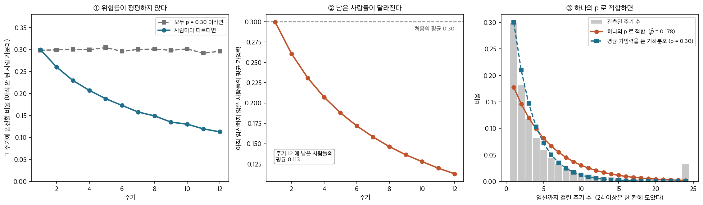
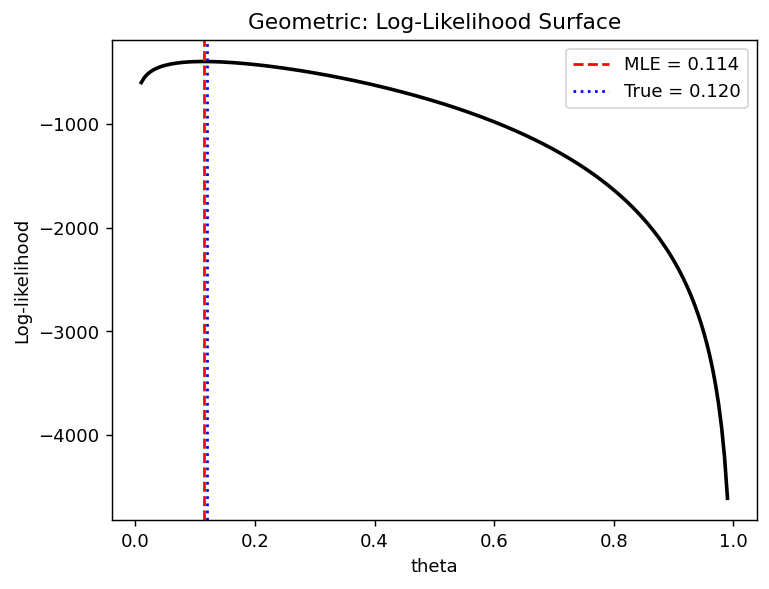

# 기하분포의 최대가능도

## 개요

기하분포는 **첫 실패가 나오기까지 이어진 성공의 수**를 센다. 설비가 고장 나기 전까지 돌아간 횟수, 광고가 클릭되기까지의 노출 수, 불량이 나오기 전까지 통과한 제품 수가 그렇다. 모수는 한 번의 시행에서 성공할 확률 $p$ 하나다.

계수 자료라는 점에서 포아송과 겉모습이 닮았지만 속은 다르다. 포아송은 **일정한 비율로 일어나는 사건의 수**를 세고, 기하는 **멈출 때까지 걸린 횟수**를 센다. 같은 계수 자료에 둘 다 적합해 어느 쪽이 나은지 가리는 방법은 6.1절 [모형을 세우면 무엇을 버는가](parametric_vs_nonparametric.md) 연습문제 4 가 셋으로 정리한다.

---

## 1. 설정

기하분포는 첫 실패 이전의 연속 성공 횟수를 모형화한다. 모수 $p$(각 시행의 성공확률)에 대해:

$$
P(X = k) = (1 - p)\, p^k, \quad k = 0, 1, 2, \ldots
$$

평균은 $E[X] = p / (1 - p)$이다.

## 2. 유도

<div class="thmbox" markdown>

### 정리 1. 기하분포의 최대가능도추정량 { .thm }

$X_1, \ldots, X_n \overset{\text{iid}}{\sim} \text{Geo}(p)$ 이고 $P(X = k) = (1-p)p^k$ 라 하자. 그러면

$$
\hat{p}_{\text{MLE}} = \frac{n_s}{n_s + n} = \frac{\bar{x}}{1 + \bar{x}},
\qquad n_s = \sum_{i=1}^{n} x_i
$$

이다. 표본평균 하나만 있으면 정해지며, $\bar x$ 가 커질수록 $\hat p$ 가 $1$ 에 가까워진다.

</div>

??? proof "증명"

    로그가능도를 성공 횟수의 합 $n_s$ 로 묶는다.

    $$
    \ell(p) = \sum_{i=1}^n \left[ x_i \log p + \log(1 - p) \right] = n_s \log p + n \log(1 - p)
    $$

    $n$ 개의 항이 $n_s$ 하나로 묶인다는 점이 베르누이와 같다. 미분해 $0$ 으로 두면

    $$
    \frac{d\ell}{dp} = \frac{n_s}{p} - \frac{n}{1 - p} = 0
    \quad\Longrightarrow\quad
    n_s(1-p) = np
    \quad\Longrightarrow\quad
    \hat p = \frac{n_s}{n_s + n}
    $$

    이고, 분자와 분모를 $n$ 으로 나누면 $\hat p = \bar x/(1+\bar x)$ 다.

    두 번 미분하면

    $$
    \ell''(p) = -\frac{n_s}{p^2} - \frac{n}{(1-p)^2} < 0
    $$

    이 $0 < p < 1$ 전체에서 성립하므로 $\ell$ 이 **엄격 오목**이고 정류점이 유일한 최대점이다. $\square$

    **$n_s = 0$ 이면 경계에 닿는다.** 관측이 모두 $0$ 이면 $\ell(p) = n\log(1-p)$ 가 단조감소라 최대가 $p = 0$ 에서 일어나고, 미분으로는 잡히지 않는다. [가능도와 최대가능도추정](likelihood.md) 정리 1 이 내부점을 전제로 하는 까닭이다.

<div class="storybox" markdown>

**그림으로 보는 통계학 1.** 기다린 사람만 남는다

기하분포의 가장 오래된 쓰임 가운데 하나는 설비도 광고도 아니다. **임신까지 걸린 주기
수**다.

$1924$ 년 이탈리아의 **코라도 지니**가 출산 간격을 「기다리는 시간」의 문제로 보고,
결혼한 여성 집단의 **첫 임신까지 걸린 월경 주기 수**에서 한 주기의 임신 확률 — 그가
**가임력**(fecundability)이라 부른 양 — 을 기하분포로 추정했다. 이 쪽의 $\hat p$ 와 같은
계산이다(첫 성공까지의 시행 수를 세면 $\hat p = 1/\bar X$ 다).

그런데 자료를 모아 보면 한 가지가 어긋난다. 첫 주기에 임신하는 비율은 $30\%$ 쯤인데,
**그다음 주기에는 그보다 낮고, 다음에는 더 낮다.** 기하분포가 말하는 것은 그 반대다 —
아직 임신하지 않은 사람에게 이번 주기의 확률은 **언제나 같아야** 한다(무기억성).

까닭은 사람마다 $p$ 가 다르다는 데 있다. 웨인버그와 글레이든($1986$)이 정리한 모형이
그것이다. $p$ 가 사람마다 베타분포를 따른다면 주기 수는 **베타–기하분포**를 따르고,
위험률이 떨어진다. 평균 $0.30$, 표준편차 $0.17$ 짜리 베타분포로 $20$ 만 쌍을 만들어
보았다.



- **①** 첫 주기에 임신하는 비율은 $0.300$ 으로 평균과 같다. 그러나 둘째 주기에는
  $0.260$, 셋째에는 $0.230$, 여섯째에는 $0.173$, 열두째에는 $0.113$ 이다. 모두가 같은
  $p = 0.30$ 을 가진 세상에서는 이 선이 **평평하다**(그림의 회색 점선).
- **②** 떨어지는 까닭은 사람이 바뀌어서다. 가임력이 높은 쪽이 먼저 빠져나가므로, 아직
  임신하지 않은 사람들의 평균 가임력이 $0.300 \to 0.113$ 으로 **내려간다.** 아무도
  변하지 않았는데 **남은 집단이 변한 것**이다.
- **③** 그 자료에 하나의 $p$ 를 적합하면 어떻게 되는가. $\hat p = 1/\bar X = 0.178$ 이다.
  평균 가임력 $0.300$ 과 한참 다르고, 그럴 수밖에 없다 — 기다린 주기의 평균은
  $E[1/P]$ 이고 $1/E[1/P] = 0.177$ 이 그 이론값이다. **옌센 부등식이 $\hat p$ 를
  평균 아래로 끌어내린다.**

이것이 이 쪽의 MLE 를 쓸 때 가장 흔히 밟는 자리다. $\hat p$ 는 **그 자료를 낳은 한 사람의
확률**을 재는 것이지, 사람마다 다른 확률들의 **평균**을 재는 것이 아니다. 둘이 같아지려면
모두의 $p$ 가 같아야 한다. 그렇지 않으면 ③ 의 $0.178$ 처럼, 어느 한 사람의 것도 아닌
수가 나온다.

_확인한 곳 — 코라도 지니가 $1924$ 년에 출산 간격을 가임력에 달린 대기시간 문제로 보고,
첫 임신까지 걸린 월경 주기 수 자료에서 기하분포로 평균 가임력을 추정했다는 것, 그리고
C. R. Weinberg · B. C. Gladen, "The beta-geometric distribution applied to comparative
fecundability studies", 『Biometrics』($1986$)가 임신까지 걸리는 시간에 베타–기하 모형을
처음 내놓았다는 것, 사람마다 가임력이 다르다는 증거가 있어 「첫 주기에 약 $30\%$ 가
임신하고 남은 사람들에서는 그 비율이 주기마다 계속 떨어진다」는 것이 가임력 연구의 표준적
서술이라는 것을 확인했다. 그림의 자료는 평균 $0.30$ 짜리 베타분포로 **직접 만든 것**이며,
수는 모두 직접 계산한 값이다_

</div>

<div class="exbox" markdown>

**보기 1.** <span class="diff easy" title="쉬움"></span> 기하분포의 MLE. $P(X = k) = (1-p)p^k$, $k = 0, 1, 2, \ldots$에서 독립표본 $x_1, \ldots, x_n$을 얻었다.

**(1)** $\hat p$를 유도하고 그것이 최대임을 확인하시오. 피셔 정보로 $\hat p$의 표준오차도 구하시오.

**(2)** $p = 0.12$, $n = 1000$으로 만든 자료에서 코드가 $\hat p = 0.1220$을 준다. (1)의 표준오차에 비추어 그럴듯한 값인가.

</div>

??? success "풀이"

    **(1) 해석적으로.** $n_s = \sum_i x_i$라 두면 로그가능도가

    $$
    \ell(p) = \sum_{i=1}^n \left[x_i \log p + \log(1-p)\right] = n_s \log p + n\log(1-p)
    $$

    이다. $1000$개의 관측이 들어가지만 식에 남은 것은 $n_s$와 $n$ 둘뿐이다($n_s$가 충분통계량이다). 미분해 $0$으로 두면

    $$
    \ell'(p) = \frac{n_s}{p} - \frac{n}{1-p} = 0
    \;\Longrightarrow\;
    n_s(1-p) = np
    \;\Longrightarrow\;
    n_s = p(n_s + n)
    $$

    이므로

    $$
    \hat p = \frac{n_s}{n_s + n} = \frac{\bar x}{1 + \bar x}
    $$

    이다. **최대임의 확인.** 한 번 더 미분하면

    $$
    \ell''(p) = -\frac{n_s}{p^2} - \frac{n}{(1-p)^2} < 0
    $$

    이 $(0,1)$ 전체에서 성립하므로 $\ell$이 엄밀히 오목하고 정류점이 하나뿐이며 그것이 전역 최대다. **끝점.** $n_s = 0$이면(모든 관측이 $0$이면) $\ell(p) = n\log(1-p)$가 감소함수라 $\hat p = 0$인데, 이는 $\bar x = 0$을 공식에 넣은 값과 같으므로 공식이 그대로 통한다.

    **표준오차.** 관측 $n$개의 피셔 정보는 $-E[\ell''(p)]$이고 $E[n_s] = nE[X] = np/(1-p)$이므로

    $$
    I_n(p) = \frac{E[n_s]}{p^2} + \frac{n}{(1-p)^2}
    = \frac{n}{p(1-p)} + \frac{n}{(1-p)^2}
    = \frac{n\left[(1-p) + p\right]}{p(1-p)^2}
    = \frac{n}{p(1-p)^2}
    $$

    이다. 따라서

    $$
    \operatorname{SE}(\hat p) \approx \sqrt{\frac{p(1-p)^2}{n}}
    = \sqrt{\frac{0.12 \times 0.88^2}{1000}} = 0.00964
    $$

    **(2) 수치적으로.** 공식과 코드의 값이 맞는지, 그리고 참값에서 몇 표준오차나 떨어졌는지 함께 찍는다.

    ```python
    import numpy as np

    np.random.seed(42)

    def geometric_mle_demo(n_train=1000, n_test=1000, p_true=0.12):
        """기하분포의 MLE — 모수적 적합과 비모수적 적합을 견준다."""
        # 자료를 만든다. 첫 실패가 나올 때까지의 성공 횟수다.
        train = np.random.geometric(1 - p_true, n_train) - 1  # 0-indexed
        test = np.random.geometric(1 - p_true, n_test) - 1

        # 최대가능도추정값.
        p_hat = train.mean() / (1 + train.mean())
        k_max = max(train.max(), test.max()) + 1
        k_vals = np.arange(k_max)

        # 모수적 적합: MLE를 넣은 확률질량함수.
        pmf_param = (1 - p_hat) * p_hat ** k_vals

        # 비모수적 적합: 자료의 상대도수를 그대로 쓴다.
        pmf_train = np.bincount(train, minlength=k_max) / n_train
        pmf_test = np.bincount(test, minlength=k_max) / n_test

        # 시험자료에서의 RMSE.
        err_param = np.sqrt(np.mean((pmf_param - pmf_test)**2))
        err_nonparam = np.sqrt(np.mean((pmf_train - pmf_test)**2))

        print(f"True p = {p_true:.3f}")
        print(f"MLE p_hat = {p_hat:.4f}")
        print(f"Test RMSE -- parametric: {err_param:.5f}")
        print(f"Test RMSE -- nonparametric: {err_nonparam:.5f}")

        # 아래에서 다시 쓰도록 돌려준다. 난수는 더 쓰지 않는다.
        return p_hat, train.mean()

    p_hat, xbar = geometric_mle_demo()

    # (1) 에서 구한 표준오차와 견준다.
    se = np.sqrt(0.12 * 0.88**2 / 1000)
    print(f"\nx-bar = {xbar:.5f}   (이론 E[X] = p/(1-p) = {0.12 / 0.88:.5f})")
    print(f"x-bar/(1+x-bar) = {xbar / (1 + xbar):.6f}  (= p-hat)")
    print(f"SE(p-hat) = sqrt(p(1-p)^2/n) = {se:.5f}")
    print(f"(p-hat - p)/SE = {(p_hat - 0.12) / se:+.3f}")
    ```

    출력:

    ```
    True p = 0.120
    MLE p_hat = 0.1220
    Test RMSE -- parametric: 0.00996
    Test RMSE -- nonparametric: 0.01164

    x-bar = 0.13900   (이론 E[X] = p/(1-p) = 0.13636)
    x-bar/(1+x-bar) = 0.122037  (= p-hat)
    SE(p-hat) = sqrt(p(1-p)^2/n) = 0.00964
    (p-hat - p)/SE = +0.211
    ```

    **그럴듯한 값이다.** $\hat p = 0.1220$이 참값 $0.12$에서 $0.0020$ 떨어져 있는데 표준오차가 $0.00964$이므로 $0.21$ 표준오차에 지나지 않는다. 표본평균 $\bar x = 0.139$도 이론값 $p/(1-p) = 0.1364$ 가까이에 있고, 둘을 $\bar x/(1+\bar x)$로 묶으면 코드가 찍은 $\hat p$와 소수 여섯째 자리까지 같다. **유도한 공식과 코드가 같은 수를 준다.**

    표준오차 $0.00964$가 작아 보이지만 $\hat p$ 자체가 $0.12$이므로 상대오차로는 $8\%$다. $n = 1000$이나 되는데도 그렇다. $I_n(p) = n/(p(1-p)^2)$에서 $p$가 작으면 정보가 **많아지는데도** 그렇다는 점이 눈에 걸릴 수 있는데, 절대오차가 작아지는 속도보다 $p$ 자체가 작아지는 속도가 빨라 상대오차는 $\sqrt{(1-p)^2/(np)}$로 오히려 커지기 때문이다.

    출력의 RMSE 두 줄은 모수적 적합이 비모수적 적합보다 검정자료에서 낫다는 것을 보이는데, 왜 그래야 하는지는 [모형을 세우면 무엇을 버는가](parametric_vs_nonparametric.md) 보기 2 에서 이론값과 함께 따진다.

### 로그가능도 곡면

로그가능도는 $p$에 대해 오목한 함수이며 유일한 전역 최댓값이 있음을 확인해 준다:

<div class="exbox" markdown>

**보기 2.** <span class="diff easy" title="쉬움"></span> 기하분포 로그가능도 곡면. 같은 모형에서 새로 뽑은 $n = 1000$개의 자료로 $\ell(\theta)$를 $\theta \in (0,1)$ 전체에 걸쳐 그린다.

**(1)** $\ell$이 $(0,1)$에서 봉우리를 하나만 갖는 까닭을 말하고, 봉우리의 자리를 자료의 어떤 두 수로 알 수 있는지 적으시오.

**(2)** 그려 보면 봉우리가 바늘처럼 보이고 $\hat\theta = 0.114$가 참값 $0.120$에서 비껴나 있다. 이 비껴남이 걱정할 만한 것인가. 봉우리가 실제로 얼마나 좁은지 수로 재시오.

</div>

??? success "풀이"

    **(1) 해석적으로.** 보기 1에서 본 대로

    $$
    \ell(\theta) = n_s \log\theta + n\log(1-\theta), \qquad
    \ell''(\theta) = -\frac{n_s}{\theta^2} - \frac{n}{(1-\theta)^2} < 0
    $$

    이다. 이계도함수가 $(0,1)$ 어디서나 음수이므로 $\ell$은 **엄밀히 오목**하고, 그런 함수는 정류점을 많아야 하나 가지며 그것이 전역 최대다. 봉우리가 둘일 수 없고 안장점도 없다. 기울기를 따라 올라가는 어떤 방법을 써도 같은 곳에 닿는다는 보장이 여기서 나온다.

    봉우리의 자리를 정하는 데 필요한 것은 **$n_s = \sum x_i$와 $n$ 둘뿐**이다. 관측이 $1000$개여도 $\ell$에 들어가는 것은 이 두 수이고, 어떤 자료든 $(n_s, n)$만 같으면 곡선이 완전히 같다. $n_s$가 **충분통계량**이라는 말이 이것이다.

    **(2) 수치적으로. 걱정할 것 없다.** 보기 1에서 $\operatorname{SE}(\hat\theta) \approx \sqrt{\theta(1-\theta)^2/n}$을 얻었고, $\hat\theta = 0.114$를 넣으면 $0.00947$이다. 참값과의 거리가 $0.006$이므로 $0.6$ 표준오차, 흔한 요동이다.

    봉우리가 "바늘처럼" 보이는 것은 가로축을 $[0,1]$ 전체로 잡았기 때문이다. 실제 폭을 재려면 **가능도비 구간**을 쓴다. $2[\ell(\hat\theta) - \ell(\theta)] \le \chi^2_{1,0.95} = 3.84$, 곧 로그가능도가 꼭대기에서 $1.92$ 아래로 떨어지기 전까지의 $\theta$를 모으면 된다.

    ```python
    import matplotlib.pyplot as plt

    plt.rcParams["font.sans-serif"] = ["NanumGothic", "Apple SD Gothic Neo", "Malgun Gothic"]
    plt.rcParams["font.family"] = "sans-serif"
    plt.rcParams["axes.unicode_minus"] = False

    # numpy의 geometric은 "첫 성공까지의 시행 수"(1부터)를 준다.
    # 여기서 쓰는 판본은 "첫 성공 이전의 실패 수"(0부터)이므로 1을 뺀다.
    # 성공확률을 1 - 0.12 로 준 것은, 이 절의 theta 가 numpy의 p와
    # 서로 여집합 관계이기 때문이다(theta = 실패확률).
    train = np.random.geometric(1 - 0.12, 1000) - 1

    # 로그가능도 l(theta) = (실패 총횟수) log(theta) + (시행 수) log(1-theta).
    # 관측이 1000개인데 계산에 들어가는 것은 이 두 숫자뿐이다.
    # 이런 요약값을 충분통계량이라고 한다.
    n_success = train.sum()
    n_fail = len(train)

    theta_grid = np.linspace(0.01, 0.99, 200)
    ll = n_success * np.log(theta_grid) + n_fail * np.log(1 - theta_grid)

    # 미분해서 0으로 두면 나오는 닫힌 해. 격자 탐색의 봉우리와 일치해야 한다.
    p_hat = train.mean() / (1 + train.mean())

    plt.plot(theta_grid, ll, "k-", lw=2)
    plt.axvline(p_hat, color="red", linestyle="--", label=f"MLE = {p_hat:.3f}")
    plt.axvline(0.12, color="blue", linestyle=":", label="True = 0.120")
    plt.xlabel("theta")
    plt.ylabel("Log-likelihood")
    plt.title("Geometric: Log-Likelihood Surface")
    plt.legend()
    plt.show()

    # 봉우리의 실제 폭. 로그가능도가 꼭대기에서 1.92 내려가는 두 점을 찾는다.
    from scipy.optimize import brentq

    def loglik(t):
        return n_success * np.log(t) + n_fail * np.log(1 - t)

    target = loglik(p_hat) - 1.92
    lo = brentq(lambda t: loglik(t) - target, 1e-9, p_hat)
    hi = brentq(lambda t: loglik(t) - target, p_hat, 1 - 1e-9)
    se = np.sqrt(p_hat * (1 - p_hat) ** 2 / n_fail)

    print(f"n_s = {n_success},  n = {n_fail},  theta-hat = {p_hat:.4f}")
    print(f"곡률 표준오차 = {se:.5f},  (theta-hat - 0.12)/SE = {(p_hat - 0.12) / se:+.3f}")
    print(f"가능도비 95% 구간 = {lo:.4f} ~ {hi:.4f}  (폭 {hi - lo:.4f})")
    print(f"왈드 95% 구간     = {p_hat - 1.96 * se:.4f} ~ {p_hat + 1.96 * se:.4f}")
    print(f"격자 간격 {theta_grid[1] - theta_grid[0]:.4f} 로 재면 구간 안의 격자점은 "
          f"{int(((theta_grid >= lo) & (theta_grid <= hi)).sum())}개뿐")
    ```

    출력:

    ```
    n_s = 129,  n = 1000,  theta-hat = 0.1143
    곡률 표준오차 = 0.00947,  (theta-hat - 0.12)/SE = -0.606
    가능도비 95% 구간 = 0.0966 ~ 0.1337  (폭 0.0371)
    왈드 95% 구간     = 0.0957 ~ 0.1328
    격자 간격 0.0049 로 재면 구간 안의 격자점은 8개뿐
    ```

    

    **비껴남은 $0.61$ 표준오차다.** $\hat\theta = 0.1143$과 참값 $0.12$의 거리가 곡률이 말하는 표준오차 $0.00947$의 절반을 조금 넘는 정도이니, 모형도 코드도 탓할 것이 없다.

    **봉우리는 실제로 좁다.** 가능도비 구간이 $0.0966 \sim 0.1337$로 폭이 $0.0371$, 가로축 $[0,1]$의 $3.7\%$다. 그려 놓은 격자가 $200$점인데 그중 구간 안에 드는 것이 $8$개뿐이니 눈에는 수직선으로 보일 수밖에 없다. **곡선이 좁아 보이는 것은 그림의 축 선택 때문이지 추정이 유난히 정밀해서가 아니다.** 상대폭으로 보면 $\hat\theta$의 $\pm16\%$다.

    가능도비 구간 $0.0966 \sim 0.1337$과 곡률로 만든 왈드 구간 $0.0957 \sim 0.1328$이 거의 같다는 것도 읽어 둘 만하다. 둘이 맞는다는 것은 봉우리 둘레에서 $\ell$이 포물선에 가깝다는 뜻이고, 그래서 정규근사를 믿어도 좋다는 신호다. 다만 가능도비 쪽이 양쪽으로 $0.0009$씩 위로 밀려 있는데 이는 $\ell$이 완전한 포물선은 아니어서 생기는 비대칭이다.

---

## 연습문제

<div class="drillbox" markdown>

**연습문제 1.** <span class="diff med" title="중간"></span> 적률법의 관점에서 기하분포의 MLE를 직접 유도하라. 이 분포에서 MLE와 적률법 추정량이 일치함을 보여라.

</div>

??? success "풀이"
    ($P(X = k) = (1-p)p^k$인) $\text{Geometric}(p)$의 평균은:

    $$
    E[X] = \frac{p}{1 - p}
    $$

    $E[X] = \bar{x}$로 두고 $p$에 대해 풀면:

    $$
    \bar{x} = \frac{p}{1 - p} \implies \bar{x}(1 - p) = p \implies \bar{x} = p(1 + \bar{x})
    $$

    $$
    \hat{p}_{\text{MoM}} = \frac{\bar{x}}{1 + \bar{x}}
    $$

    이는 로그가능도를 최대화하여 얻은 $\hat{p}_{\text{MLE}} = \bar{x}/(1 + \bar{x})$와 동일하다. 단일모수 지수족 분포에서 MLE는 언제나 충분통계량의 함수이며, 적률방정식이 그 통계량만 포함하면 MLE와 적률법이 일치한다. $\square$

---

<div class="drillbox" markdown>

**연습문제 2.** <span class="diff med" title="중간"></span> 기하분포에서 나왔다고 믿는 다음 자료를 관측했다고 하자: $x = (0, 2, 1, 0, 3, 1, 0, 0, 1, 2)$. MLE $\hat{p}$를 계산하라. 그다음 $\hat{p}$, $p = 0.3$, $p = 0.7$에서 로그가능도를 계산하여 MLE가 가장 높은 로그가능도를 주는지 확인하라.

</div>

??? success "풀이"
    자료는 $x = (0, 2, 1, 0, 3, 1, 0, 0, 1, 2)$이고 $n = 10$, $\sum x_i = 10$이다.

    MLE는:

    $$
    \hat{p} = \frac{\bar{x}}{1 + \bar{x}} = \frac{1}{1 + 1} = 0.5
    $$

    로그가능도는 $n_s = 10$, $n = 10$일 때 $\ell(p) = n_s \log p + n \log(1 - p)$이다:

    $\hat{p} = 0.5$**에서**:

    $$
    \ell(0.5) = 10 \log(0.5) + 10 \log(0.5) = 20 \log(0.5) = -20 \times 0.6931 = -13.863
    $$

    $p = 0.3$**에서**:

    $$
    \ell(0.3) = 10\log(0.3) + 10\log(0.7) = 10(-1.2040) + 10(-0.3567) = -15.607
    $$

    $p = 0.7$**에서**:

    $$
    \ell(0.7) = 10\log(0.7) + 10\log(0.3) = 10(-0.3567) + 10(-1.2040) = -15.607
    $$

    실제로 $\ell(0.5) > \ell(0.3) = \ell(0.7)$이므로 MLE가 로그가능도를 최대화함이 확인된다. $n_s = n$일 때 로그가능도가 $\hat{p} = 0.5$를 중심으로 대칭이므로 $\ell(0.3) = \ell(0.7)$이라는 대칭성이 나타난다. $\square$

---

<div class="drillbox" markdown>

**연습문제 3.** <span class="diff med" title="중간"></span>
기하분포의 MLE $\hat\theta = 1/(1+\bar x)$(실패 횟수 판본)의 Fisher 정보량을 구하고 점근분산을 유도하라. $\theta$가 0 또는 1에 가까울 때 무슨 일이 일어나는가?

</div>

??? success "풀이"
    실패 횟수 판본의 PMF는 $P(X=k) = (1-\theta)^k\theta$이므로

    $$
    \ln f = k\ln(1-\theta) + \ln\theta
    $$

    이고

    $$
    \frac{\partial\ln f}{\partial\theta} = -\frac{k}{1-\theta}+\frac1\theta, \qquad \frac{\partial^2\ln f}{\partial\theta^2} = -\frac{k}{(1-\theta)^2}-\frac{1}{\theta^2}
    $$

    이다. $E[X] = (1-\theta)/\theta$를 넣어 기대값을 취하면

    $$
    I_1(\theta) = \frac{E[X]}{(1-\theta)^2}+\frac{1}{\theta^2} = \frac{1}{\theta(1-\theta)}+\frac{1}{\theta^2} = \frac{\theta+(1-\theta)}{\theta^2(1-\theta)} = \frac{1}{\theta^2(1-\theta)}
    $$

    이다. 따라서

    $$
    \operatorname{Var}(\hat\theta) \approx \frac{\theta^2(1-\theta)}{n}
    $$

    **경계에서의 거동.**

    - **$\theta \to 1$**(거의 언제나 첫 시행에 성공): $I_1 \to \infty$이고 분산이 0으로 간다. 관측값이 대부분 0이므로 $\theta$가 1에 가깝다는 것을 매우 확실히 알 수 있다. 다만 $\hat\theta$가 경계에 붙어 정규근사가 나빠진다. 모든 관측이 0이면 $\hat\theta = 1$로 경계값이 나온다.
    - **$\theta \to 0$**(성공이 매우 드묾): $I_1 \to \infty$이지만 $\operatorname{Var} \approx \theta^2/n \to 0$이다. 절댓값 분산은 작아도 **상대 분산**이

      $$
      \frac{\operatorname{SE}(\hat\theta)}{\theta} \approx \sqrt{\frac{1-\theta}{n}} \to \frac{1}{\sqrt n}
      $$

      으로 $\theta$와 무관하게 남는다. 즉 $\theta$의 **자릿수**를 알아내는 정밀도는 일정하다.

    **실무 권고.** $\theta$가 경계 근처면 로짓 척도 $\ln\{\theta/(1-\theta)\}$에서 추론하는 편이 낫다. 그 척도에서는 로그가능도가 훨씬 이차식에 가깝고 구간이 $(0,1)$을 벗어나지 않는다.

---

<div class="drillbox" markdown>

**연습문제 4.** <span class="diff med" title="중간"></span>
기하분포는 **무기억성**을 갖는 유일한 이산분포다. 이 사실이 계수 자료 모형 선택에서 어떤 신호로 쓰일 수 있는지 설명하라.

</div>

??? success "풀이"
    **무기억성.** $P(X \ge m+n \mid X \ge m) = P(X \ge n)$이다. "이미 $m$번 실패했다"는 사실이 앞으로 몇 번 더 실패할지에 대해 아무 정보도 주지 않는다.

    **위험함수로 보기.** 이산 위험함수를

    $$
    h(k) = P(X = k \mid X \ge k) = \frac{P(X=k)}{P(X\ge k)}
    $$

    로 정의하면, 기하분포에서는

    $$
    h(k) = \frac{(1-\theta)^k\theta}{(1-\theta)^k} = \theta
    $$

    로 **$k$에 무관한 상수**다.

    **진단으로 쓰는 법.** 자료에서 경험적 위험함수

    $$
    \hat h(k) = \frac{(\text{값이 정확히 } k\text{인 개수})}{(\text{값이 } k \text{ 이상인 개수})}
    $$

    를 계산해 $k$에 대해 그린다.

    | 모양 | 시사점 |
    |---|---|
    | 평평함 | 기하분포가 적절 |
    | 감소 | 대기가 길어질수록 성공이 어려워짐. 이질성(개체마다 $\theta$ 다름)의 신호. 베타–기하 혼합 검토 |
    | 증가 | 대기가 길어질수록 성공이 쉬워짐. 학습 효과나 소진 |

    **왜 감소가 이질성의 신호인가.** $\theta$가 개체마다 다르면 **$\theta$가 큰 개체가 먼저 빠져나간다.** 시간이 지날수록 남아 있는 집단은 $\theta$가 작은 개체들로 채워지고, 그 결과 전체 위험이 떨어진다. 개체 수준에서는 무기억성이 성립해도 집단 수준에서는 감소하는 위험이 관측되는 것이다.

    이는 생존분석의 **취약성(frailty)** 개념과 같은 현상이며, 개인 수준의 성질을 집단 수준 자료에서 읽을 때 주의해야 하는 대표적인 사례다.

---

## 정리하며

기하분포의 최대가능도추정량은 표본평균 하나로 정해진다.

$$
\hat p = \frac{\bar x}{1 + \bar x}
$$

- **적률법과 같은 답을 준다.** $E[X] = p/(1-p)$ 를 $\bar x$ 와 같다고 놓고 풀어도 같은 식이 나온다(연습문제 1). 두 전략이 어긋나는 경우가 흔하므로 일치하는 쪽이 오히려 특별하다.
- **$n_s$ 하나로 묶인다.** 자료가 아무리 많아도 합 하나만 남기면 되며, 이것이 지수족의 충분통계량이다.
- **무기억성이 모형 선택의 실마리다.** 기하는 무기억성을 갖는 유일한 이산분포이므로, 「지금까지 버텼다는 사실이 앞으로를 바꾸지 않는가」를 물어 적합 여부를 가늠할 수 있다(연습문제 4).

다음 절 **[최대가능도를 수치로 구하기](mle_optimization.md)**로 넘어간다. 여기까지는 닫힌 해가 있었지만 그런 모형은 드물어서, 로그가능도를 직접 계산하고 그 봉우리를 손으로 찾아야 한다. 개별 분포에서 확인한 성질들이 **일반적으로** 왜 성립하는지는 [7장 ★ 최대가능도의 점근적 성질](../../ch07/theory/mle_asymptotics.md)이 증명한다.
