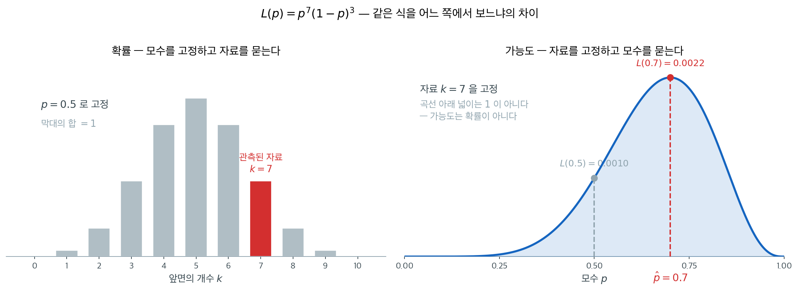
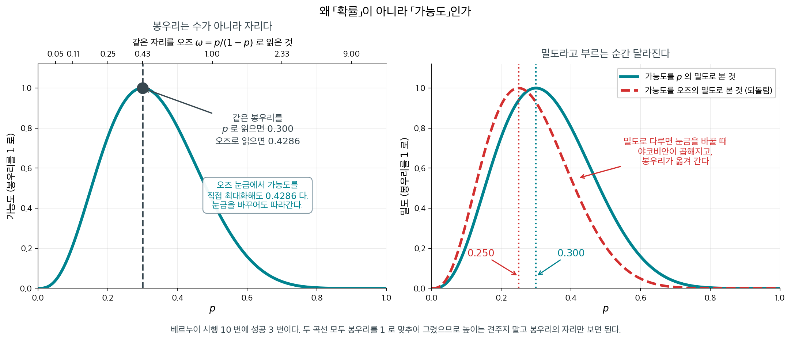

# 가능도와 최대가능도추정

## 개요

확률에서는 모수 $\theta$를 고정해 두고 "어떤 자료가 나올 법한가?"를 묻는다. 가능도함수는 이 관점을 뒤집는다. 이미 관측된 자료를 두고 "어떤 $\theta$ 값이 이 관측을 가장 그럴듯하게 만드는가?"를 묻는다. "모수가 자료를 만든다"에서 "자료가 모수에 관해 알려 준다"로의 이 전환이 가능도 기반 추론의 토대이며, 최대가능도추정, 가능도비 검정, 정보기준을 떠받친다.

---

## 1. 직관

간단한 실험을 생각해 보자. 동전을 10번 던져 앞면 7번을 관측했다. 앞면이 나올 확률이 $p = 0.5$라면 이 결과의 확률을 계산할 수 있다. 그런데 $p = 0.6$, $p = 0.7$, 또는 다른 어떤 $p$에 대해서도 같은 결과의 확률을 계산할 수 있다. 자료를 고정한 채 이 확률들을 $p$의 함수로 그린 것이 가능도함수이다. 가장 높은 봉우리를 만드는 $p$ 값이 "가장 그럴듯한" 모수값이며, 그것을 찾는 것이 최대가능도추정의 핵심이다.

두 그림은 **같은 식** $p^k(1-p)^{n-k}$을 그린 것이다. 다른 것은 무엇을 고정하고 무엇을 변수로 두느냐뿐이다. 왼쪽에서는 $p$를 고정하고 $k$를 움직였으므로 막대의 합이 1이 된다. 오른쪽에서는 관측된 $k = 7$을 고정하고 $p$를 움직였으므로 **합이 1이어야 할 이유가 없다.** 아래에서 "가능도는 확률이 아니다"라고 말할 때의 뜻이 이것이다.

오른쪽 곡선의 높이가 재는 것은 "이 $p$라면 내가 본 자료가 얼마나 잘 나왔겠는가"이며, 봉우리의 자리가 그 물음에 가장 잘 답하는 $p$다.

---

## 2. 일반적인 정의

관측된 자료 $\mathbf{x}$가 주어졌을 때 모수 $\theta$에 대한 가능도함수는, 관측된 자료에서 평가한 결합밀도(또는 결합 질량함수)를 $\theta$의 함수로 본 것으로 정의된다:

$$
L(\theta; \mathbf{x}) = f(\mathbf{x}; \theta)
$$

여기서 $f(\mathbf{x}; \theta)$는 (연속 자료에서는) 확률밀도함수이거나 (이산 자료에서는) 확률질량함수이다. 쌍반점 표기는 $\theta$가 확률변수가 아니라 고정된 모수임을 강조한다. 확률적인 의미에서 $\theta$로 조건화하는 것이 아니다.

### i.i.d.인 경우

자료가 독립이고 동일한 분포를 따르는 $n$개의 관측값 $x_1, \ldots, x_n$으로 이루어져 있으면 결합밀도가 곱으로 인수분해되고 가능도는 다음 형태가 된다:

$$
L(\theta; \mathbf{x}) = \prod_{i=1}^n f(x_i; \theta)
$$

이 곱의 구조는 i.i.d. 상황에 특유한 것이다. 의존하는 자료(예: 시계열)에서는 가능도가 다른 형태를 취하지만 밑바탕의 착상은 같다.

!!! example "베르누이 가능도"

    $X_1, \ldots, X_n \overset{\text{iid}}{\sim} \text{Bernoulli}(p)$이고 $n$번의 시행에서 성공 $k$번을 관측했다고 하자. 가능도함수는

    $$
    L(p; \mathbf{x}) = \prod_{i=1}^n p^{x_i}(1-p)^{1-x_i} = p^k (1-p)^{n-k}
    $$

    $n = 10$, $k = 7$일 때 $L(0.5) = 0.5^{10} \approx 0.001$이고 $L(0.7) = 0.7^7 \cdot 0.3^3 \approx 0.0022$이다. $p = 0.7$이 $p = 0.5$보다 관측된 자료를 약 두 배 더 그럴듯하게 만든다.

---

## 3. 로그가능도

가능도를 직접 다루는 것은 불편하다. 작은 수를 많이 곱하면 수치적 언더플로가 생기기 때문이다. **로그가능도**는 곱을 합으로 바꾼다:

$$
\ell(\theta; \mathbf{x}) = \log L(\theta; \mathbf{x}) = \sum_{i=1}^n \log f(x_i; \theta)
$$

로그가 순증가함수이므로 $\ell$을 최대화하는 것은 $L$을 최대화하는 것과 동등하다. 실무에서는 로그가능도가 표준적인 작업 도구이다.

!!! example "베르누이 로그가능도"

    베르누이 예를 이어가면:

    $$
    \ell(p; \mathbf{x}) = k \log p + (n - k) \log(1-p)
    $$

    $n = 10$, $k = 7$일 때 $\ell(0.5) = 10 \log(0.5) \approx -6.93$이고 $\ell(0.7) = 7\log(0.7) + 3\log(0.3) \approx -6.12$이다. $p = 0.7$에서 로그가능도가 더 높아 그 값이 더 그럴듯한 모수값임을 확인해 준다.

---

## 4. 가능도의 주요 성질

### 가능도는 확률이 아니다

가능도함수에 관해 가장 중요한 개념적 요점은 **그것이 $\theta$에 대한 확률분포가 아니라는** 것이다. 구체적으로 다음이 보장되지 않는다:

$$
\int L(\theta; \mathbf{x}) \, d\theta = 1
$$

일반적으로 이 적분은 임의의 양수로 수렴할 수도 있고 발산할 수도 있다. 가능도는 서로 다른 모수값의 상대적인 그럴듯함을 알려 줄 뿐 모수에 확률을 부여하지 않는다. 모수에 확률을 부여하려면 사전분포를 갖춘 베이즈 방법이 필요하다.

### 상대적 그럴듯함

한 점에서의 $L(\theta; \mathbf{x})$의 절댓값은 그 자체로 해석되지 않는다. 중요한 것은 두 모수값 사이의 **가능도비**이다:

$$
\frac{L(\theta_1; \mathbf{x})}{L(\theta_2; \mathbf{x})}
$$

비가 10이면 $\theta_1$이 $\theta_2$보다 자료를 10배 더 그럴듯하게 만든다는 뜻이다. 이 비는 곱해지는 상수에 불변이며, 그래서 가능도를 흔히 "상수배까지" 정의한다고 말한다.

### 로그가능도의 계산상 편의

로그가능도는 곱을 합으로 바꾸며 실용적인 장점을 셋 준다:

- **수치적 안정성**: 작은 확률을 많이 곱하면 언더플로가 생기지만 로그확률의 합에서는 그렇지 않다.
- **미분**: 합은 곱보다 미분하기 쉬워 최댓값을 찾기가 간단해진다.
- **가법성**: 독립인 관측값에서 전체 로그가능도는 개별 기여의 합이므로 자료점을 더하거나 빼기 쉽다.

---

## 5. 최대가능도추정

### 정의 3. 최대가능도추정량 { .dfn }

**최대가능도추정량(MLE)**은 가능도함수를 최대화하는 $\theta$ 값이다:

$$\hat{\theta}_{\text{MLE}} = \arg\max_{\theta \in \Theta} L(\theta) = \arg\max_{\theta \in \Theta} \ell(\theta)$$

MLE는 "어떤 모수값이 관측된 자료를 가장 그럴듯하게 만드는가?"라는 물음에 답한다.

### MLE 찾기

로그가능도가 미분가능하면 MLE는 대개 **점수방정식**을 풀어 찾는다:

$$\frac{\partial \ell(\theta)}{\partial \theta} = 0$$

**점수함수** $s(\theta) = \frac{\partial \ell(\theta)}{\partial \theta}$는 로그가능도의 기울기이다. MLE는 $s(\hat{\theta}_{\text{MLE}}) = 0$을 만족한다.

벡터 모수 $\theta = (\theta_1, \ldots, \theta_k)^\top$에 대해서는 다음 연립방정식을 푼다:

$$\frac{\partial \ell}{\partial \theta_j} = 0, \quad j = 1, \ldots, k$$

그 해가 (최솟값이나 안장점이 아니라) 최댓값인지 확인해야 하며, 보통 해에서 Hessian 행렬이 음의 정부호인지 살핀다.

세 꼴이 모두 같은 것을 가리킨다는 점도 적어 둔다.

$$
\operatorname*{argmax}_{\theta} L \quad\Leftrightarrow\quad \operatorname*{argmax}_{\theta} \ell \quad\Leftrightarrow\quad \operatorname*{argmin}_{\theta} J
$$

여기서 $J = -\ell$ 이 **비용함수**다. 기계학습에서 음의 로그가능도를 손실로 삼아 최소화하는 것이 곧 최대가능도추정이다.

---

## 6. 보기

**보기 1.**  정규분포 — 평균이 미지. $\sigma^2$이 알려진 $X_1, \ldots, X_n \sim N(\mu, \sigma^2)$이라 하자. $\mu$의 MLE를 구한다.

??? success "풀이"
    **가능도:**

    $$L(\mu) = \prod_{i=1}^n \frac{1}{\sqrt{2\pi\sigma^2}} \exp\left(-\frac{(x_i - \mu)^2}{2\sigma^2}\right)$$

    **로그가능도:**

    $$\ell(\mu) = -\frac{n}{2}\log(2\pi\sigma^2) - \frac{1}{2\sigma^2}\sum_{i=1}^n (x_i - \mu)^2$$

    **점수방정식:**

    $$\frac{d\ell}{d\mu} = \frac{1}{\sigma^2}\sum_{i=1}^n (x_i - \mu) = 0$$

    $$\sum_{i=1}^n x_i - n\mu = 0$$

    $$\hat{\mu}_{\text{MLE}} = \frac{1}{n}\sum_{i=1}^n x_i = \bar{x}$$

    평균의 MLE는 표본평균이며 불편이고 효율적이다.

**보기 2.**  정규분포 — 두 모수 모두 미지. $\mu$와 $\sigma^2$이 모두 미지인 $X_1, \ldots, X_n \sim N(\mu, \sigma^2)$이라 하자.

??? success "풀이"
    **로그가능도:**

    $$\ell(\mu, \sigma^2) = -\frac{n}{2}\log(2\pi) - \frac{n}{2}\log(\sigma^2) - \frac{1}{2\sigma^2}\sum_{i=1}^n (x_i - \mu)^2$$

    **점수방정식:**

    $$\frac{\partial \ell}{\partial \mu} = \frac{1}{\sigma^2}\sum_{i=1}^n (x_i - \mu) = 0 \implies \hat{\mu} = \bar{x}$$

    $$\frac{\partial \ell}{\partial \sigma^2} = -\frac{n}{2\sigma^2} + \frac{1}{2\sigma^4}\sum_{i=1}^n (x_i - \mu)^2 = 0 \implies \hat{\sigma}^2 = \frac{1}{n}\sum_{i=1}^n (x_i - \bar{x})^2$$

    **참고:** $\sigma^2$의 MLE는 $n-1$이 아니라 $n$으로 나눈다. 편향되어 있다: $E[\hat{\sigma}^2_{\text{MLE}}] = \frac{n-1}{n}\sigma^2$. MLE가 언제나 불편인 것은 아님을 보여 준다.

**보기 3.**  베르누이분포. $X_1, \ldots, X_n \sim \text{Bernoulli}(p)$라 하자.

??? success "풀이"
    **로그가능도:**

    $$\ell(p) = \sum_{i=1}^n \left[x_i \log p + (1 - x_i)\log(1 - p)\right]$$

    $$= k \log p + (n - k)\log(1 - p)$$

    여기서 $k = \sum_{i=1}^n x_i$는 성공 횟수이다.

    **점수방정식:**

    $$\frac{d\ell}{dp} = \frac{k}{p} - \frac{n-k}{1-p} = 0$$

    $$\hat{p}_{\text{MLE}} = \frac{k}{n} = \bar{x}$$

    MLE는 표본비율이며 직관적으로 자연스럽고 불편이다.

**보기 4.**  지수분포. $x > 0$에서 밀도가 $f(x; \lambda) = \lambda e^{-\lambda x}$인 $X_1, \ldots, X_n \sim \text{Exp}(\lambda)$라 하자.

??? success "풀이"
    **로그가능도:**

    $$\ell(\lambda) = n\log\lambda - \lambda \sum_{i=1}^n x_i$$

    **점수방정식:**

    $$\frac{d\ell}{d\lambda} = \frac{n}{\lambda} - \sum_{i=1}^n x_i = 0$$

    $$\hat{\lambda}_{\text{MLE}} = \frac{n}{\sum_{i=1}^n x_i} = \frac{1}{\bar{x}}$$

    **2계도함수 확인:** $\frac{d^2\ell}{d\lambda^2} = -n/\lambda^2 < 0$이므로 최댓값이다.

**보기 5.**  포아송분포. $X_1, \ldots, X_n \sim \text{Poisson}(\lambda)$라 하자.

??? success "풀이"
    **로그가능도:**

    $$\ell(\lambda) = \sum_{i=1}^n \left[x_i \log\lambda - \lambda - \log(x_i!)\right] = \left(\sum x_i\right)\log\lambda - n\lambda - \sum\log(x_i!)$$

    **점수방정식:**

    $$\frac{d\ell}{d\lambda} = \frac{\sum x_i}{\lambda} - n = 0$$

    $$\hat{\lambda}_{\text{MLE}} = \bar{x}$$

---

## 7. MLE의 성질
| 성질 | 설명 |
|----------|-------------|
| **일치성** | $n \to \infty$일 때 $\hat{\theta}_{MLE} \xrightarrow{P} \theta_0$ |
| **점근정규성** | $\sqrt{n}(\hat{\theta}_{MLE} - \theta_0) \xrightarrow{d} N(0, I(\theta_0)^{-1})$ |
| **점근 효율성** | 점근적으로 Cramér–Rao 하한을 달성한다 |
| **불변성** | $\hat{\theta}$가 $\theta$의 MLE이면 $g(\hat{\theta})$는 $g(\theta)$의 MLE이다 |

**그림으로 보는 통계학 1.** 왜 확률이 아니라 가능도인가

표 맨 아랫줄의 **불변성**이 이 쪽에서 가장 조용히 지나가는 줄이다. 그런데 그 한 줄이 이 분야의 용어를 하나 만들어 냈다.

당연한 물음이 있다. **왜 굳이 「가능도」라는 다른 말을 쓰는가?** 자료를 보고 나서 모수에 대해 말하는 것이니 그냥 「$\theta$ 의 확률」이라 부르면 안 되는가.

**피셔도 처음에는 그 구분이 흐릿했다.** $1912$ 년, 케임브리지 $3$ 학년이던 그가 이 방법을 처음 적은 논문에서 그는 이 양을 모수에 대해 **적분하기까지** 했다. 뒤에 그는 그것이 잘못이었음을 깨닫고, $1920$ 년대 초에 **가능도**라는 말을 따로 만들어 이것이 확률이 아니며 확률의 법칙을 따르지 않는다고 못 박았다.

왜 아닌지는 눈금을 바꾸어 보면 드러난다.

<figure markdown>
{ width="900" }
  <figcaption markdown>베르누이 시행 $10$ 번에 성공 $3$ 번이다. 두 곡선 모두 봉우리를 $1$ 로 맞추었으므로 높이가 아니라 **봉우리의 자리**만 보면 된다.</figcaption>
</figure>

**왼쪽 — 불변성이 하는 일.**

| | |
|---|---|
| $p$ 의 MLE | $0.300$ |
| 오즈로 옮긴 값 $g(\hat p) = \hat p/(1-\hat p)$ | $0.4286$ |
| 오즈 눈금에서 가능도를 **직접 최대화**한 값 | $\mathbf{0.4286}$ |

둘이 같다. 가능도의 봉우리는 **수가 아니라 자리**이고, 눈금을 바꾸면 그 자리를 읽는 수만 바뀐다. 위쪽 보조 눈금이 그것을 그대로 보여 준다 — 같은 꼭대기를 $p$ 로 읽으면 $0.300$, 오즈로 읽으면 $0.43$ 이다.

**오른쪽 — 확률이라고 부르는 순간.**

가능도를 $\theta$ 의 밀도로 다루기로 하자. 밀도는 눈금을 바꿀 때 **야코비안이 곱해진다.** 그러면 봉우리가 움직인다.

| | |
|---|---|
| $p$ 의 밀도로 본 최빈값 | $0.300$ |
| 오즈의 밀도로 본 최빈값을 $p$ 로 되돌린 값 | $\mathbf{0.250}$ |

**같은 자료인데 「가장 그럴듯한 $p$」가 $0.300$ 과 $0.250$ 으로 갈린다.** 무엇을 「자연스러운 눈금」으로 부르느냐에 답이 달려 버리는 것이다.

게다가 가능도는 애초에 $\theta$ 에 대해 적분하면 $1$ 이 아니다. 이 자료에서 $\int_0^1 L(p)\,dp = 0.00076$ 이다. **합이 $1$ 이 아닌 것을 확률이라 부를 수는 없다.**

그래서 가능도에는 두 가지가 **없다** — 눈금에 따라 달라지는 야코비안도, 전체를 $1$ 로 맞추는 규약도. 그 둘이 없기 때문에 봉우리가 자리에 붙어 있을 수 있다. 표의 불변성은 그 대가로 얻은 성질이다.

가능도를 정말로 확률처럼 쓰려면 야코비안을 감당해야 하고, 그러려면 **사전분포**가 필요하다. 그 길이 [베이즈 추정](../bayesian/bayesian_estimation.md)이고, 눈금에 끌려다니지 않는 사전분포를 고르는 문제가 [제프리스 사전분포](fisher_information.md)다.

_확인한 곳 — 피셔가 케임브리지 곤빌앤드키즈 칼리지의 마지막 학년에 「An absolute criterion for fitting frequency curves」($1912$)를 썼고 그것이 그의 첫 수학 논문이었다는 것, 그 글의 「절대 기준」이 역확률에서 나온 것이어서 **가능도를 적분할 수 있는 양처럼 다루었고**, $1921$–$22$ 년에 그 부분을 다시 써서 가능도는 미분요소가 아니므로 적분할 수 없다고 갈라 적었다는 것. 그림과 표의 수는 모두 직접 계산한 값이다_

---

## 8. 가능도 기반 추론
### 가능도비

두 모수값 $\theta_0$과 $\theta_1$을 비교하는 **가능도비**는:

$$\Lambda = \frac{L(\theta_0)}{L(\theta_1)}$$

$\Lambda$가 작으면 자료가 $\theta_0$보다 $\theta_1$을 지지한다는 뜻이다.

### 가능도비 검정

$H_0: \theta = \theta_0$ 대 $H_1: \theta \neq \theta_0$을 검정할 때 **가능도비 검정통계량**은:

$$\Lambda = \frac{L(\theta_0)}{L(\hat{\theta}_{\text{MLE}})}$$

$H_0$과 정칙 조건 아래에서:

$$-2\log\Lambda = 2[\ell(\hat{\theta}_{\text{MLE}}) - \ell(\theta_0)] \xrightarrow{d} \chi^2_k$$

여기서 $k$는 제약된 모수의 개수이다. 응용통계학의 많은 가설검정이 이를 토대로 한다.

### 가능도로부터의 신뢰구간

**Wald 신뢰구간:** 점근정규성을 사용하면:

$$\hat{\theta} \pm z_{\alpha/2} \cdot \text{SE}(\hat{\theta})$$

여기서 $\text{SE}(\hat{\theta}) = 1/\sqrt{nI(\hat{\theta})}$ 또는 $1/\sqrt{J(\hat{\theta})}$이다.

**프로파일 가능도 구간:** 다음을 만족하는 $\theta$ 값의 집합이다:

$$2[\ell(\hat{\theta}) - \ell(\theta)] \leq \chi^2_{1, 1-\alpha}$$

소표본이거나 가능도가 치우쳐 있을 때 이 구간이 대체로 Wald 구간보다 정확하다.

---

## 9. 계산 방법
### Newton-Raphson 방법

점수방정식을 해석적으로 풀 수 없으면 MLE를 수치적으로 찾는다. Newton-Raphson은 다음을 반복한다:

$$\theta^{(t+1)} = \theta^{(t)} - \left[\frac{\partial^2 \ell}{\partial \theta^2}\bigg|_{\theta^{(t)}}\right]^{-1} \frac{\partial \ell}{\partial \theta}\bigg|_{\theta^{(t)}}$$

이는 로그가능도에 이차근사를 반복적으로 맞추는 것과 동등하다.

### Fisher 점수법

관측 Hessian을 기대 Fisher 정보량으로 바꾼 변형이다:

$$\theta^{(t+1)} = \theta^{(t)} + I(\theta^{(t)})^{-1} \cdot s(\theta^{(t)})$$

관측 Hessian의 조건수가 나쁠 때 Fisher 점수법이 더 안정적이다.

### EM 알고리즘

잠재변수를 갖는 모형(예: 혼합모형, 은닉 마르코프 모형)에서는 **기댓값–최대화(EM) 알고리즘**이 다음을 번갈아 수행한다:

- **E 단계**: 현재 모수와 관측 자료가 주어졌을 때 기대 로그가능도를 계산한다
- **M 단계**: 이 기대 로그가능도를 최대화하여 모수를 갱신한다

EM 알고리즘은 매 단계마다 가능도가 단조 증가함을 보장하며, 국면전환 모형 같은 금융 응용에서 널리 쓰인다.

---

## 10. 금융과의 연결
가능도함수와 MLE는 계량금융 전반에 스며 있다:

- **GARCH 모형**: 보통 정규 또는 스튜던트-$t$ 혁신항을 가정하고 수익률의 조건부 로그가능도를 최대화하여 모수 $(\omega, \alpha, \beta)$를 추정한다.
- **옵션 가격결정**: Black-Scholes 내재변동성은 모형이 가정한 동학 아래에서 관측된 옵션 가격이 주어졌을 때 변동성의 MLE이다.
- **국면전환 모형**: Hamilton의 국면전환 모형은 전이확률과 국면별 모수에 대해 가능도를 최대화하는 데 EM 알고리즘을 사용한다.
- **위험 모형화**: Value-at-Risk와 기대손실 추정을 위해 손실 자료에 꼬리가 두꺼운 분포(스튜던트-$t$, 일반화 Pareto)를 MLE로 적합한다.
- **기간구조 모형**: Vasicek, CIR, 아핀 기간구조 모형의 모수는 관측된 수익률곡선의 가능도를 최대화하여 보정한다.
- **코퓰러 모형**: 코퓰러 기반 포트폴리오 위험 모형의 의존성 모수는 유사최대가능도로 추정한다.

---

## 11. MLE의 한계
MLE는 강력하지만 중요한 한계가 있다:

- **소표본 편향**: 소표본에서 MLE가 상당히 편향될 수 있다(예: 분산추정량이 $n-1$ 대신 $n$으로 나눈다)
- **경계 문제**: 참 모수가 모수공간의 경계에 있으면 표준 점근이론이 무너진다
- **모형 설정 오류**: MLE는 모형이 옳을 때 최적이다. 설정이 잘못되면 참 분포에서 모형족까지의 KL 발산을 최소화하는 모수값으로 수렴한다(준최대가능도 또는 유사최대가능도)
- **여러 봉우리를 갖는 가능도**: 특히 혼합모형에서 수치 최적화가 전역이 아닌 국소 최댓값을 찾을 수 있다
- **이상점에 대한 민감도**: 어떤 모형에서는 이상점 하나가 MLE를 크게 움직일 수 있다

---

## 연습문제

**연습문제 1.** 
$\text{Poisson}(\lambda)$ 분포에서 얻은 크기 $n = 3$인 표본에서 관측값이 $x_1 = 2, x_2 = 5, x_3 = 3$이다. $\lambda = 3$과 $\lambda = 4$에서 가능도와 로그가능도를 계산하라. 어느 값이 더 그럴듯한가?

??? success "풀이"
    포아송 가능도는 $L(\lambda) = \prod_{i=1}^n \frac{\lambda^{x_i} e^{-\lambda}}{x_i!}$이다.

    $\lambda = 3$일 때: $L(3) = \frac{3^2 e^{-3}}{2!} \cdot \frac{3^5 e^{-3}}{5!} \cdot \frac{3^3 e^{-3}}{3!} = \frac{3^{10} e^{-9}}{2! \cdot 5! \cdot 3!}$

    $$
    = \frac{59049 \times 0.0001234}{2 \times 120 \times 6} = \frac{7.2876}{1440} \approx 0.005061
    $$

    $\lambda = 4$일 때: $L(4) = \frac{4^{10} e^{-12}}{1440} = \frac{1048576 \times 6.144 \times 10^{-6}}{1440} \approx 0.004473$

    로그가능도는 $\ell(3) = 10\ln 3 - 9 - \ln 1440 \approx -5.287$이고 $\ell(4) = 10\ln 4 - 12 - \ln 1440 \approx -5.411$이다.

    $\ell(3) > \ell(4)$이므로 $\lambda = 3$이 더 그럴듯하다. 참고로 MLE는 $\hat{\lambda} = \bar{x} = 10/3 \approx 3.33$이다.

---

**연습문제 2.** 
$\mu$와 $\sigma^2$이 모두 미지일 때 $N(\mu, \sigma^2)$ 분포에서 얻은 독립인 관측값 $x_1, \dots, x_n$에 대한 가능도함수와 로그가능도함수를 쓰라.

??? success "풀이"
    가능도는:

    $$
    L(\mu, \sigma^2) = \prod_{i=1}^n \frac{1}{\sqrt{2\pi\sigma^2}} \exp\!\left(-\frac{(x_i - \mu)^2}{2\sigma^2}\right) = (2\pi\sigma^2)^{-n/2} \exp\!\left(-\frac{1}{2\sigma^2}\sum_{i=1}^n(x_i - \mu)^2\right)
    $$

    로그가능도는:

    $$
    \ell(\mu, \sigma^2) = -\frac{n}{2}\log(2\pi) - \frac{n}{2}\log(\sigma^2) - \frac{1}{2\sigma^2}\sum_{i=1}^n(x_i - \mu)^2
    $$

---

**연습문제 3.** 
가능도함수 $L(\theta; \mathbf{x})$와 확률함수 $P(\mathbf{x}; \theta)$의 차이를 설명하라. 가능도가 $\theta$에 대한 확률분포가 아닌 이유는 무엇인가?

??? success "풀이"
    **확률함수** $P(\mathbf{x}; \theta)$는 $\theta$를 고정하고 $\mathbf{x}$를 변수로 다룬다. $\theta$가 고정되면 가능한 모든 자료 결과에 대해 합(또는 적분)이 1이 된다.

    **가능도함수** $L(\theta; \mathbf{x})$는 $\mathbf{x}$를 (관측된 자료로) 고정하고 $\theta$를 변수로 다룬다. 확률함수와 같은 식을 쓰되 역할을 뒤바꾼 것이다.

    가능도가 $\theta$에 대한 확률분포가 아닌 이유는 모수공간에서 적분해도 1이 되지 않기 때문이다. 실제로 $\int L(\theta; \mathbf{x})\,d\theta$는 임의의 양수일 수도(심지어 무한일 수도) 있다. $\theta$에 대한 제대로 된 분포를 얻으려면 사전분포를 곱하고 정규화해야 하며(베이즈 접근), 그 결과가 사후분포이다.

---

**연습문제 4.** 
로그가능도를 최대화하는 것이 가능도를 최대화하는 것과 동등한 이유를 설명하라. 로그가능도로 작업할 때의 실용적 장점을 하나 서술하라.

??? success "풀이"
    로그가 순증가함수이므로 $L(\theta_1) > L(\theta_2)$일 필요충분조건은 $\ell(\theta_1) > \ell(\theta_2)$이다. 따라서 $L$을 최대화하는 $\theta$가 $\ell$도 최대화하며 그 역도 성립한다.

    **실용적 장점:** 로그가능도는 곱을 합으로 바꾼다:

    $$
    \ell(\theta) = \sum_{i=1}^n \log f(x_i; \theta)
    $$

    (곱의 미분법 대신 합의 미분법을 쓰므로) 미분하기 쉽고 수치적 언더플로를 피할 수 있다. $n$이 크면 가능도 $L(\theta) = \prod f(x_i; \theta)$가 (1보다 작은 수 $n$개의 곱이므로) 천문학적으로 작아져 부동소수점 언더플로를 일으킨다. 합인 로그가능도는 수치적으로 다룰 수 있는 범위에 머문다.

---

**연습문제 5.** 
**가능도 원리**를 서술하라. 동전을 20번 던져 앞면 6번을 얻은 경우와, 앞면이 6번 나올 때까지 던져 20번 만에 끝난 경우를 견주어 이 원리가 무엇을 주장하는지 보여라.

??? success "풀이"
    **가능도 원리.** 두 실험에서 얻은 가능도함수가 $\theta$의 함수로서 **비례**하면, 두 실험은 $\theta$에 대해 같은 증거를 담고 있다.

    **두 설계.**

    *이항 설계*($n=20$ 고정, $k$ 관측):

    $$
    L_1(p) = \binom{20}{6}p^6(1-p)^{14} \propto p^6(1-p)^{14}
    $$

    *음이항 설계*($k=6$ 고정, $n$ 관측):

    $$
    L_2(p) = \binom{19}{5}p^6(1-p)^{14} \propto p^6(1-p)^{14}
    $$

    **두 가능도가 비례한다.** 상수만 다르므로 가능도 원리에 따르면 두 실험은 같은 증거를 준다.

    **그런데 빈도주의 추론은 다르다.** $H_0: p=0.5$의 단측 $p$-값을 계산하면

    - 이항: $P(X \le 6 \mid n=20) = 0.0577$
    - 음이항: $P(N \ge 20 \mid k=6) = 0.0318$

    으로 하나는 5%에서 유의하지 않고 다른 하나는 유의하다. **$p$-값이 "관측되지 않은 자료"의 확률까지 더하는데, 그 집합이 정지규칙에 따라 달라지기 때문이다.**

    **의미.** 베이즈 추론과 순수 가능도 추론은 가능도 원리를 만족한다. 사후분포가 사전분포 곱하기 가능도에 비례하므로 상수는 무관하기 때문이다. 반면 $p$-값, 신뢰구간, 불편성 같은 빈도주의 개념은 만족하지 않는다.

    이 긴장이 통계학 기초 논쟁의 중심이었다. 버나드는 조건성 원리와 충분성 원리에서 가능도 원리가 따라 나옴을 보였는데, 두 전제는 대부분의 통계학자가 받아들이는 것이라 논의가 더 뜨거워졌다. 실용적 귀결은 **옵셔널 스토핑 문제**다. 가능도 원리를 받아들이면 중간에 들여다보는 것이 추론을 망치지 않지만, 빈도주의 틀에서는 오류율이 붕괴한다.

---

**연습문제 6.** 
가능도비 $L(\theta_1)/L(\theta_2)$를 증거의 강도로 읽는 관행이 있다. 흔히 쓰는 문턱값 $1/8$과 $1/32$의 근거를 설명하고, 이 방식과 $p$-값의 차이를 밝혀라.

??? success "풀이"
    **가능도 구간.** 최대 가능도에 대한 상대 가능도

    $$
    R(\theta) = \frac{L(\theta)}{L(\hat\theta)}
    $$

    를 두고 $R(\theta) \ge 1/k$인 $\theta$를 모은 것을 **$1/k$ 가능도 구간**이라 한다.

    **문턱값의 근거.** 우도비와 카이제곱의 관계에서

    $$
    -2\ln R(\theta) \approx \chi^2_1
    $$

    이므로

    | $1/k$ | $-2\ln R$ | 대응 신뢰수준 |
    |---|---|---|
    | $1/8$ | 4.16 | 약 96% |
    | $1/32$ | 6.93 | 약 99.2% |
    | $1/6.8$ | 3.84 | 정확히 95% |

    즉 $1/8$이 대략 95% 신뢰구간, $1/32$가 대략 99% 신뢰구간에 해당한다. 로열(Royall)이 "약한 증거"와 "강한 증거"의 기준으로 제안한 값이다.

    **$p$-값과의 차이.**

    - **가능도비는 두 가설을 직접 견준다.** "$\theta_1$이 $\theta_2$보다 자료를 8배 잘 설명한다"는 대칭적인 진술이다. $p$-값은 귀무가설 하나만 놓고 "이보다 극단적인 자료가 나올 확률"을 잰다.
    - **가능도비는 관측된 자료만 쓴다.** $p$-값은 관측되지 않은 더 극단적인 자료의 확률을 포함하므로 연습문제 5의 설계 의존성이 생긴다.
    - **가능도비는 표본크기에 따라 해석이 바뀌지 않는다.** $p$-값은 $n$이 크면 사소한 차이에도 작아진다.

    **한계.** 가능도비는 **사전 정보를 반영하지 않는다.** 극도로 있을 법하지 않은 가설이 자료를 8배 잘 설명해도 여전히 믿기 어려울 수 있다. 또 성가신 모수가 있으면 가능도비를 어떻게 정의할지가 간단하지 않고(프로파일링이 필요하다), 오류율에 대한 보장이 없다.

---

**연습문제 7.** 
관측이 완전하지 않은 세 경우 — **우측 중도절단**, **구간 중도절단**, **좌측 절단** — 에 대해 가능도의 기여 항을 각각 적어라.

??? success "풀이"
    밀도를 $f$, 생존함수를 $S = 1-F$라 하자.

    **(1) 정확한 관측.** 사건이 시각 $t$에 일어났음을 안다.

    $$
    L_i = f(t_i;\boldsymbol\theta)
    $$

    **(2) 우측 중도절단.** 시각 $c_i$까지 사건이 없었고 그 뒤는 모른다.

    $$
    L_i = S(c_i;\boldsymbol\theta)
    $$

    "적어도 $c_i$는 넘었다"는 정보를 그대로 쓴다.

    **(3) 구간 중도절단.** 사건이 $(a_i, b_i]$ 사이 어딘가에서 일어났다(예: 정기 검진 사이에 발병).

    $$
    L_i = F(b_i;\boldsymbol\theta) - F(a_i;\boldsymbol\theta) = S(a_i)-S(b_i)
    $$

    **(4) 좌측 절단.** 개체가 시각 $u_i$ 이후에야 관측 대상이 되었다. $T > u_i$인 개체만 표본에 들어오므로 **조건부 분포**를 써야 한다.

    $$
    L_i = \frac{f(t_i;\boldsymbol\theta)}{S(u_i;\boldsymbol\theta)}
    $$

    **절단과 중도절단의 차이가 핵심이다.**

    - **중도절단**은 개체가 표본에 있지만 값을 정확히 모르는 경우다. 분모 보정이 없다.
    - **절단**은 어떤 값을 가진 개체가 애초에 **표본에 들어오지 못한** 경우다. 관측 가능한 영역의 확률로 나누어 정규화해야 한다.

    이를 혼동하면 편향이 생긴다. 좌측 절단을 무시하면(지연 진입을 무시하면) 생존시간을 체계적으로 과대추정한다. 짧게 산 개체가 관측되기도 전에 사라졌기 때문이다.

    **전체 가능도.** $L = \prod_i L_i$이며, 중도절단 지시자를 써서 한 식으로 묶으면

    $$
    L = \prod_i f(t_i)^{\delta_i}S(t_i)^{1-\delta_i}
    $$

    가 된다. 생존분석의 출발점이다.

---

**연습문제 8.** 
관심 모수가 $\psi$이고 성가신 모수가 $\boldsymbol\lambda$일 때 $\boldsymbol\lambda$를 없애는 세 방법 — **프로파일**, **조건부**, **주변** 가능도 — 을 설명하고 각각의 예를 들어라.

??? success "풀이"
    **(1) 프로파일 가능도.** 각 $\psi$마다 $\boldsymbol\lambda$를 최적화해 대입한다.

    $$
    L_p(\psi) = \max_{\boldsymbol\lambda} L(\psi,\boldsymbol\lambda) = L(\psi, \hat{\boldsymbol\lambda}_\psi)
    $$

    - **장점**: 언제나 쓸 수 있고 계산이 직관적이다.
    - **단점**: 진짜 가능도가 아니라서 $\boldsymbol\lambda$ 추정의 불확실성을 반영하지 못한다. $\boldsymbol\lambda$의 차원이 $n$과 함께 커지면 일치성까지 잃는다(네이만-스콧 문제).
    - **예**: 정규분포에서 $\sigma^2$을 프로파일링해 $\mu$의 구간을 얻는 것(앞 절 연습문제).

    **(2) 조건부 가능도.** $\boldsymbol\lambda$에 대한 충분통계량 $T$로 조건을 걸면 그 조건부 분포가 $\boldsymbol\lambda$에 의존하지 않는 경우가 있다.

    $$
    L_c(\psi) = f(\mathbf{x} \mid T;\ \psi)
    $$

    - **장점**: **진짜 가능도**다. $\boldsymbol\lambda$가 완전히 사라지므로 정확한 추론이 가능하다.
    - **단점**: 그런 $T$가 존재해야 한다. 지수족의 특별한 구조에서만 가능하다.
    - **예**: 짝지은 관측의 조건부 로지스틱 회귀, $2\times2$ 표의 피셔 정확검정(주변합으로 조건화), 두 포아송 비율 비교(총합으로 조건화).

    **(3) 주변 가능도.** 자료의 일부 $S(\mathbf{x})$만 쓰되 그 분포가 $\boldsymbol\lambda$에 의존하지 않도록 고른다.

    $$
    L_m(\psi) = f(S(\mathbf{x});\ \psi)
    $$

    - **장점**: 역시 진짜 가능도다.
    - **단점**: 정보 일부를 버린다.
    - **예**: **REML**(제한최대가능도)이 대표적이다. 혼합모형에서 고정효과 $\boldsymbol\beta$를 없애려고 잔차 대비의 가능도만 쓴다. 그 덕분에 분산성분 추정의 편향이 줄어든다.

    **정리.** 조건부나 주변 가능도를 쓸 수 있으면 그쪽이 낫고, 그렇지 않으면 프로파일 가능도를 쓰되 성가신 모수가 많을 때는 조정 프로파일 가능도(바른도프-닐센 보정) 같은 보정을 고려한다.

---

**연습문제 9.** 
완전한 가능도를 쓸 수 없을 때 대신 쓰는 **유사가능도**의 예를 두 가지 들고, 이때 추론이 어떻게 달라지는지 설명하라.

??? success "풀이"
    **(1) 준가능도(quasi-likelihood).** 분포 전체를 지정하지 않고 **평균과 분산의 관계**만 지정한다.

    $$
    E[Y_i] = \mu_i(\boldsymbol\beta), \qquad \operatorname{Var}(Y_i) = \phi\,V(\mu_i)
    $$

    준포아송이 대표적이다. $V(\mu)=\mu$로 두되 산포모수 $\phi$를 자료에서 추정해 과대산포를 흡수한다. 추정방정식이 포아송 회귀와 같으므로 $\hat{\boldsymbol\beta}$는 그대로이고, **표준오차만 $\sqrt{\hat\phi}$배로 커진다.**

    **(2) 합성가능도(composite likelihood).** 고차원 결합밀도를 계산할 수 없을 때 저차원 주변분포나 조건부분포의 곱으로 대신한다. 공간통계에서 모든 지점의 결합 정규밀도 대신 이웃한 쌍들의 이변량 밀도를 곱한 **쌍별 가능도**가 예다.

    그 밖에 마르코프 확률장에서 각 지점의 조건부분포를 곱하는 **유사가능도**, 콕스 비례위험모형의 **부분가능도**가 모두 이 범주다.

    **추론이 어떻게 달라지는가.**

    - **점추정은 대체로 일치한다.** 추정방정식이 불편이면($E[U(\boldsymbol\theta_0)] = 0$) $\hat{\boldsymbol\theta}$가 참값으로 수렴한다.
    - **표준오차 공식이 달라진다.** 정보량 등식 $I = -E[\ell''] = E[(\ell')^2]$이 더 이상 성립하지 않으므로

      $$
      \operatorname{Var}(\hat{\boldsymbol\theta}) \approx A^{-1}BA^{-1}, \qquad A = -E[\ell''], \quad B = E[(\ell')^2]
      $$

      이라는 **샌드위치 분산**을 써야 한다. 참 가능도이면 $A=B$가 되어 보통의 $I^{-1}$로 돌아온다.
    - **우도비 검정이 $\chi^2$를 따르지 않는다.** 가중된 카이제곱의 합이 되므로 보정이 필요하다. 그래서 유사가능도 기반 추론에서는 왈드 검정이나 부트스트랩을 쓰는 경우가 많다.
    - **AIC/BIC를 그대로 쓸 수 없다.** 유효 모수 개수를 다시 계산하는 CLIC 같은 변형이 필요하다.

    **교훈.** 유사가능도는 계산 가능성을 얻는 대신 **효율과 추론의 단순함을 내준다.** 점추정은 믿을 만하지만 불확실성 정량화에는 추가 장치가 필요하다는 점이 공통된 특징이다.

---

**연습문제 10.** 
두 정규분포의 혼합 $f(x) = \pi\,\phi(x;\mu_1,\sigma_1^2) + (1-\pi)\phi(x;\mu_2,\sigma_2^2)$에서 가능도가 **위로 유계가 아님**을 보여라. MLE가 존재하지 않는다는 뜻인가?

??? success "풀이"
    **유계가 아님.** $\mu_1 = x_1$(첫 관측값)으로 고정하고 $\sigma_1 \to 0$으로 보내자. 첫 관측값의 기여는

    $$
    f(x_1) \ge \pi\,\phi(x_1;x_1,\sigma_1^2) = \frac{\pi}{\sigma_1\sqrt{2\pi}} \to \infty
    $$

    이고, 나머지 관측값들의 기여는 두 번째 성분이 떠받쳐 주므로 0으로 가지 않는다. 따라서

    $$
    L \ge \frac{\pi}{\sigma_1\sqrt{2\pi}}\prod_{i\ge2}(1-\pi)\phi(x_i;\mu_2,\sigma_2^2) \to \infty
    $$

    이다. $\square$

    기하적으로는 **한 성분이 관측값 하나에 무한히 뾰족하게 달라붙는** 상황이다. 밀도가 발산하므로 가능도도 발산한다.

    **MLE가 없다는 뜻인가.** 전역 최대라는 뜻으로는 **없다.** 모수공간의 경계($\sigma_1 = 0$)에서 상한이 접근되지만 달성되지 않는다.

    그러나 실무적으로 쓸 수 있는 해는 있다. **내부의 국소 최대**를 찾으면 된다. 이런 국소 최대 가운데 일치성과 점근정규성을 갖는 것이 존재함이 알려져 있으며, EM 알고리즘이 적당한 초기값에서 출발하면 대개 그것으로 수렴한다.

    **실무적 대처.**

    - **분산에 하한을 둔다.** $\sigma_j \ge \varepsilon$으로 제한하면 가능도가 유계가 된다.
    - **분산이 같다고 가정한다.** $\sigma_1 = \sigma_2$로 두면 퇴화가 일어나지 않는다.
    - **벌점이나 사전분포를 넣는다.** $\sigma_j^2$에 역감마 사전분포를 두면 0 근처가 눌려 퇴화가 사라진다. 베이즈 접근이 이 문제를 자연스럽게 푸는 이유다.
    - **EM을 여러 초기값에서 돌리고** 퇴화하는 해($\sigma_j \to 0$, 한 성분에 관측이 하나만 배정)는 버린다.

    같은 문제가 요인분석의 헤이우드 케이스, 혼합효과 모형의 경계해에서도 나타난다. **가능도가 유계가 아닌 것은 혼합모형의 구조적 특징이지 계산 오류가 아니다.**

---

**연습문제 11.** 
일간 로그수익률이 $r_t \sim N(\mu, \sigma^2)$이다. $n = 252$, $\bar r = 0.0004$, $s = 0.015$일 때 (a) $\mu_{\text{ann}} = 252\mu$와 $\sigma_{\text{ann}} = \sigma\sqrt{252}$의 MLE. (b) 점근정규성을 이용한 95% 신뢰구간. (c) $\hat\mu$가 $\hat\sigma$보다 훨씬 불안정한 이유는?

??? success "풀이"
    (a) $\hat\mu_{\text{ann}} = 252 \cdot 0.0004 = 0.1008$ (10.08%). $\hat\sigma_{\text{ann}} = 0.015 \sqrt{252} \approx 0.2381$ (23.81%).

    (b) $\mathrm{SE}(\hat\mu) = s/\sqrt n = 0.015/\sqrt{252} \approx 0.000945$. $\mathrm{SE}(\hat\mu_{\text{ann}}) = 252 \cdot 0.000945 \approx 0.238$. 95% 신뢰구간: $(-0.366, 0.568)$.

    $\sigma$에 대해서는 점근 표준오차가 $\sigma/\sqrt{2n}$이므로 $\mathrm{SE}(\hat\sigma_{\text{ann}}) \approx 0.0106$이다. 95% 신뢰구간: $(0.217, 0.259)$.

    (c) $\hat\mu_{\text{ann}}$의 표준오차 ≈ 0.238로 점추정값 0.101보다 *크다*. 신뢰구간이 $-37\%$에서 $+57\%$까지 걸쳐 있다. 변동성의 신뢰구간은 (24% 주위로 대략 ±2%포인트로) 좁다. **1년 시계에서 추세는 절망적으로 불안정하지만 변동성은 잘 추정된다.** 미래 수익률을 예측하는 데 과거 표본평균에 의존하는 것은 금융에서 고전적인 함정이다.

---

**연습문제 12.** 
**정규분포의 MLE 유도.** i.i.d. $X_1, \ldots, X_n \sim N(\mu, \sigma^2)$이 주어졌을 때 $\hat\mu$와 $\hat\sigma^2$을 유도하라.

??? success "풀이"
    로그가능도: $\ell(\mu, \sigma^2) = -(n/2)\ln(2\pi\sigma^2) - (1/(2\sigma^2))\sum(X_i - \mu)^2$.

    $\partial\ell/\partial\mu = 0 \Rightarrow \hat\mu = \bar X$.

    $\partial\ell/\partial\sigma^2 = -n/(2\sigma^2) + \sum(X_i - \mu)^2/(2\sigma^4) = 0 \Rightarrow \hat\sigma^2_{\text{MLE}} = (1/n)\sum(X_i - \bar X)^2$.

    MLE가 $n - 1$이 아니라 $n$으로 나눔에 유의하라. 편향되어 있다($\mathbb{E}[\hat\sigma^2] = (n-1)\sigma^2/n$). 불편추정을 하려면 Bessel 수정을 사용한다.

---

**연습문제 13.** 
**Bernoulli/이항의 MLE.** 표본이 $X \sim \mathrm{Binomial}(n, p)$이다. $\hat p_{\text{MLE}}$를 유도하라.

??? success "풀이"
    가능도: $L(p) = \binom{n}{X} p^X (1-p)^{n-X} \propto p^X(1-p)^{n-X}$.

    로그가능도: $\ell(p) = X\ln p + (n-X)\ln(1-p)$.

    $\ell'(p) = X/p - (n-X)/(1-p) = 0$.

    $X(1-p) = (n-X)p \Rightarrow X = np \Rightarrow \hat p = X/n$.

    MLE는 표본비율이다. 불편이다: $\mathbb{E}[\hat p] = p$.

---

**연습문제 14.** 
**MLE의 점근정규성.** 그 결과를 서술하고 베르누이의 경우에 확인하라.

??? success "풀이"
    **MLE의 점근정규성:**

    $$
    \sqrt n(\hat\theta_{\text{MLE}} - \theta) \xrightarrow{d} N(0, 1/I(\theta))
    $$

    여기서 $I(\theta) = -\mathbb{E}[\partial^2 \log f/\partial\theta^2]$는 관측값 하나당 Fisher 정보량이다.

    **베르누이에서의 확인:** $\log f = x\log p + (1-x)\log(1-p)$. 2계도함수는 $-x/p^2 - (1-x)/(1-p)^2$이다. 기댓값을 취하면 $-p/p^2 - (1-p)/(1-p)^2 = -1/p - 1/(1-p) = -1/[p(1-p)]$.

    따라서 $I(p) = 1/[p(1-p)]$이고 $\mathrm{Var}(\hat p) = p(1-p)/n$이다. 표본비율에 대한 중심극한정리와 곧바로 일치한다.

    함의: MLE는 점근적으로 **Cramér-Rao 하한**을 달성하며 점근적으로 효율적이다. 어떤 불편추정량도 이보다 작은 점근분산을 가질 수 없다.

---

**연습문제 15.** 
**MLE가 실패하는 경우.** 다음 각각의 예를 하나씩 들라: (a) MLE가 존재하지 않는 경우; (b) MLE가 경계에 있는 경우; (c) MLE가 일치하지 않는 경우.

??? success "풀이"
    **(a) MLE가 존재하지 않는 경우:** $X \sim \mathrm{Uniform}(0, \theta)$에서 가능도는 $\theta \ge \max X_i$일 때 $1/\theta^n$이고 그 아래에서는 0이다. $\theta \to \infty$이면 $L \to 0$이고, $\theta \to \max X_i$이면 $L \to (1/\max X_i)^n$으로 *상한*에 이르지만 그 지점이 경계이다. 엄밀히 말해 내부에 최댓값이 없으며, MLE는 경계값 $\hat\theta = \max X_i$이다.

    **(b) MLE가 경계에 있는 경우:** 위의 균등분포 예이다. 경계에 있는 MLE는 비표준 점근분포를 가지며($N(0, 1/I)$가 아니다) 수렴 속도가 $\sqrt n$이 아니라 $n$이다.

    **(c) MLE가 일치하지 않는 경우:** Neyman-Scott 문제이다. $i = 1, \ldots, n$, $j = 1, 2$에 대해 관측값이 $X_{ij} \sim N(\mu_i, \sigma^2)$이다. 모수의 개수($\mu_i$들 + $\sigma^2$)가 표본크기와 함께 늘어난다. $\hat\sigma^2_{\text{MLE}} \to \sigma^2/2$로 $\sigma^2$이 아니다. 모수공간의 차원이 $n$에 비례해 커지므로 일치하지 않는다.

    이런 실패 양상들이 편향 보정 MLE, 벌점 가능도, 프로파일 가능도, (베이즈의) 주변가능도 같은 개선을 이끌어 냈다.

---

**연습문제 16.** 
**불변성**을 정확히 서술하고, $g$가 일대일이 아닐 때도 성립하도록 하려면 정의를 어떻게 확장해야 하는지 설명하라. 실무에서 이 성질이 왜 유용한가?

??? success "풀이"
    **일대일인 경우.** $\eta = g(\theta)$로 모수화를 바꾸면 가능도가 $L^*(\eta) = L(g^{-1}(\eta))$이므로, $L$이 $\hat\theta$에서 최대이면 $L^*$는 $g(\hat\theta)$에서 최대다. 따라서

    $$
    \hat\eta = g(\hat\theta)
    $$

    **일대일이 아닌 경우.** $g$가 예를 들어 $\theta^2$처럼 여러 $\theta$를 같은 $\eta$로 보내면 $L^*$를 그대로 정의할 수 없다. **유도가능도**로 확장한다.

    $$
    L^*(\eta) = \sup_{\theta:\ g(\theta)=\eta} L(\theta)
    $$

    이렇게 두면 $L^*$를 최대로 하는 $\eta$가 여전히 $g(\hat\theta)$이므로 불변성이 유지된다.

    **왜 유용한가.**

    - **다시 최적화할 필요가 없다.** $\lambda$의 MLE를 구했으면 평균 $1/\lambda$, 중앙값 $\ln2/\lambda$, 생존확률 $e^{-\lambda t}$의 MLE가 모두 대입만으로 나온다.
    - **모수화를 자유롭게 고를 수 있다.** 수치 최적화를 하기 좋은 척도(경계가 없는 척도)에서 풀고 원하는 척도로 되돌려도 답이 같다. $\sigma$ 대신 $\ln\sigma$, $p$ 대신 로짓을 쓰는 것이 표준적인 관행인 이유다.
    - **보고 단위를 바꿔도 결론이 같다.** 위험비로 보고하든 로그위험비로 보고하든 추정값이 일관된다.

    **다만 불편성은 물려받지 못한다.** 앞서 본 대로 $E[g(\hat\theta)] \ne g(E[\hat\theta])$이며, 표준오차도 단순히 변환되지 않아 델타 방법이 필요하다.

---

**연습문제 17.** 
닫힌 해가 없는 모형에서 MLE를 구하는 **뉴턴-랩슨**과 **피셔 점수법**을 비교하라. 각각의 갱신식과 장단점을 적어라.

??? success "풀이"
    점수함수 $U(\boldsymbol\theta) = \partial\ell/\partial\boldsymbol\theta$를 0으로 만드는 것이 목표다. $\hat{\boldsymbol\theta}$ 근처에서 테일러 전개하면 갱신식이 나온다.

    **뉴턴-랩슨.** **관측정보량**(헤시안의 음수)을 쓴다.

    $$
    \boldsymbol\theta^{(k+1)} = \boldsymbol\theta^{(k)} + \left\{-\frac{\partial^2\ell}{\partial\boldsymbol\theta\partial\boldsymbol\theta^\top}\right\}^{-1}U(\boldsymbol\theta^{(k)})
    $$

    **피셔 점수법.** 관측정보량을 그 기대값인 **피셔 정보량**으로 바꾼다.

    $$
    \boldsymbol\theta^{(k+1)} = \boldsymbol\theta^{(k)} + I(\boldsymbol\theta^{(k)})^{-1}U(\boldsymbol\theta^{(k)})
    $$

    **비교.**

    | | 뉴턴-랩슨 | 피셔 점수법 |
    |---|---|---|
    | 수렴 속도 | 이차(가까이서 매우 빠름) | 대체로 일차~이차 |
    | 안정성 | 헤시안이 양정부호가 아니면 발산 가능 | $I$가 언제나 양반정부호라 안정적 |
    | 계산 | 2계 도함수 필요 | 기대값을 미리 구해 두면 단순해지는 경우 많음 |
    | 정준연결 GLM | — | **둘이 완전히 일치** |

    피셔 점수법이 더 안정적인 이유는 $I(\boldsymbol\theta) = E[-\partial^2\ell/\partial\boldsymbol\theta^2]$가 언제나 양반정부호여서 갱신 방향이 반드시 오르막이기 때문이다. 관측 헤시안은 봉우리에서 멀 때 음정부호가 아닐 수 있어 엉뚱한 방향으로 뛴다.

    **실무.** 일반화선형모형에서 피셔 점수법을 정리하면 **반복 가중최소제곱(IRLS)** 이 된다. 각 단계가 가중최소제곱 문제라 기존 선형대수 코드를 그대로 쓸 수 있고, 이것이 GLM 소프트웨어의 표준 구현이다.

    **표준오차에는 어느 정보량을 쓸까.** 관측정보량 $-\ell''(\hat\theta)$을 쓰는 것이 일반적으로 권장된다. 자료가 실제로 담고 있는 곡률을 반영하고, 모형이 조금 틀렸을 때도 더 나은 근사를 준다.

---

**연습문제 18.** 
자료 일부가 결측이거나 잠재변수가 있을 때 쓰는 **EM 알고리즘**의 두 단계를 설명하고, 왜 각 반복에서 가능도가 줄지 않는지 밝혀라.

??? success "풀이"
    관측자료를 $\mathbf{y}$, 결측(또는 잠재)자료를 $\mathbf{z}$라 하자. 완전자료 로그가능도 $\ell_c(\boldsymbol\theta;\mathbf{y},\mathbf{z})$는 다루기 쉬운데 관측자료 가능도

    $$
    \ell(\boldsymbol\theta;\mathbf{y}) = \ln\int f(\mathbf{y},\mathbf{z};\boldsymbol\theta)\,d\mathbf{z}
    $$

    는 적분 때문에 다루기 어렵다.

    **E 단계.** 현재 추정값 $\boldsymbol\theta^{(k)}$ 아래에서 완전자료 로그가능도의 조건부 기대값을 구한다.

    $$
    Q(\boldsymbol\theta \mid \boldsymbol\theta^{(k)}) = E_{\mathbf{z}\mid\mathbf{y},\,\boldsymbol\theta^{(k)}}\left[\ell_c(\boldsymbol\theta;\mathbf{y},\mathbf{z})\right]
    $$

    **M 단계.** $Q$를 최대로 하는 $\boldsymbol\theta^{(k+1)}$을 구한다.

    **왜 가능도가 줄지 않는가.** 다음 분해가 열쇠다.

    $$
    \ell(\boldsymbol\theta) = Q(\boldsymbol\theta\mid\boldsymbol\theta^{(k)}) - H(\boldsymbol\theta\mid\boldsymbol\theta^{(k)}), \qquad H(\boldsymbol\theta\mid\boldsymbol\theta^{(k)}) = E\left[\ln f(\mathbf{z}\mid\mathbf{y};\boldsymbol\theta)\right]
    $$

    젠슨 부등식(또는 KL 발산의 비음수성)에서 모든 $\boldsymbol\theta$에 대해

    $$
    H(\boldsymbol\theta\mid\boldsymbol\theta^{(k)}) \le H(\boldsymbol\theta^{(k)}\mid\boldsymbol\theta^{(k)})
    $$

    이다. M 단계가 $Q(\boldsymbol\theta^{(k+1)}) \ge Q(\boldsymbol\theta^{(k)})$를 보장하므로

    $$
    \ell(\boldsymbol\theta^{(k+1)}) - \ell(\boldsymbol\theta^{(k)}) = \underbrace{\left\{Q^{(k+1)}-Q^{(k)}\right\}}_{\ge 0} + \underbrace{\left\{H^{(k)}-H^{(k+1)}\right\}}_{\ge 0} \ge 0
    $$

    이다. $\square$

    **성질.** 단조증가가 보장되어 대단히 안정적이지만 수렴이 **일차**라 뉴턴법보다 느리다. 또 전역 최대를 보장하지 않으므로(정규혼합처럼 봉우리가 여럿인 경우) 여러 초기값에서 돌려 봐야 한다. 표준오차를 곧바로 주지 않는다는 점도 단점이라, 별도의 정보량 계산이나 부트스트랩이 필요하다.

    **쓰임.** 혼합모형, 은닉 마르코프 모형, 결측자료, 요인분석, 중도절단 자료, $t$ 잡음 회귀가 모두 EM으로 적합된다.

---

**연습문제 19.** 
최대 로그가능도 $\ell(\hat{\boldsymbol\theta})$는 모수를 늘릴수록 반드시 커진다. 그런데도 모형 선택에 가능도를 쓸 수 있는 이유를 **AIC**로 설명하고, BIC와 비교하라.

??? success "풀이"
    **문제.** 모형 A가 모형 B에 내포되면 $\ell_A \ge \ell_B$가 언제나 성립한다. 더 넓은 모수공간에서 최대화하기 때문이다. 따라서 최대 로그가능도만 비교하면 **언제나 가장 복잡한 모형이 이긴다.**

    **AIC.** 아카이케는 모수 개수 $p$로 벌점을 준다.

    $$
    \text{AIC} = -2\ell(\hat{\boldsymbol\theta}) + 2p
    $$

    작을수록 좋다. 벌점 $2p$의 근거는 이렇다. 같은 자료로 적합하고 평가하면 로그가능도가 낙관적으로 나오는데, 그 낙관의 크기(기대 과적합량)가 근사적으로 $p$이고, $-2$배를 하면 $2p$가 된다.

    AIC가 겨냥하는 것은 **미래 자료에 대한 예측 성능**, 정확히는 참 분포와 적합된 모형 사이의 쿨백-라이블러 발산이다.

    **BIC.**

    $$
    \text{BIC} = -2\ell(\hat{\boldsymbol\theta}) + p\ln n
    $$

    $n \ge 8$이면 $\ln n > 2$이므로 **AIC보다 강하게 벌점**하고, 더 단순한 모형을 고른다. 근거도 다르다. BIC는 베이즈 주변가능도의 근사이며 **참 모형을 찾는 것**을 겨냥한다.

    **비교.**

    | | AIC | BIC |
    |---|---|---|
    | 벌점 | $2p$ | $p\ln n$ |
    | 목표 | 예측 정확도 | 참 모형 식별 |
    | 참 모형이 후보에 있을 때 | 일치성 없음(과적합 경향) | 일치성 있음 |
    | 참 모형이 후보에 없을 때 | 최선의 근사 모형을 고름 | 지나치게 단순한 모형을 고를 수 있음 |

    **실무.** 예측이 목적이면 AIC, 설명이나 변수 선택이 목적이면 BIC가 흔히 권장된다. 다만 어느 쪽도 만능이 아니며, 예측이 진짜 목적이라면 **교차검증**이 더 직접적이다. 실제로 일탈 하나 빼기 교차검증이 AIC와 점근적으로 동등하다는 결과가 있다.

    **주의할 점.** AIC나 BIC 값은 **같은 자료, 같은 반응변수**에 적합한 모형끼리만 비교할 수 있다. 반응변수를 변환하면($y$ 대 $\ln y$) 가능도의 척도가 달라져 비교가 무의미해진다. 야코비안을 보정하면 비교할 수 있지만 흔히 놓치는 함정이다.

---

**연습문제 20.** 
PDF가 $f(x;\lambda) = \lambda e^{-\lambda x}$인 Exponential$(\lambda)$ 분포에서 얻은 확률표본 $x_1, \ldots, x_n$에 대해 로그가능도함수를 쓰고 MLE $\hat{\lambda}$를 구하라.

??? success "풀이"
    가능도는:

    $$
    L(\lambda) = \prod_{i=1}^n \lambda e^{-\lambda x_i} = \lambda^n e^{-\lambda \sum x_i}
    $$

    로그가능도는:

    $$
    \ell(\lambda) = n \log \lambda - \lambda \sum_{i=1}^n x_i
    $$

    점수를 0으로 두면:

    $$
    \frac{d\ell}{d\lambda} = \frac{n}{\lambda} - \sum_{i=1}^n x_i = 0 \implies \hat{\lambda} = \frac{n}{\sum_{i=1}^n x_i} = \frac{1}{\bar{x}}
    $$

    2계도함수가 $-n/\lambda^2 < 0$이므로 최댓값이다.

---

**연습문제 21.** 
MLE의 불변성을 사용하여, Exponential$(\lambda)$ 분포에서 $\hat{\lambda} = 1/\bar{x}$가 MLE일 때 평균 $\mu = 1/\lambda$의 MLE는 무엇인가?

??? success "풀이"
    불변성에 의해 임의의 함수 $g(\theta)$의 MLE는 $g(\hat{\theta})$이다. $\mu = 1/\lambda = g(\lambda)$이므로:

    $$
    \hat{\mu} = g(\hat{\lambda}) = \frac{1}{\hat{\lambda}} = \frac{1}{1/\bar{x}} = \bar{x}
    $$

    모평균의 MLE는 단순히 표본평균이며 직관적이다.

---

**연습문제 22.** 
정규분포의 분산추정량을 예로 들어 MLE가 유한표본에서 편향될 수 있는 이유를 설명하라.

??? success "풀이"
    $N(\mu, \sigma^2)$에서 뽑은 확률표본에 대해 $\sigma^2$의 MLE는:

    $$
    \hat{\sigma}^2_{\text{MLE}} = \frac{1}{n}\sum_{i=1}^n (X_i - \bar{X})^2
    $$

    그런데 $E[\hat{\sigma}^2_{\text{MLE}}] = \frac{n-1}{n}\sigma^2 \neq \sigma^2$이다. MLE가 $n-1$ 대신 $n$으로 나누므로 $\sigma^2/n$만큼 아래쪽으로 편향된다. MLE가 성가신 모수의 추정을 보정하지 않고 가능도를 최대화하기 때문이다(여기서는 $\mu$를 $\bar{X}$로 추정하면서 자유도 하나를 "써 버린다").

    $n \to \infty$일 때 편향이 사라지므로 MLE는 **일치**하지만, 유한표본에서 분산 추정에는 불편추정량 $S^2 = \frac{1}{n-1}\sum(X_i - \bar{X})^2$이 선호된다.

---

**연습문제 23.** 
$X_1,\dots,X_n \sim \text{Exp}(\lambda)$에서 우도비 검정으로 $H_0:\lambda=\lambda_0$을 검정하는 통계량을 유도하고, 그 기각역이 $\bar X$에 대해 어떤 모양인지 설명하라.

??? success "풀이"
    로그가능도가 $\ell(\lambda) = n\ln\lambda - \lambda\sum x_i = n\{\ln\lambda-\lambda\bar x\}$이므로

    $$
    \Lambda = 2\left\{\ell(\hat\lambda)-\ell(\lambda_0)\right\} = 2n\left\{\ln\frac{\hat\lambda}{\lambda_0}+\lambda_0\bar x - 1\right\}
    $$

    이다($\hat\lambda\bar x = 1$을 썼다). $u = \lambda_0\bar x$로 두면

    $$
    \Lambda = 2n\left(u - 1 - \ln u\right)
    $$

    **모양.** 함수 $h(u) = u-1-\ln u$는 $u=1$에서 최솟값 0을 갖고 양쪽으로 증가한다. 따라서 $\Lambda > c$인 기각역은

    $$
    \bar x < a \quad\text{또는}\quad \bar x > b
    $$

    꼴의 **양쪽 꼬리**이며, $a$와 $b$는 $h(a\lambda_0)=h(b\lambda_0)$을 만족한다.

    **핵심은 비대칭이다.** $h$가 $u=1$을 중심으로 대칭이 아니므로($u\to0$에서 발산, $u\to\infty$에서 선형) 두 끝점이 $1/\lambda_0$에서 같은 거리에 있지 않다. 아래쪽이 위쪽보다 가깝다.

    이것이 왈드 검정과의 차이다. 왈드는 $|\bar x - 1/\lambda_0|$을 대칭으로 재므로 다른 기각역을 준다. **우도비가 가능도의 실제 모양을 반영한다는 점에서 우월하다.**

    **정확한 검정.** $2n\lambda_0\bar X \sim \chi^2_{2n}$이라는 정확한 결과가 있으므로, $\chi^2$ 근사를 쓰지 않고 $\chi^2_{2n}$의 양쪽 꼬리로 정확한 임계값을 정할 수 있다. 소표본에서는 이쪽이 낫다.

---

**연습문제 24.** 
가능도함수를 **그림으로** 보고할 때 무엇을 어떻게 그려야 하는지 정리하라. 점추정값과 표준오차만 보고하는 것에 견주어 어떤 이점이 있는가?

??? success "풀이"
    **무엇을 그리는가.**

    - 세로축은 **상대 로그가능도** $\ell(\theta)-\ell(\hat\theta)$. 최댓값을 0으로 맞춰야 표본크기가 다른 자료끼리 겹쳐 볼 수 있다.
    - 가로축은 모수. 범위는 $\hat\theta \pm 4\widehat{\operatorname{SE}}$ 정도.
    - 수평 기준선 $-1.92$($=\chi^2_{1,0.95}/2$)를 그어 95% 우도비 구간을 눈으로 읽게 한다. $-0.5$(1/1.65 가능도)와 $-3.32$(99%)를 함께 그리기도 한다.
    - 모수가 여럿이면 **프로파일** 로그가능도를 그린다.

    **이점.**

    - **비대칭이 보인다.** 점추정값과 표준오차는 대칭 정규분포를 암묵적으로 가정한다. 곡선은 실제 모양을 그대로 보여 준다.
    - **왈드 근사가 얼마나 나쁜지 알 수 있다.** 포물선을 겹쳐 그려 벌어짐을 확인한다.
    - **경계 문제가 드러난다.** $\hat\theta$가 경계에 있으면 곡선이 절벽처럼 끊긴다. 숫자만으로는 알 수 없다.
    - **다봉성이 드러난다.** 봉우리가 여럿이면 곡선에 그대로 나타난다. 점추정값 하나는 이를 완전히 감춘다.
    - **평평함이 보인다.** 넓은 범위에서 거의 평평하면 "자료가 이 모수에 대해 별로 말해 주지 않는다"는 뜻이며, 좁은 신뢰구간보다 훨씬 정직한 표현이다.

    **실무 권고.** 모수가 하나이거나 핵심 모수가 한둘이면 프로파일 가능도 곡선을 **부록에라도 넣는 것**이 좋다. 비용은 거의 없고 독자가 얻는 정보는 많다. 특히 소표본, 경계 근처, 비선형 모형에서 가치가 크다.

---

**연습문제 25.** 
가능도를 이용한 **모형 비교**에서 내포된 모형과 내포되지 않은 모형을 어떻게 다르게 다루는지 설명하라.

??? success "풀이"
    **내포된 경우.** 모형 $M_0$이 $M_1$의 모수공간을 제약해 얻어지면(예: 일부 계수를 0으로 고정) **우도비 검정**을 쓸 수 있다.

    $$
    \Lambda = 2\left\{\ell_1(\hat{\boldsymbol\theta}_1)-\ell_0(\hat{\boldsymbol\theta}_0)\right\} \sim \chi^2_{p_1-p_0}
    $$

    자유도는 제약의 개수다. 이것이 회귀의 $F$ 검정, 분산분석, 일반화선형모형의 이탈도 검정의 바탕이다.

    **주의.** 제약이 모수공간의 **경계**에 있으면($\sigma^2 = 0$ 같은 경우) $\chi^2$ 근사가 틀린다. 그때 극한분포는 $\chi^2$들의 혼합이며, 예컨대 분산성분 하나를 0으로 두는 검정은 $\frac12\chi^2_0+\frac12\chi^2_1$을 따른다. $\chi^2_1$을 쓰면 보수적이 된다.

    **내포되지 않은 경우.** 우도비 검정을 쓸 수 없다. $\Lambda$가 $\chi^2$를 따를 이유가 없고 음수가 될 수도 있다.

    **대안.**

    - **정보기준.** AIC나 BIC로 비교한다. 내포 관계를 요구하지 않는 것이 가장 큰 장점이다. 다만 "유의성"이라는 개념이 없고 순위만 준다.
    - **복스-콕스류 검정.** 두 모형을 모두 포함하는 더 큰 모형을 인위적으로 만들어 각각을 내포 검정으로 돌린다. 결과가 "둘 다 기각", "둘 다 채택"으로 나올 수 있어 해석이 애매하다.
    - **부옹(Vuong) 검정.** 두 모형의 관측별 로그가능도 차이 $\ell_{1i}-\ell_{0i}$의 평균이 0인지 검정한다. 정규근사가 성립하며, 두 모형이 모두 틀려도 "어느 쪽이 참에 더 가까운가"를 물을 수 있다는 점이 개념적으로 깔끔하다.
    - **교차검증.** 예측 성능으로 직접 비교한다. 가정이 가장 적고, 예측이 목적이면 가장 적절하다.

    **실무 권고.** 내포되면 우도비 검정, 아니면 정보기준이나 교차검증. **AIC 차이를 $p$-값처럼 해석하지 말 것.** AIC는 검정이 아니라 순위 기준이다.

---

**연습문제 26.** 
로그가능도를 계산할 때 흔히 저지르는 실수 세 가지를 들고 각각의 증상과 대처를 적어라.

??? success "풀이"
    **(1) 상수항을 빼먹거나 잘못 넣는다.** $-\frac n2\ln(2\pi)$나 $-\sum\ln x_i!$처럼 모수에 무관한 항이다.

    - **증상**: 최적화 결과는 정확하지만 AIC·BIC나 우도비가 틀린다. 특히 **모형마다 다른 상수를 쓰면** 비교가 무의미해진다.
    - **대처**: 모형을 비교할 계획이면 상수를 모두 포함한다. 최적화만 할 것이면 빼도 되지만, 나중에 비교하고 싶어질 때를 대비해 포함해 두는 편이 안전하다.

    **(2) 척도 변환의 야코비안을 빠뜨린다.** $y$ 대신 $\ln y$를 모형화하면 밀도가

    $$
    f_Y(y) = f_{\ln Y}(\ln y)\cdot\frac1y
    $$

    이므로 로그가능도에 $-\sum\ln y_i$가 추가된다.

    - **증상**: 변환한 모형과 변환하지 않은 모형의 AIC를 비교하면 항상 변환한 쪽이 이긴다(또는 진다). 반응변수를 바꾸면 가능도의 척도가 달라지기 때문이다.
    - **대처**: 반응변수 변환이 다른 모형끼리는 야코비안을 보정하지 않으면 비교하지 않는다.

    **(3) 로그 척도를 벗어난다.** 확률을 곱하거나 $\ln\sum\exp$를 직접 계산한다.

    - **증상**: 언더플로로 $-\infty$가 나오거나 오버플로로 `nan`이 나온다. $n$이 커질수록 심하다.
    - **대처**: `logsumexp`, `log1p`, `expm1`, `logaddexp`를 쓰고, 분포의 `logpdf`/`logpmf` 메서드를 직접 쓴다.

    **그 밖에.**

    - **부호 혼동.** 최소화 함수에 넘길 때 음의 로그가능도를 쓰는데, 반환값이나 헤시안의 부호를 한 번 더 뒤집는 실수.
    - **결측값.** `nan`이 하나만 섞여도 합 전체가 `nan`이 된다. 합산 전에 확인한다.
    - **지지집합 밖.** 최적화기가 $\lambda \le 0$ 같은 값을 시도하면 $\ln$이 `nan`을 낸다. 재모수화나 경계 지정으로 막는다.

    **공통 대처법.** **작은 자료로 손계산과 맞춰 본다.** $n=2$나 $n=3$짜리 자료에서 로그가능도를 손으로 계산해 코드 결과와 일치하는지 확인하면 대부분의 실수를 잡아낸다.

---

**연습문제 27.** 
**벌점 가능도**($\ell(\theta)-\text{pen}(\theta)$)를 쓰는 세 가지 동기를 들고, 각각의 예를 적어라.

??? success "풀이"
    **동기 1 — 존재하지 않거나 퇴화하는 해를 막는다.**

    - **예**: 혼합모형의 분산 퇴화. $\sigma_j^2$에 역감마 사전분포에 해당하는 벌점을 주면 $\sigma_j\to0$이 막힌다.
    - **예**: 로지스틱 회귀의 완전분리. 펄스(Firth) 방법은 $\frac12\ln|I(\boldsymbol\beta)|$를 더해 유한한 해를 보장한다. 덤으로 소표본 편향까지 줄인다.

    **동기 2 — 과적합을 막고 예측을 개선한다.**

    - **예**: 능형회귀 $\text{pen} = \lambda\|\boldsymbol\beta\|_2^2$. 편향을 들여 분산을 줄인다.
    - **예**: 라소 $\text{pen} = \lambda\|\boldsymbol\beta\|_1$. 변수 선택까지 동시에 한다.
    - **예**: 평활 스플라인의 거칠기 벌점 $\lambda\int (f'')^2$. 함수의 매끄러움을 조절한다.

    **동기 3 — 모형 복잡도를 벌점해 모형을 고른다.**

    - **예**: AIC의 $-p$, BIC의 $-\frac p2\ln n$. 최대 로그가능도에서 모수 개수만큼 깎는 것이 벌점 가능도의 한 형태다.

    **공통 구조.** 벌점 가능도는 **MAP 추정과 같다.**

    $$
    \arg\max\left\{\ell(\theta)+\ln\pi(\theta)\right\}
    $$

    에서 $\ln\pi$가 벌점의 음수다. 능형은 정규 사전분포, 라소는 라플라스 사전분포, 펄스는 제프리스 사전분포에 대응한다. **벌점을 고르는 것이 곧 사전분포를 고르는 것**이라는 관점이 유용하다.

    **대가.** 추정량이 더 이상 불변이 아니고(벌점이 모수화에 의존한다), 표준적인 점근이론이 그대로 적용되지 않으며, 벌점의 세기 $\lambda$를 정해야 한다. $\lambda$는 보통 교차검증이나 정보기준으로 고르는데, 그 선택의 불확실성이 최종 추론에 반영되지 않는다는 점이 알려진 한계다.
---

## 정리하며

가능도는 확률의 관점을 **뒤집는다.**

| | 무엇을 고정하는가 | 무엇을 묻는가 |
|---|---|---|
| 확률 | 모수 $\theta$ | 어떤 자료가 나올 법한가 |
| 가능도 | 관측된 자료 $\mathbf{x}$ | 어떤 $\theta$ 가 이 자료를 그럴듯하게 만드는가 |

- **식은 같고 읽는 방향이 다르다.** $L(\theta;\mathbf x)=f(\mathbf x;\theta)$ 이며, 바뀐 것은 무엇을 변수로 보느냐뿐이다.
- **가능도는 확률이 아니다.** $\theta$ 에 대해 적분해도 $1$ 이 되지 않으며, "$\theta$ 가 이 값일 확률"로 읽으면 틀린다. 그렇게 읽으려면 사전분포가 필요하고, 그것이 6.4절의 베이즈 접근이다.
- **상수배는 뜻이 없다.** 자료에만 의존하는 인자는 $\theta$ 를 비교하는 데 영향을 주지 않으므로 흔히 버린다.
- **로그를 취하는 이유**는 곱이 합이 되어 미분이 쉬워지고, 수치적으로 언더플로를 피할 수 있기 때문이다. 최댓값의 위치는 로그가 단조라 바뀌지 않는다.
- **봉우리의 위치가 추정값이고, 봉우리의 뾰족함이 정밀도다.** 뒤의 것이 앞 절에서 본 피셔 정보량이며, 로그가능도의 곡률로 나타난다.

다음 절부터 구체적인 분포에서 최대가능도추정량을 하나씩 유도한다. 베르누이·정규·포아송·지수 순이다.
