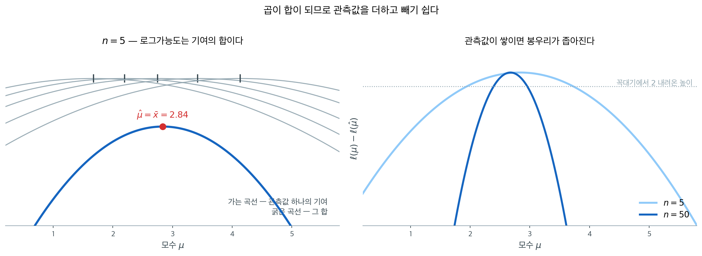
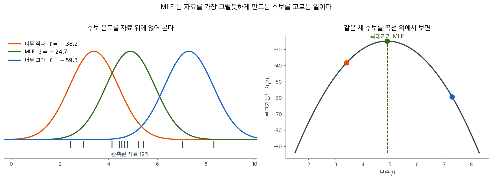
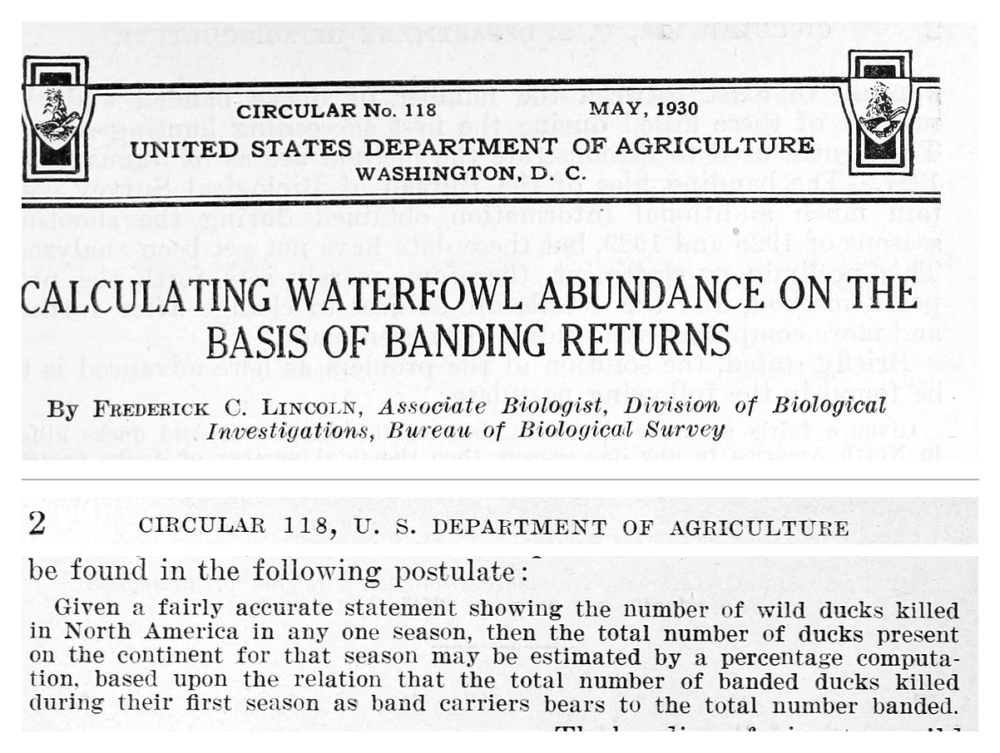
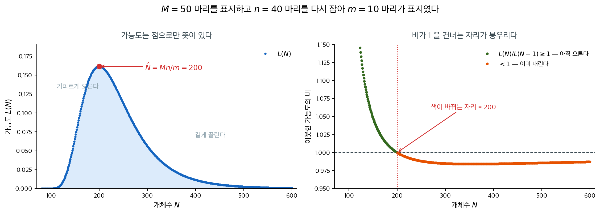
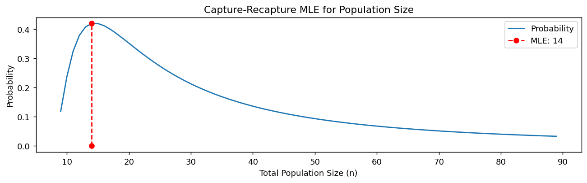
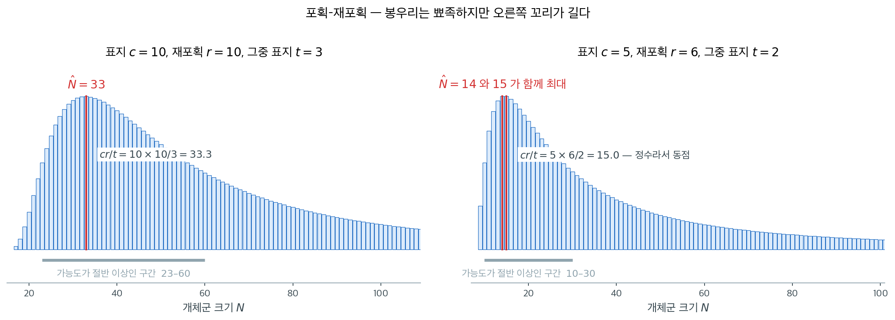
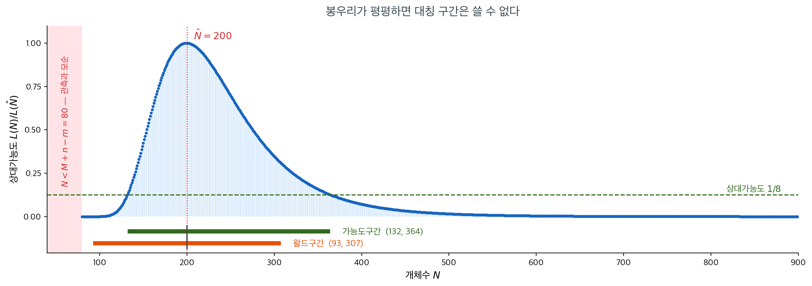
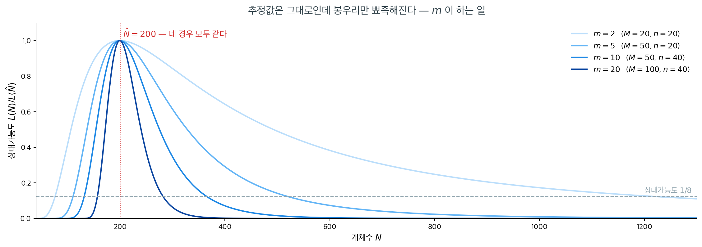

# 가능도와 최대가능도추정

## 개요

확률에서는 모수 $\theta$를 고정해 두고 "어떤 자료가 나올 법한가?"를 묻는다. 가능도함수는 이 관점을 뒤집는다. 이미 관측된 자료를 두고 "어떤 $\theta$ 값이 이 관측을 가장 그럴듯하게 만드는가?"를 묻는다. "모수가 자료를 만든다"에서 "자료가 모수에 관해 알려 준다"로의 이 전환이 가능도 기반 추론의 토대이며, 최대가능도추정, 가능도비 검정, 정보기준을 떠받친다.

---

## 1. 자료를 고정하고 모수를 움직여 본다

간단한 실험을 생각해 보자. 동전을 10번 던져 앞면 7번을 관측했다. 앞면이 나올 확률이 $p = 0.5$라면 이 결과의 확률을 계산할 수 있다. 그런데 $p = 0.6$, $p = 0.7$, 또는 다른 어떤 $p$에 대해서도 같은 결과의 확률을 계산할 수 있다. 자료를 고정한 채 이 확률들을 $p$의 함수로 그린 것이 가능도함수이다. 가장 높은 봉우리를 만드는 $p$ 값이 "가장 그럴듯한" 모수값이며, 그것을 찾는 것이 최대가능도추정의 핵심이다.


두 그림은 **같은 식** $p^k(1-p)^{n-k}$을 그린 것이다. 다른 것은 무엇을 고정하고 무엇을 변수로 두느냐뿐이다. 왼쪽에서는 $p$를 고정하고 $k$를 움직였으므로 막대의 합이 1이 된다. 오른쪽에서는 관측된 $k = 7$을 고정하고 $p$를 움직였으므로 **합이 1이어야 할 이유가 없다.** 아래에서 "가능도는 확률이 아니다"라고 말할 때의 뜻이 이것이다.

오른쪽 곡선의 높이가 재는 것은 "이 $p$라면 내가 본 자료가 얼마나 잘 나왔겠는가"이며, 봉우리의 자리가 그 물음에 가장 잘 답하는 $p$다.

---

## 2. 일반적인 정의

<div class="defn" markdown>

### 정의 1. 가능도함수 { .dfn }

관측된 자료 $\mathbf{x}$가 주어졌을 때 모수 $\theta$에 대한 **가능도함수**는, 관측된 자료에서 평가한 결합밀도(또는 결합 질량함수)를 $\theta$의 함수로 본 것이다.

$$
L(\theta; \mathbf{x}) = f(\mathbf{x}; \theta)
$$

</div>

여기서 $f(\mathbf{x}; \theta)$는 (연속 자료에서는) 확률밀도함수이거나 (이산 자료에서는) 확률질량함수이다. 쌍반점 표기는 $\theta$가 확률변수가 아니라 고정된 모수임을 강조한다. 확률적인 의미에서 $\theta$로 조건화하는 것이 아니다.

### i.i.d.인 경우

자료가 독립이고 동일한 분포를 따르는 $n$개의 관측값 $x_1, \ldots, x_n$으로 이루어져 있으면 결합밀도가 곱으로 인수분해되고 가능도는 다음 형태가 된다.

$$
L(\theta; \mathbf{x}) = \prod_{i=1}^n f(x_i; \theta)
$$

이 곱의 구조는 i.i.d. 상황에 특유한 것이다. 의존하는 자료(예: 시계열)에서는 가능도가 다른 형태를 취하지만 밑바탕의 착상은 같다.

!!! example "베르누이 가능도"

    $X_1, \ldots, X_n \overset{\text{iid}}{\sim} \text{Bernoulli}(p)$이고 $n$번의 시행에서 성공 $k$번을 관측했다고 하자. 가능도함수는

    $$
    L(p; \mathbf{x}) = \prod_{i=1}^n p^{x_i}(1-p)^{1-x_i} = p^k (1-p)^{n-k}
    $$

    $n = 10$, $k = 7$일 때 $L(0.5) = 0.5^{10} \approx 0.001$이고 $L(0.7) = 0.7^7 \cdot 0.3^3 \approx 0.0022$이다. $p = 0.7$이 $p = 0.5$보다 관측된 자료를 약 두 배 더 그럴듯하게 만든다.

---

## 3. 로그가능도

가능도를 직접 다루는 것은 불편하다. 작은 수를 많이 곱하면 수치적 언더플로가 생기기 때문이다. 로그를 취하면 곱이 합으로 바뀐다.

<div class="defn" markdown>

### 정의 2. 로그가능도 { .dfn }

가능도함수의 로그를 **로그가능도**라 하고 $\ell$ 로 적는다. 자료가 i.i.d. 이면 곱이 합으로 갈라진다.

$$
\ell(\theta; \mathbf{x}) = \log L(\theta; \mathbf{x}) = \sum_{i=1}^n \log f(x_i; \theta)
$$

</div>

로그가 순증가함수이므로 $\ell$을 최대화하는 것은 $L$을 최대화하는 것과 동등하다. 실무에서는 로그가능도가 표준적인 작업 도구이다.

<figure markdown>
  { width="900" }
  <figcaption markdown>로그가능도는 관측값의 기여를 **더한** 것이다. 왼쪽이 그 가법성이고, 오른쪽은 기여가 쌓일 때 봉우리가 좁아지는 모습이다.</figcaption>
</figure>

왼쪽에서 가는 곡선 하나가 관측값 하나의 기여 $\log f(x_i; \mu)$이고, 각 곡선의 꼭대기는 그 관측값 자신의 자리에 있다. 굵은 곡선은 그것들을 **세로로 더한** 것이며, 합의 꼭대기가 다섯 관측값의 평균에 온다. 곱이었다면 세로로 곱해야 했을 자리에서 그냥 더하면 된다는 것이 로그의 이득이다.

이 가법성은 계산 편의에 그치지 않는다. 오른쪽에서 보듯 관측값을 더할수록 봉우리가 **좁아진다.** 기여가 하나씩 쌓이면서 꼭대기 부근의 휘어짐이 그만큼 커지기 때문이며, 관측값 하나가 정보를 얼마씩 보태는지를 이 그림이 그대로 보여 준다.

!!! example "베르누이 로그가능도"

    베르누이 예를 이어가면:

    $$
    \ell(p; \mathbf{x}) = k \log p + (n - k) \log(1-p)
    $$

    $n = 10$, $k = 7$일 때 $\ell(0.5) = 10 \log(0.5) \approx -6.93$이고 $\ell(0.7) = 7\log(0.7) + 3\log(0.3) \approx -6.11$이다. $p = 0.7$에서 로그가능도가 더 높아 그 값이 더 그럴듯한 모수값임을 확인해 준다.

---

## 4. 가능도의 주요 성질

### 가능도는 확률이 아니다

가능도함수에 관해 가장 중요한 개념적 요점은 **그것이 $\theta$에 대한 확률분포가 아니라는** 것이다. 구체적으로 다음이 보장되지 않는다.

$$
\int L(\theta; \mathbf{x}) \, d\theta = 1
$$

일반적으로 이 적분은 임의의 양수로 수렴할 수도 있고 발산할 수도 있다. 가능도는 서로 다른 모수값의 상대적인 그럴듯함을 알려 줄 뿐 모수에 확률을 부여하지 않는다. 모수에 확률을 부여하려면 사전분포를 갖춘 베이즈 방법이 필요하다.

### 상대적 그럴듯함

한 점에서의 $L(\theta; \mathbf{x})$의 절댓값은 그 자체로 해석되지 않는다. 중요한 것은 두 모수값 사이의 **가능도비**이다.

$$
\frac{L(\theta_1; \mathbf{x})}{L(\theta_2; \mathbf{x})}
$$

비가 10이면 $\theta_1$이 $\theta_2$보다 자료를 10배 더 그럴듯하게 만든다는 뜻이다. 이 비는 곱해지는 상수에 불변이며, 그래서 가능도를 흔히 "상수배까지" 정의한다고 말한다.

### 로그가능도의 계산상 편의

로그가능도는 곱을 합으로 바꾸며 실용적인 장점을 셋 준다.

- **수치적 안정성**: 작은 확률을 많이 곱하면 언더플로가 생기지만 로그확률의 합에서는 그렇지 않다.
- **미분**: 합은 곱보다 미분하기 쉬워 최댓값을 찾기가 간단해진다.
- **가법성**: 독립인 관측값에서 전체 로그가능도는 개별 기여의 합이므로 자료점을 더하거나 빼기 쉽다.

---

## 5. 최대가능도추정

<figure markdown>
  { width="900" }
  <figcaption markdown>후보 분포 가운데 고르기. 왼쪽의 세 후보가 오른쪽 곡선의 세 점이고, MLE 는 그 곡선의 꼭대기다.</figcaption>
</figure>

왼쪽에서 아래쪽의 짧은 세로선들이 관측된 자료이고, 세 곡선은 모수값을 달리 잡은 세 후보 분포다. **자료는 하나인데 후보는 얼마든지 많다.** 가운데 후보는 자료가 몰려 있는 곳에 봉우리를 두었으므로 각 관측값에 큰 밀도를 준다. 양옆의 두 후보는 자료가 있는 자리에 낮은 밀도를 주므로 로그가능도가 훨씬 낮다.

오른쪽은 후보를 하나씩 세는 대신 모든 후보의 로그가능도를 한 곡선으로 그린 것이다. 왼쪽의 세 곡선이 오른쪽의 세 점에 대응하며, MLE는 이 곡선의 꼭대기다. **최대가능도추정은 이 곡선의 봉우리를 찾는 일**이고, 아래의 정식화는 그 일을 식으로 적은 것에 지나지 않는다.

<div class="defn" markdown>

### 정의 3. 최대가능도추정량 { .dfn }

**최대가능도추정량(MLE)**은 가능도함수를 최대화하는 $\theta$ 값이다.

$$\hat{\theta}_{\text{MLE}} = \arg\max_{\theta \in \Theta} L(\theta) = \arg\max_{\theta \in \Theta} \ell(\theta)$$

MLE는 "어떤 모수값이 관측된 자료를 가장 그럴듯하게 만드는가?"라는 물음에 답한다.

</div>

### 어디를 보고 찾는가

가능도를 최대로 만드는 자리를 찾는 일은 미적분의 표준 문제다. 다만 **모수공간의 안쪽에서 최대가 일어난다는 것**과 **로그가능도가 미분가능하다는 것**, 두 조건이 갖추어져야 미분이 쓸모가 있다. 그때 다음이 성립한다.

<div class="thmbox" markdown>

### 정리 1. 점수방정식 { .thm }

로그가능도 $\ell(\theta)$ 가 모수공간 $\Theta$ 의 내부에서 미분가능하고 $\hat\theta$ 가 내부점에서 $\ell$ 을 최대로 만든다고 하자. 그러면 $\hat\theta$ 는 **점수방정식**

$$
s(\hat\theta) = \frac{\partial \ell(\theta)}{\partial \theta}\Bigg|_{\theta = \hat\theta} = 0
$$

을 만족한다. 모수가 $\theta = (\theta_1, \ldots, \theta_k)^\top$ 로 여럿이면 연립방정식

$$
\frac{\partial \ell}{\partial \theta_j}\Bigg|_{\theta = \hat\theta} = 0, \qquad j = 1, \ldots, k
$$

이 된다. 역은 성립하지 않는다 — 점수방정식의 해가 최댓값이 아니라 **최솟값이나 안장점**일 수 있으므로, 해에서 헤세행렬 $\partial^2\ell/\partial\theta\,\partial\theta^\top$ 이 **음의 정부호**인지 따로 확인해야 한다.

</div>

??? proof "증명"

    $\hat\theta$ 가 $\Theta$ 의 **내부점**이므로 $\hat\theta$ 를 품는 열린 공이 $\Theta$ 안에 있다. 그 공 안에서 $\ell$ 이 미분가능하고 $\hat\theta$ 에서 최댓값을 가지므로, 페르마의 정리에 의해 그 점에서 기울기가 0 이다. 여러 모수일 때는 각 좌표방향으로 같은 논증을 적용한다. $\square$

    **두 조건이 모두 필요하다.** 미분가능성이 깨지는 예로 라플라스분포가 있다. 로그가능도가 $-\sum|x_i - \mu|$ 꼴이라 $\mu = x_i$ 에서 꺾이고, 최대점(표본중앙값)이 꺾인 자리에 놓인다. 내부성이 깨지는 예는 더 흔하다 — 베르누이에서 성공이 하나도 없으면 $\hat p = 0$ 이 되어 최대가 **경계**에서 일어나고, 거기서는 기울기가 0 이 아니다. 균등분포 $U(0,\theta)$ 의 MLE 가 표본최댓값인 것도 같은 사정이다.

**점수함수**라는 이름은 $s(\theta) = \partial\ell/\partial\theta$ 에 붙는다. 로그가능도의 기울기이며, 7.2 절 ★ 에서 이것의 분산이 **피셔 정보량**이 된다.

세 꼴이 모두 같은 것을 가리킨다는 점도 적어 둔다.

$$
\operatorname*{argmax}_{\theta} L \quad\Leftrightarrow\quad \operatorname*{argmax}_{\theta} \ell \quad\Leftrightarrow\quad \operatorname*{argmin}_{\theta} J
$$

여기서 $J = -\ell$ 이 **비용함수**다. 기계학습에서 음의 로그가능도를 손실로 삼아 최소화하는 것이 곧 최대가능도추정이다.

---

## 6. 보기 — 세지 않고 개체수를 재기

지금까지 세운 것을 한 문제에 다 쓴다. **모수가 정수**라 정리 1 이 그대로는 통하지 않는 자리이기도 하다.

### 포획하고 표지하고 다시 포획한다

1. **포획과 표지**: 개체군에서 개체들을 확률적으로 표본추출하여 포획한다. 재포획되었을 때 식별할 수 있도록 표지(꼬리표, 밴드, 무해한 염료 등)를 붙인다. 표지된 개체 수를 $M$이라 하자.

2. **방사**: 표지된 개체를 개체군에 다시 놓아 주고 충분히 섞이도록 한다.

3. **재포획**: 개체군에서 두 번째 확률표본을 얻는다. 이 표본의 일부는 이미 표지되어 있을 것이다. 두 번째 표본의 전체 개체 수를 $n$, 그중 표지된 개체 수를 $m$이라 하자.

4. **추정**: 두 번째 표본의 표지 개체 비율이 첫 단계에서 표지된 개체군 전체의 비율을 대표한다는 가정 아래 개체군 크기 $N$을 추정할 수 있다.

$$
\hat{N} = \frac{M \cdot n}{m}
$$

---

### 개체군이 닫혀 있어야 한다

1. **폐쇄 개체군**: 연구 기간 동안 개체군 크기가 일정하다(출생, 사망, 유입, 유출이 없다).
2. **동일한 포획확률**: 각 표본추출에서 모든 개체가 포획될 기회가 같다.
3. **표지가 행동에 영향을 주지 않음**: 표지 과정이 재포획 가능성에 영향을 주지 않는다.
4. **표지가 오래가고 눈에 띔**: 표지가 사라지지 않고 연구 기간 내내 식별 가능하다.

<div class="storybox" markdown>

**그림으로 보는 통계학 1.** 오리를 세지 않고 오리 수를 세는 법

<figure markdown>
  { width=720 }
  <figcaption markdown>미국 농무부 회람 제$118$ 호($1930$ 년 $5$ 월) — 프레더릭 C. 링컨 「표식 회수에 근거하여 물새의 수를 계산하기」. 첫 쪽의 머리글·제목·저자와, $2$ 쪽에 들여 써 놓은 **가정**을 잘라 위아래로 붙였다. *(Internet Archive 스캔, 미국 정부 간행물)*</figcaption>
</figure>

위의 네 가정이 왜 그렇게 적혀 있는지는 이 방법이 처음 인쇄된 쪽을 보면 알 수 있다.
사진 아래쪽에 들여 써 놓은 문단이 그것이고, 세려는 대상은 물고기도 공도 아닌 **야생
오리**였다. 오리는 주머니에 들어 있지 않고 세어 볼 수도 없다.

$2$ 쪽의 그 문단이 방법의 전부다 — 「한 철에 북아메리카에서 잡힌 들오리의 수를 어지간히
정확히 알고 있다면, 그 철에 대륙에 있던 오리의 총수는 **표식을 단 오리 가운데 첫 철에 잡힌
수가 표식을 단 전체 수에 대하여 가지는 비**에 바탕을 둔 백분율 계산으로 어림할 수 있다.」
이 쪽의 기호로 옮기면, 전체 $N$ 마리 가운데 표지를 단 것이 $M$ 마리이고 그 철에 $n$ 마리가
잡혔을 때 잡힌 것 중 표지를 단 수 $m$ 이 초기하분포를 따르므로, $E(m)=n\cdot\dfrac MN$ 에서

$$
\widehat N=\frac{Mn}{m}
$$

이 된다. 위 「방법」의 넷째 단계가 그대로 이 줄이다. 링컨이 이 셈을 믿은 근거는 자료의
한결같음이었다 — $1920$ 년부터 $1926$ 년까지 표식을 단 오리가 첫 철에 되돌아온 비율이
$13.03\%$, $13.61\%$, $15.16\%$, $10.68\%$, $14.65\%$ 로 해마다 비슷했다.

어림을 **얼마나 믿을 수 있는가**는 $m$ 이 얼마나 흔들리는가에 달려 있다. $m$ 이 분모에
들어 있기 때문이다. 초기하분포의 분산은

$$
\operatorname{Var}(m)=n\cdot\frac MN\left(1-\frac MN\right)\cdot\frac{N-n}{N-1}
$$

이고, 마지막 인수가 **유한모집단 수정**이다. 이를테면 $N=1000$, $M=100$, $n=100$ 이면
$E(m)=10$ 이고

$$
\operatorname{Var}(m)=100\cdot\frac1{10}\cdot\frac9{10}\cdot\frac{900}{999}=8.11
$$

로 복원추출로 보았을 때의 $9$ 보다 작다. 잡는 수가 전체에 견주어 커질수록 추정이 조금 더
단단해진다는 뜻이다.

다만 이 모든 것은 **표식을 단 오리가 나머지와 똑같이 섞여 똑같이 잡힌다**는 가정 위에 서
있다 — 위의 가정 $2$ 와 $3$ 이 그것이고, 링컨 자신도 이것을 「예비적인 제안」이라 적었다.
세지 않고 개수를 알아내는 또 다른 방법은
[적률법의 보기](../estimation_methods/moments_examples.md) 절 $4$ 의 독일 탱크 문제다 —
그쪽은 표지를 붙이는 대신 상대가 이미 찍어 둔 일련번호를 쓴다.

_확인한 곳 — 머리글(「CIRCULAR No. 118 · MAY, 1930 · UNITED STATES DEPARTMENT OF
AGRICULTURE」), 제목과 저자(「By Frederick C. Lincoln, Associate Biologist, Division of Biological
Investigations, Bureau of Biological Survey」), 그리고 $2$ 쪽의 가정 문단(「Given a fairly accurate
statement showing the number of wild ducks killed in North America in any one season, then the total
number of ducks present on the continent for that season may be estimated by a percentage computation,
based upon the relation that the total number of banded ducks killed during their first season as band
carriers bears to the total number banded」)은
[Internet Archive: calculatingwater118linc](https://archive.org/details/calculatingwater118linc)
의 낱장 n$2$·n$3$ 에서 **사진으로 직접 읽었다** · $1920$–$1926$ 년의 회수 비율은 같은 글
표 $1$ 의 수(표식 $238$/회수 $31$, $382$/$52$, $3774$/$572$, $4103$/$438$, $2266$/$332$)를 같은
스캔의 OCR 전문에서 읽고 **백분율은 이 쪽에서 직접 계산해 보았다** · $\operatorname{Var}(m)=8.11$
도 직접 계산한 값이다_

</div>

---

### 이 절이 끌고 갈 수

연못의 물고기 개체수를 추정한다고 하자. 이 수들을 절 $9$ 까지 그대로 들고 간다.

1. **첫 포획**: 물고기 50마리를 잡아 표지하고 놓아 준다($M = 50$).
2. **두 번째 포획**: 물고기 40마리를 잡았는데($n = 40$) 그중 10마리가 표지되어 있다($m = 10$).
3. **추정**:

$$
\hat{N} = \frac{M \cdot n}{m} = \frac{50 \cdot 40}{10} = 200
$$

연못의 추정 물고기 개체수는 200마리이다.

비례식 한 줄로 끝났다. 그런데 **이 추정값이 얼마나 단단한지는 아직 아무것도 말하지 않았다.** 200과 250 가운데 자료가 어느 쪽을 더 지지하는지, 400을 배제할 수 있는지는 비례식이 답하지 못한다. 그 답은 가능도함수의 **모양**에 들어 있고, 이 절의 나머지는 그 모양을 보는 일이다.

---

### 초기하 가능도를 최대화한다

### 초기하분포

개체군 크기가 $N$일 때 크기 $n$인 재포획 표본에서 표지 개체 $m$마리를 관측할 확률은 다음과 같다.

$$
P(m \mid N) = \frac{\binom{M}{m} \binom{N-M}{n-m}}{\binom{N}{n}}
$$

여기서 각 기호는 다음과 같다.

- $\binom{M}{m}$: $M$마리 중 표지된 $m$마리를 고르는 경우의 수.
- $\binom{N-M}{n-m}$: 남은 $N-M$마리 중 표지되지 않은 $n-m$마리를 고르는 경우의 수.
- $\binom{N}{n}$: $N$마리 중 $n$마리를 고르는 전체 경우의 수.

### 자리가 바뀐다

여기서 중요한 것은 계산이 아니라 **무엇이 변수인가**이다.

| | 확률로 읽을 때 | 가능도로 읽을 때 |
|:---|:---|:---|
| $N$ (모수) | 고정 | **변수** |
| 관측 $m$ | 변수 | **고정** |

확률을 셈할 때는 $N$을 알고 $m$이 어떻게 나올지를 묻는다. 가능도는 그 반대다. **$m = 10$을 이미 보았고 $N$을 모른다.** 같은 식을 $N$의 함수로 읽은 것이며, 이렇게 읽은 것을 가능도라 부른다.

$$
L(N) = \frac{\binom{M}{m} \binom{N-M}{n-m}}{\binom{N}{n}}
$$

가능도는 $N$에 대한 확률분포가 **아니다.** $N$에 대해 다 더해도 1이 되지 않는다. "이 $N$이 관측을 얼마나 잘 설명하는가"를 재는 값일 뿐이다.

### 가능도가 설 수 있는 자리

$\binom{N-M}{n-m}$이 뜻을 가지려면 $N - M \ge n - m$, 곧

$$
N \ge M + n - m = 50 + 40 - 10 = 80
$$

이어야 한다. 표지된 50마리와 재포획에서 새로 본 30마리를 합치면 적어도 80마리는 이미 **두 눈으로 확인한** 셈이기 때문이다. $N < 80$에서 가능도는 0이다. 이 하한은 뒤에서 신뢰구간을 따질 때 다시 나온다.

### 가능도의 최대화

$N$은 **정수 모수**라 미분할 수 없다. 대신 **이웃한 두 값끼리 견준다.** 비가 1보다 크면 아직 오르는 중이고 작으면 이미 내리는 중이다. $\binom{M}{m}$은 $N$과 무관하여 약분되므로

$$
\frac{L(N)}{L(N-1)} = \frac{(N-M)(N-n)}{N(N-M-n+m)}
$$

이고(유도는 연습문제 28), 양변을 펼치면 $N^2$과 $-N(M+n)$이 지워져

$$
\frac{L(N)}{L(N-1)} \ge 1 \iff Mn \ge Nm \iff N \le \frac{Mn}{m}
$$

만 남는다. 가능도는 $Mn/m$까지 오르다가 그 뒤로 내려간다. 따라서 MLE는 바닥값이다.

$$
\hat{N} = \left\lfloor \frac{M \cdot n}{m} \right\rfloor
$$

**비례식이 주던 $Mn/m$에 바닥함수가 붙었다.** 붙는 까닭은 $N$이 정수라는 것 하나다.

**다만 $Mn/m$ 이 정수이면 최대가 둘이다.** 위 부등식은 $N \le Mn/m$ 에서 **등호를 허용**하므로, $Mn/m$ 이 정수일 때 $N = Mn/m$ 에서 비가 정확히 $1$ 이 되어

$$
L\!\left(\frac{Mn}{m} - 1\right) = L\!\left(\frac{Mn}{m}\right)
$$

이고 가능도만으로는 두 값을 가릴 수 없다. 이 절이 들고 가는 $M = 50$, $n = 40$, $m = 10$ 이 바로 그 경우여서 $L(199) = L(200)$ 이 **한 치도 다르지 않다.** 아래에서 $\hat N = 200$ 이라 적는 것은 둘 가운데 바닥함수가 주는 쪽을 관례로 택한 것이다. $Mn/m$ 이 정수가 아니면 등호가 될 $N$ 이 없으므로 최대점이 하나뿐이다. 보기 1 이 이 동점을 작은 수로 다시 확인하고, 보기 2 가 정수가 아닌 경우와 견준다.

### 그림으로 보면

$N = 80$부터 600까지 가능도를 그려 보면 위의 논증이 눈에 보인다.

<figure markdown>
{ width="900" }
  <figcaption markdown>$M = 50$, $n = 40$, $m = 10$. 왼쪽이 가능도 자체이고 오른쪽이 이웃한 값의 비다. 두 그림의 가로축은 같다.</figcaption>
</figure>

**점으로 찍은 까닭이 있다.** $N$은 물고기 마릿수이므로 정수에서만 뜻이 있고, 점 사이를 잇는 곡선은 실재하지 않는다. 미분 대신 이웃끼리 견주는 방법을 쓴 것이 바로 이 때문이다.

왼쪽 그림에서 먼저 보이는 것은 **비대칭**이다. 왼쪽은 가파르고 오른쪽은 길게 끌린다. 봉우리에서 80만큼 떨어진 두 자리를 견주면 $N = 120$은 가능도가 최댓값의 $0.031$배로 거의 배제되는데 $N = 280$은 $0.467$배로 절반 가까이 남는다. **같은 거리인데 열다섯 배 차이다.** 자료는 "개체수가 적을 리 없다"는 말은 또렷하게 하면서 "많을 리 없다"는 말은 흐리게 한다. $m$이 분모에 있다는 사실이 그림의 모양으로 드러난 것이다.

**봉우리가 뾰족하지 않다**는 점도 함께 보라. 다음은 최댓값에 대한 비다.

| $N$ | 120 | 150 | **200** | 300 | 400 | 600 |
|---|---|---|---|---|---|---|
| $L(N)/L(200)$ | $0.031$ | $0.424$ | $\mathbf{1.000}$ | $0.347$ | $0.071$ | $0.004$ |

$N$을 150으로 줄이거나 300으로 늘려도 가능도가 최댓값의 $0.42$배, $0.35$배로 남는다. 200과 300은 물고기 백 마리 차이인데도 자료가 셋 중 하나 정도로밖에 가르지 못한다. **추정값 하나만 보고하면 이 사실이 통째로 사라진다.**

오른쪽 그림은 우리가 방금 셈한 비다. 초록 점은 1보다 커서 "다음 값이 더 그럴듯하다"는 뜻이고 주황 점은 그 반대다. **색이 바뀌는 자리가 곧 봉우리**이며, 그 자리가 정확히 $Mn/m = 200$이다. 위에서 푼 부등식이 찾아낸 것이 이 점이다.

비가 **아주 크게 출발해 빠르게 1로 내려오는 것**도 눈여겨볼 만하다. 첫 비는 $L(81)/L(80) = 15.7$ 이라 그림의 눈금 밖에 있다. 1을 건너는 자리를 보이려고 세로축을 $1.15$에서 잘랐기 때문이다. 개체수가 적을 때는 한 마리를 더 놓느냐 마느냐가 가능도를 크게 바꾸지만, $N$이 커지면 한 마리 차이가 거의 뜻이 없어진다. 봉우리를 지난 뒤 주황 점들이 1에 바짝 붙어 있는 것이 그 뜻이고, **그 붙어 있음이 왼쪽 그림의 긴 꼬리**다. $N \to \infty$에서 비가 1로 수렴하므로 꼬리는 끝내 끊기지 않는다.

### MLE의 직관

추정값 $\hat{N}$은 재포획 표본에서의 표지 개체 비율($m/n$)이 개체군 전체에서의 표지 개체 비율($M/N$)을 반영한다는 착상에 기반한다.

$$
\frac{m}{n} \approx \frac{M}{N}
\quad\Longrightarrow\quad
\hat{N} = \frac{M \cdot n}{m}
$$

**비례식과 가능도가 같은 답에 닿았다.** 비례식은 답 하나를 주고 가능도는 답과 함께 그 답의 **폭**을 준다. 7절이 그 폭을 잰다.

---

<div class="exbox" markdown>

**보기 1.** <span class="diff easy" title="쉬움"></span> 작은 표본에서의 포획–재포획. $M = 5$마리를 잡아 표지하고 놓아 준 뒤 $n = 6$마리를 다시 잡았더니 $m = 2$마리가 표지되어 있었다.

**(1)** 가능도 $L(N)$을 최대로 만드는 $N$을 구하시오. 비례식이 주는 $Mn/m$과 정확히 같은가.

**(2)** $N$을 하나씩 바꿔 가며 가능도를 재는 코드는 최대점을 **14**로 찍는다. (1)의 답과 어긋나는가.

</div>

??? success "풀이"

    **(1) 해석적으로.** $N$은 정수이므로 미분할 수 없다. 이웃한 두 값의 비를 본다. $\binom{M}{m}$은 $N$과 무관하여 약분되므로

    $$
    \frac{L(N)}{L(N-1)}
    = \frac{\binom{N-M}{n-m}}{\binom{N-1-M}{n-m}} \cdot \frac{\binom{N-1}{n}}{\binom{N}{n}}
    = \frac{(N-M)(N-n)}{N(N-M-n+m)}
    $$

    이다. 이 비가 $1$ 이상인 조건을 정리한다. 분모가 양수인 범위에서

    $$
    (N-M)(N-n) \ge N(N-M-n+m)
    $$

    인데, 양변을 펼치면 $N^2$와 $-N(M+n)$이 지워지고 $Mn \ge Nm$만 남는다. 곧

    $$
    \frac{L(N)}{L(N-1)} \ge 1 \iff N \le \frac{Mn}{m}
    $$

    이다. 가능도는 $Mn/m$까지 오르다가 그 뒤로 내려가므로

    $$
    \hat N = \left\lfloor \frac{Mn}{m} \right\rfloor
    $$

    이다. **비례식이 주는 $Mn/m$에 바닥함수가 붙는다**는 것이 요점이고, 그 까닭은 $N$이 정수라는 것 하나다(연습문제 28에서 같은 계산을 다시 밟는다).

    여기서는 $Mn/m = 5 \times 6 / 2 = 15$가 **정수**다. 그러면 $N = 15$에서 위 부등식이 등호가 되어 비가 정확히 $1$, 곧

    $$
    L(14) = L(15)
    $$

    이다. 최대가능도추정값이 **둘**이고 가능도만으로는 어느 쪽도 고를 수 없다.

    **(2) 수치적으로.** 후보 $N$마다 초기하확률을 재어 가장 큰 곳을 찾는다.

    ```python
    import matplotlib.pyplot as plt
    from fractions import Fraction
    from math import comb
    from scipy import special

    plt.rcParams["font.sans-serif"] = ["NanumGothic", "Apple SD Gothic Neo", "Malgun Gothic"]
    plt.rcParams["font.family"] = "sans-serif"
    plt.rcParams["axes.unicode_minus"] = False

    def prob(N, M, n, m):
        """
        초기하확률 P(m | N) — 표지 M 마리가 든 모집단 N 에서 n 마리를 뽑아
        그중 m 마리가 표지일 확률.
        """
        return special.comb(N - M, n - m) * special.comb(M, m) / special.comb(N, n)

    def exact_prob(N, M, n, m):
        """같은 확률을 분수로 계산한다. 반올림이 끼어들지 않는다."""
        return Fraction(comb(N - M, n - m) * comb(M, m), comb(N, n))

    def capture_recapture(M=10, n=10, m=3):
        """
        Calculate the probability distribution over possible total population sizes
        and determine the MLE (Maximum Likelihood Estimate) for the population size.

        Parameters:
        - M: Number of birds captured and tagged in the first stage
        - n: Number of birds recaptured in the second stage
        - m: Number of tagged birds in the recapture stage

        Returns:
        - prob_list: 후보 N 마다의 확률
        - mle_N: 개체수의 MLE
        """
        prob_list = []

        # 가능한 모집단 크기 N 마다 확률을 구한다.
        for N in range(M + n - m, 10 * (M + n - m)):
            prob_list.append(prob(N, M, n, m))

        # 확률이 가장 큰 N 이 모집단 크기의 MLE다.
        prob_max = max(prob_list)
        idx = prob_list.index(prob_max)
        mle_n = idx + (M + n - m)
        print(f'MLE N: {mle_n}')

        return prob_list, mle_n

    def draw(prob_list, mle_n, M=10, n=10, m=3):
        """
        Plot the probability distribution of the total population size
        and highlight the MLE.

        Parameters:
        - prob_list: 후보 N 마다의 확률
        - mle_N: 개체수의 MLE
        - M, n, m: Parameters for the capture-recapture model
        """
        idx = mle_n - (M + n - m)
        fig, ax = plt.subplots(figsize=(12, 3))
        ax.plot(range(M + n - m, 10 * (M + n - m)), prob_list, label='Probability')
        ax.plot([mle_n, mle_n], [0, prob_list[idx]], 'o--r', label=f'MLE: {mle_n}')

        # 축 이름과 범례를 다듬는다.
        ax.set_xlabel('Total Population Size (N)')
        ax.set_ylabel('Probability')
        ax.set_title('Capture-Recapture MLE for Population Size')
        ax.legend()
        plt.show()

    # 포획-재포획 모형의 값들: 표지 수, 재포획 수, 그중 표지된 수.
    M = 5   # Birds captured and tagged in the first stage
    n = 6   # Birds recaptured in the second stage
    m = 2   # Tagged birds in the recapture stage

    # 후보마다 확률을 구하고 가장 큰 것을 고른다.
    prob_list, mle_n = capture_recapture(M, n, m)

    # (1) 에서 유도한 floor(M n / m) 과 비교해 보라.
    print(f'floor(M*n/m): {M * n // m}')

    # M*n/m = 15 가 정수이므로 L(14) 와 L(15) 는 **정확히 같다.** 분수로 재면 드러난다.
    print(f'exact L(14) == L(15) ? {exact_prob(14, M, n, m) == exact_prob(15, M, n, m)}')
    print(f'float L(14) - L(15) = {prob(14, M, n, m) - prob(15, M, n, m):+.3e}')

    # n 을 7 로 바꾸면 M*n/m = 17.5 라 나누어떨어지지 않고 최대점이 하나뿐이다.
    capture_recapture(M=5, n=7, m=2)
    print(f'floor(5*7/2): {5 * 7 // 2}')

    # 봉우리가 얼마나 평평한지 재 본다.
    for N in (10, 15, 30, 60):
        print(f'L({N}) / L(15) = {prob(N, M, n, m) / prob(15, M, n, m):.3f}')

    # 확률을 후보별로 그리고 최댓값 자리를 표시한다.
    draw(prob_list, mle_n, M, n, m)
    ```

    출력:

    ```
    MLE N: 14
    floor(M*n/m): 15
    exact L(14) == L(15) ? True
    float L(14) - L(15) = +0.000e+00
    MLE N: 17
    floor(5*7/2): 17
    L(10) / L(15) = 0.567
    L(15) / L(15) = 1.000
    L(30) / L(15) = 0.508
    L(60) / L(15) = 0.162
    ```

    

    **14가 나온 까닭이 드러났다.** 분수로 재면 $L(14)$와 $L(15)$가 한 치도 다르지 않고, 부동소수점으로도 차이가 정확히 $0$이다. 비트까지 같으므로 `max()`와 `index()`는 앞쪽을 고르고, 결과는 14가 된다. **이 어긋남은 수치의 오차가 아니라 동점이며, 동점이 생긴다는 사실 자체가 (1)의 유도가 예측한 바다.** 두 값 모두 최대가능도추정값이고 가능도만으로는 가릴 수 없다.

    $n$을 7로 바꾸면 $Mn/m = 17.5$라 나누어떨어지지 않고, 격자가 찾은 17이 $\lfloor 17.5 \rfloor = 17$과 정확히 맞는다. 바닥함수가 제 몫을 하는 경우다.

    곡선이 봉우리 주위에서 **아주 평평하다**는 점도 눈여겨볼 만하다. $N$을 10으로 줄이거나 30으로 늘려도 가능도가 최댓값의 $0.57$배, $0.51$배로 남고, 60으로 네 배 늘려도 $0.16$배가 남는다. 재포획된 표지 개체가 $m = 2$마리뿐이라는 적은 정보로는 개체수를 정밀하게 맞힐 수 없다는 뜻이고, 연습문제 25가 따지는 "정밀도는 $m$이 정한다"가 바로 이 평평함이다.

<div class="exbox" markdown>

**보기 2.** <span class="diff easy" title="쉬움"></span> 봉우리의 폭을 코드로 재기. $M = 10$마리를 잡아 표지하고 놓아 준 뒤 $n = 10$마리를 다시 잡았더니 $m = 3$마리가 표지되어 있었다.

**(1)** 가능도를 전수 탐색하는 함수를 짜서 $\hat N$을 구하고, 닫힌 꼴 $\lfloor Mn/m \rfloor$와 맞는지 확인하시오.

**(2)** 봉우리가 얼마나 넓은지 재시오. 가능도가 꼭대기의 절반 이상인 $N$의 구간은 어디까지인가.

</div>

??? success "풀이"

    **(1) 해석적으로.** 닫힌 꼴이 $\hat N = \lfloor Mn/m \rfloor$이고 여기서는

    $$
    \frac{Mn}{m} = \frac{10 \times 10}{3} = 33.333\ldots
    $$

    이므로 $\hat N = 33$이다. $Mn/m$이 **정수가 아니라는 점**이 보기 1과 갈린다. 가능도비가 $1$이 되는 $N$이 없으므로 $L(32) < L(33) > L(34)$로 최대점이 하나뿐이고, 전수 탐색과 공식이 어긋날 여지가 없다.

    탐색 범위의 아래쪽 벽도 짚어 두자. 이 절에서 본 대로

    $$
    N \ge M + n - m = 17
    $$

    이다. 위쪽에는 그런 벽이 없다. $m$을 하나 줄이면 $Mn/m$이 $33.3$에서 $50$으로 뛰므로 가능도는 **오른쪽으로 길게 늘어진다.**

    **(2) 수치적으로.** 후보 $N$마다 초기하확률을 재고, 꼭대기의 절반 이상인 것을 모은다.

    ```python
    from scipy import special

    def prob(N, M, n, m):
        """
        초기하확률 P(m | N). 표지 M 마리인 모집단 N 에서 n 마리를 뽑아
        그중 m 마리가 표지일 확률이다.
        """
        return special.comb(N - M, n - m) * special.comb(M, m) / special.comb(N, n)

    def capture_recapture_mle(M, n, m):
        """전수 탐색으로 개체수 N 의 MLE 를 구한다."""
        N_min = M + n - m          # 관측과 모순이 아닌 가장 작은 N
        N_max = 10 * N_min         # 탐색 범위

        prob_list = [prob(N, M, n, m) for N in range(N_min, N_max)]
        mle_idx = max(range(len(prob_list)), key=lambda i: prob_list[i])

        return mle_idx + N_min, prob_list

    # === 보기: 10 마리에 표지, 10 마리를 다시 잡아 그중 3 마리가 표지였다 ===
    M, n, m = 10, 10, 3
    mle_N, probs = capture_recapture_mle(M, n, m)
    print(f"표지 {M}, 재포획 {n}, 그중 표지 {m}")
    print(f"전수 탐색이 찾은 MLE: {mle_N}")
    print(f"닫힌 꼴 floor(Mn/m):  {M * n // m}")

    # === 봉우리의 폭 — 가능도가 꼭대기의 절반 이상인 N 을 모은다 ===
    N_min = M + n - m
    peak = max(probs)
    half = [N_min + i for i, p in enumerate(probs) if p >= peak / 2]
    print(f"Mn/m = {M * n / m:.3f}  (정수가 아니므로 최대점은 하나)")
    print(f"가능도가 꼭대기의 절반 이상인 구간: N = {half[0]} ~ {half[-1]}")
    ```

    출력:

    ```
    표지 10, 재포획 10, 그중 표지 3
    전수 탐색이 찾은 MLE: 33
    닫힌 꼴 floor(Mn/m):  33
    Mn/m = 33.333  (정수가 아니므로 최대점은 하나)
    가능도가 꼭대기의 절반 이상인 구간: N = 23 ~ 60
    ```

    탐색한 가능도를 그대로 그리면 이렇다. 왼쪽이 이 보기의 수치이고 오른쪽이 보기 1의 수치다.

    

    전수 탐색이 준 $33$이 해석적 답 $\lfloor 33.333 \rfloor = 33$과 맞는다. **봉우리의 자리보다 그 폭이 더 할 말이 많다.** 가능도가 꼭대기의 절반 이상인 구간이 $23$부터 $60$까지로, 폭이 점추정값보다도 넓다. 표지된 10마리 중 3마리를 다시 잡았다는 관측만으로는 개체군이 25마리든 55마리든 크게 이상하지 않다는 뜻이다.

    구간이 $33$을 가운데 두지 않고 위쪽으로 치우쳐 있다는 것도 절 $7$ 이 보이는 그대로다. 아래로는 $10$칸, 위로는 $27$칸이다. 절 $7$ 이 $1/8$ 로 그을 선을 여기서는 $1/2$ 로 그었을 뿐, 읽는 법은 같다.

---

## 7. 봉우리가 평평하다는 것의 뜻

가능도를 최댓값으로 나눈 것을 **상대가능도**라 한다.

$$
R(N) = \frac{L(N)}{L(\hat N)}
$$

봉우리에서 1이고 멀어질수록 작아지므로, "자료가 이 $N$을 최선의 값에 견주어 얼마나 지지하는가"를 바로 읽을 수 있다. 흔히 쓰는 기준 하나가 $R(N) \ge 1/8$이며, 이를 만족하는 $N$들을 모은 것이 **가능도구간**이다.

<figure markdown>
{ width="900" }
  <figcaption markdown>같은 자료의 상대가능도. 가능도구간은 추정값 200을 **가운데 두지 않는다.**</figcaption>
</figure>

읽을 것이 셋이다.

**첫째, 구간이 넓다.** $R(N) \ge 1/8$인 범위가 $(132,\ 364)$다. 물고기 40마리를 다시 잡아 10마리가 표지였다는 자료로 말할 수 있는 것은 "대략 130마리에서 360마리 사이"까지이고, 200은 그 안에서 가장 그럴듯한 한 점일 뿐이다.

**둘째, 구간이 추정값을 가운데 두지 않는다.** 왼쪽으로는 68만큼 뻗는데 오른쪽으로는 164만큼 뻗는다. 두 배가 넘는 차이다. $\hat N = Mn/m$이 $m$의 **역수**이기 때문이다. $m$이 10에서 9로 하나만 줄어도 추정값은 $\lfloor 222.2 \rfloor = 222$로 뛰지만, 11로 하나 늘면 $\lfloor 181.8 \rfloor = 181$로 내려올 뿐이다. 같은 한 마리가 위로는 22를, 아래로는 19를 움직인다.

**셋째, 그래서 대칭 구간은 이 모양을 담지 못한다.** 연습문제 27의 분산 공식으로 왈드구간을 만들면

$$
\operatorname{Var}(\hat N) \approx \frac{M^2 n(n-m)}{m^3} = \frac{2500 \times 40 \times 30}{1000} = 3000,
\qquad \operatorname{SE}(\hat N) = 54.8
$$

이므로 $200 \pm 1.96(54.8) = (93,\ 307)$이다. 그림 아래쪽 주황 막대가 그것이다. 가능도구간과 견주면 **위쪽은 57만큼 짧고 아래쪽은 39만큼 길다.** 자료가 배제하지 못하는 큰 $N$을 배제해 버리고, 자료가 이미 꺼리는 작은 $N$을 끌어안는다. 대칭이라는 모양 하나 때문에 양쪽에서 동시에 틀린다.

왼쪽 붉은 띠는 $N < M + n - m = 80$, 곧 **관측과 모순이라 가능도가 0인 영역**이다. 이 보기에서는 왈드 하한 93이 다행히 그 위에 있지만 늘 그런 것은 아니다. $M = 20$, $n = 15$, $m = 5$에서는 왈드 하한이 $17.1$로 내려가 논리적 하한 30을 **뚫고 나간다**(연습문제 22). 대칭 구간은 "불가능"이라는 벽을 모른다.

---

## 8. 정밀도를 정하는 것은 m 이다

그렇다면 봉우리를 뾰족하게 만들려면 무엇을 늘려야 하는가. 표지를 더 붙일까, 더 많이 다시 잡을까.

$\hat N = Mn/m = 200$을 **정확히 고정**한 채 $m$만 올려 보면 답이 나온다.

<figure markdown>
{ width="900" }
  <figcaption markdown>네 경우 모두 $Mn/m = 200$이다. 추정값은 하나도 움직이지 않고 **폭만 줄어든다.** 곡선 넷을 견주기 위해 선으로 이었을 뿐, 뜻이 있는 것은 여전히 정수 위의 점이다.</figcaption>
</figure>

| $m$ | $M$ | $n$ | $\hat N$ | 가능도구간 | 폭 |
|---|---|---|---|---|---|
| $2$ | $20$ | $20$ | $200$ | $(77,\ 1210)$ | $1133$ |
| $5$ | $50$ | $20$ | $200$ | $(111,\ 517)$ | $406$ |
| $10$ | $50$ | $40$ | $200$ | $(132,\ 364)$ | $232$ |
| $20$ | $100$ | $40$ | $200$ | $(157,\ 281)$ | $124$ |

**$m$을 두 배로 하면 폭이 대략 절반이 된다.** 그리고 네 줄의 추정값은 모두 200으로 똑같다. 자료를 더 모은 보람은 추정값을 **옮기는** 데 있지 않고 봉우리를 **좁히는** 데 있다.

맨 윗줄을 보라. 표지 개체를 두 마리밖에 되잡지 못하면 가능도구간이 $(77,\ 1210)$이다. 연못에 물고기가 80마리일 수도 1200마리일 수도 있다는 뜻이고, 그래도 추정값은 당당히 200이라고 적힌다. **$\hat N$만 보고해서는 이 둘을 구별할 수 없다.**

여기서 $M$과 $n$은 각각이 아니라 **곱으로만** 들어온다는 점이 중요하다. $E[m] = Mn/N$이므로 $m$을 키우려면 $M$을 늘리든 $n$을 늘리든 상관없고, 총 포획 $M + n$을 아끼려면 둘을 같게 두는 것이 최적이다. 표에서 $m$이 5에서 10으로 갈 때 $n$만 두 배가 되었고, 10에서 20으로 갈 때는 $M$만 두 배가 되었는데 효과가 같았던 것이 그 때문이다. 설계 단계에서 이것을 수로 푸는 것이 연습문제 25다.

---

## 9. 포획–재포획 추정량의 성질

### 편향

앞 두 절에서 본 **오른쪽으로 끌리는 꼬리**가 그대로 편향이 된다. $\hat N = Mn/m$은 $m$의 볼록함수이므로 옌센 부등식에 의해

$$
E\!\left[\frac{Mn}{m}\right] \ge \frac{Mn}{E[m]} = N
$$

이고, 곧 링컨–피터슨 추정량은 평균적으로 **개체수를 부풀린다.** $m$이 작을수록 심해지는데, 절 $8$ 의 그림이 보인 대로 $m$이 작으면 오른쪽 꼬리가 길어지기 때문이다. **Chapman 추정량**이 분자와 분모에 1씩을 더해 이를 상쇄한다.

$$
\hat{N}_{\text{Chapman}} = \frac{(M+1)(n+1)}{m+1} - 1
$$

$m = 0$에서도 유한한 값을 준다는 것이 덤이 아니라 핵심이다(연습문제 21·26).

### 분산

MLE의 분산은 다음과 같이 근사할 수 있다.

$$
\text{Var}(\hat{N}) \approx \frac{M^2 \cdot n \cdot (n-m)}{m^3}
$$

$m^3$이 분모에 있다는 것이 절 $8$ 의 표를 식으로 적은 것이다. 다만 이 공식이 주는 것은 **폭 하나뿐**이고 방향은 주지 못한다. 가능도의 비대칭을 담으려면 절 $7$ 의 가능도구간으로 가야 한다(연습문제 22).

---

### 확장과 변형

- **다중 재포획**: 여러 차례에 걸쳐 포획하고 표지하여 추정값을 정교하게 만든다.
- **개방 개체군**: Jolly-Seber 모형 같은 확장은 개체가 들어오고 나갈 수 있는 개체군을 다룰 수 있다.
- **포획확률이 다른 경우**: Lincoln-Petersen 추정량이나 로지스틱 회귀 같은 모형으로 포획확률의 변동을 보정할 수 있다.


---

## 10. MLE의 성질
| 성질 | 설명 |
|----------|-------------|
| **일치성** | $n \to \infty$일 때 $\hat{\theta}_{MLE} \xrightarrow{P} \theta_0$ |
| **점근정규성** | $\sqrt{n}(\hat{\theta}_{MLE} - \theta_0) \xrightarrow{d} N(0, I(\theta_0)^{-1})$ |
| **점근 효율성** | 점근적으로 Cramér–Rao 하한을 달성한다 |
| **불변성** | $\hat{\theta}$가 $\theta$의 MLE이면 $g(\hat{\theta})$는 $g(\theta)$의 MLE이다 |

<div class="storybox" markdown>

**그림으로 보는 통계학 2.** 왜 확률이 아니라 가능도인가

표 맨 아랫줄의 **불변성**이 이 쪽에서 가장 조용히 지나가는 줄이다. 그런데 그 한 줄이 이 분야의 용어를 하나 만들어 냈다.

당연한 물음이 있다. **왜 굳이 「가능도」라는 다른 말을 쓰는가?** 자료를 보고 나서 모수에 대해 말하는 것이니 그냥 「$\theta$ 의 확률」이라 부르면 안 되는가.

**피셔도 처음에는 그 구분이 흐릿했다.** $1912$ 년, 케임브리지 $3$ 학년이던 그가 이 방법을 처음 적은 논문에서 그는 이 양을 모수에 대해 **적분하기까지** 했다. 뒤에 그는 그것이 잘못이었음을 깨닫고, $1920$ 년대 초에 **가능도**라는 말을 따로 만들어 이것이 확률이 아니며 확률의 법칙을 따르지 않는다고 못 박았다.

왜 아닌지는 눈금을 바꾸어 보면 드러난다.

<figure markdown>
{ width="900" }
  <figcaption markdown>베르누이 시행 $10$ 번에 성공 $3$ 번이다. 두 곡선 모두 봉우리를 $1$ 로 맞추었으므로 높이가 아니라 **봉우리의 자리**만 보면 된다.</figcaption>
</figure>

**왼쪽 — 불변성이 하는 일.**

| | |
|---|---|
| $p$ 의 MLE | $0.300$ |
| 오즈로 옮긴 값 $g(\hat p) = \hat p/(1-\hat p)$ | $0.4286$ |
| 오즈 눈금에서 가능도를 **직접 최대화**한 값 | $\mathbf{0.4286}$ |

둘이 같다. 가능도의 봉우리는 **수가 아니라 자리**이고, 눈금을 바꾸면 그 자리를 읽는 수만 바뀐다. 위쪽 보조 눈금이 그것을 그대로 보여 준다 — 같은 꼭대기를 $p$ 로 읽으면 $0.300$, 오즈로 읽으면 $0.43$ 이다.

**오른쪽 — 확률이라고 부르는 순간.**

가능도를 $\theta$ 의 밀도로 다루기로 하자. 밀도는 눈금을 바꿀 때 **야코비안이 곱해진다.** 그러면 봉우리가 움직인다.

| | |
|---|---|
| $p$ 의 밀도로 본 최빈값 | $0.300$ |
| 오즈의 밀도로 본 최빈값을 $p$ 로 되돌린 값 | $\mathbf{0.250}$ |

**같은 자료인데 「가장 그럴듯한 $p$」가 $0.300$ 과 $0.250$ 으로 갈린다.** 무엇을 「자연스러운 눈금」으로 부르느냐에 답이 달려 버리는 것이다.

게다가 가능도는 애초에 $\theta$ 에 대해 적분하면 $1$ 이 아니다. 이 자료에서 $\int_0^1 L(p)\,dp = 0.00076$ 이다. **합이 $1$ 이 아닌 것을 확률이라 부를 수는 없다.**

그래서 가능도에는 두 가지가 **없다** — 눈금에 따라 달라지는 야코비안도, 전체를 $1$ 로 맞추는 규약도. 그 둘이 없기 때문에 봉우리가 자리에 붙어 있을 수 있다. 표의 불변성은 그 대가로 얻은 성질이다.

가능도를 정말로 확률처럼 쓰려면 야코비안을 감당해야 하고, 그러려면 **사전분포**가 필요하다. 그 길이 [베이즈 추정](../bayesian/prior_posterior.md)이고, 눈금에 끌려다니지 않는 사전분포를 고르는 문제가 [제프리스 사전분포](../../ch07/theory/fisher_information.md)다.

_확인한 곳 — 피셔가 케임브리지 곤빌앤드키즈 칼리지의 마지막 학년에 「An absolute criterion for fitting frequency curves」($1912$)를 썼고 그것이 그의 첫 수학 논문이었다는 것, 그 글의 「절대 기준」이 역확률에서 나온 것이어서 **가능도를 적분할 수 있는 양처럼 다루었고**, $1921$–$22$ 년에 그 부분을 다시 써서 가능도는 미분요소가 아니므로 적분할 수 없다고 갈라 적었다는 것. 그림과 표의 수는 모두 직접 계산한 값이다_

</div>

---

## 11. 가능도 기반 추론
### 가능도비

두 모수값 $\theta_0$과 $\theta_1$을 비교하는 **가능도비**는 다음과 같다.

$$\Lambda = \frac{L(\theta_0)}{L(\theta_1)}$$

$\Lambda$가 작으면 자료가 $\theta_0$보다 $\theta_1$을 지지한다는 뜻이다.

### 가능도비 검정

$H_0: \theta = \theta_0$ 대 $H_1: \theta \neq \theta_0$을 검정할 때 **가능도비 검정통계량**은 다음과 같다.

$$\Lambda = \frac{L(\theta_0)}{L(\hat{\theta}_{\text{MLE}})}$$

$H_0$과 정칙 조건 아래에서 이렇게 된다.

$$-2\log\Lambda = 2[\ell(\hat{\theta}_{\text{MLE}}) - \ell(\theta_0)] \xrightarrow{d} \chi^2_k$$

여기서 $k$는 제약된 모수의 개수이다. 응용통계학의 많은 가설검정이 이를 토대로 한다.

### 가능도로부터의 신뢰구간

**Wald 신뢰구간:** 점근정규성을 사용하면 이렇게 된다.

$$\hat{\theta} \pm z_{1-\alpha/2} \cdot \text{SE}(\hat{\theta})$$

여기서 $\text{SE}(\hat{\theta}) = 1/\sqrt{nI(\hat{\theta})}$ 또는 $1/\sqrt{J(\hat{\theta})}$이다.

**프로파일 가능도 구간:** 다음을 만족하는 $\theta$ 값의 집합이다.

$$2[\ell(\hat{\theta}) - \ell(\theta)] \leq \chi^2_{1, 1-\alpha}$$

소표본이거나 가능도가 치우쳐 있을 때 이 구간이 대체로 Wald 구간보다 정확하다.

---

## 12. 계산 방법
### Newton-Raphson 방법

점수방정식을 해석적으로 풀 수 없으면 MLE를 수치적으로 찾는다. Newton-Raphson은 다음을 반복한다.

$$\theta^{(t+1)} = \theta^{(t)} - \left[\frac{\partial^2 \ell}{\partial \theta^2}\bigg|_{\theta^{(t)}}\right]^{-1} \frac{\partial \ell}{\partial \theta}\bigg|_{\theta^{(t)}}$$

이는 로그가능도에 이차근사를 반복적으로 맞추는 것과 동등하다.

### Fisher 점수법

관측 Hessian을 기대 Fisher 정보량으로 바꾼 변형이다.

$$\theta^{(t+1)} = \theta^{(t)} + I(\theta^{(t)})^{-1} \cdot s(\theta^{(t)})$$

관측 Hessian의 조건수가 나쁠 때 Fisher 점수법이 더 안정적이다.

### EM 알고리즘

잠재변수를 갖는 모형(예: 혼합모형, 은닉 마르코프 모형)에서는 **기댓값–최대화(EM) 알고리즘**이 다음을 번갈아 수행한다.

- **E 단계**: 현재 모수와 관측 자료가 주어졌을 때 기대 로그가능도를 계산한다
- **M 단계**: 이 기대 로그가능도를 최대화하여 모수를 갱신한다

EM 알고리즘은 매 단계마다 가능도가 단조 증가함을 보장하며, 국면전환 모형 같은 금융 응용에서 널리 쓰인다.

---

## 13. 금융과의 연결
가능도함수와 MLE는 계량금융 전반에 스며 있다.

- **GARCH 모형**: 보통 정규 또는 스튜던트-$t$ 혁신항을 가정하고 수익률의 조건부 로그가능도를 최대화하여 모수 $(\omega, \alpha, \beta)$를 추정한다.
- **옵션 가격결정**: Black-Scholes 내재변동성은 모형이 가정한 동학 아래에서 관측된 옵션 가격이 주어졌을 때 변동성의 MLE이다.
- **국면전환 모형**: Hamilton의 국면전환 모형은 전이확률과 국면별 모수에 대해 가능도를 최대화하는 데 EM 알고리즘을 사용한다.
- **위험 모형화**: Value-at-Risk와 기대손실 추정을 위해 손실 자료에 꼬리가 두꺼운 분포(스튜던트-$t$, 일반화 Pareto)를 MLE로 적합한다.
- **기간구조 모형**: Vasicek, CIR, 아핀 기간구조 모형의 모수는 관측된 수익률곡선의 가능도를 최대화하여 보정한다.
- **코퓰러 모형**: 코퓰러 기반 포트폴리오 위험 모형의 의존성 모수는 유사최대가능도로 추정한다.

---

## 14. MLE의 한계
MLE는 강력하지만 중요한 한계가 있다.

- **소표본 편향**: 소표본에서 MLE가 상당히 편향될 수 있다(예: 분산추정량이 $n-1$ 대신 $n$으로 나눈다)
- **경계 문제**: 참 모수가 모수공간의 경계에 있으면 표준 점근이론이 무너진다
- **모형 설정 오류**: MLE는 모형이 옳을 때 최적이다. 설정이 잘못되면 참 분포에서 모형족까지의 KL 발산을 최소화하는 모수값으로 수렴한다(준최대가능도 또는 유사최대가능도)
- **여러 봉우리를 갖는 가능도**: 특히 혼합모형에서 수치 최적화가 전역이 아닌 국소 최댓값을 찾을 수 있다
- **이상점에 대한 민감도**: 어떤 모형에서는 이상점 하나가 MLE를 크게 움직일 수 있다

---

## 연습문제

<div class="drillbox" markdown>

**연습문제 1.** <span class="diff easy" title="쉬움"></span>
$\text{Poisson}(\lambda)$ 분포에서 얻은 크기 $n = 3$인 표본에서 관측값이 $x_1 = 2, x_2 = 5, x_3 = 3$이다. $\lambda = 3$과 $\lambda = 4$에서 가능도와 로그가능도를 계산하라. 어느 값이 더 그럴듯한가?

</div>

??? success "풀이"
    포아송 가능도는 $L(\lambda) = \prod_{i=1}^n \frac{\lambda^{x_i} e^{-\lambda}}{x_i!}$이다.

    $\lambda = 3$일 때: $L(3) = \frac{3^2 e^{-3}}{2!} \cdot \frac{3^5 e^{-3}}{5!} \cdot \frac{3^3 e^{-3}}{3!} = \frac{3^{10} e^{-9}}{2! \cdot 5! \cdot 3!}$

    $$
    = \frac{59049 \times 0.0001234}{2 \times 120 \times 6} = \frac{7.2876}{1440} \approx 0.005061
    $$

    $\lambda = 4$일 때: $L(4) = \frac{4^{10} e^{-12}}{1440} = \frac{1048576 \times 6.144 \times 10^{-6}}{1440} \approx 0.004473$

    로그가능도는 $\ell(3) = 10\ln 3 - 9 - \ln 1440 \approx -5.287$이고 $\ell(4) = 10\ln 4 - 12 - \ln 1440 \approx -5.411$이다.

    $\ell(3) > \ell(4)$이므로 $\lambda = 3$이 더 그럴듯하다. 참고로 MLE는 $\hat{\lambda} = \bar{x} = 10/3 \approx 3.33$이다.

---

<div class="drillbox" markdown>

**연습문제 2.** <span class="diff med" title="중간"></span>
$\mu$와 $\sigma^2$이 모두 미지일 때 $N(\mu, \sigma^2)$ 분포에서 얻은 독립인 관측값 $x_1, \dots, x_n$에 대한 가능도함수와 로그가능도함수를 쓰라.

</div>

??? success "풀이"
    가능도는:

    $$
    L(\mu, \sigma^2) = \prod_{i=1}^n \frac{1}{\sqrt{2\pi\sigma^2}} \exp\!\left(-\frac{(x_i - \mu)^2}{2\sigma^2}\right) = (2\pi\sigma^2)^{-n/2} \exp\!\left(-\frac{1}{2\sigma^2}\sum_{i=1}^n(x_i - \mu)^2\right)
    $$

    로그가능도는:

    $$
    \ell(\mu, \sigma^2) = -\frac{n}{2}\log(2\pi) - \frac{n}{2}\log(\sigma^2) - \frac{1}{2\sigma^2}\sum_{i=1}^n(x_i - \mu)^2
    $$

---

<div class="drillbox" markdown>

**연습문제 3.** <span class="diff med" title="중간"></span>
가능도함수 $L(\theta; \mathbf{x})$와 확률함수 $P(\mathbf{x}; \theta)$의 차이를 설명하라. 가능도가 $\theta$에 대한 확률분포가 아닌 이유는 무엇인가?

</div>

??? success "풀이"
    **확률함수** $P(\mathbf{x}; \theta)$는 $\theta$를 고정하고 $\mathbf{x}$를 변수로 다룬다. $\theta$가 고정되면 가능한 모든 자료 결과에 대해 합(또는 적분)이 1이 된다.

    **가능도함수** $L(\theta; \mathbf{x})$는 $\mathbf{x}$를 (관측된 자료로) 고정하고 $\theta$를 변수로 다룬다. 확률함수와 같은 식을 쓰되 역할을 뒤바꾼 것이다.

    가능도가 $\theta$에 대한 확률분포가 아닌 이유는 모수공간에서 적분해도 1이 되지 않기 때문이다. 실제로 $\int L(\theta; \mathbf{x})\,d\theta$는 임의의 양수일 수도(심지어 무한일 수도) 있다. $\theta$에 대한 제대로 된 분포를 얻으려면 사전분포를 곱하고 정규화해야 하며(베이즈 접근), 그 결과가 사후분포이다.

---

<div class="drillbox" markdown>

**연습문제 4.** <span class="diff med" title="중간"></span>
로그가능도를 최대화하는 것이 가능도를 최대화하는 것과 동등한 이유를 설명하라. 로그가능도로 작업할 때의 실용적 장점을 하나 서술하라.

</div>

??? success "풀이"
    로그가 순증가함수이므로 $L(\theta_1) > L(\theta_2)$일 필요충분조건은 $\ell(\theta_1) > \ell(\theta_2)$이다. 따라서 $L$을 최대화하는 $\theta$가 $\ell$도 최대화하며 그 역도 성립한다.

    **실용적 장점:** 로그가능도는 곱을 합으로 바꾼다:

    $$
    \ell(\theta) = \sum_{i=1}^n \log f(x_i; \theta)
    $$

    (곱의 미분법 대신 합의 미분법을 쓰므로) 미분하기 쉽고 수치적 언더플로를 피할 수 있다. $n$이 크면 가능도 $L(\theta) = \prod f(x_i; \theta)$가 (1보다 작은 수 $n$개의 곱이므로) 천문학적으로 작아져 부동소수점 언더플로를 일으킨다. 합인 로그가능도는 수치적으로 다룰 수 있는 범위에 머문다.

---

<div class="drillbox" markdown>

**연습문제 5.** <span class="diff med" title="중간"></span>
**가능도 원리**를 서술하라. 동전을 20번 던져 앞면 6번을 얻은 경우와, 앞면이 6번 나올 때까지 던져 20번 만에 끝난 경우를 견주어 이 원리가 무엇을 주장하는지 보여라.

</div>

??? success "풀이"
    **가능도 원리.** 두 실험에서 얻은 가능도함수가 $\theta$의 함수로서 **비례**하면, 두 실험은 $\theta$에 대해 같은 증거를 담고 있다.

    **두 설계.**

    *이항 설계*($n=20$ 고정, $k$ 관측):

    $$
    L_1(p) = \binom{20}{6}p^6(1-p)^{14} \propto p^6(1-p)^{14}
    $$

    *음이항 설계*($k=6$ 고정, $n$ 관측):

    $$
    L_2(p) = \binom{19}{5}p^6(1-p)^{14} \propto p^6(1-p)^{14}
    $$

    **두 가능도가 비례한다.** 상수만 다르므로 가능도 원리에 따르면 두 실험은 같은 증거를 준다.

    **그런데 빈도주의 추론은 다르다.** $H_0: p=0.5$의 단측 $p$-값을 계산하면

    - 이항: $P(X \le 6 \mid n=20) = 0.0577$
    - 음이항: $P(N \ge 20 \mid k=6) = 0.0318$

    으로 하나는 5%에서 유의하지 않고 다른 하나는 유의하다. **$p$-값이 "관측되지 않은 자료"의 확률까지 더하는데, 그 집합이 정지규칙에 따라 달라지기 때문이다.**

    **의미.** 베이즈 추론과 순수 가능도 추론은 가능도 원리를 만족한다. 사후분포가 사전분포 곱하기 가능도에 비례하므로 상수는 무관하기 때문이다. 반면 $p$-값, 신뢰구간, 불편성 같은 빈도주의 개념은 만족하지 않는다.

    이 긴장이 통계학 기초 논쟁의 중심이었다. 버나드는 조건성 원리와 충분성 원리에서 가능도 원리가 따라 나옴을 보였는데, 두 전제는 대부분의 통계학자가 받아들이는 것이라 논의가 더 뜨거워졌다. 실용적 귀결은 **옵셔널 스토핑 문제**다. 가능도 원리를 받아들이면 중간에 들여다보는 것이 추론을 망치지 않지만, 빈도주의 틀에서는 오류율이 붕괴한다.

---

<div class="drillbox" markdown>

**연습문제 6.** <span class="diff med" title="중간"></span>
가능도비 $L(\theta_1)/L(\theta_2)$를 증거의 강도로 읽는 관행이 있다. 흔히 쓰는 문턱값 $1/8$과 $1/32$의 근거를 설명하고, 이 방식과 $p$-값의 차이를 밝혀라.

</div>

??? success "풀이"
    **가능도 구간.** 최대 가능도에 대한 상대 가능도

    $$
    R(\theta) = \frac{L(\theta)}{L(\hat\theta)}
    $$

    를 두고 $R(\theta) \ge 1/k$인 $\theta$를 모은 것을 **$1/k$ 가능도 구간**이라 한다.

    **문턱값의 근거.** 우도비와 카이제곱의 관계에서

    $$
    -2\ln R(\theta) \approx \chi^2_1
    $$

    이므로

    | $1/k$ | $-2\ln R$ | 대응 신뢰수준 |
    |---|---|---|
    | $1/8$ | 4.16 | 약 96% |
    | $1/32$ | 6.93 | 약 99.2% |
    | $1/6.8$ | 3.84 | 정확히 95% |

    즉 $1/8$이 대략 95% 신뢰구간, $1/32$가 대략 99% 신뢰구간에 해당한다. 로열(Royall)이 "약한 증거"와 "강한 증거"의 기준으로 제안한 값이다.

    **$p$-값과의 차이.**

    - **가능도비는 두 가설을 직접 견준다.** "$\theta_1$이 $\theta_2$보다 자료를 8배 잘 설명한다"는 대칭적인 진술이다. $p$-값은 귀무가설 하나만 놓고 "이보다 극단적인 자료가 나올 확률"을 잰다.
    - **가능도비는 관측된 자료만 쓴다.** $p$-값은 관측되지 않은 더 극단적인 자료의 확률을 포함하므로 연습문제 5의 설계 의존성이 생긴다.
    - **가능도비는 표본크기에 따라 해석이 바뀌지 않는다.** $p$-값은 $n$이 크면 사소한 차이에도 작아진다.

    **한계.** 가능도비는 **사전 정보를 반영하지 않는다.** 극도로 있을 법하지 않은 가설이 자료를 8배 잘 설명해도 여전히 믿기 어려울 수 있다. 또 성가신 모수가 있으면 가능도비를 어떻게 정의할지가 간단하지 않고(프로파일링이 필요하다), 오류율에 대한 보장이 없다.

---

<div class="drillbox" markdown>

**연습문제 7.** <span class="diff med" title="중간"></span>
관측이 완전하지 않은 세 경우 — **우측 중도절단**, **구간 중도절단**, **좌측 절단** — 에 대해 가능도의 기여 항을 각각 적어라.

</div>

??? success "풀이"
    밀도를 $f$, 생존함수를 $S = 1-F$라 하자.

    **(1) 정확한 관측.** 사건이 시각 $t$에 일어났음을 안다.

    $$
    L_i = f(t_i;\boldsymbol\theta)
    $$

    **(2) 우측 중도절단.** 시각 $c_i$까지 사건이 없었고 그 뒤는 모른다.

    $$
    L_i = S(c_i;\boldsymbol\theta)
    $$

    "적어도 $c_i$는 넘었다"는 정보를 그대로 쓴다.

    **(3) 구간 중도절단.** 사건이 $(a_i, b_i]$ 사이 어딘가에서 일어났다(예: 정기 검진 사이에 발병).

    $$
    L_i = F_{b_i;\boldsymbol\theta} - F_{a_i;\boldsymbol\theta} = S(a_i)-S(b_i)
    $$

    **(4) 좌측 절단.** 개체가 시각 $u_i$ 이후에야 관측 대상이 되었다. $T > u_i$인 개체만 표본에 들어오므로 **조건부 분포**를 써야 한다.

    $$
    L_i = \frac{f(t_i;\boldsymbol\theta)}{S(u_i;\boldsymbol\theta)}
    $$

    **절단과 중도절단의 차이가 핵심이다.**

    - **중도절단**은 개체가 표본에 있지만 값을 정확히 모르는 경우다. 분모 보정이 없다.
    - **절단**은 어떤 값을 가진 개체가 애초에 **표본에 들어오지 못한** 경우다. 관측 가능한 영역의 확률로 나누어 정규화해야 한다.

    이를 혼동하면 편향이 생긴다. 좌측 절단을 무시하면(지연 진입을 무시하면) 생존시간을 체계적으로 과대추정한다. 짧게 산 개체가 관측되기도 전에 사라졌기 때문이다.

    **전체 가능도.** $L = \prod_i L_i$이며, 중도절단 지시자를 써서 한 식으로 묶으면

    $$
    L = \prod_i f(t_i)^{\delta_i}S(t_i)^{1-\delta_i}
    $$

    가 된다. 생존분석의 출발점이다.

---

<div class="drillbox" markdown>

**연습문제 8.** <span class="diff med" title="중간"></span>
관심 모수가 $\psi$이고 성가신 모수가 $\boldsymbol\lambda$일 때 $\boldsymbol\lambda$를 없애는 세 방법 — **프로파일**, **조건부**, **주변** 가능도 — 을 설명하고 각각의 예를 들어라.

</div>

??? success "풀이"
    **(1) 프로파일 가능도.** 각 $\psi$마다 $\boldsymbol\lambda$를 최적화해 대입한다.

    $$
    L_p(\psi) = \max_{\boldsymbol\lambda} L(\psi,\boldsymbol\lambda) = L(\psi, \hat{\boldsymbol\lambda}_\psi)
    $$

    - **장점**: 언제나 쓸 수 있고 계산이 직관적이다.
    - **단점**: 진짜 가능도가 아니라서 $\boldsymbol\lambda$ 추정의 불확실성을 반영하지 못한다. $\boldsymbol\lambda$의 차원이 $n$과 함께 커지면 일치성까지 잃는다(네이만–스콧 문제).
    - **예**: 정규분포에서 $\sigma^2$을 프로파일링해 $\mu$의 구간을 얻는 것(앞 절 연습문제).

    **(2) 조건부 가능도.** $\boldsymbol\lambda$에 대한 충분통계량 $T$로 조건을 걸면 그 조건부 분포가 $\boldsymbol\lambda$에 의존하지 않는 경우가 있다.

    $$
    L_c(\psi) = f(\mathbf{x} \mid T;\ \psi)
    $$

    - **장점**: **진짜 가능도**다. $\boldsymbol\lambda$가 완전히 사라지므로 정확한 추론이 가능하다.
    - **단점**: 그런 $T$가 존재해야 한다. 지수족의 특별한 구조에서만 가능하다.
    - **예**: 짝지은 관측의 조건부 로지스틱 회귀, $2\times2$ 표의 피셔 정확검정(주변합으로 조건화), 두 포아송 비율 비교(총합으로 조건화).

    **(3) 주변 가능도.** 자료의 일부 $S(\mathbf{x})$만 쓰되 그 분포가 $\boldsymbol\lambda$에 의존하지 않도록 고른다.

    $$
    L_m(\psi) = f(S(\mathbf{x});\ \psi)
    $$

    - **장점**: 역시 진짜 가능도다.
    - **단점**: 정보 일부를 버린다.
    - **예**: **REML**(제한최대가능도)이 대표적이다. 혼합모형에서 고정효과 $\boldsymbol\beta$를 없애려고 잔차 대비의 가능도만 쓴다. 그 덕분에 분산성분 추정의 편향이 줄어든다.

    **정리.** 조건부나 주변 가능도를 쓸 수 있으면 그쪽이 낫고, 그렇지 않으면 프로파일 가능도를 쓰되 성가신 모수가 많을 때는 조정 프로파일 가능도(바른도프–닐센 보정) 같은 보정을 고려한다.

---

<div class="drillbox" markdown>

**연습문제 9.** <span class="diff med" title="중간"></span>
완전한 가능도를 쓸 수 없을 때 대신 쓰는 **유사가능도**의 예를 두 가지 들고, 이때 추론이 어떻게 달라지는지 설명하라.

</div>

??? success "풀이"
    **(1) 준가능도(quasi-likelihood).** 분포 전체를 지정하지 않고 **평균과 분산의 관계**만 지정한다.

    $$
    E[Y_i] = \mu_i(\boldsymbol\beta), \qquad \operatorname{Var}(Y_i) = \phi\,V(\mu_i)
    $$

    준포아송이 대표적이다. $V(\mu)=\mu$로 두되 산포모수 $\phi$를 자료에서 추정해 과대산포를 흡수한다. 추정방정식이 포아송 회귀와 같으므로 $\hat{\boldsymbol\beta}$는 그대로이고, **표준오차만 $\sqrt{\hat\phi}$배로 커진다.**

    **(2) 합성가능도(composite likelihood).** 고차원 결합밀도를 계산할 수 없을 때 저차원 주변분포나 조건부분포의 곱으로 대신한다. 공간통계에서 모든 지점의 결합 정규밀도 대신 이웃한 쌍들의 이변량 밀도를 곱한 **쌍별 가능도**가 예다.

    그 밖에 마르코프 확률장에서 각 지점의 조건부분포를 곱하는 **유사가능도**, 콕스 비례위험모형의 **부분가능도**가 모두 이 범주다.

    **추론이 어떻게 달라지는가.**

    - **점추정은 대체로 일치한다.** 추정방정식이 불편이면($E[U(\boldsymbol\theta_0)] = 0$) $\hat{\boldsymbol\theta}$가 참값으로 수렴한다.
    - **표준오차 공식이 달라진다.** 정보량 등식 $I = -E[\ell''] = E[(\ell')^2]$이 더 이상 성립하지 않으므로

      $$
      \operatorname{Var}(\hat{\boldsymbol\theta}) \approx A^{-1}BA^{-1}, \qquad A = -E[\ell''], \quad B = E[(\ell')^2]
      $$

      이라는 **샌드위치 분산**을 써야 한다. 참 가능도이면 $A=B$가 되어 보통의 $I^{-1}$로 돌아온다.
    - **우도비 검정이 $\chi^2$를 따르지 않는다.** 가중된 카이제곱의 합이 되므로 보정이 필요하다. 그래서 유사가능도 기반 추론에서는 왈드 검정이나 부트스트랩을 쓰는 경우가 많다.
    - **AIC/BIC를 그대로 쓸 수 없다.** 유효 모수 개수를 다시 계산하는 CLIC 같은 변형이 필요하다.

    **교훈.** 유사가능도는 계산 가능성을 얻는 대신 **효율과 추론의 단순함을 내준다.** 점추정은 믿을 만하지만 불확실성 정량화에는 추가 장치가 필요하다는 점이 공통된 특징이다.

---

<div class="drillbox" markdown>

**연습문제 10.** <span class="diff hard" title="어려움"></span>
두 정규분포의 혼합 $f(x) = \pi\,\phi(x;\mu_1,\sigma_1^2) + (1-\pi)\phi(x;\mu_2,\sigma_2^2)$에서 가능도가 **위로 유계가 아님**을 보여라. MLE가 존재하지 않는다는 뜻인가?

</div>

??? success "풀이"
    **유계가 아님.** $\mu_1 = x_1$(첫 관측값)으로 고정하고 $\sigma_1 \to 0$으로 보내자. 첫 관측값의 기여는

    $$
    f(x_1) \ge \pi\,\phi(x_1;x_1,\sigma_1^2) = \frac{\pi}{\sigma_1\sqrt{2\pi}} \to \infty
    $$

    이고, 나머지 관측값들의 기여는 두 번째 성분이 떠받쳐 주므로 0으로 가지 않는다. 따라서

    $$
    L \ge \frac{\pi}{\sigma_1\sqrt{2\pi}}\prod_{i\ge2}(1-\pi)\phi(x_i;\mu_2,\sigma_2^2) \to \infty
    $$

    이다. $\square$

    기하적으로는 **한 성분이 관측값 하나에 무한히 뾰족하게 달라붙는** 상황이다. 밀도가 발산하므로 가능도도 발산한다.

    **MLE가 없다는 뜻인가.** 전역 최대라는 뜻으로는 **없다.** 모수공간의 경계($\sigma_1 = 0$)에서 상한이 접근되지만 달성되지 않는다.

    그러나 실무적으로 쓸 수 있는 해는 있다. **내부의 국소 최대**를 찾으면 된다. 이런 국소 최대 가운데 일치성과 점근정규성을 갖는 것이 존재함이 알려져 있으며, EM 알고리즘이 적당한 초기값에서 출발하면 대개 그것으로 수렴한다.

    **실무적 대처.**

    - **분산에 하한을 둔다.** $\sigma_j \ge \varepsilon$으로 제한하면 가능도가 유계가 된다.
    - **분산이 같다고 가정한다.** $\sigma_1 = \sigma_2$로 두면 퇴화가 일어나지 않는다.
    - **벌점이나 사전분포를 넣는다.** $\sigma_j^2$에 역감마 사전분포를 두면 0 근처가 눌려 퇴화가 사라진다. 베이즈 접근이 이 문제를 자연스럽게 푸는 이유다.
    - **EM을 여러 초기값에서 돌리고** 퇴화하는 해($\sigma_j \to 0$, 한 성분에 관측이 하나만 배정)는 버린다.

    같은 문제가 요인분석의 헤이우드 케이스, 혼합효과 모형의 경계해에서도 나타난다. **가능도가 유계가 아닌 것은 혼합모형의 구조적 특징이지 계산 오류가 아니다.**

---

<div class="drillbox" markdown>

**연습문제 11.** <span class="diff easy" title="쉬움"></span>
일간 로그수익률이 $r_t \sim N(\mu, \sigma^2)$이다. $n = 252$, $\bar r = 0.0004$, $s = 0.015$일 때 (a) $\mu_{\text{ann}} = 252\mu$와 $\sigma_{\text{ann}} = \sigma\sqrt{252}$의 MLE. (b) 점근정규성을 이용한 95% 신뢰구간. (c) $\hat\mu$가 $\hat\sigma$보다 훨씬 불안정한 이유는?

</div>

??? success "풀이"
    (a) $\hat\mu_{\text{ann}} = 252 \cdot 0.0004 = 0.1008$ (10.08%). $\hat\sigma_{\text{ann}} = 0.015 \sqrt{252} \approx 0.2381$ (23.81%).

    (b) $\mathrm{SE}(\hat\mu) = s/\sqrt n = 0.015/\sqrt{252} \approx 0.000945$. $\mathrm{SE}(\hat\mu_{\text{ann}}) = 252 \cdot 0.000945 \approx 0.238$. 95% 신뢰구간: $(-0.366, 0.568)$.

    $\sigma$에 대해서는 점근 표준오차가 $\sigma/\sqrt{2n}$이므로 $\mathrm{SE}(\hat\sigma_{\text{ann}}) \approx 0.0106$이다. 95% 신뢰구간: $(0.217, 0.259)$.

    (c) $\hat\mu_{\text{ann}}$의 표준오차 ≈ 0.238로 점추정값 0.101보다 *크다*. 신뢰구간이 $-37\%$에서 $+57\%$까지 걸쳐 있다. 변동성의 신뢰구간은 (24% 주위로 대략 ±2%포인트로) 좁다. **1년 시계에서 추세는 절망적으로 불안정하지만 변동성은 잘 추정된다.** 미래 수익률을 예측하는 데 과거 표본평균에 의존하는 것은 금융에서 고전적인 함정이다.

---

<div class="drillbox" markdown>

**연습문제 12.** <span class="diff med" title="중간"></span>
**MLE가 실패하는 경우.** 다음 각각의 예를 하나씩 들라: (a) MLE가 존재하지 않는 경우; (b) MLE가 경계에 있는 경우; (c) MLE가 일치하지 않는 경우.

</div>

??? success "풀이"
    **(a) MLE가 존재하지 않는 경우:** $X \sim \mathrm{Uniform}(0, \theta)$에서 가능도는 $\theta \ge \max X_i$일 때 $1/\theta^n$이고 그 아래에서는 0이다. $\theta \to \infty$이면 $L \to 0$이고, $\theta \to \max X_i$이면 $L \to (1/\max X_i)^n$으로 *상한*에 이르지만 그 지점이 경계이다. 엄밀히 말해 내부에 최댓값이 없으며, MLE는 경계값 $\hat\theta = \max X_i$이다.

    **(b) MLE가 경계에 있는 경우:** 위의 균등분포 예이다. 경계에 있는 MLE는 비표준 점근분포를 가지며($N(0, 1/I)$가 아니다) 수렴 속도가 $\sqrt n$이 아니라 $n$이다.

    **(c) MLE가 일치하지 않는 경우:** Neyman-Scott 문제이다. $i = 1, \ldots, n$, $j = 1, 2$에 대해 관측값이 $X_{ij} \sim N(\mu_i, \sigma^2)$이다. 모수의 개수($\mu_i$들 + $\sigma^2$)가 표본크기와 함께 늘어난다. $\hat\sigma^2_{\text{MLE}} \to \sigma^2/2$로 $\sigma^2$이 아니다. 모수공간의 차원이 $n$에 비례해 커지므로 일치하지 않는다.

    이런 실패 양상들이 편향 보정 MLE, 벌점 가능도, 프로파일 가능도, (베이즈의) 주변가능도 같은 개선을 이끌어 냈다.

---

<div class="drillbox" markdown>

**연습문제 13.** <span class="diff med" title="중간"></span>
**불변성**을 정확히 서술하고, $g$가 일대일이 아닐 때도 성립하도록 하려면 정의를 어떻게 확장해야 하는지 설명하라. 실무에서 이 성질이 왜 유용한가?

</div>

??? success "풀이"
    **일대일인 경우.** $\eta = g(\theta)$로 모수화를 바꾸면 가능도가 $L^*(\eta) = L(g^{-1}(\eta))$이므로, $L$이 $\hat\theta$에서 최대이면 $L^*$는 $g(\hat\theta)$에서 최대다. 따라서

    $$
    \hat\eta = g(\hat\theta)
    $$

    **일대일이 아닌 경우.** $g$가 예를 들어 $\theta^2$처럼 여러 $\theta$를 같은 $\eta$로 보내면 $L^*$를 그대로 정의할 수 없다. **유도가능도**로 확장한다.

    $$
    L^*(\eta) = \sup_{\theta:\ g(\theta)=\eta} L(\theta)
    $$

    이렇게 두면 $L^*$를 최대로 하는 $\eta$가 여전히 $g(\hat\theta)$이므로 불변성이 유지된다.

    **왜 유용한가.**

    - **다시 최적화할 필요가 없다.** $\lambda$의 MLE를 구했으면 평균 $1/\lambda$, 중앙값 $\ln2/\lambda$, 생존확률 $e^{-\lambda t}$의 MLE가 모두 대입만으로 나온다.
    - **모수화를 자유롭게 고를 수 있다.** 수치 최적화를 하기 좋은 척도(경계가 없는 척도)에서 풀고 원하는 척도로 되돌려도 답이 같다. $\sigma$ 대신 $\ln\sigma$, $p$ 대신 로짓을 쓰는 것이 표준적인 관행인 이유다.
    - **보고 단위를 바꿔도 결론이 같다.** 위험비로 보고하든 로그위험비로 보고하든 추정값이 일관된다.

    **다만 불편성은 물려받지 못한다.** 앞서 본 대로 $E[g(\hat\theta)] \ne g(E[\hat\theta])$이며, 표준오차도 단순히 변환되지 않아 델타 방법이 필요하다.

---

<div class="drillbox" markdown>

**연습문제 14.** <span class="diff med" title="중간"></span>
자료 일부가 결측이거나 잠재변수가 있을 때 쓰는 **EM 알고리즘**의 두 단계를 설명하고, 왜 각 반복에서 가능도가 줄지 않는지 밝혀라.

</div>

??? success "풀이"
    관측자료를 $\mathbf{y}$, 결측(또는 잠재)자료를 $\mathbf{z}$라 하자. 완전자료 로그가능도 $\ell_c(\boldsymbol\theta;\mathbf{y},\mathbf{z})$는 다루기 쉬운데 관측자료 가능도

    $$
    \ell(\boldsymbol\theta;\mathbf{y}) = \ln\int f(\mathbf{y},\mathbf{z};\boldsymbol\theta)\,d\mathbf{z}
    $$

    는 적분 때문에 다루기 어렵다.

    **E 단계.** 현재 추정값 $\boldsymbol\theta^{(k)}$ 아래에서 완전자료 로그가능도의 조건부 기대값을 구한다.

    $$
    Q(\boldsymbol\theta \mid \boldsymbol\theta^{(k)}) = E_{\mathbf{z}\mid\mathbf{y},\,\boldsymbol\theta^{(k)}}\left[\ell_c(\boldsymbol\theta;\mathbf{y},\mathbf{z})\right]
    $$

    **M 단계.** $Q$를 최대로 하는 $\boldsymbol\theta^{(k+1)}$을 구한다.

    **왜 가능도가 줄지 않는가.** 다음 분해가 열쇠다.

    $$
    \ell(\boldsymbol\theta) = Q(\boldsymbol\theta\mid\boldsymbol\theta^{(k)}) - H(\boldsymbol\theta\mid\boldsymbol\theta^{(k)}), \qquad H(\boldsymbol\theta\mid\boldsymbol\theta^{(k)}) = E\left[\ln f(\mathbf{z}\mid\mathbf{y};\boldsymbol\theta)\right]
    $$

    젠슨 부등식(또는 KL 발산의 비음수성)에서 모든 $\boldsymbol\theta$에 대해

    $$
    H(\boldsymbol\theta\mid\boldsymbol\theta^{(k)}) \le H(\boldsymbol\theta^{(k)}\mid\boldsymbol\theta^{(k)})
    $$

    이다. M 단계가 $Q(\boldsymbol\theta^{(k+1)}) \ge Q(\boldsymbol\theta^{(k)})$를 보장하므로

    $$
    \ell(\boldsymbol\theta^{(k+1)}) - \ell(\boldsymbol\theta^{(k)}) = \underbrace{\left\{Q^{(k+1)}-Q^{(k)}\right\}}_{\ge 0} + \underbrace{\left\{H^{(k)}-H^{(k+1)}\right\}}_{\ge 0} \ge 0
    $$

    이다. $\square$

    **성질.** 단조증가가 보장되어 대단히 안정적이지만 수렴이 **일차**라 뉴턴법보다 느리다. 또 전역 최대를 보장하지 않으므로(정규혼합처럼 봉우리가 여럿인 경우) 여러 초기값에서 돌려 봐야 한다. 표준오차를 곧바로 주지 않는다는 점도 단점이라, 별도의 정보량 계산이나 부트스트랩이 필요하다.

    **쓰임.** 혼합모형, 은닉 마르코프 모형, 결측자료, 요인분석, 중도절단 자료, $t$ 잡음 회귀가 모두 EM으로 적합된다.

---

<div class="drillbox" markdown>

**연습문제 15.** <span class="diff med" title="중간"></span>
최대 로그가능도 $\ell(\hat{\boldsymbol\theta})$는 모수를 늘릴수록 반드시 커진다. 그런데도 모형 선택에 가능도를 쓸 수 있는 이유를 **AIC**로 설명하고, BIC와 비교하라.

</div>

??? success "풀이"
    **문제.** 모형 A가 모형 B에 내포되면 $\ell_A \ge \ell_B$가 언제나 성립한다. 더 넓은 모수공간에서 최대화하기 때문이다. 따라서 최대 로그가능도만 비교하면 **언제나 가장 복잡한 모형이 이긴다.**

    **AIC.** 아카이케는 모수 개수 $p$로 벌점을 준다.

    $$
    \text{AIC} = -2\ell(\hat{\boldsymbol\theta}) + 2p
    $$

    작을수록 좋다. 벌점 $2p$의 근거는 이렇다. 같은 자료로 적합하고 평가하면 로그가능도가 낙관적으로 나오는데, 그 낙관의 크기(기대 과적합량)가 근사적으로 $p$이고, $-2$배를 하면 $2p$가 된다.

    AIC가 겨냥하는 것은 **미래 자료에 대한 예측 성능**, 정확히는 참 분포와 적합된 모형 사이의 쿨백–라이블러 발산이다.

    **BIC.**

    $$
    \text{BIC} = -2\ell(\hat{\boldsymbol\theta}) + p\ln n
    $$

    $n \ge 8$이면 $\ln n > 2$이므로 **AIC보다 강하게 벌점**하고, 더 단순한 모형을 고른다. 근거도 다르다. BIC는 베이즈 주변가능도의 근사이며 **참 모형을 찾는 것**을 겨냥한다.

    **비교.**

    | | AIC | BIC |
    |---|---|---|
    | 벌점 | $2p$ | $p\ln n$ |
    | 목표 | 예측 정확도 | 참 모형 식별 |
    | 참 모형이 후보에 있을 때 | 일치성 없음(과적합 경향) | 일치성 있음 |
    | 참 모형이 후보에 없을 때 | 최선의 근사 모형을 고름 | 지나치게 단순한 모형을 고를 수 있음 |

    **실무.** 예측이 목적이면 AIC, 설명이나 변수 선택이 목적이면 BIC가 흔히 권장된다. 다만 어느 쪽도 만능이 아니며, 예측이 진짜 목적이라면 **교차검증**이 더 직접적이다. 실제로 일탈 하나 빼기 교차검증이 AIC와 점근적으로 동등하다는 결과가 있다.

    **주의할 점.** AIC나 BIC 값은 **같은 자료, 같은 반응변수**에 적합한 모형끼리만 비교할 수 있다. 반응변수를 변환하면($y$ 대 $\ln y$) 가능도의 척도가 달라져 비교가 무의미해진다. 야코비안을 보정하면 비교할 수 있지만 흔히 놓치는 함정이다.

---

<div class="drillbox" markdown>

**연습문제 16.** <span class="diff med" title="중간"></span>
$X_1,\dots,X_n \sim \text{Exp}(\lambda)$에서 우도비 검정으로 $H_0:\lambda=\lambda_0$을 검정하는 통계량을 유도하고, 그 기각역이 $\bar X$에 대해 어떤 모양인지 설명하라.

</div>

??? success "풀이"
    로그가능도가 $\ell(\lambda) = n\ln\lambda - \lambda\sum x_i = n\{\ln\lambda-\lambda\bar x\}$이므로

    $$
    \Lambda = 2\left\{\ell(\hat\lambda)-\ell(\lambda_0)\right\} = 2n\left\{\ln\frac{\hat\lambda}{\lambda_0}+\lambda_0\bar x - 1\right\}
    $$

    이다($\hat\lambda\bar x = 1$을 썼다). $u = \lambda_0\bar x$로 두면

    $$
    \Lambda = 2n\left(u - 1 - \ln u\right)
    $$

    **모양.** 함수 $h(u) = u-1-\ln u$는 $u=1$에서 최솟값 0을 갖고 양쪽으로 증가한다. 따라서 $\Lambda > c$인 기각역은

    $$
    \bar x < a \quad\text{또는}\quad \bar x > b
    $$

    꼴의 **양쪽 꼬리**이며, $a$와 $b$는 $h(a\lambda_0)=h(b\lambda_0)$을 만족한다.

    **핵심은 비대칭이다.** $h$가 $u=1$을 중심으로 대칭이 아니므로($u\to0$에서 발산, $u\to\infty$에서 선형) 두 끝점이 $1/\lambda_0$에서 같은 거리에 있지 않다. 아래쪽이 위쪽보다 가깝다.

    이것이 왈드 검정과의 차이다. 왈드는 $|\bar x - 1/\lambda_0|$을 대칭으로 재므로 다른 기각역을 준다. **우도비가 가능도의 실제 모양을 반영한다는 점에서 우월하다.**

    **정확한 검정.** $2n\lambda_0\bar X \sim \chi^2_{2n}$이라는 정확한 결과가 있으므로, $\chi^2$ 근사를 쓰지 않고 $\chi^2_{2n}$의 양쪽 꼬리로 정확한 임계값을 정할 수 있다. 소표본에서는 이쪽이 낫다.

---

<div class="drillbox" markdown>

**연습문제 17.** <span class="diff med" title="중간"></span>
가능도함수를 **그림으로** 보고할 때 무엇을 어떻게 그려야 하는지 정리하라. 점추정값과 표준오차만 보고하는 것에 견주어 어떤 이점이 있는가?

</div>

??? success "풀이"
    **무엇을 그리는가.**

    - 세로축은 **상대 로그가능도** $\ell(\theta)-\ell(\hat\theta)$. 최댓값을 0으로 맞춰야 표본크기가 다른 자료끼리 겹쳐 볼 수 있다.
    - 가로축은 모수. 범위는 $\hat\theta \pm 4\widehat{\operatorname{SE}}$ 정도.
    - 수평 기준선 $-1.92$($=\chi^2_{1,0.95}/2$)를 그어 95% 우도비 구간을 눈으로 읽게 한다. $-0.5$(1/1.65 가능도)와 $-3.32$(99%)를 함께 그리기도 한다.
    - 모수가 여럿이면 **프로파일** 로그가능도를 그린다.

    **이점.**

    - **비대칭이 보인다.** 점추정값과 표준오차는 대칭 정규분포를 암묵적으로 가정한다. 곡선은 실제 모양을 그대로 보여 준다.
    - **왈드 근사가 얼마나 나쁜지 알 수 있다.** 포물선을 겹쳐 그려 벌어짐을 확인한다.
    - **경계 문제가 드러난다.** $\hat\theta$가 경계에 있으면 곡선이 절벽처럼 끊긴다. 숫자만으로는 알 수 없다.
    - **다봉성이 드러난다.** 봉우리가 여럿이면 곡선에 그대로 나타난다. 점추정값 하나는 이를 완전히 감춘다.
    - **평평함이 보인다.** 넓은 범위에서 거의 평평하면 "자료가 이 모수에 대해 별로 말해 주지 않는다"는 뜻이며, 좁은 신뢰구간보다 훨씬 정직한 표현이다.

    **실무 권고.** 모수가 하나이거나 핵심 모수가 한둘이면 프로파일 가능도 곡선을 **부록에라도 넣는 것**이 좋다. 비용은 거의 없고 독자가 얻는 정보는 많다. 특히 소표본, 경계 근처, 비선형 모형에서 가치가 크다.

---

<div class="drillbox" markdown>

**연습문제 18.** <span class="diff med" title="중간"></span>
**벌점 가능도**($\ell(\theta)-\text{pen}(\theta)$)를 쓰는 세 가지 동기를 들고, 각각의 예를 적어라.

</div>

??? success "풀이"
    **동기 1 — 존재하지 않거나 퇴화하는 해를 막는다.**

    - **예**: 혼합모형의 분산 퇴화. $\sigma_j^2$에 역감마 사전분포에 해당하는 벌점을 주면 $\sigma_j\to0$이 막힌다.
    - **예**: 로지스틱 회귀의 완전분리. 펄스(Firth) 방법은 $\frac12\ln|I(\boldsymbol\beta)|$를 더해 유한한 해를 보장한다. 덤으로 소표본 편향까지 줄인다.

    **동기 2 — 과적합을 막고 예측을 개선한다.**

    - **예**: 능형회귀 $\text{pen} = \lambda\|\boldsymbol\beta\|_2^2$. 편향을 들여 분산을 줄인다.
    - **예**: 라소 $\text{pen} = \lambda\|\boldsymbol\beta\|_1$. 변수 선택까지 동시에 한다.
    - **예**: 평활 스플라인의 거칠기 벌점 $\lambda\int (f'')^2$. 함수의 매끄러움을 조절한다.

    **동기 3 — 모형 복잡도를 벌점해 모형을 고른다.**

    - **예**: AIC의 $-p$, BIC의 $-\frac p2\ln n$. 최대 로그가능도에서 모수 개수만큼 깎는 것이 벌점 가능도의 한 형태다.

    **공통 구조.** 벌점 가능도는 **MAP 추정과 같다.**

    $$
    \arg\max\left\{\ell(\theta)+\ln\pi(\theta)\right\}
    $$

    에서 $\ln\pi$가 벌점의 음수다. 능형은 정규 사전분포, 라소는 라플라스 사전분포, 펄스는 제프리스 사전분포에 대응한다. **벌점을 고르는 것이 곧 사전분포를 고르는 것**이라는 관점이 유용하다.

    **대가.** 추정량이 더 이상 불변이 아니고(벌점이 모수화에 의존한다), 표준적인 점근이론이 그대로 적용되지 않으며, 벌점의 세기 $\lambda$를 정해야 한다. $\lambda$는 보통 교차검증이나 정보기준으로 고르는데, 그 선택의 불확실성이 최종 추론에 반영되지 않는다는 점이 알려진 한계다.

---

<div class="drillbox" markdown>

**연습문제 19.** <span class="diff easy" title="쉬움"></span>
어떤 야생동물 생물학자가 호수에서 물고기 $M = 20$마리를 잡아 표지했다. 나중에 $n = 15$마리를 재포획했더니 $m = 5$마리가 표지되어 있었다. 전체 개체수 $\hat{N}$에 대한 Lincoln-Petersen MLE와 Chapman 편향 보정 추정값을 계산하라.

</div>

??? success "풀이"
    Lincoln-Petersen MLE는:

    $$
    \hat{N} = \frac{M \cdot n}{m} = \frac{20 \times 15}{5} = 60
    $$

    Chapman 추정량은:

    $$
    \hat{N}_{\text{Chapman}} = \frac{(M+1)(n+1)}{m+1} - 1 = \frac{21 \times 16}{6} - 1 = 56 - 1 = 55
    $$

    Chapman 추정값(55)이 Lincoln-Petersen 추정값(60)보다 약간 작으며, 이는 소표본에 대한 편향 보정을 반영한다.

---

<div class="drillbox" markdown>

**연습문제 20.** <span class="diff med" title="중간"></span>
포획–재포획법이 깔고 있는 가정들을 설명하고 그것이 위배되면 어떤 일이 생기는지 서술하라.

</div>

??? success "풀이"
    핵심 가정은 다음과 같다:

    1. **폐쇄 개체군**: 포획과 재포획 사이에 출생, 사망, 유입, 유출이 없다. 위배되면 개체군이 늘었는지 줄었는지에 따라 $\hat{N}$이 부풀거나 줄어든다.

    2. **동일한 포획확률**: 모든 개체가 포획될 확률이 같다. 표지된 개체가 "덫을 피하게" 되면(재포획될 가능성이 낮아지면) $m$이 너무 작아져 $\hat{N}$이 지나치게 커진다. 반대로 "덫을 좋아하게" 되면 $\hat{N}$이 지나치게 작아진다.

    3. **표지가 사라지지 않음**: 재포획 시 표지가 여전히 보인다. 표지가 사라지면 재포획된 표지 개체 일부가 비표지로 세어져 $m$이 줄고 $\hat{N}$이 부풀려진다.

    4. **섞임**: 포획 사이에 표지된 개체가 개체군과 무작위로 섞인다. 무리 지어 남아 있으면 재포획 표본이 대표성을 갖지 못한다.

---

<div class="drillbox" markdown>

**연습문제 21.** <span class="diff med" title="중간"></span>
어떤 포획–재포획 연구에서 $M = 10$마리에 표지를 붙였다. $n = 10$마리를 재포획했는데 표지된 개체가 하나도 없었다($m = 0$). MLE 공식은 무엇을 주는가? 이 추정값이 합리적인가? 대안을 제시하라.

</div>

??? success "풀이"
    Lincoln-Petersen 공식은 $\hat{N} = Mn/m = 10 \times 10 / 0$을 주는데, 이는 0으로 나누는 것이므로 **정의되지 않는다**. 개체군이 무한히 크다고 추정하는 셈이어서 합리적이지 않다.

    이런 상황은 표지한 수에 비해 개체군이 매우 크거나 가정이 위배될 때 생긴다. Chapman 추정량은 이 경우를 처리할 수 있다: $\hat{N}_{\text{Chapman}} = (11 \times 11)/1 - 1 = 120$. 또는 표지하는 개체 수나 재포획 표본크기를 늘리면 더 믿을 만한 추정값을 얻을 수 있다.

---

<div class="drillbox" markdown>

**연습문제 22.** <span class="diff med" title="중간"></span>
연습문제 27의 분산 공식으로 $M=20$, $n=15$, $m=5$일 때 $\hat N$의 표준오차와 95% 신뢰구간을 구하라. 이 구간을 그대로 보고해도 되는가?

</div>

??? success "풀이"
    $\hat N = Mn/m = 60$이고

    $$
    \operatorname{Var}(\hat N) \approx \frac{M^2n(n-m)}{m^3} = \frac{400\times15\times10}{125} = 480
    $$

    이므로 $\operatorname{SE}(\hat N) = \sqrt{480} = 21.9$이다. 왈드 구간은

    $$
    60 \pm 1.96(21.9) = (17.1,\ 102.9)
    $$

    이다.

    **그대로 보고하면 안 된다.** 세 가지 문제가 있다.

    1. **하한이 말이 안 된다.** $M=20$마리에 표지했으므로 $N \ge 20$이어야 하고, 재포획에서 $n=15$마리를 잡았으므로 사실 $N \ge 30$이다. 구간의 하한 17.1은 논리적으로 불가능한 값이다.
    2. **심하게 비대칭이어야 한다.** $\hat N = Mn/m$은 $m$의 **역수**이므로 $m$이 조금만 작아져도 $\hat N$이 크게 뛴다. $m=4$였다면 $\hat N=75$, $m=3$이었다면 100이다. 위쪽으로 훨씬 긴 구간이 나와야 하는데 대칭 구간은 이를 담지 못한다.
    3. **$m=5$는 너무 작다.** 앞서 본 대로 정밀도를 정하는 것은 표본 크기가 아니라 **재포획된 표지 개체 수 $m$** 이다. $m=5$면 상대오차가 $1/\sqrt5 = 45\%$ 수준이다.

    **대안.** $\ln\hat N$ 척도에서 구간을 만들거나($\operatorname{SE}(\ln\hat N)\approx\sqrt{(n-m)/(nm)}$), 초기하 가능도의 프로파일 구간을 쓰거나, $m$의 정확 이항·초기하 구간을 뒤집어 $N$의 구간을 얻는다. 어느 쪽이든 비대칭 구간이 나오고 하한이 $\max(M+n-m, \hat N_{\text{하한}})$ 위에 놓인다.

---

<div class="drillbox" markdown>

**연습문제 23.** <span class="diff med" title="중간"></span>
**포획확률이 개체마다 다르면** 링컨–피터슨 추정량이 어느 방향으로 치우치는가? 이유를 설명하고 대처법을 적어라.

</div>

??? success "풀이"
    **방향: 과소추정한다.**

    **이유.** 잡히기 쉬운 개체는 **첫 번째와 두 번째 포획 모두에서** 잡히기 쉽다. 따라서 표지 개체가 재포획 표본에 과대 대표되고, 관측된 $m$이 "모든 개체가 똑같이 잡힌다면 기대되는 값"보다 커진다.

    $\hat N = Mn/m$에서 $m$이 과대하면 $\hat N$이 과소해진다.

    형식적으로, 개체 $i$의 포획확률을 $p_i$라 하면

    $$
    E[m] \approx N\,E[p^2] \ge N\,(E[p])^2
    $$

    이고(코시–슈바르츠 또는 분산의 비음수성), 등호는 모든 $p_i$가 같을 때만 성립한다. 포획확률의 변동이 클수록 편향이 커진다.

    **다른 가정 위반의 방향도 함께 정리하면.**

    | 위반 | $\hat N$의 방향 |
    |---|---|
    | 포획 이질성(잡히기 쉬운 개체 존재) | 과소추정 |
    | 표지 탈락·사망 | 과대추정 |
    | 표지 개체가 덫을 피함(trap-shy) | 과대추정 |
    | 표지 개체가 덫에 끌림(trap-happy) | 과소추정 |
    | 두 포획 사이에 유입·유출 | 방향 불분명 |

    **대처.**

    - **표본을 여러 번 잡는다.** 3회 이상이면 포획 이력(예: 101, 110)에서 이질성을 추정할 수 있다. 오터리스 모형군의 $M_h$(이질성), $M_b$(행동 반응), $M_t$(시간 변동) 모형이 각각의 위반을 다룬다.
    - **공변량을 쓴다.** 크기, 나이, 성별로 포획확률을 모형화하면 관측된 이질성을 설명할 수 있다.
    - **층화한다.** 서식지나 성별로 나누어 각각 추정한 뒤 합친다.
    - **설계로 줄인다.** 두 포획의 방법을 서로 다르게 하면(덫과 그물) 포획확률의 상관이 줄어 편향이 완화된다.

---

<div class="drillbox" markdown>

**연습문제 24.** <span class="diff med" title="중간"></span>
두 개의 불완전한 명단(예: 병원 기록과 보건소 신고)으로 어떤 질병의 실제 환자 수를 추정하려 한다. 포획–재포획의 구조와 어떻게 대응되는지 밝히고, 이 응용에서 특히 위험한 가정을 지적하라.

</div>

??? success "풀이"
    **대응.**

    | 포획–재포획 | 다중 명단 추정 |
    |---|---|
    | 1차 포획해 표지한 개체 $M$ | 명단 A에 오른 환자 수 |
    | 2차 포획 표본 $n$ | 명단 B에 오른 환자 수 |
    | 재포획된 표지 개체 $m$ | 두 명단 모두에 오른 수 |
    | 전체 개체수 $N$ | 실제 전체 환자 수 |

    추정값은 그대로 $\hat N = Mn/m$이며, 명단 어디에도 없는 "숨은" 환자 수가 $\hat N - (M+n-m)$이다.

    **특히 위험한 가정: 두 명단의 독립성.**

    야생동물에서는 두 번의 포획이 시간적으로 분리되어 있어 독립을 어느 정도 기대할 수 있다. 그러나 두 명단은 **같은 이유로 사람을 놓친다.**

    - 중증 환자는 병원에도 가고 신고도 되지만, 경증이거나 의료 접근성이 낮은 사람은 **양쪽 모두에서 빠진다.**
    - 이는 양의 의존을 만들고, 앞 연습문제와 같은 논리로 $m$이 과대해져 **실제 환자 수를 과소추정**한다.

    반대 방향의 의존도 가능하다. 병원에서 신고를 대신 해 주는 제도가 있으면 A에 오른 사람이 B에도 오를 가능성이 높아져 역시 양의 의존이 된다.

    **그 밖의 위험.**

    - **명단 연결 오류.** 이름·생년월일로 두 명단을 맞추는데, 놓치면($m$ 과소) 과대추정하고 잘못 연결하면($m$ 과대) 과소추정한다.
    - **모집단의 정의.** "환자"의 정의가 두 명단에서 다르면 애초에 같은 $N$을 추정하는 것이 아니다.
    - **폐쇄성.** 관찰 기간 동안 유입·유출이 없어야 한다.

    **대처.** 명단을 셋 이상 확보하면 로그선형모형으로 **의존구조를 모형화**할 수 있다. 두 명단만으로는 독립 가정을 검정할 방법이 전혀 없다는 점이 핵심이며, 그래서 실무에서는 세 개 이상을 권한다. 그럼에도 추정값의 불확실성은 통계적 오차보다 모형 가정에서 오는 몫이 크므로, 여러 모형의 결과 범위를 함께 보고하는 것이 정직하다.

---

<div class="drillbox" markdown>

**연습문제 25.** <span class="diff med" title="중간"></span>
연구를 설계하는 단계에서 $\hat N$의 상대오차를 20% 이내로 하려면 재포획 표본 $n$을 얼마나 잡아야 하는가? $N \approx 500$, $M = 50$으로 가정하라.

</div>

??? success "풀이"
    **정밀도는 $m$이 정한다.** 델타 방법에서

    $$
    \frac{\operatorname{SE}(\hat N)}{\hat N} \approx \sqrt{\frac{n-m}{nm}} \approx \frac{1}{\sqrt m}\quad (n \gg m)
    $$

    이므로 상대오차 20%를 얻으려면

    $$
    \frac{1}{\sqrt m} \le 0.20 \implies m \ge 25
    $$

    **필요한 $n$.** $E[m] = nM/N = n(50/500) = 0.1n$이므로

    $$
    0.1n \ge 25 \implies n \ge 250
    $$

    이다. 개체 500마리 중 250마리를 다시 잡아야 한다. 전체의 절반이다.

    **읽어 둘 점.**

    - **$M$을 늘리는 것이 훨씬 효율적이다.** $M=100$이면 $E[m] = 0.2n$이 되어 $n=125$면 충분하다. $M$과 $n$을 함께 늘리는 것이 좋고, 대칭적인 역할이므로 비용이 비슷하면 $M \approx n$으로 두는 것이 최적이다.
    - **$M=n=\sqrt{25N}$이 어림이다.** $E[m] = Mn/N$이므로 $m \ge 25$를 얻으려면 $Mn \ge 25N$이면 되고, 총 포획 $M+n$을 최소로 하려면 둘을 같게 둔다. $N=500$이면 $M=n=112$다.
    - **유한모집단 보정.** 위 식은 $n \ll N$을 전제한다. $n$이 $N$에 가까우면 실제 분산이 더 작아지므로 필요한 $n$이 조금 줄어든다.

    **현실적 함의.** 개체수가 많을수록 필요한 포획량도 비례해 늘어난다. 희귀종이나 대규모 모집단에서 포획–재포획이 어려운 이유이며, 그래서 표지 없이 추정하는 방법(거리표본조사, 유전자 표지, 카메라 트랩)이 개발되었다.

---

<div class="drillbox" markdown>

**연습문제 26.** <span class="diff med" title="중간"></span>
채프먼 추정량 $\hat N_C = \dfrac{(M+1)(n+1)}{m+1}-1$이 링컨–피터슨보다 나은 이유를 두 가지 들어라. $M=20$, $n=15$, $m=0$인 경우에 두 값을 비교하라.

</div>

??? success "풀이"
    **이유 1 — $m=0$에서 정의된다.** 링컨–피터슨은 $Mn/0 = \infty$로 아무 답도 주지 못한다. 채프먼은

    $$
    \hat N_C = \frac{21\times16}{1}-1 = 335
    $$

    를 준다. 유한한 값이며, "표지 개체를 하나도 못 잡았으니 모집단이 꽤 크다"는 정보를 합리적으로 반영한다.

    **이유 2 — 편향이 훨씬 작다.** 링컨–피터슨은 $1/m$이 볼록함수라 옌센 부등식에 따라 $N$을 **과대추정**한다. $m$이 작을수록 심하다. 채프먼은 분자·분모에 1을 더해 이 편향을 상쇄하며, $n+M \ge N$이면 **정확히 불편**임이 알려져 있다. 그렇지 않은 경우에도 편향이 링컨–피터슨보다 자릿수로 작다.

    **$m=5$인 경우 비교.**

    $$
    \hat N_{\text{LP}} = \frac{20\times15}{5} = 60, \qquad \hat N_C = \frac{21\times16}{6}-1 = 55
    $$

    채프먼 쪽이 5 작다. 편향 보정이 아래 방향으로 작용한 결과다.

    **덧붙임.** 채프먼 추정량의 분산 추정값으로는

    $$
    \widehat{\operatorname{Var}}(\hat N_C) = \frac{(M+1)(n+1)(M-m)(n-m)}{(m+1)^2(m+2)}
    $$

    가 쓰인다. 역시 $m=0$에서도 유한하다. 현대의 포획–재포획 실무에서는 링컨–피터슨보다 채프먼을 기본으로 삼는다.

---

<div class="drillbox" markdown>

**연습문제 27.** <span class="diff hard" title="어려움"></span>
$m$을 확률변수로 보고 $\hat{N} = Mn/m$에 델타 방법을 적용하여 근사 분산 공식 $\text{Var}(\hat{N}) \approx \frac{M^2 n(n-m)}{m^3}$을 유도하라.

</div>

??? success "풀이"
    $\hat{N} = g(m) = Mn/m$에 델타 방법을 적용한다. (초기하 모형 아래에서) $m$의 기댓값은 $E[m] = nM/N$이다. 도함수는:

    $$
    g'(m) = -\frac{Mn}{m^2}
    $$

    (초기하분포에서) $m$의 분산은 근사적으로:

    $$
    \text{Var}(m) \approx n \cdot \frac{M}{N} \cdot \frac{N-M}{N} \cdot \frac{N-n}{N-1}
    $$

    델타 방법에 의해 $\text{Var}(\hat{N}) \approx [g'(m)]^2 \text{Var}(m)$이다. $N \approx \hat{N} = Mn/m$을 대입하고 (큰 $N$에서 유한모집단 수정을 무시하며) 정리하면:

    $$
    \text{Var}(\hat{N}) \approx \frac{M^2 n^2}{m^4} \cdot \frac{n \cdot m \cdot (n-m)}{n^2} = \frac{M^2 n(n-m)}{m^3}
    $$

    $\square$

---

<div class="drillbox" markdown>

**연습문제 28.** <span class="diff hard" title="어려움"></span>
$N$은 정수이므로 미분으로 최대화할 수 없다. 가능도비 $L(N)/L(N-1)$을 계산해 MLE가 $\hat N = \lfloor Mn/m \rfloor$임을 보여라.

</div>

??? success "풀이"
    초기하 가능도는

    $$
    L(N) = \frac{\binom{M}{m}\binom{N-M}{n-m}}{\binom{N}{n}}
    $$

    이다. $\binom{M}{m}$은 $N$과 무관하므로 비를 계산하면

    $$
    \frac{L(N)}{L(N-1)} = \frac{\binom{N-M}{n-m}}{\binom{N-1-M}{n-m}}\cdot\frac{\binom{N-1}{n}}{\binom{N}{n}}
    $$

    이다. 두 인수를 각각 정리하면

    $$
    \frac{\binom{N-M}{n-m}}{\binom{N-1-M}{n-m}} = \frac{N-M}{N-M-n+m}, \qquad \frac{\binom{N-1}{n}}{\binom{N}{n}} = \frac{N-n}{N}
    $$

    이므로

    $$
    \frac{L(N)}{L(N-1)} = \frac{(N-M)(N-n)}{N(N-M-n+m)}
    $$

    이다.

    **1과 비교.** 분모가 양수일 때 $L(N) > L(N-1)$은

    $$
    (N-M)(N-n) > N(N-M-n+m)
    $$

    와 동치다. 좌변을 전개하면 $N^2 - N(M+n) + Mn$이고 우변은 $N^2 - N(M+n) + Nm$이므로, 조건이

    $$
    Mn > Nm \iff N < \frac{Mn}{m}
    $$

    로 정리된다. $\square$

    **결론.** $N < Mn/m$이면 가능도가 증가하고 $N > Mn/m$이면 감소한다. 따라서 최대는 $Mn/m$ 이하의 가장 큰 정수, 즉

    $$
    \hat N = \left\lfloor \frac{Mn}{m}\right\rfloor
    $$

    이다. $Mn/m$이 정확히 정수이면 $L(\hat N) = L(\hat N - 1)$로 최댓값이 두 곳에서 달성된다.

    **요령의 일반성.** 이산 모수의 MLE를 찾을 때 **이웃한 가능도의 비를 1과 비교하는 것**이 표준적인 방법이다. 앞서 이항분포의 최빈값을 찾을 때 쓴 것과 같은 기법이며, 미분이 불가능한 상황에서 "증가하다가 감소한다"는 구조를 직접 확인해 준다.

---

<div class="drillbox" markdown>

**연습문제 29.** <span class="diff easy" title="쉬움"></span>
어떤 해양생물학자가 물고기 $M = 20$마리에 표지를 붙여 놓아 주었다. 나중에 $n = 25$마리를 표본으로 잡았더니 $m = 5$마리가 표지되어 있었다. 격자탐색과 링컨–피터슨 공식 두 가지로 전체 개체수의 MLE를 계산하라.

</div>

??? success "풀이"
    **링컨–피터슨.** $\hat{N} = \lfloor Mn/m \rfloor = \lfloor 20 \times 25/5 \rfloor = 100$.

    $Mn/m = 100$이 **정수**다. 보기 1에서 본 대로 이때는 $L(99) = L(100)$으로 최대가 두 곳에서 달성된다. 분수로 재면 둘 다 정확히 같다.

    **격자탐색.** 그런데 격자탐색이 돌려주는 값은 **이항계수를 무엇으로 계산하느냐에 따라 갈린다.**

    ```python
    from fractions import Fraction
    from math import comb
    from scipy import special

    M, n, m = 20, 25, 5
    N_min = M + n - m  # = 40

    def exact(N):
        return Fraction(comb(N - M, n - m) * comb(M, m), comb(N, n))

    print(f"정확(분수)  L(99) == L(100) ? {exact(99) == exact(100)}")

    for name, choose in (("math.comb", comb), ("special.comb", special.comb)):
        probs = [choose(N - M, n - m) * choose(M, m) / choose(N, n)
                 for N in range(N_min, 500)]
        idx = max(range(len(probs)), key=lambda i: probs[i])
        gap = probs[100 - N_min] - probs[99 - N_min]
        print(f"{name:13s} max -> N = {idx + N_min},  L(100) - L(99) = {gap:+.3e}")
    ```

    출력:

    ```
    정확(분수)  L(99) == L(100) ? True
    math.comb     max -> N = 99,  L(100) - L(99) = +0.000e+00
    special.comb  max -> N = 100,  L(100) - L(99) = +8.327e-17
    ```

    **셋 다 틀리지 않았다.** $99$와 $100$이 모두 최대가능도추정값이기 때문이다. `math.comb`은 정수로 세고 마지막에 한 번만 나누므로 두 값이 비트까지 같아지고, `max`는 동점 중 **앞쪽**인 $99$를 고른다. `scipy.special.comb`은 감마함수를 거쳐 실수로 계산하므로 $10^{-16}$ 수준의 찌꺼기가 남고, 그 찌꺼기가 우연히 $100$ 쪽을 높여 $100$이 나온다.

    **읽어 둘 점.** 격자탐색의 출력이 공식과 1만큼 어긋나면 **먼저 동점을 의심하라.** 알고리즘의 오류가 아니라 가능도가 실제로 두 곳에서 최대인 경우가 대부분이고, 그 사실은 $Mn/m$이 정수인지만 보면 바로 알 수 있다. 부동소수점 비교로 동점을 판정하려 들지 말고 분수로 재는 것이 옳다. $\square$

---

<div class="drillbox" markdown>

**연습문제 30.** <span class="diff med" title="중간"></span>
$M=10$, $n=10$, $m=3$인 자료(보기 2)에서 $N$의 **프로파일 가능도 구간**을 구하는 절차를 적어라. 절 $7$ 의 $1/8$ 구간이나 왈드 구간과 견주어 무엇이 다른가?

</div>

??? success "풀이"
    **절차.**

    1. $\hat N = \lfloor 100/3\rfloor = 33$과 $\ell(\hat N) = \ln L(33)$을 구한다.
    2. 각 정수 $N \ge M+n-m = 17$에 대해 $\Lambda(N) = 2\{\ell(\hat N)-\ell(N)\}$을 계산한다.
    3. $\Lambda(N) \le \chi^2_{1,\,0.95} = 3.841$인 $N$의 집합을 구간으로 삼는다.

    이 자료에서는 $(19,\ 104)$가 나온다. **$\hat N=33$을 가운데 두지 않으며** 위로 훨씬 길다. 보기 2에서 $1/2$ 선으로 잰 $(23,\ 60)$보다 넓은데, 기준선을 낮게 그었으니 당연하다. 절 $7$ 의 $1/8$ 선과 이 $\chi^2$ 기준은 사실 같은 자를 다르게 눈금 매긴 것이다. $\Lambda \le 3.841$은 $R(N) \ge e^{-3.841/2} = 0.147$과 같고, $1/8 = 0.125$가 바로 그 언저리다.

    **왈드보다 나은 이유.**

    - **비대칭을 담는다.** $\hat N = Mn/m$이 $m$의 역수이므로 $m$이 하나 줄면 $\hat N$이 크게 뛴다($m=2$면 50, $m=1$이면 100). 대칭 구간으로는 이 구조를 표현할 수 없다.
    - **논리적 하한을 지킨다.** 가능도가 $N < M+n-m$에서 0이므로 프로파일 구간이 자동으로 그 아래로 내려가지 않는다. 왈드 구간은 음수까지 뻗을 수 있다(연습문제 22).
    - **$m$이 작아도 쓸 수 있다.** $m=1$이어도 유한한 구간이 나온다. 왈드는 표준오차 공식 $\sqrt{M^2n(n-m)/m^3}$이 폭발한다.

    **덧붙임.** 이 구간도 $\chi^2$ 근사에 기대므로 $m$이 아주 작으면 포함확률이 정확하지 않다. 그때는 초기하분포의 정확 구간(각 $N$에 대해 $m$의 꼬리 확률을 계산해 뒤집는 방식)을 쓴다.

---

<div class="drillbox" markdown>

**연습문제 31.** <span class="diff med" title="중간"></span>
포획–재포획 모의실험을 설계해 링컨–피터슨 추정량의 편향과 채프먼 추정량의 편향을 비교하려 한다. 어떤 절차로 만들겠는가? 어떤 요인을 바꿔 가며 볼 것인가?

</div>

??? success "풀이"
    **절차.**

    ```python
    import numpy as np

    rng = np.random.default_rng(0)
    N_true, M, n, B = 200, 40, 40, 20_000
    lp, ch = [], []
    for _ in range(B):
        # 표지된 M 마리가 든 모집단에서 n 마리를 비복원으로 뽑는다.
        m = rng.hypergeometric(ngood=M, nbad=N_true - M, nsample=n)
        lp.append(M * n / m if m > 0 else np.nan)       # m=0 이면 정의되지 않는다
        ch.append((M + 1) * (n + 1) / (m + 1) - 1)
    print(f"m=0 이 난 반복   {np.isnan(lp).sum()} / {B}")
    print(f"링컨-피터슨 편향 {np.nanmean(lp) - N_true:+.2f}")
    print(f"채프먼 편향      {np.mean(ch) - N_true:+.2f}")
    ```

    출력:

    ```
    m=0 이 난 반복   0 / 20000
    링컨-피터슨 편향 +20.44
    채프먼 편향      -0.39
    ```

    핵심은 **$m$을 초기하분포에서 뽑는 것**이다. 비복원추출을 그대로 모사해야 한다.

    **주의할 점.** $m=0$인 반복에서 링컨–피터슨이 정의되지 않는다. 이를 `nan`으로 두고 제외하면 **그 자체가 편향을 만든다.** $m=0$은 $\hat N$이 매우 커야 할 상황인데 그것만 골라 버리는 셈이다. 정직하게 하려면 $m=0$의 발생 빈도를 따로 보고해야 하며, 이것이 "링컨–피터슨은 $m=0$에서 쓸 수 없다"는 사실의 정량적 표현이다(연습문제 21). 위 설정에서는 $E[m] = Mn/N = 8$ 이어서 $20{,}000$ 번 중 한 번도 나지 않았으므로 **여기서 센 편향 $+20.44$ 는 제외 때문에 생긴 것이 아니다.** $M$, $n$ 을 줄여 $E[m]$ 을 $2$ 쯤으로 내리면 이 줄의 수가 0 에서 벗어나고, 그때부터 두 편향을 나란히 읽는 일이 조심스러워진다.

    **바꿔 가며 볼 요인.**

    - **$E[m] = Mn/N$의 크기.** 이것이 편향의 크기를 지배한다. $E[m]$이 5 이하이면 링컨–피터슨의 편향이 뚜렷하고, 20을 넘으면 두 추정량이 거의 같아진다. 절 $8$ 의 표가 같은 이야기를 폭으로 보인 것이다.
    - **$N$의 크기.** $M$, $n$을 고정하고 $N$을 키우면 $E[m]$이 작아져 편향이 커진다.
    - **$M$과 $n$의 균형.** $Mn$을 고정한 채 $M=10$, $n=160$과 $M=n=40$을 비교하면 후자가 낫다(연습문제 25).

    **볼 것.** 편향뿐 아니라 **평균제곱오차**와 **중앙값**도 함께 본다. 링컨–피터슨의 분포는 오른쪽으로 극도로 치우쳐 있어 평균과 중앙값이 크게 다르고, 평균만 보면 실제 성능을 오해하기 쉽다.

---

<div class="drillbox" markdown>

**연습문제 32.** <span class="diff med" title="중간"></span>
격자탐색 대신 `scipy.optimize`를 쓰려 한다. 어떤 어려움이 있으며 어떻게 우회하겠는가?

</div>

??? success "풀이"
    **어려움 1 — $N$이 정수다.** `minimize`류의 최적화기는 연속 모수를 전제한다. 실수 $N$에 대해 초기하 PMF를 정의하려면 이항계수를 감마함수로 바꿔야 한다.

    $$
    \binom{a}{b} \to \frac{\Gamma(a+1)}{\Gamma(b+1)\Gamma(a-b+1)}
    $$

    이렇게 하면 연속 확장이 되고 최적화기가 돌아가지만, 결과를 반올림해야 하며 그 값이 정말 정수 MLE라는 보장은 따로 확인해야 한다.

    **어려움 2 — 제약이 있다.** $N \ge M+n-m$이고 그 아래에서는 가능도가 정의되지 않는다. 최적화기가 이 영역을 밟으면 `nan`이 나와 멈춘다.

    **어려움 3 — 매우 평평하다.** $m$이 작으면 가능도가 넓은 범위에서 거의 평평해 수렴 판정이 어렵고, 초기값에 따라 엉뚱한 곳에서 멈춘다. 절 $8$ 의 $m = 2$ 곡선이 그 모습이다.

    **우회.**

    - **재모수화.** $N = (M+n-m) + e^\eta$로 두고 $\eta \in \mathbb{R}$을 최적화하면 제약이 자동으로 지켜진다. 이는 일반적으로 유용한 요령이다(양수 모수는 로그, $(0,1)$ 모수는 로짓).
    - **경계 지정.** `minimize(..., bounds=[(M+n-m, 10*M*n/m)])`처럼 명시적으로 제약을 준다.
    - **애초에 최적화하지 않는다.** 이 문제에는 닫힌 해 $\lfloor Mn/m\rfloor$가 있으므로 수치 최적화가 불필요하다.

    **일반 교훈.** **닫힌 해가 있으면 그것을 쓰고, 수치 최적화는 해가 없을 때만 쓴다.** 그리고 정수 모수는 최적화기에 맡기기보다 이웃한 값의 가능도를 직접 비교하는 편이 안전하다. 이 예에서는 격자탐색이 오히려 더 나은 도구인데, 모수가 하나이고 범위가 제한되어 있으며 정수이기 때문이다.
---

## 정리하며

가능도는 확률의 관점을 **뒤집는다.**

| | 무엇을 고정하는가 | 무엇을 묻는가 |
|---|---|---|
| 확률 | 모수 $\theta$ | 어떤 자료가 나올 법한가 |
| 가능도 | 관측된 자료 $\mathbf{x}$ | 어떤 $\theta$ 가 이 자료를 그럴듯하게 만드는가 |

- **식은 같고 읽는 방향이 다르다.** $L(\theta;\mathbf x)=f(\mathbf x;\theta)$ 이며, 바뀐 것은 무엇을 변수로 보느냐뿐이다.
- **가능도는 확률이 아니다.** $\theta$ 에 대해 적분해도 $1$ 이 되지 않으며, "$\theta$ 가 이 값일 확률"로 읽으면 틀린다. 그렇게 읽으려면 사전분포가 필요하고, 그것이 6.3절 ★ 의 베이즈 접근이다.
- **상수배는 뜻이 없다.** 자료에만 의존하는 인자는 $\theta$ 를 비교하는 데 영향을 주지 않으므로 흔히 버린다.
- **로그를 취하는 이유**는 곱이 합이 되어 미분이 쉬워지고, 수치적으로 언더플로를 피할 수 있기 때문이다. 최댓값의 위치는 로그가 단조라 바뀌지 않는다.
- **봉우리의 위치가 추정값이고, 봉우리의 뾰족함이 정밀도다.** 뒤의 것이 앞 절에서 본 피셔 정보량이며, 로그가능도의 곡률로 나타난다.

다음 절 **[베르누이분포의 최대가능도](mle_bernoulli.md)**부터는 분포를 하나씩 끝까지 따라간다. 위에서 세운 조리법이 실제로 어떻게 돌아가는지, 그리고 추정량의 분포와 편향까지 본다.
