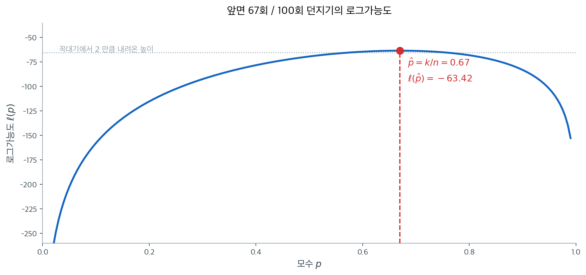
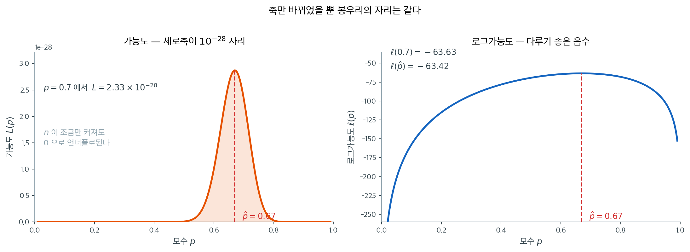
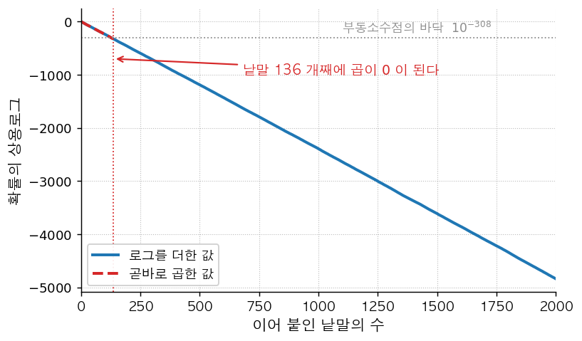
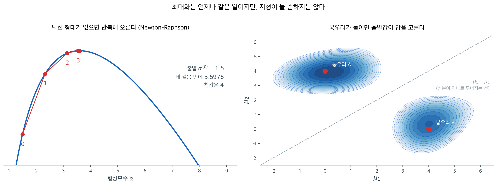

# 최대가능도를 수치로 구하기

## 개요

닫힌 해가 있는 모형은 드물다. 대부분은 로그가능도를 **직접 계산해** 그 봉우리를 **찾아야** 한다. 이 쪽은 그 두 일을 차례로 다룬다.

앞쪽(1~3절)은 **계산**이다. 로그확률을 더하는 함수를 짜고, 반복문을 벡터화하고, 가능도를 곱으로 계산했을 때 어디서 무너지는지 본다. 뒤쪽(4~8절)은 **탐색**이다. 격자로 훑는 가장 단순한 방법에서 시작해 그 한계를 재고, 기울기를 쓰는 방법과 뉴턴–랩슨으로 넘어간 뒤, 출발값 하나가 답을 바꾸는 자리에서 끝낸다.

순서가 중요하다. **계산이 틀리면 최적화는 틀린 봉우리를 정확히 찾아 준다.**

---

## 1. 로그가능도를 짜기

곡선을 읽어 MLE 와 정밀도를 알아내는 일은 [베르누이분포의 최대가능도](mle_bernoulli.md)가 이미 했다. 여기서는 그 곡선을 **짓는** 쪽을 본다.

<div class="exbox" markdown>

**보기 1.** <span class="diff easy" title="쉬움"></span> 로그가능도를 짜고 그려 보기. 참값 $p = 0.7$인 동전을 $n = 100$번 던져 앞면이 $k = 67$회 나온 자료로, $\ell(p)$를 $[0.01, 0.99]$의 격자 $200$점 위에서 계산한다.

**(1)** 관측마다 로그확률을 구해 **더하는** 함수를 짜시오. 밀도를 곱한 뒤 로그를 취하는 것과 무엇이 다른가. 또 이 격자가 참값 $\hat p = 0.67$ 을 찍지 못하는데, 그 대가가 로그가능도에서 얼마인지 재시오.

**(2)** 그려서 확인하고, 봉우리가 얼마나 평평한지 꼭대기보다 $2$ 낮은 높이를 기준으로 재시오.

</div>

??? success "풀이"

    **(1) 해석적으로.** 참값은 [베르누이분포의 최대가능도](mle_bernoulli.md) 정리 1 이 준다.

    $$
    \hat p = \frac{k}{n} = \frac{67}{100} = 0.67
    $$

    이고 $\ell''(p) < 0$이므로 이것이 유일한 전역 최대다.

    **격자는 이 값을 찍지 못한다.** 격자가 $[0.01, 0.99]$를 $200$점으로 나누므로 간격이

    $$
    \frac{0.99 - 0.01}{199} = 0.0049246\ldots
    $$

    이고 격자점은 $0.01 + j \times 0.0049246$ 꼴이다. $0.67$이 이 꼴이 되려면 $j = (0.67 - 0.01)/0.0049246 = 134.0204\ldots$이 정수여야 하는데 그렇지 않다. 가장 가까운 격자점은 $j = 134$인 $0.6698995$다. **해석적으로 푼 답은 정확하고 격자 탐색은 격자만큼만 정확하다.**

    다만 그 대가는 작다. $\ell$이 봉우리에서 포물선에 가까워 $\hat p$에서 $\delta$ 벗어나면 $\ell$이 $\tfrac12\lvert\ell''(\hat p)\rvert\delta^2$만큼 떨어지는데, $\lvert\ell''(0.67)\rvert = n/(\hat p(1-\hat p)) = 452.1$이고 $\delta = 1.0 \times 10^{-4}$이므로 떨어지는 양이 $2.3\times10^{-6}$에 지나지 않는다.

    격자의 해상도를 어떻게 정할 것인지, 그 한계가 무엇인지는 격자탐색을 정면으로 다루는 4절이 맡는다.

    **곱한 뒤 로그를 취하면 안 된다.** 관측 $100$ 개의 밀도를 곱하면 $10^{-30}$ 규모가 되고, $n$ 이 몇 백만 되면 배정도의 바닥($10^{-308}$)을 뚫는다. 처음부터 로그로 계산해 **더하면** 그런 일이 없다. 3절이 그 지점을 정확히 계산한다.

    **(2) 수치적으로.**

    ```python
    import numpy as np

    def compute_log_prob(coin, p):
        """베르누이 시행 한 번의 로그확률."""
        return coin * np.log(p) + (1 - coin) * np.log(1 - p)


    def compute_log_likelihood(coins, p):
        """베르누이 시행 여러 번의 로그가능도."""
        return sum(compute_log_prob(coin, p) for coin in coins)


    # 동전을 n번 던진다. 참 p 는 우리가 모르는 값이라고 둔다.
    rng = np.random.default_rng(1)
    p_true = 0.7
    n_samples = 100
    coins = rng.binomial(n=1, p=p_true, size=n_samples)

    k = coins.sum()
    print(f"Observed: {k} heads out of {n_samples} flips")
    print(f"MLE: p_hat = {k / n_samples:.4f}")

    # 격자 위에서 로그가능도를 계산한다.
    ps = np.linspace(0.01, 0.99, 200)
    log_liks = np.array([compute_log_likelihood(coins, p) for p in ps])

    # 수치 최적화로 MLE를 찾는다.
    idx = np.argmax(log_liks)
    mle_p = ps[idx]
    print(f"Grid-search MLE: p_hat = {mle_p:.4f}")
    print(f"Max log-likelihood: {log_liks[idx]:.4f}")

    # (1) 에서 따진 것을 확인한다. 0.67 은 격자 위에 없다.
    step = ps[1] - ps[0]
    exact_ll = k * np.log(0.67) + (n_samples - k) * np.log(0.33)
    print(f"\n격자 간격 = {step:.7f},  (0.67 - 0.01)/간격 = {(0.67 - 0.01) / step:.4f}")
    print(f"격자점 {mle_p:.7f} 에서 l = {log_liks[idx]:.9f}")
    print(f"해석적  0.67      에서 l = {exact_ll:.9f}   (차이 {exact_ll - log_liks[idx]:.2e})")

    # (2) 봉우리의 폭. 꼭대기보다 2 낮은 높이 위에 머무는 구간.
    within = ps[log_liks >= log_liks[idx] - 2]
    print(f"꼭대기보다 2 낮은 높이 위의 구간: {within.min():.4f} ~ {within.max():.4f}")
    ```

    출력:

    ```
    Observed: 67 heads out of 100 flips
    MLE: p_hat = 0.6700
    Grid-search MLE: p_hat = 0.6699
    Max log-likelihood: -63.4179

    격자 간격 = 0.0049246,  (0.67 - 0.01)/간격 = 134.0204
    격자점 0.6698995 에서 l = -63.417865855
    해석적  0.67      에서 l = -63.417863571   (차이 2.28e-06)
    꼭대기보다 2 낮은 높이 위의 구간: 0.5763 ~ 0.7585
    ```

    격자 위에서 계산한 값을 그대로 그리면 이렇다.

    

    **(1)이 예측한 그대로다.** $(0.67 - 0.01)/0.0049246 = 134.0204$이 정수가 아니므로 $0.67$은 격자에 없고, 격자가 고른 $0.6698995$에서의 로그가능도가 해석적 답보다 $2.28\times10^{-6}$ 낮다. 앞서 포물선 근사로 어림한 $2.3\times10^{-6}$과 맞는다. **격자가 비껴난 것은 사실이지만 그 대가는 소수 여섯째 자리에서야 보인다.** 그래서 그림으로는 두 값이 구별되지 않는다.

    곡선의 **모양**에서 읽을 것이 둘이다. 첫째, 봉우리 부근이 평평하다. 그림의 점선이 꼭대기보다 2만큼 낮은 높이인데, 곡선이 그 위에 머무는 구간이 $0.5763$부터 $0.7585$까지로 폭이 $0.18$이나 된다. 자료 100개로도 이 폭의 값들을 뚜렷이 구별하지 못한다는 뜻이다. 격자가 만든 $10^{-6}$의 오차와 자료가 남긴 $0.18$의 불확실성을 나란히 놓으면 **어느 쪽을 걱정해야 하는지가 분명하다.** 이 평평함의 정도가 곧 추정의 불확실성이며 [Fisher 정보량](../../ch07/theory/fisher_information.md)이 재는 것이 그것이다. 둘째, 양 끝에서 곡선이 급격히 떨어진다. $p$가 0이나 1에 가까우면 관측된 자료가 사실상 불가능해지기 때문이다.

!!! note "로그가능도의 모양"
    베르누이 로그가능도는 $(0, 1)$에서 $p$에 대해 오목한 함수이므로 유일한 전역 최댓값이 보장된다. 이 오목성은 모든 $p \in (0, 1)$에서 $\ell''(p) < 0$이라는 사실에서 따라 나온다.

---

## 2. 벡터화

로그가능도는 반복문 없이도 효율적으로 계산할 수 있다:

<div class="exbox" markdown>

**보기 2.** <span class="diff easy" title="쉬움"></span> 로그가능도의 벡터화. 보기 1의 `compute_log_likelihood`는 관측 $100$개를 하나씩 돌며 로그확률을 더한다.

**(1)** 같은 값을 자료의 요약 두 개만으로 한 줄에 계산하는 식을 쓰시오. 두 판본이 **비트까지** 같은 값을 줄 것이라 기대할 수 있는가.

**(2)** 격자 $200$점에서 두 판본을 견주어 (1)의 예측을 확인하시오. 값이 어긋나더라도 MLE가 바뀌지 않는 까닭도 밝히시오.

</div>

??? success "풀이"

    **(1) 해석적으로.** 합을 풀어 쓰면 $x_i$가 $0$ 아니면 $1$이므로

    $$
    \ell(p) = \sum_{i=1}^n \left[x_i\log p + (1-x_i)\log(1-p)\right]
    = \left(\sum_i x_i\right)\log p + \left(n - \sum_i x_i\right)\log(1-p)
    = k\log p + (n-k)\log(1-p)
    $$

    이다. 관측 $100$개가 $(k, n)$ 두 수로 줄었다. **$k$가 충분통계량**이라는 사실의 계산적 결과이며, 벡터화가 가능한 까닭도 결국 이것이다. 반복문 판본은 격자점마다 $\log$를 $2n = 200$번 부르지만 이 식은 $2$번만 부른다.

    **비트까지 같지는 않을 것이다.** 두 식은 실수에서 같지만 부동소수점에서는 셈의 **순서**가 다르다. 반복문은 항 $100$개를 차례로 더하며 반올림 오차를 $99$번 쌓고, 한 줄 판본은 곱 두 번과 덧셈 한 번으로 끝낸다. 쌓이는 상대오차는 머신 엡실론 $\varepsilon \approx 2.2\times10^{-16}$의 몇 배, 곧 $10^{-15}$ 자리로 예상된다.

    **그래도 MLE는 바뀌지 않는다.** 이웃한 격자점 사이에서 $\ell$이 $\tfrac12\lvert\ell''\rvert h^2 \approx \tfrac12(452)(0.0049)^2 = 5.4\times10^{-3}$만큼 차이 나는데, 이는 예상 오차 $10^{-13}$보다 $10$자리 크다. 순위가 뒤집힐 여지가 없다.

    **(2) 수치적으로.**

    ```python
    import numpy as np

    def log_likelihood_vectorized(coins, p):
        """로그가능도를 벡터화해 한 번에 계산한다."""
        k = coins.sum()
        n = len(coins)
        return k * np.log(p) + (n - k) * np.log(1 - p)

    # 두 값을 견준다.
    rng = np.random.default_rng(1)
    coins = rng.binomial(1, 0.7, 100)
    ps = np.linspace(0.01, 0.99, 200)

    ll_vec = np.array([log_likelihood_vectorized(coins, p) for p in ps])
    idx = np.argmax(ll_vec)
    print(f"Vectorized MLE: p = {ps[idx]:.4f}")

    # 보기 1 의 반복문 판본과 견준다.
    def compute_log_likelihood(coins, p):
        return sum(coin * np.log(p) + (1 - coin) * np.log(1 - p) for coin in coins)

    ll_loop = np.array([compute_log_likelihood(coins, p) for p in ps])
    print(f"\n두 판본이 비트까지 같은가? {np.array_equal(ll_loop, ll_vec)}")
    print(f"최대 절대 차이 = {np.abs(ll_loop - ll_vec).max():.3e}")
    print(f"최대 상대 차이 = {np.abs((ll_loop - ll_vec) / ll_loop).max():.3e}  "
          f"(머신 엡실론 {np.finfo(float).eps:.3e})")
    print(f"그래도 argmax 는 같은가? {np.argmax(ll_loop) == np.argmax(ll_vec)}")
    print(f"이웃 격자점 사이 l 의 차 = {ll_vec[idx] - ll_vec[idx + 1]:.3e}")

    # 격자까지 한꺼번에 밀어 넣으면 log 호출이 40000 번에서 2 번으로 준다.
    k, n = coins.sum(), len(coins)
    ll_array = k * np.log(ps) + (n - k) * np.log(1 - ps)
    print(f"격자 전체를 한 줄로 계산한 것과의 최대 차이 = {np.abs(ll_array - ll_vec).max():.3e}")
    ```

    출력:

    ```
    Vectorized MLE: p = 0.6699

    두 판본이 비트까지 같은가? False
    최대 절대 차이 = 4.263e-13
    최대 상대 차이 = 2.402e-15  (머신 엡실론 2.220e-16)
    그래도 argmax 는 같은가? True
    이웃 격자점 사이 l 의 차 = 5.287e-03
    격자 전체를 한 줄로 계산한 것과의 최대 차이 = 0.000e+00
    ```

    **예측이 맞았다.** 두 판본은 비트까지 같지 않고, 최대 상대 차이가 $2.4\times10^{-15}$로 머신 엡실론의 약 $11$배다. $100$개 항을 더하며 쌓인 오차치고는 작은 편이다. 그런데도 `argmax`는 같은데, 이웃 격자점 사이의 $\ell$ 차이 $5.287\times10^{-3}$이 (1)에서 어림한 $5.4\times10^{-3}$과 맞고 어긋남 $4.3\times10^{-13}$보다 $10$자리 크기 때문이다. **값이 다르면서도 답은 같다** — 수치계산에서 흔히 보는 꼴이고, "같은지"를 물을 때 비트 비교 대신 허용오차를 두고 보아야 하는 까닭이다.

    격자를 통째로 넣은 마지막 판본은 한 줄 판본과 **정확히 같은 값**($0$ 차이)을 준다. 격자점마다 부른 것과 배열로 한 번에 부른 것이 같은 연산을 같은 순서로 하기 때문이다. $\log$ 호출 수는 $40{,}000$번에서 $2$번으로 줄었다.

---

## 3. 곱으로 계산하면 언제 무너지는가

로그변환이 왜 필수적인지 보이기 위해 원래 가능도 값을 살펴보자:

<div class="exbox" markdown>

**보기 3.** <span class="diff easy" title="쉬움"></span> 가능도와 로그가능도의 수치 비교. 가능도를 곱으로 그대로 계산하면 $n$이 커질수록 작아져 언젠가 $0$으로 내려앉는다.

**(1)** $k = \hat p\,n$일 때 $\log_{10} L(\hat p)$를 $n$의 함수로 쓰고, $\hat p = 0.67$에서 배정밀도 부동소수점이 $0$을 돌려주기 시작하는 $n$을 구하시오.

**(2)** 확인하시오. 또 격자 $[0.01, 0.99]$ **전체**에서 계산할 때는 훨씬 작은 $n$에서 이미 망가지는데, 왜 그런가.

</div>

??? success "풀이"

    **(1) 해석적으로.** $k = \hat p\,n$을 넣으면

    $$
    \log_{10} L(\hat p)
    = k \log_{10}\hat p + (n-k)\log_{10}(1-\hat p)
    = -n\underbrace{\left[-\hat p\log_{10}\hat p - (1-\hat p)\log_{10}(1-\hat p)\right]}_{H_{10}(\hat p)}
    $$

    이다. 대괄호 안은 밑이 $10$인 **엔트로피**이고 $\hat p = 0.67$에서

    $$
    H_{10}(0.67) = -0.67\log_{10}0.67 - 0.33\log_{10}0.33 = 0.27542
    $$

    이다. 곧 $\log_{10}L = -0.27542\,n$으로 $n$에 **비례해** 자릿수가 내려간다. $n = 100$이면 $10^{-27.5}$, $n = 1000$이면 $10^{-275}$다.

    배정밀도의 바닥은 두 단계다. 정규수의 최솟값이 $2.225\times10^{-308}$이므로

    $$
    0.27542\,n > 307.65 \;\Longrightarrow\; n > 1117
    $$

    에서 비정규수로 떨어져 유효숫자를 잃기 시작하고, 비정규수의 최솟값 $\approx 10^{-323.3}$마저 뚫는

    $$
    0.27542\,n > 323.3 \;\Longrightarrow\; n > 1174
    $$

    에서 정확히 $0$이 된다.

    **(2) 수치적으로.**

    ```python
    import numpy as np

    rng = np.random.default_rng(1)
    coins = rng.binomial(1, 0.7, 100)
    k = coins.sum()
    n = len(coins)

    p = 0.7
    # 가능도를 곱으로 그대로 계산하면 100개의 작은 수를 곱하게 되어
    # 값이 1e-28 까지 내려간다.
    raw_likelihood = p**k * (1-p)**(n-k)

    # 로그를 취하면 곱이 합이 되어 이 문제가 사라진다.
    # log는 단조증가 함수이므로 **최대가 되는 지점은 바뀌지 않는다.**
    # 로그가능도를 쓰는 이유가 이 두 가지다: 수치 안정성과 미분의 편리함.
    log_likelihood = k * np.log(p) + (n-k) * np.log(1-p)

    print(f"Raw likelihood at p=0.7: {raw_likelihood:.2e}")
    print(f"Log-likelihood at p=0.7: {log_likelihood:.4f}")

    # (1) 이 예측한 자리에서 정말 0 이 되는지 본다. k = 0.67 n 으로 늘려 간다.
    print("\n봉우리 p_hat = 0.67 에서의 가능도")
    for N in (100, 500, 1000, 1117, 1175):
        kk = round(0.67 * N)
        print(f"  n = {N:>4}:  L = {0.67**kk * 0.33**(N - kk):.3e}")

    # 격자 전체에서는 가장 작은 값이 먼저 0 이 된다.
    ps = np.linspace(0.01, 0.99, 200)
    print("\n격자 [0.01, 0.99] 위에서 가장 작은 가능도")
    for N in (100, 200, 241, 250):
        kk = round(0.67 * N)
        print(f"  n = {N:>4}:  min L = {(ps**kk * (1 - ps)**(N - kk)).min():.3e}")
    ```

    출력:

    ```
    Raw likelihood at p=0.7: 2.33e-28
    Log-likelihood at p=0.7: -63.6283

    봉우리 p_hat = 0.67 에서의 가능도
      n =  100:  L = 2.871e-28
      n =  500:  L = 1.949e-138
      n = 1000:  L = 3.799e-276
      n = 1117:  L = 1.720e-308
      n = 1175:  L = 0.000e+00

    격자 [0.01, 0.99] 위에서 가장 작은 가능도
      n =  100:  min L = 7.177e-135
      n =  200:  min L = 5.151e-269
      n =  241:  min L = 4.447e-323
      n =  250:  min L = 0.000e+00
    ```

    **(1)의 예측이 자리마다 맞는다.** $n = 100$에서 $10^{-27.5}$, $n = 1000$에서 $10^{-275.6}$으로 $-0.27542\,n$ 그대로이고, $n = 1117$에서 $1.72\times10^{-308}$로 정규수의 바닥을 막 뚫었으며, $n = 1175$에서 정확히 $0$이 된다. 예측한 문턱 $1117$과 $1174$가 그대로 나왔다.

    **격자 전체에서는 훨씬 일찍 망가진다.** $n = 250$만 되어도 격자 위의 가장 작은 값이 이미 $0$이다. 까닭은 $\log_{10}L(p) = n[\hat p\log_{10}p + (1-\hat p)\log_{10}(1-p)]$에서 $p$가 봉우리를 벗어나면 대괄호가 $-H_{10}(\hat p)$보다 훨씬 작아지기 때문이다. 격자의 왼쪽 끝 $p = 0.01$에서는 그 값이 $-1.341$로 봉우리의 $-0.275$보다 다섯 배 가파르고, 그래서 $323.3/1.341 = 241$에서 벌써 $0$에 닿는다. **최대화할 대상이 사라지는 것은 봉우리가 아니라 그 바깥부터다.**

    

    왼쪽 세로축의 $10^{-28}$이라는 배율에 주목하라. 관측값 100개의 확률을 그대로 곱한 값이다. 오른쪽은 같은 함수에 로그를 씌운 것이다. **봉우리의 자리는 조금도 움직이지 않았다.** 로그가 순증가함수이므로 대소 관계가 그대로 보존되기 때문이며, 바뀐 것은 세로축의 눈금뿐이다. 왼쪽에서 봉우리 밖이 전부 0처럼 보이던 구간도 오른쪽에서는 제 값을 갖고 구별되는데, 바로 그 구간이 $n$을 키우면 **진짜로** 0이 되어 사라지는 곳이다.

<div class="aibox" markdown>

**AI로 보는 통계학 1.** 곱을 합으로 바꾸는 일이 지금도 하는 일

$$
\log MN=\log M+\log N
$$

이라는 한 줄은 네이피어에게는 **손 계산을 줄이는** 장치였다. 지금은 그것이 계산을 줄이는
것이 아니라 **가능하게 하는** 장치다. 보기 $3$ 이 동전 $1175$ 번에서 만난 바닥을, 언어모델은
훨씬 일찍 만난다.

요즘 언어모델은 글을 한 낱말씩 이어 붙이면서 다음 낱말의 확률을 차례로 내놓는다.
그러면 문장 하나 전체의 확률은 그 확률들의 곱이다. 그런데 낱말 하나의 확률이 천분의
몇쯤이면 수천 낱말의 곱은 $10^{-4000}$ 언저리가 되는데, 컴퓨터가 쓰는 부동소수점 수는
$10^{-308}$ 쯤에서 바닥이 난다. 그대로 곱하면 얼마 못 가 **정확히 $0$** 이 되고, 그
뒤로는 어떤 문장이 더 그럴듯한지 견줄 수조차 없다. 가능도가 $0$ 이 되면 최대화할 대상이
사라진다는 보기 $3$ 의 이야기와 똑같은 일이다.

그래서 확률을 곱하지 않고, 확률에 로그를 취한 **로그확률**을 더한다. 값을 자릿수로
바꾸어 두면 $10^{-4000}$ 도 $-4000$ 남짓한 수 하나일 뿐이라 바닥이 날 일이 없다.

낱말 $2000$ 개를 이어 붙여 두 방식을 견주어 보자.

```python
import math
import numpy as np

rng = np.random.default_rng(0)              # 씨앗을 고정해 늘 같은 값이 나오게
p = rng.uniform(1e-4, 1e-2, size=2000)      # 낱말 2000 개의 조건부확률

prod = 1.0
for q in p:
    prod *= q                               # 정의대로 곧바로 곱해 본다
logsum = float(np.sum(np.log(p)))           # log MN = log M + log N

print(f"그대로 곱한 값        : {prod}")
print(f"로그를 더한 값        : {logsum:.3f}")
print(f"자릿수로 보면 10 의   : {logsum / math.log(10):.1f} 제곱")
print(f"낱말 하나당 평균 확률 : {math.exp(logsum / len(p)):.6f}")
```

실행하면 다음이 나온다.

```text
그대로 곱한 값        : 0.0
로그를 더한 값        : -11144.186
자릿수로 보면 10 의   : -4839.9 제곱
낱말 하나당 평균 확률 : 0.003803
```

첫 줄이 $0$ 인 것은 확률이 정말 $0$ 이어서가 아니라 **바닥이 났기 때문**이다. 셋째 줄이
말하듯 참값은 $10^{-4840}$ 언저리다. 넷째 줄은 $\log M^{k}=k\log M$ 을 거꾸로 쓴
것이다 — 로그합을 낱말 수로 나눈 뒤 되돌리면 「낱말 하나당 평균 확률」, 곧 확률들의
기하평균이 된다.

<figure markdown>
  { width=640 }
  <figcaption markdown>세로축은 확률의 상용로그다. 로그를 더한 값(파란 선)은 낱말이 늘어도 그저 아래로 곧게 내려갈 뿐이다. 곧바로 곱한 값은 왼쪽 끝의 짧은 붉은 점선뿐으로, 붉은 세로선이 선 자리에서 $0$ 이 되어 더 그릴 값이 없다.</figcaption>
</figure>

붉은 세로선이 선 자리가 $136$ 번째 낱말이다. 베르누이 가능도가 $n=1175$ 까지 버틴 것은
확률이 $0.67$ 과 $0.33$ 으로 제법 컸기 때문이고, 낱말마다의 확률이 천분의 몇이면 같은
바닥이 백 몇 번 만에 온다.

다만 로그로 바꾸어도 모든 것이 편해지지는 않는다. **곱셈과 나눗셈은 덧셈과 뺄셈이
되지만 덧셈은 덧셈이 되지 않는다** — 서로 다른 갈래의 확률을 합쳐야 할 때는
$\log(M+N)$ 을 $\log M$ 과 $\log N$ 만으로 적을 길이 없어, 가장 큰 항을 밖으로 빼낸 뒤
더하는 별도의 요령을 쓴다.

</div>

<div class="aibox" markdown>

**AI로 보는 통계학 2.** 떼어 낸 양수 인수가 계산도 살린다

도함수가 $f'(x)=c(x)\{\varphi(x)-\psi(x)\}$ 처럼 적힐 때, **늘 양수인 인수 $c(x)$ 를 떼어 내고** 남은 것의 부호만 보는 것이 증감을 읽는 요령이다. 절 $3$ 이 한 일이 바로 그것이다 — 점수를 통분하면

$$
\ell'(p)=\frac kp-\frac{n-k}{1-p}=\frac{k-np}{p(1-p)}
$$

이고 $0 < p < 1$ 에서 분모가 늘 양수이므로, 로그가능도가 오르는지 내리는지는 $k-np$ 의 부호 하나가 정한다. 손으로 풀 때는 식을 줄이려는 요령처럼 보이지만, 기계에게는 그 이상이다. 떼어 내지 않으면 **부호 자체를 잃어버리는** 일이 생긴다.

컴퓨터가 쓰는 소수는 아주 작은 수를 적을 수 없다. 어느 선을 넘으면 그냥 $0$ 이 된다. 그런데 $e^{-x^{2}/2}$ 같은 인수는 $x$ 가 조금만 커져도 그 선을 넘어 버린다. 곱해진 전체를 그대로 계산하면 결과가 $0$ 이 되어, 원래 담겨 있던 **부호가 사라진다.** 양수 인수를 미리 떼어 두면 그런 일이 없다.

```python
import math

def fprime_direct(x):
    """적힌 대로 계산한다 — f'(x) = x·e^(-x²/2)·(2 - x²)."""
    return x * math.exp(-x*x/2) * (2 - x*x)

def sign_by_factors(x):
    """양수 인수를 떼고 남은 것의 부호만 본다."""
    return ((1 if x > 0 else -1 if x < 0 else 0)
            * (1 if 2 - x*x > 0 else -1 if 2 - x*x < 0 else 0))

print("    x       그대로 계산한 f'(x)    그 부호   인수로 본 부호")
for x in (1.0, 2.0, 10.0, 26.0, 27.0, 40.0):
    d = fprime_direct(x)
    sd = 1 if d > 0 else -1 if d < 0 else 0
    print(f"{x:7.1f} {d:22.6e} {sd:8d} {sign_by_factors(x):13d}")
```

실행하면 다음이 나온다.

```text
    x       그대로 계산한 f'(x)    그 부호   인수로 본 부호
    1.0           6.065307e-01        1             1
    2.0          -5.413411e-01       -1            -1
   10.0          -1.890175e-19       -1            -1
   26.0         -2.832033e-143       -1            -1
   27.0         -9.830136e-155       -1            -1
   40.0          -0.000000e+00        0            -1
```

$x=27$ 까지는 그대로 계산해도 부호가 살아 있다. 값이 $10^{-155}$ 로 터무니없이 작지만 음수라는 것은 남아 있다. 그런데 $x=40$ 에서 $e^{-800}$ 이 표현 범위를 넘어 $0$ 이 되고, 곱한 결과가 $-0.000000$ 이 되어 **부호를 물었을 때 $0$ 이라고 답한다.** 함수는 거기서 분명히 줄고 있는데 계산이 「줄지도 늘지도 않는다」고 말하는 것이다.

오른쪽 열은 흔들리지 않는다. $e^{-x^{2}/2}$ 를 떼고 $x$ 와 $2-x^{2}$ 의 부호만 보면 $x=40$ 에서도 $-1$ 이 그대로 나온다. 떼어 낸 인수는 애초에 부호에 아무 몫이 없었으므로, 그것을 곱하지 않는 것이 **식을 줄이는 일이자 계산을 지키는 일**이다. 바로 앞 상자가 확률을 곱하는 대신 로그를 더한 것도 같은 까닭에서다.

다만 이 수법이 통하는 것은 **떼어 낸 인수가 정말 늘 양수일 때**다. 부호가 바뀔 수 있는 것을 떼어 내면 그 자리에서 증감이 통째로 뒤집히므로, $c(x) > 0$ 을 먼저 확인하라는 것은 손으로 풀 때나 기계에게나 같은 당부다. 위의 $p(1-p)$ 가 양수인 것도 $0 < p < 1$ 일 때까지다.

</div>

---

## 4. 봉우리를 찾는 문제

모수족 $f(x; \theta)$에서 얻은 관측 자료 $x_1, \ldots, x_n$이 주어졌을 때 MLE는 다음을 푼다:

$$
\hat{\theta}_{\text{MLE}} = \arg\max_\theta \ell(\theta) = \arg\max_\theta \sum_{i=1}^n \log f(x_i; \theta)
$$

동등하게 음의 로그가능도를 최소화한다:

$$
\hat{\theta}_{\text{MLE}} = \arg\min_\theta \left[-\ell(\theta)\right]
$$

!!! warning "실무적 고려사항"

    - 로그가능도에 국소 최댓값이 여럿 있을 수 있다(예: 혼합모형).
    - 모수공간에 제약이 있으면(예: $\sigma^2 > 0$) 재모수화하거나 제약 최적화를 써야 한다.
    - 출발값이 나쁘면 국소 최적점으로 수렴하거나 수치적으로 실패할 수 있다.

---

## 5. 격자탐색

가장 단순한 최적화 전략은 후보값 격자에서 $\ell(\theta)$를 평가하는 것이다. 모수가 하나나 둘일 때 실행 가능하며 가능도 곡면을 시각화하는 데 유용하다.

<div class="exbox" markdown>

**보기 4.** <span class="diff easy" title="쉬움"></span> 격자탐색으로 MLE 찾기. $N(\mu, \sigma^2)$에서 $n = 100$을 뽑고 $\sigma$를 $\hat\sigma$로 고정한 뒤, $\mu$를 $[3, 7]$의 격자 $500$점에서 찾는다.

**(1)** 이때 $\ell(\mu)$가 $\mu$의 **정확한 이차식**임을 보이고 닫힌 해를 구하시오. 격자 탐색이 범할 수 있는 오차의 상한은 얼마인가.

**(2)** 격자가 준 $4.8998$과 닫힌 해 $4.8995$의 차이를 재어 (1)의 상한과 견주시오. 소수 넷째 자리까지 맞히려면 격자를 몇 점으로 해야 하는가.

</div>

??? success "풀이"

    **(1) 해석적으로.** $\sigma = \hat\sigma$를 고정하면

    $$
    \ell(\mu) = -\frac{n}{2}\log(2\pi\hat\sigma^2) - \frac{1}{2\hat\sigma^2}\sum_{i=1}^n (x_i - \mu)^2
    $$

    인데, 제곱합을 $\bar x$ 둘레로 펴면

    $$
    \sum_i (x_i - \mu)^2 = \sum_i (x_i - \bar x)^2 + n(\mu - \bar x)^2
    $$

    이다(교차항 $2(\bar x - \mu)\sum_i(x_i - \bar x)$가 $0$이다). 따라서

    $$
    \ell(\mu) = \text{상수} - \frac{n}{2\hat\sigma^2}(\mu - \bar x)^2
    $$

    로 **꼭짓점이 $\bar x$인 정확한 포물선**이다. 근사가 아니라 항등식이고, 그러므로

    $$
    \hat\mu = \bar x, \qquad \lvert\ell''\rvert = \frac{n}{\hat\sigma^2}
    $$

    이다.

    **격자 오차의 상한.** 격자 간격이 $h = (7-3)/499 = 0.0080160$이므로 $\bar x$에서 가장 가까운 격자점은 많아야 반 칸, 곧 $h/2 = 0.0040080$ 떨어져 있다. 그때 잃는 로그가능도는

    $$
    \frac{1}{2}\cdot\frac{n}{\hat\sigma^2}\cdot\left(\frac{h}{2}\right)^2
    = \frac{1}{2}\cdot\frac{100}{2.3888}\cdot(0.004008)^2
    = 3.36\times10^{-4}
    $$

    이하다. **격자 탐색은 반 칸보다 정밀할 수 없다**는 것이 요점이고, 이는 자료를 아무리 늘려도 나아지지 않는 종류의 오차다.

    **(2) 수치적으로.**

    ```python
    import numpy as np
    from scipy import stats

    def grid_search_normal_mean(data, mu_grid):
        """mu 후보를 격자로 늘어놓고 로그가능도가 가장 큰 것을 고른다.

        가장 단순하고 가장 확실한 방법이다. 미분도 초기값도 필요 없고
        국소 최적에 갇히지도 않는다. 대신 격자 간격보다 정밀할 수 없고,
        모수가 d개면 격자점이 (격자 수)^d 로 폭발해 d가 3~4만 넘어도 못 쓴다.
        """
        sigma_hat = data.std(ddof=0)     # ddof=0 이 MLE 판본이다(n으로 나눔)

        # logpdf 를 더한다. pdf를 곱한 뒤 로그를 취하면 언더플로가 나므로
        # 처음부터 로그로 계산해 더하는 것이 정석이다.
        log_liks = np.array([
            np.sum(stats.norm.logpdf(data, loc=mu, scale=sigma_hat))
            for mu in mu_grid
        ])
        best_idx = np.argmax(log_liks)
        return mu_grid[best_idx], log_liks

    # 보기.
    rng = np.random.default_rng(42)
    data = rng.normal(loc=5.0, scale=2.0, size=100)
    mu_grid = np.linspace(3.0, 7.0, 500)
    mu_hat, log_liks = grid_search_normal_mean(data, mu_grid)
    print(f"Grid search MLE: mu_hat = {mu_hat:.4f}")
    print(f"Closed-form MLE: mu_hat = {data.mean():.4f}")

    # (1) 에서 따진 상한과 견준다.
    step = mu_grid[1] - mu_grid[0]
    mu_exact = data.mean()
    sigma_hat = data.std(ddof=0)
    ll = lambda m: np.sum(stats.norm.logpdf(data, loc=m, scale=sigma_hat))

    print(f"\n격자 간격 = {step:.7f},  반 칸 = {step / 2:.7f}")
    print(f"격자 - 닫힌해 = {mu_hat - mu_exact:+.7f}  "
          f"(반 칸의 {abs(mu_hat - mu_exact) / (step / 2):.1%})")
    print(f"l 의 손실   = {ll(mu_exact) - ll(mu_hat):.6e}")
    print(f"이차식 예측 = {0.5 * len(data) / sigma_hat**2 * (mu_hat - mu_exact)**2:.6e}")
    print(f"손실의 상한 = {0.5 * len(data) / sigma_hat**2 * (step / 2)**2:.6e}")
    print(f"소수 넷째 자리까지 맞히려면 격자점이 {int((7 - 3) / 2e-4) + 1}개 필요하다")
    ```

    출력:

    ```
    Grid search MLE: mu_hat = 4.8998
    Closed-form MLE: mu_hat = 4.8995

    격자 간격 = 0.0080160,  반 칸 = 0.0040080
    격자 - 닫힌해 = +0.0003388  (반 칸의 8.5%)
    l 의 손실   = 2.402909e-06
    이차식 예측 = 2.402909e-06
    손실의 상한 = 3.362425e-04
    소수 넷째 자리까지 맞히려면 격자점이 20001개 필요하다
    ```

    **(1)의 주장이 모두 확인된다.** 격자와 닫힌 해의 차이가 $0.00034$로 반 칸 $0.0040$의 $8.5\%$ 안에 들어 상한을 지켰다. 이번에는 운이 좋아 반 칸보다 훨씬 가까웠지만, $\bar x$가 어디 떨어지느냐에 따라 최악에는 반 칸까지 벌어질 수 있다.

    더 눈여겨볼 것은 로그가능도의 손실이다. 실제 $2.402909\times10^{-6}$과 이차식이 예측한 $2.402909\times10^{-6}$이 **일곱 자리까지 같다.** (1)에서 포물선이 근사가 아니라 항등식이라고 한 그대로이며, 어림이 아니라 정확한 예측이다.

    **격자의 대가는 여기서 분명해진다.** $\hat\mu$를 소수 넷째 자리까지 맞히려면 간격을 $2\times10^{-4}$ 아래로 줄여야 하므로 격자점이 $20{,}001$개 필요하다. 지금의 $500$점보다 $40$배다. 닫힌 해 $\bar x$는 덧셈 $100$번이면 끝나고 자리 손실도 없다. **닫힌 해가 있으면 격자를 쓸 이유가 없고**, 격자는 닫힌 해가 없을 때 또는 곡면의 모양을 눈으로 보고 싶을 때 쓰는 도구다.

    모수가 $d$개면 격자점이 $(\text{격자 수})^d$로 폭발한다는 점도 함께 기억해 두자. 지금 쓴 $500$점을 모수 넷에 똑같이 적용하면 $500^4 = 6.25\times10^{10}$점이 되어 계산이 불가능하다.

---

## 6. 기울기 기반 최적화

모수가 여럿인 문제에서는 기울기 기반 방법이 필수적이다. (로그가능도의 기울기인) **점수함수**는:

$$
S(\theta) = \frac{\partial}{\partial\theta}\ell(\theta)
$$

MLE에서 점수는 0이다: $S(\hat{\theta}) = 0$.

### 제약 없는 최적화를 위한 재모수화

모수에 제약이 있으면(예: $\sigma^2 > 0$) 변환된 모수에 대해 최적화하는 것이 흔한 요령이다:

$$
\phi = \log(\sigma^2) \quad \Rightarrow \quad \sigma^2 = e^\phi
$$

이렇게 하면 제약 문제가 제약 없는 문제로 바뀐다.

<div class="exbox" markdown>

**보기 5.** <span class="diff easy" title="쉬움"></span> 재모수화로 제약 없애기. $\phi = \log\sigma^2$로 바꾸어 제약 $\sigma^2 > 0$을 없앤 뒤 넬더-미드로 $(\mu, \phi)$를 최적화한다.

**(1)** 재모수화해도 최적점이 달라지지 않는 까닭을 말하고 $(\hat\mu, \hat\sigma^2)$의 닫힌 해를 쓰시오.

**(2)** 수치 해가 닫힌 해와 소수 넷째 자리까지 같다. **이것이 넬더-미드가 그만큼 정확하다는 증거인가.**

</div>

??? success "풀이"

    **(1) 해석적으로.** $g(\sigma^2) = \log\sigma^2$이 $(0,\infty)$에서 $\mathbb{R}$로 가는 **전단사**이므로

    $$
    \max_{\sigma^2 > 0} \ell(\mu, \sigma^2) = \max_{\phi \in \mathbb{R}} \ell(\mu, e^\phi)
    $$

    이고 두 최대점이 $\hat\phi = \log\hat\sigma^2$로 맞물린다. 최댓값을 **옮겨 놓았을 뿐 바꾸지 않았다.** 이것이 최대가능도추정량의 불변성이며, 덤으로 $e^\phi > 0$이 저절로 보장되어 제약이 사라진다. 최적화기는 $\phi$를 실수 전체에서 자유롭게 움직일 수 있다.

    닫힌 해는 잘 알려진 대로

    $$
    \hat\mu = \bar x, \qquad
    \hat\sigma^2 = \frac{1}{n}\sum_{i=1}^n (x_i - \bar x)^2
    $$

    이다. 분모가 $n-1$이 아니라 **$n$**이라는 점이 중요하다.

    **(2) 증거가 아니다.** 코드의 출발점 목록을 다시 보라.

    ```
    for mu0 in [0, data.mean(), np.median(data)]:
        for ls0 in [0, np.log(data.var())]:
    ```

    `np.var`의 기본값은 `ddof=0`이므로 `data.var()`는 **정확히 $\hat\sigma^2$**이다. 곧 출발점 $(\bar x, \log\hat\sigma^2)$은 이미 **정답 그 자리**다. 넬더-미드는 그 자리에서 단체를 만들고 어느 꼭짓점도 더 낫지 않으면 $x_0$를 그대로 돌려주므로, 일치는 "소수 넷째 자리"가 아니라 **비트까지**다. 알고리즘의 정확도와는 아무 상관이 없다.

    넬더-미드의 실제 정확도를 보려면 나머지 다섯 출발점을 따로 보아야 한다.

    ```python
    import numpy as np
    from scipy import optimize

    def mle_normal_numerical(data):
        """재매개변수화를 써서 정규분포의 MLE를 수치적으로 찾는다."""
        def neg_log_lik(params):
            # sigma^2 을 직접 다루지 않고 log(sigma^2) 을 최적화한다.
            # 이유: sigma^2 > 0 이라는 제약을 최적화기에 알려 주기 어려운데,
            #       log를 쓰면 log_sigma2 가 어떤 실수든 exp를 거치며 자동으로 양수가 된다.
            #       제약 없는 최적화 문제로 바뀌므로 Nelder-Mead 같은 단순한 방법도 쓸 수 있다.
            mu, log_sigma2 = params
            sigma2 = np.exp(log_sigma2)
            n = len(data)
            # 음의 로그가능도. 최소화하는 것이 가능도를 최대화하는 것과 같다.
            return 0.5 * n * np.log(2 * np.pi * sigma2) + np.sum((data - mu) ** 2) / (2 * sigma2)

        # 출발점을 여러 개 시도한다.
        # 정규분포의 로그가능도는 볼록해서 사실 한 번이면 충분하지만,
        # 봉우리가 여럿인 문제에서는 이렇게 여러 곳에서 출발해
        # 가장 좋은 것을 골라야 국소 최적에 갇히지 않는다.
        # (numpy 배열에는 .median() 이 없으므로 np.median 을 쓴다.)
        best_result = None
        for mu0 in [0, data.mean(), np.median(data)]:
            for ls0 in [0, np.log(data.var())]:
                result = optimize.minimize(neg_log_lik, x0=[mu0, ls0], method="Nelder-Mead")
                # result.fun 이 그 출발점에서 도달한 최솟값이다
                if best_result is None or result.fun < best_result.fun:
                    best_result = result

        mu_hat = best_result.x[0]
        sigma2_hat = np.exp(best_result.x[1])    # log에서 되돌린다
        return mu_hat, sigma2_hat

    rng = np.random.default_rng(42)
    data = rng.normal(5.0, 2.0, 100)
    mu_hat, sigma2_hat = mle_normal_numerical(data)
    print(f"Numerical MLE: mu = {mu_hat:.4f}, sigma^2 = {sigma2_hat:.4f}")
    print(f"Closed-form:   mu = {data.mean():.4f}, sigma^2 = {np.mean((data - data.mean())**2):.4f}")

    # 소수 넷째 자리가 아니라 비트까지 같은지 본다.
    mu_closed = data.mean()
    sigma2_closed = np.mean((data - mu_closed) ** 2)
    print(f"\nmu  비트까지 같은가? {mu_hat == mu_closed}")
    print(f"s^2 비트까지 같은가? {sigma2_hat == sigma2_closed}")
    print(f"np.var(data) 가 MLE 와 같은가? {data.var() == sigma2_closed}")

    # 출발점마다 따로 보면 넬더-미드의 실제 정확도가 드러난다.
    def neg_ll(params):
        mu, ls = params
        s2 = np.exp(ls)
        return 0.5 * len(data) * np.log(2 * np.pi * s2) + np.sum((data - mu) ** 2) / (2 * s2)

    print("\n출발점별 오차")
    for mu0, nm in [(0.0, "0"), (mu_closed, "mean"), (float(np.median(data)), "median")]:
        for ls0, ln in [(0.0, "0"), (float(np.log(data.var())), "log var")]:
            r = optimize.minimize(neg_ll, x0=[mu0, ls0], method="Nelder-Mead")
            print(f"  ({nm:>6}, {ln:>7}):  mu 오차 {r.x[0] - mu_closed:>9.2e},"
                  f"  s^2 오차 {np.exp(r.x[1]) - sigma2_closed:>9.2e},  호출 {r.nfev:>3}")
    ```

    출력:

    ```
    Numerical MLE: mu = 4.8995, sigma^2 = 2.3888
    Closed-form:   mu = 4.8995, sigma^2 = 2.3888

    mu  비트까지 같은가? True
    s^2 비트까지 같은가? True
    np.var(data) 가 MLE 와 같은가? True

    출발점별 오차
      (     0,       0):  mu 오차  2.17e-06,  s^2 오차  7.58e-05,  호출 152
      (     0, log var):  mu 오차 -2.75e-05,  s^2 오차  8.64e-05,  호출 153
      (  mean,       0):  mu 오차  2.15e-05,  s^2 오차  5.11e-05,  호출 105
      (  mean, log var):  mu 오차  0.00e+00,  s^2 오차  0.00e+00,  호출  45
      (median,       0):  mu 오차  1.16e-05,  s^2 오차  5.96e-05,  호출 102
      (median, log var):  mu 오차  1.62e-05,  s^2 오차 -7.70e-05,  호출  49
    ```

    **짐작이 맞았다.** $\hat\mu$와 $\hat\sigma^2$이 닫힌 해와 **비트까지** 같고, `data.var()`가 MLE와 같다는 것도 `True`다. 표를 보면 사정이 분명해진다. 출발점이 `(mean, log var)`인 줄만 오차가 정확히 $0$이고 함수 호출이 $45$번으로 가장 적다. 그 자리에서 출발해 아무 데도 가지 않은 것이다. `best_result`가 최솟값으로 그 줄을 고르니 최종 답이 닫힌 해와 같아진다.

    **나머지 다섯 줄이 넬더-미드의 참모습이다.** $\hat\mu$의 오차가 $10^{-6}\sim10^{-5}$, $\hat\sigma^2$의 오차가 $5\times10^{-5}\sim9\times10^{-5}$다. 기본 허용오차 `xatol = fatol = 1e-4`에 걸맞은 정확도이며, 소수 넷째 자리까지만 믿을 수 있다는 뜻이다. **처음 출력이 넷째 자리까지 맞아 보인 것은 운이 아니라 반칙이었다.**

    여기서 배울 것은 두 가지다. 첫째, 수치 해를 닫힌 해와 견줄 때는 **출발점이 답을 알고 있지 않은지** 먼저 확인해야 한다. 둘째, 알고리즘의 정확도를 알고 싶으면 일치하는 자릿수를 세지 말고 **허용오차 설정을 보라.** $10^{-4}$를 넣고 $10^{-10}$의 정확도를 기대할 수는 없다.

---

## 7. Newton-Raphson 방법

Newton-Raphson 방법은 (Hessian이라는) 2계 정보를 사용하여 더 빠르게 수렴한다:

$$
\theta^{(t+1)} = \theta^{(t)} - \left[\ell''(\theta^{(t)})\right]^{-1} \ell'(\theta^{(t)})
$$

다변량인 경우에는 다음과 같다:

$$
\boldsymbol{\theta}^{(t+1)} = \boldsymbol{\theta}^{(t)} - \mathbf{H}^{-1}(\boldsymbol{\theta}^{(t)})\, \nabla\ell(\boldsymbol{\theta}^{(t)})
$$

여기서 $\mathbf{H}$는 로그가능도의 Hessian 행렬이다.

!!! info "Fisher 점수법"
    관측 Hessian을 그 기댓값 $-I(\theta)$(음의 Fisher 정보행렬)로 바꾸면 **Fisher 점수법** 알고리즘이 된다. MLE 근처에서는 Fisher 점수법과 Newton-Raphson이 비슷하게 거동한다.



왼쪽이 Newton–Raphson이 실제로 하는 일이다. 감마분포의 형상모수는 닫힌 형태가 없으므로 반복해 오를 수밖에 없는데, $1.5$에서 출발해 **네 걸음** 만에 소수점 넷째 자리까지 자리를 잡는다. 꼭대기 근처에서 로그가능도가 포물선에 가까워지고 Newton은 그 포물선의 꼭대기로 곧장 뛰므로, 가까이 갈수록 걸음마다 정확도가 배로 늘어난다.

오른쪽은 그 낙관이 통하지 않는 경우다. 성분이 둘인 혼합모형의 로그가능도를 두 평균의 평면에 그리면 **봉우리가 둘** 나타난다. 두 봉우리는 성분의 이름을 맞바꾼 것이라 값이 정확히 같으며(이를 **라벨 바꿈**이라 한다), 어느 쪽으로 가느냐는 순전히 출발값이 정한다.

---

## 8. 출발값에 대한 민감도

볼록하지 않은 가능도(예: 혼합모형)에서는 최적화 결과가 출발점에 의존할 수 있다.

<div class="exbox" markdown>

**보기 6.** <span class="diff easy" title="쉬움"></span> 출발값에 따른 수렴 위치. 성분 둘짜리 정규 혼합에서 뽑은 $n = 200$개로 $(\pi, \mu_1, \mu_2, \sigma)$를 세 출발점에서 최적화한다.

**(1)** 세 결과가 모두 $402.58$에 닿는데 출발 2만 $\mu_1$과 $\mu_2$가 뒤바뀌어 있다. **이것이 국소 최적에 갇힌 것인가.** 그렇게 판정한 근거와 함께, $\hat\pi$ 두 값 사이에 성립해야 할 관계를 쓰시오.

**(2)** 찾은 모수에서 이름을 맞바꾼 벡터의 음의 로그가능도를 다시 계산해 (1)을 확인하시오.

</div>

??? success "풀이"

    **(1) 해석적으로. 국소 최적이 아니다 — 라벨 바꿈이다.** 혼합밀도

    $$
    f(x) = \pi\,\varphi(x; \mu_1, \sigma) + (1-\pi)\,\varphi(x; \mu_2, \sigma)
    $$

    에서 치환

    $$
    (\pi, \mu_1, \mu_2) \;\longmapsto\; (1-\pi,\ \mu_2,\ \mu_1)
    $$

    을 하면 두 항이 자리만 바꿀 뿐 **합이 한 치도 달라지지 않는다.** 모든 $x$에서 $f$가 같으므로 가능도도 정확히 같다. 성분이 $K$개면 이런 치환이 $K!$가지 있고, 여기서는 $2! = 2$다. 곧 전역 최대가 **둘**이고 둘은 같은 해를 다르게 이름 붙인 것에 지나지 않는다.

    출발 2는 $\mu_1 = \mu_2 = 2$라는 대칭 자리에서 시작했다. 두 봉우리에서 꼭 같은 거리에 있으므로 어느 쪽으로 가느냐는 단체가 처음 어떻게 펴지느냐가 정할 뿐이고, 어느 쪽으로 가든 **같은 높이**에 닿는다. 국소 최적에 갇혔다면 음의 로그가능도가 **더 컸어야** 하는데 셋이 모두 $402.58$이다.

    $\hat\pi$ 사이에는 치환이 그대로

    $$
    \hat\pi_{(2)} = 1 - \hat\pi_{(1)}
    $$

    을 요구한다. 출력의 $0.374$와 $0.626$이 정확히 그 관계다.

    **(2) 수치적으로.**

    ```python
    import numpy as np
    from scipy import optimize, stats

    def mixture_log_likelihood(params, data):
        """성분 둘짜리 정규 혼합모형의 음의 로그가능도."""
        pi, mu1, mu2, sigma = params[0], params[1], params[2], np.exp(params[3])
        pi = 1 / (1 + np.exp(-pi))  # sigmoid transform for mixing weight
        ll = np.sum(np.log(
            pi * stats.norm.pdf(data, mu1, sigma) +
            (1 - pi) * stats.norm.pdf(data, mu2, sigma)
        ))
        return -ll

    # 봉우리 둘짜리 혼합분포에서 자료를 만든다.
    rng = np.random.default_rng(42)
    n = 200
    z = rng.binomial(1, 0.4, n)
    data = np.where(z, rng.normal(0, 1, n), rng.normal(4, 1, n))

    # 출발값을 바꿔 가며 어디로 수렴하는지 본다.
    starts = [[0, -1, 5, 0], [0, 2, 2, 0], [0, 0, 3, 0.5]]
    for i, x0 in enumerate(starts):
        result = optimize.minimize(mixture_log_likelihood, x0, args=(data,), method="Nelder-Mead")
        pi_hat = 1 / (1 + np.exp(-result.x[0]))
        print(f"Start {i+1}: pi={pi_hat:.3f}, mu1={result.x[1]:.3f}, "
              f"mu2={result.x[2]:.3f}, nll={result.fun:.2f}")

    # (1) 이 말한 불변성을 직접 확인한다.
    best = optimize.minimize(mixture_log_likelihood, starts[0], args=(data,),
                             method="Nelder-Mead").x
    swapped = np.array([-best[0], best[2], best[1], best[3]])   # pi -> 1-pi, mu1 <-> mu2
    a = mixture_log_likelihood(best, data)
    b = mixture_log_likelihood(swapped, data)

    print(f"\nnll(theta)   = {a:.12f}")
    print(f"nll(swapped) = {b:.12f}")
    print(f"비트까지 같은가? {a == b}")

    sig = lambda t: 1 / (1 + np.exp(-t))
    print(f"pi + (1-pi) 로 맞물리는가: {sig(best[0]):.6f} + {sig(-best[0]):.6f} "
          f"= {sig(best[0]) + sig(-best[0]):.6f}")
    print(f"sigma-hat = {np.exp(best[3]):.4f}  (참값 1)")
    print(f"pi-hat = {sig(best[0]):.4f},  표본의 실제 섞임 비율 = {z.mean():.4f},  참값 0.4")
    ```

    출력:

    ```
    Start 1: pi=0.374, mu1=0.154, mu2=3.900, nll=402.58
    Start 2: pi=0.626, mu1=3.900, mu2=0.154, nll=402.58
    Start 3: pi=0.374, mu1=0.154, mu2=3.899, nll=402.58

    nll(theta)   = 402.578187662901
    nll(swapped) = 402.578187662901
    비트까지 같은가? True
    pi + (1-pi) 로 맞물리는가: 0.374353 + 0.625647 = 1.000000
    sigma-hat = 1.0101  (참값 1)
    pi-hat = 0.3744,  표본의 실제 섞임 비율 = 0.3850,  참값 0.4
    ```

    **불변성이 비트까지 확인되었다.** 이름을 맞바꾼 모수에서 음의 로그가능도를 다시 재면 $402.578187662901$로 자릿수 하나 다르지 않다. 반올림 오차 수준으로 같은 것이 아니라 **정확히 같은 수**인데, 두 식이 같은 항들을 다른 순서로 더한 것이 아니라 아예 같은 곱의 합이기 때문이다. $\hat\pi$도 $0.374353 + 0.625647 = 1.000000$으로 맞물린다.

    **따라서 세 결과는 모두 전역 최대다.** 출발 2가 다른 답을 준 것이 아니라 같은 답에 다른 이름을 붙였을 뿐이고, 국소 최적에 갇힌 것과는 성질이 전혀 다르다. 세 `nll`을 소수 아래까지 펼쳐 보면 $5\times10^{-8}$ 안에서 같은데, 이는 넬더-미드가 멈춘 자리의 차이일 뿐 봉우리가 달라서 생긴 차이가 아니다.

    **그렇다고 라벨 바꿈이 무해하지는 않다.** 같은 자료에 여러 번 적합하거나 MCMC로 사후표본을 모으면 $\mu_1$이 어떤 때는 $0.15$, 어떤 때는 $3.90$으로 튀어 **평균을 내면 $2$ 언저리라는 엉뚱한 값**이 나온다. 그래서 실무에서는 $\mu_1 < \mu_2$ 같은 **순서 제약**을 걸거나, 적합이 끝난 뒤 성분을 평균순으로 정렬해 이름을 통일한다.

    나머지 추정값도 제자리다. $\hat\sigma = 1.0101$이 참값 $1$에 가깝고, $\hat\pi = 0.3744$는 참값 $0.4$보다 이 표본에서 실제로 뽑힌 비율 $0.3850$에 더 가깝다. **추정량이 겨냥하는 것은 모집단의 참값이지만 손에 쥔 자료는 표본이므로** 이것이 당연한 모습이다.

---

## 9. 해석

- **격자탐색**은 저차원 문제에서 믿을 만하며 가능도 곡면을 직접 시각화해 준다.
- **기울기 기반 방법**(Nelder-Mead, BFGS, Newton-Raphson)은 고차원으로 확장되지만 국소 최적점으로 수렴할 수 있다.
- **재모수화**는 제약 최적화를 제약 없는 최적화로 바꾸어 수치적 안정성을 높인다.
- **여러 출발값으로 재시작**하면 봉우리가 여럿인지 진단하는 데 도움이 된다.

---

## 연습문제

<div class="drillbox" markdown>

**연습문제 1.** <span class="diff easy" title="쉬움"></span> $k = 14$번 성공한 $n = 20$번의 베르누이 시행에 대해 $p = 0.5, 0.6, 0.7, 0.8$에서 로그가능도를 계산하라. 어느 값의 로그가능도가 가장 높은가? MLE와 어떻게 비교되는가?

</div>

??? success "풀이"
    $\ell(p) = 14\log p + 6\log(1-p)$를 사용하여 계산하면:

    - $\ell(0.5) = 20 \ln 0.5 = -13.863$
    - $\ell(0.6) = 14 \ln 0.6 + 6 \ln 0.4 = -7.148 - 5.498 = -12.646$
    - $\ell(0.7) = 14 \ln 0.7 + 6 \ln 0.3 = -4.993 - 7.225 = -12.218$
    - $\ell(0.8) = 14 \ln 0.8 + 6 \ln 0.2 = -3.124 - 9.657 = -12.781$

    로그가능도가 가장 높은 것은 $p = 0.7$이며, 이것이 MLE $\hat{p} = 14/20 = 0.7$이다. $\square$

---

<div class="drillbox" markdown>

**연습문제 2.** <span class="diff med" title="중간"></span> 수치 계산에서 $L(\theta)$ 대신 $\log L(\theta)$를 쓰는 것이 왜 필수적인지 설명하라. 컴퓨터에서 $L(\theta)$가 0으로 언더플로되는 구체적인 예를 들라.

</div>

??? success "풀이"
    IEEE 754 배정밀도 부동소수점의 최소 양수는 약 $5 \times 10^{-324}$이다. i.i.d. Bernoulli$(0.5)$ 관측값 $n = 1000$개를 생각하자. $p = 0.5$에서 가능도는:

    $$
    L(0.5) = 0.5^{1000} = 2^{-1000} \approx 9.3 \times 10^{-302}
    $$

    이는 표현 가능하지만, $n = 1100$이면 $2^{-1100} \approx 10^{-331}$로 최소값보다 작아 부동소수점에서 정확히 0.0으로 언더플로된다.

    로그가능도는 이를 피한다: $\ell(0.5) = -1100 \ln 2 \approx -762.5$로 완벽하게 표현 가능한 수이다. $n = 10^6$에서도 로그가능도는 수치적으로 안정하다. $\square$

---

<div class="drillbox" markdown>

**연습문제 3.** <span class="diff med" title="중간"></span>
로그가능도를 $\hat\theta$ 근처에서 2차까지 테일러 전개하면 무엇이 나오는가? 이 근사에서 왈드 신뢰구간이 어떻게 따라 나오는지 보이고, 근사가 나쁠 때의 신호를 적어라.

</div>

??? success "풀이"
    $\hat\theta$가 내부 최댓값이면 $\ell'(\hat\theta) = 0$이므로 1차항이 사라지고

    $$
    \ell(\theta) \approx \ell(\hat\theta) + \frac12\ell''(\hat\theta)(\theta-\hat\theta)^2 = \ell(\hat\theta) - \frac{\hat I}{2}(\theta-\hat\theta)^2
    $$

    이다($\hat I = -\ell''(\hat\theta)$는 관측정보량). 즉 **로그가능도가 봉우리 근처에서 아래로 볼록한 포물선**이고, 가능도 자체는

    $$
    L(\theta) \approx L(\hat\theta)\exp\left\{-\frac{\hat I}{2}(\theta-\hat\theta)^2\right\}
    $$

    로 **평균 $\hat\theta$, 분산 $1/\hat I$인 정규밀도 모양**이 된다.

    **왈드 구간.** 이 근사를 우도비 구간에 넣으면

    $$
    2\{\ell(\hat\theta)-\ell(\theta)\} \approx \hat I(\theta-\hat\theta)^2 \le \chi^2_{1,0.95} = 1.96^2
    $$

    이므로

    $$
    |\theta-\hat\theta| \le \frac{1.96}{\sqrt{\hat I}} \implies \hat\theta \pm 1.96\,\widehat{\operatorname{SE}}, \quad \widehat{\operatorname{SE}} = \frac{1}{\sqrt{\hat I}}
    $$

    가 나온다. **왈드 구간은 곧 "로그가능도를 포물선으로 본" 구간**이다.

    **근사가 나쁠 때의 신호.**

    - 로그가능도 곡선이 눈에 띄게 **비대칭**이다(한쪽이 급하고 다른 쪽이 완만하다).
    - $\hat\theta$가 모수공간의 **경계**에 있거나 가깝다($\hat p = 0$, $\hat\sigma^2 = 0$ 등).
    - 표본이 작다. 이차 근사의 오차는 $O(n^{-1/2})$이다.
    - 모수화가 부자연스럽다. 같은 모형이라도 $p$ 대신 로짓, $\sigma$ 대신 $\ln\sigma$로 두면 곡선이 훨씬 포물선에 가까워진다.

    **진단 방법이 간단하다.** 로그가능도 곡선을 그려 봉우리에 포물선을 겹쳐 그리면 된다. 두 곡선이 $\pm2$ 표준오차 범위에서 눈에 띄게 벌어지면 왈드 대신 우도비 구간을 써야 한다.

---

<div class="drillbox" markdown>

**연습문제 4.** <span class="diff med" title="중간"></span>
코시분포의 위치모수 $\theta$에 대한 로그가능도

$$
\ell(\theta) = -\sum_{i=1}^n \ln\left\{1+(x_i-\theta)^2\right\} + \text{상수}
$$

는 봉우리가 여럿일 수 있다. 왜 그런지 설명하고, 수치 최적화에서 무엇을 조심해야 하는지 적어라.

</div>

??? success "풀이"
    **왜 봉우리가 여럿인가.** 점수함수가

    $$
    \ell'(\theta) = \sum_i \frac{2(x_i-\theta)}{1+(x_i-\theta)^2}
    $$

    인데, 각 항 $\psi(r) = 2r/(1+r^2)$이 **유계이고 $|r|\to\infty$에서 0으로 되돌아간다**(재하강). 따라서 $\theta$가 어느 관측값 근처에 있으면 그 관측값만 강하게 끌어당기고 멀리 있는 관측값들은 거의 힘을 쓰지 못한다.

    관측값들이 서로 멀리 떨어져 있으면 **각 무리마다 국소 봉우리**가 생긴다. 실제로 $\ell'(\theta)=0$은 최대 $2n-1$개의 해를 가질 수 있다.

    정규분포와 대비하면 분명하다. 정규에서는 $\psi(r)=r$이 유계가 아니라 모든 관측값이 끝까지 끌어당기고, 점수방정식이 선형이라 해가 유일하다($\bar x$).

    **수치 최적화에서 조심할 것.**

    - **초기값을 잘 주어야 한다.** 표본중앙값이 좋은 출발점이다. 코시분포에서 중앙값은 일치추정량이고 계산도 간단하다. 표본평균은 절대 쓰면 안 된다(수렴하지 않는다).
    - **여러 초기값에서 돌린다.** 관측값들 자체나 분위수들을 초기값으로 삼아 여러 번 최적화하고 가장 큰 $\ell$을 고른다.
    - **격자 탐색으로 전역 모양을 먼저 본다.** 모수가 하나이므로 $\ell(\theta)$를 촘촘한 격자에서 그려 보는 것이 가장 확실하다.
    - **뉴턴법이 발산할 수 있다.** $\ell''$이 양수인 영역이 있으므로 갱신이 오르막이 아닐 수 있다. 신뢰영역법이나 감쇠 뉴턴법이 안전하다.

    **일반 교훈.** 재하강하는 $\psi$를 갖는 강건 추정량은 **강건성의 대가로 다봉성을 얻는다.** 후버 추정량처럼 $\psi$가 단조이면 로그가능도가 오목해 봉우리가 하나지만, 터키의 이중가중치나 $t$ 잡음처럼 재하강하는 것은 국소 최대가 생긴다.

---

<div class="drillbox" markdown>

**연습문제 5.** <span class="diff med" title="중간"></span>
**관측정보량** $\hat I = -\ell''(\hat\theta)$과 **기대정보량** $I(\theta) = E[-\ell''(\theta)]$의 차이를 설명하라. 표준오차 계산에 어느 쪽을 쓰는 것이 좋은가?

</div>

??? success "풀이"
    **차이.**

    - **관측정보량**은 손에 든 자료에서 계산한 실제 곡률이다. 확률변수이며 자료마다 다르다.
    - **기대정보량**은 그 기대값이다. $\theta$만의 함수이고 자료에 의존하지 않는다.

    큰수의 법칙에 따라 $\hat I/n \to I_1(\theta)$이므로 $n$이 크면 둘이 가까워진다.

    분포에 따라 아예 같은 경우도 있다. 지수분포에서 $\ell'' = -n/\lambda^2$은 자료에 의존하지 않으므로 관측정보량과 기대정보량이 정확히 같다. 베르누이에서는 $\hat I = n/\{\hat p(1-\hat p)\}$이고 $I(\hat p)$도 같은 값이라 역시 일치한다. **정준연결 지수족에서는 언제나 일치한다.**

    **어느 쪽을 쓸까.** 일반적으로 **관측정보량**이 권장되며, 이유는 세 가지다.

    1. **계산이 쉽다.** 기대값을 구할 필요 없이 최적화 과정에서 이미 얻은 헤시안을 그대로 쓴다.
    2. **조건성 원리에 맞는다.** 실제로 얻은 자료가 얼마나 정보를 담고 있는지를 반영한다. 에프론과 힝클리가 보인 대로, 부수통계량으로 조건화한 추론에 더 가깝다.
    3. **모형이 조금 틀렸을 때 더 낫다.** 기대정보량은 모형이 정확히 맞다는 가정에 더 의존한다.

    **예외.** 기대정보량이 유용한 경우도 있다. 피셔 점수법에서는 기대정보량이 언제나 양반정부호라 알고리즘이 안정적이다. 또 실험 설계 단계에서는 자료가 없으므로 기대정보량으로 표본크기를 계획한다.

---

<div class="drillbox" markdown>

**연습문제 6.** <span class="diff med" title="중간"></span>
혼합모형이나 잠재변수 모형에서는 $\ln\sum_k \exp(a_k)$ 꼴을 계산해야 한다. 이를 그대로 계산하면 왜 위험한지 설명하고 **logsumexp** 요령을 적어라.

</div>

??? success "풀이"
    **위험.** $a_k$가 로그가능도 값이면 $-1000$ 같은 큰 음수인 경우가 흔하다. 그대로 $\exp$를 취하면

    $$
    e^{-1000} = 0 \quad(\text{언더플로})
    $$

    이 되어 합이 0이 되고 $\ln 0 = -\infty$가 나온다. 반대로 $a_k$가 큰 양수이면 $\exp$가 오버플로해 `inf`가 된다.

    **logsumexp 요령.** $M = \max_k a_k$를 빼고 더한 뒤 되돌린다.

    $$
    \ln\sum_k e^{a_k} = M + \ln\sum_k e^{a_k-M}
    $$

    수학적으로 정확한 항등식이다($e^M$을 묶어 낸 것). 그런데 수치적으로는 완전히 다르다. 지수의 인수 $a_k - M$이 모두 0 이하이므로 $e^{a_k-M} \in (0,1]$이고, 적어도 하나(최댓값에 해당하는 항)는 정확히 1이다. **오버플로가 불가능하고, 합이 1 이상이라 언더플로도 무해하다.**

    ```python
    from scipy.special import logsumexp
    print(logsumexp([-1000, -1001, -1002]))   # -999.59...
    print(np.log(np.sum(np.exp([-1000, -1001, -1002]))))   # -inf
    ```

    **어디에 쓰이는가.**

    - **혼합모형의 로그가능도**: $\ell = \sum_i \ln\sum_k \pi_k f_k(x_i)$의 안쪽 합.
    - **소프트맥스와 교차엔트로피**: 분류 모형의 표준 구현이 모두 logsumexp를 쓴다.
    - **은닉 마르코프 모형의 전진-후진 알고리즘**, 신뢰전파, 베이즈망의 메시지 전달.
    - **중요도추출의 가중치 정규화**.

    같은 발상의 형제로 $\ln(1+x)$를 정확히 계산하는 `log1p`, $e^x-1$의 `expm1`, 로그 척도에서 두 값을 더하는 `logaddexp`가 있다. **가능도를 다루는 코드는 되도록 로그 척도를 떠나지 않는 것이 원칙이다.**

---

<div class="drillbox" markdown>

**연습문제 7.** <span class="diff med" title="중간"></span>
같은 모형에 $n=10$과 $n=100$인 자료를 적합해 로그가능도 곡선을 겹쳐 그렸다. 두 곡선에서 읽을 수 있는 것을 정리하고, 곡선을 어떻게 정규화해야 비교가 공정해지는지 적어라.

</div>

??? success "풀이"
    **곡선에서 읽는 것.**

    - **봉우리의 위치**가 $\hat\theta$다. 두 표본의 $\hat\theta$가 얼마나 다른지가 표집변동의 크기를 보여 준다.
    - **봉우리의 뾰족함**이 정보량이다. $n=100$ 곡선이 훨씬 가파르며, 곡률이 $n$에 비례하므로 폭이 $1/\sqrt n$로 줄어든다. 즉 $n$이 10배면 폭이 약 3.2분의 1이다.
    - **비대칭**이 남아 있는지. $n$이 커지면 곡선이 포물선에 가까워진다. $n=10$에서 눈에 띄던 비대칭이 $n=100$에서 거의 사라진다면, 왈드 근사를 작은 표본에 쓰면 안 된다는 신호다.

    **공정한 비교를 위한 정규화.**

    1. **세로축을 최댓값 기준으로 옮긴다.** $\ell(\theta)-\ell(\hat\theta)$를 그린다. 로그가능도의 절대 높이는 $n$에 비례해 커지므로(관측값마다 항이 하나씩 더해진다) 그대로 겹쳐 그리면 $n=100$ 곡선이 한참 아래에 놓여 모양을 볼 수 없다. 상대 로그가능도로 옮기면 두 곡선이 모두 0에서 시작한다.

    2. **관심이 "모양"이면 그대로, "정밀도"면 그대로 둔다.** 상대 로그가능도만 맞추면 $n=100$ 곡선이 훨씬 좁게 나오며, 이것이 곧 정밀도의 차이다. 반대로 두 곡선의 **모양**(비대칭 정도)만 비교하고 싶다면 가로축을 $\sqrt{\hat I}(\theta-\hat\theta)$로 표준화한다. 그러면 이차 근사가 완벽할 때 두 곡선이 같은 포물선 $-z^2/2$로 겹친다.

    3. **가로 범위를 표준오차 단위로 잡는다.** $\hat\theta \pm 4\widehat{\operatorname{SE}}$ 정도가 적당하다. 절대 범위로 잡으면 $n$이 클 때 곡선이 한 점으로 뭉개진다.

    **읽는 요령 하나.** 상대 로그가능도가 $-1.92$인 지점이 95% 우도비 구간의 양끝이다($\chi^2_{1,0.95}/2 = 1.92$). 이 수평선을 그려 두면 구간을 눈으로 바로 읽을 수 있고, 구간이 대칭인지도 함께 보인다.

---

<div class="drillbox" markdown>

**연습문제 8.** <span class="diff med" title="중간"></span>
로그가능도를 계산할 때 흔히 저지르는 실수 세 가지를 들고 각각의 증상과 대처를 적어라.

</div>

??? success "풀이"
    **(1) 상수항을 빼먹거나 잘못 넣는다.** $-\frac n2\ln(2\pi)$나 $-\sum\ln x_i!$처럼 모수에 무관한 항이다.

    - **증상**: 최적화 결과는 정확하지만 AIC·BIC나 우도비가 틀린다. 특히 **모형마다 다른 상수를 쓰면** 비교가 무의미해진다.
    - **대처**: 모형을 비교할 계획이면 상수를 모두 포함한다. 최적화만 할 것이면 빼도 되지만, 나중에 비교하고 싶어질 때를 대비해 포함해 두는 편이 안전하다.

    **(2) 척도 변환의 야코비안을 빠뜨린다.** $y$ 대신 $\ln y$를 모형화하면 밀도가

    $$
    f_Y(y) = f_{\ln Y}(\ln y)\cdot\frac1y
    $$

    이므로 로그가능도에 $-\sum\ln y_i$가 추가된다.

    - **증상**: 변환한 모형과 변환하지 않은 모형의 AIC를 비교하면 항상 변환한 쪽이 이긴다(또는 진다). 반응변수를 바꾸면 가능도의 척도가 달라지기 때문이다.
    - **대처**: 반응변수 변환이 다른 모형끼리는 야코비안을 보정하지 않으면 비교하지 않는다.

    **(3) 로그 척도를 벗어난다.** 확률을 곱하거나 $\ln\sum\exp$를 직접 계산한다.

    - **증상**: 언더플로로 $-\infty$가 나오거나 오버플로로 `nan`이 나온다. $n$이 커질수록 심하다.
    - **대처**: `logsumexp`, `log1p`, `expm1`, `logaddexp`를 쓰고, 분포의 `logpdf`/`logpmf` 메서드를 직접 쓴다.

    **그 밖에.**

    - **부호 혼동.** 최소화 함수에 넘길 때 음의 로그가능도를 쓰는데, 반환값이나 헤시안의 부호를 한 번 더 뒤집는 실수.
    - **결측값.** `nan`이 하나만 섞여도 합 전체가 `nan`이 된다. 합산 전에 확인한다.
    - **지지집합 밖.** 최적화기가 $\lambda \le 0$ 같은 값을 시도하면 $\ln$이 `nan`을 낸다. 재모수화나 경계 지정으로 막는다.

    **공통 대처법.** **작은 자료로 손계산과 맞춰 본다.** $n=2$나 $n=3$짜리 자료에서 로그가능도를 손으로 계산해 코드 결과와 일치하는지 확인하면 대부분의 실수를 잡아낸다.

---

<div class="drillbox" markdown>

**연습문제 9.** <span class="diff med" title="중간"></span> $X_1, \ldots, X_n \overset{\text{iid}}{\sim} \text{Exp}(\lambda)$에 대해 음의 로그가능도를 쓰고 MLE를 해석적으로 구하라. $\lambda \in [0.1, 5]$에서 격자탐색을 구현하여 답을 확인하라.

</div>

??? success "풀이"
    로그가능도는:

    $$
    \ell(\lambda) = n\log\lambda - \lambda\sum_{i=1}^n x_i
    $$

    $\ell'(\lambda) = n/\lambda - \sum x_i = 0$으로 두면 $\hat{\lambda}_{\text{MLE}} = n/\sum x_i = 1/\bar{X}$이다.

    ```python
    import numpy as np

    rng = np.random.default_rng(42)
    data = rng.exponential(scale=2.0, size=50)  # true lambda = 0.5
    lam_grid = np.linspace(0.1, 5, 1000)
    ll = len(data) * np.log(lam_grid) - lam_grid * data.sum()
    lam_hat_grid = lam_grid[np.argmax(ll)]
    lam_hat_exact = 1 / data.mean()
    print(f"Grid MLE:    {lam_hat_grid:.4f}")
    print(f"Analytic MLE: {lam_hat_exact:.4f}")
    ```

    출력:

    ```
    Grid MLE:    0.6003
    Analytic MLE: 0.5982
    ```

    두 값이 거의 일치해야 한다. $\square$

---

<div class="drillbox" markdown>

**연습문제 10.** <span class="diff med" title="중간"></span> 수치적 MLE에서 $\sigma^2$을 직접 최적화하는 대신 $\phi = \log(\sigma^2)$을 최적화하는 편이 나은 이유를 설명하라. 이 변환의 어떤 성질이 최적화기가 $\sigma^2 \leq 0$에서 평가하지 않도록 보장하는가?

</div>

??? success "풀이"
    지수함수 $\sigma^2 = e^\phi$는 $\phi \in \mathbb{R}$를 $\sigma^2 \in (0, \infty)$로 보낸다. 모든 실수 $\phi$에 대해 $e^\phi > 0$이므로 최적화기는 유효하지 않은(양수가 아닌) 분산을 만들 걱정 없이 $\mathbb{R}$ 전체를 탐색할 수 있다. 이 재모수화가 없으면 기울기 단계가 $\sigma^2$을 0 아래로 밀어낼 수 있고, (정규 로그가능도에 $\log(\sigma^2)$이 나오므로) 로그가능도가 정의되지 않게 된다. 이 변환은 곡률을 더 고르게 만들어 최적화 지형도 개선한다. $\square$

---

<div class="drillbox" markdown>

**연습문제 11.** <span class="diff med" title="중간"></span> 관측값 $x$ 하나가 주어졌을 때 $\text{Binomial}(n, p)$의 $p$를 추정하는 Newton-Raphson 갱신식을 유도하라. $p^{(0)} = 0.5$에서 시작하여 $n = 20, x = 14$일 때 처음 두 번의 반복값을 계산하라.

</div>

??? success "풀이"
    (상수를 무시한) 로그가능도는:

    $$
    \ell(p) = x\log p + (n - x)\log(1 - p)
    $$

    점수: $\ell'(p) = x/p - (n-x)/(1-p)$.

    Hessian: $\ell''(p) = -x/p^2 - (n-x)/(1-p)^2$.

    Newton-Raphson 갱신: $p^{(t+1)} = p^{(t)} - \ell'(p^{(t)})/\ell''(p^{(t)})$.

    $n = 20, x = 14, p^{(0)} = 0.5$일 때:

    - $\ell'(0.5) = 14/0.5 - 6/0.5 = 28 - 12 = 16$
    - $\ell''(0.5) = -14/0.25 - 6/0.25 = -56 - 24 = -80$
    - $p^{(1)} = 0.5 - 16/(-80) = 0.5 + 0.2 = 0.7$

    $p^{(1)} = 0.7$에서:

    - $\ell'(0.7) = 14/0.7 - 6/0.3 = 20 - 20 = 0$

    따라서 $p^{(2)} = 0.7$이며, 이는 이미 MLE $\hat{p} = x/n = 14/20 = 0.7$이다. Newton-Raphson이 한 단계 만에 수렴했다. $\square$

---

<div class="drillbox" markdown>

**연습문제 12.** <span class="diff med" title="중간"></span> 베르누이분포의 모수 $p$를 추정하는 Fisher 점수법 알고리즘을 구현하라. Fisher 정보량은 $I(p) = 1/[p(1-p)]$이다. 참 $p = 0.3$인 $n = 50$개의 관측값에서 Newton-Raphson과 수렴 속도를 비교하라.

</div>

??? success "풀이"
    ```python
    import numpy as np

    rng = np.random.default_rng(42)
    n = 50
    data = rng.binomial(1, 0.3, n)
    x_sum = data.sum()

    # 뉴턴-랩슨: 관측정보량을 쓴다.
    p_nr = 0.5
    for i in range(10):
        score = x_sum / p_nr - (n - x_sum) / (1 - p_nr)
        hessian = -x_sum / p_nr**2 - (n - x_sum) / (1 - p_nr)**2
        p_nr = p_nr - score / hessian
        print(f"NR  iter {i+1}: p = {p_nr:.8f}")

    # 피셔 스코어링: 기대정보량을 쓴다.
    p_fs = 0.5
    for i in range(10):
        score = x_sum / p_fs - (n - x_sum) / (1 - p_fs)
        fisher_info = n / (p_fs * (1 - p_fs))
        p_fs = p_fs + score / fisher_info
        print(f"FS  iter {i+1}: p = {p_fs:.8f}")
    ```

    출력:

    ```
    NR  iter 1: p = 0.36000000
    NR  iter 2: p = 0.36000000
    NR  iter 3: p = 0.36000000
    NR  iter 4: p = 0.36000000
    NR  iter 5: p = 0.36000000
    NR  iter 6: p = 0.36000000
    NR  iter 7: p = 0.36000000
    NR  iter 8: p = 0.36000000
    NR  iter 9: p = 0.36000000
    NR  iter 10: p = 0.36000000
    FS  iter 1: p = 0.36000000
    FS  iter 2: p = 0.36000000
    FS  iter 3: p = 0.36000000
    FS  iter 4: p = 0.36000000
    FS  iter 5: p = 0.36000000
    FS  iter 6: p = 0.36000000
    FS  iter 7: p = 0.36000000
    FS  iter 8: p = 0.36000000
    FS  iter 9: p = 0.36000000
    FS  iter 10: p = 0.36000000
    ```

    둘 다 $\hat{p} = x_{\text{sum}}/n$으로 수렴한다. 베르누이에서는 관측 정보량과 기대 정보량이 밀접하게 연결되어 있어 수렴 속도가 거의 같다. 일반적으로는 관측 Hessian의 조건수가 나쁠 때 Fisher 점수법이 더 안정적일 수 있다. $\square$

---

<div class="drillbox" markdown>

**연습문제 13.** <span class="diff med" title="중간"></span>
수치 최적화가 수렴했다고 판정하는 기준을 세 가지 들고, 각각이 실패하는 경우를 하나씩 적어라.

</div>

??? success "풀이"
    **(1) 목적함수의 변화.** $|\ell^{(k+1)}-\ell^{(k)}| < \varepsilon$.

    - **실패**: 목적함수가 평평한 고원을 지날 때 변화가 작아 조기에 멈춘다. 실제로는 아직 봉우리에서 멀 수 있다.
    - 상대 기준 $|\Delta\ell|/(|\ell|+1) < \varepsilon$을 쓰는 편이 척도에 덜 민감하다.

    **(2) 모수의 변화.** $\|\boldsymbol\theta^{(k+1)}-\boldsymbol\theta^{(k)}\| < \varepsilon$.

    - **실패**: 보폭이 작게 잡혀 천천히 기어갈 때도 만족된다. 감쇠가 과한 알고리즘에서 흔하다.
    - 모수마다 척도가 다르면 상대 변화로 재야 한다.

    **(3) 기울기의 크기.** $\|\nabla\ell(\boldsymbol\theta^{(k)})\| < \varepsilon$.

    - **가장 원리적**이다. 내부 최댓값의 필요조건이 기울기 0이기 때문이다.
    - **실패**: 최댓값이 **경계**에 있으면 기울기가 0이 아니어서 영원히 만족되지 않는다. 또 기울기의 크기는 목적함수의 척도에 의존하므로 절대 기준을 정하기 어렵다.

    **권고.** 세 기준을 **모두** 요구하고, 여기에 다음을 더한다.

    - **헤시안 확인.** 수렴한 점에서 헤시안이 음정부호인지 본다. 그렇지 않으면 안장점이거나 수렴하지 않은 것이다. 표준오차를 구하려면 어차피 계산해야 한다.
    - **여러 초기값.** 서로 다른 출발점에서 같은 곳으로 가는지 본다. 다봉성을 잡아내는 가장 확실한 방법이다.
    - **최대 반복 횟수 도달 여부.** 수렴 플래그를 반드시 확인한다. 많은 라이브러리가 조용히 최대 횟수에서 멈추고 결과를 돌려준다.

    **실무의 사고.** `scipy.optimize.minimize`의 결과에서 `res.success`를 확인하지 않고 `res.x`만 쓰는 것이 흔한 실수다. 수렴하지 않은 값을 추정값으로 보고하게 된다.

---

<div class="drillbox" markdown>

**연습문제 14.** <span class="diff med" title="중간"></span>
모수에 제약이 있을 때($\sigma > 0$, $0<p<1$, $\sum\pi_k=1$) 이를 다루는 세 가지 방법을 비교하라.

</div>

??? success "풀이"
    **(1) 재모수화.** 제약을 자동으로 만족하는 변환을 쓴다.

    | 제약 | 변환 |
    |---|---|
    | $\sigma>0$ | $\sigma = e^\phi$ |
    | $0<p<1$ | $p = \sigma(\eta) = 1/(1+e^{-\eta})$ |
    | $\sum\pi_k=1$, $\pi_k>0$ | 소프트맥스 $\pi_k = e^{\eta_k}/\sum_j e^{\eta_j}$ |
    | 공분산행렬 양정부호 | 촐레스키 인자의 대각을 지수로 |

    - **장점**: 제약 없는 최적화기를 그대로 쓸 수 있다. 로그가능도가 새 척도에서 오히려 더 이차식에 가까워지는 경우도 많다.
    - **단점**: 최적해가 경계에 있으면 $\phi \to -\infty$로 발산한다. 표준오차를 원래 척도로 되돌리려면 델타 방법이 필요하다.

    **(2) 경계 제약 최적화.** `L-BFGS-B`처럼 상자 제약을 지원하는 알고리즘을 쓴다.

    - **장점**: 직관적이고, 경계해가 나와도 그 값을 그대로 준다.
    - **단점**: 선형·비선형 제약(예: $\sum\pi_k=1$)은 상자로 표현할 수 없다. 경계에서 멈추면 표준오차의 정규근사가 성립하지 않는다.

    **(3) 벌점이나 사전분포.** 목적함수에 $-\gamma/\sigma^2$ 같은 항을 더하거나 베이즈 사전분포를 둔다.

    - **장점**: 경계로 가는 퇴화를 근본적으로 막는다. 혼합모형의 분산 퇴화를 다루는 표준적인 방법이다.
    - **단점**: 목적함수가 달라지므로 더 이상 순수한 MLE가 아니다. 벌점의 세기를 정해야 한다.

    **권고.** 대부분의 경우 **재모수화**가 가장 깔끔하다. 최적해가 경계에 있을 가능성이 실질적이면(분산성분이 0일 수 있는 혼합효과 모형 등) 경계 제약 최적화를 쓰고, **경계해가 나왔을 때 표준적인 추론을 쓰면 안 된다**는 점을 기억한다. 그 경우 우도비 통계량의 극한분포가 $\chi^2$가 아니라 $\chi^2$들의 혼합이 된다.

---

<div class="drillbox" markdown>

**연습문제 15.** <span class="diff med" title="중간"></span>
같은 모형을 최적화하는데 초기값에 따라 다른 답이 나온다. 국소 최댓값이 여럿인지 확인하고 전역 최댓값을 찾는 전략을 적어라.

</div>

??? success "풀이"
    **확인.**

    - **여러 초기값에서 돌린다.** 수렴한 $\ell$ 값들을 히스토그램으로 보면 봉우리가 몇 개인지 드러난다. 값이 여러 무리로 갈리면 다봉성이다.
    - **모수가 1~2개면 격자로 그린다.** 가장 확실하다. 3개 이상이면 두 개씩 골라 프로파일 곡면을 그린다.
    - **수렴점 사이를 잇는 경로를 따라 $\ell$을 계산한다.** 두 해 사이에 골짜기가 있으면 서로 다른 봉우리다.

    **전역 최댓값을 찾는 전략.**

    - **다중 출발(multistart).** 모수공간에서 무작위로(또는 라틴 초입방 설계로) 초기값을 여러 개 뽑아 각각 국소 최적화하고 가장 좋은 것을 고른다. 가장 널리 쓰이고 병렬화가 쉽다.
    - **좋은 초기값을 설계한다.** 적률법 추정값, 더 단순한 모형의 해, 자료를 나눠 각각 적합한 값 등. 혼합모형이라면 $k$-평균 군집 결과로 초기화하는 것이 표준이다.
    - **전역 최적화 알고리즘.** `basinhopping`, `differential_evolution`, 시뮬레이티드 어닐링. 느리지만 넓게 훑는다.
    - **점진적 접근.** 단순한 모형에서 시작해 복잡도를 조금씩 올리며 직전 해를 초기값으로 쓴다. 성분 수를 1부터 늘려 가는 혼합모형 적합이 그 예다.
    - **결정론적 어닐링.** 목적함수를 처음에는 매끄럽게 만들었다가 점차 원래대로 되돌린다.

    **보고할 때.** 전역 최댓값을 찾았다고 **증명할 수는 없다.** 정직하게 하려면 몇 개의 초기값에서 출발했고 몇 개의 서로 다른 국소해를 찾았는지 기록한다. 국소해들의 $\ell$ 값이 비슷하면서 모수가 크게 다르다면, 그것은 **모형이 식별되지 않는다는 신호**일 수 있으므로 최적화 문제로만 볼 것이 아니다.

---

<div class="drillbox" markdown>

**연습문제 16.** <span class="diff med" title="중간"></span>
최적화 후에 표준오차를 얻으려면 헤시안이 필요하다. 최적화기가 돌려준 헤시안 근사를 그대로 써도 되는가? 주의할 점을 적어라.

</div>

??? success "풀이"
    **대체로 그대로 쓰면 안 된다.**

    **이유 1 — 준뉴턴 근사는 정확하지 않다.** BFGS가 유지하는 `hess_inv`는 **최적화를 안내하기 위한** 근사이며, 수렴 경로에서 본 기울기 변화로 쌓아 올린 것이다. 봉우리에서의 참 곡률과는 다를 수 있고, 특히 반복 횟수가 적으면 초기 근사(보통 단위행렬)의 흔적이 남는다.

    **이유 2 — 척도 문제.** 재모수화해서 최적화했다면 헤시안도 그 척도의 것이다. 원래 모수의 표준오차를 얻으려면 야코비안으로 변환해야 한다.

    $$
    \operatorname{Var}(\hat\theta) = \left(\frac{\partial\theta}{\partial\phi}\right)^2\operatorname{Var}(\hat\phi)
    $$

    이것을 잊는 것이 가장 흔한 실수다.

    **이유 3 — 목적함수의 부호와 상수.** 최소화를 위해 **음의** 로그가능도를 넘겼다면 그 헤시안이 곧 관측정보량이다. 부호를 한 번 더 뒤집으면 음수 분산이 나온다. 또 $-2\ell$을 최소화했다면 헤시안이 2배이므로 표준오차가 $\sqrt2$배 틀린다.

    **권장 절차.**

    1. 최적화는 아무 방법으로나 한다.
    2. 수렴한 $\hat{\boldsymbol\theta}$에서 헤시안을 **다시** 계산한다. 자동미분이 가장 좋고, 없으면 `numdifftools` 같은 고정밀 수치 미분을 쓴다.
    3. 그 헤시안이 양정부호인지 확인한다(음의 로그가능도 기준). 아니면 수렴하지 않았거나 안장점이다.
    4. 역행렬의 대각 제곱근이 표준오차다. 필요하면 델타 방법으로 원 척도로 옮긴다.
    5. 가능하면 **프로파일 가능도나 부트스트랩으로 교차 확인**한다. 왈드 표준오차와 크게 다르면 이차 근사가 나쁘다는 뜻이다.

---

<div class="drillbox" markdown>

**연습문제 17.** <span class="diff med" title="중간"></span>
관측이 $n = 10^7$개인 자료에 MLE를 적합하려 한다. 전체 자료를 한 번에 쓰는 방법이 비현실적일 때 쓸 수 있는 접근을 세 가지 적어라.

</div>

??? success "풀이"
    **(1) 확률적 경사법.** 매 단계에서 자료 전체가 아니라 무작위로 고른 작은 묶음(minibatch)으로 기울기를 근사한다.

    $$
    \boldsymbol\theta^{(k+1)} = \boldsymbol\theta^{(k)} + \eta_k\,\frac{n}{|B_k|}\sum_{i\in B_k}s(x_i;\boldsymbol\theta^{(k)})
    $$

    - 한 단계의 비용이 $n$과 무관하다.
    - 학습률 $\eta_k$가 $\sum\eta_k=\infty$, $\sum\eta_k^2<\infty$를 만족하면 수렴이 보장된다(로빈스-먼로).
    - 기계학습의 표준이며, Adam 같은 적응적 변형이 널리 쓰인다.
    - **단점**: 표준오차를 곧바로 주지 않고, 수렴 판정이 까다롭다.

    **(2) 충분통계량 활용.** 지수족이면 자료 전체가 아니라 **저차원 요약**만 있으면 된다. 정규분포는 $(\sum x_i, \sum x_i^2)$, 포아송은 $\sum x_i$, 로지스틱 회귀는 $X^\top\mathbf{y}$와 $X^\top X$면 충분하다.

    - 자료를 한 번만 훑으며 통계량을 누적하면 그 뒤로는 $n$과 무관한 비용으로 최적화한다.
    - 분산 처리도 쉽다. 각 노드에서 통계량을 계산해 더하기만 하면 된다.
    - **단점**: 지수족이 아니면 쓸 수 없다.

    **(3) 표본추출·분할정복.**

    - **부분표본.** $n=10^7$이면 $10^5$만 써도 표준오차가 $\sqrt{100}=10$배 커질 뿐이다. 이미 충분히 정밀하다면 나머지를 쓸 이유가 없다. **정밀도가 이미 실무 요구를 넘었는지** 먼저 따져 볼 일이다.
    - **분할정복.** 자료를 $K$조각으로 나눠 각각 $\hat\theta_j$를 구하고 평균한다. 앞서 본 정보량 가중을 쓰면 된다. 일차적으로는 전체 MLE와 점근적으로 동등하다.
    - **중요도 가중 부분표본.** 영향력이 큰 관측을 더 자주 뽑고 가중치로 보정한다. 희귀사건 자료에서 특히 효과적이다.

    **고르는 기준.** 모형이 지수족이면 (2)가 압도적으로 좋다. 그렇지 않고 정밀도가 이미 충분하면 (3)의 부분표본이 가장 간단하다. 복잡한 모형을 전체 자료로 적합해야 한다면 (1)을 쓰되, 표준오차는 부트스트랩이나 샌드위치로 따로 구한다.

---

<div class="drillbox" markdown>

**연습문제 18.** <span class="diff med" title="중간"></span>
닫힌 해가 없는 모형에서 MLE를 구하는 **뉴턴-랩슨**과 **피셔 점수법**을 비교하라. 각각의 갱신식과 장단점을 적어라.

</div>

??? success "풀이"
    점수함수 $U(\boldsymbol\theta) = \partial\ell/\partial\boldsymbol\theta$를 0으로 만드는 것이 목표다. $\hat{\boldsymbol\theta}$ 근처에서 테일러 전개하면 갱신식이 나온다.

    **뉴턴-랩슨.** **관측정보량**(헤시안의 음수)을 쓴다.

    $$
    \boldsymbol\theta^{(k+1)} = \boldsymbol\theta^{(k)} + \left\{-\frac{\partial^2\ell}{\partial\boldsymbol\theta\partial\boldsymbol\theta^\top}\right\}^{-1}U(\boldsymbol\theta^{(k)})
    $$

    **피셔 점수법.** 관측정보량을 그 기대값인 **피셔 정보량**으로 바꾼다.

    $$
    \boldsymbol\theta^{(k+1)} = \boldsymbol\theta^{(k)} + I(\boldsymbol\theta^{(k)})^{-1}U(\boldsymbol\theta^{(k)})
    $$

    **비교.**

    | | 뉴턴-랩슨 | 피셔 점수법 |
    |---|---|---|
    | 수렴 속도 | 이차(가까이서 매우 빠름) | 대체로 일차~이차 |
    | 안정성 | 헤시안이 양정부호가 아니면 발산 가능 | $I$가 언제나 양반정부호라 안정적 |
    | 계산 | 2계 도함수 필요 | 기대값을 미리 구해 두면 단순해지는 경우 많음 |
    | 정준연결 GLM | — | **둘이 완전히 일치** |

    피셔 점수법이 더 안정적인 이유는 $I(\boldsymbol\theta) = E[-\partial^2\ell/\partial\boldsymbol\theta^2]$가 언제나 양반정부호여서 갱신 방향이 반드시 오르막이기 때문이다. 관측 헤시안은 봉우리에서 멀 때 음정부호가 아닐 수 있어 엉뚱한 방향으로 뛴다.

    **실무.** 일반화선형모형에서 피셔 점수법을 정리하면 **반복 가중최소제곱(IRLS)** 이 된다. 각 단계가 가중최소제곱 문제라 기존 선형대수 코드를 그대로 쓸 수 있고, 이것이 GLM 소프트웨어의 표준 구현이다.

    **표준오차에는 어느 정보량을 쓸까.** 관측정보량 $-\ell''(\hat\theta)$을 쓰는 것이 일반적으로 권장된다. 자료가 실제로 담고 있는 곡률을 반영하고, 모형이 조금 틀렸을 때도 더 나은 근사를 준다.
---

## 정리하며

닫힌 형태가 없으면 **수치적으로** 봉우리를 찾는다.

- **최소화로 바꿔 푼다.** 대부분의 최적화 라이브러리가 최소화를 다루므로 $-\ell(\theta)$ 를 최소화하며, 로그를 쓰는 덕분에 곱이 합이 되고 언더플로를 피한다.
- **방법의 계층.** 격자탐색은 모수가 하나둘일 때 확실하지만 차원이 늘면 쓸 수 없다. 기울기·뉴턴 계열은 빠르지만 출발값에 민감하다. EM 알고리즘은 결측이나 잠재변수 구조가 있을 때 각 단계에서 가능도가 **줄지 않음**이 보장된다.
- **출발값이 결과를 바꾼다.** 가능도가 다봉이면 지역 최적에 갇힌다. 여러 출발값에서 돌려 같은 곳으로 모이는지 확인하는 것이 기본 진단이다.
- **수렴했다고 최적은 아니다.** 기울기가 $0$ 에 가까운 것은 필요조건일 뿐이며, 헤세행렬이 음정치인지도 확인해야 한다. 3장에서 본 정규혼합처럼 **가능도가 위로 유계가 아니면** 경계로 달아나는 해가 나온다.
- **모수를 변환해 제약을 없애는 것**이 실무의 요령이다. $\sigma>0$ 은 $\log\sigma$ 로, 확률 $p\in(0,1)$ 은 로짓으로 두면 무제약 최적화가 된다.

다음 절 **모형을 세우면 무엇을 버는가**로 넘어간다. 분포를 가정해 맞춘 적합과 관측 빈도를 그대로 쓴 경험분포를 남겨 둔 자료에서 견주어, 모형을 세운 값을 수로 재어 본다.
