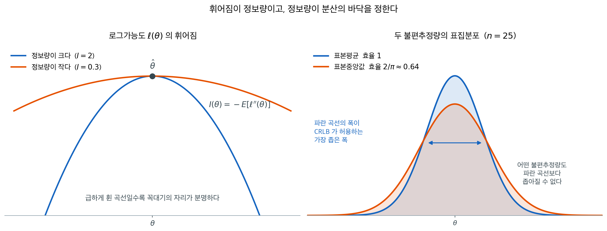
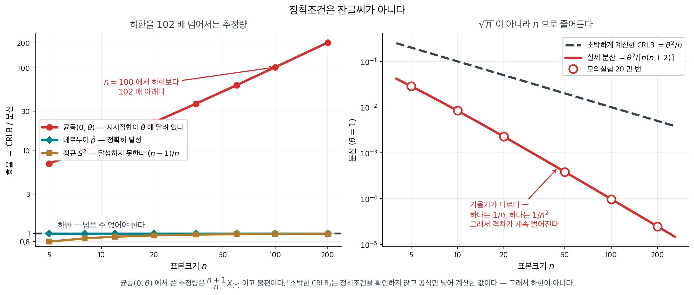

# 효율성과 Cramér-Rao 하한

## 개요

모수적 모형이 주어지면 모수 $\theta$에 대한 불편추정량이 여럿 존재할 수 있다. 어떤 것은 다른 것보다 분산이 작을 텐데, 자연스러운 물음이 떠오른다. 불편추정량의 분산은 얼마나 작아질 수 있는가? **Cramér-Rao 하한(CRLB)**은 임의의 불편추정량의 분산에 근본적인 바닥을 설정함으로써 이 물음에 답한다. 어떤 특정 추정량의 품질을 재는 기준선을 제공하므로 추정이론의 중심이 되는 결과이다.

---

## 1. 들어가기 전에 — 정보량 한 줄

하한을 적으려면 **Fisher 정보량**이 먼저 있어야 한다. 점수함수 $s(X;\theta) = \partial_\theta \log f(X;\theta)$ 의 분산이 그것이고,

$$
I(\theta) = E\!\left[\left(\frac{\partial}{\partial\theta}\log f(X;\theta)\right)^{2}\right] = -E\!\left[\frac{\partial^{2}}{\partial\theta^{2}}\log f(X;\theta)\right]
$$

이며 독립표본에서는 $n I(\theta)$ 로 더해진다. 두 꼴이 같다는 것과 $E[s] = 0$ 이라는 것은 $7.2$ 절 [Fisher 정보량](fisher_information.md)이 정의 $1$·$2$ 와 정리 $1$·$2$ 로 증명해 두었고, 베르누이·정규·포아송에서의 값도 거기 보기 $1$–$3$ 에 있다. 여기서는 그 수를 **하한으로 쓰는** 일만 한다.

---

## 2. Cramér-Rao 부등식

Fisher 정보량을 손에 넣었으니 근본적인 결과를 서술할 수 있다.

<div class="thmbox" markdown>

### 정리 1. (Cramér-Rao 하한) { .thm }


$X_1, \ldots, X_n$을 다음 정칙 조건을 만족하는 밀도함수 또는 질량함수 $f(x; \theta)$를 갖는 i.i.d. 확률변수라 하자:

1. 지지집합 $\{x : f(x; \theta) > 0\}$이 $\theta$에 의존하지 않는다.
2. 도함수 $\frac{\partial}{\partial \theta} f(x; \theta)$와 $\frac{\partial^2}{\partial \theta^2} f(x; \theta)$가 존재하고 연속이다.
3. 미분과 적분(또는 합)을 교환할 수 있다.

그러면 임의의 불편추정량 $\hat{\theta} = \hat{\theta}(X_1, \ldots, X_n)$에 대해:

$$
\text{Var}(\hat{\theta}) \geq \frac{1}{n I(\theta)}
$$

</div>

??? proof "증명"

    **점수함수.** 표본 전체의 로그가능도를 $\ell(\theta) = \sum_i \log f(X_i; \theta)$라
    하고 그 도함수를 **점수** $S(\theta) = \ell'(\theta)$라 하자.

    밀도의 적분이 $\theta$와 무관하게 1이므로, 정칙 조건 3이 허락하는 대로 양변을
    $\theta$로 미분하면

    $$
    0 = \frac{\partial}{\partial \theta}\int f(x; \theta)\,dx
    = \int \frac{\partial f}{\partial \theta}\,dx
    = \int \frac{\partial \log f}{\partial \theta}\, f\,dx
    = E\!\left[\frac{\partial \log f}{\partial \theta}\right]
    $$

    이다. 곧 관측값 하나의 점수는 기댓값이 $0$이고, 따라서 $E[S(\theta)] = 0$이다.
    점수의 분산은 Fisher 정보량의 정의이고 독립이면 더해지므로
    $\text{Var}(S(\theta)) = n I(\theta)$다.

    **불편성을 미분한다.** $\hat\theta$가 불편이므로 모든 $\theta$에 대해
    $E[\hat\theta] = \theta$다. 양변을 $\theta$로 미분하면 왼쪽은

    $$
    \frac{\partial}{\partial \theta}\int \hat\theta(x)\, L(x; \theta)\,dx
    = \int \hat\theta(x)\, \frac{\partial L}{\partial \theta}\,dx
    = \int \hat\theta(x)\, S(\theta)\, L(x; \theta)\,dx
    = E[\hat\theta\, S(\theta)]
    $$

    이고 오른쪽은 $1$이다. $E[S(\theta)] = 0$이므로 이것은 곧 공분산이다.

    $$
    \operatorname{Cov}(\hat\theta,\, S(\theta)) = E[\hat\theta\,S] - E[\hat\theta]E[S] = 1
    $$

    **코시–슈바르츠.** 공분산의 제곱은 분산의 곱을 넘지 못하므로

    $$
    1 = \operatorname{Cov}(\hat\theta, S)^2 \le \text{Var}(\hat\theta)\,\text{Var}(S)
    = \text{Var}(\hat\theta)\cdot n I(\theta)
    $$

    이고, 양변을 $nI(\theta) > 0$으로 나누면 $\text{Var}(\hat\theta) \ge 1/(nI(\theta))$다.
    $\square$

    등호는 코시–슈바르츠가 등호가 될 때, 곧 $\hat\theta - \theta$가 점수의 상수배일
    때에만 성립한다. 뒤에 나오는 **효율적 추정량**이 정확히 그 경우다.

$1 / (nI(\theta))$가 Cramér-Rao 하한이다. 어떤 불편추정량도 이 문턱 아래의 분산을 가질 수 없다.



왼쪽이 정보량의 뜻이다. 로그가능도가 꼭대기에서 급하게 휘어 있으면 $\theta$를 조금만 옮겨도 가능도가 크게 떨어지므로, 자료가 "여기다"라고 강하게 말하는 셈이다. 평평하면 그 반대다. 넓은 구간의 $\theta$가 거의 같은 정도로 자료를 설명하므로 어디가 참값인지 자료가 잘 구별하지 못한다. $I(\theta) = -E[\ell''(\theta)]$가 재는 것이 정확히 이 휘어짐이다.

오른쪽이 그 결과다. 정보량이 정해지면 불편추정량의 분산에 바닥이 생기고, 그 바닥에 닿은 추정량이 **효율적**이다. 정규모집단에서 표본평균은 바닥에 정확히 닿지만 표본중앙값은 그러지 못한다. 두 곡선의 폭 차이가 효율 $2/\pi \approx 0.64$이며, 표본중앙값이 표본평균만큼 정밀해지려면 표본크기를 약 $\pi/2 \approx 1.57$배로 늘려야 한다는 뜻이기도 하다.

!!! example "정규분포 평균의 CRLB"

    $\sigma^2$이 알려진 $X_1, \ldots, X_n \overset{\text{iid}}{\sim} N(\mu, \sigma^2)$이라 하자. 관측값 하나에 대한 로그가능도는

    $$
    \log f(x; \mu) = -\frac{1}{2}\log(2\pi\sigma^2) - \frac{(x - \mu)^2}{2\sigma^2}
    $$

    $\mu$에 대해 2계도함수를 취하면:

    $$
    \frac{\partial^2}{\partial \mu^2} \log f(x; \mu) = -\frac{1}{\sigma^2}
    $$

    따라서 $I(\mu) = 1/\sigma^2$이고, $n$개 관측값에 대한 CRLB는

    $$
    \text{Var}(\hat{\mu}) \geq \frac{1}{n \cdot (1/\sigma^2)} = \frac{\sigma^2}{n}
    $$

    $\text{Var}(\bar{X}) = \sigma^2 / n$이므로 표본평균 $\bar{X}$가 CRLB를 정확히 달성한다.

---

## 3. 하한에 닿는가 — 수로 확인하기

정규분포의 평균에 대해 표본평균이 CRLB를 달성하는지 확인할 수 있다.

<div class="exbox" markdown>

**보기 1.** <span class="diff easy" title="쉬움"></span> 표본평균이 하한에 도달함을 확인하기. $\sigma = 2$인 정규모집단에서 $n = 50$을 뽑는다.

**(1)** 크라메르–라오 하한과 $\operatorname{Var}(\bar X)$를 구해 $\bar X$가 효율적임을 보이고, 비교 대상으로 표본중앙값의 점근분산도 구하시오.

**(2)** 모의실험으로 두 분산을 재면 중앙값의 효율이 $0.6567$로 나온다. 점근값 $2/\pi = 0.6366$보다 $3\%$ 크다. **몬테카를로 오차인가.**

</div>

??? success "풀이"

    **(1) 해석적으로.** 보기 4에서 $I(\mu) = 1/\sigma^2$을 얻었으므로 표본 $n$개의 전체 정보는 $nI(\mu) = n/\sigma^2$이고 하한은

    $$
    \operatorname{Var}(\hat\mu) \ge \frac{1}{nI(\mu)} = \frac{\sigma^2}{n} = \frac{4}{50} = 0.08
    $$

    이다. 한편 $\operatorname{Var}(\bar X) = \sigma^2/n$이 정확히 이 값이다. **표본평균은 하한을 등호로 달성한다.** 점근적으로만 그런 것이 아니라 모든 $n$에서 그렇다.

    표본중앙값은 다르다. 중앙값의 점근분포는

    $$
    \sqrt{n}\,(\tilde X - \mu) \overset{d}{\to} N\!\left(0, \frac{1}{4f(\mu)^2}\right)
    $$

    인데 정규밀도의 중앙에서 $f(\mu) = 1/(\sigma\sqrt{2\pi})$이므로

    $$
    \frac{1}{4f(\mu)^2} = \frac{2\pi\sigma^2}{4} = \frac{\pi\sigma^2}{2},
    \qquad
    \operatorname{Var}(\tilde X) \approx \frac{\pi\sigma^2}{2n} = \frac{\pi \cdot 4}{100} = 0.1257
    $$

    이다. 효율은 둘의 비

    $$
    \frac{\sigma^2/n}{\pi\sigma^2/(2n)} = \frac{2}{\pi} = 0.6366
    $$

    으로 $\sigma$와 $n$이 모두 지워진다. **중앙값은 자료가 담은 정보의 $64\%$만 쓴다**는 익숙한 수가 여기서 나온다. 다만 이 $2/\pi$는 $n \to \infty$의 값이라는 점을 기억해 두자. (2)의 물음이 바로 그것이다.

    **(2) 수치적으로. 몬테카를로 오차가 아니다 — 유한표본 효과다.** 먼저 모의실험을 돌린다.

    ```python
    import numpy as np

    def verify_crlb(mu_true=5.0, sigma=2.0, n=50, n_sim=20_000):
        """표본평균이 크라메르-라오 하한에 도달함을 확인한다."""
        rng = np.random.default_rng(42)
        crlb = sigma**2 / n

        means = np.array([rng.normal(mu_true, sigma, n).mean() for _ in range(n_sim)])
        empirical_var = means.var()

        print(f"CRLB = sigma^2/n = {crlb:.6f}")
        print(f"Var(X_bar)       = {empirical_var:.6f}")
        print(f"Ratio            = {empirical_var / crlb:.4f}")

        # 비교: 중앙값은 하한을 달성하지 못한다.
        # 정규모집단에서 중앙값의 점근 효율은 2/pi ≈ 0.637 이다.
        # 즉 같은 정밀도를 얻으려면 표본이 약 1.57배 더 필요하다.
        medians = np.array([np.median(rng.normal(mu_true, sigma, n)) for _ in range(n_sim)])
        print(f"\nVar(median) = {medians.var():.6f}")
        print(f"Efficiency of median = {crlb / medians.var():.4f}")

    verify_crlb()
    ```

    출력:

    ```
    CRLB = sigma^2/n = 0.080000
    Var(X_bar)       = 0.078777
    Ratio            = 0.9847

    Var(median) = 0.121813
    Efficiency of median = 0.6567
    ```

    **표본평균 쪽은 먼저 정리된다.** $\operatorname{Var}(\bar X) = 0.078777$이 하한 $0.08$의 $0.9847$배인데, 반복 $20{,}000$회에서 분산 추정값의 상대 표준오차가 $\sqrt{2/20{,}000} = 1.0\%$이므로 $1.5\%$의 어긋남은 $1.5$ 표준오차다. 몬테카를로 요동이고, (1)이 말한 등호 달성과 어긋나지 않는다.

    **중앙값 쪽은 다르다.** $0.6567$과 $0.6366$의 차이는 $3\%$, 곧 $3$ 표준오차로 요동만으로는 설명되지 않는다. 범인은 $2/\pi$가 **$n \to \infty$의 값**이라는 데 있다. $n$을 바꿔 가며 다시 재 보면 드러난다.

    ```python
    import numpy as np

    # 중앙값의 효율이 n 과 함께 2/pi 로 내려가는지 본다.
    # 반복 수를 n 에 따라 달리 두어 작은 n 쪽의 몬테카를로 오차를 줄인다.
    print(f"{'n':>6} {'반복':>8} {'Var(median)':>13} {'CRLB':>10} {'효율':>8} {'MC오차':>8}")
    print("-" * 60)
    rng = np.random.default_rng(0)
    for n, n_sim in ((49, 200_000), (50, 200_000), (51, 200_000),
                     (200, 50_000), (1000, 20_000)):
        v = np.median(rng.normal(5.0, 2.0, size=(n_sim, n)), axis=1).var()
        print(f"{n:>6} {n_sim:>8} {v:>13.6f} {4 / n:>10.6f} "
              f"{(4 / n) / v:>8.4f} {np.sqrt(2 / n_sim):>7.2%}")
    print(f"\n점근값 2/pi = {2 / np.pi:.4f}")
    ```

    출력:

    ```
         n       반복   Var(median)       CRLB       효율     MC오차
    ------------------------------------------------------------
        49   200000      0.126389   0.081633   0.6459   0.32%
        50   200000      0.122504   0.080000   0.6530   0.32%
        51   200000      0.121927   0.078431   0.6433   0.32%
       200    50000      0.031505   0.020000   0.6348   0.63%
      1000    20000      0.006296   0.004000   0.6353   1.00%

    점근값 2/pi = 0.6366
    ```

    **$n$이 커지면 효율이 $2/\pi$로 내려간다.** $n = 1000$에서 $0.6353$, $n = 200$에서 $0.6348$로 둘 다 점근값 $0.6366$과 몬테카를로 오차 안에서 맞는다. 반면 $n = 50$에서는 $0.6530$으로 분명히 크다. 처음의 $0.6567$은 이 유한표본 값에 반복 수가 적어 생긴 요동이 더해진 것이다.

    **왜 $n = 50$이 유독 유리한가.** 표에서 $n = 49$는 $0.6459$, $n = 51$은 $0.6433$인데 가운데 끼인 $n = 50$만 $0.6530$으로 튄다. 몬테카를로 오차 $0.32\%$를 넘는 차이다. 짝수 $n$에서는 중앙값이 가운데 **두** 순서통계량의 평균이고, 그 평균이 하나만 쓰는 것보다 분산을 줄여 주기 때문이다. 홀수와 짝수가 번갈아 오르내리면서 $n$이 커질수록 둘 다 $2/\pi$로 모인다.

    정리하면 **표본평균의 $1.5\%$는 몬테카를로 오차이고, 중앙값의 $3\%$는 유한표본 효과다.** 겉보기 크기는 비슷해도 성격이 다르며, 반복 수를 늘려 가려낼 수 있는 것은 앞쪽뿐이다.

!!! note "중앙값의 효율"
    정규분포에서 평균 대비 중앙값의 점근 상대효율은 $2/\pi \approx 0.637$이다. 중앙값은 자료가 담은 정보의 약 64%만 사용한다.

---

---

## 4. 효율성

CRLB는 자연스럽게 불편추정량의 순위를 매기는 방법으로 이어진다. 하한을 달성하는 불편추정량은 가능한 한 최선이다. 자료에서 모든 정보를 뽑아내기 때문이다.

불편추정량 $\hat{\theta}$가 모든 $\theta$에 대해 다음을 만족하면 **효율적**이라 한다:

$$
\text{Var}(\hat{\theta}) = \frac{1}{n I(\theta)}
$$

불편추정량의 **효율**은 CRLB를 실제 분산으로 나눈 비이다:

$$
e(\hat{\theta}) = \frac{1 / (nI(\theta))}{\text{Var}(\hat{\theta})} \leq 1
$$

효율이 1이면 그 추정량은 효율적이다. 1보다 작은 값은 이론적 최적에 비해 얼마나 많은 분산이 "낭비"되었는지를 나타낸다.

!!! example "표본평균의 효율 (정규분포)"

    위의 예에서 $\bar{X}$의 분산은 $\sigma^2/n$이고 CRLB도 $\sigma^2/n$이므로

    $$
    e(\bar{X}) = \frac{\sigma^2/n}{\sigma^2/n} = 1
    $$

    표본평균은 (분산이 알려진) 정규분포 평균의 효율적 추정량이다.

!!! example "표본중앙값의 효율 (정규분포)"

    $X_1, \ldots, X_n \overset{\text{iid}}{\sim} N(\mu, \sigma^2)$에서 표본중앙값도 $\mu$의 불편추정량이지만 점근분산은 $\pi \sigma^2 / (2n)$이다. 따라서 점근 효율은

    $$
    e(\text{median}) = \frac{\sigma^2/n}{\pi\sigma^2/(2n)} = \frac{2}{\pi} \approx 0.637
    $$

    표본중앙값은 정규분포 자료에서 표본평균이 뽑아내는 정보의 약 64%만 사용한다.

---

## 5. CRLB를 달성할 수 없는 경우

모든 모수적 모형에 효율적 추정량이 존재하는 것은 아니다. CRLB를 달성할 수 있을 필요충분조건은 점수함수를 다음 형태로 쓸 수 있는 것이다:

$$
\frac{\partial}{\partial \theta} \log f(x; \theta) = a(\theta)\left[T(x) - \theta\right]
$$

여기서 $a(\theta)$는 어떤 함수이고 $T(x)$는 통계량이다. 이 조건은 지수족 분포에서 만족되지만 다른 많은 모형에서는 성립하지 않는다.

!!! warning "균등분포"

    $X_1, \ldots, X_n \overset{\text{iid}}{\sim} \text{Uniform}(0, \theta)$라 하자. 지지집합 $\{x : 0 < x < \theta\}$가 $\theta$에 의존하므로 첫 번째 정칙 조건을 위반한다. CRLB가 적용되지 않으며, 실제로 MLE $\hat{\theta} = X_{(n)}$(표본 최댓값)의 분산은 $1/n^2$의 속도로 줄어들어 CRLB가 허용할 $1/n$ 속도보다 빠르다.

<div class="storybox" markdown>

**그림으로 보는 통계학 1.** 정칙조건은 잔글씨가 아니다

위 경고가 말하는 「$1/n$ 보다 빠르다」가 얼마나 빠른 것인지 재 보자. 정리 1 의 조건들을 세 모형에서 나란히 놓으면 세 가지 다른 일이 일어난다.

<figure markdown>
{ width="900" }
  <figcaption markdown>효율은 CRLB $\div$ 분산이다. 정의상 $1$ 을 넘을 수 없어야 한다. 오른쪽 동그라미는 모의실험 $20$ 만 번으로 확인한 값이다.</figcaption>
</figure>

| 표본크기 $n$ | 베르누이 $\hat p$ | 정규 $S^2$ | 균등$(0,\theta)$ |
|---|---|---|---|
| $5$ | $1.000$ | $0.800$ | $\mathbf{7.0}$ |
| $20$ | $1.000$ | $0.950$ | $\mathbf{22.0}$ |
| $100$ | $1.000$ | $0.990$ | $\mathbf{102.0}$ |

- **베르누이** — $\hat p$ 의 분산이 $p(1-p)/n$ 이고 CRLB 도 같다. **정확히 달성한다.** §4 의 지수족 조건을 만족하기 때문이다.
- **정규분포의 $S^2$** — $\operatorname{Var}(S^2) = 2\sigma^4/(n-1)$ 인데 CRLB 는 $2\sigma^4/n$ 이다. 달성하지 못하지만 **하한 아래로 내려가지도 않는다.** 효율이 $(n-1)/n$ 으로 $1$ 에 다가갈 뿐이다.
- **균등분포** — $\frac{n+1}{n}X_{(n)}$ 은 불편이고 분산이 $\theta^2/[n(n+2)]$ 다. 공식만 넣어 계산한 「CRLB」 $\theta^2/n$ 과 견주면 효율이 $n+2$ 다. $n = 100$ 에서 **하한보다 $102$ 배 아래**에 있다.

조건을 어기면 결과가 **조금** 나빠지는 것이 아니라 하한이 통째로 무너진다. 그리고 $n$ 이 커질수록 더 무너진다 — 오른쪽 그림에서 두 선의 **기울기가 다르기** 때문이다.

까닭은 자료가 모수를 좁히는 방식에 있다. 보통의 모형에서는 관측값 하나가 $\theta$ 에 대한 믿음을 **조금씩** 조정한다. 그런데 균등분포에서는 $x_i > \theta$ 인 관측값이 하나라도 나오면 그 $\theta$ 는 **즉시 배제된다.** 조금 깎는 것이 아니라 단칼에 자르는 것이다. 그래서 수렴이 $\sqrt{n}$ 이 아니라 $n$ 으로 간다.

끝으로 이 부등식의 내력. **네 사람이 네 해 사이에 따로 얻었다** — 프레셰($1943$, 프랑스), 다르무아($1945$, 프랑스), 라오($1945$, 인도), 크라메르($1946$, 스웨덴). 전쟁으로 나라 사이의 연락이 끊겨 있던 기간이다. 라오 쪽의 계기는 교실이었다. $1944$ 년 $1$ 월, 스물넷이던 그가 캘커타에서 추정을 가르치며 **큰 표본에서 성립하는** 피셔의 결과를 증명해 보이자 한 학생이 물었다 — 「표본이 작을 때는 왜 안 됩니까?」 그는 집에 가 밤을 새웠고, 이듬해 스물다섯에 논문으로 냈다. 그래서 이 부등식을 네 이름을 모두 붙여 부르는 책도 있다.

_확인한 곳 — 네 사람이 따로 얻은 연도(프레셰 $1943$, 다르무아 $1945$, 라오 $1945$, 크라메르 $1946$)와 다르무아가 처음으로 엄밀한 증명을 준 것, $1944$ 년 $1$ 월 캘커타의 수업에서 학생의 물음을 받고 라오가 밤새워 유한표본 판을 얻어 이듬해 발표했다는 일화. 그림과 표의 수는 모두 직접 계산한 값이다_

</div>

---

## 연습문제

<div class="drillbox" markdown>

**연습문제 1.** <span class="diff med" title="중간"></span>
$X_1, \ldots, X_n \sim N(\mu, \sigma^2)$이고 추정량이 $\hat\mu_w = wX_1 + (1-w)\bar X$이다. (a) 불편인가? (b) 분산을 최소화하는 $w$는? (c) $w = 0$과 $w = 1$에서의 분산은?

</div>

??? success "풀이"
    (a) 선형성에 의해 $\mathbb{E}[\hat\mu_w] = w\mu + (1-w)\mu = \mu$이다. 모든 $w$에 대해 불편이다.

    (b) $\bar X_{-1}$을 ($X_1$과 독립인) $X_2, \ldots, X_n$의 평균이라 하고 $\bar X = X_1/n + (n-1)\bar X_{-1}/n$으로 쓰면:

    $\hat\mu_w = (w + (1-w)/n) X_1 + ((1-w)(n-1)/n) \bar X_{-1}$

    분산은 두 항 모두에 양의 계수를 가지며, $w$에 대해 미분하여 0으로 두면 $w^* = 0$을 얻는다.

    (c) $w = 0$: $\hat\mu = \bar X$, $\mathrm{Var} = \sigma^2/n$. $w = 1$: $\hat\mu = X_1$, $\mathrm{Var} = \sigma^2$. $w = 1$의 대가는 분산이 $n$배가 되는 것이다.

    표본평균이 관측값 하나에 의존하는 것보다 $n$배 효율적이다.

---

<div class="drillbox" markdown>

**연습문제 2.** <span class="diff med" title="중간"></span>
**정규분포 평균의 효율성.** $X \sim N(\mu, \sigma^2)$에서 $\mu$를 추정할 때 $\bar X$가 CRLB를 달성함을 보여라.

</div>

??? success "풀이"
    정규분포 평균의 Fisher 정보량은 $I(\mu) = 1/\sigma^2$이다. CRLB는 $\mathrm{Var}(\hat\mu) \ge \sigma^2/n$이다.

    표본평균의 분산은 $\mathrm{Var}(\bar X) = \sigma^2/n$으로 CRLB를 정확히 달성한다.

    따라서 $\bar X$는 $\mu$에 대한 **일률최소분산불편추정량(UMVUE)**이다. 어떤 $\mu$에서도 이보다 분산이 작은 불편추정량은 없다.

    이는 강한 최적성 결과이다. $\bar X$는 단지 일치하고 불편인 데 그치지 않고, 정규 모형 아래에서 *최선의* 추정량이다.

---

<div class="drillbox" markdown>

**연습문제 3.** <span class="diff med" title="중간"></span>
**MLE의 점근 효율성.** MLE가 점근적으로 CRLB를 달성한다는 결과를 서술하고 설명하라.

</div>

??? success "풀이"
    **결과:** 정칙 조건 아래에서 $\hat\theta_{\text{MLE}}$는 분산이 CRLB와 같은 **점근적 정규**이다:

    $$
    \sqrt n (\hat\theta_{\text{MLE}} - \theta) \xrightarrow{d} N(0, 1/I(\theta))
    $$

    따라서 $\mathrm{Var}(\hat\theta_{\text{MLE}}) \to 1/(n I(\theta))$로, 관측값 하나당 Fisher 정보량의 역수가 된다. 이것이 불편추정량의 CRLB이다.

    **함의:** MLE는 **점근적으로 효율적**이다. 모든 일치추정량 중에서 MLE의 점근분산이 가장 작다.

    **주의:** 유한표본에서의 효율은 나쁠 수 있다. MLE는 편향될 수도, 존재하지 않을 수도, 느리게 수렴할 수도 있다. 점근 효율성은 장기적인 보장이지 유한표본에 대한 보장이 아니다.

    소표본에서는 다른 추정량(적률법, 편향 보정된 MLE, James-Stein 계열의 축소)이 MLE를 능가할 수 있다. $n$이 크면 MLE가 사실상 최적이다.

---

<div class="drillbox" markdown>

**연습문제 4.** <span class="diff med" title="중간"></span>
**비효율적인 불편추정량.** $N(\mu, 1)$에서 분산이 $1/n$(CRLB)보다 큰 $\mu$의 불편추정량을 구성하라. 그런 추정량이 존재하는 이유를 설명하라.

</div>

??? success "풀이"
    예: $\hat\mu = X_1$(첫 관측값만 사용). 불편이다: $\mathbb{E}[X_1] = \mu$. 분산: $\mathrm{Var}(X_1) = 1$.

    $n \ge 2$이면 $\mathrm{Var}(X_1) = 1 > 1/n =$ CRLB이다. 따라서 이 추정량은 $n$배 비효율적이다.

    **그런 추정량이 존재하는 이유:** CRLB는 *하한*이며 많은 추정량이 그 위에 있다. CRLB는 어떤 불편추정량도 그 **아래**로 갈 수 없다고 말할 뿐이다. ($X_2, \ldots, X_n$을 무시하는 $X_1$처럼) 정보를 버리는 추정량은 분명히 최적이 아니다.

    다른 예: $(X_1 + X_2)/2$(관측값 두 개만 사용), $X_{(n)}$(최댓값이며 특정 분포에서만 불편이다).

    **효율**은 불편추정량의 분산이 CRLB에 얼마나 가까운지를 잰다. $\bar X$의 효율은 1이고(CRLB 달성), 크기 $n$인 정규 표본에서 $X_1$의 효율은 $1/n$이다.

---

<div class="drillbox" markdown>

**연습문제 5.** <span class="diff med" title="중간"></span>
**실제 응용에서의 맞바꿈.** 언제 불편추정량보다 편향되어 있지만 평균제곱오차가 작은 추정량(예: 능형회귀, James-Stein)을 선호하겠는가?

</div>

??? success "풀이"
    **MSE 분해:** $\mathrm{MSE}(\hat\theta) = \mathrm{Var}(\hat\theta) + [\mathrm{Bias}(\hat\theta)]^2$.

    불편추정량은 $\mathrm{Bias} = 0$이므로 $\mathrm{MSE} = \mathrm{Var}$이고, CRLB가 이를 아래에서 제한한다.

    어느 정도의 편향을 받아들이면 편향의 제곱이 더하는 것보다 분산이 더 많이 줄어들 수 있고, 그러면 **평균제곱오차가 내려간다**.

    **예:**

    - **능형회귀:** 0 쪽으로 편향되지만 큰 계수에 벌점을 주어 분산을 줄인다. 설명변수가 상관된 상황에서 평균제곱오차가 더 작다.
    - **James-Stein** ($p \ge 3$개의 정규 평균 추정): 개별 표본평균을 0 쪽으로 축소하여 결합하며, 참 모수가 무엇이든 평균제곱오차에서 MLE를 지배한다.
    - **정보가 있는 사전분포를 쓴 MAP:** 사전 평균 쪽으로 편향되지만 정칙화 덕분에 분산이 작다. 사전분포가 대체로 옳으면 평균제곱오차가 더 작다.

    **선호할 때:**

    - 표본크기가 작을 때(높은 분산이 지배한다).
    - 자료에 비해 모수가 많을 때(고차원 회귀).
    - 예측이 목적일 때(불편성보다 평균제곱오차가 중요하다).
    - 사전 정보를 쓸 수 있을 때(베이즈 상황).

    **불편추정량을 선호할 때:**

    - 추정값의 해석이 중요할 때(예: 인과효과).
    - 표본크기가 클 때(분산은 줄지만 편향은 남는다).
    - 규제나 학문적 관행이 불편성을 요구할 때.

    편향–분산 맞바꿈은 근본적인 긴장이며, 현대 통계적 학습은 평균제곱오차에서 이기기 위해 편향을 받아들이는 일이 일상적이다.

---

<div class="drillbox" markdown>

**연습문제 6.** <span class="diff med" title="중간"></span>
Cramér-Rao 하한이 **달성되기 위한 조건**을 밝혀라. 어떤 분포족에서 달성 가능한 불편추정량이 존재하는가?

</div>

??? success "풀이"
    **등호 조건.** 크라메르–라오 부등식은 점수함수 $S(\theta)=\partial\ell/\partial\theta$와 $\hat\theta$ 사이의 코시–슈바르츠 부등식에서 나온다. 등호는 두 확률변수가 **선형 관계**일 때만 성립하므로, 조건은

    $$
    S(\theta) = a(\theta)\left\{\hat\theta - \theta\right\}
    $$

    가 확률 1로 성립하는 것이다($a(\theta)$는 자료에 의존하지 않는 함수).

    **이 조건은 지수족을 낳는다.** 위 식을 $\theta$에 대해 적분하면

    $$
    \ell(\theta) = A(\theta)\,T(\mathbf{x}) + B(\theta) + C(\mathbf{x})
    $$

    꼴이 되고, 지수를 취하면

    $$
    f(\mathbf{x};\theta) = h(\mathbf{x})\exp\left\{A(\theta)T(\mathbf{x})-B(\theta)\right\}
    $$

    로 **일모수 지수족**이다. 그리고 $\hat\theta$는 $T(\mathbf{x})$의 특정 선형함수여야 한다.

    **정리하면.** 하한을 달성하는 불편추정량이 존재하려면

    1. 모형이 일모수 지수족이고,
    2. 추정 대상이 **평균모수**(자연통계량의 기대값)여야 한다.

    **예.**

    | 분포 | 하한을 달성하는 모수 | 추정량 |
    |---|---|---|
    | 정규($\sigma$ 기지) | $\mu$ | $\bar X$ |
    | 포아송 | $\lambda$ | $\bar X$ |
    | 베르누이 | $p$ | $\bar X$ |
    | 지수 | $\mu = 1/\lambda$ | $\bar X$ |

    모두 $\bar X$라는 점이 시사적이다. 지수족에서 자연통계량의 평균을 추정할 때만 하한이 달성된다.

    **달성되지 않는 예.** 같은 포아송에서 $g(\lambda)=e^{-\lambda}$를 추정하면 하한을 달성하는 불편추정량이 없다. $\lambda$의 비선형 함수이기 때문이다. 지수분포에서 $\lambda$ 자체도 마찬가지다($\mu=1/\lambda$는 되지만).

    **실무적 함의.** "MLE가 하한을 달성하지 못한다"는 것이 MLE가 나쁘다는 뜻이 아니다. **하한 자체가 달성 불가능한 경우가 많다.** 그래서 유한표본 최적성보다 점근효율성을 기준으로 삼는 것이 일반적이다.

---

<div class="drillbox" markdown>

**연습문제 7.** <span class="diff med" title="중간"></span>
**상대효율**을 정의하고, 정규모집단에서 표본중앙값·표본평균, 그리고 $t_3$ 모집단에서 같은 둘의 상대효율을 계산해 비교하라.

</div>

??? success "풀이"
    **정의.** 두 불편추정량(또는 같은 양을 추정하는 두 일치추정량)의 **점근상대효율**은

    $$
    \text{ARE}(\hat\theta_1, \hat\theta_2) = \frac{\text{점근분산}(\hat\theta_2)}{\text{점근분산}(\hat\theta_1)}
    $$

    이다. 1보다 크면 $\hat\theta_1$이 효율적이다. 실무적으로는 "같은 정밀도를 얻는 데 필요한 표본크기의 비"로 읽는다.

    **일반 공식.** 표본중앙값의 점근분산이 $1/\{4nf(m)^2\}$이고 표본평균이 $\sigma^2/n$이므로

    $$
    \text{ARE}(\tilde X, \bar X) = 4\sigma^2 f(m)^2
    $$

    **정규모집단.** $f(\mu) = 1/(\sigma\sqrt{2\pi})$이므로

    $$
    \text{ARE} = 4\sigma^2\cdot\frac{1}{2\pi\sigma^2} = \frac{2}{\pi} = 0.637
    $$

    중앙값이 평균보다 나쁘다. 같은 정밀도에 표본이 $1/0.637 = 1.57$배 필요하다.

    **$t_3$ 모집단.** 분산이 $\nu/(\nu-2) = 3$이고 밀도의 중심값이

    $$
    f(0) = \frac{\Gamma(2)}{\sqrt{3\pi}\,\Gamma(1.5)} = \frac{1}{\sqrt{3\pi}\cdot(\sqrt\pi/2)} = \frac{2}{\pi\sqrt3} = 0.3676
    $$

    이므로

    $$
    \text{ARE} = 4\times3\times0.3676^2 = 1.62
    $$

    **중앙값이 평균보다 62% 효율적이다.** 순서가 뒤집혔다.

    **정리.**

    | 모집단 | ARE(중앙값 대 평균) |
    |---|---|
    | 정규 | 0.64 |
    | $t_5$ | 0.96 |
    | $t_3$ | 1.62 |
    | 이중지수(라플라스) | 2.00 |
    | 코시 | $\infty$ |

    **교훈.** **어느 추정량이 효율적인지는 모집단 분포에 달려 있다.** 정규분포를 벗어나 꼬리가 조금만 두꺼워져도($t_5$쯤) 두 방법이 거의 같아지고, 더 두꺼워지면 중앙값이 이긴다. 모집단을 확신할 수 없다면 **절사평균처럼 두 극단 사이에 있는 추정량**이 합리적인 보험이다. 20% 절사평균은 정규에서 96%, $t_3$에서 1.4 정도의 효율을 낸다.

---

<div class="drillbox" markdown>

**연습문제 8.** <span class="diff med" title="중간"></span>
$X_i \sim \text{Uniform}(0,\theta)$에서 $\hat\theta = \frac{n+1}{n}X_{(n)}$의 분산이 Cramér-Rao 하한보다 **작다**. 모순이 아닌 이유를 설명하라.

</div>

??? success "풀이"
    **분산 계산.** $X_{(n)}/\theta \sim \text{Beta}(n,1)$이므로

    $$
    E[X_{(n)}] = \frac{n}{n+1}\theta, \qquad \operatorname{Var}(X_{(n)}) = \frac{n\theta^2}{(n+1)^2(n+2)}
    $$

    이고

    $$
    \operatorname{Var}(\hat\theta) = \left(\frac{n+1}{n}\right)^2\operatorname{Var}(X_{(n)}) = \frac{\theta^2}{n(n+2)}
    $$

    **$O(n^{-2})$이다.**

    **형식적인 "하한".** $f(x;\theta)=1/\theta$이므로 $\ln f = -\ln\theta$이고 $\partial\ln f/\partial\theta = -1/\theta$, $\partial^2\ln f/\partial\theta^2 = 1/\theta^2$이다. 그대로 계산하면

    $$
    I_1(\theta) = \frac{1}{\theta^2}, \qquad \text{"하한"} = \frac{\theta^2}{n}
    $$

    가 나온다. $\theta^2/\{n(n+2)\}$가 이보다 한 차수 작다.

    **모순이 아닌 이유.** **크라메르–라오 부등식의 정칙 조건이 성립하지 않기 때문이다.**

    구체적으로, 부등식의 유도에서

    $$
    \frac{\partial}{\partial\theta}\int f(x;\theta)\,dx = \int \frac{\partial f}{\partial\theta}\,dx
    $$

    처럼 **미분과 적분을 맞바꾸는** 단계가 필요하다. 여기서는 적분 구간이 $[0,\theta]$로 $\theta$에 의존하므로, 라이프니츠 규칙에 따라 경계항이 추가로 나온다.

    $$
    \frac{\partial}{\partial\theta}\int_0^\theta \frac{1}{\theta}dx = \frac{\partial}{\partial\theta}(1) = 0
    $$

    인데, 적분 안에서만 미분하면 $\int_0^\theta(-1/\theta^2)dx = -1/\theta \ne 0$이다. **맞바꿈이 성립하지 않는다.**

    그 결과 $E[S(\theta)] = 0$이라는 기본 항등식이 깨지고, 그 위에 세워진 크라메르–라오 부등식 전체가 무효가 된다.

    **교훈.** 정칙 조건은 장식이 아니다. **지지집합이 모수에 의존하면 크라메르–라오를 쓰면 안 된다.** 그런 모형에서는 수렴 속도가 $\sqrt n$보다 빠를 수 있고(초일치성), 극한분포도 정규가 아니다.

---

<div class="drillbox" markdown>

**연습문제 9.** <span class="diff med" title="중간"></span>
효율성을 따질 때 **불편성이라는 제약**을 푸는 것이 왜 중요한지, 제임스–스타인 추정량을 예로 설명하라.

</div>

??? success "풀이"
    **문제 설정.** $\mathbf{X} \sim N_d(\boldsymbol\mu, I)$에서 $\boldsymbol\mu$를 추정한다. MLE는 $\hat{\boldsymbol\mu} = \mathbf{X}$이고, 이는

    - 불편이고,
    - 각 성분이 크라메르–라오 하한을 달성하며,
    - 최소분산불편추정량이다.

    "불편추정량 안에서 최적"이라는 자격을 모두 갖췄다.

    **제임스–스타인 추정량.**

    $$
    \hat{\boldsymbol\mu}_{\text{JS}} = \left(1-\frac{d-2}{\|\mathbf{X}\|^2}\right)\mathbf{X}
    $$

    $d \ge 3$이면 **모든 $\boldsymbol\mu$에서**

    $$
    E\left\|\hat{\boldsymbol\mu}_{\text{JS}}-\boldsymbol\mu\right\|^2 < E\left\|\mathbf{X}-\boldsymbol\mu\right\|^2 = d
    $$

    가 성립한다. 즉 MLE가 **허용 불가능**(inadmissible)하다.

    **왜 이런 일이 가능한가.** 제임스–스타인은 편향되어 있다. $\mathbf{X}$를 원점 쪽으로 축소하므로 편향이 생기지만, 그 대가로 분산이 더 크게 줄어든다. $d \ge 3$이면 언제나 이 거래가 이득이다.

    직관은 이렇다. $\|\mathbf{X}\|^2$의 기대값이 $\|\boldsymbol\mu\|^2 + d$이므로 $\mathbf{X}$는 원점에서 **체계적으로 너무 멀리** 있다. 그만큼 당겨 주면 좋아진다. 차원이 높을수록 이 과대평가가 뚜렷해져 $d \ge 3$에서 효과가 나타난다.

    **가장 놀라운 점.** 성분들이 **서로 아무 관련이 없어도** 성립한다. 밀의 가격, 대만의 교통사고 수, 어떤 별의 밝기를 함께 추정해도 셋을 공동으로 축소하는 것이 낫다. 개별 성분의 오차는 나빠질 수 있지만 **총 제곱오차는 반드시 줄어든다.**

    **함의.**

    - **불편성은 최적성의 기준이 아니다.** "불편추정량 중 최선"이라는 결과는 그 부류 안에서만 최선이라는 뜻이며, 그 부류 자체가 최선이 아닐 수 있다.
    - **여러 모수를 동시에 추정하는 상황**에서는 정보를 빌려 오는 것이 이득이다. 이것이 계층 베이즈 모형, 축소 추정, 경험 베이즈의 출발점이다.
    - 능형회귀, 라소, 정칙화가 모두 같은 원리 위에 있다. **편향을 조금 들여 분산을 크게 줄인다.**

    제임스–스타인이 발표된 1961년에 이 결과가 충격적이었던 것은, 당시 통계학이 불편성을 거의 공리처럼 받아들이고 있었기 때문이다.

---

<div class="drillbox" markdown>

**연습문제 10.** <span class="diff hard" title="어려움"></span>
**Cramér-Rao 하한 (CRLB).** 불편추정량에 대한 CRLB를 서술하고 증명하라.

</div>

??? success "풀이"
    **CRLB:** $\hat\theta$가 밀도 $f(x; \theta)$에서 얻은 $n$개의 i.i.d. 관측값에 기반한 $\theta$의 불편추정량이면:

    $$
    \mathrm{Var}(\hat\theta) \ge \frac{1}{n I(\theta)}
    $$

    여기서 $I(\theta) = -\mathbb{E}[\partial^2 \log f/\partial \theta^2]$는 관측값 하나당 Fisher 정보량이다.

    **증명 개요:** Cauchy-Schwarz에 의해 $|\mathrm{Cov}(\hat\theta, S)|^2 \le \mathrm{Var}(\hat\theta) \mathrm{Var}(S)$이며, $S = \partial \log L/\partial \theta$는 **점수함수**이다. (불편성에서 $\mathbb{E}[\hat\theta] = \theta$를 미분하여) $\mathrm{Cov}(\hat\theta, S) = 1$이고 $\mathrm{Var}(S) = n I(\theta)$임을 계산한다. 따라서 $1 \le \mathrm{Var}(\hat\theta) \cdot n I(\theta)$이고 하한을 얻는다.

    등호는 $\hat\theta$가 점수함수의 선형함수일 때, 즉 추정량이 **효율적**일 때에만 성립한다.

---

## 정리하며

크라메르–라오 하한은 불편추정량의 분산에 **넘을 수 없는 바닥**을 정한다.

$$
\mathrm{Var}(\hat\theta) \;\ge\; \frac{1}{n\,I(\theta)}
$$

- **피셔 정보량** $I(\theta)=\mathbb{E}\bigl[(\partial_\theta\log f(X;\theta))^2\bigr]$ 이 관측 하나가 담은 정보량이다. 점수함수의 평균이 $0$ 이므로 정보량은 그 **분산**이다.
- **정보가 많을수록 하한이 낮다.** 가능도가 $\theta$ 에 민감하게 반응할수록(로그가능도의 곡률이 클수록) 그 모수를 정밀하게 추정할 수 있다는 뜻이며, $I(\theta)=-\mathbb{E}[\partial^2_\theta\log f]$ 라는 두 번째 표현이 그 곡률 해석을 직접 보여 준다.
- **$1/n$ 이 붙는다는 사실**이 표준 $\sqrt n$ 속도의 근원이다.
- **하한을 달성하는 추정량을 효율적이라 한다.** 지수족에서 자연모수를 추정할 때 달성되며, 일반적으로는 최대가능도추정량이 **점근적으로** 달성한다.
- **정칙 조건이 필수다.** 지지집합이 $\theta$ 에 의존하면(균등분포의 $\theta$ 추정이 그렇다) 하한 자체가 성립하지 않고, 실제로 $1/n$ 보다 빠른 $1/n^2$ 속도가 가능하다.

다음 절 **충분성**으로 넘어간다. "정보를 잃지 않고 자료를 얼마나 압축할 수 있는가"라는, 정보량과 짝을 이루는 물음이다.
