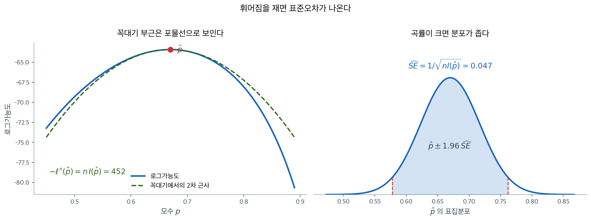
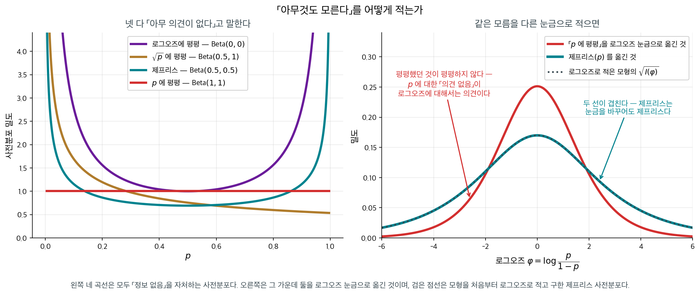
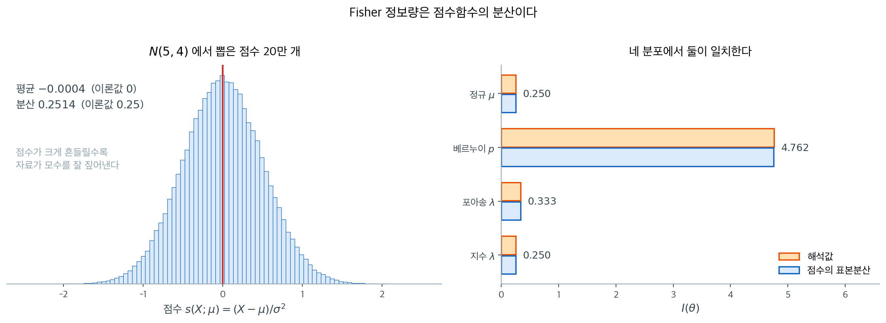

# Fisher 정보량과 표준오차

## 개요

자료로부터 모수 $\theta$를 추정할 때 우리는 $\theta$를 얼마나 정밀하게 추정할 수 있는지 알고 싶다. 그 답은 자료가 $\theta$에 관해 얼마나 많은 "정보"를 담고 있는지에 달려 있다. Fisher 정보량은 이 개념을 형식화한다. 임의의 불편추정량이 도달할 수 있는 가장 날카로운 정밀도를 결정하고, 최대가능도추정값의 표준오차를 곧바로 제공한다. 요컨대 Fisher 정보량은 모수적 모형과 그로부터 이끌어 낼 수 있는 추론의 질을 잇는 다리이다.

---

## 1. 점수함수

Fisher 정보량을 정의하기 위해 먼저 **점수함수**를 소개한다. $X$를 확률밀도함수 또는 확률질량함수가 $f(x; \theta)$인 확률변수라 하자. 점수함수는 로그가능도를 $\theta$에 대해 미분한 것이다:

<div class="defn" markdown>

### 정의 1. 점수함수 { .dfn }

$$
s(x; \theta) = \frac{\partial}{\partial \theta} \log f(x; \theta)
$$

</div>

점수함수는 로그가능도가 $\theta$의 변화에 얼마나 민감한지를 담아낸다. $\theta$가 변할 때 로그가능도가 급격히 달라지면 자료가 $\theta$에 관해 많은 정보를 담고 있는 것이고, 평평하면 정보가 거의 없는 것이다.

<div class="thmbox" markdown>

### 정리 1. 점수함수의 기댓값은 0 이다 { .thm }

정칙 조건 아래에서 — 지지집합 $\{x : f(x;\theta) > 0\}$ 이 $\theta$ 에 의존하지 않고 미분과 적분을 교환할 수 있을 때 —

$$
E\bigl[s(X; \theta)\bigr] = 0
$$

이다. 따라서 점수함수의 **분산이 곧 2차 적률**이다.

</div>

??? proof "증명"

    밀도의 적분이 1 이라는 사실을 $\theta$ 로 미분하는 것이 전부다.

    $$
    \int f(x;\theta)\,dx = 1
    \qquad\Longrightarrow\qquad
    \frac{\partial}{\partial\theta}\int f(x;\theta)\,dx = 0
    $$

    정칙 조건이 미분을 적분 안으로 들여보내게 해 준다.

    $$
    0 = \int \frac{\partial f(x;\theta)}{\partial\theta}\,dx
    = \int \underbrace{\frac{\partial \log f(x;\theta)}{\partial\theta}}_{s(x;\theta)} f(x;\theta)\,dx
    = E\bigl[s(X;\theta)\bigr]
    $$

    가운데 등식은 연쇄법칙 $\frac{\partial \log f}{\partial\theta} = \frac{1}{f}\frac{\partial f}{\partial\theta}$ 를 거꾸로 쓴 것이다. $\square$

    **$1$ 을 미분하면 0 이라는 한 줄이 이 정리의 전부다.** 그래서 "자료가 무엇이든 평균적으로는 기울기가 0"이고, 참값 $\theta$ 에서 로그가능도가 **평균적으로 평평하다**는 뜻이 된다. 그 평평한 자리 둘레로 기울기가 얼마나 흔들리는지가 정보량이다.

    정칙 조건이 왜 필요한지는 깨지는 예를 보면 분명하다. $\text{Unif}(0,\theta)$ 는 지지집합이 $\theta$ 에 의존하므로 이 정리가 성립하지 않고, 실제로 그 MLE(표본최댓값)는 점근정규가 아니다.

---

## 2. Fisher 정보량의 정의

<div class="defn" markdown>

### 정의 2. Fisher 정보량 { .dfn }

관측값 하나에 대한 **Fisher 정보량**은 점수함수의 분산이다.

$$
I(\theta) = \operatorname{Var}\bigl(s(X;\theta)\bigr) = E\left[\left(\frac{\partial}{\partial \theta} \log f(X;\theta)\right)^{\!2}\right]
$$

(정리 1 에서 점수의 평균이 0 이므로 분산과 2차 적률이 같다.)

</div>

<div class="thmbox" markdown>

### 정리 2. 정보량의 두 꼴은 같다 { .thm }

같은 정칙 조건 아래에서

$$
I(\theta) = -E\left[\frac{\partial^2}{\partial\theta^2} \log f(X;\theta)\right]
$$

이다. 곧 **점수의 분산**과 **로그가능도의 기대 곡률에 음수를 취한 것**이 같다.

</div>

??? proof "증명"

    정리 1 의 식 $\int s(x;\theta)f(x;\theta)\,dx = 0$ 을 **한 번 더 미분한다.**

    $$
    0 = \frac{\partial}{\partial\theta}\int s\,f\,dx
    = \int \frac{\partial s}{\partial\theta}f\,dx + \int s\,\frac{\partial f}{\partial\theta}\,dx
    $$

    곱의 미분이다. 첫 적분은 $E\bigl[\partial^2 \log f/\partial\theta^2\bigr]$ 이고, 둘째 적분은 $\frac{\partial f}{\partial\theta} = s f$ 를 넣으면

    $$
    \int s \cdot s f\,dx = E\bigl[s^2\bigr] = I(\theta)
    $$

    다. 두 항의 합이 0 이므로

    $$
    E\left[\frac{\partial^2 \log f}{\partial\theta^2}\right] + I(\theta) = 0
    \quad\Longrightarrow\quad
    I(\theta) = -E\left[\frac{\partial^2 \log f}{\partial\theta^2}\right]
    $$

    이다. $\square$

    **정리 1 은 1 을 한 번 미분한 것이고 정리 2 는 두 번 미분한 것이다.** 같은 항등식에서 차례로 나오는 두 결과이며, 이 둘을 묶어 **바틀릿 항등식**이라 부른다.

    두 번째 형태가 계산하기 더 쉬운 경우가 많다. 기하적인 직관도 준다 — 로그가능도가 급하게 휘어 있으면(큰 $I$) 자료가 모수를 강하게 제약하고, 평평하면(작은 $I$) 넓은 범위의 $\theta$ 가 자료를 거의 같은 정도로 설명한다. 기하적인 직관도 준다. 로그가능도가 급하게 휘어 있으면(큰 $I(\theta)$) 자료가 모수를 강하게 제약하는 것이고, 평평하면(작은 $I(\theta)$) 자료가 정보를 주지 못하는 것이다.

독립이고 동일한 분포를 따르는 $n$개의 관측값 $X_1, \ldots, X_n$에 대해 전체 Fisher 정보량은 가법적이다:

$$
I_n(\theta) = n \cdot I(\theta)
$$


<div class="exbox" markdown>

**보기 1.** <span class="diff easy" title="쉬움"></span> 베르누이분포. $X \sim \text{Bernoulli}(p)$이면 $x \in \{0, 1\}$에서 $f(x; p) = p^x (1-p)^{1-x}$이다. 관측값 하나에 대한 로그가능도는

</div>

??? success "풀이"
    $$
    \log f(x; p) = x \log p + (1-x) \log(1-p)
    $$

    2계도함수를 취하면:

    $$
    \frac{\partial^2}{\partial p^2} \log f(x; p) = -\frac{x}{p^2} - \frac{1-x}{(1-p)^2}
    $$

    $E[X] = p$이므로:

    $$
    I(p) = -E\left[-\frac{X}{p^2} - \frac{1-X}{(1-p)^2}\right] = \frac{p}{p^2} + \frac{1-p}{(1-p)^2} = \frac{1}{p} + \frac{1}{1-p} = \frac{1}{p(1-p)}
    $$

    Fisher 정보량은 $p$가 0이나 1에 가까울 때 가장 크고(그때 관측값 하나가 $p$에 관해 가장 많은 정보를 준다) $p = 1/2$에서 가장 작다.

<div class="exbox" markdown>

**보기 2.** <span class="diff easy" title="쉬움"></span> 정규분포 (평균). $\sigma^2$이 알려진 $X \sim N(\mu, \sigma^2)$이라 하자. 관측값 하나에 대한 로그가능도는

</div>

??? success "풀이"
    $$
    \log f(x; \mu) = -\frac{1}{2}\log(2\pi\sigma^2) - \frac{(x - \mu)^2}{2\sigma^2}
    $$

    $\mu$에 대한 2계도함수는

    $$
    \frac{\partial^2}{\partial \mu^2} \log f(x; \mu) = -\frac{1}{\sigma^2}
    $$

    이는 ($x$에 의존하지 않는) 상수이므로

    $$
    I(\mu) = \frac{1}{\sigma^2}
    $$

    잡음 $\sigma^2$이 작아질수록 Fisher 정보량이 커지며, 이는 직관과 맞아떨어진다. 잡음이 적은 자료가 평균에 관해 더 많은 정보를 담는다.

<div class="exbox" markdown>

**보기 3.** <span class="diff easy" title="쉬움"></span> 포아송분포. $X \sim \text{Poisson}(\lambda)$이면 $f(x; \lambda) = e^{-\lambda}\lambda^x / x!$이다. 로그가능도는

</div>

??? success "풀이"
    $$
    \log f(x; \lambda) = -\lambda + x \log \lambda - \log(x!)
    $$

    2계도함수는

    $$
    \frac{\partial^2}{\partial \lambda^2} \log f(x; \lambda) = -\frac{x}{\lambda^2}
    $$

    $E[X] = \lambda$이므로:

    $$
    I(\lambda) = \frac{1}{\lambda}
    $$

---

## 3. Fisher 정보량으로부터의 표준오차

Fisher 정보량의 가장 중요한 응용 중 하나는 MLE의 표준오차를 제공하는 것이다. 정칙 조건 아래에서 MLE $\hat{\theta}_{\text{MLE}}$는 점근적으로 정규이다:

$$
\hat{\theta}_{\text{MLE}} \overset{d}{\to} N\left(\theta, \frac{1}{nI(\theta)}\right) \quad \text{as } n \to \infty
$$

실무에서는 (대입 원리에 따라) Fisher 정보량을 MLE에서 평가하여 표준오차를 추정한다:

$$
\widehat{\text{SE}}(\hat{\theta}_{\text{MLE}}) = \frac{1}{\sqrt{nI(\hat{\theta}_{\text{MLE}})}}
$$

이 근사는 표본크기가 커질수록 좋아지며 신뢰구간과 Wald 검정통계량 구성의 바탕이 된다.



왼쪽이 이 공식이 나오는 자리다. 로그가능도를 꼭대기에서 테일러 전개하면 1차항은 0이고(꼭대기이므로) 2차항만 남아, 봉우리 부근이 포물선으로 보인다.

$$
\ell(\theta) \approx \ell(\hat\theta) - \frac{1}{2}\,[-\ell''(\hat\theta)]\,(\theta - \hat\theta)^2
$$

이 포물선의 계수가 $-\ell''(\hat\theta) = nI(\hat\theta)$이다. 지수를 취해 가능도로 되돌리면 $\exp\{-(\theta-\hat\theta)^2 / (2/nI)\}$, 곧 표준편차가 $1/\sqrt{nI}$인 정규분포의 모양이 된다. **표준오차 공식은 이 포물선의 계수를 읽은 것**이고, 오른쪽 그림이 그 결과다.

그래서 곡률이 크면 분포가 좁고 곡률이 작으면 넓다. 정보량이 "자료가 $\theta$에 관해 얼마나 말해 주는가"를 재는 양이라는 말의 계산적 내용이 이것이다. 같은 관계를 하한의 관점에서 본 것이 [효율성과 Cramér–Rao 하한](efficiency_crlb.md)이다.

!!! example "Bernoulli MLE의 표준오차"

    $X_1, \ldots, X_n \overset{\text{iid}}{\sim} \text{Bernoulli}(p)$에서 MLE는 $\hat{p} = \bar{X}$이다. 추정된 표준오차는

    $$
    \widehat{\text{SE}}(\hat{p}) = \frac{1}{\sqrt{n \cdot \frac{1}{\hat{p}(1-\hat{p})}}} = \sqrt{\frac{\hat{p}(1-\hat{p})}{n}}
    $$

    표본비율의 표준오차에 대한 익숙한 공식이다.

---

## 4. 흔한 Fisher 정보량 값 요약

| 분포 | 모수 | Fisher 정보량 $I(\theta)$ |
|---|---|---|
| $\text{Bernoulli}(p)$ | $p$ | $\dfrac{1}{p(1-p)}$ |
| $N(\mu, \sigma^2)$ ($\sigma^2$ 알려짐) | $\mu$ | $\dfrac{1}{\sigma^2}$ |
| $\text{Poisson}(\lambda)$ | $\lambda$ | $\dfrac{1}{\lambda}$ |
| $\text{Exp}(\lambda)$ | $\lambda$ | $\dfrac{1}{\lambda^2}$ |

이 표의 각 항목은 위의 보기에서 보인 2계도함수 방법으로 확인할 수 있다.

<div class="storybox" markdown>

**그림으로 보는 통계학 1.** 아무것도 모른다」를 어떻게 적는가

표 맨 윗줄의 $I(p) = 1/[p(1-p)]$ 는 쓸모가 하나 더 있다. 그것이 어디에 쓰이는지는 통계학의 가장 오래된 말다툼 가운데 하나와 닿아 있다.

모르는 비율 $p$ 를 베이즈로 추정하려면 사전분포가 있어야 한다. **아무 의견이 없을 때는 무엇을 쓰는가?** 자연스러운 답은 $p$ 에 평평한 분포다. 라플라스가 쓴 것이 그것이고, 이 책의 [라플라스 평활](../../ch06/mle/mle_bernoulli.md)도 거기서 나온다.

**그런데 「평평하다」는 눈금에 달린 말이다.**

<figure markdown>
{ width="900" }
  <figcaption markdown>오른쪽 검은 점선은 모형을 **처음부터 로그오즈로 적고** 구한 제프리스 사전분포다. 청록 선과 완전히 겹친다.</figcaption>
</figure>

$p$ 에 평평한 분포를 로그오즈 $\varphi = \log\frac{p}{1-p}$ 눈금으로 옮겨 보라. **평평하지 않다.** 가운데가 솟은 종 모양이 된다. 곧 「$p$ 에 대해 의견이 없다」는 말은 「$\varphi$ 에 대해서는 $0$ 근처라고 본다」는 **의견**이다. 오즈로 적으면 또 다른 의견이 되고, $\sqrt p$ 로 적으면 또 다르다.

같은 「정보 없음」이 넷으로 갈라진다. 모두 $\text{Beta}(a,b)$ 로 적힌다.

| 무엇에 평평한가 | $a$ | $b$ |
|---|---|---|
| 로그오즈 (홀데인) | $0$ | $0$ |
| $\sqrt p$ | $0.5$ | $1$ |
| $\arcsin\sqrt p$ | $0.5$ | $0.5$ |
| $p$ (라플라스) | $1$ | $1$ |

그리고 답이 실제로 갈린다. $n = 10$ 에서 사후평균은

| $k$ | MLE | 홀데인 | $\sqrt p$ | $\arcsin\sqrt p$ | $p$ |
|---|---|---|---|---|---|
| $0$ | $0.000$ | $0.000$ | $0.043$ | $0.045$ | $\mathbf{0.083}$ |
| $2$ | $0.200$ | $0.200$ | $0.217$ | $0.227$ | $0.250$ |
| $10$ | $1.000$ | $1.000$ | $0.913$ | $0.955$ | $0.917$ |

**한 번도 보지 못한 사건에서 $0$ 과 $0.083$ 이 갈린다.** 의견이 없다고 말한 네 사람이 서로 다른 답을 내놓는 것이다. ([한 번도 보지 못한 것의 확률](../../ch06/estimation_methods/estimation_methods.md)은 같은 물음의 빈도론 쪽 답이다.)

**해럴드 제프리스**($1939$)의 답이 이 표의 $I(\theta)$ 를 쓴다.

$$
\pi(\theta) \;\propto\; \sqrt{I(\theta)}
$$

베르누이에서는 $\sqrt{1/[p(1-p)]}$, 곧 $\text{Beta}(0.5,\,0.5)$ 다. 이 규칙이 특별한 까닭은 오른쪽 그림에 있다 — **제프리스를 로그오즈 눈금으로 옮긴 것과, 모형을 처음부터 로그오즈로 적고 구한 제프리스가 정확히 같다.** 어느 눈금으로 문제를 적든 같은 답이 나온다.

까닭은 바로 위 연습문제의 식이다. 재모수화하면 $I$ 가 $[g'(\theta)]^2$ 로 나뉘고, 제곱근을 씌우면 $|g'(\theta)|$ 로 나뉜다. **그것이 정확히 확률밀도를 옮길 때 곱해지는 야코비안이다.** 정보량의 제곱근은 밀도와 **같은 방식으로** 변환되므로 눈금에 끌려다니지 않는다.

마지막으로 한 가지. 가장 널리 쓰이는 「객관적」 베이즈 사전분포의 재료가 **피셔의 정보량**이다. 그리고 제프리스와 피셔는 $1932$–$34$ 년에 확률의 뜻을 두고 지면에서 공개적으로 다툰 사이였다 — 학술지가 「마지막 말을 서로 맞춰 적으라」며 논쟁을 끝냈을 정도다.

_확인한 곳 — 해럴드 제프리스의 『Theory of Probability』($1939$)가 비정보 사전분포를 $\pi(\theta) \propto |I(\theta)|^{1/2}$ 로 세워 어떤 미분가능한 재모수화에도 불변이게 한 것, 그리고 제프리스와 피셔가 $1932$–$34$ 년에 지면에서 논쟁했고 학술지가 양쪽의 마지막 글을 맞추게 하여 끝냈다는 것. 그림과 표의 수는 모두 직접 계산한 값이다_

</div>

---

## 5. Fisher 정보량의 수치적 계산

Fisher 정보량을 닫힌 형태로 계산할 수 없을 때는 다음 방법으로 수치적으로 추정할 수 있다:

1. **점수 분산법**: $f(x; \theta)$에서 $X_1, \ldots, X_N$을 표본추출하고 각 점에서 점수를 계산한 뒤 $I(\theta) \approx \text{Var}(\{S_i\})$로 추정한다.
2. **유한차분법**: 점수를 $S(\theta) \approx [\log f(X; \theta + \delta) - \log f(X; \theta - \delta)]/(2\delta)$로 근사한다.

<div class="exbox" markdown>

**보기 4.** <span class="diff easy" title="쉬움"></span> 피셔 정보량을 수치로 구하기. $\sigma = 2$가 알려진 $N(\mu, \sigma^2)$에서 $\mu$에 관한 피셔 정보량을 생각한다.

**(1)** $I(\mu)$를 점수의 분산과 이계도함수 기댓값의 음수, 두 가지로 구하고 둘이 일치함을 보이시오.

**(2)** 로그밀도를 중심차분으로 미분해 점수를 근사한 뒤 그 표본분산으로 $I(\mu)$를 추정하면 $N = 10^5$에서 $0.251855$가 나온다. 해석값과 $0.74\%$ 어긋나는데, **중심차분의 오차인가 표본의 오차인가.**

</div>

??? success "풀이"

    **(1) 해석적으로.** 로그밀도가

    $$
    \log f(x; \mu) = -\tfrac{1}{2}\log(2\pi\sigma^2) - \frac{(x-\mu)^2}{2\sigma^2}
    $$

    이므로 점수는

    $$
    S(\mu) = \frac{\partial}{\partial\mu}\log f(X; \mu) = \frac{X-\mu}{\sigma^2}
    $$

    이다. **점수의 분산으로.** $E[S(\mu)] = E[X-\mu]/\sigma^2 = 0$이므로 분산과 2차 적률이 같고

    $$
    I(\mu) = \operatorname{Var}\!\left(\frac{X-\mu}{\sigma^2}\right)
    = \frac{\operatorname{Var}(X)}{\sigma^4} = \frac{\sigma^2}{\sigma^4} = \frac{1}{\sigma^2}
    $$

    이다. **이계도함수로.** 한 번 더 미분하면

    $$
    \frac{\partial^2}{\partial\mu^2}\log f(x; \mu) = -\frac{1}{\sigma^2}
    $$

    인데 이것이 $x$에 **의존하지 않는 상수**이므로 기댓값을 취할 것이 없고 $-E[\cdot] = 1/\sigma^2$이다. 두 길이 같은 답을 준다.

    $$
    I(\mu) = \frac{1}{\sigma^2} = \frac{1}{4} = 0.25
    $$

    이계도함수가 상수라는 사실은 따로 기억해 둘 만하다. 로그가능도가 $\mu$에 대해 **정확한 포물선**이고 그 곡률이 자료와 무관하게 $1/\sigma^2$로 고정되어 있다는 뜻이다. 이 점이 (2)에서 바로 쓰인다.

    **(2) 수치적으로. 표본의 오차다.** 중심차분의 나머지항은

    $$
    \frac{\ell(\mu+\delta) - \ell(\mu-\delta)}{2\delta} = \ell'(\mu) + \frac{\delta^2}{6}\ell'''(\mu) + O(\delta^4)
    $$

    인데, (1)에서 보았듯 $\ell$이 $\mu$의 이차식이라 $\ell''' \equiv 0$이다. **이 모형에서 중심차분은 근사가 아니라 정확하다.** 그러므로 어긋남은 모두 표본 $N = 10^5$개에서 오는 몬테카를로 오차여야 한다. 코드로 두 주장을 다 확인한다.

    ```python
    import numpy as np
    from scipy import stats

    def fisher_information_numerical(dist_name="norm", true_params=None,
                                      param_name="loc", n_samples=100_000, delta=1e-5):
        """점수함수의 분산으로 피셔 정보량을 수치적으로 구한다."""
        if true_params is None:
            true_params = {"loc": 5, "scale": 2}

        dist = getattr(stats, dist_name)
        rng = np.random.default_rng(42)
        data = dist.rvs(size=n_samples, random_state=rng, **true_params)

        theta = true_params[param_name]

        # 점수함수 = 로그밀도를 모수로 미분한 것.
        # 해석적으로 미분하는 대신 중심차분으로 근사한다.
        # 그래서 이 코드는 분포가 무엇이든 그대로 쓸 수 있다.
        params_plus = {**true_params, param_name: theta + delta}
        params_minus = {**true_params, param_name: theta - delta}

        logf_plus = dist.logpdf(data, **params_plus)
        logf_minus = dist.logpdf(data, **params_minus)
        score = (logf_plus - logf_minus) / (2 * delta)

        # 피셔정보는 점수함수의 **분산**이다.
        # 참 모수에서 점수의 기댓값이 0이므로 분산 = 2차 적률이 되고,
        # 그래서 var를 그대로 쓰면 된다.
        #
        # 직관: 점수가 크게 흔들린다는 것은 모수를 조금만 바꿔도 가능도가
        # 크게 변한다는 뜻이고, 그만큼 자료가 모수를 잘 짚어낸다는 뜻이다.
        I_numerical = np.var(score)
        return I_numerical

    # 정규분포 평균의 피셔 정보량은 이론적으로 1/sigma^2 이다.
    I_num = fisher_information_numerical("norm", {"loc": 5, "scale": 2}, "loc")
    I_theory = 1 / 2**2
    print(f"Normal mean Fisher information:")
    print(f"  Numerical:   I(mu) = {I_num:.6f}")
    print(f"  Theoretical: I(mu) = {I_theory:.6f}")

    # 어긋남이 중심차분 탓인가 표본 탓인가. 같은 자료로 점수를
    # **해석적으로** 계산해 나란히 놓으면 가려진다.
    rng = np.random.default_rng(42)
    data = stats.norm.rvs(size=100_000, random_state=rng, loc=5, scale=2)
    delta = 1e-5
    score_fd = (stats.norm.logpdf(data, loc=5 + delta, scale=2)
                - stats.norm.logpdf(data, loc=5 - delta, scale=2)) / (2 * delta)
    score_exact = (data - 5) / 2**2        # S(mu) = (x - mu) / sigma^2

    print()
    print(f"  중심차분 점수 - 해석적 점수, 최대 차이 = {np.abs(score_fd - score_exact).max():.2e}")
    print(f"  var(중심차분 점수) = {np.var(score_fd):.9f}")
    print(f"  var(해석적 점수)   = {np.var(score_exact):.9f}")
    print(f"  몬테카를로 상대오차 sqrt(2/N) = {np.sqrt(2 / 100_000):.3%}")
    print(f"  실제 상대 어긋남              = {(I_num - I_theory) / I_theory:.3%}")
    ```

    출력:

    ```
    Normal mean Fisher information:
      Numerical:   I(mu) = 0.251855
      Theoretical: I(mu) = 0.250000

      중심차분 점수 - 해석적 점수, 최대 차이 = 1.53e-10
      var(중심차분 점수) = 0.251855080
      var(해석적 점수)   = 0.251855080
      몬테카를로 상대오차 sqrt(2/N) = 0.447%
      실제 상대 어긋남              = 0.742%
    ```

    

    **판정이 끝났다.** 중심차분 점수와 해석적 점수가 최대 $1.5\times10^{-10}$밖에 다르지 않고(이것은 $\delta = 10^{-5}$에서 생기는 부동소수점 자리 손실이다), 두 점수의 표본분산은 아홉째 자리까지 똑같이 $0.251855080$이다. 곧 **중심차분은 어긋남에 기여하지 않았다.**

    남는 것은 표본이다. $S(\mu) \sim N(0, 1/\sigma^2)$이므로 표본분산의 상대 표준오차가 $\sqrt{2/N} = 0.447\%$인데 실제 어긋남이 $0.742\%$, 곧 $1.7$ 표준오차다. 흔히 일어나는 요동이다. 자리를 더 얻으려면 $N$을 키우는 수밖에 없고, $\delta$를 줄이는 것은 아무 도움이 되지 않는다(오히려 자리 손실만 늘어난다).

    왼쪽 그림이 위 코드가 계산한 점수값들의 분포다. 두 가지가 눈에 띈다. **중심이 0**이고($E[S] = 0$은 정칙 조건 아래에서 언제나 성립한다), 그 **퍼짐이 곧 정보량**이다. 평균이 0이므로 분산과 2차 적률이 같아져 `np.var(score)` 한 줄로 $I(\theta)$가 나온다.

    오른쪽은 같은 방법을 네 분포에 적용해 해석값과 나란히 놓은 것이다. 베르누이의 막대가 유독 긴 것은 $p = 0.3$에서 $I(p) = 1/(p(1-p)) \approx 4.76$이기 때문인데, 성공확률이 0이나 1에 가까울수록 관측 하나가 주는 정보가 커진다는 뜻이다.

    수치적 방법의 쓸모는 여기에 있다. **로그밀도를 미분할 수만 있으면 분포가 무엇이든 같은 코드가 통한다.** 해석적으로 기댓값을 구하기 어려운 모형에서 특히 그렇다. 다만 지금 본 대로 정규분포의 평균처럼 로그밀도가 이차식인 경우가 아니면 중심차분의 $O(\delta^2)$ 항이 살아 있어, $\delta$를 너무 크게 잡으면 절단오차가, 너무 작게 잡으면 자리 손실이 끼어든다.

---

정보량이 손에 들어오면 곧바로 묻게 되는 것이 「그 정보로 얼마나 정밀해질 수 있는가」다.
그 바닥이 크라메르–라오 하한이고, 표본평균이 그 바닥에 **닿는다**는 것을 수로 확인하는
보기는 $7.3$ 절 [효율성과 Cramér-Rao 하한](efficiency_crlb.md) 절 3 에 있다.

---

## 6. 다모수 Fisher 정보행렬

모수 벡터 $\boldsymbol{\theta} = (\theta_1, \ldots, \theta_k)$에 대해 Fisher 정보량은 $k \times k$ 행렬이다:

$$
[I(\boldsymbol{\theta})]_{ij} = -E\left[\frac{\partial^2}{\partial\theta_i\,\partial\theta_j}\log f(X; \boldsymbol{\theta})\right]
$$

$\mu$와 $\sigma^2$이 모두 미지인 정규분포에서:

$$
I(\mu, \sigma^2) = \begin{pmatrix} 1/\sigma^2 & 0 \\ 0 & 1/(2\sigma^4) \end{pmatrix}
$$

비대각 성분이 0이라는 것은 $\mu$와 $\sigma^2$이 정보적으로 직교함을 보여 준다.

<div class="aibox" markdown>

**AI로 보는 통계학 1.** 어느 쪽으로 한 걸음 디딜지 정하는 행렬

위의 $I(\boldsymbol\theta)$ 는 이 쪽에서 **표준오차를 내놓는 양**이다. 기계가 모형을
학습시킬 때는 같은 행렬이 **걸음의 방향**을 정한다. 식을 바꾸지도, 이름을 바꾸지도
않는다 — $I(\boldsymbol\theta)^{-1}$ 을 기울기 앞에 그대로 곱한다.

$$
\boldsymbol\theta \;\leftarrow\; \boldsymbol\theta
+ \eta\, I(\boldsymbol\theta)^{-1} \nabla_{\boldsymbol\theta}\,\bar\ell(\boldsymbol\theta)
$$

까닭은 보통의 기울기 하강이 가진 흠에 있다. **기울기는 모수를 어떤 눈금으로 적었는지에
끌려다닌다.** 같은 모형을 $p$ 로 적느냐 로그오즈 $\varphi = \log\frac{p}{1-p}$ 로
적느냐에 따라 $\nabla\bar\ell$ 의 크기가 달라지고, 같은 보폭 $\eta$ 가 전혀 다른 걸음이
된다. 그런데 두 적는 법은 **같은 모형**이다. 눈금을 바꿨다고 학습 경로가 달라지는 것은
모형의 성질이 아니라 좌표의 성질이다.

$I(\boldsymbol\theta)$ 가 그 눈금을 정확히 상쇄한다. 눈금을 바꾸면 $\nabla\bar\ell$ 도
$I$ 도 같은 야코비안으로 변환되므로 $I^{-1}\nabla\bar\ell$ 은 변환되는 **방식까지
포함해** 같은 걸음이 된다. $100$ 번에 $30$ 번 성공한 자료로 두 눈금을 나란히 돌려 보면
이렇다.

```python
import numpy as np

n, k = 100, 30                      # 100 번에 30 번 — MLE 는 0.30
p_hat, eta, start = k / n, 0.05, 0.80
sig = lambda z: 1 / (1 + np.exp(-z))
logit = lambda p: np.log(p / (1 - p))


def path(step, m=12):
    p, row = start, [start]
    for _ in range(m):
        p = step(p)
        row.append(p)
    return row


# 평균 로그가능도의 기울기.  p 눈금에서 (p_hat-p)/(p(1-p)),  로그오즈 눈금에서 p_hat-p
runs = {
    "보통 기울기 · p 눈금      ": path(lambda p: p + eta * (p_hat - p) / (p * (1 - p))),
    "보통 기울기 · 로그오즈 눈금": path(lambda p: sig(logit(p) + eta * (p_hat - p))),
    # 피셔 정보로 앞을 고른다.  I(p)=1/(p(1-p)),  I(phi)=p(1-p)
    "자연기울기 · p 눈금       ": path(lambda p: p + eta * (p_hat - p)),
    "자연기울기 · 로그오즈 눈금 ": path(
        lambda p: sig(logit(p) + eta * (p_hat - p) / (p * (1 - p)))),
}
print("           걸음      0       2       4       6       8      12")
for name, row in runs.items():
    print(f"{name} " + "  ".join(f"{row[i]:.4f}" for i in [0, 2, 4, 6, 8, 12]))
```

출력:

```
           걸음      0       2       4       6       8      12
보통 기울기 · p 눈금       0.8000  0.5688  0.4712  0.4090  0.3682  0.3252
보통 기울기 · 로그오즈 눈금 0.8000  0.7919  0.7837  0.7754  0.7671  0.7502
자연기울기 · p 눈금        0.8000  0.7512  0.7073  0.6675  0.6317  0.5702
자연기울기 · 로그오즈 눈금  0.8000  0.7493  0.7043  0.6642  0.6283  0.5670
```

위의 두 줄이 흠이다. **같은 모형, 같은 자료, 같은 보폭, 같은 출발점인데** 열두 걸음 뒤에
한쪽은 $0.3252$ 이고 다른 쪽은 $0.7502$ 다. 어긋남이 최대 $0.4250$ 으로, 모수 전체 범위의
$40$ 퍼센트를 넘는다. 어느 쪽이 「맞는」 경로인지 물을 수도 없다 — 둘 다 같은 모형이다.

아래 두 줄이 $I(\theta)^{-1}$ 을 끼운 것이다. $0.5702$ 와 $0.5670$, 어긋남이
$0.0034$ 로 내려간다. 남은 어긋남은 보폭이 유한해서 생긴 것이다. 보폭을 $10$ 분의 $1$ 로
줄이고 걸음 수를 $10$ 배로 늘리면 어긋남도 $0.000313$ 으로 대략 $10$ 분의 $1$ 이 된다.
**불변은 연속 극한에서의 성질**이고, 실제로 디디는 걸음에는 그만큼의 오차가 남는다.

$p$ 눈금의 자연기울기 식이 $p \leftarrow p + \eta(\hat p - p)$ 로 단순해진 것도 우연이
아니다. 보폭을 $\eta = 1$ 로 두면 **한 걸음에 $\hat p = 0.3$ 에 닿는다.** $I(\theta)^{-1}$
을 끼우는 일이 이 모형에서는 뉴턴 방법과 같아지기 때문이다.

한계는 두 가지다. 첫째, 모수가 $k$ 개면 $I$ 는 $k \times k$ 이고 뒤집는 데
$k^3$ 이 든다. 모수가 수억 개인 모형에서는 그대로 쓸 수 없고 대각만 쓰거나 블록으로
쪼개는 근사를 쓴다. 둘째, 위에서 본 대로 **불변은 보폭이 $0$ 으로 갈 때의 이야기**다.
실제 보폭에서는 눈금에 대한 의존이 완전히 사라지지 않는다.

덧붙여, 이 쪽의 「그림으로 보는 통계학 1」도 같은 $I(\theta)$ 의 같은 성질을 쓴다.
제프리스는 그것으로 **어떻게 적어도 같은 사전분포**를 만들었고, 여기서는 **어떻게 적어도
같은 걸음**을 만든다. 하나는 믿음에, 하나는 갱신에 붙은 같은 불변성이다.

</div>

---

## 연습문제

<div class="drillbox" markdown>

**연습문제 1.** <span class="diff med" title="중간"></span>
파레토분포: $x \ge 1$에서 $f(x; \alpha) = \alpha x^{-(\alpha+1)}$이다. (a) $\hat\alpha_{\text{MLE}}$를 유도하라. (b) $\mathbb{E}[X] = \alpha/(\alpha-1)$을 이용한 적률법. (c) Fisher 정보량과 CRLB. (d) MLE는 효율적인가?

</div>

??? success "풀이"
    (a) $\ell(\alpha) = n\ln\alpha - (\alpha + 1)\sum \ln x_i$. $\ell'(\alpha) = n/\alpha - \sum\ln x_i = 0 \Rightarrow \hat\alpha_{\text{MLE}} = n/\sum \ln x_i$.

    (b) $\bar x = \alpha/(\alpha - 1) \Rightarrow \hat\alpha_{\text{MoM}} = \bar x/(\bar x - 1)$.

    (c) $\partial^2 \ln f/\partial\alpha^2 = -1/\alpha^2 \Rightarrow I(\alpha) = 1/\alpha^2$. CRLB = $\alpha^2/n$.

    (d) $Y = \ln X \sim \mathrm{Exp}(\alpha)$이므로 $\sum \ln X_i \sim \mathrm{Gamma}(n, 1/\alpha)$이고 $\hat\alpha_{\text{MLE}} = n/\sum \ln X_i$는 $\mathbb{E}[\hat\alpha_{\text{MLE}}] = n\alpha/(n-1)$을 만족한다(위쪽으로 편향). 편향 보정한 $\tilde\alpha = (n-1)/n \cdot \hat\alpha_{\text{MLE}}$가 점근적으로 CRLB를 달성한다. MLE는 점근적으로 효율적이다.

<div class="drillbox" markdown>

**연습문제 2.** <span class="diff med" title="중간"></span>
Poisson$(\lambda)$: $f(x; \lambda) = \lambda^x e^{-\lambda}/x!$. (a) $I(\lambda)$를 계산하라. (b) CRLB. (c) $\bar X$가 효율적임을 보여라. (d) $g(\lambda) = e^{-\lambda}$에 대한 CRLB.

</div>

??? success "풀이"
    (a) $\ln f = x\ln\lambda - \lambda - \ln x!$. $\partial^2/\partial\lambda^2 = -x/\lambda^2$. $I(\lambda) = \mathbb{E}[X]/\lambda^2 = 1/\lambda$.

    (b) CRLB = $\lambda/n$.

    (c) $\mathrm{Var}(\bar X) = \lambda/n$ = CRLB이므로 효율적이다.

    (d) 델타 방법에 의한 CRLB: $\mathrm{Var}(\widehat{g}) \ge [g'(\lambda)]^2/(n I(\lambda)) = e^{-2\lambda} \cdot \lambda/n = \lambda e^{-2\lambda}/n$.

<div class="drillbox" markdown>

**연습문제 3.** <span class="diff med" title="중간"></span>
**Fisher 정보량을 정의하고** 두 정의의 동등성 $I(\theta) = \mathbb{E}[(\partial \log f/\partial\theta)^2] = -\mathbb{E}[\partial^2 \log f/\partial\theta^2]$을 증명하라.

</div>

??? success "풀이"
    **정의 1 (점수의 분산):** $I(\theta) = \mathbb{E}[(\partial \log f/\partial\theta)^2]$.

    **정의 2 (Hessian):** $I(\theta) = -\mathbb{E}[\partial^2 \log f/\partial\theta^2]$.

    **동등성 증명:** 항등식 $\int f \, dx = 1$을 한 번 미분하면 $\int \partial f/\partial\theta \, dx = 0 \Rightarrow \int f \cdot \partial \log f/\partial\theta \, dx = 0 \Rightarrow \mathbb{E}[\partial \log f/\partial\theta] = 0$이다.

    다시 미분하면 $\int [\partial^2 f/\partial\theta^2] dx = 0$이다. $\partial^2 f/\partial\theta^2 = f \partial^2 \log f/\partial\theta^2 + f (\partial \log f/\partial\theta)^2$으로 나타내면:

    $\mathbb{E}[\partial^2 \log f/\partial\theta^2] + \mathbb{E}[(\partial \log f/\partial\theta)^2] = 0$.

    따라서 $I(\theta) = \mathbb{E}[(\partial \log f/\partial\theta)^2] = -\mathbb{E}[\partial^2 \log f/\partial\theta^2]$이다. $\square$

    두 정의는 계산상 서로 바꿔 쓸 수 있으므로, 주어진 가능도에서 더 쉬운 쪽을 택하면 된다.

<div class="drillbox" markdown>

**연습문제 4.** <span class="diff med" title="중간"></span>
**Fisher 정보량의 가법성.** i.i.d. 자료에서 $I$가 관측값 하나당 Fisher 정보량일 때 $I_n(\theta) = n I(\theta)$이다. 이를 증명하고 해석하라.

</div>

??? success "풀이"
    결합 로그가능도: $\log L(\theta) = \sum_i \log f(X_i; \theta)$.

    점수: $\partial \log L/\partial\theta = \sum_i \partial \log f(X_i; \theta)/\partial\theta$. 독립 확률변수의 합의 분산은 분산의 합이므로:

    $\mathrm{Var}(\partial \log L/\partial\theta) = \sum_i \mathrm{Var}(\partial \log f(X_i; \theta)/\partial\theta) = n I(\theta)$.

    따라서 $I_n(\theta) = n I(\theta)$이다. $\square$

    **해석:** 정보는 표본크기에 선형으로 쌓인다. $n$을 두 배로 하면 Fisher 정보량이 두 배가 되고 CRLB가 절반이 되며 MLE의 점근분산이 좁아진다.

<div class="drillbox" markdown>

**연습문제 5.** <span class="diff med" title="중간"></span>
**정보량과 재모수화.** 미분가능한 $g$에 대해 $\eta = g(\theta)$일 때 $I(\eta) = I(\theta)/[g'(\theta)]^2$임을 보여라.

</div>

??? success "풀이"
    연쇄법칙에 의해 $\partial \log f/\partial\eta = (\partial \log f/\partial\theta) \cdot (\partial\theta/\partial\eta) = (\partial \log f/\partial\theta)/g'(\theta)$이다.

    분산을 취하면 $I(\eta) = \mathbb{E}[(\partial \log f/\partial\eta)^2] = \mathbb{E}[(\partial \log f/\partial\theta)^2]/[g'(\theta)]^2 = I(\theta)/[g'(\theta)]^2$이다.

    $\square$

    **함의:** Fisher 정보량은 **모수화에 의존한다**. 재모수화하면 정보량의 크기가 달라진다. 이것이 Jeffreys 사전분포 $\pi(\theta) \propto \sqrt{I(\theta)}$가 매력적인 이유 중 하나이다. (평평한 사전분포와 달리) 재모수화에 불변이기 때문이다.

<div class="drillbox" markdown>

**연습문제 6.** <span class="diff med" title="중간"></span>
**관측 정보량과 기대 정보량.** 둘을 정의하라. 언제 같고 언제 다른가?

</div>

??? success "풀이"
    **기대 (Fisher) 정보량:** $I(\theta) = -\mathbb{E}_\theta[\partial^2 \log f/\partial\theta^2]$. 참 분포 아래에서 기댓값을 취한다.

    **관측 정보량:** $J(\hat\theta) = -\partial^2 \log L/\partial\theta^2 \big|_{\hat\theta}$. *표본*의 MLE에서 평가하며 기댓값을 취하지 않는다.

    **일치:** $\theta = \hat\theta$에서 그리고 점근적으로 $J(\hat\theta)/n \to I(\theta)$이다. 기댓값의 의미에서 둘이 일치한다.

    **차이:**

    - 유한표본에서 관측 정보량은 실제 자료를 사용하므로 다른 점추정값을 줄 수 있다.
    - 기대 정보량은 분포에 대해 적분해야 하는데, 해석적으로 어렵거나 불가능할 수 있다.
    - 관측 정보량은 MLE에서 2계도함수만 계산하면 되므로 계산이 더 간단하다.

    **권고:** Efron과 Hinkley(1978)는 유한표본 추론에서 **관측 정보량**이 낫다고 주장한다(많은 경우 더 정확한 신뢰구간을 준다). 통계 소프트웨어(R, Python의 `statsmodels`)는 대개 관측 정보량을 기본으로 사용한다.

<div class="drillbox" markdown>

**연습문제 7.** <span class="diff med" title="중간"></span>
모수가 여럿일 때 Fisher 정보**행렬**의 역행렬 대각성분이 표준오차를 준다. 2×2인 경우에 $\operatorname{Var}(\hat\theta_1) \ge 1/I_{11}$이 아니라 $\ge (I^{-1})_{11}$인 이유를 설명하라.

</div>

??? success "풀이"
    $2\times2$ 역행렬 공식에서

    $$
    (I^{-1})_{11} = \frac{I_{22}}{I_{11}I_{22}-I_{12}^2} = \frac{1}{I_{11}-I_{12}^2/I_{22}} \ge \frac{1}{I_{11}}
    $$

    이다. 등호는 $I_{12}=0$일 때만 성립한다.

    **뜻.** $1/I_{11}$은 **$\theta_2$를 안다고 가정했을 때**의 하한이다. 실제로는 $\theta_2$도 추정해야 하므로 $\theta_1$의 불확실성이 더 커진다. 그 증가분이 $I_{12}^2/I_{22}$이며, **두 모수가 얽혀 있을수록**(정보행렬의 비대각이 클수록) 커진다.

    직관적으로, 로그가능도 곡면이 기울어진 타원이면 $\theta_1$ 방향으로 자른 단면은 가파르지만 $\theta_2$를 자유롭게 두고 본 프로파일은 훨씬 완만하다. 그 완만함이 실제 불확실성이다.

    **극단적인 경우.** $I_{12}^2 \to I_{11}I_{22}$이면 행렬식이 0으로 가서 분산이 폭발한다. 이것이 **모수가 식별되지 않거나 다중공선성이 있는 상황**이다.

    **직교 모수화.** $I_{12}=0$이면 두 하한이 일치하고, 성가신 모수를 추정하는 대가가 사라진다. 정규분포의 $(\mu,\sigma^2)$이 그런 경우이며, 그래서 $\sigma$를 몰라도 $\hat\mu$의 점근분산이 커지지 않는다.

<div class="drillbox" markdown>

**연습문제 8.** <span class="diff med" title="중간"></span>
$I(\theta) = E\left[\left(\dfrac{\partial\ln f}{\partial\theta}\right)^2\right]$이라는 정의에서, Fisher 정보량이 **분포가 $\theta$에 얼마나 민감한가**를 재는 양임을 설명하라. 쿨백-라이블러 발산과의 관계를 밝혀라.

</div>

??? success "풀이"
    **민감도 해석.** 점수 $s(x;\theta) = \partial\ln f/\partial\theta$는 "$\theta$를 조금 바꿨을 때 이 관측값의 로그확률이 얼마나 달라지는가"이다. 정보량은 그 제곱의 기대값, 즉 **점수의 분산**($E[s]=0$이므로)이다.

    - 점수가 크게 흔들린다 = 관측값마다 "어느 $\theta$가 맞는지"에 대해 강한 의견을 낸다 = 자료가 $\theta$를 잘 구별해 준다.
    - 점수가 거의 0이다 = $\theta$를 바꿔도 자료의 확률이 별로 달라지지 않는다 = $\theta$를 알아내기 어렵다.

    **KL 발산과의 관계.** $\theta$ 근처에서 $\theta+\delta$로의 쿨백-라이블러 발산을 전개하면

    $$
    D_{\text{KL}}\left(f_\theta \,\|\, f_{\theta+\delta}\right) = \frac12 I(\theta)\,\delta^2 + O(\delta^3)
    $$

    이다. 1차항이 사라지는 것은 $D_{\text{KL}}$이 $\delta=0$에서 최솟값 0을 갖기 때문이고, 2차항의 계수가 정확히 $I(\theta)/2$다.

    **따라서 $I(\theta)$는 모수공간에 놓인 "거리"의 국소 척도다.** 정보량이 크면 $\theta$를 조금만 바꿔도 분포가 크게 달라지고, 그만큼 구별이 쉽다. 이 관점에서 $\sqrt{I(\theta)}\,d\theta$를 모수공간의 길이 요소로 삼는 것이 **정보기하학**이며, 그 길이로 잰 거리를 피셔-라오 거리라 한다.

    **부산물.** 제프리스 사전분포 $\pi(\theta) \propto \sqrt{I(\theta)}$가 여기서 나온다. 정보기하학적 부피 요소이므로 **모수화에 불변**이며, $\theta$로 적든 $g(\theta)$로 적든 같은 사전분포를 준다. 균등 사전분포가 그렇지 못한 것과 대비된다.

<div class="drillbox" markdown>

**연습문제 9.** <span class="diff med" title="중간"></span>
$g(\theta)$를 추정할 때의 크라메르-라오 하한이 $\{g'(\theta)\}^2/\{nI_1(\theta)\}$임을 설명하고, 포아송에서 $g(\lambda)=e^{-\lambda}$(사건이 0번 일어날 확률)의 하한을 구하라. $\hat g = e^{-\bar X}$가 이 하한을 달성하는가?

</div>

??? success "풀이"
    **하한.** $\hat g$가 $g(\theta)$의 불편추정량이면 크라메르-라오 부등식의 일반형에서

    $$
    \operatorname{Var}(\hat g) \ge \frac{\{g'(\theta)\}^2}{nI_1(\theta)}
    $$

    이다. 델타 방법의 결과와 같은 꼴이며, 이는 우연이 아니라 MLE의 점근효율성이 변환에 보존되기 때문이다.

    **포아송 적용.** $I_1(\lambda) = 1/\lambda$이고 $g(\lambda)=e^{-\lambda}$이므로 $g'(\lambda) = -e^{-\lambda}$이고

    $$
    \text{CRLB} = \frac{e^{-2\lambda}}{n/\lambda} = \frac{\lambda e^{-2\lambda}}{n}
    $$

    **$\hat g = e^{-\bar X}$는 달성하는가.** 점근적으로는 달성한다. 델타 방법으로

    $$
    \operatorname{Var}(e^{-\bar X}) \approx e^{-2\lambda}\operatorname{Var}(\bar X) = \frac{\lambda e^{-2\lambda}}{n}
    $$

    로 하한과 일치한다.

    그러나 **유한표본에서는 불편이 아니다.** $e^{-x}$가 볼록하므로 $E[e^{-\bar X}] > e^{-\lambda}$이다. 실제로 $T=\sum X_i \sim \text{Poisson}(n\lambda)$이고 적률생성함수를 쓰면

    $$
    E\left[e^{-T/n}\right] = \exp\left\{n\lambda\left(e^{-1/n}-1\right)\right\} \ne e^{-\lambda}
    $$

    이다.

    **불편추정량.** 레만-셰페로 구할 수 있다. $T$가 완비충분통계량이고

    $$
    \hat g_{\text{UMVUE}} = \left(1-\frac1n\right)^{T}
    $$

    이 불편임을 확인할 수 있다($E[a^\top] = e^{n\lambda(a-1)}$에 $a = 1-1/n$을 넣으면 $e^{-\lambda}$). 이것이 유일한 UMVUE지만 **분산이 크라메르-라오 하한보다 크다.** $e^{-\lambda}$가 $\lambda$의 선형함수가 아니라서 하한이 달성 불가능한 예다.

    **교훈.** **크라메르-라오 하한은 언제나 달성되지는 않는다.** 하한을 달성하는 불편추정량이 존재하려면 점수함수가 $\hat g - g(\theta)$에 비례해야 하고, 이는 지수족에서 자연모수의 특정 함수일 때만 성립한다.

<div class="drillbox" markdown>

**연습문제 10.** <span class="diff med" title="중간"></span>
실험을 설계할 때 Fisher 정보량을 최대로 하도록 조건을 고르는 방식을 **최적 설계**라 한다. 로지스틱 회귀에서 용량 $x$를 어디에 배치해야 기울기를 가장 정밀하게 추정하는지 논하라.

</div>

??? success "풀이"
    로지스틱 회귀의 정보행렬은

    $$
    I(\boldsymbol\beta) = \sum_i p_i(1-p_i)\,\mathbf{x}_i\mathbf{x}_i^\top, \qquad p_i = \sigma(\beta_0+\beta_1x_i)
    $$

    이다. **가중치 $p(1-p)$가 $p=0.5$에서 최대**이고 $p$가 0이나 1에 가까우면 거의 0이 된다.

    **뜻.** 반응이 거의 확실한 용량(전부 죽거나 전부 사는 용량)에서 얻는 정보가 **거의 없다.** 그런 관측값은 "이미 아는 것"만 확인해 줄 뿐이다.

    **기울기 $\beta_1$을 겨냥한 최적 설계.** 위 가중치와 $\mathbf{x}\mathbf{x}^\top$의 퍼짐을 함께 고려해야 한다. $\operatorname{SE}(\hat\beta_1)$을 최소로 하려면 $x$가 널리 퍼져 있어야 하는데, 너무 멀리 가면 $p(1-p)$가 0이 되어 정보가 사라진다. 두 요구의 균형점이

    $$
    p = 0.176 \quad\text{과}\quad p = 0.824
    $$

    에 해당하는 두 용량에 표본을 반씩 배치하는 것으로 알려져 있다($\beta_0+\beta_1x = \pm1.5434$). 이것이 기울기에 대한 $D$-최적 설계다.

    **실무에서 그대로 쓰지 않는 이유.**

    - **모수를 알아야 설계할 수 있다.** 최적 용량이 $(\beta_0,\beta_1)$에 의존하는데, 그것이 바로 추정하려는 대상이다. 순환 문제다. 대처로 선행 정보를 쓰거나(국소 최적 설계), 사전분포를 두고 평균하거나(베이즈 최적 설계), 순차적으로 갱신한다(적응 설계).
    - **모형 진단이 불가능해진다.** 두 점만 쓰면 로지스틱 곡선의 모양이 맞는지 확인할 수 없다. 굽은 관계를 놓쳐도 알아챌 방법이 없다.
    - **다른 목적이 있을 수 있다.** $\text{LD}_{50}$(반수 치사량)을 추정하려면 $p=0.5$ 근처에 집중하는 것이 낫다. **무엇을 추정할 것인가에 따라 최적 설계가 달라진다.**

    **타협.** 실무에서는 최적점 근처에 대부분을 배치하되 중간과 양끝에도 일부를 두어 모형 검증의 여지를 남긴다. 최적 설계 이론은 **어디에 자원을 몰아야 하는지에 대한 지침**으로 쓰는 것이 적절하다.

---

<div class="drillbox" markdown>

**연습문제 11.** <span class="diff med" title="중간"></span> 비율이 $\lambda$인 지수분포($x > 0$에서 밀도 $f(x; \lambda) = \lambda e^{-\lambda x}$)에 대해 Fisher 정보량과, $n$개의 관측값으로 $\lambda$를 추정할 때의 Cramér-Rao 하한을 계산하라.

</div>

??? success "풀이"
    로그밀도는 $\log f(x; \lambda) = \log\lambda - \lambda x$이다.

    점수: $S(\lambda) = 1/\lambda - X$. 2계도함수: $\partial^2\log f/\partial\lambda^2 = -1/\lambda^2$.

    Fisher 정보량: $I(\lambda) = 1/\lambda^2$.

    $n$개 관측값에 대한 CRLB는:

    $$
    \text{Var}(\hat{\lambda}) \geq \frac{1}{nI(\lambda)} = \frac{\lambda^2}{n}
    $$

    MLE는 $\hat{\lambda} = 1/\bar{X}$이다. 델타 방법에 의해 $n$이 크면 $\text{Var}(\hat{\lambda}) \approx \lambda^2/n$이므로 MLE가 점근적으로 이 한계를 달성한다. $\square$

---

<div class="drillbox" markdown>

**연습문제 12.** <span class="diff med" title="중간"></span> 베르누이분포에서 Fisher 정보량 $I(p) = 1/[p(1-p)]$이 $p = 1/2$에서 최소가 됨을 보여라. 동전 던지기의 관점에서 이 결과를 해석하라.

</div>

??? success "풀이"
    미분하면 $\frac{d}{dp}I(p) = \frac{d}{dp}[p(1-p)]^{-1} = -\frac{1-2p}{[p(1-p)]^2}$이다.

    0으로 두면 $p = 1/2$이다. $p \to 0$이나 $p \to 1$일 때 $I(p) \to \infty$이고 $I(1/2) = 4$가 유한한 최솟값이므로 $p = 1/2$에서 Fisher 정보량이 최소가 된다.

    **해석:** 공정한 동전($p = 1/2$)이 인접한 값들과 구별하기 가장 어렵다. 결과가 가장 불확실할 때 던지기 한 번이 $p$에 관해 가장 적은 정보를 준다. 반대로 $p$가 0이나 1에 가까우면 결과가 매우 예측 가능하므로 던지기 한 번이 큰 정보를 주며, 그 양상에서 벗어나는 결과는 강한 진단 신호가 된다. $\square$

---

<div class="drillbox" markdown>

**연습문제 13.** <span class="diff med" title="중간"></span>
Fisher 정보량을 **수치 미분**으로 계산할 때 생기는 문제를 설명하고, 더 나은 방법을 두 가지 적어라.

</div>

??? success "풀이"
    **수치 미분의 문제.** 중심차분

    $$
    \ell''(\theta) \approx \frac{\ell(\theta+h)-2\ell(\theta)+\ell(\theta-h)}{h^2}
    $$

    은 두 종류의 오차가 **반대 방향으로** 작용한다.

    - **절단오차** $O(h^2)$: $h$가 크면 커진다.
    - **반올림오차** $O(\epsilon/h^2)$: $h$가 작으면 커진다. 분자에서 거의 같은 세 수를 빼기 때문에 상쇄가 일어나고, 그것을 아주 작은 $h^2$으로 나누면 오차가 증폭된다.

    최적 $h$는 대략 $\epsilon^{1/4} \approx 10^{-4}$인데, 그때도 유효숫자를 절반 이상 잃는다. 1계 도함수의 최적 $h \approx \epsilon^{1/3}$보다 나쁘다.

    **더 나은 방법 1 — 해석적 미분.** 손으로 2계 도함수를 구해 코드에 넣는다. 가장 정확하고 빠르지만, 모형이 복잡하면 실수하기 쉽고 모형을 바꿀 때마다 다시 해야 한다.

    **더 나은 방법 2 — 자동미분.** JAX나 PyTorch의 `hessian`을 쓰면 **기계 정밀도까지 정확한** 도함수를 얻는다. 연쇄법칙을 코드 수준에서 적용하는 것이라 수치 근사가 전혀 들어가지 않는다.

    ```python
    # verify: noexec — 관용을 보이는 두 줄이다. loglik·data·theta_hat 은 독자의
    # 모형이고, jax 는 이 책의 요구 꾸러미에 없다.
    import jax, jax.numpy as jnp
    H = jax.hessian(lambda th: -loglik(th, data))(theta_hat)
    ```

    **방법 3 — 복소 계단 미분.** 1계 도함수에는

    $$
    f'(x) \approx \frac{\operatorname{Im}\{f(x+ih)\}}{h}
    $$

    가 뺄셈 없이 계산되어 $h$를 $10^{-20}$까지 줄여도 안전하다. 2계에는 바로 쓸 수 없지만, 점수함수가 해석적으로 있으면 그것에 적용해 헤시안을 얻을 수 있다.

    **실용적 절충.** 많은 최적화 라이브러리가 준뉴턴법(BFGS)으로 헤시안의 근사를 이미 만들어 두므로 그것을 재활용할 수 있다. 다만 BFGS 근사는 최적화를 위한 것이라 표준오차 계산에 쓰기에는 정확도가 부족한 경우가 있어, 최종 표준오차는 위 방법으로 다시 계산하는 편이 안전하다.

---

<div class="drillbox" markdown>

**연습문제 14.** <span class="diff med" title="중간"></span>
관측 Fisher 정보량 $\hat I = -\ell''(\hat\theta)$과 $n$개 관측값의 점수 제곱합 $\sum_i s(x_i;\hat\theta)^2$은 둘 다 $I_n$을 추정한다. 둘의 차이와 각각의 쓰임을 밝혀라.

</div>

??? success "풀이"
    **두 추정값.**

    $$
    \hat A = -\sum_i \frac{\partial^2\ln f(x_i;\hat\theta)}{\partial\theta^2}, \qquad \hat B = \sum_i \left(\frac{\partial\ln f(x_i;\hat\theta)}{\partial\theta}\right)^2
    $$

    $\hat B$를 **외적 기울기(OPG)** 추정량 또는 버른트-홀-홀-하우스만 추정량이라 한다.

    **모형이 맞으면 둘이 같은 것을 추정한다.** 정보량 등식 $E[-\ell''] = E[(\ell')^2]$ 때문이다. 다만 유한표본에서 값은 다르고, 일반적으로 $\hat A$가 더 안정적이다. $\hat B$는 점수를 제곱하므로 이상치에 민감하다.

    **모형이 틀리면 갈라진다.** 이 차이 자체가 정보를 담는다.

    - **샌드위치 분산** $\hat A^{-1}\hat B\hat A^{-1}$을 쓰면 모형 오설정에 강건한 표준오차가 나온다.
    - $\hat A$와 $\hat B$가 크게 다르다는 것 자체가 **모형 오설정의 신호**다. 이를 형식적으로 검정하는 것이 화이트의 정보행렬 검정이다.

    **각각의 쓰임.**

    | | $\hat A$(헤시안) | $\hat B$(OPG) |
    |---|---|---|
    | 계산 | 2계 도함수 필요 | 1계 도함수만 필요 |
    | 안정성 | 좋음 | 이상치에 민감 |
    | 양정부호 보장 | 없음(봉우리 밖) | **있음** |
    | 주 용도 | 표준오차 기본값 | 2계 도함수가 어려울 때, 샌드위치의 가운데 |

    OPG가 널리 쓰이는 이유는 **점수만으로 계산되고 언제나 양반정부호**여서다. 복잡한 모형에서 헤시안을 구하기 어려울 때 실용적인 대안이 되며, 계량경제학에서 특히 흔하다. 다만 소표본에서 정보량을 과대평가하는 경향이 있어 표준오차가 너무 작게 나올 수 있다는 점은 알려진 단점이다.

---

<div class="drillbox" markdown>

**연습문제 15.** <span class="diff med" title="중간"></span>
$\text{Gamma}(\alpha,\beta)$의 Fisher 정보행렬을 구하고, $\alpha$와 $\beta$가 **직교하지 않음**을 확인하라. 이것이 $\alpha$ 추정에 어떤 대가를 치르게 하는가?

</div>

??? success "풀이"
    밀도가 $f(x) = \dfrac{\beta^\alpha}{\Gamma(\alpha)}x^{\alpha-1}e^{-\beta x}$(비율 모수화)이므로

    $$
    \ln f = \alpha\ln\beta - \ln\Gamma(\alpha) + (\alpha-1)\ln x - \beta x
    $$

    이다. 2계 편도함수를 구하면

    $$
    \frac{\partial^2\ln f}{\partial\alpha^2} = -\psi_1(\alpha), \qquad
    \frac{\partial^2\ln f}{\partial\alpha\partial\beta} = \frac1\beta, \qquad
    \frac{\partial^2\ln f}{\partial\beta^2} = -\frac{\alpha}{\beta^2}
    $$

    이고($\psi_1$은 트라이감마 함수), 자료에 의존하지 않으므로 기대값이 그대로다.

    $$
    I_1 = \begin{pmatrix}\psi_1(\alpha) & -1/\beta \\ -1/\beta & \alpha/\beta^2\end{pmatrix}
    $$

    **비대각이 0이 아니다.** 따라서 두 모수가 직교하지 않는다.

    **$\alpha$ 추정의 대가.** 앞 절의 결과에 따라

    $$
    \operatorname{Var}(\hat\alpha) \ge \frac{(I_1^{-1})_{11}}{n} = \frac{1}{n}\cdot\frac{\alpha/\beta^2}{\psi_1(\alpha)\alpha/\beta^2 - 1/\beta^2} = \frac{1}{n}\cdot\frac{\alpha}{\alpha\psi_1(\alpha)-1}
    $$

    이다. $\beta$를 안다면 하한이 $1/\{n\psi_1(\alpha)\}$이므로, 모르는 대가가

    $$
    \frac{\alpha\psi_1(\alpha)}{\alpha\psi_1(\alpha)-1} > 1
    $$

    배다. $\alpha=1$이면 $\psi_1(1)=\pi^2/6=1.645$이므로 배율이 $1.645/0.645 = 2.55$다. **$\beta$를 모른다는 이유만으로 $\alpha$의 분산이 2.5배가 된다.**

    $\alpha$가 커지면 $\alpha\psi_1(\alpha)\to1+1/(2\alpha)$이 아니라 $\to 1 + \tfrac{1}{2\alpha}$ 꼴로 1에 가까워져 배율이 더 커진다. 형상모수가 큰 감마분포에서 $\alpha$를 정밀하게 추정하기가 특히 어려운 이유다.

    **직교 모수화.** $(\alpha, \mu)$($\mu = \alpha/\beta$가 평균)로 바꾸면 정보행렬이 대각에 가까워진다. 실제로 이 모수화에서 비대각이 0이 되어 두 모수가 직교하며, 일반화선형모형이 감마분포를 평균 모수화로 다루는 이유 중 하나다.

---

<div class="drillbox" markdown>

**연습문제 16.** <span class="diff med" title="중간"></span>
Fisher 정보량은 **표본크기**뿐 아니라 **관측의 질**에도 의존한다. 측정오차가 있는 경우($X$ 대신 $X+\varepsilon$을 관측) 정보량이 어떻게 줄어드는지 정규 모형에서 확인하라.

</div>

??? success "풀이"
    참값이 $X \sim N(\mu, \sigma^2)$인데 측정오차 $\varepsilon \sim N(0,\tau^2)$이 더해진 $Y = X+\varepsilon$을 관측한다고 하자($\varepsilon$은 $X$와 독립).

    **관측되는 분포.** 정규의 합이므로

    $$
    Y \sim N(\mu,\ \sigma^2+\tau^2)
    $$

    이다.

    **정보량.** 정규분포에서 평균에 대한 관측값 하나당 정보량이 분산의 역수이므로

    $$
    I_1^{(Y)}(\mu) = \frac{1}{\sigma^2+\tau^2} < \frac{1}{\sigma^2} = I_1^{(X)}(\mu)
    $$

    이다. **측정오차가 정보를 줄인다.**

    **얼마나 줄어드는가.** 감쇠 계수

    $$
    \frac{I^{(Y)}}{I^{(X)}} = \frac{\sigma^2}{\sigma^2+\tau^2} =: \kappa
    $$

    를 **신뢰도**라 한다. 이 값이 정확히 "관측값 하나가 참값 하나 대비 몇 개분의 정보를 갖는가"이다.

    $\tau = \sigma$이면 $\kappa = 0.5$로, **관측값 두 개가 오차 없는 관측값 하나만큼의 정보**밖에 없다. 유효 표본크기가 절반이 된 셈이다.

    **회귀에서는 더 나쁘다.** 설명변수에 측정오차가 있으면 정보량이 줄 뿐 아니라 **계수 추정이 편향된다.**

    $$
    \hat\beta \xrightarrow{p} \kappa\beta
    $$

    로 0 쪽으로 감쇠한다(회귀 희석). 표본을 늘려도 사라지지 않는 편향이며, 이것이 측정오차의 가장 심각한 결과다.

    **함의.** **표본크기를 늘리는 것과 측정을 정밀하게 하는 것은 서로 대체 가능하다.** 정보량이 $n\kappa/\sigma^2$이므로, 측정 정밀도를 두 배 좋게 하는 것($\tau^2$을 절반으로)과 표본을 일정 비율 늘리는 것이 같은 효과를 낸다. 어느 쪽이 싼지가 설계의 문제다.

    반복 측정도 방법이다. 같은 대상을 $k$번 재어 평균하면 오차분산이 $\tau^2/k$로 줄어 신뢰도가 올라간다. 심리측정에서 문항 수를 늘려 신뢰도를 높이는 것(스피어만-브라운 공식)이 같은 원리다.
---

## 정리하며

피셔 정보량은 **자료가 모수에 관해 담은 정보의 양**이며, 추정의 정밀도를 직접 결정한다.

- **점수함수** $s(x;\theta)=\partial_\theta\log f(x;\theta)$ 는 로그가능도가 $\theta$ 에 얼마나 민감한지를 잰다. 정칙 조건 아래 $\mathbb{E}[s]=0$ 이므로 정보량은 점수의 **분산**이다.
- **두 가지 표현이 같다.**

$$
I(\theta)=\mathbb{E}\bigl[s(X;\theta)^2\bigr] = -\,\mathbb{E}\left[\frac{\partial^2}{\partial\theta^2}\log f(X;\theta)\right]
$$

  두 번째 것이 실무에서 계산하기 쉽고, **로그가능도의 곡률**이라는 해석을 준다. 봉우리가 뾰족할수록 정보가 많다.
- **가법적이다.** i.i.d. 관측 $n$ 개의 정보량은 $nI(\theta)$ 이며, 이것이 표준오차가 $1/\sqrt{nI(\theta)}$ 로 줄어드는 이유다.
- **실무의 표준오차는 관측정보로 계산한다.** 기댓값을 구하기 어려울 때 $\hat\theta$ 에서 평가한 $-\ell''(\hat\theta)$ 을 쓰며, 수치 최적화기가 돌려주는 헤세행렬이 바로 그것이다.
- **다모수에서는 행렬이 된다.** 정보행렬의 역행렬이 점근 공분산행렬이며, 대각원소의 제곱근이 각 모수의 표준오차다. **비대각 원소가 0 이 아니면 모수들이 얽혀 있어** 하나를 정밀하게 추정하기가 더 어려워진다.

다음 장 **신뢰구간**으로 넘어간다. 지금까지 점 하나로 답했다면, 이제 **불확실성의 범위를 함께 보고하는** 방법을 다룬다.
