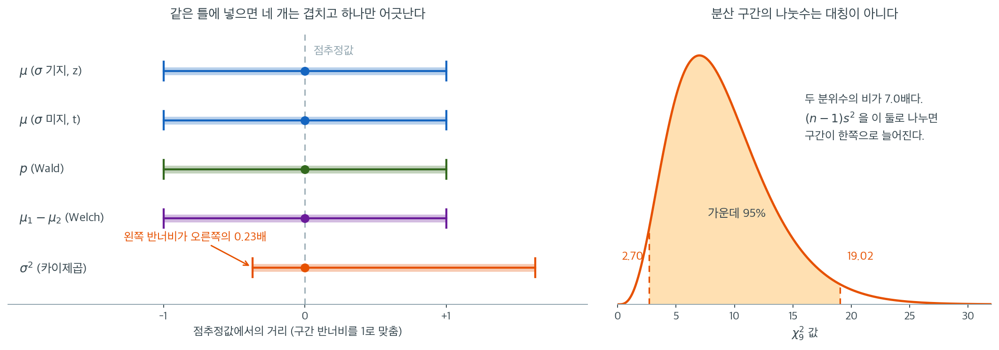

# 신뢰구간 시연

## 개요

이 쪽은 **미리보기**다. 모평균 $\mu$, 비율 $p$, 분산 $\sigma^2$, 두 평균의 차 $\mu_1-\mu_2$ 에 대한 구간을 **한 자료로 차례차례** 만들어 보고, 끝에서 네 구간을 포개어 **구조가 같다는 것과 어디가 예외인지**를 눈으로 확인한다.

모수마다의 깊은 이야기 — 타당성 조건, 방법의 대안, 포함확률을 실제로 세어 보는 일, 표본크기 계산 — 는 8.2절부터 모수별로 한다. 여기서 수를 다 맞추려 하지 말고 **네 구간이 한 틀에서 나온다는 것**만 가져가면 된다.

---

## 1. 모평균의 신뢰구간

### z-구간 (분산을 아는 경우)

모표준편차 $\sigma$를 알 때 $\mu$의 $(1-\alpha)100\%$ 신뢰구간은

$$
\bar{X} \pm z_{\alpha/2} \cdot \frac{\sigma}{\sqrt{n}}
$$

여기서 $z_{\alpha/2}$는 표준정규분포의 상위 $\alpha/2$ 분위수이다.

### t-구간 (분산을 모르는 경우)

$\sigma$를 모르고 표본표준편차 $s$로 대체하면 자유도 $n - 1$인 $t$-분포를 쓴다:

$$
\bar{X} \pm t_{\alpha/2,\, n-1} \cdot \frac{s}{\sqrt{n}}
$$

<div class="exbox" markdown>

**보기 1.** <span class="diff easy" title="쉬움"></span> 평균의 신뢰구간 — $z$와 $t$. 관측값 $20$개를 얻었다.

$$
120,\ 125,\ 118,\ 130,\ 122,\ 128,\ 115,\ 135,\ 121,\ 126,\
119,\ 132,\ 124,\ 117,\ 129,\ 123,\ 131,\ 116,\ 127,\ 120
$$

**(1)** $\sigma = 6$을 안다고 할 때의 $95\%$ $z$-구간과, $\sigma$를 모를 때의 $95\%$ $t$-구간을 각각 구하시오.

**(2)** 두 구간의 폭이 거의 같다. 그 까닭을 **임계값 몫**과 **산포 몫**으로 갈라 설명하시오. `scipy.stats.t.interval` 의 `scale` 에는 무엇을 넣어야 하는가.

</div>

??? success "풀이"

    **(1) 두 구간.** $n = 20$, $\bar x = 123.9$, $s = 5.73906$ 이다.

    $z$-구간은 $z_{0.025} = 1.95996$, $\text{SE} = \sigma/\sqrt n = 6/\sqrt{20} = 1.34164$ 이므로

    $$
    123.9 \pm 1.95996 \times 1.34164 = 123.9 \pm 2.62957 = (121.27,\ 126.53)
    $$

    $t$-구간은 자유도 $19$, $t_{0.025,\,19} = 2.09302$, $\text{SE} = s/\sqrt n = 5.73906/\sqrt{20} = 1.28329$ 이므로

    $$
    123.9 \pm 2.09302 \times 1.28329 = 123.9 \pm 2.68596 = (121.21,\ 126.59)
    $$

    **(2) 두 몫이 서로 상쇄한다.** 폭의 비는 두 인자의 곱이다.

    $$
    \frac{\text{MOE}_t}{\text{MOE}_z}
    = \underbrace{\frac{t_{0.025,\,19}}{z_{0.025}}}_{1.06789}
    \times
    \underbrace{\frac{s}{\sigma}}_{5.73906/6 \,=\, 0.95651}
    = 1.02145
    $$

    임계값은 폭을 $6.8\%$ **키우려** 하고 산포는 $4.3\%$ **줄이려** 한다. 둘이 거의 맞부딪혀 남은 차이가 $2.1\%$ 뿐이다.

    **두 몫의 성격이 다르다는 점이 중요하다.** 임계값 몫 $1.068$ 은 $n = 20$ 하나로 정해지는 **확정된 비용**이고, 산포 몫 $0.957$ 은 이 표본에서 우연히 $s < \sigma$ 가 나온 **우연한 양**이다. 다른 표본에서는 $s > \sigma$ 가 되어 두 몫이 같은 방향으로 겹칠 수도 있다. 그러므로 **폭을 보고 방법을 고르면 안 된다.** 고르는 기준은 $\sigma$ 를 정말로 아는가 하나다.

    **`scale` 에는 $s$ 가 아니라 $s/\sqrt n$ 을 넣는다.** `stats.t.interval(0.95, df, loc, scale)` 의 `loc` 과 `scale` 은 **구간이 가리키는 양의 분포**, 곧 $\bar X$ 의 분포를 기술한다. 자료의 분포가 아니다. `scale=s` 로 두면 구간이 $\sqrt{20} = 4.47$ 배 넓어져 $(112.0,\ 135.8)$ 쯤이 된다. 자릿수가 틀렸을 뿐 오류 메시지는 나지 않는다.

    **확인.**

    ```python
    import numpy as np
    from scipy import stats

    data = np.array([120, 125, 118, 130, 122, 128, 115, 135, 121, 126,
                     119, 132, 124, 117, 129, 123, 131, 116, 127, 120])
    n = len(data)
    xbar = data.mean()
    s = data.std(ddof=1)
    alpha = 0.05

    # z-구간: sigma를 안다고 가정한다.
    # ppf(1 - alpha/2)인 것에 주의하라. 양쪽 꼬리에 alpha/2씩 남겨야 하므로
    # 필요한 것은 상위 alpha/2 분위수, 즉 왼쪽 누적확률 1 - alpha/2 지점이다.
    sigma_known = 6
    z_crit = stats.norm.ppf(1 - alpha / 2)
    me_z = z_crit * sigma_known / np.sqrt(n)
    print(f"z-interval: ({xbar - me_z:.2f}, {xbar + me_z:.2f})")

    # t-구간: sigma를 모르고 s로 대신한다.
    # s가 그 자체로 흔들리는 양이라 임계값을 z보다 키워 그 불확실성을 갚아 준다.
    # 자유도는 n-1이다. 편차를 x_bar에서 재는 순간 자유도 하나를 잃기 때문이다.
    t_crit = stats.t.ppf(1 - alpha / 2, df=n - 1)
    me_t = t_crit * s / np.sqrt(n)
    print(f"t-interval: ({xbar - me_t:.2f}, {xbar + me_t:.2f})")

    # scipy로 한 번에. scale에 s가 아니라 **표준오차** s/sqrt(n)을 넣어야 한다.
    # 여기서 흔히 틀린다. loc/scale은 자료의 분포가 아니라 x_bar의 분포를 가리킨다.
    ci = stats.t.interval(1 - alpha, df=n - 1, loc=xbar, scale=s / np.sqrt(n))
    print(f"scipy t.interval: ({ci[0]:.2f}, {ci[1]:.2f})")
    ```

    출력:

    ```
    z-interval: (121.27, 126.53)
    t-interval: (121.21, 126.59)
    scipy t.interval: (121.21, 126.59)
    ```

    **(1)과 맞는다.** $z$-구간 $(121.27,\ 126.53)$, $t$-구간 $(121.21,\ 126.59)$ 다. `stats.t.interval` 의 답이 손으로 만든 $t$-구간과 한 자리도 다르지 않다 — `scale` 에 $s/\sqrt n$ 을 넣었기 때문이다.

    **두 구간의 반폭은 $2.62957$ 과 $2.68596$ 으로 $2.1\%$ 차이**이고, 이것이 (2)에서 구한 $1.06789 \times 0.95651 = 1.02145$ 와 같다.

$\sigma = 6$을 안다고 가정한 z-구간과, $s = 5.74$를 자료에서 추정해 쓴 t-구간의 너비가 거의 같다($\pm 2.63$ 대 $\pm 2.69$). $n = 20$에서는 $t_{0.025,\,19} = 2.093$이 $z_{0.025} = 1.960$과 크게 다르지 않고, $s$가 $\sigma$보다 조금 작게 나온 것이 임계값 차이를 거의 상쇄했기 때문이다. $n$이 작아지면 이 균형이 깨진다.

---

## 2. 비율의 신뢰구간

비율 $\hat{p} = x / n$에 대한 **Wald 구간**은

$$
\hat{p} \pm z_{\alpha/2} \sqrt{\frac{\hat{p}(1 - \hat{p})}{n}}
$$

**Wilson score 구간**은 포함확률을 개선하기 위해 중심과 너비를 조정한다:

$$
\frac{\hat{p} + \frac{z^2}{2n}}{1 + \frac{z^2}{n}}
\;\pm\;
\frac{z}{1 + \frac{z^2}{n}}
\sqrt{\frac{\hat{p}(1-\hat{p})}{n} + \frac{z^2}{4n^2}}
$$

**Agresti–Coull 구간**은 가상의 성공과 실패를 $z^2/2$개씩 더한 뒤, 보정된 개수 $\tilde{n} = n + z^2$과 $\tilde{p} = (x + z^2/2) / \tilde{n}$에 Wald 공식을 적용한다.

<div class="exbox" markdown>

**보기 2.** <span class="diff easy" title="쉬움"></span> 비율의 신뢰구간. 시행 $n = 200$번에서 성공이 $x = 84$번 나왔다.

**(1)** 왈드·윌슨·아그레스티–쿨 $95\%$ 구간을 모두 구하시오.

**(2)** 뒤의 두 구간이 소수 **넷째 자리까지** 같다. 어디까지가 필연이고 어디부터가 이 자료의 사정인가.

</div>

??? success "풀이"

    **(1) 세 구간.** $\hat p = 84/200 = 0.42$, $z = 1.95996$, $z^2 = 3.84146$ 이다.

    **왈드.** $\text{SE} = \sqrt{0.42 \times 0.58/200} = 0.0349000$, $\text{MOE} = 0.0684025$ 이므로 $(0.35160,\ 0.48840)$.

    **윌슨.** 중심 $\dfrac{\hat p + z^2/(2n)}{1 + z^2/n} = 0.4215076$, 반폭 $0.0677716$ 이므로 $(0.35374,\ 0.48928)$.

    **아그레스티–쿨.** $\tilde n = 203.84146$, $\tilde p = (84 + 1.92073)/\tilde n = 0.4215076$, 반폭 $z\sqrt{\tilde p(1-\tilde p)/\tilde n} = 0.0677881$ 이므로 $(0.35372,\ 0.48930)$.

    **(2) 중심이 같은 것은 필연이다.** 윌슨 중심의 분자·분모에 $n$을 곱하면

    $$
    \frac{\hat p + \frac{z^2}{2n}}{1 + \frac{z^2}{n}}
    = \frac{n\hat p + \frac{z^2}{2}}{n + z^2}
    = \frac{x + \frac{z^2}{2}}{\tilde n}
    = \tilde p
    $$

    로 아그레스티–쿨의 $\tilde p$ 와 **같은 식**이다. 자료가 무엇이든 두 중심은 언제나 일치한다.

    **폭이 같은 것은 필연이 아니다.** 두 반폭은

    $$
    \text{윌슨} = \frac{z}{\tilde n}\sqrt{\frac{x(n-x)}{n} + \frac{z^2}{4}},
    \qquad
    \text{AC} = \frac{z}{\tilde n}\sqrt{\frac{(x + \frac{z^2}{2})(n - x + \frac{z^2}{2})}{\tilde n}}
    $$

    로 서로 다른 식이고, 여기서는 $0.0677716$ 대 $0.0677881$ 로 **$0.0000165$** 차이다. 폭으로 치면 $3.3 \times 10^{-5}$ 이라 소수 넷째 자리에서 보이지 않을 뿐이다.

    **세 구간이 겹치는 것도 이 자료의 사정이다.** 보정량 $z^2/2 = 1.92$ 가 $x = 84$ 의 $2.3\%$, $z^2 = 3.84$ 가 $n = 200$ 의 $1.9\%$ 에 불과하다. 중심이 $0.42$ 에서 $0.4215$ 로 $0.0015$ 밀렸을 뿐인데, 이것은 구간 폭의 $1.1\%$ 다. $n$이 작거나 $\hat p$ 이 $0$ 또는 $1$ 에 가까우면 보정량의 비중이 커져 세 구간이 크게 갈라지고, 그때 왈드가 무너진다.

    **확인.**

    ```python
    x, n = 84, 200
    p_hat = x / n
    z = stats.norm.ppf(1 - alpha / 2)

    # Wald: 표준오차에 p_hat을 그냥 대입한다. 가장 간단하지만 가장 나쁘다.
    # p_hat이 0이나 1이면 표준오차가 0이 되어 폭이 0인 구간이 나온다.
    me_wald = z * np.sqrt(p_hat * (1 - p_hat) / n)
    print(f"Wald: ({p_hat - me_wald:.4f}, {p_hat + me_wald:.4f})")

    # Wilson: |p_hat - p| <= z*sqrt(p(1-p)/n) 을 p에 대한 이차부등식으로 풀어 얻는다.
    # 표준오차에 미지의 p를 그대로 두고 풀었다는 것이 핵심이다.
    # 그래서 중심이 p_hat이 아니라 p_hat과 0.5 사이로 조금 당겨진다.
    denom = 1 + z**2 / n
    center = (p_hat + z**2 / (2 * n)) / denom
    me_wilson = z * np.sqrt(p_hat * (1 - p_hat) / n + z**2 / (4 * n**2)) / denom
    print(f"Wilson: ({center - me_wilson:.4f}, {center + me_wilson:.4f})")

    # Agresti-Coull: Wilson의 중심을 그대로 쓰되 너비는 Wald 공식으로 계산한다.
    # 95%에서는 z^2 = 3.84 ~ 4 이므로 "성공 2개와 실패 2개를 더하고 Wald를 쓰라"는
    # 손계산 규칙이 된다.
    n_tilde = n + z**2
    p_tilde = (x + z**2 / 2) / n_tilde
    me_ac = z * np.sqrt(p_tilde * (1 - p_tilde) / n_tilde)
    print(f"Agresti-Coull: ({p_tilde - me_ac:.4f}, {p_tilde + me_ac:.4f})")
    ```

    출력:

    ```
    Wald: (0.3516, 0.4884)
    Wilson: (0.3537, 0.4893)
    Agresti-Coull: (0.3537, 0.4893)
    ```

    **(1)과 맞는다.** 세 구간이 손 계산과 같고, 윌슨과 아그레스티–쿨이 넷째 자리까지 겹친다. 더 많은 자리를 찍어 보면 $(0.3537360,\ 0.4892793)$ 과 $(0.3537195,\ 0.4892957)$ 로 **다섯째 자리에서 갈라진다.** (2)에서 예고한 대로 중심은 $0.4215076$ 으로 똑같고 반폭만 $0.0677716$ 대 $0.0677881$ 이다.

$n = 200$이고 $\hat p = 0.42$로 극단적이지 않아 세 구간이 거의 겹친다. Wilson과 Agresti–Coull은 소수점 넷째 자리까지 같다. 두 구간의 중심이 $z^2$만큼 보정된 같은 값이고, 너비를 계산하는 방식만 다르기 때문이다. 차이는 $n$이 작거나 $\hat p$가 0 또는 1에 가까울 때 드러난다.

---

## 3. 분산의 신뢰구간

자료가 정규모집단에서 나왔다는 가정 아래 추축량 $(n-1)S^2 / \sigma^2$은 자유도 $n - 1$인 카이제곱분포를 따른다. 그 결과 $\sigma^2$의 $(1-\alpha)100\%$ 신뢰구간은

$$
\left(\frac{(n-1)s^2}{\chi^2_{1-\alpha/2,\,n-1}},\;\;
      \frac{(n-1)s^2}{\chi^2_{\alpha/2,\,n-1}}\right)
$$

<div class="exbox" markdown>

**보기 3.** <span class="diff easy" title="쉬움"></span> 분산의 신뢰구간. 앞 보기 1의 $20$개 가운데 앞쪽 $10$개

$$
120,\ 125,\ 118,\ 130,\ 122,\ 128,\ 115,\ 135,\ 121,\ 126
$$

만 쓴다. 모집단은 정규라고 본다.

**(1)** $s^2$을 손으로 구하고 $\sigma^2$과 $\sigma$의 $95\%$ 신뢰구간을 만드시오.

**(2)** 상한이 하한의 일곱 배를 넘는다. 이 **배수**가 자료에 의존하는가.

</div>

??? success "풀이"

    **(1) $s^2$이 딱 떨어진다.** 합이 $1240$이므로 $\bar x = 124$ 이고 편차가

    $$
    -4,\ 1,\ -6,\ 6,\ -2,\ 4,\ -9,\ 11,\ -3,\ 2
    $$

    이다. 제곱합이 $16+1+36+36+4+16+81+121+9+4 = 324$ 이므로

    $$
    s^2 = \frac{324}{9} = 36, \qquad s = 6
    $$

    이다(보기 1에서 "안다"고 가정했던 $\sigma = 6$ 과 우연히 같다).

    자유도 $9$의 임계값은 $\ell = \chi^2_{0.025,\,9} = 2.70039$, $u = \chi^2_{0.975,\,9} = 19.02277$ 이다. 추축량 $(n-1)S^2/\sigma^2 \sim \chi^2_9$ 을 $\sigma^2$ 에 대해 풀면 **큰 임계값이 아래끝의 분모**로 간다.

    $$
    \left(\frac{9 \times 36}{19.02277},\ \frac{9 \times 36}{2.70039}\right)
    = (17.03,\ 119.98)
    $$

    제곱근은 $\sigma > 0$ 에서 순증가이므로 양 끝에 그대로 씌우면 $\sigma$의 구간이다.

    $$
    (\sqrt{17.03},\ \sqrt{119.98}) = (4.13,\ 10.95)
    $$

    **(2) 배수는 자료와 무관하다.** 상한을 하한으로 나누면 $(n-1)s^2$ 이 통째로 약분된다.

    $$
    \frac{\text{상한}}{\text{하한}} = \frac{u}{\ell} = \frac{19.02277}{2.70039} = 7.04445
    $$

    $s^2$ 이 $36$ 이든 $1$ 이든 $1000$ 이든 **언제나 $7.04$ 배**다. $n$ 하나가 정하는 값이며, 자료를 보기도 전에 "이 표본크기로는 분산을 일곱 배 범위까지밖에 못 좁힌다"는 사실이 정해져 있다는 뜻이다. $\sigma$ 척도에서는 제곱근인 $\sqrt{7.04445} = 2.654$ 배로 줄어든다.

    **평균의 구간과 견주면 차이가 분명하다.** 보기 1에서 같은 자료의 평균 구간은 $123.9 \pm 2.69$ 로 중심의 $2\%$ 폭이었다. 여기서 분산의 구간은 점추정값 $36$ 을 $17$ 에서 $120$ 까지 늘어뜨린다. **같은 표본으로 평균은 꽤 정확히, 분산은 거의 모르는 채로 추정한다.**

    **확인.**

    ```python
    data = np.array([120, 125, 118, 130, 122, 128, 115, 135, 121, 126])   # 앞의 20개 중 10개
    n = len(data)
    s2 = data.var(ddof=1)

    chi2_lower = stats.chi2.ppf(alpha / 2, df=n - 1)
    chi2_upper = stats.chi2.ppf(1 - alpha / 2, df=n - 1)

    # 분모에 들어가는 임계값이 **뒤바뀐다**. 자주 틀리는 자리다.
    # (n-1)s²/σ² 이 chi2_lower 와 chi2_upper 사이에 있다는 부등식을
    # σ² 에 대해 풀면 σ² 이 분모로 내려가면서 대소가 뒤집히기 때문이다.
    ci_var = ((n - 1) * s2 / chi2_upper, (n - 1) * s2 / chi2_lower)
    # 제곱근은 단조증가 함수라 양끝에 그대로 씌우면 σ의 구간이 된다.
    ci_sd = (np.sqrt(ci_var[0]), np.sqrt(ci_var[1]))

    print(f"95% CI for sigma^2: ({ci_var[0]:.2f}, {ci_var[1]:.2f})")
    print(f"95% CI for sigma:   ({ci_sd[0]:.2f}, {ci_sd[1]:.2f})")
    ```

    출력:

    ```
    95% CI for sigma^2: (17.03, 119.98)
    95% CI for sigma:   (4.13, 10.95)
    ```

    **(1)과 맞는다.** $\sigma^2$ 구간 $(17.03,\ 119.98)$, $\sigma$ 구간 $(4.13,\ 10.95)$ 다. 배수는 $119.98/17.03 = 7.045$ 로 $u/\ell = 7.04445$ 와 같다.

    **$\sigma$ 구간이 참값 $\sigma = 6$ 을 담지만** $4.13$ 에서 $10.95$ 까지다. 같은 자료로 "표준편차가 $4$ 쯤인가 $11$ 쯤인가"조차 가리지 못한다는 뜻이다.

$n = 10$에서 $\sigma^2$의 구간은 위쪽 끝이 아래쪽 끝의 일곱 배다. 카이제곱분포가 오른쪽으로 길게 늘어져 있어 구간이 $s^2$을 중심으로 대칭이 아니며, 분산은 평균보다 훨씬 추정하기 어렵다는 뜻이다.

---

## 4. 평균 차이에 대한 이표본 신뢰구간

### Welch의 t-구간 (분산이 다른 경우)

크기 $n_1$과 $n_2$인 독립표본에 대해 $\mu_1 - \mu_2$의 신뢰구간은

$$
(\bar{X}_1 - \bar{X}_2) \;\pm\; t_{\alpha/2,\,\nu} \cdot \sqrt{\frac{s_1^2}{n_1} + \frac{s_2^2}{n_2}}
$$

여기서 Satterthwaite 자유도는

$$
\nu = \frac{\left(\frac{s_1^2}{n_1} + \frac{s_2^2}{n_2}\right)^2}{\frac{(s_1^2/n_1)^2}{n_1-1} + \frac{(s_2^2/n_2)^2}{n_2-1}}
$$

### 합동 t-구간 (분산이 같은 경우)

등분산을 가정하면 합동분산은 $s_p^2 = [(n_1-1)s_1^2 + (n_2-1)s_2^2] / (n_1+n_2-2)$이고 구간은 다음이 된다:

$$
(\bar{X}_1 - \bar{X}_2) \;\pm\; t_{\alpha/2,\,n_1+n_2-2} \cdot s_p \sqrt{\frac{1}{n_1} + \frac{1}{n_2}}
$$

<div class="exbox" markdown>

**보기 4.** <span class="diff easy" title="쉬움"></span> 두 평균 차이의 신뢰구간. 독립인 두 군에서 각각 $10$개씩 관측했다.

$$
\text{A}:\ 12,\ 15,\ 11,\ 14,\ 13,\ 16,\ 10,\ 15,\ 12,\ 14
$$

$$
\text{B}:\ 18,\ 20,\ 17,\ 19,\ 16,\ 21,\ 15,\ 20,\ 18,\ 17
$$

**(1)** $\mu_A - \mu_B$의 웰치 $95\%$ 신뢰구간을 구하시오. 새터스웨이트 자유도는 얼마인가.

**(2)** 등분산을 가정한 합동 구간과 견주시오. 둘이 거의 같은 까닭을 밝히고, 언제 일치가 깨지는지 말하시오.

</div>

??? success "풀이"

    **(1) 웰치 구간.** $n_1 = n_2 = 10$, $\bar x_A = 13.2$, $\bar x_B = 18.1$, $s_A = 1.93218$, $s_B = 1.91195$ 이다. 두 표본이 독립이므로 **분산이 더해진다.**

    $$
    \text{SE} = \sqrt{\frac{s_A^2}{n_1} + \frac{s_B^2}{n_2}}
    = \sqrt{\frac{3.73333}{10} + \frac{3.65556}{10}} = 0.85959
    $$

    새터스웨이트 자유도는

    $$
    \nu = \frac{(0.373333 + 0.365556)^2}{\frac{0.373333^2}{9} + \frac{0.365556^2}{9}} = 17.998
    $$

    이고 $t_{0.025,\,17.998} = 2.10094$ 다. 차이가 $13.2 - 18.1 = -4.9$ 이므로

    $$
    -4.9 \pm 2.10094 \times 0.85959 = (-6.71,\ -3.09)
    $$

    **구간이 통째로 음수 쪽에 있다.** $0$을 담지 않으므로 B군의 평균이 A군보다 $3$에서 $7$ 정도 높다고 읽으며, 이것은 유의수준 $5\%$에서 $\mu_A = \mu_B$ 를 기각하는 것과 같은 말이다(9장).

    **(2) $n_1 = n_2$ 이면 표준오차가 대수적으로 같다.** 합동분산은

    $$
    s_p^2 = \frac{(n-1)s_A^2 + (n-1)s_B^2}{2n-2} = \frac{s_A^2 + s_B^2}{2} = 3.69444
    $$

    이고 합동 표준오차는

    $$
    s_p\sqrt{\frac1n + \frac1n} = \sqrt{\frac{s_A^2+s_B^2}{2} \cdot \frac2n} = \sqrt{\frac{s_A^2+s_B^2}{n}}
    $$

    인데, 이것이 웰치의 $\sqrt{s_A^2/n + s_B^2/n}$ 와 **글자 그대로 같은 식**이다. 둘 다 $0.85959$ 다. **표본크기가 같으면 두 방법의 표준오차는 언제나 일치한다.**

    **남는 차이는 자유도 하나뿐이다.** $n_1 = n_2 = n$ 일 때 새터스웨이트 자유도를 정리하면

    $$
    \nu = \frac{(n-1)(s_A^2 + s_B^2)^2}{s_A^4 + s_B^4}
    $$

    인데, $a = s_A^2$, $b = s_B^2$ 로 두면 $(a+b)^2 \le 2(a^2+b^2)$ 이고 등호는 $a = b$ 일 때뿐이다. 그러므로

    $$
    \nu \le 2(n-1) = 18
    $$

    이고, **두 분산이 같을수록 $\nu$ 가 $18$ 에 가까워진다.** 여기서는 $s_A$ 와 $s_B$ 가 거의 같아 $\nu = 17.998$ 이고 임계값이 $2.10094$ 대 $2.10092$ 로 소수 넷째 자리에서야 갈린다. 두 구간은 $(-6.70594,\ -3.09406)$ 와 $(-6.70592,\ -3.09408)$ 로 사실상 같다.

    **일치가 깨지는 곳.** 두 가지다. 표본크기가 다르면($n_1 \ne n_2$) 표준오차부터 달라지고, 분산이 크게 다르면 $\nu$ 가 $2(n-1)$ 보다 뚜렷이 작아진다. 둘이 겹치면 — 작은 표본에 큰 분산이 붙으면 — 합동 구간이 **너무 좁아져** 포함률을 지키지 못한다. 그래서 등분산을 확인하기 전에는 웰치가 기본값이다.

    **확인.**

    ```python
    group_a = np.array([12, 15, 11, 14, 13, 16, 10, 15, 12, 14])
    group_b = np.array([18, 20, 17, 19, 16, 21, 15, 20, 18, 17])

    n1, n2 = len(group_a), len(group_b)
    x1, x2 = group_a.mean(), group_b.mean()
    s1, s2_val = group_a.std(ddof=1), group_b.std(ddof=1)   # 위의 분산 s2와 이름이 겹치지 않게

    # 두 표본이 독립이므로 분산이 더해진다. 표준오차는 제곱해서 더한 뒤 제곱근이다.
    se = np.sqrt(s1**2 / n1 + s2_val**2 / n2)

    # Satterthwaite 자유도. 정수가 아니어도 된다.
    # 두 분산이 같고 n도 같으면 n1+n2-2가 되고, 한쪽 분산이 압도하면
    # 그쪽 표본의 자유도(n-1)로 줄어든다. 즉 "실효 표본크기"를 재는 양이다.
    df_welch = (s1**2 / n1 + s2_val**2 / n2)**2 / (
        (s1**2 / n1)**2 / (n1 - 1) + (s2_val**2 / n2)**2 / (n2 - 1)
    )
    t_crit = stats.t.ppf(1 - alpha / 2, df=df_welch)
    diff = x1 - x2
    ci_welch = (diff - t_crit * se, diff + t_crit * se)
    print(f"Welch CI: ({ci_welch[0]:.2f}, {ci_welch[1]:.2f})")
    ```

    출력:

    ```
    Welch CI: (-6.71, -3.09)
    ```

    **(1)과 맞는다.** $\text{SE} = 0.85959$, $\nu = 17.998$, 구간 $(-6.71,\ -3.09)$ 이다. 합동 구간을 같은 자료로 계산하면 $(-6.70592,\ -3.09408)$ 로, 웰치의 $(-6.70594,\ -3.09406)$ 와 소수 **다섯째 자리**에서야 갈린다. (2)에서 본 대로 표준오차가 같고 자유도만 $17.998$ 대 $18$ 로 다르기 때문이다.

구간이 통째로 음수쪽에 있어 0을 담지 않는다. B군의 평균이 A군보다 3에서 7 정도 높다고 읽으며, 이는 유의수준 5%에서 $\mu_1 = \mu_2$를 기각하는 것과 같은 말이다(9장).

---

## 5. 포함확률은 무엇을 세는가

위의 네 구간은 모두 「명목 $95\%$」를 약속한다. 그 약속이 지켜지는지는 참값을 아는 모집단에서 구간을 되풀이해 만들어 **세어** 보면 된다. 모수마다 사정이 다르므로 그 세는 일은 8.2절부터 모수별로 하고 — 평균은 8.2절 [μ의 신뢰구간](../one_sample_intervals/ci_mu.md) 절 $5$, 비율은 [p의 신뢰구간](../one_sample_intervals/ci_p.md) 절 $5$ 다 — 여기서는 **무엇을 세고 있는지**만 분명히 해 둔다.

세는 것은 구간이 **모수**를 담은 비율이다. 그런데 사람들이 신뢰구간에서 읽어 내려는 것은 대개 다른 것이고, 그 간극이 생각보다 크다.

<div class="storybox" markdown>

**그림으로 보는 통계학 1.** $95$ 퍼센트가 가리키는 것

포함확률이 센 것은 구간이 **모수**를 담은 비율이다. 그런데 사람들이 신뢰구간에서 실제로
읽어 내려는 것은 대개 다른 것이다 — **「다음에 또 해 보면 어디쯤 나올까」**다.

호크스트라와 모리와 라우더와 바헨마커스가 2014 년에 그 간극을 쟀다. 신뢰구간에 관한 **거짓인
진술 여섯 개**를 주고 참·거짓을 묻는 설문이었고, 심리학과 1 학년생 $442$ 명과 연구자
$120$ 명이 답했다. 결과가 논문 제목에 들어 있다 — 「신뢰구간의 완강한 오독」. **연구자들이
1 학년생보다 나을 것이 없었다.**

그러면 다음 실험의 평균은 얼마나 담는가. 이것은 셀 수 있다. 실험을 한 번 해서 $\bar X_1$ 과
구간 $\bar X_1 \pm 1.96\,\sigma/\sqrt n$ 을 얻고, 같은 모집단에서 같은 크기로 한 번 더 해
$\bar X_2$ 를 얻는다. 두 평균의 차는 **분산이 두 배**이므로

$$
P\!\left(\bar X_2 \in \text{구간}\right)
= P\!\left(|Z| \leq \frac{1.96}{\sqrt 2}\right)
= 2\Phi(1.3859) - 1 = 0.834
$$

이다. **모수는 $95\%$ 담지만 다음 실험의 평균은 $83\%$ 밖에 담지 못한다.**

<figure markdown>
{ width="900" }
  <figcaption markdown>모든 눈금은 표준오차 단위다. 왼쪽 회색 산은 첫 실험의 평균이 어디에 떨어지는지의 분포이고, 이 분포로 포착률 곡선을 평균 내면 $0.834$ 가 된다.</figcaption>
</figure>

더 눈여겨볼 것은 $0.834$ 가 **평균일 뿐**이라는 점이다. 첫 실험의 평균이 참값에서 $d$
표준오차 떨어져 있었다면 그 구간의 포착률은 $\Phi(d + 1.96) - \Phi(d - 1.96)$ 이다.

| $d$ | $0$ | $1$ | $1.5$ | $1.96$ | $2.5$ |
|---|---|---|---|---|---|
| 그 구간의 포착률 | $0.950$ | $0.830$ | $0.677$ | $0.500$ | $0.295$ |

운 좋게 참값 위에 떨어진 구간은 $0.95$ 를 담고, $1.96$ 표준오차 벗어난 구간은 **절반**만
담는다. 그리고 **내가 그린 구간이 둘 중 어느 쪽인지는 알 수 없다.** 알 수 있었다면 애초에
구간이 필요 없었을 것이다.

오른쪽 그림이 그 사정이다. 아래쪽 굵은 선이 「내가 한 번 해서 얻은 구간」이고, 위로 쌓인 것이
똑같은 실험을 $24$ 번 더 한 결과다. 처음 그린 구간이 담은 평균이 $20$ 개 — $24$ 분의
$20$ 은 $0.833$ 으로, 정확히 위 식이 말한 값이다.

그러니 네이만이 1937 년에 이 구간을 내놓으며 분명히 해 둔 것을 다시 적어 둘 만하다.
$95\%$ 는 **절차**에 붙는 수다. 이 구간 하나에 붙는 수가 아니고, 다음 실험에 붙는 수는
더더욱 아니다.

_확인한 곳 — 호크스트라·모리·라우더·바헨마커스의 「Robust misinterpretation of confidence intervals」(『Psychonomic Bulletin & Review』 $21$ 권 $5$ 호 $1157$–$1164$ 쪽, $2014$)가 **거짓인 진술 여섯 개**를 학부 $1$ 학년 $442$ 명·석사 $34$ 명·연구자 $120$ 명에게 물었고 연구자가 학생보다 낫지 않았다는 것. 표와 그림의 수는 모두 직접 계산하거나 모의실험한 값이다_

</div>

---

## 연습문제

<div class="drillbox" markdown>

**연습문제 1.** <span class="diff med" title="중간"></span>
신뢰구간을 만드는 세 가지 일반 원리 — **추축량**, **검정의 역전**, **점근 정규성** — 을 설명하고 각각의 예를 들어라.

</div>

??? success "풀이"
    **원리 1 — 추축량(pivotal quantity).** 모수를 담고 있으면서 그 **분포가 모수에 의존하지 않는** 양을 찾는다.

    $$
    Q(\mathbf{X},\theta) \sim \text{알려진 분포}
    $$

    $P(a\le Q\le b)=0.95$를 $\theta$에 대해 풀면 구간이 나온다.

    - **예**: $\dfrac{\bar X-\mu}{S/\sqrt n}\sim t_{n-1}$, $\dfrac{(n-1)S^2}{\sigma^2}\sim\chi^2_{n-1}$, $2\lambda\sum X_i\sim\chi^2_{2n}$.
    - **장점**: 구간이 **정확**하다. 근사가 없다.
    - **한계**: 추축량이 존재하는 모형이 제한적이다. 대체로 위치-척도족이나 지수족.

    **원리 2 — 검정의 역전.** 수준 $\alpha$ 검정을 각 $\theta_0$에 대해 수행하고, **기각되지 않는 $\theta_0$를 모아** 구간으로 삼는다.

    $$
    C(\mathbf{x}) = \left\{\theta_0:\ H_0:\theta=\theta_0\text{이 기각되지 않음}\right\}
    $$

    - **예**: 우도비 구간, 점수 구간(윌슨), 클로퍼-피어슨(정확 이항검정의 역전).
    - **장점**: 가장 일반적이다. 검정이 있으면 언제나 구간을 만들 수 있고, 검정의 수준이 곧 구간의 포함확률이다.
    - **핵심 성질**: 구간과 검정이 **논리적으로 일치**한다. $\theta_0$가 구간 밖이면 반드시 기각된다.

    **원리 3 — 점근 정규성.** $\hat\theta\approx N(\theta, \operatorname{SE}^2)$을 이용해

    $$
    \hat\theta\pm z_{1-\alpha/2}\widehat{\operatorname{SE}}
    $$

    - **예**: 왈드 구간 일반.
    - **장점**: 어떤 모형에도 기계적으로 적용된다.
    - **한계**: 근사이며, 앞서 여러 번 본 대로 경계 근처나 소표본에서 나쁘다.

    **관계.** 세 원리는 독립적이지 않다. 추축량이 있으면 그것을 뒤집는 검정이 자연스럽게 정의되고, 점근 정규성은 왈드 검정을 역전한 것이다. **역전 원리가 가장 넓고**, 나머지가 그 특수한 경우다.

    **실무 선택.** 정확한 추축량이 있으면 그것을 쓰고, 없으면 우도비 역전을 쓰며, 계산이 부담되면 왈드를 쓰되 그 한계를 확인한다.

---

---

<div class="drillbox" markdown>

**연습문제 2.** <span class="diff med" title="중간"></span>
신뢰구간과 가설검정의 **쌍대성**을 정확히 서술하고, 둘이 어긋나 보이는 경우가 왜 생기는지 설명하라.

</div>

??? success "풀이"
    **쌍대성.** 수준 $\alpha$의 양측검정족 $\{\phi_{\theta_0}\}$과 포함확률 $1-\alpha$의 구간족 $\{C(\mathbf{x})\}$이

    $$
    \theta_0 \in C(\mathbf{x}) \iff H_0:\theta=\theta_0\text{을 기각하지 않음}
    $$

    으로 일대일 대응한다.

    **따라서** 구간이 $\theta_0$를 담지 않는 것과 $p$-값이 $\alpha$보다 작은 것이 **논리적으로 동치**다.

    **어긋나 보이는 경우와 그 이유.**

    **(1) 서로 다른 근사를 썼다.** 앞서 본 두 비율 비교가 대표적이다.

    - 검정은 **합동 비율**로 표준오차를 계산한다($H_0$ 아래의 분산).
    - 구간은 **각각의 비율**로 계산한다.

    둘이 다르므로 경계 근처에서 결론이 갈릴 수 있다. **엄밀히 말하면 이 둘은 쌍대가 아니다.** 진짜 쌍대인 구간은 검정을 역전해 얻어야 한다.

    **(2) 단측과 양측을 혼동했다.** 단측 검정의 $p$-값이 0.03이면 5%에서 기각이지만, 양측 95% 구간은 $\theta_0$를 담을 수 있다. 대응하는 것은 **단측 구간**이다.

    **(3) 다중비교 보정이 한쪽에만 적용됐다.** 검정에는 본페로니를 쓰고 구간에는 안 쓰면 어긋난다.

    **(4) 검정통계량과 구간의 중심이 다르다.** 우도비 검정과 왈드 구간을 함께 쓰면 근사 방식이 달라 갈릴 수 있다.

    **실무 권고.**

    - **$p$-값과 구간을 같은 방법으로 계산**한다. 같은 소프트웨어 함수에서 나온 쌍이면 대개 일관된다.
    - 어긋나면 **어느 쪽 근사가 나쁜지** 확인한다. 경계 근처면 왈드를 의심한다.
    - 보고할 때는 **구간을 우선**한다. 효과의 크기와 불확실성을 함께 주므로 $p$-값보다 정보가 많다.

---

---

<div class="drillbox" markdown>

**연습문제 3.** <span class="diff med" title="중간"></span>
**신뢰영역**(다차원)을 구성하는 방법을 설명하고, 개별 구간을 그대로 곱집합으로 쓰면 왜 안 되는지 밝혀라.

</div>

??? success "풀이"
    **문제.** 모수가 $(\theta_1,\theta_2)$일 때, 각각의 95% 구간 $C_1$, $C_2$를 만들어 직사각형 $C_1\times C_2$를 쓰면

    $$
    P\left\{(\theta_1,\theta_2)\in C_1\times C_2\right\} < 0.95
    $$

    다. 두 사건이 동시에 일어나야 하므로 확률이 줄어든다. 독립이면 $0.95^2=0.9025$이고, 상관이 있으면 다르지만 어쨌든 0.95보다 작다.

    **더 근본적인 문제 — 모양.** 두 추정값이 상관되어 있으면 참 신뢰영역이 **기울어진 타원**인데, 직사각형은 그 모양을 담지 못한다. 타원 밖의 모서리를 포함하고 타원 안의 일부를 빠뜨린다.

    **올바른 구성.**

    **(1) 왈드 타원.** $\hat{\boldsymbol\theta}\approx N(\boldsymbol\theta, \Sigma)$이면

    $$
    \left(\hat{\boldsymbol\theta}-\boldsymbol\theta\right)^\top\hat\Sigma^{-1}\left(\hat{\boldsymbol\theta}-\boldsymbol\theta\right)\le\chi^2_{p,1-\alpha}
    $$

    앞서 본 마할라노비스 거리와 카이제곱의 관계 그대로다.

    **(2) 우도비 영역.**

    $$
    \left\{\boldsymbol\theta:\ 2\left\{\ell(\hat{\boldsymbol\theta})-\ell(\boldsymbol\theta)\right\}\le\chi^2_{p,1-\alpha}\right\}
    $$

    타원이 아니라 가능도의 실제 모양을 따르는 영역이 나온다.

    **(3) 본페로니 직사각형.** 각 구간을 $1-\alpha/p$ 수준으로 만들면 곱집합의 포함확률이 $1-\alpha$ 이상이다. 보수적이지만 **해석이 쉽고** 각 모수를 따로 읽을 수 있다는 장점이 있다.

    **어느 것을 쓰는가.**

    - **모수들을 함께 판단해야 한다면** 타원이나 우도비 영역. "두 계수가 동시에 0인가"를 묻는 경우다.
    - **각 모수를 개별적으로 해석한다면** 본페로니 구간이나 그냥 개별 구간. 다만 **동시 보장이 없다는 점을 명시**해야 한다.
    - 논문에서 회귀계수 표에 개별 구간을 싣는 것이 관행인데, 이는 동시 신뢰영역이 아니다. 여러 계수에 대한 결합 주장을 하려면 보정이 필요하다.

---

---

<div class="drillbox" markdown>

**연습문제 4.** <span class="diff med" title="중간"></span>
신뢰구간이 **공집합**이거나 **전체 모수공간**이 되는 경우가 있다. 그런 일이 왜 생기며, 그것이 잘못된 것인지 논하라.

</div>

??? success "풀이"
    **공집합이 되는 예.** 앤더슨-루빈 검정을 역전한 도구변수 신뢰구간은 도구가 아주 약하면 **빈 집합**이 될 수 있다. 모든 $\beta_0$가 기각되는 것이다.

    **전체가 되는 예.** 같은 방법에서 도구가 전혀 정보를 주지 못하면 **$(-\infty,\infty)$** 가 나온다. 어떤 $\beta_0$도 기각되지 않는다.

    **잘못된 것인가.** **아니다. 오히려 정직한 답이다.**

    - **$(-\infty,\infty)$** 는 "이 자료로는 모수에 대해 아무것도 말할 수 없다"는 뜻이다. 약한 도구 상황에서 정확히 옳은 결론이며, 이를 숨기고 좁은 구간을 보고하는 2SLS 왈드 구간이 오히려 잘못이다.

      실제로 모수가 약한 도구 아래에서 **식별되지 않을 수 있고**, 그때 유한한 구간을 주는 방법은 반드시 포함확률을 어긴다. 이것은 정리로 증명되어 있다(더프-소마이니).

    - **공집합**은 "**모형이 자료와 맞지 않는다**"는 신호다. 과대식별 제약이 위배되었을 때 나타나며, $J$ 검정이 기각하는 것과 같은 정보다. 모형을 재검토하라는 뜻이다.

    **다른 예들.**

    - **클로퍼-피어슨.** $k=0$이면 구간이 $[0,\ 3/n]$ 꼴로 한쪽이 경계에 붙는다. 퇴화는 아니지만 비대칭이 극심하다.
    - **프로파일 가능도 구간.** 가능도가 다봉이면 **연결되지 않은 구간**이 나올 수 있다. 두 영역이 모두 그럴듯하다는 뜻이며, 이것도 정직한 표현이다.
    - **분산성분.** 경계해가 나오면 구간이 $[0,\ u]$로 한쪽이 0에 붙는다.

    **실무 권고.** 이런 결과가 나왔을 때 **억지로 "정상적인" 구간을 만들려 하지 않는다.** 대신

    - 왜 그런지 진단한다(약한 도구, 모형 오설정, 다봉성, 경계).
    - 결과를 그대로 보고하고 해석을 붙인다.
    - 필요하면 자료를 더 모으거나 설계를 바꾼다.

    **"모른다"는 답이 틀린 답보다 낫다.**

---

---

<div class="drillbox" markdown>

**연습문제 5.** <span class="diff med" title="중간"></span>
신뢰구간을 보고할 때 지켜야 할 사항을 정리하라. 흔히 놓치는 것은 무엇인가?

</div>

??? success "풀이"
    **반드시 적을 것.**

    1. **신뢰수준.** 95%가 기본이지만 명시한다. 90%나 99%를 썼다면 특히.
    2. **구성 방법.** $t$ 구간인지 부트스트랩인지 우도비인지. 부트스트랩이면 어느 변형(백분위, BCa)이고 $B$가 얼마인지.
    3. **점추정값.** 구간만으로는 중심을 알 수 없다. 비대칭 구간이면 특히 중요하다.
    4. **표본크기.** 독자가 정밀도를 가늠하는 기준이다.
    5. **단측인지 양측인지.**
    6. **다중비교 보정 여부.** 여러 구간을 보고하면 동시 보장이 있는지.

    **흔히 놓치는 것.**

    - **표집오차만 담는다는 사실.** 무응답 편향, 측정오차, 모형 오설정은 구간에 들어 있지 않다. 조사 자료라면 응답률을 함께 적어야 한다.
    - **"유의하지 않다"와 "효과가 없다"의 혼동.** 구간이 0을 담는다고 효과가 없는 것이 아니다. 구간이 넓으면 **큰 효과도 배제하지 못한다.** 구간의 양끝을 보고 실무적으로 의미 있는 값이 포함되는지 논해야 한다.
    - **유효숫자의 과잉.** $n=30$인 자료에서 구간을 소수 넷째 자리까지 적으면 없는 정밀도를 주장하는 것이다. 대략 표준오차의 10분의 1 자리까지가 적당하다.
    - **비대칭을 대칭으로 보고.** 부트스트랩 구간이 $(0.12, 0.45)$인데 "$0.28\pm0.17$"로 적으면 비대칭 정보가 사라진다.
    - **여러 구간의 비교.** 두 구간이 겹치는지로 차이의 유의성을 판단하면 안 된다. **차이에 대한 구간**을 따로 계산해야 한다.

    **좋은 보고의 예.**

    > 처리군과 대조군의 회복률 차이는 15.0%포인트였다($n_1=n_2=200$, 95% 신뢰구간 5.3%p~24.7%p, 왈드 방법). 구간이 0을 담지 않으므로 차이가 있다고 볼 근거가 있으나, 실무적으로 의미 있다고 보는 5%p 문턱에 하한이 가까워 효과의 크기는 불확실하다.

---

## 정리하며

네 가지 모수에 대한 구간을 한자리에서 만들어 보았다.

| 모수 | 구간 | 쓰는 분포 |
|---|---|---|
| $\mu$ ($\sigma$ 기지) | $\bar X\pm z_{\alpha/2}\sigma/\sqrt n$ | 정규 |
| $\mu$ ($\sigma$ 미지) | $\bar X\pm t_{\alpha/2,n-1}s/\sqrt n$ | $t$ |
| $p$ | $\hat p\pm z_{\alpha/2}\sqrt{\hat p(1-\hat p)/n}$ | 정규(근사) |
| $\sigma^2$ | $(n-1)s^2/\chi^2$ 양쪽 분위수 | 카이제곱 |
| $\mu_1-\mu_2$ | 차 $\pm$ 임계값 $\times$ 결합 표준오차 | $t$ |



"구조가 같다"는 말은 눈으로 확인할 수 있다. 왼쪽 그림은 이 페이지에서 실제로 계산한 다섯 구간을 각각의 **반너비를 1로 맞춰** 포개 놓은 것이다. 단위가 시간, 확률, 점수, 제곱단위로 제각각이지만 같은 자로 재면 네 개가 정확히 $-1$부터 $+1$까지로 겹친다. $\mu$의 z-구간 $(121.27,\ 126.53)$도, $p$의 Wald 구간 $(0.3516,\ 0.4884)$도, Welch 구간 $(-6.71,\ -3.09)$도 점추정값이 한가운데 놓인다. 점추정값 $\pm$ 임계값 $\times$ 표준오차라는 한 줄의 틀에서 나왔으니 당연한 결과다.

어긋나는 것은 마지막 줄 하나뿐이다. $\sigma^2$의 구간 $(17.03,\ 119.98)$에서 점추정값 $s^2 = 36.00$까지의 거리는 왼쪽이 $18.97$, 오른쪽이 $83.98$로 **4.4배** 차이가 난다. 같은 자로 재면 왼쪽 반너비가 오른쪽의 $0.23$배다. 이 구간을 "$36 \pm$ 얼마"로 적으려는 시도는 처음부터 불가능하다.

이유는 오른쪽 그림에 있다. 분산의 구간은 $(n-1)s^2$을 $\chi^2_9$의 두 분위수로 나누어 만드는데, 그 두 나눗수가 $2.70$과 $19.02$로 **7.0배** 차이 난다. 정규분포나 $t$-분포에서는 $\pm 1.96$, $\pm 2.093$처럼 양쪽 분위수의 크기가 같아 더하고 빼는 형태가 되지만, 카이제곱분포는 오른쪽으로 길게 늘어져 있어 그런 대칭이 없다. 게다가 나눗수로 들어가면서 작은 쪽 $2.70$이 구간의 **위쪽 끝**을 만들기 때문에, 분포의 비대칭이 구간에서 한 번 더 증폭된다.

그래서 실무에서 분산이나 표준편차의 구간을 볼 때는 양끝을 따로 읽어야 한다. 위 결과를 $\sigma$로 옮기면 $(4.13,\ 10.95)$인데, "표준편차가 4에서 11 사이"라는 말은 $n = 10$으로 산포를 재려는 시도가 얼마나 무력한지를 그대로 보여 준다.

- **구조가 모두 같다.** 점추정값에 임계값 곱하기 표준오차를 더하고 뺀다. **분산의 구간만 예외**로, 카이제곱분포가 비대칭이라 구간도 비대칭이다.
- **포함확률 모의실험이 검증 도구다.** 명목 $95\%$ 가 실제로 $95\%$ 를 덮는지 확인하는 절차이며, 8.2절부터 모수마다 한 번씩 돌린다.
- **근사인 것과 정확한 것을 구별하라.** 정규모집단의 $t$ 구간과 카이제곱 구간은 정확하고, 비율의 정규근사 구간은 근사다.
- **가정에 대한 민감도가 다르다.** $t$ 구간은 웬만큼 강건하지만 **분산의 카이제곱 구간은 정규성이 깨지면 무너진다**(4장에서 로그정규 자료의 실제 포함률이 $42\%$ 였다).

다음 쪽 **오차막대 그림**에서 같은 자료를 그림으로 보고하는 법을 보고, 8.2절부터 각 모수를 하나씩 깊이 다룬다.
