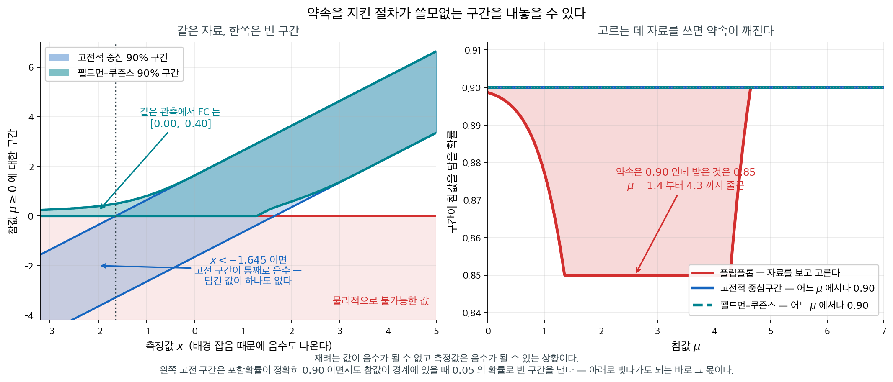
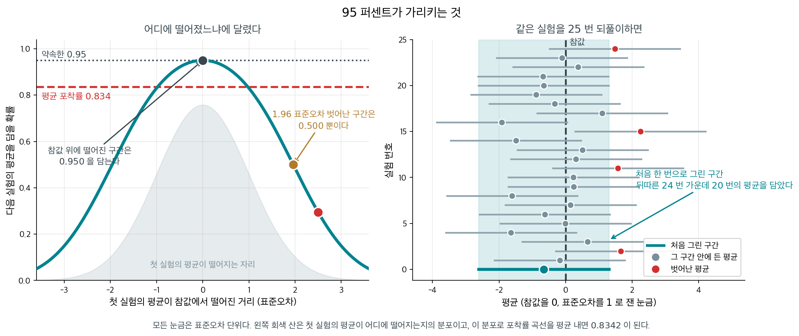

# 신뢰수준과 포함확률

## 1. 신뢰구간이란 무엇인가

점추정값 하나는 모수에 대한 최선의 추측을 주지만 **그 추측이 얼마나 믿을 만한지는 말해 주지 않는다.** 학생 평균 키의 추정값이 $170$ cm 라고만 적으면, 그것이 $169$–$171$ 안에서 흔들리는 추정인지 $150$–$190$ 안에서 흔들리는 추정인지 알 길이 없다. 신뢰구간은 그 폭을 함께 적는다.

$$
\text{추정값} \pm \text{오차한계}
$$

**오차한계는 둘의 곱이다.** 하나는 추정량의 흔들림을 재는 **표준오차**이고, 다른 하나는 표집분포에서 꺼내는 **임계값**이다. 표준오차는 자료의 변동성과 표본크기가 정하고, 임계값은 우리가 요구하는 신뢰수준이 정한다. 그래서 오차한계를 정하는 것은 셋이다 — 변동성, 표본크기, 신뢰수준. 구간이 넓으면 인정한 불확실성이 크고 좁으면 정밀하다.

**임계값을 어느 분포에서 꺼내는가는 $\sigma$ 를 아는지가 정한다.** $n$ 이 정하는 것이 아니다.

임계값을 꺼내는 그 분포는 $\bar X$ 의 **표집분포를 중심화하고 척도화한 것**이다(5.4절 [평균의 표집분포](../../ch05/applications/sample_mean.md)).

| $\sigma$ | 표집분포 | 구간 |
|:---|:---|:---|
| 안다 | 표준정규 $z$ | $\bar x \pm z_{1-\alpha/2}\,\sigma/\sqrt n$ |
| 모른다 | $t_{n-1}$ | $\bar x \pm t_{1-\alpha/2,\,n-1}\,s/\sqrt n$ |

!!! note "왜 중심화하고 척도화하는가 — 그래야 임계값을 읽을 수 있다"
    $\bar X$ 의 표집분포는 $N(\mu, \sigma^2/n)$ 이고 **모르는 것이 둘** 들어 있다. 그 꼴로는
    임계값을 읽을 수 없다 — 표를 찾으려면 $\mu$ 와 $\sigma$ 를 알아야 하는데, 알면 애초에
    구간이 필요하지 않다. **중심화와 척도화는 그 모수를 쫓아내는 작업이다.** 모수를 담고
    있으면서 그 분포에는 모수가 남지 않는 양을 **추축량**(pivotal quantity)이라 부르고, 구간과
    검정은 그것을 뒤집어 만든다(연습문제 11 이 이 원리를 다른 둘과 함께 정리한다).

    **표 두 줄의 차이는 척도화에 무엇을 썼는가뿐이다.** $\sigma$ 를 알면 **상수**
    $\sigma/\sqrt n$ 으로 나눈다. $Z = (\bar X - \mu)\big/(\sigma/\sqrt n)$ 는 $\bar X$ 를 상수로
    옮기고 상수로 나눈 것이므로, 표준정규는 새로운 분포가 아니라 $N(\mu, \sigma^2/n)$ 을
    **눈금만 바꿔 적은 것**이다.

    $\sigma$ 를 모르면 **추정값** $s/\sqrt n$ 으로 나누는 길밖에 없고, 그러면 분모가 표본마다
    흔들린다. 그래서 $t_{n-1}$ 은 눈금을 바꾼 것이 아니라 **두 확률변수의 비의 분포**이며,
    정규분포를 아무리 옮기고 늘여도 그 두꺼운 꼬리는 나오지 않는다. **척도화에 상수를 썼는가
    추정값을 썼는가** — 이것이 $z$ 와 $t$ 를 가르는 전부다.

    $\bar X$ 의 표집분포 **자체**는 $\sigma$ 를 알든 모르든 $N(\mu, \sigma^2/n)$ 로 같다는 점에
    주의할 것. $\sigma$ 를 모르는 것은 $\bar X$ 가 흩어지는 모습을 바꾸지 않는다. 바꾸는 것은
    그 흩어짐을 **무엇으로 재는가**다.

    **이 책이 쓰는 이름.** 영어의 sampling distribution 은 중심화·척도화한 뒤까지 함께 덮는
    쪽이 흔하다("the sampling distribution of the test statistic"). 이 책도 **표집분포를 그 뜻으로
    쓰되**, 가리키는 것이 어느 쪽인지 밝혀야 하는 자리에서는 갈라 적는다(아래 표준오차 대목).
    이름이 둘 더 있는데 새로운 분포가 아니라 **같은 분포를 가정 아래에서 부르는 이름**이다.

    | 층 | 그 자체 | 가정이 맞다면 |
    |:---|:---|:---|
    | **모집단분포** population distribution | 뽑든 말든 그 자리에 있다 | **기준분포** $F_0$ — 내 추측이 맞다면 |
    | **표본분포** sample distribution<br>(식에서는 **경험분포** $\hat F_n$) | 손에 쥔 $n$ 개 | — |
    | **표집분포** sampling distribution | 통계량이 흔들리는 모습 | **귀무분포** — $H_0$ 가 맞다면 |

    세 층은 5.1절 [반복추출 개념](../../ch05/foundations/repeated_sampling.md)이 세웠다.
    오른쪽 칸의 둘은 **문법이 같다** — 둘 다 「~가 맞다면」이 붙은 꼴이고, 맞는지는 **재는
    대상**이다. 적합도 검정이 $F_0$ 를 의심하고 가설검정이 $H_0$ 를 의심한다.

    **가운데 칸이 비는 것도 뜻이 있다.** 표본분포는 셋 가운데 **관측되는 유일한 것**이라서
    「~라면」이 붙을 자리가 없다. 히스토그램을 그릴 수 있는 것이 그것뿐이다.

    **표집분포는 둘로 갈라 쓴다.** 중심화·척도화를 거친 뒤의 분포도 표집분포이지만, 그것을
    묶음으로 가리킬 때는 **표준화 표집분포**라 부른다. 이 구별이 그냥 깔끔함을 위한 것이
    아니다 — **표준오차가 거기에 매여 있다.**

    | 분포 | 그 표준편차 |
    |:---|:---|
    | **표집분포** $\bar X \sim N(\mu, \sigma^2/n)$ | $\sigma/\sqrt n$ — **이것이 표준오차다** |
    | **표준화 표집분포** $Z \sim N(0,1)$ | $1$ |
    | **표준화 표집분포** $T \sim t_{n-1}$ | $\sqrt{(n-1)/(n-3)}$ |

    아래 두 줄에 **$\sigma$ 가 없다.** 그것이 요점이다. 5.3절
    [표준오차](../../ch05/applications/standard_error.md)가 표준오차를 「통계량의 표집분포의
    표준편차」로 정의하는데, 표준화한 쪽을 가리키면 그 표준편차가 $\sigma$ 를 잃어버려
    표준오차를 읽을 수 없다. 게다가 **순서가 뒤집힌다** —
    $(\hat\theta - \theta)/\mathrm{SE}(\hat\theta)$ 로 표준화하려면 표준오차를 **먼저** 알아야
    하므로, 표준오차는 표준화하기 **전**의 분포에만 매달 수 있다.

    **기준분포도 똑같이 갈린다.** 위치·척도족을 가정하면 그 족의 **표준화한 구성원**을
    기준분포로 준다 — 정규라면 $\Phi$, 지수라면 $\text{Exp}(1)$. 그러면 어느 쪽 층이든
    **표준화한 꼴에서 값을 읽는** 모양이 된다. 임계값을 $z$·$t$ 표에서 읽는 것처럼 Q-Q 그림의
    가로축도 $\Phi$ 의 분위수다.

    그런데 이쪽에서는 그 선택이 **읽히는 값을 바꾼다.** 자료가 $F((x-\mu)/\sigma)$ 에서 왔고
    기준분포를 표준화한 구성원 $F$ 로 주면 $X_{(i)} \approx \mu + \sigma q_i$ 이므로 적합선이
    위치와 척도를 **흡수해** 그 둘을 내놓는다. 자유 위치·척도가 없으면($\chi^2_{10}$ — 자유도까지
    박았다) 흡수할 것이 없어 $X_{(i)} \approx q_i$ 가 된다.

    | 기준분포에 자유 위치·척도가 | Q-Q 적합선의 기울기 | 절편 |
    |:---|:---|:---|
    | 있다 ($\Phi$, $\text{Exp}(1)$) | $\hat\sigma$ | $\hat\mu$ |
    | 없다 ($\chi^2_{10}$) | $1$ | $0$ |

    14.2절 [Q-Q 그림](../../ch14/graphical_methods/qq_plots.md)이 한 문단에서 둘을 다 보인다.
    모수를 자료에서 추정해 끼운 $\hat F_0(x) = \Phi((x-\bar X)/S)$ 는 **셋째 경우**다 —
    완전지정이 아니라 **복합**이고, 그래서 임계값을 따로 써야 한다(릴리포스가 존재하는 까닭).

    그래서 $F_0$ 를 **모집단분포라 부르지 않는다.** 모집단분포는 참이고, $F_0$ 는 그 자리에
    놓아 본 추측이다. Q-Q 그림이 「**기준분포를 바꾸면** 같은 자료가 어떻게 달리 보이는가」를
    묻거나 모수를 끼운 $\hat F_0(x) = \Phi((x - \bar X)/S)$ 를 **참** $\Phi$ 와 대비시키는 자리가
    그 차이를 드러낸다(14.2절 [Q-Q 그림](../../ch14/graphical_methods/qq_plots.md)).
    모집단분포는 바꿀 수도 없고 참과 대비될 수도 없다.

    가르는 자도 하나 적어 둔다 — **$n$ 에 의존하나.** $\bar X$ 의 표집분포는 $N(\mu, \sigma^2/n)$
    이라 $n$ 이 커지면 좁아지는데, $F_0$ 는 $n$ 이 아무리 커도 같은 함수다. 앞의 것이
    **흔들림**의 이름이라면 $F_0$ 는 **자**의 이름이다.

$\sigma$ 를 모르면 $n$ 이 크든 작든 $t$ 가 맞는 분포다. $n$ 이 커지면 $t_{n-1}$ 이 $z$ 로 가까워져 둘의 차이가 사라지고, 그래서 "$n \ge 30$ 이면 $z$ 를 써도 된다"는 관행이 생겼다. 다만 그 문턱이 보장하는 것은 **임계값의 차이가 작다는 것뿐**이다. 모집단이 크게 치우쳐 있으면 $n = 30$ 으로도 중심극한정리 근사가 부족하며, $z$ 임계값을 $s$ 와 함께 쓰면 포함률이 명목값 아래로 내려간다(아래 연습문제 4). 그 대가를 $n$ 의 함수로 그린 그림은 8.2절 [μ의 신뢰구간](../one_sample_intervals/ci_mu.md)에 있다.

!!! note "이 쪽이 이미 아는 것으로 두는 것"
    모집단과 모수, 표본과 통계량, 그리고 **추정량과 추정값의 구별**은 5.1절 [확률변수로서의 통계량](../../ch05/foundations/statistics_as_rv.md)에서 세웠다. 그 가운데 하나가 아래에서 그대로 쓰인다. 추정량 $\bar X$ 는 확률변수이고 추정값 $\bar x$ 는 수 하나라는 구별이다. **"구간이 모수를 담을 확률"에서 흔들리는 것은 구간의 끝점이고 모수는 고정되어 있다** — 대문자와 소문자를 갈라 쓰는 까닭이 여기서 드러난다.

---

## 2. 신뢰수준은 절차의 성질이다

신뢰수준은 같은 조건에서 표본을 되풀이해 뽑을 때 **만들어진 구간들 가운데 참 모수를 담는 비율**이다. $95\%$ 구간이란 그렇게 만든 구간 $100$ 개 중 약 $95$ 개가 참값을 담는다는 뜻이다.

손에 쥔 구간 하나에 대한 말이 아니라는 점이 중요하다. 수로 굳은 구간은 참값을 담았거나 담지 않았거나 둘뿐이고, 그 사이의 확률이 남아 있지 않다. **신뢰수준은 구간이 아니라 구간을 만드는 절차에 붙는 값이다.**

좀 더 손에 잡히는 자리로 옮겨 보자. **어느 핸드폰 공장의 공정 불량률이 $5\%$ 라 하자.** 이 말은 그 공정이 백 대를 만들면 다섯 대쯤 불량을 낸다는 뜻이다. **내 손에 있는 핸드폰에 대한 말이 아니다.** 내 핸드폰은 불량이거나 정상이거나 둘 중 하나이고 그 사이의 확률이 없다. $5\%$ 는 **공정이 얼마나 잘 유지되고 있는지를 재는 지표**다.

신뢰수준이 똑같이 그렇다.

| 공장 | 신뢰구간 |
|:---|:---|
| 공정 | 구간을 만드는 **절차** |
| 불량률 $5\%$ | 신뢰수준 $95\%$ |
| 내 손의 핸드폰 한 대 | 손에 쥔 구간 하나 |
| 불량이거나 정상, 그 사이는 없다 | 참값을 담았거나 담지 않았다 |

공정이 좋다는 것은 내 핸드폰이 정상일 것이라 믿을 근거가 된다. 그러나 그것이 「내 핸드폰이 $95\%$ 정상」이라는 뜻은 아니다. **$95\%$ 는 내 구간에 붙은 값이 아니라 그 구간을 만들어 낸 절차에 붙은 값이다.**

비유가 깨지는 자리도 적어 둔다. **핸드폰은 열어서 확인할 수 있다.** 불량이면 불량인 것이 드러나고, 그러면 그 한 대에 대해서는 더 이상 비율을 말할 일이 없다. 구간은 그럴 수 없다 — $\mu$ 를 모르기 때문에 애초에 구간을 만든 것이고, 그래서 **내 구간이 맞았는지는 영원히 알 수 없다.** 끝까지 믿을 수 있는 것은 공정의 품질뿐이고, 통계학에서 그 품질에 붙인 이름이 신뢰수준이다.

이 구별이 통계학에서 가장 흔하게 오해되는 대목이라서 [다음 쪽](interpretation.md)이 그것만 따로 다루고, 네이만이 "확률"이라는 말을 피해 "신뢰"라는 낱말을 새로 지은 사정도 거기에 적었다. 여기서는 그 구별이 **가장 사납게 드러나는 자리 하나**만 본다.

<div class="storybox" markdown>

**그림으로 보는 통계학 1.** 아무 값도 담지 않은 신뢰구간

절차와 그 절차가 내놓은 구간 하나를 갈라야 한다는 말이 추상적으로 들린다면, 그 말이 가장 사납게 드러난 자리를 보면 된다.

입자물리학에서 재려는 양은 음수가 될 수 없는 경우가 많다 — 질량, 붕괴율, 사건 발생률. 그런데 **측정값**은 배경 잡음 때문에 얼마든지 음수가 나온다. 재는 값이 $x \sim N(\mu, 1)$ 이고 참값은 $\mu \geq 0$ 이라고 하자. 고전적 중심 $90\%$ 구간은

$$
[\,x - 1.645,\; x + 1.645\,]
$$

이다. 어느 날 $x = -2$ 가 나왔다고 하자. 구간은 $[-3.65,\ -0.35]$ 다.

**가능한 값이 하나도 들어 있지 않다.** 1990 년대에 이런 일이 거듭 일어났고, 실험 보고서에 「물리적으로 허용되지 않는 상한」이 실리는 일이 드물지 않았다.

<figure markdown>
{ width="900" }
  <figcaption markdown>왼쪽에서 측정값이 $-1.645$ 보다 작으면 파란 띠가 통째로 붉은 영역에 잠긴다. 오른쪽 세로축의 폭이 $0.84$–$0.91$ 로 좁게 잡혀 있음에 유의하라.</figcaption>
</figure>

**여기서 중요한 것은 이것이 고장이 아니라는 점이다.** 이 절차의 포함확률은 어느 $\mu$ 에서나 **정확히 $0.90$** 이다. 참값이 경계 $\mu = 0$ 에 있을 때 구간이 통째로 음수 쪽으로 빠질 확률은

$$
\Phi(-1.645) = 0.0500
$$

곧 아래로 빗나가도 되는 바로 그 $5\%$ 다. **절차는 약속을 완벽히 지켰고, 그날 받아 든 구간은 쓸모가 없다.** 신뢰수준이 절차에 붙는 값이라는 말이 뜻하는 바가 이것이다 — $90\%$ 는 그 하나의 구간에 대한 말이 아니다.

그런데 물리학자들이 실제로 한 일은 더 나빴다. 자료를 보고 나서 고른 것이다.

- 신호가 뚜렷하지 않다 → 「상한만 보고하자」, 곧 $[0,\ x + 1.282]$
- 신호가 $3\sigma$ 를 넘었다 → 「양쪽 구간을 보고하자」, 곧 $[x - 1.645,\ x + 1.645]$

각각은 틀림없는 $90\%$ 절차다. 그런데 **둘 중 무엇을 쓸지 자료를 보고 정하면** 그 합성물은 더 이상 $90\%$ 가 아니다. 펠드먼과 쿠즌스(1998)는 이 「플립플롭」의 포함확률을 계산했다.

| 참값 $\mu$ | 포함확률 |
|---|---|
| $0$ | $0.899$ |
| $1$ | $0.877$ |
| $1.36 \sim 4.28$ | $\mathbf{0.850}$ |
| $5$ 이상 | $0.900$ |

약속은 $0.90$ 인데 받은 것은 $0.85$ 다. 이 책이 여러 장에서 되풀이해 만나는 모양이 여기 또 있다 — **고르는 데 자료를 한 번 쓰고, 고른 뒤의 절차는 그 사실을 모른다.** 단계적 선택([11.8절](../../ch11/model_selection/subset_stepwise_selection.md))도, 교차검증을 거꾸로 쓰는 일도, 분산분석 앞의 등분산 사전검정도 같은 병이다.

펠드먼과 쿠즌스의 처방은 **자료를 보기 전에 규칙을 못 박는 것**이었다. 우도비로 순서를 매겨 받아들임 영역을 정하면, 상한이냐 양쪽이냐를 고를 일이 아예 없어진다. 그 구간은 결코 비지 않고(앞의 $x = -2$ 에서 $[0.00,\ 0.40]$), 측정값이 크면 고전적 중심구간과 **정확히 같아진다**($x = 6$ 에서 둘 다 $[4.36,\ 7.64]$).

_확인한 곳 — 펠드먼·쿠즌스의 $1998$ 년 「통합 접근」이 **올바른 포함확률을 지키면서 플립플롭을 없애는 것**을 목표로 삼았다는 것, 곧 상한과 양쪽 구간을 자료를 보고 골라 쓰면 포함확률이 어긋난다는 것. 표의 포함확률과 구간의 수는 모두 직접 계산한 값이다_

</div>

---

## 3. 포함확률은 무엇을 세는가

$\S 5$ 의 표가 모으는 구간들은 모두 「명목 $95\%$」를 약속한다. 그 약속이 지켜지는지는 참값을 아는 모집단에서 구간을 되풀이해 만들어 **세어** 보면 된다. 모수마다 사정이 다르므로 그 세는 일은 8.2절부터 모수별로 하고 — 평균은 8.2절 [μ의 신뢰구간](../one_sample_intervals/ci_mu.md) 절 $3$, 비율은 [p의 신뢰구간](../one_sample_intervals/ci_p.md) 절 $3$ 다 — 여기서는 **무엇을 세고 있는지**만 분명히 해 둔다.

세는 것은 구간이 **모수**를 담은 비율이다. 그런데 사람들이 신뢰구간에서 읽어 내려는 것은 대개 다른 것이고, 그 간극이 생각보다 크다.

<div class="storybox" markdown>

**그림으로 보는 통계학 2.** $95$ 퍼센트가 가리키는 것

포함확률이 센 것은 구간이 **모수**를 담은 비율이다. 그런데 사람들이 신뢰구간에서 실제로
읽어 내려는 것은 대개 다른 것이다 — **「다음에 또 해 보면 어디쯤 나올까」**다.

호크스트라와 모리와 라우더와 바헨마커스가 2014 년에 그 간극을 쟀다. 신뢰구간에 관한 **거짓인
진술 여섯 개**를 주고 참·거짓을 묻는 설문이었고, 심리학과 1 학년생 $442$ 명과 연구자
$120$ 명이 답했다. 결과가 논문 제목에 들어 있다 — 「신뢰구간의 완강한 오독」. **연구자들이
1 학년생보다 나을 것이 없었다.**

그러면 다음 실험의 평균은 얼마나 담는가. 이것은 셀 수 있다. 실험을 한 번 해서 $\bar X_1$ 과
구간 $\bar X_1 \pm 1.96\,\sigma/\sqrt n$ 을 얻고, 같은 모집단에서 같은 크기로 한 번 더 해
$\bar X_2$ 를 얻는다. 두 평균의 차는 **분산이 두 배**이므로

$$
P\!\left(\bar X_2 \in \text{구간}\right)
= P\!\left(|Z| \leq \frac{1.96}{\sqrt 2}\right)
= 2\Phi(1.3859) - 1 = 0.834
$$

이다. **모수는 $95\%$ 담지만 다음 실험의 평균은 $83\%$ 밖에 담지 못한다.**

<figure markdown>
{ width="900" }
  <figcaption markdown>모든 눈금은 표준오차 단위다. 왼쪽 회색 산은 첫 실험의 평균이 어디에 떨어지는지의 분포이고, 이 분포로 포착률 곡선을 평균 내면 $0.834$ 가 된다.</figcaption>
</figure>

더 눈여겨볼 것은 $0.834$ 가 **평균일 뿐**이라는 점이다. 첫 실험의 평균이 참값에서 $d$
표준오차 떨어져 있었다면 그 구간의 포착률은 $\Phi(d + 1.96) - \Phi(d - 1.96)$ 이다.

| $d$ | $0$ | $1$ | $1.5$ | $1.96$ | $2.5$ |
|---|---|---|---|---|---|
| 그 구간의 포착률 | $0.950$ | $0.830$ | $0.677$ | $0.500$ | $0.295$ |

운 좋게 참값 위에 떨어진 구간은 $0.95$ 를 담고, $1.96$ 표준오차 벗어난 구간은 **절반**만
담는다. 그리고 **내가 그린 구간이 둘 중 어느 쪽인지는 알 수 없다.** 알 수 있었다면 애초에
구간이 필요 없었을 것이다.

오른쪽 그림이 그 사정이다. 아래쪽 굵은 선이 「내가 한 번 해서 얻은 구간」이고, 위로 쌓인 것이
똑같은 실험을 $24$ 번 더 한 결과다. 처음 그린 구간이 담은 평균이 $20$ 개 — $24$ 분의
$20$ 은 $0.833$ 으로, 정확히 위 식이 말한 값이다.

그러니 네이만이 1937 년에 이 구간을 내놓으며 분명히 해 둔 것을 다시 적어 둘 만하다.
$95\%$ 는 **절차**에 붙는 수다. 이 구간 하나에 붙는 수가 아니고, 다음 실험에 붙는 수는
더더욱 아니다.

_확인한 곳 — 호크스트라·모리·라우더·바헨마커스의 「Robust misinterpretation of confidence intervals」(『Psychonomic Bulletin & Review』 $21$ 권 $5$ 호 $1157$–$1164$ 쪽, $2014$)가 **거짓인 진술 여섯 개**를 학부 $1$ 학년 $442$ 명·석사 $34$ 명·연구자 $120$ 명에게 물었고 연구자가 학생보다 낫지 않았다는 것. 표와 그림의 수는 모두 직접 계산하거나 모의실험한 값이다_

</div>

---

## 4. 신뢰구간과 가설검정의 관계

신뢰구간과 가설검정은 밀접하게 연관되어 있다. 귀무가설 $H_0: \mu = \mu_0$을 대립가설 $H_1: \mu \neq \mu_0$에 대해 검정하는 경우를 생각해 보자.

이를 판단하는 한 가지 방법은 $\mu$에 대한 신뢰구간을 구성하고 가설의 값 $\mu_0$이 그 구간 안에 있는지 보는 것이다.

- $\mu_0$의 값이 $\mu$의 신뢰구간 **밖에 있으면** 해당 유의수준에서 귀무가설을 **기각**한다. 신뢰구간 밖의 값은 관측된 자료에 비추어 볼 때 그럴듯하지 않다고 보기 때문이다.
- $\mu_0$이 신뢰구간 **안에 있으면** 귀무가설을 **기각하지 못한다**. $\mu$가 $\mu_0$과 다르다고 결론지을 만한 충분한 증거가 자료에 없기 때문이다.

가설검정의 **유의수준**($\alpha$)은 신뢰구간의 **신뢰수준**과 다음 관계에 있다.

$$
\textbf{유의수준} = 1 - \textbf{신뢰수준}
$$

**여기서는 대응만 적어 둔다.** 두 판정이 우연히 맞아떨어지는 것이 아니라 **같은 사건**이라는 것, 그리고 검정에서 거꾸로 구간을 만들어 내는 길은 9.1절 [신뢰구간과 검정의 쌍대성](../../ch09/foundations/duality.md)이 부등식의 동치변형으로 보인다.

---

## 5. 어느 모수에 어떤 구간이 붙는가

모수가 달라지면 **추축량이 달라지고**, 추축량이 달라지면 구간의 꼴도 달라진다. 아래 표가 그 대응을 한 판에 펴 놓은 것이고, **각 줄이 뒤에서 한 절씩**이 된다. $\S 3$ 이 포함확률을 세는 일을 모수별로 미뤄 둔 것도 이 표의 줄마다 사정이 다르기 때문이다.

### 모수별 구간 한눈에

$$
\begin{array}{llll}
\text{모수} & \text{추정값} & \text{표집분포} & \text{신뢰구간 공식} \\
\hline
\mu & \bar{x} & \displaystyle\frac{\bar{x}-\mu}{\sigma/\sqrt{n}}\approx z & \displaystyle\bar{x}\pm z_{1-\alpha/2}\frac{\sigma}{\sqrt{n}} \\[8pt]
& & \displaystyle\frac{\bar{x}-\mu}{s/\sqrt{n}}\approx t_{n-1} & \displaystyle\bar{x}\pm t_{1-\alpha/2,n-1}\frac{s}{\sqrt{n}} \\[8pt]
p & \hat{p} & \displaystyle\frac{\hat{p}-p}{\sqrt{\hat{p}(1-\hat{p})/n}}\approx z & \displaystyle\hat{p}\pm z_{1-\alpha/2}\sqrt{\frac{\hat{p}(1-\hat{p})}{n}} \\[8pt]
\sigma^2 & s^2 & \displaystyle\frac{(n-1)s^2}{\sigma^2}\sim \chi^2_{n-1} & \displaystyle\left[\frac{(n-1)s^2}{\chi^2_{1-\alpha/2,n-1}},\frac{(n-1)s^2}{\chi^2_{\alpha/2,n-1}}\right] \\[8pt]
\frac{\sigma_1^2}{\sigma_2^2} & \frac{s_1^2}{s_2^2} & \displaystyle\frac{s_1^2/\sigma_1^2}{s_2^2/\sigma_2^2}\sim F_{n_1-1,n_2-1} & \displaystyle\left[\frac{s_1^2/s_2^2}{F_{1-\alpha/2}},\frac{s_1^2/s_2^2}{F_{\alpha/2}}\right] \\[8pt]
\mu_d & \bar{x}_d & \displaystyle\frac{\bar{x}_d-\mu_d}{s_d/\sqrt{n}}\approx t_{n-1} & \displaystyle\bar{x}_d\pm t_{1-\alpha/2,n-1}\frac{s_d}{\sqrt{n}} \\[8pt]
\mu_1-\mu_2 & \bar{x}_1-\bar{x}_2 & \text{Welch 또는 합동 } t & \displaystyle(\bar{x}_1-\bar{x}_2)\pm t_{1-\alpha/2,\text{df}}\cdot\text{SE} \\[8pt]
p_1-p_2 & \hat{p}_1-\hat{p}_2 & z & \displaystyle(\hat{p}_1-\hat{p}_2)\pm z_{1-\alpha/2}\cdot\text{SE}
\end{array}
$$

!!! note "임계값의 아래첨자를 읽는 법 — 언제나 누적확률이다"
    이 책은 **모든** 임계값의 아래첨자를 **「왼쪽부터 쌓은 누적확률」**로 적는다. 코드의 `ppf` 가 받는 수가 바로 그 수다.

    $$
    z_{1-\alpha/2} = 1.96, \qquad
    t_{1-\alpha/2,\,11} = 2.201, \qquad
    \chi^2_{0.025,\,11} = 3.816, \qquad
    \chi^2_{0.975,\,11} = 21.920
    $$

    **많은 교재는 정규와 $t$ 에 한해 다른 관례를 쓴다** — $z_{\alpha/2}$ 라 적고 「오른쪽 꼬리의 넓이가 $\alpha/2$ 인 점」으로 정의하는 것이다. 수는 같다. 교재의 $z_{\alpha/2}$ 가 이 책의 $z_{1-\alpha/2}$ 이고 $\alpha = 0.05$ 에서 둘 다 $1.96$ 이다. **두 관례가 섞이면 비대칭분포에서 아래위가 통째로 바뀌므로**, 이 책은 한쪽으로 모았다.

    모아 두면 위 표의 마지막 두 줄이 그대로 읽힌다. $\sigma^2$ 과 $\sigma_1^2/\sigma_2^2$ 의 분모가 **큰 분위수부터** 시작하는 것은 모수가 추축량의 **분모**에 있어 부등호가 돌아가기 때문이고, 8.2절 [σ²의 신뢰구간](../one_sample_intervals/ci_sigma2.md)과 8.3절 [σ₁²/σ₂²의 신뢰구간](../two_sample_intervals/ci_variance_ratio.md)이 그 유도를 따라간다.

유한모집단에서 비복원으로 뽑았을 때 붙는 **유한모집단 수정**은 8.2절 [μ의 신뢰구간](../one_sample_intervals/ci_mu.md) 연습문제 8에서 유도와 함께 다룬다. 비율·분산을 비롯한 나머지 줄도 각각 제자리에서 모의실험으로 확인한다.

---

## 연습문제

<div class="drillbox" markdown>

**연습문제 1.** <span class="diff easy" title="쉬움"></span>
독립인 표본 100개로 평균에 대한 95% 신뢰구간을 만든다. 이 구간들 중 참 평균을 담지 못하는 것은 대략 몇 개로 기대되는가?

</div>

??? success "풀이"
    정의에 따라 95% 신뢰구간이 참 모수값을 담지 못할 확률은 5%이다. 독립인 표본 100개에서 참 평균을 담지 못하는 구간 수의 기댓값은:

    $$
    100 \times 0.05 = 5
    $$

    실제 개수는 실험마다 (Binomial(100, 0.05) 분포를 따라) 달라지지만 약 5개의 실패를 기대한다.

---

<div class="drillbox" markdown>

**연습문제 2.** <span class="diff easy" title="쉬움"></span>
크기 $N = 500$인 유한모집단에서 $n = 100$인 표본을 비복원으로 뽑을 때 유한모집단 수정 인자를 계산하라. 복원추출과 비교하여 신뢰구간의 너비에 어떤 영향을 주는가?

</div>

??? success "풀이"
    유한모집단 수정 인자는:

    $$
    \text{FPC} = \sqrt{\frac{N - n}{N - 1}} = \sqrt{\frac{500 - 100}{500 - 1}} = \sqrt{\frac{400}{499}} = \sqrt{0.8016} \approx 0.895
    $$

    표준오차에 0.895가 곱해지므로 무한모집단(복원추출) 경우에 비해 신뢰구간 너비가 약 10.5% 줄어든다. 500명 중 100명(모집단의 20%)을 뽑는 것이 무한모집단에서 100명을 뽑는 것보다 더 많은 정보를 주므로 이는 자연스럽다 — 이미 모집단의 상당 부분을 관측했기 때문이다.

---

<div class="drillbox" markdown>

**연습문제 3.** <span class="diff med" title="중간"></span>
95% 신뢰구간이 참 모수가 그 구간 안에 있을 확률이 95%라는 뜻이 아닌 이유를 설명하라. 올바른 해석은 무엇인가?

</div>

??? success "풀이"
    모수 $\mu$는 확률변수가 아니라 고정된 (미지의) 상수이다. 자료로부터 구간을 계산하고 나면 $\mu$는 그 안에 있거나 없거나 둘 중 하나이다 — 그 특정한 구간에 대해서는 확률이 개입하지 않는다.

    올바른 해석은 **빈도주의적**이다: 표본추출 절차를 여러 번 반복하여 매번 95% 신뢰구간을 만들면 그 구간들 중 약 95%가 참 $\mu$를 담는다. "95%"는 $\mu$를 담는 구간의 장기적 비율을 가리키는 것이지, 특정한 구간 하나가 $\mu$를 담을 확률이 아니다.

---

<div class="drillbox" markdown>

**연습문제 4.** <span class="diff med" title="중간"></span>
어떤 연구자가 $n = 10$일 때 $\sigma$ 자리에 표본표준편차 $s$를 대입한 z-구간("z-plugin" 방법)을 쓴다. 실제 포함확률은 명목 95%보다 높겠는가, 낮겠는가? 이유를 설명하라.

</div>

??? success "풀이"
    실제 포함확률은 95%보다 **낮다**. z-구간은 $\sigma$를 안다고 가정하고 임계값으로 $z_{0.025} = 1.96$을 쓴다. $\sigma$를 모르고 $s$로 추정하면 $\sigma$ 추정에서 오는 추가 변동성이 생기는데, z-구간은 이를 반영하지 않는다.

    $n$이 작으면 $s$가 $\sigma$를 상당히 과소추정할 수 있어 구간이 너무 좁아진다. $t$-구간은 더 큰 $t_{n-1}$ 임계값(예: $t_{0.975,\,9} = 2.262 > 1.96$)을 써서 $\sigma$ 추정의 불확실성을 반영해 이를 바로잡는다. $n \to \infty$이면 $s \to \sigma$이고 z-구간과 t-구간은 수렴한다.

---

<div class="drillbox" markdown>

**연습문제 5.** <span class="diff med" title="중간"></span>
이항비율 신뢰구간 네 가지 — 왈드, 윌슨, 아그레스티–코울, 클로퍼–피어슨 — 의 **포함확률**을 $n=40$, $p=0.1$에서 정확히 계산하여 비교하라.

</div>

??? success "풀이"
    **정확한 포함확률.** 이항은 이산이므로 모든 $k=0,\dots,n$에 대해 구간을 만들고

    $$
    C(p)=\sum_{k=0}^{n}\mathbf{1}\{p\in I(k)\}\binom nk p^k(1-p)^{n-k}
    $$

    를 직접 더하면 된다. 몬테카를로가 필요 없다.

    ```python
    import numpy as np
    from scipy import stats

    def coverage(n, p, method, alpha=0.05):
        z = stats.norm.ppf(1 - alpha / 2)
        k = np.arange(n + 1)
        ph = k / n
        if method == "wald":
            se = np.sqrt(ph * (1 - ph) / n)
            lo, hi = ph - z * se, ph + z * se
        elif method == "wilson":
            d = 1 + z**2 / n
            c = (ph + z**2 / (2 * n)) / d
            h = z / d * np.sqrt(ph * (1 - ph) / n + z**2 / (4 * n**2))
            lo, hi = c - h, c + h
        elif method == "ac":                      # 아그레스티–코울: 성공·실패에 2씩 더함
            nt = n + z**2
            pt = (k + z**2 / 2) / nt
            se = np.sqrt(pt * (1 - pt) / nt)
            lo, hi = pt - z * se, pt + z * se
        elif method == "cp":                      # 클로퍼-피어슨
            lo = np.where(k == 0, 0.0, stats.beta.ppf(alpha / 2, k, n - k + 1))
            hi = np.where(k == n, 1.0, stats.beta.ppf(1 - alpha / 2, k + 1, n - k))
        inside = (lo <= p) & (p <= hi)
        return stats.binom.pmf(k, n, p)[inside].sum()

    for m in ["wald", "wilson", "ac", "cp"]:
        print(f"{m:7s} {coverage(40, 0.1, m):.4f}")
    ```

    ```text
    wald    0.9145
    wilson  0.9433
    ac      0.9581
    cp      0.9697
    ```

    **읽기.**

    | 방법 | 포함확률 | 평가 |
    |---|---|---|
    | 왈드 | **0.9145** | 명목에 3.5%포인트 못 미친다 |
    | 윌슨 | 0.9433 | 명목에 가장 가깝다 |
    | 아그레스티–코울 | 0.9581 | 약간 보수적 |
    | 클로퍼–피어슨 | 0.9697 | 가장 보수적(모든 $p$에서 $\ge$ 0.95 보장) |

    **왈드가 왜 모자라는가.** $p=0.1$, $n=40$이면 성공의 기댓값이 4개다. $k\le1$이면 구간의 상한이 $p=0.1$에 못 미쳐 참값을 놓친다($k=0$이면 폭이 0인 점구간 $\{0\}$, $k=1$이면 상한이 0.073이다). 이 경우들의 확률만 해도

    $$
    P(K\le1)=0.9^{40}+40(0.1)(0.9)^{39}=0.0148+0.0657=0.0805
    $$

    로 8%다. 여기에 $\hat p\ge0.25$인 위쪽 누락이 더해져 총 8.6%가 된다. **누락이 한쪽으로 심하게 쏠려 있다**는 점이 특히 나쁘다.

    **결론.** 앞서 본 대로 **왈드 구간은 쓰지 않는다.** 윌슨이 포함확률과 폭의 균형에서 가장 낫고, 보수적인 보장이 꼭 필요하면 클로퍼–피어슨을 쓴다.

---

<div class="drillbox" markdown>

**연습문제 6.** <span class="diff med" title="중간"></span>
포함확률 외에 신뢰구간을 평가하는 **다른 기준**들을 적고, 기준들이 충돌하는 예를 들어라.

</div>

??? success "풀이"
    **기준들.**

    1. **포함확률.** $P(\theta\in C)\ge1-\alpha$. 기본이지만 이것만으로는 부족하다. $(-\infty,\infty)$가 항상 100%를 만족한다.

    2. **기대 폭.** $E[\text{길이}]$. 짧을수록 정보가 많다. 포함확률을 맞춘 뒤 폭으로 비교하는 것이 표준이다.

    3. **거짓 포함확률.** $P(\theta'\in C)$ for $\theta'\ne\theta$. 틀린 값을 담지 않아야 한다. 검정의 검정력에 대응한다.

    4. **동등꼬리성.** 양쪽 비포함확률이 각각 $\alpha/2$인가. 한쪽으로 쏠리면 방향성 있는 결론이 왜곡된다.

    5. **불편성.** $P(\theta\in C(\theta))\ge P(\theta'\in C(\theta))$. 참값을 다른 값보다 더 자주 담아야 한다.

    6. **변환 불변성.** $\theta$의 구간에 $g$를 적용한 것이 $g(\theta)$의 구간과 같은가. 우도비 구간은 만족하고 왈드는 아니다.

    7. **계산 가능성과 설명 가능성.** 실무에서 무시할 수 없다.

    **충돌의 예 — 클로퍼–피어슨 대 윌슨.**

    | | 클로퍼–피어슨 | 윌슨 |
    |---|---|---|
    | 최소 포함확률 | $\ge0.95$ 보장 | 0.93까지 떨어질 수 있음 |
    | 평균 포함확률 | 0.97 | 0.95 |
    | 기대 폭 | 넓다 | 좁다 |

    **보장이냐 효율이냐의 충돌**이다. 규제 당국에 제출하는 자료라면 보장이 중요하고, 탐색적 분석이라면 효율이 중요하다.

    **다른 충돌 — 동등꼬리 대 최단.** 카이제곱 분산 구간에서 동등꼬리 구간과 최단 구간이 다르다. 최단 구간은 폭이 짧지만 양쪽 꼬리 확률이 다르므로, 단측 결론을 내릴 때 부적절하다.

    **또 다른 충돌 — 불편성 대 포함확률.** 어떤 이산 모형에서는 정확한 포함확률을 유지하면서 불편성을 만족하는 구간이 존재하지 않는다.

    **교훈.** "최고의 신뢰구간"은 없다. **목적에 따라 어떤 기준을 우선할지 정해야 한다.**

---

<div class="drillbox" markdown>

**연습문제 7.** <span class="diff med" title="중간"></span>
**조건부 포함확률**의 문제를 설명하라. 주변적으로 95%를 만족해도 특정 자료에서는 왜 부적절할 수 있는가?

</div>

??? success "풀이"
    **주변 포함확률과 조건부 포함확률.** 표준적인 보장은

    $$
    P_\theta\{\theta\in C(\mathbf X)\}=0.95
    $$

    로, **모든 가능한 표본에 대한 평균**이다. 하지만 우리는 하나의 실현된 표본을 가지고 있다. **이 표본에서** 구간이 믿을 만한가?

    **고전적 반례 — 균등분포의 두 관측값.** $X_1,X_2\sim\text{Unif}(\theta-1/2,\theta+1/2)$일 때, 구간

    $$
    C=\left(\min(X_1,X_2),\ \max(X_1,X_2)\right)
    $$

    를 생각하자. 이것의 포함확률은 정확히 **50%** 다(참값이 두 점 사이에 있을 확률).

    그런데 **$R=|X_1-X_2|$를 관측하고 나면** 이야기가 다르다.

    - $R=0.9$이면 $\theta$는 반드시 두 점 사이에 있다. **조건부 포함확률 = 1.**
    - $R=0.01$이면 두 점이 거의 겹쳐 있고, $\theta$가 그 사이일 확률은 **1%쯤**이다.

    **"50% 구간"이라고 보고하는 것이 두 경우 모두에서 오해를 부른다.** $R$은 **보조통계량**(분포가 $\theta$에 의존하지 않음)이므로, 조건부 추론이 옳다.

    **실무적 예.**

    - **약한 도구변수.** 1단계 $F$ 통계량이 작으면 2SLS 구간의 조건부 포함확률이 크게 나쁘다. 주변적으로는 괜찮아 보여도.
    - **선택 후 추론.** 변수선택을 거친 뒤의 구간은 "선택되었다"는 조건 아래에서 포함확률이 무너진다. 앞서 본 승자의 저주와 같은 구조다.
    - **경계 근처.** 분산성분이 0 근처면 추정값이 경계에 붙었는지 여부가 구간의 신뢰도를 크게 바꾼다.

    **대처.**

    - **보조통계량이 있으면 그것에 조건화**한다(피셔의 조건부성 원리).
    - 조건부 보장을 주는 방법을 쓴다: 앤더슨–루빈(약한 도구), 선택 후 추론의 조건부 방법(POSI, selective inference).
    - 최소한 **진단 통계량을 함께 보고**한다. 1단계 $F$, 선택 경로, 경계 도달 여부.

    **철학적 함의.** 빈도주의 보장은 "장기적으로 평균" 보장이다. 베이즈 신용구간은 조건부 진술이지만 사전분포가 필요하다. **둘 다 무료가 아니다.**

---

<div class="drillbox" markdown>

**연습문제 8.** <span class="diff med" title="중간"></span>
포함확률을 모의실험으로 추정할 때 필요한 **반복 횟수**를 정하고, 결과를 어떻게 보고해야 하는지 설명하라.

</div>

??? success "풀이"
    **모의실험 오차.** $M$번 반복하여 추정한 포함확률 $\hat C$는 이항비율이므로

    $$
    \operatorname{SE}(\hat C)=\sqrt{\frac{C(1-C)}{M}}\approx\sqrt{\frac{0.95\times0.05}{M}}=\frac{0.218}{\sqrt M}
    $$

    | $M$ | SE | 95% 오차한계 |
    |---|---|---|
    | 1,000 | 0.0069 | $\pm$0.014 |
    | 10,000 | 0.00218 | $\pm$0.0043 |
    | 100,000 | 0.00069 | $\pm$0.0014 |

    **필요한 $M$ 정하기.** 목표 정밀도 $d$에 대해

    $$
    M \ge \frac{0.95\times0.05}{(d/1.96)^2}
    $$

    - **0.95와 0.94를 구별**하려면($d=0.01$) $M\approx1{,}825$. 실무에서 $M=2{,}000$이면 충분하다.
    - **0.950과 0.945를 구별**하려면($d=0.0025$) $M\approx29{,}000$.
    - 대체로 **$M=10{,}000$이 좋은 기본값**이다.

    ```python
    import numpy as np

    for M in [1_000, 10_000, 100_000]:
        se = np.sqrt(0.95 * 0.05 / M)
        print(f"M={M:>7,d}  SE={se:.5f}  ±{1.96 * se:.4f}")
    ```

    ```text
    M=  1,000  SE=0.00689  ±0.0135
    M= 10,000  SE=0.00218  ±0.0043
    M=100,000  SE=0.00069  ±0.0014
    ```

    **보고할 것.**

    1. **반복 횟수 $M$.**
    2. **몬테카를로 표준오차.** "포함확률 0.943"이 아니라 "0.943 (MCSE 0.0023)"으로 적는다.
    3. **난수 씨앗.** 재현 가능해야 한다.
    4. **생성 분포와 모수 설정.** 어떤 $(n,\theta)$ 격자에서 평가했는지.
    5. **실패 사례의 처리.** 수렴하지 않거나 구간이 정의되지 않은 경우를 어떻게 셌는지. 이것을 빼고 계산하면 포함확률이 낙관적으로 나온다.

    **흔한 실수.** $M=1{,}000$으로 0.943과 0.951을 비교하며 "전자가 나쁘다"고 결론 내리는 것. 차이가 MCSE의 1배 이내라 구별되지 않는다.

    **효율 향상.** 가능하면 **정확한 계산**을 쓴다. 이산분포에서는 앞 문제처럼 합으로 구할 수 있어 몬테카를로 오차가 0이다. 공통난수를 쓰면 방법 간 비교의 분산이 크게 준다.

---

<div class="drillbox" markdown>

**연습문제 9.** <span class="diff hard" title="어려움"></span>
이산분포에서 포함확률이 $p$에 대해 **톱니 모양**으로 진동하는 이유를 설명하고, 그 함의를 논하라.

</div>

??? success "풀이"
    **현상.** $n$을 고정하고 $p$를 0에서 1까지 움직이며 포함확률을 그리면, 매끄러운 곡선이 아니라 **급격히 오르내리는 톱니**가 나타난다.

    ```python
    import numpy as np
    from scipy import stats

    n, z = 40, stats.norm.ppf(0.975)
    k = np.arange(n + 1)
    ph = k / n
    d = 1 + z**2 / n
    c = (ph + z**2 / (2 * n)) / d
    h = z / d * np.sqrt(ph * (1 - ph) / n + z**2 / (4 * n**2))
    lo, hi = c - h, c + h

    grid = np.linspace(0.05, 0.30, 6)
    for p in grid:
        inside = (lo <= p) & (p <= hi)
        print(f"p={p:.2f}  포함확률 {stats.binom.pmf(k, n, p)[inside].sum():.4f}")
    ```

    ```text
    p=0.05  포함확률 0.9520
    p=0.10  포함확률 0.9433
    p=0.15  포함확률 0.9580
    p=0.20  포함확률 0.9283
    p=0.25  포함확률 0.9577
    p=0.30  포함확률 0.9443
    ```

    **이유.** 포함확률은

    $$
    C(p)=\sum_{k\,:\,p\in I(k)} \binom nk p^k(1-p)^{n-k}
    $$

    로, $p$가 연속으로 변해도 **합에 들어가는 $k$의 집합은 이산적으로 바뀐다.** $p$가 어떤 $I(k)$의 경계를 넘는 순간 항 하나가 통째로 빠지거나 들어온다. 그 항의 크기가 $\binom nk p^k(1-p)^{n-k}$이므로, 확률질량이 큰 $k$가 빠질 때 포함확률이 뚝 떨어진다.

    **함의.**

    1. **"평균 포함확률"이 오해를 부른다.** $p$에 대해 평균 내면 0.95에 가깝게 나오지만, 특정 $p$에서는 0.93일 수 있다. **최악의 경우**를 봐야 한다.

    2. **$n$을 늘려도 톱니가 사라지지 않는다.** 진폭은 $O(n^{-1/2})$로 줄지만 진동 자체는 남는다. 이것은 근사의 문제가 아니라 **이산성의 본질**이다.

    3. **정확한 방법만이 보장을 준다.** 클로퍼–피어슨은 모든 $p$에서 $\ge0.95$를 보장하지만, 그 대가로 대부분의 $p$에서 0.97 이상이라 구간이 필요 이상으로 넓다. **이산분포에서 "정확히 95%"는 불가능하다.**

    4. **무작위화 구간.** 이론적으로는 경계에서 동전을 던져 포함 여부를 정하면 정확히 95%를 얻을 수 있다. 실무에서는 같은 자료가 다른 결론을 주므로 쓰지 않는다.

    **권고.** 방법을 비교할 때는 포함확률을 **$p$의 함수로 그려서** 최솟값과 평균을 함께 본다. 하나의 $p$에서 좋다고 좋은 방법이 아니다.

---

<div class="drillbox" markdown>

**연습문제 10.** <span class="diff hard" title="어려움"></span>
$n=25$의 정규 표본에서 **분산**에 대한 카이제곱 구간이 정규성 위배에 얼마나 민감한지 모의실험으로 확인하고, 평균에 대한 $t$ 구간과 비교하라.

</div>

??? success "풀이"
    ```python
    import numpy as np
    from scipy import stats

    rng = np.random.default_rng(20250908)
    n, M = 25, 20_000

    def dists():
        yield "정규", lambda size: rng.normal(0, 1, size), 0.0, 1.0
        yield "균등", lambda size: rng.uniform(-np.sqrt(3), np.sqrt(3), size), 0.0, 1.0
        yield "지수", lambda size: rng.exponential(1, size) - 1, 0.0, 1.0
        yield "t(5)", lambda size: rng.standard_t(5, size) / np.sqrt(5 / 3), 0.0, 1.0

    print(f"{'분포':6s} {'초과첨도':>8s} {'t구간':>8s} {'χ²구간':>8s}")
    for name, gen, mu, var in dists():
        x = gen((M, n))
        xb, s2 = x.mean(1), x.var(1, ddof=1)
        # 평균에 대한 t 구간
        h = stats.t.ppf(0.975, n - 1) * np.sqrt(s2 / n)
        cov_t = np.mean((xb - h <= mu) & (mu <= xb + h))
        # 분산에 대한 카이제곱 구간
        lo = (n - 1) * s2 / stats.chi2.ppf(0.975, n - 1)
        hi = (n - 1) * s2 / stats.chi2.ppf(0.025, n - 1)
        cov_c = np.mean((lo <= var) & (var <= hi))
        kurt = stats.kurtosis(x.ravel())
        print(f"{name:6s} {kurt:8.2f} {cov_t:8.3f} {cov_c:8.3f}")
    ```

    ```text
    분포         초과첨도      t구간     χ²구간
    정규         0.01    0.951    0.951
    균등        -1.20    0.949    0.997
    지수         5.95    0.923    0.720
    t(5)       4.73    0.953    0.834
    ```

    **읽기.**

    | 분포 | $t$ 구간 | 카이제곱 구간 |
    |---|---|---|
    | 정규 | 0.951 | 0.951 |
    | 균등(첨도 $-1.2$) | 0.949 | **0.997** |
    | 지수(첨도 6.0) | 0.923 | **0.720** |
    | $t_5$(첨도 4.7) | 0.953 | **0.834** |

    **결론 1 — 카이제곱 구간은 첨도에 극도로 민감하다.** 지수분포에서 포함확률이 **72%** 로 무너진다. 명목 95%와 23%포인트 차이다. 꼬리가 두꺼우면 과대기각, 얇으면 과대보수적이다(균등분포에서 99.7%).

    **결론 2 — $t$ 구간은 훨씬 강건하다.** 첨도가 6인 지수분포에서도 0.923이다. **중심극한정리가 $\bar X$를 보호**하지만, $S^2$의 분포는 4차 적률에 직접 의존해 보호받지 못한다.

    **이유.** $S^2$의 점근분산은

    $$
    \operatorname{Var}(S^2)\approx\frac{\mu_4-\sigma^4}{n}=\frac{\sigma^4(\gamma_2+2)}{n}
    $$

    로 초과첨도 $\gamma_2$에 직접 비례한다. 정규에서는 $\gamma_2=0$이라 $2\sigma^4/n$인데, 지수에서는 $\gamma_2=6$이라 **네 배**다. 카이제곱 구간은 $\gamma_2=0$을 가정하므로 폭이 실제 필요한 것의 절반밖에 되지 않는다.

    **대처.**

    - **분산 구간에는 부트스트랩을 쓴다.** BCa가 안전하다.
    - 첨도를 보정한 구간(보넷의 방법)을 쓴다.
    - 최소한 **정규성을 확인**하고, 위배가 보이면 카이제곱 구간을 보고하지 않는다.

    **교훈.** "정규성 가정"이 모든 절차에 같은 정도로 중요한 것이 아니다. **평균에는 관대하고 분산에는 엄격하다.**

---

<div class="drillbox" markdown>

**연습문제 11.** <span class="diff med" title="중간"></span>
신뢰구간을 만드는 세 가지 일반 원리 — **추축량**, **검정의 역전**, **점근 정규성** — 을 설명하고 각각의 예를 들어라.

</div>

??? success "풀이"
    **원리 1 — 추축량(pivotal quantity).** 모수를 담고 있으면서 그 **분포가 모수에 의존하지 않는** 양을 찾는다.

    $$
    Q(\mathbf{X},\theta) \sim \text{알려진 분포}
    $$

    $P(a\le Q\le b)=0.95$를 $\theta$에 대해 풀면 구간이 나온다.

    - **예**: $\dfrac{\bar X-\mu}{S/\sqrt n}\sim t_{n-1}$, $\dfrac{(n-1)S^2}{\sigma^2}\sim\chi^2_{n-1}$, $2\lambda\sum X_i\sim\chi^2_{2n}$.
    - **장점**: 구간이 **정확**하다. 근사가 없다.
    - **한계**: 추축량이 존재하는 모형이 제한적이다. 대체로 위치–척도족이나 지수족.

    **원리 2 — 검정의 역전.** 수준 $\alpha$ 검정을 각 $\theta_0$에 대해 수행하고, **기각되지 않는 $\theta_0$를 모아** 구간으로 삼는다.

    $$
    C(\mathbf{x}) = \left\{\theta_0:\ H_0:\theta=\theta_0\text{이 기각되지 않음}\right\}
    $$

    - **예**: 우도비 구간, 점수 구간(윌슨), 클로퍼–피어슨(정확 이항검정의 역전).
    - **장점**: 가장 일반적이다. 검정이 있으면 언제나 구간을 만들 수 있고, 검정의 수준이 곧 구간의 포함확률이다.
    - **핵심 성질**: 구간과 검정이 **논리적으로 일치**한다. $\theta_0$가 구간 밖이면 반드시 기각된다.

    **원리 3 — 점근 정규성.** $\hat\theta\approx N(\theta, \operatorname{SE}^2)$을 이용해

    $$
    \hat\theta\pm z_{1-\alpha/2}\widehat{\operatorname{SE}}
    $$

    - **예**: 왈드 구간 일반.
    - **장점**: 어떤 모형에도 기계적으로 적용된다.
    - **한계**: 근사이며, 앞서 여러 번 본 대로 경계 근처나 소표본에서 나쁘다.

    **관계.** 세 원리는 독립적이지 않다. 추축량이 있으면 그것을 뒤집는 검정이 자연스럽게 정의되고, 점근 정규성은 왈드 검정을 역전한 것이다. **역전 원리가 가장 넓고**, 나머지가 그 특수한 경우다.

    **실무 선택.** 정확한 추축량이 있으면 그것을 쓰고, 없으면 우도비 역전을 쓰며, 계산이 부담되면 왈드를 쓰되 그 한계를 확인한다.

---

<div class="drillbox" markdown>

**연습문제 12.** <span class="diff med" title="중간"></span>
신뢰구간과 가설검정의 **쌍대성**을 정확히 서술하고, 둘이 어긋나 보이는 경우가 왜 생기는지 설명하라.

</div>

??? success "풀이"
    **쌍대성.** 수준 $\alpha$의 양측검정족 $\{\phi_{\theta_0}\}$과 포함확률 $1-\alpha$의 구간족 $\{C(\mathbf{x})\}$이

    $$
    \theta_0 \in C(\mathbf{x}) \iff H_0:\theta=\theta_0\text{을 기각하지 않음}
    $$

    으로 일대일 대응한다.

    **따라서** 구간이 $\theta_0$를 담지 않는 것과 $p$-값이 $\alpha$보다 작은 것이 **논리적으로 동치**다.

    **어긋나 보이는 경우와 그 이유.**

    **(1) 서로 다른 근사를 썼다.** 앞서 본 두 비율 비교가 대표적이다.

    - 검정은 **합동 비율**로 표준오차를 계산한다($H_0$ 아래의 분산).
    - 구간은 **각각의 비율**로 계산한다.

    둘이 다르므로 경계 근처에서 결론이 갈릴 수 있다. **엄밀히 말하면 이 둘은 쌍대가 아니다.** 진짜 쌍대인 구간은 검정을 역전해 얻어야 한다.

    **(2) 단측과 양측을 혼동했다.** 단측 검정의 $p$-값이 0.03이면 5%에서 기각이지만, 양측 95% 구간은 $\theta_0$를 담을 수 있다. 대응하는 것은 **단측 구간**이다.

    **(3) 다중비교 보정이 한쪽에만 적용됐다.** 검정에는 본페로니를 쓰고 구간에는 안 쓰면 어긋난다.

    **(4) 검정통계량과 구간의 중심이 다르다.** 우도비 검정과 왈드 구간을 함께 쓰면 근사 방식이 달라 갈릴 수 있다.

    **실무 권고.**

    - **$p$-값과 구간을 같은 방법으로 계산**한다. 같은 소프트웨어 함수에서 나온 쌍이면 대개 일관된다.
    - 어긋나면 **어느 쪽 근사가 나쁜지** 확인한다. 경계 근처면 왈드를 의심한다.
    - 보고할 때는 **구간을 우선**한다. 효과의 크기와 불확실성을 함께 주므로 $p$-값보다 정보가 많다.

---

<div class="drillbox" markdown>

**연습문제 13.** <span class="diff med" title="중간"></span>
**신뢰영역**(다차원)을 구성하는 방법을 설명하고, 개별 구간을 그대로 곱집합으로 쓰면 왜 안 되는지 밝혀라.

</div>

??? success "풀이"
    **문제.** 모수가 $(\theta_1,\theta_2)$일 때, 각각의 95% 구간 $C_1$, $C_2$를 만들어 직사각형 $C_1\times C_2$를 쓰면

    $$
    P\left\{(\theta_1,\theta_2)\in C_1\times C_2\right\} < 0.95
    $$

    다. 두 사건이 동시에 일어나야 하므로 확률이 줄어든다. 독립이면 $0.95^2=0.9025$이고, 상관이 있으면 다르지만 어쨌든 0.95보다 작다.

    **더 근본적인 문제 — 모양.** 두 추정값이 상관되어 있으면 참 신뢰영역이 **기울어진 타원**인데, 직사각형은 그 모양을 담지 못한다. 타원 밖의 모서리를 포함하고 타원 안의 일부를 빠뜨린다.

    **올바른 구성.**

    **(1) 왈드 타원.** $\hat{\boldsymbol\theta}\approx N(\boldsymbol\theta, \Sigma)$이면

    $$
    \left(\hat{\boldsymbol\theta}-\boldsymbol\theta\right)^\top\hat\Sigma^{-1}\left(\hat{\boldsymbol\theta}-\boldsymbol\theta\right)\le\chi^2_{p,1-\alpha}
    $$

    앞서 본 마할라노비스 거리와 카이제곱의 관계 그대로다.

    **(2) 우도비 영역.**

    $$
    \left\{\boldsymbol\theta:\ 2\left\{\ell(\hat{\boldsymbol\theta})-\ell(\boldsymbol\theta)\right\}\le\chi^2_{p,1-\alpha}\right\}
    $$

    타원이 아니라 가능도의 실제 모양을 따르는 영역이 나온다.

    **(3) 본페로니 직사각형.** 각 구간을 $1-\alpha/p$ 수준으로 만들면 곱집합의 포함확률이 $1-\alpha$ 이상이다. 보수적이지만 **해석이 쉽고** 각 모수를 따로 읽을 수 있다는 장점이 있다.

    **어느 것을 쓰는가.**

    - **모수들을 함께 판단해야 한다면** 타원이나 우도비 영역. "두 계수가 동시에 0인가"를 묻는 경우다.
    - **각 모수를 개별적으로 해석한다면** 본페로니 구간이나 그냥 개별 구간. 다만 **동시 보장이 없다는 점을 명시**해야 한다.
    - 논문에서 회귀계수 표에 개별 구간을 싣는 것이 관행인데, 이는 동시 신뢰영역이 아니다. 여러 계수에 대한 결합 주장을 하려면 보정이 필요하다.

---

<div class="drillbox" markdown>

**연습문제 14.** <span class="diff med" title="중간"></span>
신뢰구간이 **공집합**이거나 **전체 모수공간**이 되는 경우가 있다. 그런 일이 왜 생기며, 그것이 잘못된 것인지 논하라.

</div>

??? success "풀이"
    **공집합이 되는 예.** 앤더슨–루빈 검정을 역전한 도구변수 신뢰구간은 도구가 아주 약하면 **빈 집합**이 될 수 있다. 모든 $\beta_0$가 기각되는 것이다.

    **전체가 되는 예.** 같은 방법에서 도구가 전혀 정보를 주지 못하면 **$(-\infty,\infty)$** 가 나온다. 어떤 $\beta_0$도 기각되지 않는다.

    **잘못된 것인가.** **아니다. 오히려 정직한 답이다.**

    - **$(-\infty,\infty)$** 는 "이 자료로는 모수에 대해 아무것도 말할 수 없다"는 뜻이다. 약한 도구 상황에서 정확히 옳은 결론이며, 이를 숨기고 좁은 구간을 보고하는 2SLS 왈드 구간이 오히려 잘못이다.

      실제로 모수가 약한 도구 아래에서 **식별되지 않을 수 있고**, 그때 유한한 구간을 주는 방법은 반드시 포함확률을 어긴다. 이것은 정리로 증명되어 있다(더프–소마이니).

    - **공집합**은 "**모형이 자료와 맞지 않는다**"는 신호다. 과대식별 제약이 위배되었을 때 나타나며, $J$ 검정이 기각하는 것과 같은 정보다. 모형을 재검토하라는 뜻이다.

    **다른 예들.**

    - **클로퍼–피어슨.** $k=0$이면 구간이 $[0,\ 3/n]$ 꼴로 한쪽이 경계에 붙는다. 퇴화는 아니지만 비대칭이 극심하다.
    - **프로파일 가능도 구간.** 가능도가 다봉이면 **연결되지 않은 구간**이 나올 수 있다. 두 영역이 모두 그럴듯하다는 뜻이며, 이것도 정직한 표현이다.
    - **분산성분.** 경계해가 나오면 구간이 $[0,\ u]$로 한쪽이 0에 붙는다.

    **실무 권고.** 이런 결과가 나왔을 때 **억지로 "정상적인" 구간을 만들려 하지 않는다.** 대신

    - 왜 그런지 진단한다(약한 도구, 모형 오설정, 다봉성, 경계).
    - 결과를 그대로 보고하고 해석을 붙인다.
    - 필요하면 자료를 더 모으거나 설계를 바꾼다.

    **"모른다"는 답이 틀린 답보다 낫다.**

---

## 정리하며

신뢰구간은 점추정에 **불확실성의 폭**을 붙인 것이다.

$$
\text{점추정값} \pm \text{오차한계}
$$

- **오차한계를 정하는 것은 셋이다.** 자료의 변동성, 표본크기, 그리고 원하는 신뢰수준. 앞의 둘은 표준오차로 묶이고, 마지막 것이 임계값으로 들어온다.
- **폭이 곧 정밀도의 보고다.** 좁으면 정밀하고 넓으면 그렇지 않다. **점추정값만 보고하면 이 정보가 통째로 사라진다.**
- **$1/\sqrt n$ 이 여기서도 지배한다.** 구간을 절반으로 줄이려면 표본을 네 배로 늘려야 하며, 이 장 마지막의 표본크기 계산이 전부 그 관계를 뒤집어 푼 것이다.
- **신뢰수준을 높이면 구간이 넓어진다.** $90\%\to95\%\to99\%$ 로 갈수록 임계값이 커지므로, **확신과 정밀도는 맞바꿈 관계**다. 둘 다 좋게 하려면 자료를 더 모으는 수밖에 없다.

다음 쪽 **[해석과 흔한 오해](interpretation.md)**로 넘어간다. 이 구간이 정확히 무엇을 뜻하는지가 통계학에서 가장 흔하게 오해되는 대목이다.
