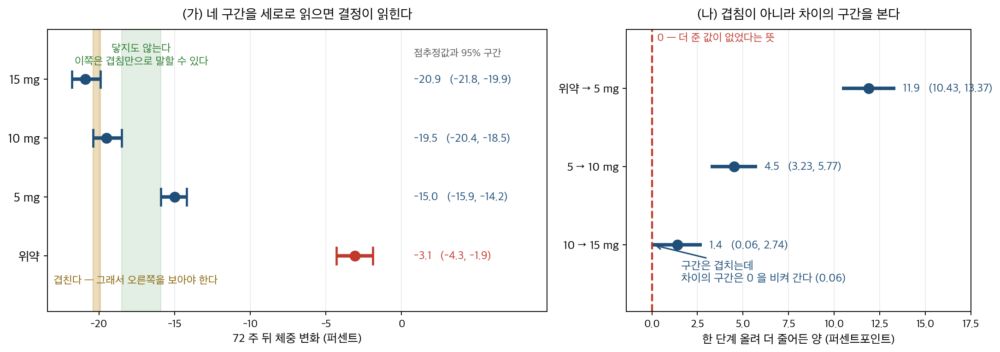

# 8장: 신뢰구간

## 개요

**마운자로**(성분 이름은 티르제파티드)라는 살 빼는 약이 얼마나 듣는지 알아보려고 큰 시험을 했다. 결과를 발표할 때 연구자들은 「몸무게가 $20.9\%$ 줄었다」라고만 쓰지 않았다. 그 옆에 괄호를 하나 붙였다 — $(19.9\%,\ 21.8\%)$. 「$20.9$ 쯤인데, 이 자료로 말할 수 있는 것은 $19.9$ 와 $21.8$ 사이까지다」라는 뜻이다. 학술지에 실리는 수는 거의 늘 이렇게 **둘이 짝을 이룬다.**

괄호가 왜 필요한지는 그것을 떼어 보면 안다. 「이 약은 몸무게를 $20.9\%$ 줄인다」라고만 적으면, 읽는 사람은 자기도 꼭 그만큼 빠질 것처럼 받아들인다. 그런데 연구자가 가진 것은 몇천 명을 재어 본 결과일 뿐이다. 다른 몇천 명을 새로 모아 다시 재면 수는 조금 달라진다. 괄호는 **그 흔들림의 크기**를 적은 것이고, 사람을 적게 모았으면 괄호가 넓어진다. **넓은 괄호는 「아직 잘 모른다」는 뜻이다.**

괄호는 결정에도 쓰인다. 이 시험은 약을 세 가지 양으로 나누어 주었다. 적게 준 쪽은 $15.0\%$, 중간은 $19.5\%$, 많이 준 쪽은 $20.9\%$ 가 빠졌다. 수만 보면 많이 줄수록 좋아 보인다. 그런데 괄호를 보면 이야기가 갈린다. 적게 준 쪽과 중간 쪽은 괄호가 **서로 닿지도 않는다** — 양을 늘린 값이 분명히 있었다는 뜻이다. 반면 중간과 많이 준 쪽은 괄호가 **겹친다.** 더 늘려서 얻은 $1.4$ 퍼센트포인트는 자료가 받쳐 주지 못하는 것이다. 수 세 개로는 할 수 없고 **괄호 세 개라야 할 수 있는 판단**이다.

<figure markdown>
{ width="900" }
  <figcaption markdown>왼쪽에서 가로축은 체중이 **줄어든** 쪽이 왼쪽이다. 녹색 띠는 적게 준 쪽과 중간 쪽의 범위 **사이에 비어 있는 자리**이고, 노란 띠는 중간과 많이 준 쪽의 범위가 **겹치는 자리**다. 오른쪽은 사람 수가 네 배이거나 $4$ 분의 $1$ 이었다면 범위가 어떻게 되었을지를 $1/\sqrt n$ 으로 환산해 본 것이다 — 시험이 실제로 보고한 것은 가운데 줄 하나뿐이다.</figcaption>
</figure>

_확인한 곳 — Jastreboff 외, 『New England Journal of Medicine』 $387$($2022$) $205$ 쪽의 초록 — $72$ 주 뒤 체중 변화가 $5$ mg $-15.0\%$ $(-15.9,\ -14.2)$, $10$ mg $-19.5\%$ $(-20.4,\ -18.5)$, $15$ mg $-20.9\%$ $(-21.8,\ -19.9)$, 위약 $-3.1\%$ $(-4.3,\ -1.9)$. 구간이 겹치는지와 그림 왼쪽의 두 띠는 그 네 줄에서 직접 읽은 것이고, **그림 오른쪽은 보고된 폭을 $1/\sqrt n$ 으로 환산해 본 것이지 시험이 보고한 수가 아니다.** 이 구간들이 이 장의 식에서 나온 것인지는 8.4절 [μ_D (차이의 평균)의 신뢰구간](paired_sample_intervals/ci_mu_paired.md)이 밝힌다_

신뢰구간은 그럴듯한 값들의 범위를 지정된 신뢰수준과 함께 제시하여 모수 추정의 불확실성을 정량화한다. 이 장에서는 일표본, 이표본, 대응표본 설계에서 평균, 비율, 분산에 대한 신뢰구간의 이론과 구성법을 전개한다. 또한 원하는 오차한계를 달성하려면 표본이 얼마나 커야 하는가라는 실무적 질문도 다룬다.

---

## 1. 장의 구성

### 8.1 기초

신뢰구간이 무엇인지, 어떻게 올바르게 해석하는지, 가장 흔한 오해는 무엇인지를 비롯한 신뢰구간의 기초 이론:

- **[신뢰수준과 포함확률](foundations/coverage.md)** -- 일반형 점추정값 ± 오차한계를 세우고, 임계값을 어느 분포에서 꺼내는지는 $n$ 이 아니라 $\sigma$ 를 아는지가 정한다는 것을 밝힌다. 신뢰수준이 구간이 아니라 **구간을 만드는 절차**에 붙는 값임을 말하고, 그 절차가 세는 것이 정확히 무엇인지를 — 모수는 $95\%$ 담지만 **다음 실험의 평균은 $83\%$ 밖에 담지 못한다** — 분명히 한 뒤, 어느 모수에 어떤 구간이 붙는지를 표로 모은다.
- **[해석과 흔한 오해](foundations/interpretation.md)** -- 오해 셋을 하나씩 깬다 — 「$\mu$ 가 이 구간에 있을 확률이 $95\%$」, 「자료의 $95\%$ 가 들어간다」, 「두 구간이 겹치면 차이가 없다」(겹침 판정이 맞으려면 신뢰수준이 $83.4\%$ 여야 한다). 그리고 **구간을 만들기 전에 자료를 보는** 잘못을 「갈림길의 정원」이라는 이름으로 세워, 뒤의 여러 절이 그 자리를 가리킨다.
- **[오차막대 그림](foundations/error_bars.md)** -- 같은 구간을 그림으로 보고하는 법. 막대가 무엇을 재고 있는지(표준편차·표준오차·신뢰구간)를 밝히지 않으면 읽을 수 없다는 것을 보인다.

### 8.2 일표본 구간

표본 하나로 추정하는 단일 모수의 신뢰구간. 모수마다 한 쪽이고, 그 한 쪽이 **공식·손 계산·코드·포함확률 모의실험**을 모두 담는다. **비율만 한 쪽을 더 둔다** — 자료가 0 과 1 뿐이어서 포함률이 톱니를 그리고, 그 톱니는 한 자리를 재는 것으로는 보이지 않아 곡선 전체가 필요하다:

- **[μ의 신뢰구간](one_sample_intervals/ci_mu.md)** -- 표준화한 양의 분포에서 뒤집어 $z$ 구간과 $t$ 구간을 얻는다. 갈림길은 $n$ 이 아니라 $\sigma$ 를 아는지이며, $\sigma$ 를 모르면 $n$ 이 크든 작든 $t$ 가 맞는 분포다. 「$n \ge 30$ 이면 $z$」는 관행이고 근사다.
- **[p의 신뢰구간](one_sample_intervals/ci_p.md)** -- 왈드 구간을 세운 뒤 윌슨·아그레스티–쿨·클로퍼–피어슨을 올리는데, **넷을 가르는 것은 하나다 — 중심을 옮기는가.** 네 구간을 한 자료에 나란히 두어 그 선택이 어디서 갈라지는지 보고, 이어서 **명목 $95\%$ 가 실제로 몇 퍼센트인지**를 $p$ 와 $n$ 을 훑어 곡선으로 잰다. 왈드 구간은 $\hat p = 0$ 에서 한 점으로 **붕괴하고** 포함률이 $1-(1-p)^n$ 을 넘지 못하며, 윌슨은 그 자리에서도 폭을 잃지 않는다 — 정리 둘이 각각을 적는다. $np \ge 10$ 이라는 보수적 기준이 어디서 오는지도 여기서 보인다.
- **[σ²의 신뢰구간](one_sample_intervals/ci_sigma2.md)** -- 카이제곱 추축량을 뒤집어 모분산의 구간을 만든다. 평균에는 중심극한정리가 있지만 분산에는 없어 **정규성이 가정이 아니라 전제**다. 상한이 하한의 몇 배인지가 분산 추정의 정밀도를 그대로 말해 준다 — $n = 12$ 에서 $5.7$ 배다.

### 8.3 이표본 구간

두 독립 모집단의 모수를 비교하는 신뢰구간:

- **[μ₁−μ₂의 신뢰구간](two_sample_intervals/ci_mu_diff.md)** -- 넷이 모두 같은 꼴이고 물음은 하나다 — **차의 분산을 무엇으로 아는가.** 웰치가 기본값인 까닭이 비대칭 도박이라는 것과, 등분산 검정을 돌려 보고 고르면 안 되는 까닭까지 다룬다.
- **[p₁−p₂의 신뢰구간](two_sample_intervals/ci_p_diff.md)** -- 독립이면 차의 분산이 분산의 합이 된다는 사실 하나로 구간을 세우고(더해지는 것은 분산이고 표준오차가 아니다), 왈드와 뉴컴·클로퍼–피어슨을 포함률과 폭을 **함께** 재어 견준다.
- **[σ₁²/σ₂²의 신뢰구간](two_sample_intervals/ci_variance_ratio.md)** -- 왜 차가 아니라 비인지부터 시작해, 8.2 의 카이제곱 추축량을 두 번 써서 $F$ 분포가 어디서 오는지 잇는다. 정규성 요구가 **두 배로** 붙는 자리다.

### 8.4 대응표본 구간

관측값이 자연스럽게 짝을 이루는 자료의 신뢰구간:

- **[μ_D (차이의 평균)의 신뢰구간](paired_sample_intervals/ci_mu_paired.md)** -- 짝지은 자료는 차이 $D$ 하나로 줄어들어 일표본 $t$ 구간이 그대로 선다. 그런데 **짝을 무시해도 포함률은 지켜진다** — 구간이 넓어질 뿐이다. 그래서 짝짓기의 값은 「틀리지 않게 해 주는 것」이 아니라 **「같은 돈으로 더 좁은 구간을 사는 것」**이다. 마지막에는 **대응 설계와 독립 설계 가운데 무엇을 고를 것인가**까지 간다 — 짝 내 상관 $\rho$ 와 실행 여건이 그 판단을 정한다.
- **[비율의 대응 구간 (McNemar)](paired_sample_intervals/ci_paired_proportions.md)** -- 일치–불일치 표에서 구간을 세우면 **$a$ 와 $d$ 가 식에서 사라진다.** 그래서 정규근사를 받쳐 주는 것은 전체 $n$ 이 아니라 **불일치 짝의 수 $b+c$** 이고, $n = 1000$ 이어도 $b+c = 6$ 이면 표본이 여섯인 것과 같다.

### 8.5 표본크기의 결정

목표 정밀도를 달성하는 데 필요한 최소 표본크기를 정하는 공식:

- **[표본크기 계산](sample_size/sample_size.md)** -- 지정된 오차한계와 신뢰수준으로 평균과 비율을 추정하기 위한 표본크기 공식을 유도하고, $E$ 가 분모에 제곱으로 들어가는 **역제곱 법칙**이 계획에 무엇을 뜻하는지 곡선으로 본다.
- **[두 집단 비교를 위한 표본크기](sample_size/two_group_sample_size.md)** -- $\alpha$ 와 검정력과 「의미 있는 최소 효과」를 집단당 관측값 수로 옮긴다. 그 공식이 **무엇을 가정하고 있는지**를 하나씩 풀어 보는 것이 이 쪽의 일이다 — 탈락률, 불균등 배분, 군집, 비열등성, 다중비교가 각각 수를 어떻게 움직이는가.

### 8.6 연습문제

신뢰구간의 해석, 일표본·이표본 구간의 구성, 표본크기의 결정, 신뢰수준과 구간 너비의 관계를 다루는 연습문제들.

---

## 2. 선수 지식

이 장은 다음 내용을 바탕으로 한다:

- **5장** (추정량과 표집분포) -- 추축량 구성의 바탕이 되는 normal, t, 카이제곱, F 표집분포.
- **[5장](../ch05/index.md)·[6장](../ch06/index.md)** -- 편향과 일치성 같은 추정량의 성질([5.11 편향–분산 분해](../ch05/estimators/bias_variance.md)~[5.13 분산의 추정](../ch05/variance/naive.md)), [최대가능도추정량](../ch06/mle/likelihood.md)과 [적률법 추정량](../ch06/estimation_methods/moments_foundations.md).
- **[5.11~5.13](../ch05/estimators/bias_variance.md)** -- [추정량으로서의 표본평균](../ch05/mean/sample_mean.md)과 [소박한 분산추정량](../ch05/variance/naive.md), [Bessel 수정](../ch05/variance/bessels.md), 그리고 그 표집분포.

---

## 3. 핵심 요약

1. 신뢰구간은 미지의 모수에 대해 그럴듯한 값들의 범위를 준다. 신뢰수준은 반복표본추출에서의 장기적 포함 비율을 가리키는 것이지, 특정한 하나의 구간이 모수를 담을 확률이 아니다.
2. z-구간과 t-구간 중 무엇을 쓸지는 모분산을 아는지와 표본크기에 달려 있다. $\sigma$ 를 모르고 표본이 작을 때는 t-구간이 더 적절하다.
3. 이표본 구간은 독립인 집단들 사이에서 평균, 비율, 분산을 비교하게 해 주며, 분산이 다를 때는 Welch 방식이 로버스트성을 준다.
4. 대응표본 구간은 짝 내 상관을 활용해 변동성을 줄이며, 짝짓기가 의미 있을 때 독립표본 설계보다 좁은 구간을 만든다.
5. 표본크기 공식은 원하는 오차한계와 신뢰수준을 필요한 최소 관측값 수로 옮겨 주어, 연구자가 충분한 정밀도로 연구를 계획할 수 있게 한다.
