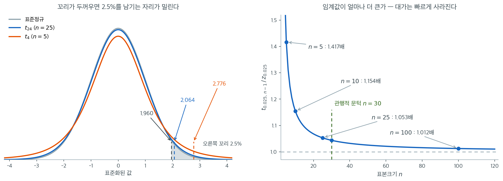
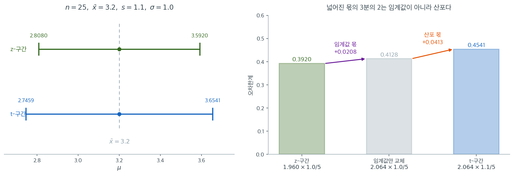
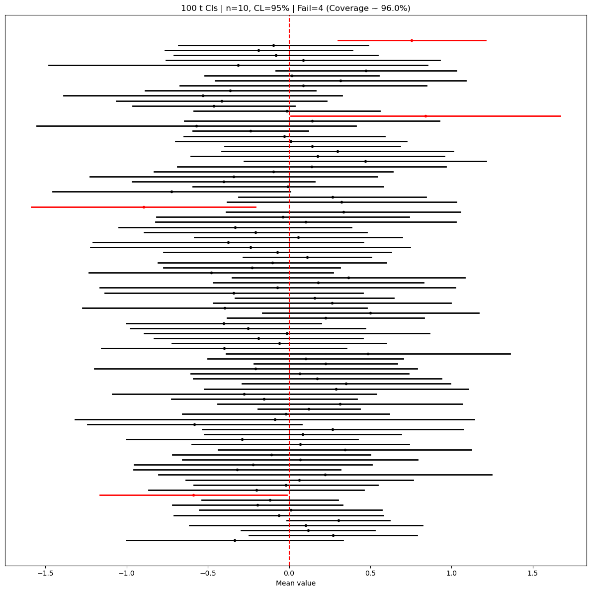
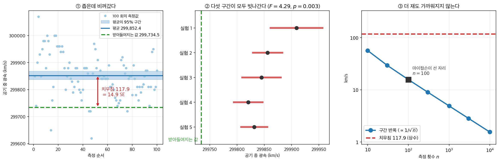

# μ의 신뢰구간

## 1. 일표본 z 신뢰구간

모평균을 추정하는 일은 거의 모든 분야에서 가장 먼저 하는 일이다. 그 추정에 폭을 붙이는 방법이 이 절의 주제이고, 갈림길은 하나뿐이다 — **$\sigma$ 를 아는가.** 아는 자리에서 먼저 시작한다. 현실에서 드물지만 구조가 가장 단순해서 나머지가 모두 여기서 변형으로 나온다.

출발점은 표준화한 양의 분포다. 모집단이 정규이면

$$
\frac{\bar X - \mu}{\sigma/\sqrt n} \sim N(0, 1)
$$

이 **정확히** 성립하고, 정규가 아니어도 $n$ 이 크면 중심극한정리로 근사한다. 이 양에는 모르는 값이 $\mu$ 하나뿐이고 그 분포에는 모수가 남지 않으니 추축량이다. 가운데를 $1-\alpha$ 확률로 가두고 $\mu$ 에 대해 풀면 구간이 나온다.

$$
\bar{X} \pm z_{\alpha/2} \cdot \frac{\sigma}{\sqrt{n}}
$$

여기서 $\bar X$ 는 표본평균, $\sigma$ 는 아는 모표준편차, $n$ 은 표본크기이고, $z_{\alpha/2}$ 는 $P(Z > z_{\alpha/2}) = \alpha/2$ 를 만족하는 표준정규분포의 임계값이다($\alpha = 1 - \text{신뢰수준}$). 분모의 $\sigma/\sqrt n$ 이 **표본평균의 표준오차**이고, 구간의 반폭은 그 표준오차에 임계값을 곱한 것일 뿐이다 — 8.1절 [신뢰수준과 포함확률](../foundations/coverage.md)이 적은 「추정값 $\pm$ 오차한계」가 이 꼴이다.

이 구간이 서는 데 필요한 것은 둘이다. **모집단이 정규이면 모든 $n$ 에서 정확하다.** 정규가 아니면 중심극한정리에 기대야 하므로 $n$ 이 넉넉해야 하고, 모집단이 많이 치우쳐 있으면 흔히 말하는 $n \ge 30$ 으로도 부족하다. 그리고 유한모집단에서 비복원으로 뽑을 때는 $n \le 0.1N$ 쯤이어야 독립 근사가 통한다 — 표본이 모집단의 큰 몫을 차지하면 유한모집단 수정이 따로 필요하다.

$\sigma$ 를 모르는데 $n$ 이 크면 그 자리에 $s$ 를 꽂고 $z$ 임계값을 그대로 쓰는 관행이 있다. $s \to \sigma$ 가 대수의법칙으로 보장되므로 큰 $n$ 에서 틀린 값은 아니다. **다만 그것은 근사이고, 맞는 분포는 아니다.** $\sigma$ 를 모르면 $n$ 이 크든 작든 $t$ 가 맞는 분포이며($\S 2$), $n \ge 30$ 이 보장하는 것은 두 임계값의 차이가 작다는 것뿐이다. 8.1절 [신뢰수준과 포함확률](../foundations/coverage.md)이 그 문턱의 한계를 적어 두었다.

<div class="exbox" markdown>

**보기 1.** <span class="diff easy" title="쉬움"></span> 일표본 $z$ 신뢰구간 계산. 크기 $n = 40$인 확률표본에서 $\bar x = 85$를 얻었고 모표준편차가 $\sigma = 12$로 알려져 있다.

**(1)** $\mu$의 $95\%$ 신뢰구간을 구하시오. 임계값으로 $z_{0.95}$가 아니라 $z_{0.975}$를 쓰는 까닭과, 표준오차를 $\sigma$가 아니라 $\sigma/\sqrt n$으로 쓰는 까닭을 밝히시오.

**(2)** 같은 오차한계를 **절반**으로 줄이려면 $n$을 얼마로 해야 하는가. 코드로 (1)과 (2)를 확인하시오.

</div>

??? success "풀이"

    **(1) 구간.** $\alpha = 0.05$이므로 $z_{\alpha/2} = z_{0.025} = 1.95996$이다. 표준오차와 오차한계는

    $$
    \text{SE} = \frac{\sigma}{\sqrt n} = \frac{12}{\sqrt{40}} = 1.89737,
    \qquad
    \text{MOE} = 1.95996 \times 1.89737 = 3.71877
    $$

    이고 구간은

    $$
    85 \pm 3.71877 = (81.2812,\ 88.7188)
    $$

    이다.

    **왜 $0.975$ 분위수인가.** 구하려는 것은 $P(-c \le Z \le c) = 0.95$를 만족하는 $c$다. 남는 확률 $0.05$가 **양쪽 꼬리에 절반씩** 놓이므로 위쪽 꼬리가 $0.025$이고, 따라서 $c$는 누적확률 $1 - 0.025 = 0.975$인 자리다. `norm.ppf(0.95) = 1.645`를 쓰면 한쪽 꼬리만 $5\%$로 둔 것이라 **단측** $95\%$ 구간이 되고, 양측으로 읽으면 실제 신뢰수준이 $90\%$로 떨어진다. 이것이 신뢰구간 코드에서 가장 흔한 한 줄 오류다.

    **왜 $\sqrt n$으로 나누는가.** 구간이 재는 것은 관측값 하나의 산포가 아니라 **$\bar X$의 산포**다. 독립인 관측값에서 $\operatorname{Var}(\bar X) = \sigma^2/n$이므로 $\text{SD}(\bar X) = \sigma/\sqrt n$이다. $\sigma = 12$를 그대로 쓰면 구간이 $\sqrt{40} = 6.32$배 넓어진다.

    **(2) 오차한계는 $1/\sqrt n$에 비례한다.** $\text{MOE}(n) = z\sigma/\sqrt n$이므로

    $$
    \frac{\text{MOE}(n')}{\text{MOE}(n)} = \sqrt{\frac{n}{n'}} = \frac12
    \;\Longrightarrow\; n' = 4n = 160
    $$

    이다. **절반으로 줄이려면 네 배가 든다.** 자료 수집 비용이 $n$에 비례한다면 정밀도 한 자리를 더 얻는 값이 네 배라는 뜻이다.

    **확인.**

    ```python
    import scipy.stats as stats
    import numpy as np

    # 주어진 자료
    n = 40
    sample_mean = 85
    sigma = 12          # 알고 있는 모표준편차
    confidence_level = 0.95

    # 임계값. 0.95가 아니라 1 - 0.05/2 = 0.975를 넣는다.
    # 양쪽 꼬리에 alpha/2씩 나눠 주기 때문이다.
    z_critical = stats.norm.ppf(1 - (1 - confidence_level) / 2)

    # 표준오차는 자료의 산포가 아니라 **표본평균**의 산포다. sqrt(n)으로 나눈다.
    standard_error = sigma / np.sqrt(n)
    margin_of_error = z_critical * standard_error

    confidence_interval = (sample_mean - margin_of_error, sample_mean + margin_of_error)
    print(f"{z_critical = :.5f}")
    print(f"{standard_error = :.5f}, {margin_of_error = :.5f}")
    print(f"{confidence_interval = }")

    # (2) 오차한계를 절반으로 줄이려면 n 을 네 배로 한다.
    for m in (40, 160):
        moe = z_critical * sigma / np.sqrt(m)
        print(f"n = {m:>4}:  MOE = {moe:.5f}")
    ```

    출력:

    ```
    z_critical = 1.95996
    standard_error = 1.89737, margin_of_error = 3.71877
    confidence_interval = (81.28122980617263, 88.71877019382737)
    n =   40:  MOE = 3.71877
    n =  160:  MOE = 1.85939
    ```

    **손 계산과 맞는다.** $z = 1.95996$, $\text{SE} = 1.89737$, $\text{MOE} = 3.71877$, 구간 $(81.2812,\ 88.7188)$ 이 모두 (1)과 같다. $n = 160$의 오차한계 $1.85939$ 는 $3.71877/2 = 1.85939$ 로 **정확히 절반**이다.

    임계값을 $1.96$ 으로 반올림해 써도 답은 거의 같다. $1.96 \times 1.89737 = 3.71884$ 이고 구간이 $(81.2812,\ 88.7188)$ 로, 반올림의 영향이 소수 넷째 자리에서야 나타난다.

$\sigma$ 를 알면 구간의 폭이 자료에 의존하지 않는다. 그래서 거꾸로, 원하는 폭을 먼저 정하고 거기에 맞는 표본크기를 구할 수 있다.

<div class="exbox" markdown>

**보기 2.** <span class="diff easy" title="쉬움"></span> 표본크기의 결정 (천문학자). 한 천문학자가 멀리 있는 별까지의 거리를 측정한다. 측정값은 i.i.d.이고 평균이 $d$(실제 거리), 분산이 4 광년이다. 추정값이 95% 신뢰수준에서 $\pm 0.5$ 광년 이내로 정확하려면 측정을 몇 번 해야 하는가?

</div>

??? success "풀이"
    다음이 필요하다.

    $$
    1.96 \sqrt{\frac{4}{n}} \leq 0.5
    $$

    $n$에 대해 풀면:

    $$
    n \geq \frac{4 \times 1.96^2}{0.5^2} = 61.4656
    $$

    $n$은 정수여야 하므로 적어도 **62번의 측정**이 필요하다.

---

## 2. 일표본 t 신뢰구간

실제로 $\sigma$ 를 아는 일은 거의 없다. 그러면 표준오차의 자리에 $s/\sqrt n$ 을 넣게 되는데, **분모가 상수에서 확률변수로 바뀐다.** 그 차이가 분포를 바꾼다. $\S 1$ 의 $Z$ 는 $\bar X$ 를 상수로 나눈 것이라 정규가 그대로 남지만, $s$ 로 나눈 양은 두 확률변수의 비여서 꼬리가 두꺼워진다. 모집단이 정규이면 그 비의 분포가 정확히 알려져 있다.

$$
\frac{\bar X - \mu}{s/\sqrt n} \sim t_{n-1}
$$

그래서 구간은 임계값만 바뀐 꼴이 된다.

$$
\bar{X} \pm t_{\alpha/2, \, n-1} \cdot \frac{s}{\sqrt{n}}
$$

$t_{\alpha/2,\,n-1}$ 은 자유도 $n-1$ 인 $t$ 분포에서 $P(T > t_{\alpha/2,\,n-1}) = \alpha/2$ 를 만족하는 값이다. 자유도가 $n$ 이 아니라 $n-1$ 인 것은 $s^2$ 이 표본평균을 먼저 쓰고 남은 변동으로 계산되기 때문이고, 보기 3 이 그것을 따라간다.

**임계값이 커진 만큼이 「$\sigma$ 를 모른다」는 사실의 값이다.** $n = 25$ 에서 $t_{0.025,24} = 2.064$ 이고 $z_{0.025} = 1.960$ 이므로 구간이 $5.3\%$ 넓어진다. $n = 5$ 에서는 $2.776$ 대 $1.960$ 으로 $41.7\%$ 넓어지고, $n = 100$ 에서는 $1.2\%$ 로 줄어든다. 소표본에서 치르는 값이 크고 큰 표본에서는 거의 사라진다.

**$t$ 구간을 쓰는 조건은 「$n$ 이 작다」가 아니라 「$\sigma$ 를 모른다」다.** $n$ 이 아무리 커도 $\sigma$ 를 추정해 쓴 것이면 맞는 분포는 $t$ 이고, 다만 $n$ 이 크면 $t_{n-1}$ 이 $z$ 에 가까워져 둘의 차이가 실무에서 사라진다. 그래서 $t$ 를 쓰는 쪽이 늘 안전하다 — 큰 $n$ 에서는 $z$ 와 같은 답을 주고 작은 $n$ 에서는 $z$ 가 놓치는 폭을 되찾아 준다.

$t$ 구간이 **정확**하려면 모집단이 정규여야 한다. 위 분포 결과가 정규 가정에서 유도되기 때문이다. $n$ 이 작을 때 이 가정이 특히 중요하다 — 중심극한정리가 받쳐 주지 못하므로 치우침이 그대로 포함확률에 남는다. $n$ 이 커지면 $t$ 구간도 정규성 위반에 꽤 둔해지지만, 극단적으로 치우친 모집단에서는 $n = 30$ 으로도 명목값에 못 미친다($\S 3$ 의 모의실험이 그 대가를 $n$ 의 함수로 재고, 유한모집단이면 여기서도 $n \le 0.1N$ 이 필요하다).

<div class="exbox" markdown>

**보기 3.** <span class="diff easy" title="쉬움"></span> 일표본 $t$ 신뢰구간 계산. 크기 $n = 25$인 확률표본에서 $\bar x = 50$, $s = 8$을 얻었다. 모표준편차는 모른다.

**(1)** $\mu$의 $95\%$ $t$-구간을 구하시오. 자유도가 $n$이 아니라 $n - 1$인 까닭을 밝히시오.

**(2)** $\sigma$를 모른다는 사실의 **값**을 재시오. 곧 같은 $\bar x$와 같은 산포에 $z$ 임계값을 썼다면 구간의 폭이 몇 배였겠는지 구하고, 그 비가 $n$에 따라 어떻게 변하는지 $n = 5,\ 10,\ 25,\ 100$에서 계산하시오.

</div>

??? success "풀이"

    **(1) 구간.** 자유도는 $n - 1 = 24$이고 $t_{0.025,\,24} = 2.06390$이다.

    $$
    \text{SE} = \frac{s}{\sqrt n} = \frac{8}{5} = 1.6,
    \qquad
    \text{MOE} = 2.06390 \times 1.6 = 3.30224
    $$

    $$
    50 \pm 3.30224 = (46.6978,\ 53.3022)
    $$

    **왜 자유도가 $n - 1$인가.** $s^2$이 편차를 참 평균 $\mu$가 아니라 **표본평균 $\bar x$에서** 재기 때문이다. $n$개의 편차 $x_i - \bar x$는 항상 $\sum (x_i - \bar x) = 0$이라는 **하나의 선형제약**을 만족하므로, 자유롭게 움직이는 것은 $n - 1$개뿐이다. 그 결과 $(n-1)s^2/\sigma^2 \sim \chi^2_{n-1}$이고 $t$의 자유도가 $n - 1$이 된다. 자유도를 $n$으로 잘못 주면 임계값이 $2.06390$ 대신 $2.05954$가 되어 구간이 **조용히 좁아진다.** 오류 메시지가 나지 않으므로 더 위험하다.

    **(2) $\sigma$를 모르는 값은 임계값의 비다.** 두 구간의 $\text{SE}$가 같으므로 폭의 비가 곧 임계값의 비다.

    $$
    \frac{\text{폭}_t}{\text{폭}_z} = \frac{t_{0.025,\,n-1}}{z_{0.025}}
    $$

    $n = 25$에서 $2.06390/1.95996 = 1.05303$ 으로 **$5.3\%$ 넓다.** 이 비는 $n$에 대해 단조감소한다.

    | $n$ | $t_{0.025,\,n-1}$ | $t/z$ |
    |---|---|---|
    | $5$ | $2.77645$ | $1.41658$ |
    | $10$ | $2.26216$ | $1.15418$ |
    | $25$ | $2.06390$ | $1.05303$ |
    | $100$ | $1.98422$ | $1.01237$ |

    **처음 몇 개의 관측값이 압도적으로 비싸다.** $n = 5$에서는 $42\%$를 더 치러야 하지만 $n = 100$에서는 $1.2\%$다. 거꾸로 읽으면, $n$이 작은데 $z$를 쓰면 구간이 $1/1.41658 = 0.706$배로 **$30\%$ 가까이 좁아지고** 그 좁아진 구간은 약속한 $95\%$를 지키지 못한다.

    **확인.**

    ```python
    import scipy.stats as stats
    import numpy as np

    # 주어진 자료
    n = 25
    sample_mean = 50
    sample_std = 8      # 모표준편차가 아니라 자료에서 얻은 표본표준편차
    confidence_level = 0.95

    # 앞의 z-구간과 달라지는 곳은 여기 한 줄뿐이다.
    # 자유도가 n-1인 것은 편차를 참 평균이 아니라 x_bar에서 쟀기 때문이다.
    degrees_of_freedom = n - 1
    t_critical = stats.t.ppf(1 - (1 - confidence_level) / 2, degrees_of_freedom)

    standard_error = sample_std / np.sqrt(n)
    margin_of_error = t_critical * standard_error

    confidence_interval = (sample_mean - margin_of_error, sample_mean + margin_of_error)
    print(f"{t_critical = :.5f}, {standard_error = :.5f}, {margin_of_error = :.5f}")
    print(f"{confidence_interval = }")

    # (2) sigma 를 모르는 값: 같은 SE 에서 임계값의 비가 곧 폭의 비다.
    z_critical = stats.norm.ppf(1 - (1 - confidence_level) / 2)
    print(f"\n{'n':>5}{'t*':>10}{'t*/z*':>10}")
    for m in (5, 10, 25, 100):
        tm = stats.t.ppf(1 - (1 - confidence_level) / 2, m - 1)
        print(f"{m:>5}{tm:>10.5f}{tm / z_critical:>10.5f}")
    ```

    출력:

    ```
    t_critical = 2.06390, standard_error = 1.60000, margin_of_error = 3.30224
    confidence_interval = (46.697762301395166, 53.302237698604834)

        n        t*     t*/z*
        5   2.77645   1.41658
       10   2.26216   1.15418
       25   2.06390   1.05303
      100   1.98422   1.01237
    ```

    **(1)과 (2)가 모두 맞는다.** 임계값 $2.06390$, 표준오차 $1.6$, 오차한계 $3.30224$, 구간 $(46.6978,\ 53.3022)$ 가 손 계산과 같고, 표의 네 비도 그대로 재현된다.

    **다만 이 수들이 보장하는 것은 폭뿐이다.** $t$-구간의 포함률은 모집단이 정규라는 가정 아래 정확히 $0.95$다. $n = 5$의 $1.41658$배라는 값은 "정규모집단에서 $\sigma$를 모르는 대가"이지, 모집단이 크게 치우쳐 있을 때의 대가가 아니다. 그쪽은 임계값이 아니라 **포함률**이 무너지는 문제이며 아래 3절의 모의실험에서 다룬다.

$t_{0.025,\,24} = 2.0639$로 $z_{0.025} = 1.9600$보다 5.3% 크다. 같은 $\bar x$와 같은 산포에서 구간이 그만큼 넓어지며, 이것이 $\sigma$를 모른다는 사실의 값이다.



$\sigma$를 모르는 대가가 정확히 어디서 나오는지는 왼쪽 그림에 있다. 세 곡선은 넓이가 모두 1인 확률밀도이고, 우리가 하는 일은 **오른쪽 끝에서 2.5%를 남기는 자리를 찾는 것**이다. 표준정규에서는 그 자리가 $1.960$이다. $t_{24}$는 꼬리가 조금 더 두꺼워 같은 2.5%를 남기려면 $2.064$까지 가야 하고, 자유도가 4뿐인 $t_4$는 $2.776$까지 밀려난다. 구간의 너비는 이 임계값에 정비례하므로, 밀려난 만큼이 그대로 구간의 너비가 된다.

오른쪽 그림은 그 대가를 $n$의 함수로 그린 것이다. $n = 5$에서는 $t$ 임계값이 $z$의 $1.417$배지만, $n = 10$에서 $1.154$배, $n = 25$에서 $1.053$배, $n = 100$에서는 $1.012$배로 줄어든다. **처음 몇 개의 관측값이 압도적으로 비싸다.** 곡선이 $n = 30$ 부근에서 이미 1에 거의 붙어 있고, 이것이 "$n \ge 30$이면 $z$를 써도 된다"는 관행의 근거다. 다만 이 문턱이 보장하는 것은 임계값의 차이가 작다는 것뿐이며, 모집단이 크게 치우쳐 있으면 $n = 30$으로도 중심극한정리 근사가 부족할 수 있다.

실무적인 결론은 단순하다. **의심스러우면 $t$를 써라.** $n$이 크면 $t$와 $z$가 어차피 같아지므로 잃는 것이 1% 남짓이고, $n$이 작으면 $t$가 반드시 필요하다. 반대로 $z$를 골랐다가 틀리면 $n = 5$에서 구간이 $1/1.417 = 0.71$배, 곧 30% 가까이 좁아지고, 그 좁아진 구간은 약속한 95%를 지키지 못한다.

<div class="exbox" markdown>

**보기 4.** <span class="diff easy" title="쉬움"></span> 모평균의 95% 신뢰구간 (큰 표본). 성인 남성 100명의 확률표본에서 평균 키 175 cm, 표본표준편차 6 cm를 얻었다. 모표준편차는 모른다.

**(1)** $\mu$ 의 $95\%$ 구간을 구하시오. 어느 분포에서 임계값을 꺼내야 하는가.

**(2)** "$n$ 이 $30$ 을 넘으니 $z$ 를 써도 된다"고 하면 구간이 얼마나 달라지는가. 그 차이를 수로 보이시오.

</div>

??? success "풀이"
    **(1) $\sigma$ 를 모르므로 $t$ 다.** $n$ 이 크다는 것이 $z$ 를 정당화하지 않는다. 꺼낼 분포를 정하는 것은 $\sigma$ 를 아는지 하나이며, 여기서 $6$ cm 는 **표본**표준편차다. 자유도는 $n - 1 = 99$ 이고 $t_{0.025,\,99} = 1.98422$ 이므로

    $$
    \text{SE} = \frac{6}{\sqrt{100}} = 0.6,
    \qquad \text{ME} = 1.98422 \times 0.6 = 1.19053
    $$

    $$
    \boxed{(173.809,\ 176.191) \text{ cm}}
    $$

    **(2) 차이는 $1.22\%$ 다.** $z_{0.025} = 1.95996$ 을 쓰면 $\text{ME} = 1.17598$, 구간은 $(173.824,\ 176.176)$ 이다. 폭이 $2.38106$ 에서 $2.35196$ 으로 **$1.22\%$ 좁아진다.**

    이것이 "$n \ge 30$ 이면 $z$" 라는 관행의 실체다. **틀린 쪽으로 틀리지만 아주 조금 틀린다.** 그리고 틀리는 방향이 언제나 같다 — $t > z$ 이므로 $z$ 를 쓰면 구간이 **좁아지고** 포함률이 명목값 아래로 내려간다. 같은 셈을 작은 $n$ 에서 하면 $n = 25$ 에서 $5.04\%$, $n = 10$ 에서 $13.36\%$, $n = 5$ 에서 $29.41\%$ 좁아진다(보기 3의 (2)가 임계값의 비로 적은 것을 폭의 비로 뒤집은 것이다). **$n$ 이 작을 때 이 관행을 쓰는 것이 위험한 것이고, $n$ 이 클 때는 애초에 $t$ 를 써도 잃을 것이 없다.**

    ```python
    import numpy as np
    from scipy import stats

    n, x_bar, s = 100, 175, 6
    se = s / np.sqrt(n)

    # sigma 를 모르므로 t 가 맞는 분포다. z 는 비교를 위해서만 함께 찍는다.
    for name, crit in [("t", stats.t.ppf(0.975, n - 1)), ("z", stats.norm.ppf(0.975))]:
        moe = crit * se
        print(f"{name}  임계값 {crit:.5f}  ME {moe:.5f}  "
              f"({x_bar - moe:.3f}, {x_bar + moe:.3f})  폭 {2 * moe:.5f}")
    ```

    출력:

    ```
    t  임계값 1.98422  ME 1.19053  (173.809, 176.191)  폭 2.38106
    z  임계값 1.95996  ME 1.17598  (173.824, 176.176)  폭 2.35196
    ```

<div class="exbox" markdown>

**보기 5.** <span class="diff easy" title="쉬움"></span> t*의 계산. 관측값이 $n = 15$개일 때 98% 신뢰구간의 임계값 $t_*$는 얼마인가?

</div>

??? success "풀이"

    ```python
    import scipy.stats as stats

    confidence_level = 0.98
    alpha = 1 - confidence_level
    n = 15
    df = n - 1

    # 98% 구간이므로 한쪽 꼬리에 1%씩 남긴다. 즉 왼쪽 누적확률 0.99 지점.
    t_star = stats.t(df=df).ppf(1 - alpha / 2)
    print(f"{t_star = :.4f}")
    ```

    출력:

    ```
    t_star = 2.6245
    ```

    같은 98%라도 정규분포라면 $z = 2.3263$이다. 자유도가 14밖에 안 되어 꼬리가 두껍기 때문에 임계값이 13% 커졌다.

<div class="exbox" markdown>

**보기 6.** <span class="diff easy" title="쉬움"></span> 도장 두께. Felix는 자동차 부품에서 무작위로 50개 지점을 골라 도막 두께를 측정했다. 표본에서 $\bar{x} = 148$ 마이크론, $s = 3.3$ 마이크론을 얻었고 95% 신뢰구간 $(147.1, 148.9)$ 마이크론을 구성했다. 평균 두께가 목표값 150 마이크론과 일치한다고 보는 것이 그럴듯한가?

</div>

??? success "풀이"
    아니다. 신뢰구간 $(147.1, 148.9)$가 목표 두께 150 마이크론을 포함하지 않기 때문이다. 자료는 평균 두께가 목표에서 유의하게 벗어난다는 증거를 준다.

공식을 코드로 옮길 때 걸림돌은 공식이 아니라 그 앞뒤다. **자료를 읽어 들이는 일**과 **무엇을 입력으로 받을지 정하는 일**이다.

<div class="exbox" markdown>

**보기 7.** <span class="diff easy" title="쉬움"></span> CSV에서 자료 읽기. 한 CSV 파일에 값이 `12`, `15`, `14` 로 한 줄에 하나씩 적힌 뒤 **빈 줄**이 하나 있고, 그다음 줄에 `10,13,16` 이 쉼표로 묶여 적혀 있다. 이 파일 전체를 표본 하나로 본다.

**(1)** 표본크기 $n$과 표본평균 $\bar x$를 구하시오.

**(2)** 줄을 어떻게 나누었든 같은 표본을 돌려주는 읽기 함수를 만들어 (1)을 확인하시오. 빈 칸을 건너뛰어야 하는 까닭과, 수치가 하나도 없을 때 함수가 무엇을 해야 하는지 밝히시오.

</div>

??? success "풀이"

    **(1) 줄 구조는 표본이 아니다.** 값은 여섯 개이므로 $n = 6$이고

    $$
    \bar x = \frac{12 + 15 + 14 + 10 + 13 + 16}{6} = \frac{80}{6} = \frac{40}{3} = 13.3\overline{3}
    $$

    이다. 줄바꿈과 쉼표는 **파일의 서식**일 뿐 표본의 구조가 아니다. 그러므로 읽기 함수가 지켜야 할 성질은 하나다. **값의 다중집합만 보존하고 줄 구조는 버린다.**

    **(2) 구현과 확인.**

    ```python
    import csv
    import numpy as np

    def load_data(csv_path):
        """CSV에서 수치값을 모두 읽어 1차원 배열로 돌려준다.

        행 하나에 값이 하나든 여럿이든 상관없이 모두 같은 표본으로 본다.
        빈 칸을 건너뛰는 것은 CSV 끝의 빈 줄이나 후행 쉼표 때문이다.
        """
        arr = []
        with open(csv_path, "r", newline="") as f:
            reader = csv.reader(f)
            for row in reader:
                for item in row:
                    item = item.strip()
                    if item:
                        arr.append(float(item))
        if len(arr) == 0:
            # 빈 배열을 그냥 돌려주면 평균이 nan이 되어 원인을 찾기 어렵다.
            # 읽는 쪽에서 바로 알아채도록 여기서 끊는다.
            raise ValueError("No numeric values found in CSV.")
        return np.array(arr, dtype=float)


    # 임시 파일로 동작을 확인한다. 값 배치가 달라도 결과는 같다.
    import tempfile, os
    with tempfile.TemporaryDirectory() as d:
        path = os.path.join(d, "data.csv")
        with open(path, "w") as f:
            f.write("12\n15\n14\n\n10,13,16\n")     # 한 줄에 하나, 빈 줄, 한 줄에 셋
        x = load_data(path)
    print(x, x.mean())
    ```

    출력:

    ```
    [12. 15. 14. 10. 13. 16.] 13.333333333333334
    ```

    **(1)과 맞는다.** 배열의 길이가 $6$이고 평균이 $13.333333333333334$로, $40/3$을 배정도 부동소수점으로 가장 가깝게 적은 수다($40/3$은 이진법으로 유한소수가 아니므로 마지막 자리에 $4$가 남는다).

    **빈 칸을 건너뛰는 까닭.** `csv.reader` 는 파일 끝의 빈 줄이나 후행 쉼표를 빈 문자열 `''` 로 넘겨준다. 걸러 내지 않으면 `float('')` 이 `ValueError` 를 던져 **자료가 아니라 서식 때문에** 읽기가 실패한다. 이 보기의 입력에 빈 줄을 일부러 넣은 것이 그 확인이다.

    **수치가 하나도 없으면 끊어야 한다.** 빈 배열을 그대로 돌려주면 `arr.mean()` 이 `nan` 을 주고 그 `nan` 이 표준오차를 거쳐 구간의 양 끝까지 번진다. 끝에 가서는 `(nan, nan)` 만 보일 뿐 원인이 "파일을 잘못 지정했다"였는지 "열 이름이 달랐다"였는지 알 수 없다. **실패는 번지기 전에 끊는다.**

<div class="exbox" markdown>

**보기 8.** <span class="diff easy" title="쉬움"></span> 평균 신뢰구간 계산기. 어떤 표본에서 요약통계량 $n = 25$, $\bar x = 3.2$, $s = 1.1$ 을 얻었다. 비교를 위해, 같은 자리에서 모표준편차가 $\sigma = 1.0$ 으로 알려져 있었다면 어떠했을지도 함께 본다.

**(1)** $95\%$ $t$-구간과 $95\%$ $z$-구간을 손으로 계산하시오. 두 오차한계의 차이를 **임계값 몫**과 **산포 몫**으로 쪼개고, 그 쪼개기가 순서에 의존하는지 밝히시오.

**(2)** 원자료가 아니라 요약통계량만 받는 함수를 만들어 (1)을 확인하시오.

</div>

??? success "풀이"

    **(1) 구조는 하나다.** 두 구간 모두 "추정값 $\pm$ 임계값 $\times$ 표준오차" 꼴이고, 다른 것은 **임계값**과 **산포** 둘뿐이다.

    $z$-구간은 $z_{0.025} = 1.95996$, $\text{SE} = \sigma/\sqrt n = 1.0/5 = 0.2$ 이므로

    $$
    \text{MOE}_z = 1.95996 \times 0.2 = 0.39199,
    \qquad (2.80801,\ 3.59199)
    $$

    $t$-구간은 자유도 $n - 1 = 24$, $t_{0.025,\,24} = 2.06390$, $\text{SE} = s/\sqrt n = 1.1/5 = 0.22$ 이므로

    $$
    \text{MOE}_t = 2.06390 \times 0.22 = 0.45406,
    \qquad (2.74594,\ 3.65406)
    $$

    **차이를 쪼갠다.** 전체 증가분은 $0.45406 - 0.39199 = 0.06206$ 이다. 한 번에 하나씩만 바꾼다.

    $$
    \underbrace{(2.06390 - 1.95996) \times 0.2}_{\text{임계값 몫} \;=\; 0.02079}
    \;+\;
    \underbrace{2.06390 \times (0.22 - 0.2)}_{\text{산포 몫} \;=\; 0.04128}
    \;=\; 0.06206
    $$

    **산포 몫이 전체의 $66.5\%$** 다. "$t$-분포를 썼으니 넓어졌다"는 설명이 절반도 안 된다는 뜻이다. 임계값의 비는 $t/z = 1.05303$ 로 $5.3\%$ 에 불과하다.

    **쪼개기는 순서에 의존한다.** 산포를 먼저 바꾸면 산포 몫이 $1.95996 \times 0.02 = 0.03920$, 임계값 몫이 $0.02287$ 이 되어 두 몫의 크기가 뒤바뀐다. 합만 $0.06206$ 으로 같다. 오차한계가 두 인자의 **곱**이기 때문이고, 그래서 순서에 무관한 쪼개기는 곱으로 적는 것이다.

    $$
    \frac{\text{MOE}_t}{\text{MOE}_z}
    = \frac{t_{0.025,\,24}}{z_{0.025}} \cdot \frac{s}{\sigma}
    = 1.05303 \times 1.1 = 1.15833
    $$

    이 꼴에서는 임계값 인자 $1.053$ 과 산포 인자 $1.100$ 을 어느 쪽부터 읽어도 같다.

    **(2) 요약통계량만 받는 계산기.**

    ```python
    import math
    from scipy.stats import norm, t

    def ci_mean(n, xbar, s=None, known_sigma=None, method="t", cl=0.95):
        """모평균에 대한 일표본 신뢰구간.

        원자료가 아니라 **요약통계량만** 받는다. 신뢰구간을 만드는 데
        필요한 것은 n, xbar, 그리고 산포 하나뿐이기 때문이다.
        논문에 실린 표만 있어도 구간을 다시 만들 수 있다는 뜻이다.

        n : 표본크기
        xbar : 표본평균
        s : 표본표준편차 (t-구간에 필요)
        known_sigma : 알고 있는 모표준편차 (z-구간에 필요)
        method : 't' 또는 'z'
        cl : 신뢰수준 (기본 0.95)
        """
        alpha = 1 - cl

        if method == "z":
            se = known_sigma / math.sqrt(n)
            z_star = norm.ppf(1 - alpha / 2)
            moe = z_star * se
        else:
            se = s / math.sqrt(n)
            df = n - 1                              # xbar를 쓰느라 하나를 잃는다
            t_star = t.ppf(1 - alpha / 2, df=df)
            moe = t_star * se

        # 두 갈래가 다른 것은 임계값과 산포뿐이다.
        # 구조는 언제나 "추정값 ± 임계값 × 표준오차"로 같다.
        return xbar - moe, xbar + moe

    # 요약통계량에서 바로 t-구간
    lo, hi = ci_mean(n=25, xbar=3.2, s=1.1, method="t", cl=0.95)
    print(f"95% t-interval: ({lo:.4f}, {hi:.4f})")

    # sigma를 아는 경우의 z-구간. 비교를 위해 s보다 작은 sigma=1.0을 넣었다.
    lo, hi = ci_mean(n=25, xbar=3.2, known_sigma=1.0, method="z", cl=0.95)
    print(f"95% z-interval: ({lo:.4f}, {hi:.4f})")
    ```

    출력:

    ```
    95% t-interval: (2.7459, 3.6541)
    95% z-interval: (2.8080, 3.5920)
    ```

    **(1)의 손 계산과 맞는다.** $t$-구간 $(2.7459,\ 3.6541)$, $z$-구간 $(2.8080,\ 3.5920)$ 으로 소수 넷째 자리까지 같다. 쪼갠 두 몫 $0.0208 + 0.0413 = 0.0621$ 도 전체 증가분과 같다.

    **함수가 `known_sigma` 와 `s` 를 다른 인자로 받는 까닭.** 두 값은 단위도 같고 크기도 비슷해 하나의 인자로 받고 `method` 로만 갈라도 코드는 돈다. 그러나 **$\sigma$ 는 자료 밖에서 주어진 상수**이고 **$s$ 는 이 표본에서 계산된 통계량**이다. 구간을 고르는 기준은 두 구간의 폭이 아니라 그 하나, **$\sigma$ 를 정말로 아는가**다. 인자를 나누어 둔 것은 그 구별을 호출하는 쪽에서 매번 선언하게 만들기 위한 것이다.

위의 쪼개기가 그림으로는 이렇게 보인다.



왼쪽은 두 구간을 같은 수직선에 얹은 것이다. 중심 $\bar x = 3.2$ 는 같고 뻗어 나간 길이만 다르다. 오른쪽 막대가 그 길이 차이 $0.0621$ 을 임계값 몫 $0.0208$ 과 산포 몫 $0.0413$ 으로 가른 것이고, **긴 쪽이 산포 몫이다.**

이 예에서 산포 몫이 큰 것은 $s = 1.1$이 $\sigma = 1.0$보다 10% 컸기 때문이고, 그 10%는 우연일 수도 있고 $\sigma$에 대한 우리의 믿음이 틀렸다는 신호일 수도 있다. 여기서 구별해야 할 것은, **임계값의 차이는 $n$만 알면 미리 계산되는 확정된 비용**인 반면 **산포의 차이는 표본마다 달라지는 우연한 양**이라는 점이다. $s$가 $\sigma$보다 작게 나온 표본에서는 $t$-구간이 오히려 $z$-구간보다 좁아질 수도 있다.

그러니 두 구간의 너비를 비교해 방법을 고르려 해서는 안 된다. 고르는 기준은 오직 하나, **$\sigma$를 정말로 아는가**이다. 알면 $z$, 모르면 $t$다. 이 페이지의 `ci_mean`이 `known_sigma`와 `s`를 아예 다른 인자로 받는 것도 그 구별을 코드에 새겨 두기 위해서다.

---

## 3. 계산한 포함확률을 세어서 확인한다

지금까지 포함확률을 **계산**했다. 이제 **세어** 본다. 참값을 아는 모집단에서 구간을 되풀이해 만들어 몇 개가 참값을 담는지 세면, 닫힌 꼴로 적은 값이 실제로 그 값인지 확인된다. 세 방법의 차이가 가장 선명하게 드러나는 자리이기도 하다.

<div class="exbox" markdown>

**보기 9.** <span class="diff easy" title="쉬움"></span> 세 방법으로 만든 평균 신뢰구간. 정규모집단 $N(\mu, \sigma^2)$에서 크기 $n$인 표본을 뽑아 위의 세 구간을 만든다.

**(1)** $t$-구간의 포함확률을 구하시오. 그 값이 $n$, $\mu$, $\sigma$에 의존하는가. 이어서 $s$를 꽂고 $z$ 임계값을 쓴 구간의 포함확률을 닫힌 꼴로 적고 $n = 10$에서 계산하시오.

**(2)** $n = 10$, $\mu = 0$, $\sigma = 1$에서 $t$-구간을 $100$개 만들어 참값을 담은 개수를 세시오. 그 개수로 (1)의 답을 확인할 수 있는가.

</div>

??? success "풀이"

    **(1) $t$-구간의 포함확률은 정확히 $0.95$다.** 정규표본에서

    $$
    T = \frac{\bar X - \mu}{S/\sqrt n} \sim t_{n-1}
    $$

    이다. 그런데 $t$-구간이 $\mu$를 담는다는 것은

    $$
    \bar X - t_{\alpha/2,\,n-1}\frac{S}{\sqrt n} \le \mu \le \bar X + t_{\alpha/2,\,n-1}\frac{S}{\sqrt n}
    \iff |T| \le t_{\alpha/2,\,n-1}
    $$

    과 **같은 사건**이다. 그러므로 포함확률은

    $$
    P\big(|T| \le t_{\alpha/2,\,n-1}\big) = 1 - \alpha = 0.95
    $$

    이고, 이것은 $n \ge 2$인 **모든** $n$과 **모든** $\mu$, $\sigma$에서 성립한다. $T$가 **추축량**(pivotal quantity)이라서 그렇다. 분포에 $\mu$도 $\sigma$도 남지 않으므로 모르는 값이 들어설 자리가 없다.

    **따라서 이 쪽에서 $t$-구간에 대해 모의실험으로 알아낼 것은 포함확률이 아니다.** 포함확률은 이미 정확히 알고, 모의실험이 할 일은 그 값을 재확인하는 것과 **폭**이 표본마다 얼마나 흔들리는지 보는 것뿐이다.

    **$s$를 꽂은 $z$-구간은 다르다.** 이 구간이 $\mu$를 담는 사건은 $|T| \le z_{\alpha/2}$인데, $T$는 여전히 $t_{n-1}$을 따른다. 그러므로 포함확률은

    $$
    P\big(|t_{n-1}| \le z_{\alpha/2}\big) = 2F_{t_{n-1}}(1.95996) - 1
    $$

    로 $n$에만 의존하는 **닫힌 꼴**이다. $n = 10$이면 $F_{t_9}$를 써서

    $$
    2F_{t_9}(1.95996) - 1 = 0.91835
    $$

    이다. 명목 $0.95$인데 $0.918$이다. $n = 5$에서는 $0.878$, $n = 30$에서도 $0.940$이다. **임계값 한 자리를 $t$에서 $z$로 바꾼 것만으로 모자란 포함확률이 생긴다.**

    **(2) 모의실험.**

    ```python
    import numpy as np
    import matplotlib.pyplot as plt
    from scipy.stats import norm, t

    def finite_population_correction(n, N):
        """유한모집단 수정 인자. N을 주지 않으면 1.0(수정 없음)."""
        if N is None:
            return 1.0
        return float(np.sqrt((N - n) / (N - 1)))

    def compute_intervals(xbar, s, n, alpha, method, sigma_known=None, N=None):
        """z_known, z_plugin, t 세 방법의 구간 끝점을 한꺼번에 계산한다.

        xbar와 s가 배열이면 구간도 배열로 나온다.
        모의실험에서 표본 만 개를 한 번에 처리하려고 이렇게 짰다.
        """
        fpc = finite_population_correction(n, N)
        if method == "z_known":
            z_star = norm.ppf(1 - alpha / 2)
            se = sigma_known / np.sqrt(n) * fpc
            moe = z_star * se
        elif method == "z_plugin":
            z_star = norm.ppf(1 - alpha / 2)
            se = (s / np.sqrt(n)) * fpc
            moe = z_star * se
        else:  # t
            df = n - 1
            t_star = t.ppf(1 - alpha / 2, df=df)
            se = (s / np.sqrt(n)) * fpc
            moe = t_star * se
        # z_plugin과 t의 차이는 임계값 한 자리뿐이다. 표준오차는 완전히 같다.
        return xbar - moe, xbar + moe

    # 모의실험 설정. 그림으로 보기 좋게 100회만 돌린다.
    # (포함확률을 정확히 재려면 아래 연습문제처럼 10,000회가 필요하다.)
    rng = np.random.default_rng(42)
    n_sim, n, mu, sigma, alpha = 100, 10, 0.0, 1.0, 0.05

    # 행 하나가 표본 하나. axis=1로 요약하면 표본별 통계량이 한 번에 나온다.
    X = rng.normal(loc=mu, scale=sigma, size=(n_sim, n))
    xbar = X.mean(axis=1)
    s = X.std(axis=1, ddof=1)

    lower, upper = compute_intervals(xbar, s, n, alpha, method="t")
    covered = (lower <= mu) & (mu <= upper)
    coverage_pct = 100.0 * covered.mean()

    print(f"t-interval coverage: {coverage_pct:.1f}%")
    ```

    출력:

    ```
    t-interval coverage: 96.0%
    ```

    **$100$개 가운데 $96$개가 담았다.** (1)의 답은 정확히 $0.95$이므로 기대 개수가 $95$개인데 하나 더 나왔다.

    **이 개수로는 (1)을 확인할 수 없다.** 담은 개수가 $\text{Binomial}(100,\ 0.95)$를 따르므로 비율의 표준오차가

    $$
    \sqrt{\frac{0.95 \times 0.05}{100}} = 0.0218
    $$

    이다. $0.96$과 $0.95$의 거리가 $0.01$로 표준오차의 **절반(0.46배)** 도 안 된다. 되풀이 $100$회는 $0.95$와 $0.96$을 구별하지 못한다. 거꾸로 $z$-구간의 $0.918$과는 $1.5$ 표준오차 떨어져 있으니 그 차이는 $100$회로도 겨우 보인다. **$0.95$ 근처의 차이를 재려면 되풀이를 만 번 단위로 올려야 하고**, 뒤의 연습문제들이 그렇게 한다.

    **그러므로 이 모의실험의 쓸모는 포함률을 "재는" 데 있지 않다.** 포함률은 추축량이 이미 정확히 주었다. 모의실험이 보여 주는 것은 그 $95$개와 $5$개가 **어떤 모양으로** 갈라지는가이고, 그것이 다음 보기의 그림이다.

100회만 돌렸으므로 이 값 자체의 표준오차가 $\sqrt{0.95 \times 0.05/100} \approx 2.2$%p다. 96.0%는 95%와 구별되지 않는다.

<div class="exbox" markdown>

**보기 10.** <span class="diff easy" title="쉬움"></span> 구간 100개를 한 그림에. 앞 보기에서 만든 $t$-구간 $100$개를 가로선 하나씩으로 그리고, 참값을 놓친 것만 빨갛게 칠한다.

**(1)** 그림을 그리고 무엇이 읽히는지 수와 함께 말하시오. 구간의 **폭**이 제각각인 까닭과, 참값을 놓친 구간들의 공통점을 밝히시오.

**(2)** 이 그림이 **가리는** 것은 무엇인가.

</div>

??? success "풀이"

    **(1) 그림.**

    ```python
    # 구간 하나를 가로선 하나로 그린다. 참값을 담은 구간은 검정, 놓친 구간은
    # 빨강이다. 세로 점선이 참값이고, 빨간 선이 몇 개인지 세는 것이 곧 포함확률을
    # 재는 일이다. 구간마다 길이가 다른 까닭은 표본마다 s 가 다르기 때문이다.
    fig, ax = plt.subplots(figsize=(12, 12))
    for i in range(n_sim):
        color = "k" if covered[i] else "r"
        ax.plot([lower[i], upper[i]], [i, i], lw=2, color=color)
        ax.plot(xbar[i], i, marker="o", ms=3, color=color)

    ax.axvline(mu, linestyle="--", linewidth=1.5, color="r")
    n_fail = int((~covered).sum())
    ax.set_title(f"{n_sim} t CIs | n={n}, CL=95% | Fail={n_fail} (Coverage ~ {coverage_pct:.1f}%)")
    ax.set_yticks([])
    ax.set_xlabel("Mean value")
    plt.tight_layout()
    plt.show()
    ```

    

    **읽히는 것 하나 — 실패가 넷이다.** 빨간 선을 세는 일이 곧 포함률을 재는 일이다. 다만 앞 보기에서 보았듯 $4$와 $5$의 차이는 되풀이 $100$회의 잡음 안에 있다.

    **읽히는 것 둘 — 폭은 중심과 따로 움직인다.** 구간의 폭이

    $$
    2\,t_{0.025,\,9}\,\frac{S}{\sqrt{10}} = 2 \times 2.26216 \times \frac{S}{3.16228} = 1.43096\,S
    $$

    로 $S$ **하나에만** 비례한다. $n = 10$에서 $S$가 크게 흔들리므로 폭도 흔들린다. 실제로 $100$개의 폭은 최소 $0.6292$, 중앙값 $1.3756$, 최대 $2.4561$ 로 **최대가 최소의 $3.90$배**다. 평균 폭 $1.3782$는 이론값

    $$
    E[\text{폭}] = 1.43096 \cdot E[S] = 1.43096 \cdot c_4 \sigma,
    \qquad c_4 = \sqrt{\frac{2}{n-1}}\,\frac{\Gamma(n/2)}{\Gamma((n-1)/2)} = 0.97266
    $$

    곧 $1.3916$과 $1\%$ 안에서 맞는다($100$개 평균이므로 이 정도 차이는 몬테카를로 오차다).

    **읽히는 것 셋 — 실패의 조건은 "$\bar x$가 멀다"가 아니다.** 구간이 $\mu$를 놓치는 것은 $|T| > 2.26216$ 과 **정확히 같은 사건**이다($T = \bar x/(s/\sqrt{10})$). 네 실패의 $T$는

    $$
    -2.317, \quad -2.939, \quad 2.288, \quad 3.753
    $$

    로 모두 임계값 밖이고, 담은 $96$개 가운데 $|T|$가 가장 큰 것이 $2.243$ 으로 임계값 안이다. **빗금 하나로 깔끔히 갈린다.**

    $\bar x$ 하나로는 갈리지 않는다. 실패한 네 표본의 $|\bar x|$는 $0.590$–$0.896$ 인데, 담은 표본 가운데도 $|\bar x|$가 이보다 큰 것이 있다. $s$ 하나로도 갈리지 않는다. 실패한 네 표본의 $s$는 $0.805,\ 0.964,\ 1.159,\ 0.636$ 으로 셋은 중앙값 $0.961$보다 작지만 **하나는 더 크다.** 갈리는 것은 둘의 **비**다.

    **중심과 폭이 독립이라는 것도 그림에서 보인다.** 정규표본에서 $\bar X$와 $S$가 독립이므로 "중심이 멀리 간 구간이 특히 짧다"는 경향이 없어야 한다. $|\bar x|$와 폭의 표본상관이 $0.084$로 $0$과 구별되지 않는다. 긴 선과 짧은 선이 참값 양쪽에 고르게 섞여 있는 것이 그 모습이다.

    **(2) 이 그림이 가리는 것.**

    **첫째, 색칠은 참값을 알 때만 할 수 있다.** 실제 자료에서는 자기 구간이 검정인지 빨강인지 **알 길이 없다.** 그림의 교육적 힘이 바로 실무에서 쓸 수 없는 정보에서 나온다. "내 구간이 $95\%$ 확률로 $\mu$를 담는다"가 아니라 "이런 구간을 $100$번 만들면 $95$번쯤 담는다"인 까닭이 여기 있다.

    **둘째, 포함률의 참값이 보이지 않는다.** $4$개 실패를 보고 "$0.96$이구나" 할 수 없다. 참값은 모의실험이 아니라 (1)의 추축량 논증이 준 $0.95$다.

    **셋째, 정규성 의존이 보이지 않는다.** $t$-구간의 포함률이 정확히 $0.95$인 것은 모집단이 정규라는 가정에서 나왔다. 치우친 모집단에서도 이 그림은 똑같이 그려지며 실패 개수도 비슷하게 나올 수 있는데, 그때 달라지는 것은 **실패가 한쪽으로 쏠린다**는 점이다. 여기서는 $T$가 음수인 실패 둘, 양수인 실패 둘로 균형이 맞아 있다. 그 쏠림은 선의 개수가 아니라 선의 **방향**을 세어야 보인다.

가로선 하나가 표본 하나의 신뢰구간이고 세로 점선이 참값 $\mu = 0$이다. 놓친 넷만 빨간색이다.

너비가 제각각인 것이 $t$-구간의 특징이다. 너비는 $s$에 비례하는데 $n = 10$에서 $s$는 표본마다 크게 흔들린다. 실패한 구간들을 보면 $\bar x$가 0에서 멀리 떨어져 있을 뿐 아니라 그 표본의 $s$가 그 거리를 덮을 만큼 크지 않았던 경우들이다.

<div class="storybox" markdown>

**그림으로 보는 통계학 1.** 더 재도 가까워지지 않는 거리

위의 모의실험이 $0.95$를 내놓은 데에는 조건이 하나 숨어 있다. **표본마다 새로 뽑았다**는
것이다. 각 표본의 오차는 서로 독립이고 평균이 $0$이라, 많이 모으면 서로 지워진다.
현실의 측정은 그렇지 않을 때가 있다. **같은 장치가 모든 관측에 같은 몫을 얹으면** 그
몫은 지워지지 않는다.

마이컬슨이 $1879$ 년 $6$ 월 $5$ 일부터 $7$ 월 $2$ 일까지 공기 중 광속을 잰 자료가 남아
있다. 실험 다섯 번, 각 $20$ 회, 모두 $100$ 회다. 그 $100$ 개로 이 절의 $t$-구간을 세우면

$$
\bar x = 299{,}852.4, \quad s = 79.0, \quad \frac{s}{\sqrt{n}} = 7.90
$$

이고 $95\%$ 구간이 $[299{,}836.7,\ 299{,}868.1]$, 반폭 $15.7$ 이다. **절차에는 흠이 없다.**
$n$ 이 $100$ 이니 정규성 걱정도 크지 않고, 구간은 $\pm 16$ 이라 할 만큼 좁다.

그런데 이 척도에서 받아들여지는 값은 $299{,}734.5$ 다. 구간은 그것을 **담지 않는다.**
벗어난 거리가 $117.9$ km/s 이고, 이것은 $14.9$ 표준오차이자 **구간 반폭의 $7.5$ 배**다.

여기서 한 가지를 짚어야 한다. 흔히 아는 광속 $299{,}792.458$ 과 견주고 싶어지는데
**그러면 안 된다.** 이 자료는 공기 중 측정이고 $299{,}792.458$ 은 진공값이다. 위에 쓴
$299{,}734.5$ 가 **같은 척도에서** 받아들여지는 값이며, 따라서 어긋남은 공기와 진공을
혼동해서 생긴 것이 아니다.



- **①** $100$ 개의 점과 그 평균의 구간이다. 띠가 얇고 점들이 그 위아래로 고르게
  흩어져 있어 **안에서 보면 아무 문제가 없다.** 아래쪽 초록 선까지의 거리가 $117.9$ 다.
- **②** 실험 다섯을 따로 세우면 평균이 $299{,}909.0$, $299{,}856.0$, $299{,}845.0$,
  $299{,}820.5$, $299{,}831.5$ 로 $88.5$ km/s 에 걸쳐 흩어져 있다. 다섯 구간 가운데
  받아들여지는 값을 담는 것이 **하나도 없다.** 그리고 다섯이 서로 같은 곳을 가리키지도
  않는다 — 일원분산분석이 $F = 4.288$, $p = 0.0031$ 이다. **치우침이 실험마다 달랐다는
  사실이 그의 자료 안에 이미 적혀 있었던 셈이다.**
- **③** 같은 장치로 $n$ 만 키우면 어떻게 되는가. 반폭은 $1/\sqrt{n}$ 로 내려가
  $n = 10{,}000$ 에서 $1.5$ 가 된다. 치우침은 $117.9$ 에 그대로 있다. **두 선은 만나지
  않는다.** 측정을 백 배로 늘리면 틀린 답을 백 배 더 좁게 말하게 될 뿐이다.

$95\%$ 라는 수가 약속하는 것은 **표집에서 오는 흔들림**에 대한 것이지 과녁까지의 거리가
아니다. 앞 절의 모의실험에서 포함률이 $0.95$ 로 나온 것은 거기서 참값을 우리가 정해
주었기 때문이다. 구간의 폭은 자료가 알려 주지만, 자료가 어디서 왔는지는 자료가 알려 주지
않는다.

_확인한 곳 — R 의 `MASS::michelson` 문서. 「$1879$ 년 $6$ 월 $5$ 일부터 $7$ 월 $2$ 일까지
공기 중에서 잰 광속, 실험 다섯 번 각 $20$ 회, 단위는 km/s 에서 $299000$ 을 뺀 값」이라
적고 **「이 측정 척도에서 현재 받아들여지는 값은 $734.5$」**라 밝힌다. 같은 자료가
`datasets::morley` 이며 두 문서 모두 출처로 Stigler (1977) *Do robust estimators work
with real data?* Annals of Statistics **5**, 1055–1098 의 Table 6 을 적는다. 그림과 표의
수는 모두 직접 계산한 값이다_

</div>

---

## 연습문제

<div class="drillbox" markdown>

**연습문제 1.** <span class="diff easy" title="쉬움"></span>
병 50개에서 $\bar X = 503$ mL, $s = 5$ mL이다. $\mu$의 95% 신뢰구간을 구하라.

</div>

??? success "풀이"
    $n$이 크므로 $z$를 쓴다: $\mathrm{SE} = 5/\sqrt{50} \approx 0.707$. 오차한계 = $1.96 \cdot 0.707 \approx 1.39$.

    신뢰구간: $(501.6, 504.4)$ mL.

    목표값 500 mL가 신뢰구간 밖이다 — 이 배치의 평균이 목표를 넘는다는 증거이다.

---

<div class="drillbox" markdown>

**연습문제 2.** <span class="diff easy" title="쉬움"></span>
**표본크기 계획.** 목표 오차한계 10 km, $\sigma = 15$ km, 신뢰수준 90%. 필요한 $n$은?

</div>

??? success "풀이"
    $z_{0.05} = 1.645$. $n = (1.645 \cdot 15/10)^2 = (2.47)^2 \approx 6.09$. 올림하면 $n = 7$.

    아주 작아서 실행 가능하다. 신뢰수준을 높이면(95%) $z = 1.96$이고 $n \approx 9$이다. $\sigma$가 더 크면(예: 30) $n \approx 25$이다.

    표본크기는 $\sigma^2$과 $z^2$에 비례한다 — 둘 다에 대해 이차이다.

---

<div class="drillbox" markdown>

**연습문제 3.** <span class="diff easy" title="쉬움"></span>
**작은 표본에서의 $t$-구간.** 병 $n = 25$개에서 $\bar X = 500$ mL, $s = 10$ mL이다. 95% 신뢰구간을 구하라.

</div>

??? success "풀이"
    $\sigma$를 모르므로 $t$를 쓴다: $t_{0.025, 24} = 2.064$. 오차한계 = $2.064 \cdot 10/\sqrt{25} = 4.13$.

    신뢰구간: $(495.87, 504.13)$.

    $t_{0.025, 24} > z_{0.025}$임에 유의하라 — 같은 신뢰수준에서 $t$ 구간이 $z$ 구간보다 넓은 것은 $s$의 불확실성을 반영하기 때문이다.

---

<div class="drillbox" markdown>

**연습문제 4.** <span class="diff easy" title="쉬움"></span>
**$\sigma$를 아는 시험점수.** $n = 36$, $\bar X = 78$, $\sigma = 12$. 95% 신뢰구간을 구하라.

</div>

??? success "풀이"
    $\sigma$를 알므로 $z$를 쓴다: 오차한계 = $1.96 \cdot 12/\sqrt{36} = 1.96 \cdot 2 = 3.92$.

    신뢰구간: $(74.08, 81.92)$.

    $\sigma$를 알면 표준오차 공식 외에는 표본크기가 $z$ 구간의 형태를 바꾸지 않는다. 가장 깔끔한 상황이지만 현실적인 경우는 드물다(보통은 $\sigma$를 모른다).

---

<div class="drillbox" markdown>

**연습문제 5.** <span class="diff easy" title="쉬움"></span>
**전구.** $n = 25$, $\bar X = 1200$시간, $s = 150$시간. (a) 95% 신뢰구간. (b) 99% 신뢰구간. (c) 오차한계 20시간을 위한 $n$.

</div>

??? success "풀이"
    (a) $t_{0.025, 24} = 2.064$. 오차한계 = $2.064 \cdot 150/5 = 61.9$. 신뢰구간: $(1138.1, 1261.9)$.

    (b) $t_{0.005, 24} = 2.797$. 오차한계 = $2.797 \cdot 30 = 83.9$. 신뢰구간: $(1116.1, 1283.9)$. 예상대로 더 넓다.

    (c) ($n$이 커질 것이므로) $z$ 근사를 쓰면 $n = (1.96 \cdot 150/20)^2 = (14.7)^2 \approx 216.1$. 올림하면 $n = 217$.

    오차한계 20을 달성하려면 원래의 $n = 25$보다 거의 9배 많은 표본이 필요하다. 오차한계를 약 62에서 20으로 줄이려면 자료가 $217/25 \approx 8.7$배 필요하다 — 오차한계 감소에 대해 이차이다.

---

<div class="drillbox" markdown>

**연습문제 6.** <span class="diff easy" title="쉬움"></span> 어떤 연구자가 $n = 100$, $s = 10$일 때 $\mu$의 95% $t$-구간과 $z$-구간이 "사실상 같다"고 주장한다. 수치로 확인하라.

</div>

??? success "풀이"

    $n = 100$이면 $\text{df} = 99$이고:

    - $z_{0.025} = 1.960$
    - $t_{0.025,99} = 1.984$

    표준오차는 $s/\sqrt{n} = 10/10 = 1$이다.

    - $z$-오차한계 $= 1.960 \times 1 = 1.960$
    - $t$-오차한계 $= 1.984 \times 1 = 1.984$

    차이는 $1.984 - 1.960 = 0.024$로 $z$-오차한계의 1.3% 미만이다. 표본평균이 예컨대 50이라면 $z$-구간은 $(48.040, 51.960)$, $t$-구간은 $(48.016, 51.984)$이다. 연구자의 주장이 옳다: 양쪽 끝에서 0.024 단위만 다르다. $\square$

---

<div class="drillbox" markdown>

**연습문제 7.** <span class="diff easy" title="쉬움"></span> 원자료 $\{12, 15, 14, 10, 13, 16, 11, 14, 13, 12\}$에 대해 $\mu$의 90% $t$-구간을 손으로 계산하고 코드로 확인하라.

</div>

??? success "풀이"

    **손으로:** $n = 10$, $\bar{x} = (12+15+14+10+13+16+11+14+13+12)/10 = 130/10 = 13.0$.

    $$
    s^2 = \frac{1}{9}\sum(x_i - 13)^2 = \frac{1}{9}(1+4+1+9+0+9+4+1+0+1) = \frac{30}{9} = 3.333
    $$

    $$
    s = \sqrt{3.333} = 1.826
    $$

    $\text{df} = 9$, $\alpha = 0.10$, $t_{0.05,9} = 1.833$이므로:

    $$
    13.0 \pm 1.833 \times \frac{1.826}{\sqrt{10}} = 13.0 \pm 1.833 \times 0.5774 = 13.0 \pm 1.059
    $$

    90% 신뢰구간은 $(11.94, 14.06)$이다.

    **확인:**

    ```python
    import numpy as np
    from scipy.stats import t
    data = np.array([12, 15, 14, 10, 13, 16, 11, 14, 13, 12])
    n = len(data)
    xbar, s = data.mean(), data.std(ddof=1)
    t_crit = t.ppf(0.95, df=n-1)     # 90% 구간이므로 한쪽 꼬리에 5%
    moe = t_crit * s / np.sqrt(n)
    print(f"({xbar - moe:.2f}, {xbar + moe:.2f})")
    ```

    출력:

    ```
    (11.94, 14.06)
    ```

    $\square$

---

<div class="drillbox" markdown>

**연습문제 8.** <span class="diff easy" title="쉬움"></span>
$n=16$인 자료에서 90%, 95%, 99% $t$-구간의 폭을 비교하라. 신뢰수준을 95%에서 99%로 올리면 폭이 몇 배가 되는가?

</div>

??? success "풀이"
    자유도 15의 $t$ 임계값을 쓴다. 폭은 $2t_{15,1-\alpha/2}\,s/\sqrt n$으로 임계값에 **비례**하므로, 폭의 비가 곧 임계값의 비다.

    ```python
    from scipy import stats

    nu = 15
    base = stats.t.ppf(0.975, nu)
    for lv in [0.80, 0.90, 0.95, 0.99, 0.999]:
        t = stats.t.ppf(0.5 + lv / 2, nu)
        print(f"{lv:5.1%}  t = {t:.4f}   95% 대비 폭 {t / base:.3f}배")
    ```

    ```text
    80.0%  t = 1.3406   95% 대비 폭 0.629배
    90.0%  t = 1.7531   95% 대비 폭 0.822배
    95.0%  t = 2.1314   95% 대비 폭 1.000배
    99.0%  t = 2.9467   95% 대비 폭 1.382배
    99.9%  t = 4.0728   95% 대비 폭 1.911배
    ```

    **95% → 99%는 폭이 1.38배**다. 신뢰수준 4%포인트를 더 사는 데 폭을 38% 넓혀야 한다.

    **같은 폭을 유지하며 99%로 올리려면** 표본을 몇 배 늘려야 하는가? 폭이 $1/\sqrt n$에 비례하므로

    $$
    \frac{n_{99}}{n_{95}} = \left(\frac{2.947}{2.131}\right)^2 = 1.91
    $$

    **약 두 배**다. 자유도가 함께 바뀌므로 정확히는 $n$을 하나씩 키우며 확인해야 하는데, $n=28$에서 처음으로 99% 구간이 원래의 95% 구간보다 좁아진다.

    **수확체감.** 99.9%로 가면 폭이 1.91배, 같은 폭을 위한 표본은 3.65배다. **신뢰수준을 높이는 비용이 가속적으로 커진다.** 95%가 관행이 된 데는 이런 균형이 있다.

---

<div class="drillbox" markdown>

**연습문제 9.** <span class="diff easy" title="쉬움"></span>
$n=16$, $\bar x=50$, $s=8$인 자료에서 **단측** 95% 하한과 상한을 각각 구하고, 양측 구간과 비교하라.

</div>

??? success "풀이"
    **임계값이 다르다.** 양측은 $t_{15,0.975}$, 단측은 $t_{15,0.95}$를 쓴다.

    ```python
    import numpy as np
    from scipy import stats

    n, xbar, s = 16, 50.0, 8.0
    se = s / np.sqrt(n)
    t2 = stats.t.ppf(0.975, n - 1)
    t1 = stats.t.ppf(0.950, n - 1)
    print(f"SE = {se:.3f}")
    print(f"양측 95%      ({xbar - t2 * se:.3f}, {xbar + t2 * se:.3f})   t = {t2:.4f}")
    print(f"단측 95% 하한  ({xbar - t1 * se:.3f}, ∞)          t = {t1:.4f}")
    print(f"단측 95% 상한  (-∞, {xbar + t1 * se:.3f})")
    ```

    ```text
    SE = 2.000
    양측 95%      (45.737, 54.263)   t = 2.1314
    단측 95% 하한  (46.494, ∞)          t = 1.7531
    단측 95% 상한  (-∞, 53.506)
    ```

    **읽기.**

    | | 하한 | 상한 |
    |---|---|---|
    | 양측 95% | 45.74 | 54.26 |
    | 단측 95% 하한 | **46.49** | — |
    | 단측 95% 상한 | — | **53.51** |

    **단측 하한이 양측 하한보다 높다.** 한쪽에 $\alpha$ 전부를 몰아주는 대신 다른 쪽을 포기했기 때문이다. 방향을 미리 정했다면 **같은 신뢰수준에서 더 강한 진술**을 얻는다.

    **주의 두 가지.**

    1. **방향을 자료를 본 뒤에 정하면 안 된다.** $\bar x$가 크게 나온 것을 보고 하한만 보고하면 실제 수준은 95%가 아니다.
    2. **단측 95% 하한은 양측 90% 구간의 하한과 같다.** 두 단측 구간을 모두 보고하면 그것은 90% 양측 구간이지 95%가 아니다.

    **언제 단측인가.** 오염물질 농도의 상한, 재료 강도의 하한, 약의 비열등성처럼 **한 방향만 실무적 의미**가 있을 때다.

---

<div class="drillbox" markdown>

**연습문제 10.** <span class="diff med" title="중간"></span>
**신뢰수준의 맞바꿈.** 90% 신뢰구간이 $(72, 78)$이다. (a) 해석. (b) 99% 신뢰구간이 더 넓은 이유.

</div>

??? success "풀이"
    (a) 올바른 해석: "이 표본추출과 신뢰구간 구성을 여러 번 반복하면 그 결과 구간들 중 약 90%가 참 평균을 담는다." "$\mu \in (72, 78)$일 확률이 90%이다"가 아니다 — 모수는 고정되어 있다.

    (b) 99% 신뢰구간은 $z_{0.005} = 2.576$을 쓰고 90% 신뢰구간은 $z_{0.05} = 1.645$를 쓴다. 너비의 비: $2.576/1.645 \approx 1.57$. 99% 신뢰구간이 57% 더 넓다.

    더 높은 확신을 위해서는 더 큰 변동을 감당해야 하므로 구간이 넓어진다. 신뢰수준이 낮으면 구간이 조이지만 덜 믿을 만하다. 정밀도와 확신 사이의 맞바꿈이다.

---

<div class="drillbox" markdown>

**연습문제 11.** <span class="diff med" title="중간"></span>
$\sigma$를 아는 $z$-구간과 모르는 $t$-구간의 **기대 폭의 비**를 $n$의 함수로 구하라. $\sigma$를 모르는 대가가 얼마나 되는가?

</div>

??? success "풀이"
    **$z$-구간의 폭**은 $2z_{0.975}\sigma/\sqrt n$으로 고정이다.

    **$t$-구간의 기대 폭**은 $2t_{n-1,0.975}E[S]/\sqrt n$이다. 여기서

    $$
    E[S]=\sigma\,c_4(n),\qquad c_4(n)=\sqrt{\frac{2}{n-1}}\;\frac{\Gamma(n/2)}{\Gamma\!\left(\frac{n-1}{2}\right)}
    $$

    이다($c_4$는 앞서 본 $S$의 편향 보정 상수로 $c_4<1$).

    **따라서 비는**

    $$
    \frac{E[\text{폭}_t]}{\text{폭}_z}=\frac{t_{n-1,0.975}}{z_{0.975}}\,c_4(n)
    $$

    ```python
    import numpy as np
    from scipy import stats
    from scipy.special import gammaln

    def c4(n):
        return np.sqrt(2 / (n - 1)) * np.exp(gammaln(n / 2) - gammaln((n - 1) / 2))

    z = stats.norm.ppf(0.975)
    print(f"{'n':>5s} {'t/z':>7s} {'c4':>7s} {'기대 폭 비':>11s}")
    for n in [3, 5, 10, 20, 30, 50, 100, 500]:
        t = stats.t.ppf(0.975, n - 1)
        print(f"{n:5d} {t / z:7.4f} {c4(n):7.4f} {t / z * c4(n):11.4f}")
    ```

    ```text
        n     t/z      c4      기대 폭 비
        3  2.1953  0.8862      1.9455
        5  1.4166  0.9400      1.3316
       10  1.1542  0.9727      1.1226
       20  1.0679  0.9869      1.0539
       30  1.0435  0.9914      1.0345
       50  1.0253  0.9949      1.0201
      100  1.0124  0.9975      1.0098
      500  1.0024  0.9995      1.0019
    ```

    **읽기.**

    | $n$ | 추가 비용 |
    |---|---|
    | 3 | **95%** 더 넓다 |
    | 10 | 12% |
    | 30 | 3.5% |
    | 100 | 1.0% |

    **$\sigma$를 모르는 대가는 $n$이 커지면 빠르게 사라진다.** $n\ge30$이면 3% 남짓이고, $n\ge100$이면 1%다.

    **두 요인이 반대로 작용한다.**

    - $t/z>1$은 폭을 **넓히고**(불확실성을 반영),
    - $c_4<1$은 $E[S]<\sigma$이므로 폭을 **좁힌다**($S$가 평균적으로 $\sigma$를 과소추정).

    $t/z$가 더 커서 순효과는 넓어지는 쪽이다. **$c_4$의 효과를 무시하면 대가를 과대평가**한다($n=10$에서 15.4%가 아니라 12.3%다).

    **실무적 함의.** 산업 공정처럼 $\sigma$가 과거 자료로 잘 알려진 경우에도, 이득이 작다면 $t$ 구간을 쓰는 것이 안전하다. $\sigma$가 변했을 위험이 3%의 폭보다 크다.

---

<div class="drillbox" markdown>

**연습문제 12.** <span class="diff med" title="중간"></span>
크기 $N=800$인 유한모집단에서 $n=200$을 비복원으로 뽑아 $\bar x=45.2$, $s=8.6$을 얻었다. **유한모집단 수정**을 반영한 95% 구간을 구하고, 수정을 빠뜨렸을 때와 비교하라.

</div>

??? success "풀이"
    **수정 인자.** 비복원추출에서 표본평균의 분산은

    $$
    \operatorname{Var}(\bar X)=\frac{\sigma^2}{n}\cdot\frac{N-n}{N-1}
    $$

    이고, $\sqrt{(N-n)/(N-1)}$을 **유한모집단 수정(FPC)** 이라 한다.

    ```python
    import numpy as np
    from scipy import stats

    N, n, xbar, s = 800, 200, 45.2, 8.6
    t = stats.t.ppf(0.975, n - 1)
    se0 = s / np.sqrt(n)
    fpc = np.sqrt((N - n) / (N - 1))
    se1 = se0 * fpc

    print(f"표집비율 f = n/N = {n / N:.3f}")
    print(f"FPC = {fpc:.4f}")
    print(f"수정 없음 SE {se0:.4f}  구간 ({xbar - t * se0:.3f}, {xbar + t * se0:.3f})  "
          f"폭 {2 * t * se0:.3f}")
    print(f"수정 적용 SE {se1:.4f}  구간 ({xbar - t * se1:.3f}, {xbar + t * se1:.3f})  "
          f"폭 {2 * t * se1:.3f}")
    print(f"폭이 {1 - fpc:.1%} 줄어든다")
    ```

    ```text
    표집비율 f = n/N = 0.250
    FPC = 0.8666
    수정 없음 SE 0.6081  구간 (44.001, 46.399)  폭 2.398
    수정 적용 SE 0.5270  구간 (44.161, 46.239)  폭 2.078
    폭이 13.3% 줄어든다
    ```

    **표집비율이 25%나 되므로 수정이 무시할 수 없다.** 폭이 13% 좁아진다.

    **언제 무시해도 되는가.** $f=n/N$이 작으면 $\text{FPC}\approx\sqrt{1-f}$이므로

    | $f$ | FPC | 폭 감소 |
    |---|---|---|
    | 0.01 | 0.995 | 0.5% |
    | 0.05 | 0.975 | 2.5% |
    | 0.10 | 0.949 | 5.1% |
    | 0.25 | 0.866 | 13.4% |
    | 0.50 | 0.707 | 29.3% |

    **관행적 기준은 $f<0.05$면 무시**다. 그 이상이면 적용하는 것이 맞다.

    **극단적 경우.** $n=N$이면 FPC$=0$이 되어 구간의 폭이 0이다. **전수조사를 했으므로 표집오차가 없다**는 뜻으로, 옳다. 다만 측정오차나 무응답은 여전히 남는다.

    **$0.1N$ 규칙이 안전한 까닭.** FPC는 언제나 $1$ 이하이므로, **무시하면 표준오차를 실제보다 크게 잡는다.** 곧 구간이 필요보다 넓어지고 포함률은 명목 **위**로 간다. 아래로 내려가는 일이 없다.

    | $n/N$ | FPC | 무시했을 때 폭의 배수 |
    |---|---|---|
    | $0.01$ | $0.99499$ | $1.005$ |
    | $0.05$ | $0.97468$ | $1.026$ |
    | $0.10$ | $0.94869$ | $1.054$ |
    | $0.50$ | $0.70711$ | $1.414$ |

    $n = 0.1N$ 에서도 구간이 $5.4\%$ 넓어지는 데 그친다. **틀리되 안전한 쪽으로 틀리고 그 크기가 작다** — 이것이 관행의 전부다. 반대로 $n = 0.5N$ 이면 $41\%$ 나 넓어지므로 더는 무시할 수 없다.

    **주의.** 여론조사 보도에서 "전국 유권자 4천만 명 중 1천 명 표본"이면 $f=0.000025$로 FPC가 무의미하다. **모집단이 크다고 표본을 더 뽑아야 하는 것이 아니다** — 정밀도는 $n$이 결정하지 $N$이 아니다. 이것이 표본조사에서 가장 흔한 오해 중 하나다.

---

<div class="drillbox" markdown>

**연습문제 13.** <span class="diff med" title="중간"></span>
$n=20$인 자료에 **이상치 하나**가 섞이면 $t$-구간이 어떻게 변하는지 보이고, 강건한 대안과 비교하라.

</div>

??? success "풀이"
    ```python
    import numpy as np
    from scipy import stats

    rng = np.random.default_rng(101)
    x = np.round(rng.normal(50, 5, 20), 1)
    y = x.copy()
    y[-1] = 120.0                                   # 이상치 하나 (기록 오류)

    def t_ci(v):
        n = len(v)
        h = stats.t.ppf(0.975, n - 1) * v.std(ddof=1) / np.sqrt(n)
        return v.mean() - h, v.mean() + h, 2 * h

    def trim_ci(v, prop=0.1):
        n = len(v)
        k = int(np.floor(n * prop))
        sv = np.sort(v)
        tm = sv[k:n - k].mean()
        # 윈저화 분산으로 절사평균의 표준오차를 구한다
        w = np.concatenate([np.full(k, sv[k]), sv[k:n - k], np.full(k, sv[n - k - 1])])
        se = w.std(ddof=1) / ((1 - 2 * prop) * np.sqrt(n))
        h = stats.t.ppf(0.975, n - 2 * k - 1) * se
        return tm - h, tm + h, 2 * h

    for name, v in [("원자료", x), ("이상치 포함", y)]:
        lo, hi, w = t_ci(v)
        lo2, hi2, w2 = trim_ci(v)
        print(f"{name}")
        print(f"  평균 {v.mean():7.3f}  t 구간 ({lo:7.3f}, {hi:7.3f})  폭 {w:6.3f}")
        print(f"  10% 절사평균 {np.sort(v)[2:18].mean():7.3f}  "
              f"구간 ({lo2:7.3f}, {hi2:7.3f})  폭 {w2:6.3f}")
    ```

    ```text
    원자료
      평균  49.665  t 구간 ( 47.104,  52.226)  폭  5.121
      10% 절사평균  49.706  구간 ( 46.849,  52.563)  폭  5.714
    이상치 포함
      평균  53.465  t 구간 ( 45.726,  61.204)  폭 15.478
      10% 절사평균  50.594  구간 ( 47.396,  53.792)  폭  6.396
    ```

    **두 방향으로 망가진다.**

    1. **중심이 이동한다.** 평균이 49.67에서 53.47로 3.8 옮겨 갔다. 이상치 하나가 바꾼 양은 정확히 $(120-44.0)/20=3.80$이다.
    2. **폭이 폭발한다.** 5.12에서 15.48로 **3.0배**가 되었다. $S$가 이상치의 제곱거리를 흡수하기 때문이다.

    **역설적인 결과.** 폭이 넓어져서 구간이 원래의 참값을 여전히 담는다. **"보수적이니 괜찮다"고 생각하기 쉽지만 그렇지 않다.** 정밀도를 3배 잃은 것이고, 다른 자료에서는 중심 이동이 더 커서 참값을 놓칠 수 있다.

    **절사평균 구간은 훨씬 안정적이다.** 중심이 0.9만 움직이고 폭은 5.71에서 6.40으로 12%만 늘었다.

    **실무 절차.**

    1. **먼저 그림을 본다.** 상자그림이나 점도표에서 이상치를 찾는다.
    2. **원인을 확인한다.** 기록 오류면 고치거나 지운다. 진짜 관측값이면 지우면 안 된다.
    3. **민감도 분석.** 포함/제외 두 결과를 모두 보고한다.
    4. **치우친 분포라면** 이상치가 아니라 분포의 성질이다. 앞 장에서 본 대로 제거가 아니라 적절한 모형이 답이다.

---

<div class="drillbox" markdown>

**연습문제 14.** <span class="diff med" title="중간"></span>
"$\mu$의 95% 구간이 $(48.2, 52.7)$이다"에서 출발하여, 이 구간만으로 답할 수 있는 것과 없는 것을 구분하라.

</div>

??? success "풀이"
    **답할 수 있는 것.**

    1. **점추정값과 오차한계.** 대칭 $t$ 구간이라면 $\bar x=50.45$, 오차한계 $2.25$다.
    2. **양측 검정의 결과.** $H_0:\mu=50$은 5%에서 기각되지 않는다(50이 구간 안). $H_0:\mu=55$는 기각된다.
    3. **다른 신뢰수준의 구간.** $t$ 임계값의 비를 곱하면 된다. 자유도를 알아야 정확하다.

       $n=20$이면 90% 구간은 $50.45\pm2.25\times(1.729/2.093)=50.45\pm1.86=(48.59,\ 52.31)$이다.

    4. **$p$-값의 대략적 범위.** 50이 구간 중앙 근처이므로 $H_0:\mu=50$의 $p$-값은 크다(0.6쯤). 끝에 가까울수록 0.05에 가깝다.

    **답할 수 없는 것.**

    1. **개별 관측값의 범위.** 앞서 본 대로 이것은 예측구간의 몫이다. $n=20$이면 표준편차가 $2.25\sqrt{20}/2.093=4.81$이므로 자료의 95%는 대략 $(41,\ 60)$에 있다. **구간보다 4배 넓다.**

    2. **분포의 모양.** 치우쳤는지, 이봉인지, 이상치가 있는지 알 수 없다. **요약통계는 분포를 대신하지 못한다.**

    3. **표본크기.** $n$과 $s$의 조합이 같은 폭을 줄 수 있다. $n=20,s=4.8$과 $n=100,s=11.3$이 비슷한 구간을 준다.

    4. **실무적 중요성.** 50과 52.7의 차이가 의미 있는지는 통계가 아니라 **영역 지식**이 답한다.

    5. **어떻게 만들었는지.** $t$인지 부트스트랩인지, 단측인지 양측인지, 이상치를 뺐는지. **비대칭 구간이라면 위의 계산이 모두 틀린다.**

    6. **표집오차 외의 오차.** 무응답, 측정오차, 표본틀 오류는 구간에 들어 있지 않다.

    7. **인과적 해석.** 관측자료라면 이 평균이 무엇을 뜻하는지는 설계가 결정한다.

    **교훈.** 구간은 **표집 불확실성 한 가지**만 요약한다. 나머지는 자료, 설계, 맥락을 보아야 한다. 논문에서 구간만 인용하고 원자료의 분포를 보이지 않는 관행이 이 점에서 문제다.

---

<div class="drillbox" markdown>

**연습문제 15.** <span class="diff med" title="중간"></span> $z$-구간의 오차한계가 $n$의 감소함수임을 보이고 감소 속도를 구하라.

</div>

??? success "풀이"

    오차한계는 $\text{MOE} = z_{\alpha/2} \cdot \sigma / \sqrt{n}$이다. $z_{\alpha/2}$와 $\sigma$가 상수이므로:

    $$
    \frac{d(\text{MOE})}{dn} = z_{\alpha/2} \cdot \sigma \cdot \left(-\frac{1}{2}\right) n^{-3/2} < 0
    $$

    따라서 오차한계는 $n$에 대해 순감소한다. 감소 속도는 $O(n^{-1/2})$이다: $n$을 두 배로 하면 오차한계가 $1/\sqrt{2} \approx 0.707$배가 되어 약 29% 줄어든다. 오차한계를 절반으로 줄이려면 표본크기를 네 배로 해야 한다. $\square$

---

<div class="drillbox" markdown>

**연습문제 16.** <span class="diff med" title="중간"></span> $\nu \to \infty$일 때 $t_{\alpha/2,\,\nu} \to z_{\alpha/2}$임을 증명하라.

</div>

??? success "풀이"

    $T \sim t_\nu$이면 $T = Z / \sqrt{V/\nu}$이며 여기서 $Z \sim N(0,1)$과 $V \sim \chi^2_\nu$는 독립이다. 대수의법칙에 의해 $\nu \to \infty$일 때 $V/\nu \xrightarrow{P} 1$이다. 따라서 Slutsky 정리에 의해

    $$
    T = \frac{Z}{\sqrt{V/\nu}} \xrightarrow{d} \frac{Z}{1} = Z \sim N(0,1)
    $$

    이다. $t_\nu$의 누적분포함수가 표준정규 누적분포함수로 점별 수렴하므로 분위수도 수렴한다:

    $$
    t_{\alpha/2,\,\nu} \to z_{\alpha/2} \quad (\nu \to \infty)
    $$

    $\square$

---

<div class="drillbox" markdown>

**연습문제 17.** <span class="diff med" title="중간"></span>
$t$-구간이 **아핀변환에 불변**임을 보이고, 섭씨 자료의 구간을 화씨로 바꾸는 예로 확인하라.

</div>

??? success "풀이"
    **주장.** $Y_i=a+bX_i$($b>0$)이면 $\mu_Y$의 구간은 $\mu_X$ 구간에 같은 변환을 한 것이다.

    **증명.** $\bar Y=a+b\bar X$이고

    $$
    S_Y^2=\frac1{n-1}\sum(Y_i-\bar Y)^2=\frac1{n-1}\sum b^2(X_i-\bar X)^2=b^2S_X^2
    $$

    이므로 $S_Y=|b|S_X=bS_X$다. 따라서

    $$
    \bar Y\pm t\frac{S_Y}{\sqrt n}=a+b\bar X\pm t\frac{bS_X}{\sqrt n}=a+b\left(\bar X\pm t\frac{S_X}{\sqrt n}\right)\ \square
    $$

    $b<0$이면 양끝이 뒤바뀔 뿐 같은 집합이다.

    **수치 확인.**

    ```python
    import numpy as np
    from scipy import stats

    c = np.array([21.3, 22.1, 20.8, 23.4, 21.9, 22.7, 20.5, 23.1])
    f = 32 + 1.8 * c                       # 화씨로 변환

    def ci(x, lv=0.95):
        n = len(x)
        t = stats.t.ppf(0.5 + lv / 2, n - 1)
        h = t * x.std(ddof=1) / np.sqrt(n)
        return x.mean() - h, x.mean() + h

    lo_c, hi_c = ci(c)
    lo_f, hi_f = ci(f)
    print(f"섭씨 구간        ({lo_c:.4f}, {hi_c:.4f})")
    print(f"화씨 구간        ({lo_f:.4f}, {hi_f:.4f})")
    print(f"섭씨 구간을 변환  ({32 + 1.8 * lo_c:.4f}, {32 + 1.8 * hi_c:.4f})")
    ```

    ```text
    섭씨 구간        (21.0894, 22.8606)
    화씨 구간        (69.9609, 73.1491)
    섭씨 구간을 변환  (69.9609, 73.1491)
    ```

    **정확히 같다.**

    **비선형 변환에서는 성립하지 않는다.** $\mu$의 구간에 $\exp$를 취한 것은 $E[e^X]$의 구간이 **아니다**. 앞서 본 대로 $E[e^X]\ne e^{E[X]}$이기 때문이다. 그것은 **기하평균**에 대한 구간이다.

    **실무적 의미.** 단위를 바꿔도 결론이 바뀌지 않는다는 것은 절차의 최소 요건이다. 왈드 구간이 비율이나 오즈비에서 **척도에 따라 달라지는** 것과 대비된다.

---

<div class="drillbox" markdown>

**연습문제 18.** <span class="diff med" title="중간"></span>
세 공장에서 각각 $(n,\bar x,s)$가 $(20, 48.5, 6.0)$, $(35, 51.2, 7.5)$, $(15, 49.8, 5.5)$였다. **전체 평균**의 95% 구간을 구하라. 합동분산을 쓰는 방식과 가중평균 방식을 비교하라.

</div>

??? success "풀이"
    **가정.** 세 공장이 같은 모평균 $\mu$와 같은 모분산 $\sigma^2$을 가진다고 보자(등분산 가정).

    **합동분산.**

    $$
    S_p^2=\frac{\sum(n_i-1)s_i^2}{\sum(n_i-1)},\qquad
    \bar x_\bullet=\frac{\sum n_i\bar x_i}{\sum n_i}
    $$

    자유도는 $\sum(n_i-1)=67$이다.

    ```python
    import numpy as np
    from scipy import stats

    n = np.array([20, 35, 15])
    xb = np.array([48.5, 51.2, 49.8])
    s = np.array([6.0, 7.5, 5.5])

    N = n.sum()
    grand = (n * xb).sum() / N
    sp2 = ((n - 1) * s**2).sum() / (n - 1).sum()
    df = (n - 1).sum()
    se = np.sqrt(sp2 / N)
    t = stats.t.ppf(0.975, df)
    print(f"전체 평균 {grand:.4f}   합동분산 {sp2:.4f}   자유도 {df}")
    print(f"SE {se:.4f}   95% 구간 ({grand - t * se:.3f}, {grand + t * se:.3f})")

    # 등분산을 가정하지 않는 방식: 각 평균의 분산으로 역분산 가중
    w = n / s**2
    mu_w = (w * xb).sum() / w.sum()
    se_w = np.sqrt(1 / w.sum())
    z = stats.norm.ppf(0.975)
    print(f"가중평균 {mu_w:.4f}   SE {se_w:.4f}   "
          f"95% 구간 ({mu_w - z * se_w:.3f}, {mu_w + z * se_w:.3f})")
    ```

    ```text
    전체 평균 50.1286   합동분산 45.0746   자유도 67
    SE 0.8024   95% 구간 (48.527, 51.730)
    가중평균 49.8890   SE 0.7730   95% 구간 (48.374, 51.404)
    ```

    **두 결과가 비슷하다.** 분산이 크게 다르지 않기 때문이다.

    **어느 것을 쓰는가.**

    - **등분산이 그럴듯하면** 합동분산 방식이 자유도를 모두 쓰므로 효율적이다.
    - **분산이 다르면** 역분산 가중이 낫다. 정밀한 공장에 더 큰 가중치를 준다.
    - 다만 가중치를 **추정된 분산**으로 정하면 소표본에서 편향이 생긴다. $n_i$가 작으면 주의한다.

    **더 중요한 질문.** 세 공장의 평균이 **정말 같은가?** 그렇지 않다면 "전체 평균"이 무엇을 뜻하는지 불분명하다. 앞서 본 심프슨의 역설처럼, 집단을 뭉개면 해석이 왜곡될 수 있다. 분산분석으로 먼저 확인하는 것이 순서다.

---

<div class="drillbox" markdown>

**연습문제 19.** <span class="diff med" title="중간"></span>
어떤 연구자가 자료를 모으면서 **$n$을 하나씩 늘릴 때마다 구간을 다시 계산**하고, 구간이 0을 벗어나는 순간 멈춘다. 이 절차의 문제를 모의실험으로 보여라.

</div>

??? success "풀이"
    **문제의 이름.** **선택적 중지(optional stopping)** 다. 참 평균이 0인데도 언젠가는 구간이 0을 벗어난다.

    ```python
    import numpy as np
    from scipy import stats

    rng = np.random.default_rng(11)
    M, nmax = 5_000, 200
    stopped = 0
    for _ in range(M):
        x = rng.normal(0, 1, nmax)
        cs = np.cumsum(x)
        for n in range(5, nmax + 1):
            xb = cs[n - 1] / n
            sd = x[:n].std(ddof=1)
            h = stats.t.ppf(0.975, n - 1) * sd / np.sqrt(n)
            if abs(xb) > h:                  # 구간이 0을 벗어남
                stopped += 1
                break
    print(f"참 평균이 0인데 '유의'로 멈춘 비율: {stopped / M:.3f}")
    ```

    ```text
    참 평균이 0인데 '유의'로 멈춘 비율: 0.379
    ```

    **명목 5%가 실제로는 38%다.** $n=5$부터 200까지 196번 들여다보았기 때문이다.

    **왜 그런가.** 각 시점의 구간은 개별적으로 95%를 만족하지만, **"어느 한 시점에서라도 벗어날 확률"** 은 훨씬 크다. 이것은 다중비교와 같은 구조이며, 반복측정이 강하게 상관되어 있어 $196\times0.05$만큼 크지는 않지만 여전히 심각하다.

    **$n\to\infty$이면 확률 1로 멈춘다.** 반복로그법칙에 따르면 $\bar X_n$의 변동이 $\sqrt{2\log\log n/n}$ 규모로 무한히 많이 진동하므로, 고정 임계값 $1.96/\sqrt n$은 언젠가 반드시 넘어선다. **충분히 오래 보면 무엇이든 "유의"해진다.**

    **대처.**

    1. **표본크기를 미리 정하고 지킨다.** 가장 단순하고 확실하다.
    2. **군순차 설계.** 오브라이언–플레밍이나 폴록의 경계를 쓴다. 중간분석 횟수와 시점을 미리 정하고, 전체 수준이 5%가 되도록 각 시점의 임계값을 조정한다.
    3. **언제나 타당한 구간(anytime-valid).** 신뢰순차(confidence sequence)를 쓰면 **모든 $n$에서 동시에** 포함확률을 보장한다. 폭이 $\sqrt{\log\log n}$만큼 넓어지는 대가를 치른다.
    4. **베이즈 사후분포.** 사후분포 자체는 중지규칙에 영향받지 않는다(가능도원리). 다만 빈도주의 성질은 여전히 무너진다.

    **보고할 것.** 중간분석을 했다면 **몇 번, 언제 했는지** 반드시 밝힌다. 이것을 숨기는 것이 재현성 위기의 주요 원인 중 하나다.

---

<div class="drillbox" markdown>

**연습문제 20.** <span class="diff med" title="중간"></span> 참 모집단이 정규가 아니라 비율 $\lambda = 1$인 지수분포(따라서 $\mu = 1$, $\sigma = 1$)라고 하자. $n = 10$, $n_{\text{sim}} = 10{,}000$으로 모의실험을 설계하여 $t$-구간이 여전히 약 95%의 포함확률을 달성하는지 확인하라.

</div>

??? success "풀이"

    ```python
    from scipy.stats import t as t_dist
    rng = np.random.default_rng(0)
    n, n_sim, mu, alpha = 10, 10_000, 1.0, 0.05
    covers = 0
    for _ in range(n_sim):
        sample = rng.exponential(scale=1.0, size=n)
        xbar = sample.mean()
        s = sample.std(ddof=1)
        t_crit = t_dist.ppf(1 - alpha / 2, df=n - 1)
        lo = xbar - t_crit * s / np.sqrt(n)
        hi = xbar + t_crit * s / np.sqrt(n)
        if lo <= mu <= hi:
            covers += 1
    print(f"Coverage: {100 * covers / n_sim:.1f}%")
    ```

    출력:

    ```
    Coverage: 89.9%
    ```

    95%에 한참 못 미친다. 지수분포는 오른쪽으로 크게 치우쳐 있어 $n = 10$에서는 중심극한정리 근사가 아직 멀었다. 같은 코드에서 $n$만 바꾸면 30일 때 92.2%, 100일 때 94.3%로 천천히 올라온다. 정규자료에서는 $n = 5$에서도 $t$-구간이 정확했다는 점과 대비된다. $t$-구간이 지켜 주는 것은 $\sigma$를 모른다는 사실이지 **정규성이 아니다**.

    실패가 양쪽에 고르게 퍼지지도 않는다. 같은 모의실험에서 실패 1009번 중 972번이 구간이 통째로 참값 **왼쪽**에 놓인 경우이고, 오른쪽은 37번뿐이다. 지수분포에서는 큰 값이 드물게 나오므로 대부분의 표본에서 $\bar x$가 참 평균을 밑돌고, 드물게 큰 값이 걸린 표본에서는 $s$까지 함께 커져 구간이 넓어지는 탓에 오른쪽 실패는 잘 생기지 않는다. 명목 95%를 "양쪽에 2.5%씩"이라고 읽으면 곤란한 상황이다. $\square$

---

<div class="drillbox" markdown>

**연습문제 21.** <span class="diff med" title="중간"></span>
포함확률만 보지 말고 **평균 폭**도 함께 재어라. $t$-구간과 $z$-대입 구간을 $n=5,10,30$에서 비교하고, 둘의 상충을 설명하라.

</div>

??? success "풀이"
    ```python
    import numpy as np
    from scipy import stats

    rng = np.random.default_rng(7)
    M = 50_000
    print(f"{'n':>3s} {'t 포함':>8s} {'t 폭':>8s} {'z 포함':>8s} {'z 폭':>8s}")
    for n in [5, 10, 30]:
        x = rng.normal(0, 1, (M, n))
        xb, s = x.mean(1), x.std(1, ddof=1)
        se = s / np.sqrt(n)
        ht = stats.t.ppf(0.975, n - 1) * se       # t 구간
        hz = stats.norm.ppf(0.975) * se           # s를 σ 자리에 대입한 z 구간
        ct, cz = np.mean(np.abs(xb) <= ht), np.mean(np.abs(xb) <= hz)
        print(f"{n:3d} {ct:8.4f} {2 * ht.mean():8.4f} {cz:8.4f} {2 * hz.mean():8.4f}")
    ```

    ```text
      n     t 포함      t 폭     z 포함      z 폭
      5   0.9508   2.3342   0.8808   1.6478
     10   0.9508   1.3913   0.9182   1.2054
     30   0.9497   0.7402   0.9396   0.7093
    ```

    **읽기.**

    | $n$ | $t$ 포함 / 폭 | $z$ 포함 / 폭 |
    |---|---|---|
    | 5 | 0.951 / 2.33 | **0.881** / 1.65 |
    | 10 | 0.951 / 1.39 | 0.918 / 1.21 |
    | 30 | 0.950 / 0.74 | 0.940 / 0.71 |

    **상충이 분명하다.** $z$ 구간이 언제나 **좁지만** 포함확률이 부족하다. $n=5$에서 폭이 29% 짧은 대신 포함확률이 7%포인트 모자란다.

    **좁은 것이 좋은 것이 아니다.** 폭 비교는 **포함확률을 맞춘 뒤에만** 의미가 있다. 포함확률이 다른 두 구간의 폭을 비교하는 것은 사과와 배를 견주는 일이다.

    **$t$ 구간의 폭이 변동한다.** $n=5$에서 평균 폭이 2.33이지만, 개별 구간의 폭은 $S$에 비례하므로 크게 흔들린다. 표준편차를 함께 재면

    ```python
    n = 5
    x = rng.normal(0, 1, (M, n))
    w = 2 * stats.t.ppf(0.975, n - 1) * x.std(1, ddof=1) / np.sqrt(n)
    print(f"폭 평균 {w.mean():.3f}  표준편차 {w.std():.3f}  "
          f"사분위 ({np.percentile(w, 25):.3f}, {np.percentile(w, 75):.3f})")
    ```

    ```text
    폭 평균 2.333  표준편차 0.848  사분위 (1.721, 2.874)
    ```

    **폭이 1.72에서 2.87까지 흔들린다.** "평균 폭"만 보고하면 이 변동이 숨는다. 사분위나 백분위를 함께 적는 것이 좋다.

---

<div class="drillbox" markdown>

**연습문제 22.** <span class="diff med" title="중간"></span>
로그정규 모집단($\mu_{\log}=0$, $\sigma_{\log}=1$)에서 $t$-구간의 포함확률이 $n$에 따라 어떻게 회복되는지 조사하라. 얼마나 커야 충분한가?

</div>

??? success "풀이"
    참 평균은 $E[X]=e^{0+1/2}=1.6487$이다. 왜도가 $(e^1+2)\sqrt{e^1-1}=6.185$로 매우 크다.

    ```python
    import numpy as np
    from scipy import stats

    rng = np.random.default_rng(21)
    M, mu = 20_000, np.exp(0.5)
    print(f"{'n':>5s} {'포함확률':>9s} {'아래 누락':>10s} {'위 누락':>9s}")
    for n in [10, 30, 100, 300, 1000, 3000]:
        x = rng.lognormal(0, 1, (M, n))
        xb, s = x.mean(1), x.std(1, ddof=1)
        h = stats.t.ppf(0.975, n - 1) * s / np.sqrt(n)
        lo, hi = xb - h, xb + h
        below = np.mean(hi < mu)              # 구간이 참값보다 아래
        above = np.mean(lo > mu)              # 구간이 참값보다 위
        print(f"{n:5d} {1 - below - above:9.4f} {below:10.4f} {above:9.4f}")
    ```

    ```text
        n      포함확률      아래 누락      위 누락
       10    0.8392     0.1598    0.0009
       30    0.8812     0.1168    0.0020
      100    0.9178     0.0762    0.0060
      300    0.9374     0.0527    0.0100
     1000    0.9440     0.0437    0.0123
     3000    0.9471     0.0350    0.0179
    ```

    **관찰 1 — 회복이 매우 느리다.** $n=100$에서도 91.8%이고, $n=1000$이어야 94.4%다. 중심극한정리는 성립하지만 **$n^{-1/2}$로 느리게** 수렴한다.

    **관찰 2 — 누락이 한쪽으로 쏠린다.** $n=10$에서 아래 누락 16%, 위 누락 0.1%다. 오른쪽으로 치우친 분포에서 대부분의 표본이 참 평균보다 작은 $\bar x$를 주고, 큰 값이 몇 개 들어온 표본에서는 $S$도 함께 커져 구간이 넓어지기 때문이다. **앞서 본 $\operatorname{Cov}(\bar X,S^2)>0$의 결과**다.

    **실무적 기준.** 흔히 인용되는 $n\ge30$은 **이 정도 왜도에서 전혀 충분하지 않다.** 대략적인 지침으로 $n\gtrsim25\gamma_1^2$이 제안되는데, $\gamma_1=6.19$이면 $n\approx960$이다. 위 표와 잘 맞는다.

    ```python
    g1 = (np.exp(1) + 2) * np.sqrt(np.exp(1) - 1)
    print(f"왜도 {g1:.3f}   권장 n ≳ {25 * g1**2:.0f}")
    ```

    ```text
    왜도 6.185   권장 n ≳ 956
    ```

    **대처.** 로그 척도에서 분석하거나(다만 추정 대상이 바뀐다), 부트스트랩-$t$, 또는 왜도 보정 구간을 쓴다.

---

<div class="drillbox" markdown>

**연습문제 23.** <span class="diff med" title="중간"></span>
**공통난수**를 써서 여러 구간 방법을 비교하면 왜 효율적인지 설명하고, 수치로 확인하라.

</div>

??? success "풀이"
    **착안.** 두 방법 A, B의 포함확률 차이 $\Delta=C_A-C_B$를 추정할 때

    $$
    \operatorname{Var}(\hat\Delta)=\operatorname{Var}(\hat C_A)+\operatorname{Var}(\hat C_B)-2\operatorname{Cov}(\hat C_A,\hat C_B)
    $$

    다. **같은 표본**에 두 방법을 모두 적용하면 공분산이 크게 양수가 되어 분산이 줄어든다. 독립 모의실험을 두 번 돌리면 공분산이 0이라 이 이득을 버린다.

    ```python
    import numpy as np
    from scipy import stats

    rng = np.random.default_rng(33)
    n, M, R = 10, 2_000, 200
    zc, tc = stats.norm.ppf(0.975), stats.t.ppf(0.975, n - 1)

    d_common, d_indep = [], []
    for _ in range(R):
        # 공통난수: 같은 표본에 두 방법 적용
        x = rng.normal(0, 1, (M, n))
        se = x.std(1, ddof=1) / np.sqrt(n)
        xb = x.mean(1)
        d_common.append(np.mean(np.abs(xb) <= tc * se) - np.mean(np.abs(xb) <= zc * se))
        # 독립난수: 방법마다 다른 표본
        x1 = rng.normal(0, 1, (M, n))
        x2 = rng.normal(0, 1, (M, n))
        c1 = np.mean(np.abs(x1.mean(1)) <= tc * x1.std(1, ddof=1) / np.sqrt(n))
        c2 = np.mean(np.abs(x2.mean(1)) <= zc * x2.std(1, ddof=1) / np.sqrt(n))
        d_indep.append(c1 - c2)

    sc, si = np.std(d_common), np.std(d_indep)
    print(f"공통난수  차이 평균 {np.mean(d_common):.4f}  표준편차 {sc:.5f}")
    print(f"독립난수  차이 평균 {np.mean(d_indep):.4f}  표준편차 {si:.5f}")
    print(f"분산 감소 {(1 - sc**2 / si**2):.1%}   필요 M 배율 {sc**2 / si**2:.3f}")
    ```

    ```text
    공통난수  차이 평균 0.0313  표준편차 0.00413
    독립난수  차이 평균 0.0316  표준편차 0.00815
    분산 감소 74.3%   필요 M 배율 0.257
    ```

    **분산이 74% 줄었다.** 같은 정밀도를 얻는 데 반복 횟수가 **4분의 1**이면 된다.

    **왜 이렇게 효과가 큰가.** $t$ 구간과 $z$ 구간은 **같은 $\bar x$와 $s$** 를 쓰고 임계값만 다르다. 포함 여부가 거의 완전히 연동되어 있어 공분산이 매우 크다. 두 방법이 비슷할수록 이득이 크다.

    **주의.**

    - **차이의 추정에만 효과가 있다.** 개별 포함확률의 정밀도는 그대로다.
    - **방법이 자료를 전혀 다르게 쓰면** 이득이 작다. 예컨대 부트스트랩 구간과 $t$ 구간은 연동이 약하다.
    - 난수 스트림 관리가 필요하다. 방법마다 다른 수의 난수를 소비하면 동기가 깨진다.

    **일반 원리.** 대조군을 둔 실험에서 **같은 개체에 두 처리를 모두 적용**하는 쌍체설계와 정확히 같은 논리다.

---

<div class="drillbox" markdown>

**연습문제 24.** <span class="diff med" title="중간"></span>
모의실험으로 포함확률을 비교할 때 저지르기 쉬운 **설계상의 잘못**을 정리하라.

</div>

??? success "풀이"
    **1 — 참값을 하나만 본다.** $\mu=0$에서만 확인하고 "괜찮다"고 결론 내린다. 위치모수라면 불변성 덕에 상관없지만, **비율이나 분산에서는 참값에 따라 결과가 크게 다르다.** 앞서 본 이항의 톱니가 그 예다. **모수 격자에서 확인**해야 한다.

    **2 — 반복 횟수를 보고하지 않는다.** 0.943과 0.951의 차이가 몬테카를로 오차 안인지 알 수 없다. **MCSE를 함께** 적는다.

    **3 — 실패를 조용히 버린다.** 수치적으로 수렴하지 않거나 구간이 정의되지 않는 경우를 제외하고 계산하면 포함확률이 낙관적으로 나온다. **실패도 비포함으로 세거나, 최소한 실패율을 보고**한다.

    **4 — 자료생성과정과 분석모형이 같다.** 정규자료에서 정규가정 절차를 확인하면 당연히 잘 나온다. **위배 상황을 반드시 포함**한다: 치우침, 두꺼운 꼬리, 이상치, 이분산, 종속.

    **5 — 씨앗을 고르고 나서 결과를 본다.** 여러 씨앗으로 돌려 보고 마음에 드는 것을 보고하면 모의실험판 $p$-해킹이다. **씨앗을 미리 고정**하고 한 번만 돌린다.

    **6 — 폭을 무시한다.** 포함확률만 맞추면 $(-\infty,\infty)$가 최고다. **폭을 함께** 재야 비교가 의미를 갖는다.

    **7 — 공통난수를 안 쓴다.** 방법 비교라면 같은 자료를 쓰는 것이 훨씬 효율적이다.

    **8 — 표본크기 하나만 본다.** $n=30$에서 좋다고 $n=10$에서도 좋은 것이 아니다. **$n$의 범위**를 훑는다.

    **9 — 명목 수준 하나만 본다.** 95%에서 좋아도 99%에서 무너질 수 있다. 꼬리로 갈수록 근사가 나빠지기 때문이다.

    **10 — 재현 정보를 남기지 않는다.** 난수 생성기 종류, 씨앗, 패키지 버전, 코드. 이것이 없으면 남이 검증할 수 없다.

    **좋은 모의실험 보고의 요소.**

    | 항목 | 예 |
    |---|---|
    | 자료생성 | $N(0,1)$, $\text{Exp}(1)$, $t_3$, 오염 $0.9N(0,1)+0.1N(0,9)$ |
    | 모수 격자 | $n\in\{5,10,30,100\}$, $p\in\{0.01,\dots,0.5\}$ |
    | 반복 | $M=10{,}000$, MCSE $\le0.0022$ |
    | 평가 | 포함확률, 평균 폭, 누락의 좌우 균형 |
    | 재현 | `default_rng(20250908)`, numpy 1.26.4, scipy 1.13.1 |

---

<div class="drillbox" markdown>

**연습문제 25.** <span class="diff hard" title="어려움"></span>
**부트스트랩-$t$** 구간이 치우친 자료에서 $t$-구간보다 나은지 모의실험으로 확인하라.

</div>

??? success "풀이"
    **방법.** 각 부트스트랩 재표본에서 스튜던트화 통계량

    $$
    T^*=\frac{\bar X^*-\bar x}{S^*/\sqrt n}
    $$

    을 계산하고, 그 경험적 분위수 $t^*_{\alpha/2}$, $t^*_{1-\alpha/2}$로 구간을 만든다.

    $$
    \left(\bar x-t^*_{1-\alpha/2}\frac{s}{\sqrt n},\ \ \bar x-t^*_{\alpha/2}\frac{s}{\sqrt n}\right)
    $$

    **아래쪽 분위수가 위쪽 끝에 들어간다**는 점에 주의한다.

    ```python
    import numpy as np
    from scipy import stats

    rng = np.random.default_rng(5)
    n, M, B, mu = 20, 2_000, 999, 1.0
    hit_t = hit_bt = 0
    for _ in range(M):
        x = rng.exponential(1.0, n)                 # 참 평균 1
        xb, s = x.mean(), x.std(ddof=1)
        h = stats.t.ppf(0.975, n - 1) * s / np.sqrt(n)
        hit_t += (xb - h <= mu <= xb + h)

        idx = rng.integers(0, n, (B, n))
        xs = x[idx]
        tb = (xs.mean(1) - xb) / (xs.std(1, ddof=1) / np.sqrt(n))
        lo_q, hi_q = np.percentile(tb, [2.5, 97.5])
        lo = xb - hi_q * s / np.sqrt(n)
        hi = xb - lo_q * s / np.sqrt(n)
        hit_bt += (lo <= mu <= hi)
    print(f"t 구간         포함확률 {hit_t / M:.4f}")
    print(f"부트스트랩-t   포함확률 {hit_bt / M:.4f}")
    ```

    ```text
    t 구간         포함확률 0.9200
    부트스트랩-t   포함확률 0.9440
    ```

    **부트스트랩-$t$가 낫다.** 92.0%에서 94.4%로 개선되었다.

    **왜 나은가.** $t$ 구간은 $T$의 분포가 $t_{n-1}$이라고 **가정**한다. 지수분포에서는 실제 분포가 왼쪽으로 치우쳐 있는데, 부트스트랩-$t$는 그 비대칭을 **자료에서 추정**한다. 이론적으로 **이차정확**($O(n^{-1})$ 오차)이며, 일차정확($O(n^{-1/2})$)인 백분위 부트스트랩보다도 낫다.

    **한계.**

    - **$B$가 커야 한다.** 꼬리 분위수를 추정하므로 $B\ge999$가 필요하다.
    - **$S^*=0$이 될 수 있다.** 이산자료나 $n$이 아주 작을 때 분모가 0이 되어 폭발한다.
    - **척도 불변이 아니다.** 변환에 따라 결과가 달라진다. BCa는 이 점에서 우월하다.
    - **계산이 무겁다.** $M\times B$번의 재표본이 필요하다.

    **권고.** 평균처럼 표준오차 공식이 있는 통계량에는 부트스트랩-$t$가 좋다. 표준오차를 구하기 어려우면 BCa를 쓴다.

---

## 정리하며

$\mu$ 의 신뢰구간은 하나의 꼴을 갖는다.

$$
\bar x \pm (\text{임계값}) \cdot (\text{표준오차})
$$

- **갈리는 것은 $\sigma$ 를 아는지 하나다.** 알면 $z_{\alpha/2}\,\sigma/\sqrt n$, 모르면 $t_{\alpha/2,n-1}\,s/\sqrt n$ 이다. **$n$ 이 정하는 것이 아니다.** 실무에서는 거의 언제나 후자이고, 그래서 이 쪽의 `ci_mean` 이 `known_sigma` 와 `s` 를 아예 다른 인자로 받는다.
- **$z_{0.025}=1.96$** 이 가장 자주 쓰이는 값이다. $0.95$ 가 아니라 $0.975$ 의 분위수라는 점이 요령이며, 양쪽 꼬리에 $2.5\%$ 씩 남기기 때문이다.
- **$\sigma$ 를 알면 폭이 자료에 의존하지 않는다.** $2z_{\alpha/2}\sigma/\sqrt n$ 이므로 표본을 보기 전에 폭이 정해지고, 그래서 8.5절 [표본크기 계산](../sample_size/sample_size.md)이 그 설계가 가능하다. $\sigma$ 를 모르면 폭이 $s$ 에 비례해 **표본마다 흔들린다.**
- **$t$ 가 넓어지는 까닭의 절반은 임계값이 아니다.** 보기 8에서 쪼개 보았듯 $n=25$ 에서 오차한계 증가분의 $66.5\%$ 가 **산포 몫**($s$ 대 $\sigma$)이었고 임계값 몫은 $5.3\%$ 에 그쳤다. 그래서 두 구간의 폭을 비교해 방법을 고르려 해서는 안 된다.
- **입력은 세 수뿐이다.** $n$, $\bar x$, 그리고 산포 하나. 논문에 실린 요약표만으로도 구간을 다시 만들 수 있다.
- **자유도를 빠뜨리지 말 것.** `stats.t.ppf(0.975, df=n-1)` 에서 `df` 를 잘못 주면 **조용히** 틀린 구간이 나온다. $n$ 이 작을수록 어긋남이 크다.
- **구간은 $\bar x$ 에 대해 대칭이다.** 평균에서만 그렇다. 다음 절의 비율과 그다음의 분산에서는 그렇지 않다.
- **정규성이 필요한가.** 모집단이 정규면 모든 $n$ 에서 정확하고, 아니면 중심극한정리에 기대는 근사다. 치우친 모집단에서는 $n \ge 30$ 으로도 부족할 수 있으며, 그때는 17.2절 [백분위수법](../../ch17/bootstrap_ci/percentile.md)을 쓴다.

다음 절 **[$p$ 의 신뢰구간](ci_p.md)**으로 넘어간다. 비율에서는 표준오차가 추정하려는 모수 자체에 의존해 새로운 문제가 생긴다.
