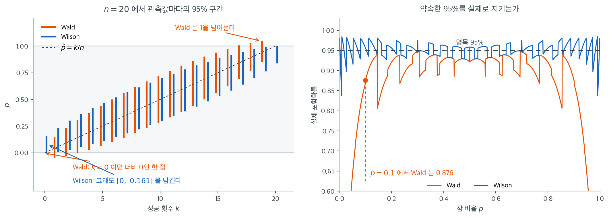
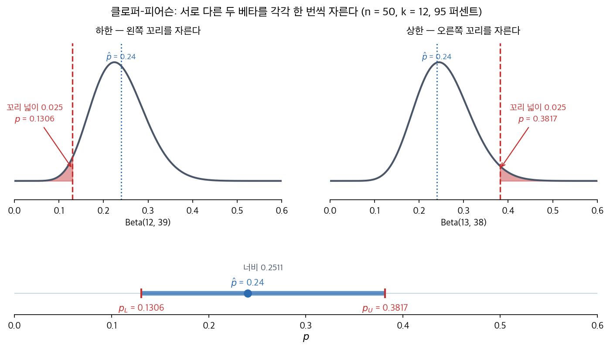
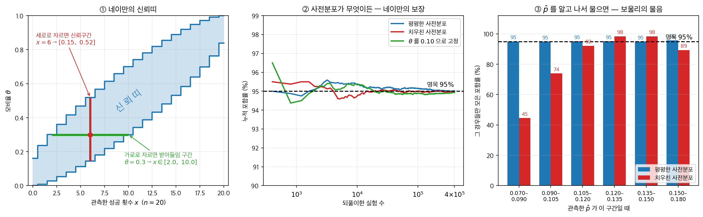
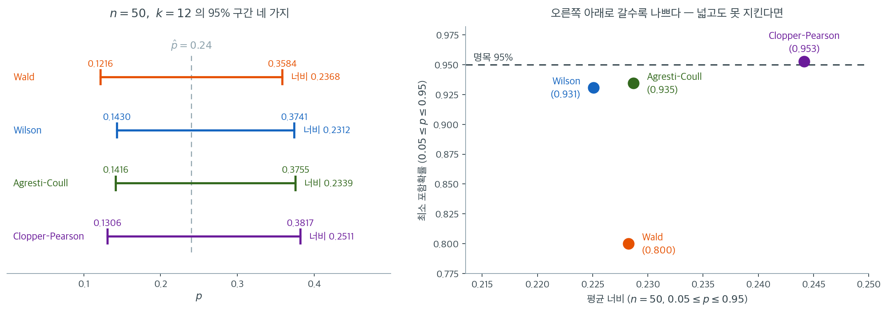
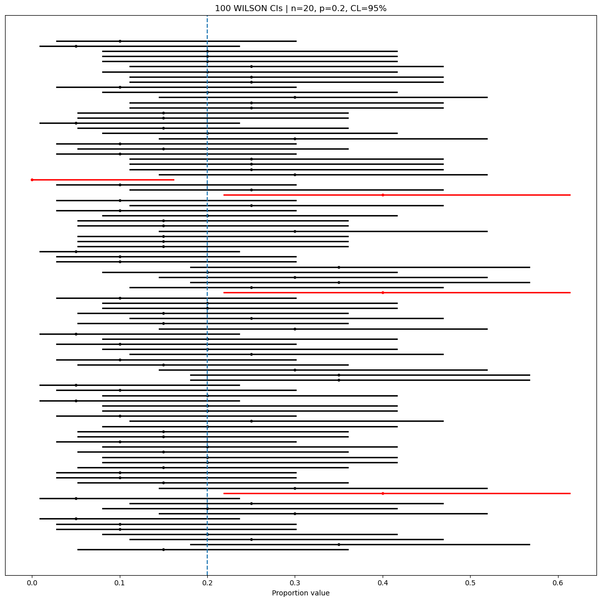
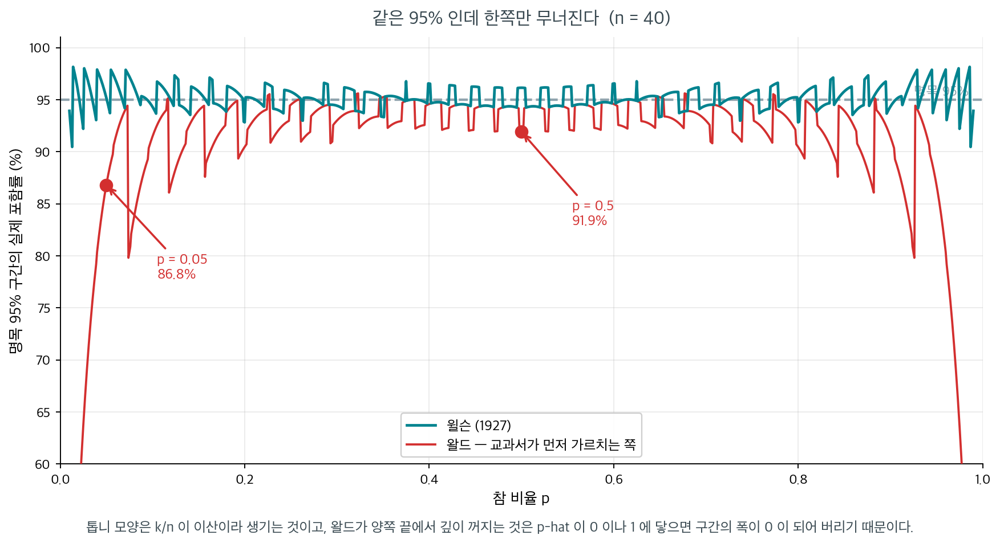
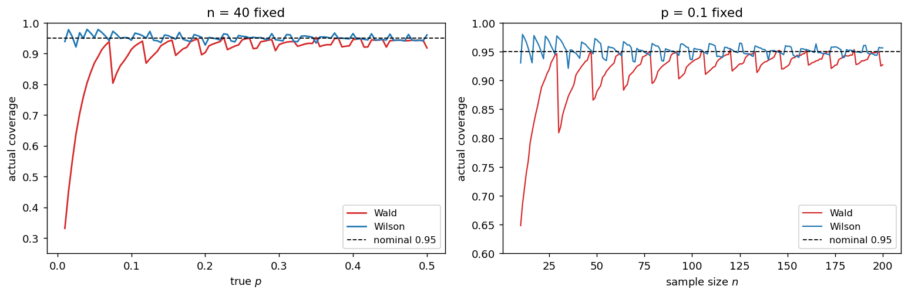

# p의 신뢰구간

## 1. 왈드 z-구간

$2022$ 년 $3$ 월 $7$ 일, 대통령 선거를 이틀 앞두고 한국갤럽이 전국 성인 $1{,}000$ 명에게 누구를 찍을지 물었다. 이재명 $43\%$, 윤석열 $44\%$, 심상정 $3\%$ 였고, 발표문 끝에 늘 붙는 한 줄이 함께 적혀 있었다 — 「표본오차 $\pm 3.1$ 퍼센트포인트($95\%$ 신뢰수준)」. 그 한 줄이 뜻하는 것은 이렇다. **같은 방식으로 조사를 수없이 되풀이하면, 그때마다 만든 구간의 $95\%$ 가 참값을 담는다.** 「참값이 이번 구간 안에 있을 확률이 $95\%$」라는 말은 아니다 — 참값은 하나로 정해진 수이고 흔들리는 쪽은 구간이다.

$44\%$ 였던 후보에게는 이 한 줄이 잘 맞는다. 그 자리에서 오차한계를 제대로 계산해도 $\pm 3.08$ 이라 적어 둔 $3.1$ 과 거의 같고, 구간은 $40.9\%$ 에서 $47.1\%$ 다.

문제는 **같은 발표문에 $3\%$ 짜리 후보도 적혀 있다**는 것이다. 그 수에 $\pm 3.1$ 을 그대로 갖다 대면 「$-0.1\%$ 에서 $6.1\%$ 사이」가 된다. **득표율이 음수일 수는 없다.** 까닭은 이렇다. **$\pm 3.1$ 은 지지율이 $50\%$ 일 때의 값이고, 오차는 그 자리에서 가장 크다.** 지지율이 $50$ 에서 멀어질수록 오차는 작아진다. $3\%$ 짜리 후보의 오차한계를 제대로 계산하면 $\pm 1.06$ 으로 $3.1$ 의 삼분의 일 남짓이다. 그러니 $3.1$ 을 갖다 댄 것은 오차를 **너무 작게** 잡은 것이 아니라 **세 배 가까이 크게** 잡은 것이고, 그렇게 크게 잡은 나머지 $0$ 아래로 넘어가 버린 것이다. 발표문의 한 줄은 **가장 나쁜 경우에 맞춰 둔 수**이고, 그래서 표의 모든 수에 그대로 쓸 수 없다.

그러면 $3\%$ 에 맞게 다시 계산하면 될까. 여기서 이 쪽의 일이 시작된다. **다시 계산하는 방법이 하나가 아니다.** 같은 $1{,}000$ 명, 같은 $3\%$, 같은 $95\%$ 인데 네 가지 방법이 네 가지 답을 낸다.

| 방법 | $95\%$ 구간 |
|---|---|
| 왈드 $z$-구간 | $(1.94\%,\ 4.06\%)$ |
| 윌슨 | $(2.11\%,\ 4.25\%)$ |
| 아그레스티–코울 | $(2.09\%,\ 4.27\%)$ |
| 클로퍼–피어슨 | $(2.03\%,\ 4.26\%)$ |

첫 줄이 가장 단순한 방법이다. $\hat p$ 에 그 자리의 오차한계를 더하고 빼는 것이라 **왈드 $z$-구간**이라 부르고, $(1.94\%,\ 4.06\%)$ 가 방금 적은 $3 \pm 1.06$ 그대로다. 나머지 셋은 그것을 고친 것들이다. 넷 다 음수를 내지 않는다. 그 점에서는 모두 제구실을 했다. 그런데 갈리는 방향이 한쪽이다 — **왈드만 통째로 아래로 내려가 있다.** 아래끝도 위끝도 넷 가운데 가장 낮다. $44\%$ 였다면 네 구간이 거의 포개졌을 텐데($40.89$–$40.95$ 에서 시작해 $47.08$–$47.14$ 에서 끝난다) $3\%$ 에서는 이렇게 벌어진다.

**비율 하나를 가두는 데 왜 방법이 넷이나 필요하고, 무엇을 보고 고르는가.** 이 쪽은 넷을 한 자료에 나란히 세워 그 갈림이 어디서 생기는지 짚는다. 이름만 보고 고르면 안 된다는 것을 아래 상자가 $64$ 년에 걸친 이야기로 따라간다.

_확인한 곳 — 한국갤럽 「제$20$ 대 대통령선거 사후조사」 보고서(갤럽리포트 G$20220311$)의 사전여론조사 추이표 — $2022$ 년 $3$ 월 $7$ 일(D$-2$) 조사 사례수 $1{,}000$ 명에 이재명 $43\%$ · 윤석열 $44\%$ · 심상정 $3\%$, 표본오차 $\pm 3.1$ 퍼센트포인트($95\%$ 신뢰수준), 그리고 같은 표가 적은 $3$ 월 $9$ 일 실제 득표율 이재명 $47.8\%$ · 윤석열 $48.6\%$ · 심상정 $2.4\%$. **그 조사의 $43/44/3$ 은 의견유보 $9\%$ 를 포함한 단순 집계여서 득표율과 바로 견줄 수 있는 수가 아니다** — 이 쪽이 쓰는 것은 「$1{,}000$ 명 가운데 $3\%$」라는 비율 하나뿐이다. 네 구간은 그 수에 각 방법을 적용해 직접 계산한 값이다. 「표본오차 $\pm 3.1$%p」가 $1{,}000$ 명에서 어떻게 나오는지는 8.5절 [표본크기 계산](../sample_size/sample_size.md)이 풀어 두고, 구간을 읽는 법은 8.1절 [해석과 흔한 오해](../foundations/interpretation.md)가 자세히 다룬다_

모비율은 가장 많이 추정되는 모수일 것이다. 후보 지지율, 배치의 불량률, 광고의 전환율 — 세는 것이 둘 가운데 하나인 자리에는 모두 $p$ 가 있다.

$\mu$ 의 구간과 다른 점이 하나 있고 그것이 이 절을 끌고 간다. **산포를 따로 추정하지 않는다.** 베르누이에서는 분산이 $p(1-p)$ 로 **평균이 정해지면 함께 정해지기** 때문이다. 평균의 구간에서 $\sigma$ 를 모를 때 $s$ 를 따로 구해야 했던 일이 여기서는 없다. 보기 1 이 이 대비를 묻는다.

$X \sim \text{Binomial}(n, p)$ 에서 $\hat p = X/n$ 이라 하면 $E[\hat p] = p$ 이고 $\operatorname{Var}(\hat p) = p(1-p)/n$ 이다. 중심극한정리로

$$
\frac{\hat p - p}{\sqrt{p(1-p)/n}} \;\approx\; N(0, 1)
$$

이므로 가운데를 $1-\alpha$ 확률로 가두면 된다. 그런데 분모의 $p$ 가 모르는 값이다. **거기에 $\hat p$ 를 꽂는 것**이 가장 단순한 길이고, 그렇게 얻은 것이 왈드 구간이다. 이 한 걸음에는 이름이 있다 — **대입 원리**(plug-in principle)다. 모르는 모수가 식에 남으면 그 자리에 추정값을 넣는 것으로, 6.2절 [적률법의 기초](../../ch06/estimation_methods/moments_foundations.md)가 일반적으로 세운다. 모평균의 구간에서 $\sigma$ 자리에 $s$ 를 넣는 것도, 7.2절 [Fisher 정보량](../../ch07/theory/fisher_information.md)이 정보량을 MLE 에서 평가하는 것도 같은 원리다.

$$
\hat{p} \pm z_{1-\alpha/2} \sqrt{\frac{\hat{p}(1 - \hat{p})}{n}}
$$

$\hat p$ 는 표본비율, $n$ 은 표본크기, $z_{1-\alpha/2}$ 는 $P(Z > z_{1-\alpha/2}) = \alpha/2$ 를 만족하는 표준정규분포의 임계값이며($\alpha = 1 - \text{신뢰수준}$), 뿌리 안의 것이 표본비율의 표준오차다. **꽂아 넣는 그 한 걸음이 뒤에 값을 치른다** — $\S 2$ 가 그 자리를 다룬다.

이 구간이 서려면 정규근사가 통해야 하고, 그 조건은 $n$ 만으로 적히지 않는다. **성공과 실패가 둘 다 넉넉해야 한다.** — 흔히 $n\hat p \ge 10$ 이고 $n(1-\hat p) \ge 10$ 을 요구한다. $n$ 이 $1000$ 이어도 $\hat p = 0.002$ 이면 성공이 둘뿐이라 근사가 통하지 않는다. 여기에 $s \approx \sigma$ 류의 요구는 필요하지 않다 — 산포를 따로 추정하지 않으니까. 유한모집단에서 비복원으로 뽑으면 $n \le 0.1N$ 이 독립 근사를 받쳐 준다.

비율의 표집분포가 근사적으로 정규가 되도록 표본크기 $n$이 충분히 커야 한다. 여기 적은 $10$은 **보수적 기준**이다. 분포의 모양만 보고 확률 하나를 어림할 참이면 문턱값 $5$인 느슨한 기준으로 족하지만, 구간을 만드는 일은 요구 수준이 다르다. 명목 95%를 약속한 구간이 실제로도 95% 가까이 참값을 담기를 바라기 때문이다. 두 기준을 가르는 근거는 [이항분포의 정규근사](../../ch04/discrete_distributions/binomial.md#언제-쓸-수-있는가-5와-10)에 정리해 두었다.

<div class="exbox" markdown>

**보기 1.** <span class="diff easy" title="쉬움"></span> 비율의 신뢰구간 계산. 크기 $n = 200$인 확률표본에서 성공이 $x = 120$번 나왔다.

**(1)** $p$의 왈드 $95\%$ 신뢰구간을 구하시오. 평균의 구간과 달리 산포를 **따로** 추정하지 않아도 되는 까닭을 밝히고, 타당성 조건을 확인하시오.

**(2)** 이 구간에는 "명목 $95\%$"라고 적혀 있다. 참값이 $p = 0.6$이고 $n = 200$일 때 **실제** 포함률을 모의실험 없이 정확히 구하시오.

</div>

??? success "풀이"

    **(1) 구간.** $\hat p = 120/200 = 0.6$이고 $z_{0.025} = 1.95996$이다.

    $$
    \text{SE} = \sqrt{\frac{\hat p(1-\hat p)}{n}} = \sqrt{\frac{0.6 \times 0.4}{200}} = \sqrt{0.0012} = 0.0346410
    $$

    $$
    \text{MOE} = 1.95996 \times 0.0346410 = 0.0678951,
    \qquad (0.5321049,\ 0.6678951)
    $$

    **왜 산포를 따로 추정하지 않는가.** 베르누이 분포에는 모수가 **하나뿐**이다. $X \sim \text{Bernoulli}(p)$이면

    $$
    E[X] = p, \qquad \operatorname{Var}(X) = p(1-p)
    $$

    로 **분산이 평균에 딸려 온다.** 그래서 $\hat p$ 하나가 구간의 중심과 폭을 모두 정한다. 정규모집단에서는 $\mu$와 $\sigma^2$이 **따로 움직이는 두 모수**라 $\bar x$ 말고 $s$를 하나 더 추정해야 했고, 그 추정의 대가로 $t$ 임계값을 치렀다. 비율에는 치를 대가가 없어 보인다.

    **그러나 공짜가 아니다.** 분산을 따로 추정하지 않는 대신, 표준오차 안의 $p$ 자리에 **추정값 $\hat p$을 꽂았다.** 그 꽂기가 $\hat p$이 극단일 때 구간을 무너뜨린다. 여기서는 그 일이 일어나지 않는다는 것이 타당성 조건이다.

    $$
    n\hat p = 120 \ge 10, \qquad n(1-\hat p) = 80 \ge 10
    $$

    보수적 기준 $10$을 넉넉히 만족한다.

    **(2) 포함률은 유한합이므로 정확히 계산된다.** $\hat p$이 가질 수 있는 값은 $k/n$ 꼴의 $n+1$개뿐이고 각 값의 확률은 이항 확률질량함수가 준다. 구간이 참값을 덮는지는 $k$만 보면 정해지므로

    $$
    C(n, p) = \sum_{k=0}^{n} \binom nk p^k (1-p)^{n-k}\,
    \mathbf 1\!\left\{\, p \in I\!\left(\tfrac kn\right) \right\}
    $$

    이다. **모의실험이 필요 없다.** 아래 코드가 이 합을 그대로 계산한다.

    **확인.**

    ```python
    import numpy as np
    import scipy.stats as stats

    n = 200          # 표본크기
    x = 120          # 성공 횟수
    confidence_level = 0.95

    p_hat = x / n
    z_critical = stats.norm.ppf(1 - (1 - confidence_level) / 2)
    # 평균의 구간과 달리 여기서는 산포를 따로 추정하지 않는다.
    # Bernoulli 분포에서는 분산 p(1-p)가 평균 p에 딸려 오기 때문이다.
    # 그래서 p_hat 하나로 중심과 너비가 모두 정해진다.
    standard_error = np.sqrt((p_hat * (1 - p_hat)) / n)
    margin_of_error = z_critical * standard_error
    confidence_interval = (p_hat - margin_of_error, p_hat + margin_of_error)

    print(f"{p_hat = }, {standard_error = :.7f}, {margin_of_error = :.7f}")
    print(f"{confidence_interval = }")


    # (2) 포함률은 유한합이다. 열거해서 더하면 끝이다.
    def exact_coverage(n, p, z):
        k = np.arange(n + 1)
        ph = k / n
        pmf = stats.binom.pmf(k, n, p)
        half = z * np.sqrt(ph * (1 - ph) / n)
        return pmf[(ph - half <= p) & (p <= ph + half)].sum()


    print("\n참값 p = 0.6 에서 명목 95% 왈드 구간의 정확한 포함률")
    for m in (198, 199, 200, 201, 202, 205):
        print(f"  n = {m}:  {exact_coverage(m, 0.6, z_critical):.5f}")
    ```

    출력:

    ```
    p_hat = 0.6, standard_error = 0.0346410, margin_of_error = 0.0678951
    confidence_interval = (0.5321048559554297, 0.6678951440445703)

    참값 p = 0.6 에서 명목 95% 왈드 구간의 정확한 포함률
      n = 198:  0.94077
      n = 199:  0.94920
      n = 200:  0.94895
      n = 201:  0.94756
      n = 202:  0.94771
      n = 205:  0.95386
    ```

    **(1)과 맞는다.** $\hat p = 0.6$, $\text{SE} = 0.0346410$, $\text{MOE} = 0.0678951$, 구간 $(0.5321049,\ 0.6678951)$ 이 손 계산과 같다.

    **(2)의 답은 $0.95$가 아니라 $0.94895$다.** 타당성 조건을 넉넉히 만족하고 $p = 0.6$이 경계에서 멀며 $n$이 $200$인데도, 명목 $95\%$ 구간이 실제로는 $94.90\%$를 담는다. 모자라는 $0.00105$는 작지만 **잡음이 아니다.** 이 값은 모의실험이 아니라 유한합으로 구한 것이라 몬테카를로 오차가 아예 없다.

    **더 눈에 띄는 것은 $n$에 대한 움직임이다.** $n$을 $198$에서 $205$까지 하나씩 올리는 동안 포함률이

    $$
    0.94077 \to 0.94920 \to 0.94895 \to 0.94756 \to 0.94771 \to \cdots \to 0.95386
    $$

    으로 **오르내린다.** $n = 198$에서 $199$로 하나 늘렸을 뿐인데 $0.0084$ 올랐고, 다시 $200$에서 $201$로 가며 내렸다. **포함률은 $n$의 증가함수가 아니다.**

    까닭은 위 합의 지시함수에 있다. $n$이 하나 늘면 격자 $k/n$ 전체가 조금씩 움직이고, 그러다 어떤 $k$의 구간이 $p = 0.6$을 담던 상태에서 담지 못하는 상태로 **갑자기** 넘어간다. 그 $k$의 점질량이 통째로 합에서 빠지거나 들어온다. $\hat p$이 **이산**이라서 생기는 일이며, $n$을 키운다고 사라지지 않고 톱니가 잘아질 뿐이다.

    여기서 다루는 $p = 0.6$, $n = 200$은 왈드 구간에 **가장 유리한** 자리다. $p$가 극단으로 가면 사정이 훨씬 나빠지며, 그 모습은 아래 그림과 $\S 4$ 에서 본다.

타당성 조건 $n\hat p = 120 \ge 10$과 $n(1-\hat p) = 80 \ge 10$을 넉넉히 만족하므로 보수적 기준으로 보아도 Wald 구간을 써도 되는 경우다.

거꾸로 표본크기를 먼저 정하거나 신뢰수준을 올리는 일도 같은 공식으로 답한다.

<div class="exbox" markdown>

**보기 2.** <span class="diff easy" title="쉬움"></span> 학교 재정 조사를 위한 표본크기. Della는 비율에 대해 95% 신뢰수준에서 오차한계를 $\pm 2\%$보다 작게 하려 한다. 필요한 최소 표본크기는?

</div>

??? success "풀이"
    최악의 표준오차는 ($\hat{p}(1-\hat{p})$를 최대화하는) $\hat{p} = 0.5$에서 나온다.

    ```python
    import scipy.stats as stats
    import numpy as np

    confidence_level = 0.95
    alpha = 1 - confidence_level
    z_star = stats.norm().ppf(1 - alpha / 2)
    margin_of_error_max = 0.02
    p_max = 0.5

    # p를 모르는 채로 표본크기를 정해야 하므로 최악을 가정한다.
    # p(1-p)는 p=0.5에서 최대(0.25)이니, 이 n이면 참 p가 무엇이든 안전하다.
    n = 1
    while True:
        n += 1
        me = z_star * np.sqrt(p_max * (1 - p_max) / n)
        if me <= margin_of_error_max:
            break
    print(f"{n = }")
    ```

    출력:

    ```
    n = 2401
    ```

    공식으로 계산하면 $n = (z_{0.025}/2E)^2 = 2400.91$이고 올림하여 2401이다($z = 1.96$으로 반올림해 쓰면 정확히 2401이 된다). 참 비율이 0.5에서 멀면 이만큼 필요하지 않다. 사전 정보로 $p \approx 0.1$을 쓸 수 있다면 같은 오차한계에 865개면 된다.

<div class="exbox" markdown>

**보기 3.** <span class="diff easy" title="쉬움"></span> 여성 아티스트의 노래 (99% 신뢰구간). Della는 노래를 500곡 넘게 가지고 있다. 무작위로 50곡을 골랐더니 20곡이 여성 아티스트의 노래였다. 99% 신뢰구간을 구성하라.

</div>

??? success "풀이"

    ```python
    import numpy as np
    from scipy import stats

    confidence_level = 0.99
    alpha = 1 - confidence_level
    p_hat = 20 / 50
    n = 50

    z_star = stats.norm().ppf(1 - alpha / 2)
    margin_of_error = z_star * np.sqrt(p_hat * (1 - p_hat) / n)
    print(f"{p_hat} ± {margin_of_error:.3f}")
    ```

    출력:

    ```
    0.4 ± 0.178
    ```

    99% 신뢰구간은 대략 $(0.222, 0.578)$이다.

    여기서 한 가지 짚어 둘 것이 있다. 500곡 중 50곡을 뽑았으므로 $n/N = 0.1$이고, i.i.d. 근사가 아슬아슬한 경계에 있다. 유한모집단 수정을 넣으면 $\sqrt{(500-50)/499} = 0.950$이 곱해져 오차한계가 0.178에서 0.169로 줄어든다.

자료가 요약값이 아니라 $0/1$ 기록으로 올 때는 읽어 들이는 일이 먼저다.

<div class="exbox" markdown>

**보기 4.** <span class="diff easy" title="쉬움"></span> CSV에서 자료 읽기. 베르누이 자료가 담긴 CSV 파일에 `1,0,0,1,0` 과 `1,0,0,0,0` 두 줄이 적혀 있다.

**(1)** 표본크기 $n$, 성공 횟수 $k$, 표본비율 $\hat p$를 구하시오.

**(2)** 0/1 값을 읽는 함수를 만들어 (1)을 확인하시오. 함수가 `0` 과 `1` 이 아닌 값을 만났을 때 **끊어야 하는** 까닭을 구체적인 예로 보이시오.

</div>

??? success "풀이"

    **(1) 세는 것이 전부다.** 값은 열 개이므로 $n = 10$이고, $1$인 것이 세 개이므로 $k = 3$, 따라서

    $$
    \hat p = \frac{k}{n} = \frac{3}{10} = 0.3
    $$

    이다. 비율 자료의 요약은 $(n, k)$ **두 수로 끝난다.** 평균의 구간에서는 $\bar x$와 $s$를 따로 구해야 했지만, 베르누이에서는 분산 $p(1-p)$가 평균에 딸려 오므로 표준오차까지 이 두 수에서 나온다. 그러므로 원자료를 읽는 일의 전부는 **이 두 수를 바르게 세는 것**이다.

    **(2) 구현과 확인.**

    ```python
    import csv
    import numpy as np

    def load_data(csv_path):
        """비율 추정을 위해 CSV에서 0/1 값을 읽는다."""
        arr = []
        with open(csv_path, "r", newline="") as f:
            reader = csv.reader(f)
            for row in reader:
                for item in row:
                    item = item.strip()
                    if item:
                        v = float(item)
                        # 0과 1 외의 값이 섞이면 여기서 끊는다.
                        # 그냥 두면 sum()이 성공 횟수가 아니게 되어
                        # p_hat이 1을 넘는 식으로 조용히 망가진다.
                        if v not in (0, 1):
                            raise ValueError("CSV must contain only 0/1 values.")
                        arr.append(v)
        if len(arr) == 0:
            raise ValueError("No values found in CSV.")
        return np.array(arr, dtype=float)


    # 임시 파일로 확인한다. 성공 횟수 k와 표본크기 n만 있으면 구간을 만들 수 있다.
    import tempfile, os
    with tempfile.TemporaryDirectory() as d:
        path = os.path.join(d, "bernoulli.csv")
        with open(path, "w") as f:
            f.write("1,0,0,1,0\n1,0,0,0,0\n")
        y = load_data(path)
    print(f"n = {len(y)}, k = {int(y.sum())}, p_hat = {y.mean()}")
    ```

    출력:

    ```
    n = 10, k = 3, p_hat = 0.3
    ```

    **(1)과 맞는다.** $n = 10$, $k = 3$, $\hat p = 0.3$ 이다. 줄을 어떻게 나누었든 값의 개수와 합만 세므로 결과가 같다.

    **0/1 이 아닌 값에서 끊어야 하는 까닭.** 이 함수가 하는 일은 결국 `len` 과 `sum` 두 가지인데, **`sum` 이 성공 횟수라는 보장은 값이 0/1 일 때만 성립한다.** 다른 값이 섞이면 조용히 틀린다.

    - 값 하나가 `2` 라면 $k = 4$, $\hat p = 0.4$ 가 된다. **그럴듯한 수라서 알아챌 길이 없다.**
    - 결측을 `99` 로 코딩한 자료가 섞이면 $k = 102$, $\hat p = 10.2$ 가 된다. 이때 표준오차 안의 $\hat p(1-\hat p) = 10.2 \times (-9.2) = -93.84$ 가 **음수**가 되어 $\sqrt{\cdot}$ 가 `nan` 을 준다. 구간이 `(nan, nan)` 으로 나오므로 그나마 눈에 띈다.

    **눈에 띄는 쪽이 운이 좋은 경우다.** 첫째 예처럼 틀린 값이 유효 범위 안에 떨어지면 끝까지 아무 신호가 없다. 그래서 검사를 계산 뒤가 아니라 **읽는 자리**에 둔다.

---

## 2. 왈드 z-구간의 대안

Wald 구간은 이런 형태의 구간을 정규근사로 형식화한 [Abraham Wald](https://en.wikipedia.org/wiki/Abraham_Wald)의 이름을 딴 것이다. 그러나 $n$이 작거나, $\hat{p}$가 0 또는 1에 가깝거나, $n\hat{p}$ 또는 $n(1-\hat{p})$가 10보다 작으면 **Wald 구간의 성능이 나쁘다**. 이런 경우에는 포함확률이 명목 수준보다 훨씬 낮아질 수 있다.

| 구간 | 공식의 종류 | $z$를 쓰는가? | 잘 통하는 경우 | 비고 |
|---|---|---|---|---|
| **Wald (z)** | $\hat{p} \pm z\sqrt{\hat{p}(1-\hat{p})/n}$ | 예 | $n$이 큰 경우 | 단순하지만 작은 표본에서 부정확 |
| **Wilson score** | z-검정을 뒤집어 유도 | 예 | 작은 $n$부터 큰 $n$까지 | 포함확률이 훨씬 좋음 |
| **Agresti–Coull** | 보정된 Wald(가상 관측값 추가) | 예 | 작은~중간 $n$ | 손쉬운 보완, Wilson에 근접한 성능 |
| **Clopper–Pearson** | 이항에 기반 | 아니오 | 작은 $n$ | 보수적이지만 정확 |

### 윌슨 점수 구간

Wilson 구간은 비율에 대한 z-검정을 *뒤집어서* 얻는다.

$$
\frac{(\hat{p} - p)^2}{p(1-p)/n} = z_{1-\alpha/2}^2
$$

**여기서부터 $z = z_{1-\alpha/2}$ 로 줄여 쓴다.** 아래 식에 같은 값이 네 번 들어가므로 아래첨자를 달면 분수가 읽히지 않는다. $95\%$ 면 $z = 1.96$ 이다.

$p$에 대해 풀면 이렇게 된다.

$$
\text{CI} =
\frac{
\hat{p} + \frac{z^2}{2n} \pm
z \sqrt{\frac{\hat{p}(1-\hat{p})}{n} + \frac{z^2}{4n^2}}
}{
1 + \frac{z^2}{n}
}
$$

구간의 중심은 $\hat{p}$가 **아니라** 0.5 쪽으로 **축소된 값**이다. 이 값을 $\tilde p$ 라 쓰고 **축소 중심**이라 부르자.

$$
\tilde{p} = \frac{\hat{p} + \frac{z^2}{2n}}{1 + \frac{z^2}{n}}
= \frac{x + \frac{z^2}{2}}{n + z^2}
$$

오른쪽 꼴이 축소의 정체를 그대로 말한다 — **관측값 $z^2$ 개를 더하되 그 절반을 성공으로 치는 것**이다. $95\%$ 면 $z^2 = 3.8416$ 이므로 가상의 관측값 $3.84$ 개 가운데 $1.92$ 개가 성공이다. $x$ 가 $0$ 이어도 중심이 $0$ 이 되지 않는 까닭이 여기 있다.

이 구간은 $[0, 1]$ 안에 머물며, 작거나 치우친 표본에서 훨씬 좋은 성능을 보여 $n < 30$에서도 거의 명목 포함확률을 달성한다.

### 아그레스티–코울 구간

Agresti와 Coull은 **바로 위의 축소 중심을 손으로 셀 수 있게 반올림하면 된다**는 것을 관찰했다. $95\%$ 에서 $z^2 = 3.8416 \approx 4$ 이고 $z^2/2 = 1.9208 \approx 2$ 이므로

- 성공 2개와 실패 2개를 더한다 → 사실상 관측값 4개가 추가된다.
- 보정된 개수를 쓴다: $n' = n + 4$, $x' = x + 2$, $\hat{p}' = x'/n'$.
- 보정된 비율로 Wald 형태의 구간을 계산한다.

$$
\hat{p}' \pm z_{1-\alpha/2} \sqrt{\frac{\hat{p}'(1 - \hat{p}')}{n'}}
$$

**기호를 가려 쓴 까닭이 있다.** $\hat p'$ 은 $\tilde p$ 의 **반올림판**이지 같은 수가 아니다 — $n' = n + 4$ 대 $n + 3.8416$, $x' = x + 2$ 대 $x + 1.9208$ 이다. 반올림을 하지 않고 $z^2$ 을 그대로 쓰면 **아그레스티–코울의 중심은 윌슨의 $\tilde p$ 와 정확히 같아진다.** 둘이 가까운 까닭이 바로 이것이다.

**그러면 무엇이 남아 다른가 — 중심이 아니라 표준오차다.** 윌슨은 근호 안에 **보정하지 않은** $\hat p$ 를 넣고 전체를 $1 + z^2/n$ 으로 나누는 반면, 아그레스티–코울은 보정한 비율을 그대로 넣는다. 연습문제 16 이 $k = 7$, $n = 25$ 에서 두 중심이 $0.3093$ 으로 **같고** 반너비만 $0.002$ 다른 것을 수로 확인한다.

포함확률이 Wilson에 매우 가깝고 설명하기도 손으로 계산하기도 쉽다. $n$이 크면 Wilson과 같아진다.



말로만 "Wald가 나쁘다"고 하면 얼마나 나쁜지 감이 오지 않는다. 왼쪽 그림은 $n = 20$에서 **나올 수 있는 모든 결과** $k = 0, 1, \ldots, 20$에 대해 두 구간을 나란히 그린 것이다. Wald 막대가 대각선 $\hat p = k/n$을 정확히 가운데 두고 대칭인 반면, Wilson 막대는 중심이 $0.5$ 쪽으로 조금씩 당겨져 있다. 양끝에서 차이가 극적이다. $k = 0$이면 $\hat p = 0$이고 표준오차 $\sqrt{\hat p(1-\hat p)/n}$도 0이 되어 **Wald 구간은 $[0,\ 0]$이라는 한 점으로 무너진다.** 같은 자료에서 Wilson은 $[0,\ 0.161]$을 준다. $k = 19$에서는 Wald의 상한이 $1.046$으로 **확률이 될 수 없는 값**까지 나간다.

오른쪽 그림은 그 대가를 갚는 자리다. 참 비율 $p$를 가로축에 놓고, 각 $p$에서 이항분포로 **정확한** 포함확률을 계산했다. 명목값은 95%인데 Wald 곡선은 거의 모든 $p$에서 그 아래에 있고, $p = 0.1$에서는 $0.876$까지 내려간다. 스무 번에 한 번 놓친다고 믿고 있지만 실제로는 여덟 번에 한 번 놓치는 셈이다. Wilson 곡선은 같은 톱니를 그리면서도 95% 선 주위에 머문다.

두 곡선이 모두 **톱니 모양**이라는 점도 중요하다. $k$가 정수라서 구간이 취할 수 있는 위치가 21가지뿐이고, $p$가 조금만 움직여도 어떤 $k$의 구간이 $p$를 담았다 놓쳤다 하며 포함확률이 뛴다. 이것은 방법의 잘못이 아니라 **이산성 자체의 성질**이며, $n$을 키워도 사라지지 않고 톱니가 잘아질 뿐이다. 그래서 비율의 구간에서는 "포함확률이 정확히 95%"인 방법을 바랄 수 없고, 평균적으로 95%에 가까운 것(Wilson)과 절대 95% 아래로 내려가지 않는 것(Clopper–Pearson) 중에 고르게 된다.

실무적으로는 이렇게 기억하면 된다. **$n\hat p$와 $n(1-\hat p)$가 10을 넘으면 Wald를 써도 큰 탈이 없고, 그렇지 않으면 Wilson을 쓴다.** 위 그림의 $n = 20$, $p = 0.1$은 기대 성공 횟수가 2에 불과해 그 조건을 한참 어기는 경우다.

### 클로퍼–피어슨 (정확) 구간

Clopper–Pearson 구간은 베타 분위수로 두 개의 단측 이항검정을 뒤집는다.

$$
\left(\text{Beta}\!\left(\frac{\alpha}{2};\; k,\; n-k+1\right),\;\;
      \text{Beta}\!\left(1-\frac{\alpha}{2};\; k+1,\; n-k\right)\right)
$$

여기서 $\text{Beta}(\alpha/2;\ \cdot)$ 의 인자는 **왼쪽부터 쌓은 누적확률**이라 위의 $z_{1-\alpha/2}$ 와 읽는 법이 다르다. 두 관례를 가르는 줄은 8.1절 [신뢰수준과 포함확률](../foundations/coverage.md)에 적어 두었다.

**식이 헷갈리는 까닭은 한 분포를 두 번 자르는 것처럼 보이기 때문이다.** 실제로는 **서로 다른 두 베타**를 각각 **한 번씩** 자른다. 하한은 $\text{Beta}(k,\ n-k+1)$ 의 **왼쪽** 꼬리에서, 상한은 $\text{Beta}(k+1,\ n-k)$ 의 **오른쪽** 꼬리에서 나온다. 두 분포의 모수가 **한 칸씩 어긋나 있는 것**이 요점이다.

<figure markdown>
  { width=940 }
  <figcaption markdown>보기 5 와 같은 자료($n = 50$, $k = 12$, $\hat p = 0.24$)다. 왼쪽은 $\text{Beta}(12, 39)$ 의 왼쪽 꼬리 $0.025$ 를 잘라 $p_L = 0.1306$ 을, 오른쪽은 $\text{Beta}(13, 38)$ 의 오른쪽 꼬리 $0.025$ 를 잘라 $p_U = 0.3817$ 을 준다. **두 밀도가 다른 분포임을 눈으로 확인하라** — 봉우리가 서로 어긋나 있다. 자료에서 직접 그렸다.</figcaption>
</figure>

왜 하필 저 두 모수인가. 하한 $p_L$ 은 「$p$ 가 이보다 작다면 $k$ 번 이상 성공할 확률이 $\alpha/2$ 도 안 된다」는 $p$ 의 경계이고, 상한 $p_U$ 는 「$p$ 가 이보다 크다면 $k$ 번 이하로 성공할 확률이 $\alpha/2$ 도 안 된다」는 경계다. 두 **단측** 이항검정을 각각 뒤집은 것이고, 이항 꼬리합이 베타 누적분포와 같다는 항등식이 그것을 베타 분위수로 바꾸어 준다. **$k$ 번 이상**과 **$k$ 번 이하**가 $k$ 를 양쪽에서 포함하므로 모수가 한 칸 어긋난다.

$k = 0$이면 하한을 0으로, $k = n$이면 상한을 1로 두는 관례를 따른다. 이 구간은 모든 $p$에서 적어도 $(1-\alpha)100\%$의 포함확률을 보장하지만 (필요보다 넓게) 보수적이다.

---

<div class="storybox" markdown>

**그림으로 보는 통계학 1.** 「정확」이라는 이름이 덫이 되기까지 — 64 년

예지 네이만이 $1934$ 년 왕립통계학회의 저녁 모임에서 **신뢰**라는 말을 지어냈다(아래 쪽지 $2$).
그 말을 **처음 써 본 사람들**이 바로 위의 클로퍼와 피어슨이다. 같은 해 $12$ 월 『바이오메트리카』에
실린 그들의 논문 제목이 「**신뢰 또는 fiducial 한계**의 사용 — 이항의 경우로 보임」이다.
**말이 아직 정해지지 않아 둘을 나란히 적어 두었다.**

논문은 첫 쪽에서 당시의 관행을 이렇게 흔든다. 추정값에 확률오차를 붙여
$\hat a \pm 3\,\mathrm{p.e.}(\hat a)$ 로 적는 방식에 대해,

> 「그 확률이라는 것에 **정확한 정의를 주기도 쉽지 않았고**, 표본에서 $\mathrm{p.e.}(\hat a)$ 를
> 추정하면서 들어가는 **오차의 크기를 재기도** 쉽지 않았다.」

$\S 1$ 의 왈드 구간이 안고 있는 두 가지가 그대로다 — **뜻이 분명하지 않다는 것**과
**표준오차 자체가 추정값이라는 것**. 두 사람은 피셔의 「fiducial 확률」이 보통의 확률과
구별되지 않아 오해를 부를 수 있다고 적고, **네이만이 제안한 말을 따르겠다**고 밝힌 뒤
각주에 네이만의 그 $1934$ 년 논문을 단다. 쪽수까지 적혀 있다.

그리고 그들은 자기 구간의 성질을 이렇게 적었다 — 표본을 거듭 뽑으면 점 $(x, p)$ 의
**「적어도 $95\%$」**가 띠 안에 든다고. **보수성이 흠이 아니라 설계였고, 1934 년에 이미
적혀 있었다.** 이산인 이항에서 포함률을 정확히 $95\%$ 로 맞출 수는 없으니, 모자라는 쪽이
아니라 넘치는 쪽으로 틀리기를 고른 것이다.

**그 선택이 「정확(exact)」이라는 이름을 얻었다.** 그리고 $64$ 년 뒤, 앨런 아그레스티와
브렌트 코울이 『더 아메리칸 스태티스티션』에 논문을 낸다. 제목이
**「이항 비율의 구간추정에서는 근사가 "정확"보다 낫다」**이고, **「정확」에 따옴표가
논문 제목에 그대로 붙어 있다.** 초록은 이렇게 요약한다 — 이항검정을 뒤집은 「정확」
구간은 포함률이 **지나치게 크고**, 왈드를 뒤집은 구간은 **지나치게 작고**, 윌슨이 제안한
점수검정 뒤집기는 **아주 작은 표본에서도 명목값에 가깝다**고.

초록의 마지막 문장이 이 쪽을 겨눈다.

> 「초급 과정에서 점수 방법과 보정 왈드 방법을 쓰면 **어색한 표본크기 지침을 학생에게
> 줄 필요가 없어진다.**」

$\S 1$ 이 가르친 $n\hat p \ge 10$ 이 바로 그 「어색한 지침」이다. 두 사람이 권한 보정 왈드가
**성공 $2$ 개와 실패 $2$ 개를 더하는** 그 한 줄이고, 위에서 $\hat p'$ 이라 쓴 것이다.
$1934$ 년에 「적어도 $95\%$」를 고른 보수성이, $1998$ 년에는 **고쳐야 할 것**이 되어 있었다.

_확인한 곳 — C. J. Clopper · E. S. Pearson, 「The Use of Confidence or Fiducial Limits
Illustrated in the Case of the Binomial」, *Biometrika* $26$(4) ($1934$ 년 $12$ 월), $404$–$413$ 쪽
(인용한 두 대목은 $404$ 쪽의 서론과 네이만 용어를 채택하는 대목이며, 네이만 $1934$ 년
『왕립통계학회지』 $97$ 권 $558$–$606$ 쪽을 각주로 단다) · Alan Agresti · Brent A. Coull,
「Approximate is Better than "Exact" for Interval Estimation of Binomial Proportions」,
*The American Statistician* $52$(2) ($1998$), $119$–$126$ 쪽 (제목의 따옴표와 인용한
초록 문장은 원문 그대로다). 그림과 표의 수는 모두 직접 계산한 값이다_

</div>

### 넷을 가르는 것은 중심을 옮기는가다

| 방법 | 중심 | 보정 | 성능 |
|---|---|---|---|
| **Wald (z)** | $\hat{p}$ | 없음 | 작은 표본·경계 근처에서 나쁨 |
| **Wilson score** | $\hat{p}$와 0.5의 가중평균 | 중심과 너비를 함께 조정 | 훌륭함 |
| **Agresti–Coull** | $(x+2)/(n+4)$ | 가상 자료 추가 | Wilson에 거의 맞먹음 |
| **Clopper–Pearson** | 중심이 따로 없다 | 이항검정을 그대로 뒤집는다 | 어느 $p$ 에서도 명목 이상. 대신 넓다 |

<div class="storybox" markdown>

**그림으로 보는 통계학 2.** 그 방에 피셔가 있었다

Wilson 구간은 $z$ 검정을 **뒤집어서** 얻는다고 했다. 그 뒤집기에 이름을 붙이고 틀을
세운 사람이 **예지 네이만**이고, 그가 그것을 처음 내놓은 자리가 $1934$ 년 왕립통계학회의
저녁 모임이었다. 논문 제목은 신뢰구간과 아무 상관이 없다 — 「표본조사법의 두 가지 측면 이렇게 된다.
층화표집과 유의선택」. 신뢰구간은 **부록 주석 $1$** 에 들어 있었다.

거기 적힌 문장이 이렇다.

> 「$\varepsilon$ 의 값은 전적으로 임의로 고르는 것인데, 나는 이것을 **신뢰계수**라
> 부르기를 제안한다. (…) 수 $\theta_1(x)$ 와 $\theta_2(x)$ 는 R. A. 피셔가 $\theta$ 의
> **fiducial 한계**라 부르는 것이다. 그런데 「fiducial」이라는 말은 내가 앞서 말한
> 오해들을 낳은 「fiducial 확률」 개념에 붙어 다니고, 그 개념은 실제로는 보통의 확률
> 개념과 구별되지 않는다. 그래서 나는 그 말을 피하고, 구간 $[\theta_1(x), \theta_2(x)]$ 를
> 신뢰계수 $\varepsilon$ 에 대응하는 **신뢰구간**이라 부르고자 한다.」

「신뢰구간」이라는 이름은 그러니까 **피셔의 낱말을 쓰지 않으려고** 지은 것이다. 그 조심스러움이
무엇을 위한 것이었는지는 [신뢰구간의 해석](../foundations/interpretation.md)에서 보았다.
같은 논문의 그림 $\mathrm{IV}$ 에 그는 띠를 하나 그렸고, 그림 안에 비스듬히
**CONFIDENCE BELT** 라고 적어 두었다.



**①** 띠를 **가로로** 자르면 $\theta$ 가 참일 때 받아들일 $x$ 의 범위이고, **세로로**
자르면 $x$ 를 관측했을 때의 구간이다. 위에서 유도한 Wilson 구간이 바로 이 세로 절단이다.
순서가 중요하다 — **띠가 먼저 그려지고 자료는 나중에 온다.**

그날의 토론이 활자로 남아 있다. 감사의 동의를 낸 사람은 런던정경대의 **아서 보울리**였다.

> **「나는 그 「신뢰」가 「신용 사기(confidence trick)」가 아니라고 전혀 확신하지 못하겠다.」**

농담만 한 것이 아니다. 그는 곧장 셈을 해 보였다. 「무작위로 뽑은 $1{,}000$ 명 가운데
해당 성질을 가진 이가 $10$ 분의 $1$ 이고 모집단의 비율이 천분율 $80$ 과 $120$ 사이
어디였다면, 그런 일이 일어날 확률은 대략 스무 번에 한 번보다 작다.」 연단에서 한 암산인데
맞는다 — $n = 1{,}000$, $x = 100$ 의 $95\%$ Wilson 구간이 천분율 $[82.9,\ 120.2]$ 다.

그러고 나서 물었다. **「그것이 정말 우리를 더 멀리 데려가는가? 우리에게 정말 필요한 것,
곧 우리가 표집하고 있는 그 세계에서 비율이 이 한계 안에 있을 가능성으로 데려가는가?
나는 아니라고 본다. 우리가 아는 것은 — 있을 법하지 않은 일이 일어났거나, 아니면 모집단의
비율이 그 한계 안에 있거나, 둘 중 하나라는 것뿐이다.」**

그런데 **피셔가 그 방에 있었다.** 보울리는 발언 중에 「피셔 교수가 와 계셔서 매우 기쁘다,
네이만 박사가 받아들여 녹여 넣은 것이 그의 연구이기 때문」이라고 말해 두었다. 차례가 오자
피셔는 두 말의 뜻이 같다는 데 동의한 뒤, 보울리의 농담을 주워 들었다.

> 「네이만 박사는 **confidence** 라는 말로 수식했다. 뜻은 분명히 같았고, 그는 confidence 가
> 형용사로 쓰일 수 있다는 것을 부정할 생각이 없었다. 보울리 교수가 상기시켜 준 대로
> **「confidence trick」이라는 표현으로 우리 모두 너무나 익숙한 말이다.** 그래도 fiducial 이
> 순전히 형식적인 근거에서는 아마 더 나은 형용사였을 것이다.」

네이만의 답변은 토론 맨 끝에 있다. 먼저 한 줄로 웃는다. 「비판이 하도 엇갈려서, 한 분은
이 논문의 모든 것이 미심쩍다 하시고 다른 분은 새로울 것이 없다 하시니, 그것만으로도
흐뭇하다.」 그러고는 보울리의 두 문장에 **(가)(나)** 라고 번호를 매겨 따로 답했다.

- **(가)** 「비율이 이 한계 안에 있을 가능성」은 **베이즈의 꼴로 쓴 추정 문제**다. 「간단한
  대수로 보이듯 이 문제의 해는 사전확률법칙에 **의존할 수밖에 없다.**」
- **(나)** 「신뢰구간의 방법에서 하는 일은 다르다. 우리는 **말하자면 표본을 뽑기 전에**
  추론을 시작한다.」

**②③** 이 두 답을 수로 옮긴 것이다. **②** 에서는 $\theta$ 를 평평한 사전분포에서 가져오든,
치우친 사전분포에서 가져오든, 아예 $0.10$ 으로 못 박든 장기 포함률이 모두 $95\%$ 다 —
네이만이 「사전확률법칙이 무엇이든」이라고 쓴 것이 이것이다. **③** 에서는 $\hat p$ 를 보고 난
뒤 그 경우들만 모아 센다. 평평한 사전분포에서는 $\hat p$ 가 어디든 $95\%$ 인데, 치우친
사전분포에서는 **$45\%$ 에서 $98\%$ 까지** 갈린다. 보울리가 원한 수는 실제로 사전분포가
정한다 — (가) 가 말한 그대로다.

아흔 해가 지났다. ② 도 여전히 맞고 ③ 도 여전히 맞다. 신뢰구간이 주는 것은 ② 이지 ③ 이
아니며, 그것을 「신용 사기」라 부를지 「사전분포 없이 가질 수 있는 유일한 보장」이라 부를지는
그날 밤 이후로 아직 정해지지 않았다.

_확인한 곳 — Jerzy Neyman, "On the Two Different Aspects of the Representative Method:
The Method of Stratified Sampling and the Method of Purposive Selection", 『Journal of the
Royal Statistical Society』 $97$ 권 $4$ 호 $558$–$625$ 쪽($1934$)의 스캔 원문. 신뢰계수·신뢰구간의
정의와 fiducial 을 피한 이유는 $589$–$590$ 쪽 부록 주석 $1$, 신뢰띠는 $590$–$591$ 쪽과 그림
$\mathrm{IV}$, 보울리의 발언은 토론 $609$ 쪽, 피셔의 발언은 $617$ 쪽, 네이만의 답변은 $623$–$624$ 쪽.
그림의 수는 모두 직접 계산한 값이다_

</div>

방법이 넷이므로 넷을 한 함수로 묶어 두고 **무엇을 고를지를 부르는 쪽에서 정하게** 하는 편이 낫다.

<div class="exbox" markdown>

**보기 5.** <span class="diff easy" title="쉬움"></span> 비율 신뢰구간 계산기 — 네 방법. 시행 $n = 50$번에서 성공이 $k = 12$번 나왔다.

**(1)** 네 구간을 $95\%$에서 모두 계산하시오. 윌슨 구간과 아그레스티–코울 구간의 **중심이 정확히 같다**는 것을 보이고, 두 구간이 갈라지는 곳이 어디인지 닫힌 꼴로 적으시오.

**(2)** 네 구간의 폭을 비교하시오. "보수적인 구간이 넓다"는 통념이 어디까지 맞는가.

</div>

??? success "풀이"

    **(1) 네 구간.** $\hat p = 12/50 = 0.24$, $z = 1.95996$, $z^2 = 3.84146$, $\tilde n = n + z^2 = 53.84146$ 이다.

    **왈드.** $\text{SE} = \sqrt{0.24 \times 0.76/50} = 0.0603987$, $\text{MOE} = 0.1183793$ 이므로 $(0.1216,\ 0.3584)$.

    **윌슨.** 중심과 반폭이

    $$
    \frac{\hat p + \frac{z^2}{2n}}{1 + \frac{z^2}{n}} = 0.2585504,
    \qquad
    \frac{z}{1+\frac{z^2}{n}}\sqrt{\frac{\hat p(1-\hat p)}{n} + \frac{z^2}{4n^2}} = 0.1155750
    $$

    이므로 $(0.1430,\ 0.3741)$.

    **아그레스티–코울.** $\tilde p = (k + z^2/2)/\tilde n = 13.92073/53.84146 = 0.2585504$, 반폭 $z\sqrt{\tilde p(1-\tilde p)/\tilde n} = 0.1169475$ 이므로 $(0.1416,\ 0.3755)$.

    **클로퍼–피어슨.** $\text{Beta}(0.025;\ 12,\ 39) = 0.1306$, $\text{Beta}(0.975;\ 13,\ 38) = 0.3817$ 이므로 $(0.1306,\ 0.3817)$.

    **중심이 같은 것은 우연이 아니다.** 윌슨 중심의 분자와 분모에 $n$을 곱하면

    $$
    \frac{\hat p + \frac{z^2}{2n}}{1 + \frac{z^2}{n}}
    = \frac{n\hat p + \frac{z^2}{2}}{n + z^2}
    = \frac{k + \frac{z^2}{2}}{\tilde n}
    = \tilde p
    $$

    로 아그레스티–코울의 $\tilde p$와 **같은 식**이다. 둘 다 성공 $z^2/2 = 1.92$회와 실패 $1.92$회를 가상으로 더한 비율이고, $95\%$에서 이것을 $2$로 반올림한 것이 "plus-four" 규칙이다.

    **갈라지는 곳은 반폭 하나뿐이다.** 두 반폭을 같은 분모 $\tilde n$으로 정리하면

    $$
    \text{윌슨 반폭} = \frac{z}{\tilde n}\sqrt{\frac{k(n-k)}{n} + \frac{z^2}{4}},
    \qquad
    \text{AC 반폭} = \frac{z}{\tilde n}\sqrt{\frac{(k+\frac{z^2}{2})(n-k+\frac{z^2}{2})}{\tilde n}}
    $$

    이다(윌슨 쪽은 $\frac{z}{1+z^2/n} = \frac{zn}{\tilde n}$ 임을 쓰고 $n$을 근호 안으로 넣으면 나온다). 근호 안을 비교하면 $10.0804$ 대 $10.3211$ 로 **아그레스티–코울이 조금 크다.** 윌슨은 산포를 관측된 $k$로 재고, 아그레스티–코울은 $1/2$ 쪽으로 당겨진 $\tilde p$로 재기 때문이다. $\tilde p$가 $0.5$에 더 가까우므로 $\tilde p(1-\tilde p)$가 더 크다.

    **(2) 폭.** 네 구간의 폭은

    | 방법 | 구간 | 폭 | 윌슨 대비 |
    |---|---|---|---|
    | 왈드 | $(0.1216,\ 0.3584)$ | $0.2368$ | $1.024$ |
    | **윌슨** | $(0.1430,\ 0.3741)$ | $0.2312$ | 기준 |
    | 아그레스티–코울 | $(0.1416,\ 0.3755)$ | $0.2339$ | $1.012$ |
    | 클로퍼–피어슨 | $(0.1306,\ 0.3817)$ | $0.2511$ | $1.086$ |

    **통념이 맞는 것은 클로퍼–피어슨뿐이다.** 폭이 윌슨보다 $8.6\%$ 넓고, 그 대가로 모든 $p$에서 포함률 $0.95$ 이상을 **보장**한다. 여기서는 "보수적 = 넓다"가 성립한다.

    **왈드는 통념에 맞지 않는다.** 포함률이 가장 나쁜데 폭은 윌슨보다 $2.4\%$ **넓다.** 좁아서 부정확한 것이 아니라 **엉뚱한 자리에 놓여서** 부정확하다는 뜻이다.

    다만 왈드가 언제나 더 넓은 것은 아니다. 두 폭의 비를 풀면 $n = 50$에서 $\hat p$가

    $$
    0.1400 \le \hat p \le 0.8600
    $$

    일 때 윌슨이 더 좁고, 그 **바깥에서만** 왈드가 좁아진다. 그런데 그 바깥이 바로 $\sqrt{\hat p(1-\hat p)}$가 작아져 왈드가 무너지는 자리다. **왈드가 좁아지는 곳과 왈드가 실패하는 곳이 같은 곳이다.**

    **확인.**

    ```python
    import math
    from scipy.stats import norm, beta

    def ci_proportion(k, n, method="wilson", cl=0.95):
        """모비율에 대한 일표본 신뢰구간. 네 가지 방법을 한 함수에 모았다.

        기본값이 wald가 아니라 wilson인 것에 주의하라.
        Wald는 교과서에 먼저 나오지만 실무 기본값으로 삼을 만한 방법이 아니다.

        k : 성공 횟수
        n : 표본크기
        method : 'wald', 'wilson', 'ac', 'cp'
        cl : 신뢰수준 (기본 0.95)
        """
        alpha = 1 - cl
        z = norm.ppf(1 - alpha / 2)
        phat = k / n

        if method == "wald":
            se = math.sqrt(phat * (1 - phat) / n)
            lo = phat - z * se
            hi = phat + z * se
        elif method == "wilson":
            denom = 1 + z * z / n
            center = (phat + z * z / (2 * n)) / denom
            half = z * math.sqrt(phat * (1 - phat) / n + z * z / (4 * n * n)) / denom
            lo, hi = center - half, center + half
        elif method == "ac":
            n_tilde = n + z * z
            p_tilde = (k + 0.5 * z * z) / n_tilde
            se_tilde = math.sqrt(p_tilde * (1 - p_tilde) / n_tilde)
            lo = p_tilde - z * se_tilde
            hi = p_tilde + z * se_tilde
        else:  # cp (Clopper-Pearson)
            # 정규근사를 아예 쓰지 않고 이항분포를 직접 뒤집는다.
            # Beta가 나오는 것은 이항 꼬리확률과 Beta 누적분포가 같은 식이기 때문이다.
            # k=0이나 k=n이면 한쪽 Beta의 모수가 0이 되어 정의되지 않으므로 관례를 따른다.
            lo = 0.0 if k == 0 else beta.ppf(alpha / 2, k, n - k + 1)
            hi = 1.0 if k == n else beta.ppf(1 - alpha / 2, k + 1, n - k)

        # Wald는 끝점이 [0,1]을 벗어날 수 있다. 나머지 셋은 그럴 일이 없다.
        lo = max(0.0, lo)
        hi = min(1.0, hi)
        return lo, hi

    # 50번 중 12번 성공에 대한 95% Wilson 구간
    lo, hi = ci_proportion(k=12, n=50, method="wilson", cl=0.95)
    print(f"95% Wilson CI: ({lo:.4f}, {hi:.4f})")

    # 같은 자료의 99% Clopper-Pearson 구간
    lo, hi = ci_proportion(k=12, n=50, method="cp", cl=0.99)
    print(f"99% Clopper-Pearson CI: ({lo:.4f}, {hi:.4f})")

    # (1),(2) 신뢰수준을 95%로 맞추고 네 방법을 나란히 둔다.
    print()
    print(f"{'방법':>6}{'하한':>10}{'상한':>10}{'중심':>10}{'폭':>10}{'윌슨대비':>10}")
    base = None
    for name in ("wald", "wilson", "ac", "cp"):
        lo, hi = ci_proportion(k=12, n=50, method=name, cl=0.95)
        if name == "wilson":
            base = hi - lo
    for name in ("wald", "wilson", "ac", "cp"):
        lo, hi = ci_proportion(k=12, n=50, method=name, cl=0.95)
        print(f"{name:>6}{lo:>10.4f}{hi:>10.4f}{(lo + hi) / 2:>10.7f}"
              f"{hi - lo:>10.4f}{(hi - lo) / base:>10.3f}")
    ```

    출력:

    ```
    95% Wilson CI: (0.1430, 0.3741)
    99% Clopper-Pearson CI: (0.1056, 0.4255)

        방법        하한        상한        중심         폭      윌슨대비
      wald    0.1216    0.3584 0.2400000    0.2368     1.024
    wilson    0.1430    0.3741 0.2585504    0.2312     1.000
        ac    0.1416    0.3755 0.2585504    0.2339     1.012
        cp    0.1306    0.3817 0.2561503    0.2511     1.086
    ```

    **(1)과 (2)가 모두 맞는다.** 네 구간의 끝점과 폭이 손 계산과 같고, 윌슨과 아그레스티–코울의 중심이 소수 일곱째 자리까지 **$0.2585504$ 로 같다.** 왈드의 중심만 $\hat p = 0.24$ 그대로다. 클로퍼–피어슨의 중심 $0.2562$ 는 셋 중 어느 것과도 다른데, 이 구간은 중심을 먼저 정하고 폭을 더하는 꼴로 만들어진 것이 아니라 **양쪽 꼬리를 따로 뒤집어** 만든 것이라 대칭일 이유가 없기 때문이다.

    폭의 비도 표와 같다. 왈드 $1.024$, 아그레스티–코울 $1.012$, 클로퍼–피어슨 $1.086$ 이다.

두 구간의 신뢰수준이 다르므로 너비를 곧바로 비교할 수는 없다. 같은 95%로 맞추면 Wilson이 $(0.1430, 0.3741)$, Clopper–Pearson이 $(0.1306, 0.3817)$로 후자가 약 9% 넓다. 이것이 "모든 $p$에서 95% 아래로 내려가지 않는다"는 보장의 값이다.



왼쪽은 $n = 50$, $k = 12$라는 하나의 자료에 네 방법을 모두 적용한 결과다. Wald $(0.1216,\ 0.3584)$, Wilson $(0.1430,\ 0.3741)$, Agresti–Coull $(0.1416,\ 0.3755)$, Clopper–Pearson $(0.1306,\ 0.3817)$. 네 구간이 꽤 닮아 보이지만 **위치가 조금씩 다르다.** Wald만 $\hat p = 0.24$를 정확히 가운데 두고, 나머지 셋은 중심이 오른쪽(곧 $0.5$ 쪽)으로 밀려 있다. 자료 하나만 보아서는 어느 쪽이 옳은지 판단할 방법이 없다.

판단은 오른쪽 그림처럼 **모든 $p$를 한꺼번에** 볼 때만 가능하다. 가로축은 평균 너비, 세로축은 $0.05 \le p \le 0.95$ 구간에서의 **최소** 포함확률이다. 좋은 방법은 왼쪽 위(좁으면서 약속을 지킴)에 있다. Clopper–Pearson만 95% 선 위에 있고($0.953$), 그 대가로 평균 너비 $0.244$로 가장 넓다. Wilson은 $0.931$까지 내려가지만 너비가 $0.225$로 가장 좁고, Agresti–Coull이 $0.935$와 $0.229$로 그 사이에 있다. Wald는 너비가 $0.228$로 Wilson보다도 넓으면서 최소 포함확률이 $0.800$이다. **넓기까지 한데 약속도 못 지킨다** — 오른쪽 아래, 고를 이유가 없는 자리다.

이 그림이 "Clopper–Pearson은 보수적이다"라는 말의 정확한 뜻이다. 95% 보장은 **가장 나쁜 $p$에서도** 95%를 지킨다는 뜻이고, 그러려면 대부분의 $p$에서는 95%보다 넉넉히 덮어야 한다. 실제로 같은 자료에서 Clopper–Pearson의 너비 $0.2511$은 Wilson의 $0.2312$보다 8.6% 넓다. 이것이 보장의 값이다.

그래서 기본값을 고를 때의 기준은 "누가 이기는가"가 아니라 **어떤 실패를 감당할 수 있는가**이다. 규제나 안전처럼 명목 수준을 반드시 지켜야 하면 Clopper–Pearson, 일반적인 보고에는 Wilson, 손으로 계산해야 하면 Agresti–Coull이다. `ci_proportion`의 기본값이 `wald`가 아니라 `wilson`인 것은 이 그림에서 Wald가 놓인 자리 때문이다.

---

## 3. 네 방법이 한 자료에서 어떻게 갈라지는가

비율에서는 포함확률을 **정확히 계산할 수 있다.** 이항은 이산이라 모든 $k$ 를 열거해 더하면 되기 때문이다(연습문제 25). 그런데도 모의실험을 하는 까닭은 구간 $100$ 개를 **눈으로 보는** 데 있고, 네 방법이 같은 자료에서 어떻게 갈라지는지가 거기서 읽힌다.

여기서 보는 것은 **한 자리** $(n = 20,\ p = 0.2)$ 다. 포함률을 $p$ 와 $n$ 에 걸쳐 **곡선으로** 재고, 왈드가 왜 무너지는지(포함률이 $1-(1-p)^n$ 을 넘지 못한다)와 윌슨이 왜 안 무너지는지를 **정리로** 증명하는 것은 $\S 4$ 가 맡는다. 그 쪽은 두 방법만 보므로, 아그레스티–코울과 클로퍼–피어슨이 어디에 놓이는지는 여기서만 읽을 수 있다.

<div class="exbox" markdown>

**보기 6.** <span class="diff easy" title="쉬움"></span> 비율 신뢰구간 모의실험. $n = 20$, 참값 $p = 0.2$, 명목 $95\%$에서 네 방법을 비교한다. 되풀이는 $100$회다.

**(1)** 네 방법의 포함률을 **모의실험 없이** 정확히 구하시오. 그리고 왈드와 윌슨의 차이가 어느 $k$에서 생기는지 밝히시오.

**(2)** 되풀이 $100$회의 모의 포함률을 (1)과 나란히 두고, 차이가 몬테카를로 오차로 설명되는지 확인하시오.

</div>

??? success "풀이"

    **(1) $\S 1$ 의 보기 $1$ 이 쓴 그 유한합을 네 방법에 그대로 건다.** $n = 20$ 이면 $k$ 가 가질 수 있는 값이 스물한 가지뿐이므로, 각 방법에 대해 **$p = 0.2$ 를 담는 $k$ 의 집합** $S$ 를 구하고 그 점질량을 더하면 끝이다. 일반형 $C(n,p) = \sum_k \binom nk p^k (1-p)^{n-k}\,\mathbf 1\{p \in I(k/n)\}$ 과 그것이 **톱니가 잡음이 아니라 구조**임을 말해 주는 까닭은 $\S 4$ 의 보기 9 에 있다.

    $$
    C = \sum_{k \in S} \binom{20}{k} (0.2)^k (0.8)^{20-k}
    $$

    네 집합을 실제로 구하면 다음과 같다.

    | 방법 | $p = 0.2$를 담는 $k$ | 포함률 |
    |---|---|---|
    | 왈드 | $\{2, 3, \ldots, 8\}$ | $0.92084$ |
    | 윌슨 | $\{1, 2, \ldots, 7\}$ | $0.95633$ |
    | 아그레스티–코울 | $\{1, 2, \ldots, 7\}$ | $0.95633$ |
    | 클로퍼–피어슨 | $\{1, 2, \ldots, 8\}$ | $0.97849$ |

    **왈드와 윌슨의 차이는 두 개의 $k$에서 나온다.** 집합을 비교하면 왈드는 $k = 1$을 **잃고** $k = 8$을 **얻는다.** 그 두 점질량이

    $$
    P(X = 1) = \binom{20}{1}(0.2)(0.8)^{19} = 0.05765,
    \qquad
    P(X = 8) = 0.02216
    $$

    이므로

    $$
    0.95633 - 0.05765 + 0.02216 = 0.92084
    $$

    로 **정확히 맞아떨어진다.** $k = 1$에서 왈드 구간은 $(0,\ 0.1455)$ 로 $0.2$에 닿지 못하는데, 윌슨은 중심이 $1/2$ 쪽으로 당겨져 $(0.0089,\ 0.2361)$ 이 되어 담는다. 잃는 쪽이 얻는 쪽보다 $2.6$배 무거워 왈드가 진다.

    **클로퍼–피어슨은 윌슨에 $k = 8$만 더한 것이다.** $0.95633 + 0.02216 = 0.97849$ 다. 명목 $0.95$를 **위로** $2.8$퍼센트포인트 넘는데, 이것이 "보수적"이라는 말의 정확한 뜻이다.

    **윌슨과 아그레스티–코울은 포함률이 같다.** 두 구간은 중심이 같고 폭만 아그레스티–코울이 조금 넓은데, 이 자리에서는 그 추가 폭이 새로운 $k$를 **하나도** 들여오지 못했다. 포함률이 $k$ 단위로만 움직이므로 폭의 차이가 집합을 바꾸지 못하면 포함률도 바뀌지 않는다. **이산성이 두 방법을 똑같이 만든 것이고, $n$이나 $p$가 조금만 달라져도 갈라진다.**

    **(2) 모의실험.**

    ```python
    import numpy as np
    import matplotlib.pyplot as plt
    from scipy.stats import norm, beta

    np.random.seed(42)          # 아래 출력과 그림을 재현하려면 고정한다

    n_simulations = 100
    n = 20
    p_true = 0.20
    alpha = 0.05
    method = "wilson"  # 'wald' | 'wilson' | 'ac' | 'cp'

    # 표본을 만들 필요가 없다. 필요한 것은 성공 횟수 k 하나뿐이므로
    # 0/1을 n개 뽑는 대신 이항분포에서 k를 바로 뽑는다.
    k = np.random.binomial(n=n, p=p_true, size=n_simulations)
    phat = k / n
    z = norm.ppf(1 - alpha / 2)

    lower = np.empty(n_simulations)
    upper = np.empty(n_simulations)

    for i, ki in enumerate(k):
        p = ki / n
        if method == "wald":
            se = np.sqrt(p * (1 - p) / n)
            lo, hi = p - z * se, p + z * se
        elif method == "wilson":
            denom = 1 + z**2 / n
            center = (p + z**2 / (2 * n)) / denom
            half = z * np.sqrt(p * (1 - p) / n + z**2 / (4 * n**2)) / denom
            lo, hi = center - half, center + half
        elif method == "ac":
            n_tilde = n + z**2
            p_tilde = (ki + 0.5 * z**2) / n_tilde
            se_tilde = np.sqrt(p_tilde * (1 - p_tilde) / n_tilde)
            lo, hi = p_tilde - z * se_tilde, p_tilde + z * se_tilde
        else:  # cp
            lo = 0.0 if ki == 0 else beta.ppf(alpha / 2, ki, n - ki + 1)
            hi = 1.0 if ki == n else beta.ppf(1 - alpha / 2, ki + 1, n - ki)

        lower[i] = max(0.0, lo)
        upper[i] = min(1.0, hi)

    covered = (lower <= p_true) & (p_true <= upper)
    coverage_pct = 100.0 * covered.mean()
    print(f"{method} coverage: {coverage_pct:.1f}%")


    # (1) 포함률은 유한합이다. k 가 21가지뿐이므로 담는 k 를 모아 더하면 끝이다.
    from scipy.stats import binom


    def interval(ki, which):
        """성공 횟수 ki 하나에서 네 방법의 구간 끝점을 돌려준다."""
        p = ki / n
        if which == "wald":
            se = np.sqrt(p * (1 - p) / n)
            lo, hi = p - z * se, p + z * se
        elif which == "wilson":
            denom = 1 + z**2 / n
            center = (p + z**2 / (2 * n)) / denom
            half = z * np.sqrt(p * (1 - p) / n + z**2 / (4 * n**2)) / denom
            lo, hi = center - half, center + half
        elif which == "ac":
            n_tilde = n + z**2
            p_tilde = (ki + 0.5 * z**2) / n_tilde
            se_tilde = np.sqrt(p_tilde * (1 - p_tilde) / n_tilde)
            lo, hi = p_tilde - z * se_tilde, p_tilde + z * se_tilde
        else:
            lo = 0.0 if ki == 0 else beta.ppf(alpha / 2, ki, n - ki + 1)
            hi = 1.0 if ki == n else beta.ppf(1 - alpha / 2, ki + 1, n - ki)
        return max(0.0, lo), min(1.0, hi)


    def covers(ki, which):
        lo, hi = interval(ki, which)
        return lo <= p_true <= hi


    print()
    print(f"{'방법':<8}{'담는 k':<12}{'정확':>9}{'모의':>8}{'차이/MC오차':>10}")
    for m in ("wald", "wilson", "ac", "cp"):
        S = [ki for ki in range(n + 1) if covers(ki, m)]
        exact = sum(binom.pmf(ki, n, p_true) for ki in S)
        sim = np.mean([covers(ki, m) for ki in k])
        se_mc = np.sqrt(exact * (1 - exact) / n_simulations)
        print(f"{m:<8}{f'{S[0]}..{S[-1]}':<12}{exact:>9.5f}{sim:>8.2f}{abs(sim - exact) / se_mc:>10.2f}")
    ```

    출력:

    ```
    wilson coverage: 96.0%

    방법      담는 k               정확      모의   차이/MC오차
    wald    2..8          0.92084    0.91      0.40
    wilson  1..7          0.95633    0.96      0.18
    ac      1..7          0.95633    0.96      0.18
    cp      1..8          0.97849    0.99      0.79
    ```

    **네 정확값이 (1)의 표와 같다.** 담는 $k$의 범위도 $2..8$, $1..7$, $1..7$, $1..8$ 로 손으로 구한 집합과 같다.

    **모의와 정확이 모두 몬테카를로 오차 안에서 맞는다.** 마지막 열이 $|\text{모의} - \text{정확}|$ 을 그 자리의 몬테카를로 표준오차로 나눈 값인데, 네 방법 모두 $0.79$ 이하다. $1$ 표준오차를 넘는 것이 하나도 없다.

    **그러나 $100$회로 읽을 수 있는 것은 순서뿐이다.** 모의가 준 $0.91 / 0.96 / 0.96 / 0.99$ 는 정확값 $0.9208 / 0.9563 / 0.9563 / 0.9785$ 의 **차례는 바르게** 재현했지만 자릿수는 믿을 수 없다. $0.95$ 근처에서 되풀이 $100$회의 표준오차가 $0.02$라서 소수 둘째 자리가 통째로 흔들린다. 포함률을 **값으로** 말하려면 정확 계산을 하거나 되풀이를 만 번 단위로 올려야 한다.

    **윌슨과 아그레스티–코울은 모의에서도 한 글자도 다르지 않다.** 둘이 같은 $k$ 집합을 담으므로 **같은 표본에서는 언제나 같이 맞고 같이 틀린다.** 모의실험을 아무리 늘려도 이 자리에서는 두 방법이 갈라지지 않는다.

같은 자료(같은 시드)에 `method`만 바꿔 세어 보면 Wald 91.0%, Agresti–Coull 96.0%, Clopper–Pearson 99.0%가 된다. Wald만 명목값 아래로 내려가고, Clopper–Pearson은 보수적인 만큼 위로 넘친다.

<div class="exbox" markdown>

**보기 7.** <span class="diff easy" title="쉬움"></span> 구간 100개를 한 그림에. 앞 보기에서 만든 윌슨 구간 $100$개를 가로선 하나씩으로 그리고, 참값을 놓친 것만 빨갛게 칠한다.

**(1)** 그림을 그리고 무엇이 읽히는지 수와 함께 말하시오. 선이 **몇 자리에만** 나타나는 까닭을 밝히시오.

**(2)** 이 그림에서 **왈드** 구간의 실패를 읽을 수 있는가. 그 밖에 이 그림이 가리는 것은 무엇인가.

</div>

??? success "풀이"

    **(1) 그림.**

    ```python
    # 구간 하나를 가로선 하나로 그린다. 참값을 담은 구간은 검정, 놓친 구간은
    # 빨강이다. 세로 점선이 참값이고, 빨간 선이 몇 개인지 세는 것이 곧 포함확률을
    # 재는 일이다. 구간마다 길이가 다른 까닭은 표본마다 s 가 다르기 때문이다.
    fig, ax = plt.subplots(figsize=(12, 12))
    for i in range(n_simulations):
        color = "k" if covered[i] else "r"
        ax.plot([lower[i], upper[i]], [i, i], lw=2, color=color)
        ax.plot(phat[i], i, marker="o", ms=3, color=color)

    ax.axvline(p_true, linestyle="--", linewidth=1.5)
    ax.set_title(f"{n_simulations} {method.upper()} CIs | n={n}, p={p_true}, CL=95%")
    ax.set_yticks([])
    ax.set_xlabel("Proportion value")
    plt.tight_layout()
    plt.show()
    ```

    

    **읽히는 것 하나 — 선이 아홉 자리에만 있다.** $k$가 정수이므로 $\hat p = k/n$이 $0,\ 0.05,\ 0.10,\ \ldots$ 의 스물한 가지 값만 가질 수 있고, 구간은 $k$의 함수이므로 **같은 $k$가 나온 표본은 완전히 같은 구간을 만든다.** 이 $100$개 표본에 실제로 나온 $k$는 아홉 가지뿐이다.

    | $k$ | 0 | 1 | 2 | 3 | 4 | 5 | 6 | 7 | 8 |
    |---|---|---|---|---|---|---|---|---|---|
    | 표본 수 | 1 | 8 | 19 | 18 | 21 | 16 | 9 | 5 | 3 |

    그림에 선이 $100$개 그려져 있지만 **서로 다른 선은 아홉 개**다. 나머지는 겹쳐 그린 것이다.

    **읽히는 것 둘 — 빨간 선이 넷이고, 그 정체가 분명하다.** 맨 왼쪽의 짧은 빨간 선 하나가 $k = 0$의 구간 $(0,\ 0.1611)$ 이고, $0.219$ 에서 시작하는 긴 빨간 선 셋이 $k = 8$의 구간 $(0.2188,\ 0.6134)$ 다. 앞 보기에서 구한 "윌슨이 담는 $k$는 $\{1, \ldots, 7\}$" 과 **정확히 맞는다.** $k = 0$은 위에서 못 미치고 $k = 8$은 아래에서 넘어선다.

    **읽히는 것 셋 — 폭이 $k$와 함께 넓어진다.** 윌슨 구간의 폭은

    $$
    k = 0:\ 0.1611, \quad 2:\ 0.2732, \quad 4:\ 0.3354, \quad 6:\ 0.3735, \quad 8:\ 0.3946
    $$

    로 $\hat p$이 $1/2$에 가까울수록 넓다. $\hat p(1-\hat p)$가 $1/2$에서 최대이기 때문이다. $k = 0$에서도 폭이 $0.1611$ 로 **남아 있다**는 점이 중요하다. 같은 자리에서 왈드 구간은 $(0,\ 0)$ 한 점으로 무너진다.

    **(2) 왈드의 실패는 이 그림에 없다.** 그려진 것은 윌슨 구간이므로, 왈드가 $k = 1$의 여덟 표본에서 실패한다는 사실은 이 그림의 어디에도 나타나지 않는다. 다만 $k$별 도수를 **셀 수는** 있으므로, 앞 보기에서 구한 "왈드가 담는 $k$는 $\{2,\ldots,8\}$" 과 맞추면 왈드의 실패가 $1 + 8 = 9$개임을 **계산해 낼** 수는 있다. 그림이 보여 주는 것이 아니라 그림에서 센 수와 다른 계산을 합쳐야 나오는 값이다.

    **그 밖에 가리는 것 셋.**

    1. **포함률의 참값.** 빨간 선이 넷이라고 해서 포함률이 $0.96$인 것이 아니다. 참값은 $0.95633$이고, 그것은 이 그림이 아니라 유한합이 준다.
    2. **표본의 다양성.** 선이 $100$개 그려져 있어 $100$가지 결과처럼 보이지만 실제로는 아홉 가지다. **그림이 자료의 풍부함을 과장한다.**
    3. **색칠에 필요한 정보.** 검정인지 빨강인지는 참값 $p = 0.2$를 알아야 정할 수 있다. 실제 자료에서는 그 선이 어느 색인지 알 길이 없다.

구간이 몇 가지 위치에만 나타나는 것은 $k$가 정수여서 $\hat p$가 $0, 0.05, 0.10, \ldots$ 스물한 가지 값밖에 갖지 못하기 때문이다. 같은 $k$가 나온 표본들은 완전히 같은 구간을 만든다.

Wald가 91%로 떨어지는 이유는 $k$별로 따져 보면 분명하다. 이 100개 표본 중 $k = 1$인 것이 8개인데, 그 경우 Wald 구간은 $(0, 0.146)$으로 참값 0.2에 닿지 못한다. 반면 Wilson 구간은 중심이 0.5 쪽으로 당겨져 $(0.009, 0.236)$이 되어 참값을 담는다. 여기에 $k = 0$인 표본 하나를 더해 Wald는 9번 실패한다. $k = 0$에서는 Wald 구간이 $\hat p = 0$ 때문에 표준오차가 0이 되어 점 하나로 무너진다.

Wilson의 실패 4번은 $k = 0$ 하나와 $k = 8$ 셋이다. 즉 두 방법의 차이는 "$\hat p$가 작은 쪽에서 구간이 0 쪽으로 쏠리는가"에서 갈린다.

---

## 4. 명목 95%는 실제로 몇 퍼센트인가

불량률이 $1\%$ 인 공정에서 제품 $40$ 개를 뽑아 검사했더니 불량이 **하나도 없었다.** 이상한 일이 아니다 — $0.99^{40} = 0.6690$ 이니 **열 번에 일곱 번**은 그렇게 나온다. 이제 이 자료로 불량률의 $95\%$ 구간을 적어야 한다.

$\S 1$ 에서 배운 한 줄짜리 공식을 그대로 써 보자. 왈드 구간 $\hat p \pm 1.96\sqrt{\hat p(1-\hat p)/n}$ 인데, $\hat p = 0$ 이면 뿌리 안이 $0$ 이 되어 **폭이 통째로 사라진다.** 답이 $(0,\ 0)$ — 구간이 아니라 **한 점**이다. 제품 $40$ 개를 본 것으로 「이 공정의 불량률은 정확히 $0\%$ 」라고 선언하는 셈이다. 같은 자료에 윌슨 구간을 쓰면 $(0\%,\ 8.76\%)$ 가 나온다 — 「$40$ 개로는 $8.8\%$ 아래라는 것까지만 말할 수 있다」는 뜻이고, 이쪽이 정직하다.

한 점으로 무너지는 일이 드물지 않다는 데 대가가 있다. 불량을 하나도 보지 못할 확률이 $0.6690$ 이고 그때마다 구간이 무너지므로, **명목 $95\%$ 의 실제 포함률이 $0.3310$ 을 넘을 수 없다.** 열 번에 일곱 번은 맞힐 기회조차 없는 것이다.

더 이상한 것은 표본을 늘려도 낫지 않는다는 것이다 — $p = 0.1$ 에서 $n$ 을 $29$ 에서 $30$ 으로 **하나 늘리면** 포함률이 $0.947$ 에서 $0.809$ 로 떨어진다. 같은 자리에서 윌슨 구간은 $0.939$ 를 지킨다.

$\S 3$ 은 한 자리 $(n = 20,\ p = 0.2)$ 를 보았다. 여기서는 **$p$ 와 $n$ 을 끝까지 훑는다.** 명목 $95\%$ 라고 적힌 구간이 실제로 몇 퍼센트를 담는지, 그리고 한 줄 공식의 무엇이 위의 두 일을 모두 일으키는지를 **정리로** 따진다.

_확인한 곳 — 두 구간은 $n = 40$, 불량 $0$ 개에 각 방법을 적용해 직접 계산한 값이다. 한 줄짜리 왈드가 교과서에 자리 잡은 사정은 아래 「더 나은 구간이 먼저 나와 있었다」 상자가 따라간다_

다루는 대상은 명목 $95\%$ 구간 두 개다.

$$
\text{Wald:}\quad \hat p \pm 1.96\sqrt{\frac{\hat p(1-\hat p)}{n}}
$$

$$
\text{Wilson:}\quad \frac{\hat p + \frac{z^2}{2n} \pm z\sqrt{\frac{\hat p(1-\hat p)}{n} + \frac{z^2}{4n^2}}}{1 + \frac{z^2}{n}}
$$

두 공식의 유도는 $\S 2$ 와 연습문제 28 에 있다. $\hat p$ 의 표집분포가 정규에서 얼마나 벗어나는지는 5.5절 [p̂의 표집분포 (표본크기의 효과)](../../ch05/applications/phat_n.md)와 [p̂의 표집분포 (희귀사건)](../../ch05/applications/phat_small_p.md)가 보았다. 여기서는 그 벗어남이 **추론에서 치르는 값**을 본다.

미리 말하면 왈드 구간은 $p$ 가 극단일 때 처참하게 무너진다. $n = 40$, $p = 0.01$ 에서 실제 포함률이 **$0.331$** 이다. $95\%$ 라고 적고 $33\%$ 를 담는다. 윌슨 구간은 같은 자리에서 $0.939$ 를 유지한다. 그리고 포함률은 $n$ 이 커질 때 $0.95$ 로 **매끄럽게 수렴하지 않는다** — 톱니처럼 오르내리며 수렴한다. 원인은 $\hat p$ 의 **이산성**이다.

### 곡선을 그리는 데 모의실험을 쓰는 까닭

$\S 1$ 의 보기 $1$ 이 포함률 $C(n, p)$ 를 세워 두었다 — 구간이 $\hat p$ 의 함수이고 $\hat p$ 이 $n+1$ 개 값만 가지므로, 참값을 담는 $k$ 의 점질량을 더하면 **모의실험 없이 정확히** 나온다. 여기서는 그 $C(n,p)$ 를 아래 끝 $L$ 과 위 끝 $U$ 로 적어 둔다.

$$
C(n, p) = P\big(L(\hat p) \le p \le U(\hat p)\big)
$$

그런데도 아래 곡선을 모의실험으로 그리는 까닭이 있다 — **톱니가 몬테카를로 오차에 묻히지 않고 살아남는 것** 자체가 「톱니는 잡음이 아니라 구조다」의 증거이기 때문이다. 되풀이 $10$ 만 회의 오차가 $0.0015$ 남짓인데 톱니의 골은 그보다 백 배 깊다.

!!! note "포함률은 $p$의 함수다"
    "95% 신뢰구간"이라는 이름은 $p$가 무엇이든 포함률이 0.95라는 약속으로 들린다. 이항 자료에서 그 약속은 지킬 수 없다. $\hat p$의 분포가 이산이므로 포함률은 $p$에 따라 계단처럼 움직이며, 어떤 방법도 모든 $p$에서 정확히 0.95를 낼 수 없다.

    그래서 평가는 두 가지 기준으로 한다. 포함률이 0.95 **근처에 있는가**(평균적 성질), 그리고 **어디서도 크게 밑돌지 않는가**(최악의 경우). 왈드 구간은 두 번째 기준에서 실패한다.

$\hat p$ 가 $0$ 에 가까워질 때 두 구간이 전혀 다르게 행동한다. 왈드는 폭을 잃고 윌슨은 잃지 않는데, 그 차이가 **표준오차에 무엇을 넣었는가** 한 가지에서 나온다. 정리 둘이 각각을 적는다.

### 왈드 구간이 붕괴하는 방식

<div class="thmbox" markdown>

### 정리 1. 왈드 구간의 포함률은 1 - (1-p)^n 을 넘지 못한다 { .thm }

$\hat p = 0$ 이면 왈드 구간이 한 점 $[0, 0]$ 으로 **붕괴한다.** 따라서 $0 < p < 1$ 인 모든 $p$ 에 대해 포함률이

$$
C_{\text{Wald}}(n, p) \;\le\; 1 - (1-p)^n
$$

으로 묶인다. $n = 40$, $p = 0.01$ 이면 상한이 $1 - 0.99^{40} = 0.3310$ 이다. **명목 95% 구간의 포함률이 33% 를 넘을 수 없다.**

</div>

??? proof "증명"

    왈드 구간의 반폭은 $z\sqrt{\hat p(1-\hat p)/n}$ 이다. $\hat p = 0$ 을 넣으면

    $$
    z\sqrt{\frac{0 \times 1}{n}} = 0
    \qquad\Longrightarrow\qquad
    \text{구간} = [0,\ 0]
    $$

    이다. **추정된 표준오차가 0 이 되어 구간이 사라진다.** 성공을 한 번도 보지 못한 자료에서 "$p$ 는 정확히 0 이다"라고 주장하는 셈이다.

    $p > 0$ 이면 $p \notin [0,0]$ 이므로 $\hat p = 0$ 인 사건에서는 **반드시** 참값을 놓친다. 그러므로 참값을 담는 사건은 $\{\hat p > 0\}$ 에 포함되고

    $$
    C_{\text{Wald}}(n,p) \le P(\hat p > 0) = 1 - P(\hat p = 0) = 1 - (1-p)^n
    $$

    이다. 마지막 등식은 $n$ 번 모두 실패할 확률이 $(1-p)^n$ 이라는 것이다. $\square$

    **$\hat p = 0$ 은 드문 일이 아니다.** $n = 40$, $p = 0.01$ 이면 $0.99^{40} = 0.6690$ 으로 **열 번 중 일곱 번**은 성공을 하나도 보지 못한다. 그때마다 구간이 무너지므로 상한이 $0.331$ 로 내려앉는다.

    문제의 뿌리는 분모에 **표준오차의 추정값**을 꽂은 데 있다. $\hat p$ 이 0 에 가까우면 추정된 표준오차도 함께 작아져, 구간이 가장 넓어야 할 자리에서 가장 좁아진다. **추정의 불확실성이 큰 곳에서 불확실성을 가장 작게 보고하는** 꼴이다.

### 윌슨 구간이 붕괴하지 않는 이유

<div class="thmbox" markdown>

### 정리 2. 윌슨 구간은 폭을 잃지 않는다 { .thm }

윌슨 구간은 $\left|(\hat p - p)\big/\sqrt{p(1-p)/n}\right| \le z$ 를 $p$ 에 대해 푼 집합이다. $\hat p = 0$ 에서도 구간이

$$
\left[\,0,\ \frac{z^2}{n+z^2}\,\right]
$$

으로 **양의 폭을 갖는다.** $n = 40$, $z = 1.96$ 이면 $[0,\ 0.0876]$ 이고, 이 구간은 $p = 0.01$ 을 담는다.

</div>

??? proof "증명"

    $\hat p = 0$ 을 조건에 넣으면 분자가 $-p$ 이므로

    $$
    \frac{p^2}{p(1-p)/n} \le z^2
    \quad\Longleftrightarrow\quad
    \frac{np}{1-p} \le z^2
    \quad\Longleftrightarrow\quad
    p \le \frac{z^2}{n+z^2}
    $$

    다. 마지막 변형은 $np \le z^2(1-p)$ 를 $p$ 에 대해 모은 것이다. $z > 0$ 이므로 상한이 **양수**이고, 따라서 구간이 한 점으로 붕괴하지 않는다. $\square$

    **분모에 $\hat p$ 이 아니라 $p$ 자신이 들어 있다는 것이 결정적이다.** 왈드는 자료에서 추정한 폭을 쓰고 윌슨은 **가설값이 스스로 폭을 정하게** 한다. $\hat p = 0$ 이어도 $p$ 가 0 이 아닌 후보들은 각자 자기 표준오차로 평가되므로 살아남을 수 있다.

    윌슨 구간의 중심도 $\hat p$ 이 아니다.

    $$
    \tilde p = \frac{\hat p + \frac{z^2}{2n}}{1 + \frac{z^2}{n}} = \frac{X + \frac{z^2}{2}}{n + z^2}
    $$

    로, 성공 $z^2/2 \approx 1.92$ 회와 실패 $z^2/2$ 회를 **가상으로 더한** 비율이다. 중심이 $1/2$ 쪽으로 당겨진다. 아그레스티–코울 구간은 이 아이디어를 "성공 2 회, 실패 2 회를 더한다"로 둥글린 것이다.

### 이산성이 만드는 톱니

포함률이 $n$에 대해 매끄럽게 수렴하지 않는 이유는 $C(n,p)$가 **유한한 점질량들의 합**이라는 데 있다. $n$이 1 늘어나면 격자 $k/n$이 전부 조금씩 이동하고, 그러다 어떤 $k$의 구간이 $p$를 담는 상태에서 담지 못하는 상태로 **갑자기** 넘어간다. 그 $k$의 점질량이 통째로 포함률에서 빠진다.

구체적인 예가 $p = 0.1$에서 $n = 29 \to 30$이다. $k = 1$의 왈드 구간 상한이 $0.10089$에서 $0.09757$로 내려가 $p = 0.1$을 넘지 못하게 된다(연습문제 27). 그런데 $n = 30$, $p = 0.1$에서 $P(X = 1) = 0.1413$이다. **이 점질량 하나가 빠지면서 포함률이 0.947에서 0.809로 떨어진다.**

표본을 하나 늘렸는데 신뢰구간이 나빠졌다. 포함률이 $n$의 **단조함수가 아니라는** 사실이 여기서 드러난다.

<div class="storybox" markdown>

**그림으로 보는 통계학 3.** 더 나은 구간이 먼저 나와 있었다

정리 1 과 정리 2 는 두 구간을 가른다. 왈드는 $\hat p$ 가 $0$ 이나 $1$ 에 닿으면 폭을 잃고,
윌슨은 잃지 않는다. 그 차이가 포함률에서 어떻게 드러나는지를 $n = 40$ 에서 전부 세어 보면
이렇다.

<figure markdown>
  { width=940 }
  <figcaption markdown>이항은 유한하므로 모의가 아니라 **정확히 셀 수 있다.** 톱니는 $k/n$ 이 이산이라 생기는 것이고, 왈드가 양 끝에서 곤두박질치는 것은 정리 1 이 말한 폭 손실 때문이다. 자료에서 직접 그렸다.</figcaption>
</figure>

$p = 0.05$ 에서 왈드의 실제 포함률은 $86.8\%$ 다. $95\%$ 라고 적어 놓고 스무 번에 세 번
가까이 빗나간다. 같은 자리에서 윌슨은 $95.2\%$ 다. $p = 0.5$ 처럼 가장 좋은 자리에서도
왈드는 $91.9\%$ 에 그친다.

**여기서 이야기가 시작된다.** 왈드 구간은 아브라함 왈드의 이름을 빌려 부르지만, 더 나은
쪽인 윌슨 구간은 **$1927$ 년에 이미 나와 있었다.** 에드윈 윌슨이 『미국통계학회지』에
실은 글에서, $\hat p$ 를 중심에 놓고 폭을 재는 대신 **$p$ 에 대한 부등식을 그대로 풀어**
구간을 얻는 방법을 적었다. 정리 2 의 그 구간이다.

그런데 교과서에 자리를 잡은 것은 왈드 쪽이었다. 손으로 계산하던 시절에 $\hat p \pm z\sqrt{\hat p(1-\hat p)/n}$
은 한 줄이면 끝나는데, 윌슨은 이차식을 풀어야 했기 때문이다. 계산기를 쓰는 지금은 그 차이가
없는데도 순서는 바뀌지 않았다.

$2001$ 년 『Statistical Science』에 실린 「이항 비율의 구간추정」이 이 사정을 정면으로 다루며
왈드 구간의 포함률이 얼마나 들쭉날쭉한지 보이고, **쓰지 말 것**을 권했다. 그래도 지금도
많은 교과서가 왈드를 먼저 가르치고 윌슨을 뒤에 둔다 — 이 책이 그 둘을 한 쪽에 나란히
놓은 까닭이다.

**$70$ 년 먼저 나온 답이 더 늦게 퍼지는 일이 통계학에서 드물지 않다.** 손으로 풀던 시절의
편의가 관례로 굳고, 관례가 교과서가 되고, 교과서가 다음 세대의 기본값이 된다.

_확인한 곳 — E. B. Wilson, 「Probable Inference, the Law of Succession, and Statistical Inference」, *Journal of the American Statistical Association* $22$ ($1927$), $209$–$212$ 쪽 · L. D. Brown, T. T. Cai, A. DasGupta, 「Interval Estimation for a Binomial Proportion」, *Statistical Science* $16$(2) ($2001$), $101$–$133$ 쪽 — 왈드 구간의 포함률이 불규칙하다는 것과 윌슨 쪽을 권한다는 것이 여기 있다 · 그림의 포함률은 $n = 40$ 에서 이항 점질량을 직접 합해 얻었다_

</div>

위의 두 정리는 $\hat p = 0$ 이라는 한 점을 말한다. 그 점 하나가 포함률 곡선 전체를 어떻게 끌어내리는지는 $p$ 와 $n$ 을 훑어 보아야 보인다.

<div class="exbox" markdown>

**보기 8.** <span class="diff easy" title="쉬움"></span> 포함률 곡선. 명목 $95\%$ 왈드 구간과 윌슨 구간의 실제 포함률을 두 방향으로 훑는다. 왼쪽은 $n = 40$을 고정하고 $p$를 $0.01$에서 $0.5$까지, 오른쪽은 $p = 0.1$을 고정하고 $n$을 $10$에서 $200$까지 **$1$씩** 늘린다.

**(1)** $n = 40$, $p = 0.01$에서 왈드 포함률이 넘을 수 없는 값을 구하시오. 같은 자리에서 윌슨 구간은 $\hat p = 0$일 때 어떤 구간이 되는가.

**(2)** 두 패널을 그리고, 왈드 곡선의 왼쪽 절벽과 오른쪽 톱니가 각각 어디서 오는지 수와 함께 말하시오.

</div>

??? success "풀이"

    **(1) 왈드의 천장.** $\hat p = 0$이면 추정 표준오차가 $\sqrt{0 \times 1/n} = 0$이라 구간이 $[0, 0]$ 한 점으로 붕괴한다. $p = 0.01 > 0$이므로 그런 표본에서는 **절대** 참값을 담지 못한다. 그 일이 일어날 확률이

    $$
    P(\hat p = 0) = (1-p)^n = 0.99^{40} = 0.66897
    $$

    이므로 포함률은

    $$
    C(40,\, 0.01) \le 1 - 0.66897 = 0.33103
    $$

    을 넘을 수 없다. 표본의 $67\%$를 버리고 시작하는 구간이다.

    **윌슨은 붕괴하지 않는다.** $\hat p = 0$을 윌슨의 부등식에 넣으면

    $$
    \frac{p^2}{p(1-p)/n} \le z^2
    \;\Longrightarrow\; \frac{np}{1-p} \le z^2
    \;\Longrightarrow\; p \le \frac{z^2}{n+z^2}
    $$

    이므로 구간이 $\left[0,\ \frac{1.96^2}{40+1.96^2}\right] = [0,\ 0.08762]$다. **폭이 남아 있고 $p = 0.01$을 담는다.** 분모에 $\hat p$이 아니라 $p$를 둔 것 하나가 이 차이를 만든다.

    **(2) 모의실험.**

    ```python
    import matplotlib.pyplot as plt
    import numpy as np

    plt.rcParams["font.sans-serif"] = ["NanumGothic", "Apple SD Gothic Neo", "Malgun Gothic"]
    plt.rcParams["font.family"] = "sans-serif"
    plt.rcParams["axes.unicode_minus"] = False

    rng = np.random.default_rng(1)
    z, REP = 1.96, 100_000


    def coverage(n, p):
        """명목 95% Wald 구간과 Wilson 구간의 실제 포함률을 모의실험으로 구한다."""
        phat = rng.binomial(n, p, size=REP) / n

        # Wald: 표준오차에 p 대신 p^ 를 그대로 꽂는다. p^ = 0 이면 구간이 [0, 0].
        half = z * np.sqrt(phat * (1 - phat) / n)
        wald = np.mean((phat - half <= p) & (p <= phat + half))

        # Wilson: |p - p^| <= z sqrt(p(1-p)/n) 을 p 에 대해 풀어 얻는다.
        c = 1 + z**2 / n
        center = (phat + z**2 / (2 * n)) / c
        half_w = z * np.sqrt(phat * (1 - phat) / n + z**2 / (4 * n**2)) / c
        wilson = np.mean((center - half_w <= p) & (p <= center + half_w))

        return wald, wilson


    fig, (ax1, ax2) = plt.subplots(1, 2, figsize=(12, 4))

    # (좌) n 을 40 으로 고정하고 참값 p 를 훑는다.
    ps = np.arange(0.01, 0.5001, 0.005)
    cov = np.array([coverage(40, q) for q in ps])
    ax1.plot(ps, cov[:, 0], "-", color="tab:red", lw=1.5, label="Wald")
    ax1.plot(ps, cov[:, 1], "-", color="tab:blue", lw=1.5, label="Wilson")
    ax1.axhline(0.95, color="black", ls="--", lw=1, label="nominal 0.95")
    ax1.set_xlabel("true $p$")
    ax1.set_ylabel("actual coverage")
    ax1.set_title("n = 40 fixed")
    ax1.set_ylim(0.25, 1.0)
    ax1.legend(fontsize=9, loc="lower right")

    # (우) p 를 0.1 로 고정하고 표본크기를 키운다. 톱니 진동을 보려면 n 을 1 씩 늘려야 한다.
    ns = np.arange(10, 201)
    cov2 = np.array([coverage(int(m), 0.1) for m in ns])
    ax2.plot(ns, cov2[:, 0], "-", color="tab:red", lw=1.2, label="Wald")
    ax2.plot(ns, cov2[:, 1], "-", color="tab:blue", lw=1.2, label="Wilson")
    ax2.axhline(0.95, color="black", ls="--", lw=1, label="nominal 0.95")
    ax2.set_xlabel("sample size $n$")
    ax2.set_ylabel("actual coverage")
    ax2.set_title("p = 0.1 fixed")
    ax2.set_ylim(0.6, 1.0)
    ax2.legend(fontsize=9, loc="lower right")

    plt.tight_layout()
    plt.show()

    # 두 패널을 수로 요약한다.
    print(f"n = 40, p = 0.01:  P(p-hat = 0) = {0.99 ** 40:.4f}  ->  Wald 포함률의 상한 {1 - 0.99 ** 40:.4f},  모의 {cov[0, 0]:.4f}")
    print(f"  p-hat = 0 일 때 Wilson 구간 = [0, {z**2 / (40 + z**2):.4f}]  (p = 0.01 을 담는다)")
    print(f"왼쪽 패널 {len(ps)} 개 p 에 대해   Wald  최소 {cov[:, 0].min():.4f}  평균 {cov[:, 0].mean():.4f}  0.95 이상인 비율 {(cov[:, 0] >= 0.95).mean():.3f}")
    print(f"                              Wilson 최소 {cov[:, 1].min():.4f}  평균 {cov[:, 1].mean():.4f}  0.95 이상인 비율 {(cov[:, 1] >= 0.95).mean():.3f}")
    i29, i30 = list(ns).index(29), list(ns).index(30)
    print(f"오른쪽 패널  n = 29 -> 30:  Wald {cov2[i29, 0]:.4f} -> {cov2[i30, 0]:.4f}  (낙차 {cov2[i29, 0] - cov2[i30, 0]:.4f})")
    print(f"             n >= 100 에서  Wald  최소 {cov2[90:, 0].min():.4f}  최대 {cov2[90:, 0].max():.4f}")
    print(f"                            Wilson 최소 {cov2[90:, 1].min():.4f}  최대 {cov2[90:, 1].max():.4f}")
    ```

    출력:

    ```
    n = 40, p = 0.01:  P(p-hat = 0) = 0.6690  ->  Wald 포함률의 상한 0.3310,  모의 0.3313
      p-hat = 0 일 때 Wilson 구간 = [0, 0.0876]  (p = 0.01 을 담는다)
    왼쪽 패널 99 개 p 에 대해   Wald  최소 0.3313  평균 0.9017  0.95 이상인 비율 0.030
                                  Wilson 최소 0.9216  평균 0.9522  0.95 이상인 비율 0.545
    오른쪽 패널  n = 29 -> 30:  Wald 0.9465 -> 0.8093  (낙차 0.1371)
                 n >= 100 에서  Wald  최소 0.9107  최대 0.9538
                                Wilson 최소 0.9352  최대 0.9651
    ```

    

    **천장이 그대로 달성된다.** 모의 포함률 $0.3313$이 (1)에서 구한 상한 $0.33103$과 비율의 몬테카를로 오차 $\sqrt{0.33 \times 0.67/10^5} = 0.0015$ 안에서 같다. **상한이 "넘을 수 없다"가 아니라 "정확히 그만큼"**이라는 뜻이고, $\hat p \ge 1/40$인 표본에서는 왈드 구간이 전부 $p = 0.01$을 담는다는 것이다. 왈드가 놓치는 표본과 $\hat p = 0$인 표본이 같은 집합이다.

    **왼쪽 패널의 절벽.** $p$가 작은 쪽에서 빨간 선이 수직으로 떨어지는 것은 $(1-p)^{40}$이 급격히 커지기 때문이다. 같은 이유로 $p$가 조금만 커져도 절벽이 사라진다. $p = 0.05$에서 $(1-p)^{40} = 0.1285$, $p = 0.1$에서 $0.0148$이다.

    그런데 절벽을 지나서도 왈드는 명목 수준에 닿지 못한다. 훑어본 $99$개 $p$ 가운데 포함률이 $0.95$ 이상인 것이 **$3\%$**뿐이고 평균이 $0.9017$이다. 윌슨은 최소가 $0.9216$, 평균이 $0.9522$, $0.95$ 이상인 비율이 $54.5\%$다. **왈드의 문제는 극단적인 $p$에만 있는 것이 아니라 전 구간에 있다.**

    **오른쪽 패널의 톱니.** $n = 29$에서 $0.9465$였던 왈드 포함률이 $n = 30$에서 $0.8093$으로 $0.1371$ 떨어진다. **표본을 하나 더 얻고 포함률 $14$ 퍼센트포인트를 잃었다.** 까닭은 이산성이다. $k = 1$의 왈드 상한이 $n = 29$에서 $0.10089$였다가 $n = 30$에서 $0.09757$로 내려가 $p = 0.1$을 넘지 못하게 되고, 그 순간 $P(X = 1) = 0.1413$이라는 점질량이 통째로 빠진다. 낙차 $0.1371$이 이 점질량과 거의 같다.

    **톱니는 잡음이 아니다.** 되풀이를 10만 번 했으므로 한 점의 몬테카를로 오차가 $0.0015$ 남짓인데 톱니의 골은 그보다 100배 깊다. 같은 계산을 모의실험 없이 정확히 해도 같은 톱니가 나오며, 그것을 다음 보기에서 확인한다. $n \ge 100$에서도 왈드가 $0.9107$에서 $0.9538$ 사이를 오르내리고 윌슨은 $0.9352$에서 $0.9651$ 사이다. **어느 쪽도 한 값으로 수렴하지 않는다.** 이항 자료에서 포함률이 $n$의 매끄러운 함수가 될 수 없기 때문이다.


**왼쪽 패널.** 빨간 선(왈드)이 $p$가 작은 쪽에서 절벽처럼 떨어진다. $p = 0.01$에서 0.33이고, $p = 0.1$에 가도 0.92를 넘지 못한다. $p = 0.5$에 이르러서야 0.92쯤이다. 파란 선(윌슨)은 전 구간에서 0.95 수평선 주위에 붙어 있다.

**오른쪽 패널.** $p = 0.1$을 고정하고 $n$을 1씩 늘렸다. 두 곡선 모두 매끄럽지 않다. 왈드는 톱니의 골이 깊어 $n = 30$에서 0.81까지 떨어지고, 바로 앞 $n = 29$에서는 0.947이었다. $n = 200$에서도 0.93 근처를 오르내리며 0.95에 닿지 못한다. 윌슨은 진동하되 진폭이 작고 대체로 0.95 위에 머문다.

<div class="exbox" markdown>

**보기 9.** <span class="diff easy" title="쉬움"></span> 대표값을 표로 정리한다. 앞 보기의 두 곡선에서 대표적인 $(n, p)$를 골라 숫자로 적는다.

**(1)** 포함률을 **모의실험 없이** 정확히 계산할 수 있는가. 가능하다면 그 식을 적으시오.

**(2)** 정확한 포함률과 모의 포함률을 나란히 적어 서로 맞는지 확인하고, 왈드 구간이 놓치는 표본이 어떤 표본인지 밝히시오.

</div>

??? success "풀이"

    **(1) 정확히 계산된다** — $\S 1$ 의 보기 $1$ 이 세운 그 유한합이다. 구간이 참값을 덮는지는 $k$ 만 알면 결정되므로 덮는 $k$ 들의 점질량을 더하면 된다.

    $$
    C(n, p) = \sum_{k=0}^{n} \binom nk p^k (1-p)^{n-k}\,
    \mathbf 1\!\left\{\,p \in I\!\left(\tfrac kn\right)\right\}
    $$

    여기서 $I(\hat p)$가 왈드든 윌슨이든 무엇이든 상관없다. **모의실험은 확인용이고, 참값은 이 합이다.** 앞 보기의 톱니가 잡음이 아니라 구조라는 것도 이 식에서 바로 보인다. $n$이 하나 늘면 지시함수가 $1$에서 $0$으로 뒤집히는 $k$가 생기고, 그 $k$의 점질량이 합에서 통째로 사라진다.

    되풀이 10만 번의 모의 포함률은 이 참값을 $\sqrt{C(1-C)/10^5} \le 0.0016$의 오차로 추정한다. 그러므로 소수 셋째 자리까지는 믿을 수 있고 넷째 자리는 믿을 수 없다.

    **(2) 두 값을 나란히.**

    ```python
    import numpy as np
    from scipy import stats

    z, REP = 1.96, 100_000
    rng = np.random.default_rng(1)


    def coverage(n, p):
        """보기 8 과 같다. 모의실험으로 두 구간의 포함률을 구한다."""
        phat = rng.binomial(n, p, size=REP) / n
        half = z * np.sqrt(phat * (1 - phat) / n)
        wald = np.mean((phat - half <= p) & (p <= phat + half))
        c = 1 + z**2 / n
        center = (phat + z**2 / (2 * n)) / c
        half_w = z * np.sqrt(phat * (1 - phat) / n + z**2 / (4 * n**2)) / c
        wilson = np.mean((center - half_w <= p) & (p <= center + half_w))
        return wald, wilson


    def exact_coverage(n, p):
        """포함률은 유한한 점질량의 합이므로 모의실험 없이 정확히 계산된다."""
        k = np.arange(n + 1)
        phat = k / n
        pmf = stats.binom(n, p).pmf(k)
        half = z * np.sqrt(phat * (1 - phat) / n)
        wald = pmf[(phat - half <= p) & (p <= phat + half)].sum()
        c = 1 + z**2 / n
        center = (phat + z**2 / (2 * n)) / c
        half_w = z * np.sqrt(phat * (1 - phat) / n + z**2 / (4 * n**2)) / c
        wilson = pmf[(center - half_w <= p) & (p <= center + half_w)].sum()
        return wald, wilson


    print("n = 40 고정          Wald            Wilson")
    print("    p      정확    모의     정확    모의    P(p^=0)")
    for p in (0.01, 0.02, 0.05, 0.10, 0.20, 0.30, 0.50):
        w, s = coverage(40, p)
        we, se_ = exact_coverage(40, p)
        print(f"{p:>5.2f}   {we:.4f}  {w:.4f}   {se_:.4f}  {s:.4f}   {(1-p)**40:>7.4f}")

    print()
    print("p = 0.1 고정         Wald            Wilson")
    print("   n      정확    모의     정확    모의")
    for n in (10, 20, 29, 30, 40, 50, 100, 200):
        w, s = coverage(n, 0.1)
        we, se_ = exact_coverage(n, 0.1)
        print(f"{n:>4}   {we:.4f}  {w:.4f}   {se_:.4f}  {s:.4f}")
    ```

    출력:

    ```
    n = 40 고정          Wald            Wilson
        p      정확    모의     정확    모의    P(p^=0)
     0.01   0.3310  0.3313   0.9393  0.9393    0.6690
     0.02   0.5531  0.5525   0.9543  0.9549    0.4457
     0.05   0.8681  0.8670   0.9520  0.9528    0.1285
     0.10   0.9145  0.9133   0.9433  0.9432    0.0148
     0.20   0.9047  0.9036   0.9283  0.9275    0.0001
     0.30   0.9299  0.9300   0.9443  0.9442    0.0000
     0.50   0.9193  0.9191   0.9615  0.9614    0.0000

    p = 0.1 고정         Wald            Wilson
       n      정확    모의     정확    모의
      10   0.6497  0.6496   0.9298  0.9294
      20   0.8760  0.8774   0.9568  0.9572
      29   0.9467  0.9466   0.9784  0.9783
      30   0.8085  0.8093   0.9742  0.9741
      40   0.9145  0.9134   0.9433  0.9431
      50   0.8789  0.8779   0.9703  0.9702
     100   0.9324  0.9325   0.9364  0.9375
     200   0.9271  0.9267   0.9561  0.9551
    ```

    **정확값과 모의값이 모두 맞는다.** 서른 쌍 가운데 가장 크게 벌어진 것이 $n = 20$의 왈드($0.8760$ 대 $0.8774$)와 $n = 100$의 윌슨($0.9364$ 대 $0.9375$)으로 둘 다 $0.0011$–$0.0014$이고, 그 자리의 몬테카를로 오차 $0.0010$–$0.0008$의 $1.3$–$1.4$배다. 나머지는 소수 셋째 자리까지 그대로 겹친다. **앞 보기의 톱니는 모의실험이 만든 것이 아니다.**

    **왈드가 놓치는 표본의 정체.** 위쪽 표에서 정확한 포함률과 마지막 열을 더해 보라.

    $$
    p = 0.01: \ 0.3310 + 0.6690 = 1.0000, \qquad
    p = 0.02: \ 0.5531 + 0.4457 = 0.9988
    $$

    $p = 0.01$에서는 소수 넷째 자리까지 정확히 $1$이다. **왈드가 놓치는 표본이 곧 $\hat p = 0$인 표본**이라는 것이며, 그 밖의 표본에서는 하나도 놓치지 않는다. $p = 0.02$에서 $0.9988$로 조금 모자라는 것은 $k \ge 5$인 표본 때문이다. $k = 5$면 $\hat p = 0.125$이고 구간이 $[0.0225,\ 0.2275]$가 되어 **하한이 $p = 0.02$를 넘어선다.** $k \ge 5$의 점질량을 모두 더하면 $0.0012$로, 모자라는 양과 정확히 맞는다.

    **$p$가 극단이 아닐 때도 모자란다.** $p = 0.2$에서 정확한 왈드 포함률이 $0.9047$, $p = 0.5$에서 $0.9193$이다. $\hat p = 0$이 사실상 일어나지 않는 자리인데도 $0.95$에 못 미친다. 이것은 붕괴와 다른 원인, 곧 $\hat p(1-\hat p)$이 $p(1-p)$를 **평균적으로 작게** 추정한다는 사실에서 온다($E[\hat p(1-\hat p)] = \frac{n-1}{n}pq$). 구간이 체계적으로 좁다.

    **아래쪽 표.** $n = 29 \to 30$의 정확한 낙차가 $0.9467 \to 0.8085$로 $0.1382$이고, $n = 30$에서 $P(X=1) = 0.1413$인 점질량이 빠진 것과 맞는다. 그리고 $n = 200$에서도 왈드가 $0.9271$이다. **$n$을 스무 배로 늘려도 $0.95$에 닿지 못한다.** 윌슨은 여덟 자리 모두 $0.93$ 위이고 평균적으로 $0.95$ 근처다.

위쪽 표의 마지막 열이 왈드 구간의 실패를 설명한다. $P(\hat p = 0)$과 왈드 포함률의 합이 $p = 0.01$에서 $0.3313 + 0.6690 = 1.0003$으로 거의 정확히 1이다. $p = 0.02$에서도 $0.5525 + 0.4457 = 0.9982$다. **왈드 구간이 놓치는 표본이 곧 $\hat p = 0$인 표본**이라는 뜻이다.

아래쪽 표에서 $n = 29 \to 30$의 낙차(0.9466 → 0.8093)가 톱니의 크기를 보여 준다. 표본을 하나 더 얻고 포함률 14퍼센트포인트를 잃었다.

$n = 200$에서도 왈드가 0.9267이다. **표본을 다섯 배로 늘려도 0.95에 도달하지 못한다.**

!!! note "주요 관찰"

    1. **왈드 구간은 $\hat p = 0$에서 붕괴한다.** 추정된 표준오차가 0이 되어 구간이 한 점 $[0,0]$으로 줄어든다. $p > 0$이면 결코 참값을 담지 못한다. $n = 40$, $p = 0.01$에서 이 일이 표본의 67%에서 벌어지므로 포함률이 0.331에 묶인다.
    2. **왈드 구간은 $p$가 극단이 아니어도 명목 수준을 밑돈다.** $n = 40$에서 $p = 0.2$일 때 0.9036, $p = 0.5$일 때 0.9191이다. 0.95를 넘는 곳이 거의 없다. 평균적으로도 0.95가 아니라 0.90 근처다.
    3. **윌슨 구간은 전 구간에서 0.95 근처를 유지한다.** $p = 0.01$에서도 0.9393이고 최악의 경우가 0.92를 크게 밑돌지 않는다. 표준오차에 $\hat p$ 대신 $p$를 두고 역으로 풀었기 때문에 경계에서도 폭이 남는다.
    4. **포함률은 $n$에 대해 매끄럽게 수렴하지 않는다.** $p = 0.1$에서 $n = 29$의 0.9466이 $n = 30$에서 0.8093으로 떨어진다. $k = 1$의 구간 상한이 $p$를 넘지 못하게 되면서 점질량 $P(X=1) = 0.1413$이 통째로 빠지기 때문이다. 이산성의 직접적인 결과다.
    5. **명목 수준은 약속이 아니라 이름일 뿐이다.** 이항 자료에서 포함률이 정확히 0.95인 방법은 없다. 그러므로 방법의 선택은 "평균 포함률이 0.95에 가까운가"와 "최악의 경우가 얼마나 나쁜가"로 판단해야 하며, 왈드 구간은 두 기준에서 모두 밀린다.

---

## 5. 그래서 어떤 구간을 쓰는가

$\S 4$ 가 한 일은 구간을 고르는 것이 아니라 **$\hat p$ 의 표집분포가 가진 두 성질이 실제로 무엇을 망가뜨리는지**를 보인 것이다. 하나는 표준오차가 알고 싶은 값 $p$ 자체에 의존한다는 것이고, 다른 하나는 $\hat p$ 이 격자 위에만 놓인다는 이산성이다. 앞의 것이 왈드 구간을 $\hat p = 0$ 에서 한 점으로 붕괴시키고, 뒤의 것이 포함률을 $n$ 의 단조함수가 아니게 만든다.

두 성질 모두 **표본을 키운다고 사라지지 않는다.** 정확히 말하면 영향이 줄기는 하지만 $p$ 가 극단이면 필요한 $n$ 이 급격히 커지고, 톱니는 어떤 $n$ 에서도 남는다. 유한한 자료로 비율을 다루는 한 피할 수 없는 성질이라는 뜻이다.

그러므로 실무의 답은 「표본을 더 모은다」가 아니라 **「애초에 이 성질에 덜 휘둘리는 구간을 쓴다」**가 된다. $\S 2$ 에서 만든 윌슨·아그레스티–코울·클로퍼–피어슨 셋이 그 답이고, 넷을 한 자료에 세운 것이 $\S 3$, 포함률로 줄을 세운 것이 $\S 4$ 다. 세 기준(평균 포함률·최소 포함률·평균 제곱 오차)으로 넷의 순위를 매기는 것은 연습문제 35 이며, **왈드는 세 기준 모두에서 꼴찌다.** 두 공식의 대수적 유도는 4.1절 [이항분포 B(n, p)](../../ch04/discrete_distributions/binomial.md) 연습문제 5 에도 있다.

---

## 연습문제

<div class="drillbox" markdown>

**연습문제 1.** <span class="diff easy" title="쉬움"></span>
차량 100대 중 74대가 검사를 통과했다. $p$의 95% 신뢰구간을 구하라.

</div>

??? success "풀이"
    $\hat p = 0.74$. $\mathrm{SE} = \sqrt{0.74 \cdot 0.26/100} \approx 0.0439$. 오차한계 = $1.96 \cdot 0.0439 \approx 0.086$.

    신뢰구간: $(0.654, 0.826)$.

---

<div class="drillbox" markdown>

**연습문제 2.** <span class="diff easy" title="쉬움"></span>
200명 중 120명이 A를 선호한다. $p$의 90% 신뢰구간을 구하라.

</div>

??? success "풀이"
    $\hat p = 0.60$. $z_{0.05} = 1.645$. 오차한계 = $1.645 \sqrt{0.60 \cdot 0.40/200} \approx 0.057$.

    신뢰구간: $(0.543, 0.657)$.

---

<div class="drillbox" markdown>

**연습문제 3.** <span class="diff easy" title="쉬움"></span>
유권자 500명 중 280명이 지지한다. (a) Wald 95% 신뢰구간. (b) Wilson 95% 신뢰구간. (c) $p > 0.5$라는 증거가 있는가?

</div>

??? success "풀이"
    (a) $\hat p = 0.56$. 오차한계 = $1.96 \cdot 0.0222 = 0.0435$. Wald 신뢰구간: $(0.517, 0.604)$.

    (b) Wilson 신뢰구간: 중심 $= (0.56 + 1.96^2/1000)/(1 + 1.96^2/500) \approx 0.560$. 신뢰구간 $\approx (0.516, 0.603)$. Wald와 거의 같다 — $n$이 크고 $\hat p$가 중간이면 Wilson과 Wald가 일치한다.

    (c) 신뢰구간 전체가 0.5보다 위에 있다: 5% 수준에서 과반이 이 안건을 지지한다는 증거이다.

---

<div class="drillbox" markdown>

**연습문제 4.** <span class="diff easy" title="쉬움"></span>
**비율 신뢰구간을 위한 표본크기.** $\hat p$와 무관하게 95% 신뢰구간의 오차한계가 $0.03$ 이하가 되도록 하는 $n$을 구하라.

</div>

??? success "풀이"
    $\mathrm{ME} = 1.96\sqrt{\hat p(1-\hat p)/n} \le 0.03$.

    최악의 경우는 $\hat p = 1/2$에서 $\hat p(1-\hat p) = 0.25$일 때이다.

    $1.96 \sqrt{0.25/n} \le 0.03 \Rightarrow n \ge (1.96)^2 \cdot 0.25/(0.03)^2 = 0.9604/0.0009 \approx 1068$.

    참 $p$가 무엇이든 **$n = 1068$**이면 95% 신뢰수준에서 오차한계 $0.03$ 이하가 된다. 여론조사의 "$n \approx 1000$" 규칙이 여기서 나온다.

    $p$가 0.1이나 0.9 근처라고 짐작된다면 $p(1-p) = 0.09$이므로 $n \ge 385$면 된다. $p$의 대략적인 값을 알면 필요한 $n$을 약 64% 줄일 수 있다.

---

<div class="drillbox" markdown>

**연습문제 5.** <span class="diff easy" title="쉬움"></span> 품질관리 표본에서 200개 중 8개가 불량이다. 불량률 $p$의 95% Wald와 Wilson 신뢰구간을 계산하라. 차이를 논하라.

</div>

??? success "풀이"

    여기서 $k = 8$, $n = 200$, $\hat{p} = 0.04$, $z = 1.96$이다.

    **Wald:** $\text{SE} = \sqrt{0.04 \times 0.96 / 200} = \sqrt{0.000192} = 0.01386$. 신뢰구간: $0.04 \pm 1.96 \times 0.01386 = 0.04 \pm 0.02716 = (0.0128, 0.0672)$.

    **Wilson:** 분모: $1 + 1.96^2/200 = 1 + 0.01921 = 1.01921$. 중심: $(0.04 + 3.8416/400)/1.01921 = 0.04960/1.01921 = 0.04868$. 반너비: $1.96 \times \sqrt{0.04 \times 0.96/200 + 3.8416/160000}/1.01921 = 1.96 \times \sqrt{0.000192 + 0.000024}/1.01921 = 1.96 \times 0.01470/1.01921 = 0.02826$. 신뢰구간: $(0.0204, 0.0770)$.

    Wilson 구간은 오른쪽으로 옮겨져 있고(중심 0.049 대 0.040) 약간 더 넓다. $n\hat{p} = 8 < 10$이므로 Wald 구간의 바탕인 정규근사가 아슬아슬하며, Wilson 구간이 더 믿을 만한 포함확률을 준다. $\square$

---

<div class="drillbox" markdown>

**연습문제 6.** <span class="diff easy" title="쉬움"></span>
$n=10{,}000$, $k=5{,}400$일 때 다섯 방법의 구간을 계산하고, 소표본에서 보였던 차이가 왜 사라지는지 설명하라.

</div>

??? success "풀이"
    ```python
    import numpy as np
    from scipy import stats

    n, k = 10_000, 5_400
    z = stats.norm.ppf(0.975)
    ph = k / n

    se = np.sqrt(ph * (1 - ph) / n)
    d = 1 + z**2 / n
    c = (ph + z**2 / (2 * n)) / d
    h = z / d * np.sqrt(ph * (1 - ph) / n + z**2 / (4 * n**2))
    nt = n + z**2
    pt = (k + z**2 / 2) / nt
    sea = np.sqrt(pt * (1 - pt) / nt)

    rows = [("왈드", ph - z * se, ph + z * se),
            ("윌슨", c - h, c + h),
            ("아그레스티–코울", pt - z * sea, pt + z * sea),
            ("클로퍼-피어슨", stats.beta.ppf(0.025, k, n - k + 1),
             stats.beta.ppf(0.975, k + 1, n - k)),
            ("제프리스", *stats.beta.ppf([0.025, 0.975], k + 0.5, n - k + 0.5))]
    for name, lo, hi in rows:
        print(f"{name:13s} ({lo:.6f}, {hi:.6f})  폭 {hi - lo:.6f}")
    ```

    ```text
    왈드            (0.530232, 0.549768)  폭 0.019537
    윌슨            (0.530218, 0.549751)  폭 0.019533
    아그레스티–코울      (0.530218, 0.549751)  폭 0.019533
    클로퍼-피어슨       (0.530171, 0.549806)  폭 0.019634
    제프리스          (0.530221, 0.549756)  폭 0.019534
    ```

    **다섯째 자리까지 같다.** 실무적으로 완전히 동일하다.

    **왜 사라지는가.** 방법들의 차이는 **$z^2$ 정도의 유사관측값을 더하느냐**로 요약되는데, 그 효과가 $O(1/n)$이다.

    | 차이의 원천 | 크기 |
    |---|---|
    | 윌슨의 중심 이동 $\frac{z^2/2}{n+z^2}$ | $0.00019$ |
    | 아그레스티–코울의 $+2$ 성공 | $0.00019$ |
    | 클로퍼–피어슨의 보수성(폭 차이) | $0.00010$ |
    | 구간의 폭 | $0.01954$ |

    **보정항이 폭의 1%에 불과**하다. $\hat p$가 0.5 근처라 $p(1-p)$가 평탄한 것도 근사를 돕는다.

    **언제 다시 차이가 나는가.** $n$이 커도 **$np$나 $n(1-p)$가 작으면** 여전히 다르다. $n=10{,}000$, $k=3$이면

    - 왈드: $(-0.000039,\ 0.000639)$ — 하한이 음수
    - 클로퍼–피어슨: $(0.000062,\ 0.000876)$

    으로 크게 다르다. **관건은 $n$이 아니라 $\min(np,n(1-p))$** 다. 흔한 지침은 이 값이 5 이상이어야 정규근사가 쓸 만하다는 것이며, 위의 $k=3$은 이를 크게 벗어난다.

---

<div class="drillbox" markdown>

**연습문제 7.** <span class="diff med" title="중간"></span>
**경계 근처에서의 Wilson 구간.** $n = 20$, $X = 2$(즉 $\hat p = 0.1$)에 대해 Wald와 Wilson 신뢰구간을 비교하라.

</div>

??? success "풀이"
    Wald: 오차한계 $= 1.96 \sqrt{0.1 \cdot 0.9/20} \approx 0.131$. Wald 신뢰구간: $(0.1 - 0.131, 0.1 + 0.131) = (-0.031, 0.231)$ — **0 아래로 뻗는다**.

    Wilson: 중심 $\approx (0.1 + 1.96^2/40)/(1 + 1.96^2/20) \approx 0.196/1.192 \approx 0.164$. 반너비: $1.96\sqrt{0.1 \cdot 0.9/20 + 1.96^2/1600}/1.192 \approx 0.137$. 신뢰구간 $\approx (0.028, 0.301)$ — $[0, 1]$ 안에 머문다.

    경계 근처에서는 Wilson이 훨씬 낫다. 이항 신뢰구간에는 Wilson을 기본으로 삼으라.

---

<div class="drillbox" markdown>

**연습문제 8.** <span class="diff med" title="중간"></span>
**연속성 보정.** 언제 신뢰구간을 개선하는가? 연습문제 1에 적용해 보라. (연습문제 18이 같은 보정을 정의부터 쓰고 포함확률까지 재어 본다.)

</div>

??? success "풀이"
    연속성 보정은 이항분포에 정규근사를 쓸 때 반너비에 $1/(2n)$을 더한다. 연습문제 1에서는 보정한 오차한계가 $\approx 0.086 + 1/200 = 0.091$이다.

    보정한 신뢰구간: $(0.649, 0.831)$, 보정하지 않은 것: $(0.654, 0.826)$. 약간 더 넓다.

    **언제 쓰는가:**

    - 연속성이 문제가 되는 작거나 중간 크기의 $n$.
    - 꼬리 확률이 중요할 때(단측 검정).
    - 이항분포의 이산성이 무시할 수 없을 때.

    현대의 실무: 보정 대신 정확한 방법(Clopper-Pearson)이나 Wilson 구간을 쓴다. 연속성 보정은 컴퓨터 이전 시대 근사의 유산이다.

---

<div class="drillbox" markdown>

**연습문제 9.** <span class="diff med" title="중간"></span>
비율의 오차한계를 3%포인트 이하로 하려면 $n$이 얼마여야 하는가? $p$를 모를 때, 사전정보가 있을 때, 그리고 신뢰수준을 바꿀 때를 각각 다루어라.

</div>

??? success "풀이"
    **기본식.** 오차한계 $E=z\sqrt{p(1-p)/n}$을 $n$에 대해 풀면

    $$
    n=\frac{z^2p(1-p)}{E^2}
    $$

    **$p$를 모를 때.** $p(1-p)$는 $p=0.5$에서 최대 0.25다. **가장 보수적인 선택**이다.

    ```python
    import numpy as np
    from scipy import stats

    E = 0.03
    print(f"{'신뢰수준':>8s} {'z':>7s} {'p=0.5':>8s} {'p=0.2':>8s} {'p=0.05':>8s}")
    for lv in [0.90, 0.95, 0.99]:
        z = stats.norm.ppf(0.5 + lv / 2)
        ns = [int(np.ceil(z**2 * p * (1 - p) / E**2)) for p in [0.5, 0.2, 0.05]]
        print(f"{lv:8.0%} {z:7.4f} {ns[0]:8d} {ns[1]:8d} {ns[2]:8d}")
    ```

    ```text
        신뢰수준       z    p=0.5    p=0.2   p=0.05
         90%  1.6449      752      481      143
         95%  1.9600     1068      683      203
         99%  2.5758     1844     1180      351
    ```

    **읽기.**

    - **95%에서 $p$를 모르면 $n=1068$.** 여론조사에서 "표본 1000명, 오차 $\pm3.1\%$포인트"라는 문구가 여기서 나온다.
    - **사전정보가 큰 차이를 만든다.** $p\approx0.2$임을 알면 683명으로 충분하다. 36% 절약이다.
    - **$p=0.05$처럼 극단이면 203명**이면 되지만, 이때는 정규근사 자체가 나빠 윌슨 기준으로 다시 계산해야 한다.

    **$E$에 대한 민감도.** $n\propto E^{-2}$이므로

    | $E$ | $n$ ($p=0.5$, 95%) |
    |---|---|
    | 5%p | 385 |
    | 3%p | 1,068 |
    | 2%p | 2,401 |
    | 1%p | 9,604 |

    **오차를 절반으로 줄이려면 표본이 네 배**다. 1%포인트를 노리면 1만 명이 필요하고, 이 지점에서 표집오차보다 무응답 편향이 훨씬 커지므로 **투자할 가치가 없다.**

    **주의.** 이 계산은 **단순임의추출**을 가정한다. 실제 조사는 층화·군집 설계를 쓰므로 다음 문제에서 볼 설계효과를 곱해야 한다.

---

<div class="drillbox" markdown>

**연습문제 10.** <span class="diff med" title="중간"></span>
학교 40곳에서 각각 25명씩 뽑아 1000명을 조사했다. 급내상관이 $\rho=0.05$일 때 **설계효과**를 계산하고, 신뢰구간을 어떻게 고쳐야 하는지 보여라.

</div>

??? success "풀이"
    **설계효과.** 크기 $m$인 군집을 뽑을 때

    $$
    \text{DEFF}=1+(m-1)\rho
    $$

    이고, **유효표본크기**는 $n_{\text{eff}}=n/\text{DEFF}$다.

    ```python
    import numpy as np
    from scipy import stats

    n, m, rho, phat = 1000, 25, 0.05, 0.42
    deff = 1 + (m - 1) * rho
    n_eff = n / deff
    z = stats.norm.ppf(0.975)

    se0 = np.sqrt(phat * (1 - phat) / n)
    se1 = np.sqrt(phat * (1 - phat) / n_eff)
    print(f"DEFF = 1 + ({m}-1)×{rho} = {deff:.2f}")
    print(f"유효표본크기 {n_eff:.1f}명 (실제 {n}명)")
    print(f"군집 무시  SE {se0:.5f}  구간 ({phat - z * se0:.4f}, {phat + z * se0:.4f})  "
          f"오차한계 {z * se0:.4f}")
    print(f"설계 반영  SE {se1:.5f}  구간 ({phat - z * se1:.4f}, {phat + z * se1:.4f})  "
          f"오차한계 {z * se1:.4f}")
    print(f"오차한계가 {se1 / se0:.2f}배로 커진다")
    ```

    ```text
    DEFF = 1 + (25-1)×0.05 = 2.20
    유효표본크기 454.5명 (실제 1000명)
    군집 무시  SE 0.01561  구간 (0.3894, 0.4506)  오차한계 0.0306
    설계 반영  SE 0.02315  구간 (0.3746, 0.4654)  오차한계 0.0454
    오차한계가 1.48배로 커진다
    ```

    **1000명을 조사했지만 정보량은 455명어치다.** 같은 학교 학생들이 서로 비슷하기 때문에, 한 학교에서 25명을 뽑아도 25명분의 독립정보를 얻지 못한다.

    **$\rho$가 작아도 $m$이 크면 심각하다.**

    | $\rho$ | $m=5$ | $m=25$ | $m=100$ |
    |---|---|---|---|
    | 0.01 | 1.04 | 1.24 | 1.99 |
    | 0.05 | 1.20 | 2.20 | 5.95 |
    | 0.10 | 1.40 | 3.40 | 10.9 |

    **$(m-1)\rho$가 관건**이다. 급내상관이 0.01처럼 작아 보여도 군집이 100명이면 유효표본이 절반이 된다.

    **설계 함의.** 같은 예산에서 **군집을 많이, 각 군집은 작게** 뽑는 것이 유리하다. 학교 40곳×25명보다 학교 100곳×10명이 낫다(DEFF가 2.20에서 1.45로 준다). 다만 학교를 추가하는 비용이 학생을 추가하는 비용보다 크므로, 최적 $m$은 비용비와 $\rho$로 결정된다.

    **보고.** 조사 결과를 낼 때 **설계효과나 유효표본크기를 함께** 적어야 한다. "$n=1000$, 오차 $\pm3.1\%$p"는 군집설계에서 거짓이다.

---

<div class="drillbox" markdown>

**연습문제 11.** <span class="diff med" title="중간"></span>
세 지역(가중치 0.5, 0.3, 0.2)에서 각각 $n_h=(300, 200, 200)$을 뽑아 $\hat p_h=(0.40, 0.55, 0.30)$을 얻었다. **층화 비율**의 95% 구간을 구하고, 층화를 무시했을 때와 비교하라.

</div>

??? success "풀이"
    **층화추정량.**

    $$
    \hat p_{\text{st}}=\sum_h W_h\hat p_h,\qquad
    \operatorname{Var}(\hat p_{\text{st}})=\sum_h W_h^2\frac{\hat p_h(1-\hat p_h)}{n_h}
    $$

    여기서 $W_h$는 **모집단에서의** 층 비중이다.

    ```python
    import numpy as np
    from scipy import stats

    W = np.array([0.5, 0.3, 0.2])
    nh = np.array([300, 200, 200])
    ph = np.array([0.40, 0.55, 0.30])
    z = stats.norm.ppf(0.975)

    p_st = (W * ph).sum()
    var_st = (W**2 * ph * (1 - ph) / nh).sum()
    se_st = np.sqrt(var_st)

    n = nh.sum()
    p_pool = (nh * ph).sum() / n                 # 층화를 무시하고 단순 합산
    se_pool = np.sqrt(p_pool * (1 - p_pool) / n)

    print(f"층화 추정 {p_st:.4f}  SE {se_st:.5f}  "
          f"구간 ({p_st - z * se_st:.4f}, {p_st + z * se_st:.4f})")
    print(f"단순 합산 {p_pool:.4f}  SE {se_pool:.5f}  "
          f"구간 ({p_pool - z * se_pool:.4f}, {p_pool + z * se_pool:.4f})")
    print(f"설계효과 DEFF = {var_st / (p_st * (1 - p_st) / n):.4f}")

    nh_prop = np.array([350, 210, 140])          # 비례배분이었다면
    var_prop = (W**2 * ph * (1 - ph) / nh_prop).sum()
    print(f"비례배분일 때 SE {np.sqrt(var_prop):.5f}  "
          f"DEFF = {var_prop / (p_st * (1 - p_st) / n):.4f}")
    ```

    ```text
    층화 추정 0.4250  SE 0.01880  구간 (0.3882, 0.4618)
    단순 합산 0.4143  SE 0.01862  구간 (0.3778, 0.4508)
    설계효과 DEFF = 1.0122
    비례배분일 때 SE 0.01837  DEFF = 0.9668
    ```

    **두 가지가 다르다.**

    1. **추정값이 다르다.** 0.4250 대 0.4143. 표본배분 $(300,200,200)$이 모집단 비중 $(0.5,0.3,0.2)$과 다르기 때문이다. **비례배분이 아니면 단순 합산은 편향된다.** 1지역이 모집단의 50%인데 표본에서는 42.9%뿐이라 과소대표되고, 비율이 가장 낮은 3지역이 20% 대신 28.6%로 과대대표되어 합산값이 아래로 끌린다.

    2. **표준오차도 다르다.** 이 배분에서는 DEFF가 **1.012로 1보다 크다.** 층화 자체는 분산을 줄이지만, **배분이 비례에서 벗어난 손실이 그 이득을 조금 넘어섰다.** 같은 700명을 비례배분 $(350,210,140)$으로 뽑았다면 DEFF가 0.967로 내려가 단순임의추출보다 유리해진다.

    **층화의 두 얼굴.**

    - **편향 제거.** 배분이 비례가 아닐 때 가중이 필수다. 이것은 언제나 이득이다.
    - **분산.** 비례배분이면 DEFF $\le1$이 보장되지만, 비례에서 벗어나면 1을 넘을 수 있다. **층별 추정을 위해 작은 층을 과대표집하면 전체 추정의 정밀도를 내주는 셈**이다.

    **군집과 반대 방향이다.** 앞 문제에서 군집은 DEFF를 1보다 크게 만들었다. 실제 조사는 **층화와 군집을 함께** 쓰므로 두 효과가 상쇄되며, 총 DEFF는 보통 1.5~3 사이다.

    **최적 배분.** 분산을 최소화하는 네이만 배분은 $n_h\propto W_h\sigma_h$다. 비율이라면 $\sigma_h=\sqrt{p_h(1-p_h)}$이므로 $p_h$가 0.5에 가까운 층에 더 많이 배분한다. 다만 층별 추정도 필요하다면 최소 표본수를 보장해야 한다.

---

<div class="drillbox" markdown>

**연습문제 12.** <span class="diff med" title="중간"></span>
**로짓 변환**으로 비율의 구간을 만드는 방법을 설명하고, $n=30$, $k=3$에서 윌슨·클로퍼–피어슨과 비교하라.

</div>

??? success "풀이"
    **착안.** $\hat p$는 $[0,1]$에 갇혀 있어 경계 근처에서 정규근사가 나쁘다. **로짓**

    $$
    \hat\eta=\log\frac{\hat p}{1-\hat p}
    $$

    은 실수 전체를 값으로 가지므로 정규근사가 낫다. 델타법으로

    $$
    \operatorname{Var}(\hat\eta)\approx\frac{1}{n\hat p(1-\hat p)}=\frac1k+\frac1{n-k}
    $$

    구간을 로짓 척도에서 만들고 **역로짓으로 되돌린다.**

    ```python
    import numpy as np
    from scipy import stats

    n, k = 30, 3
    z = stats.norm.ppf(0.975)
    ph = k / n

    # 로짓 구간
    eta = np.log(ph / (1 - ph))
    se_eta = np.sqrt(1 / k + 1 / (n - k))
    lo_l, hi_l = [1 / (1 + np.exp(-(eta + s * z * se_eta))) for s in (-1, 1)]

    # 왈드
    se = np.sqrt(ph * (1 - ph) / n)
    lo_w, hi_w = ph - z * se, ph + z * se

    # 윌슨
    d = 1 + z**2 / n
    c = (ph + z**2 / (2 * n)) / d
    h = z / d * np.sqrt(ph * (1 - ph) / n + z**2 / (4 * n**2))

    # 클로퍼-피어슨
    lo_c = stats.beta.ppf(0.025, k, n - k + 1)
    hi_c = stats.beta.ppf(0.975, k + 1, n - k)

    for name, lo, hi in [("왈드", lo_w, hi_w), ("로짓", lo_l, hi_l),
                         ("윌슨", c - h, c + h), ("클로퍼-피어슨", lo_c, hi_c)]:
        print(f"{name:12s} ({lo:.4f}, {hi:.4f})  폭 {hi - lo:.4f}")
    ```

    ```text
    왈드           (-0.0074, 0.2074)  폭 0.2147
    로짓           (0.0326, 0.2681)  폭 0.2355
    윌슨           (0.0346, 0.2562)  폭 0.2216
    클로퍼-피어슨      (0.0211, 0.2653)  폭 0.2442
    ```

    **읽기.**

    - **왈드는 하한이 음수**다. 확률이 음수일 수 없으므로 명백히 잘못이다.
    - **로짓 구간은 $(0,1)$ 안에 있다.** 역로짓이 항상 $(0,1)$로 사상하기 때문에 **구조적으로 보장**된다.
    - **로짓과 윌슨은 하한이 거의 같다**(0.033 대 0.035). 상한은 로짓이 0.268로 윌슨의 0.256보다 높아, 로짓 구간이 조금 더 넓고 오른쪽으로 더 뻗는다.
    - **클로퍼–피어슨이 가장 넓다.** 보수적인 정확 구간이다.

    **로짓의 치명적 결함.** $k=0$이나 $k=n$이면 $\hat\eta=\mp\infty$이고 분산도 무한대라 **구간을 만들 수 없다.** 흔한 대처는 **$k$와 $n-k$에 0.5씩 더하는** 것인데(하일랜드 수정), 임시방편이다.

    **어느 것을 쓰는가.** 단독 비율이라면 **윌슨**이 가장 낫다. 로짓이 유용한 곳은 **회귀모형**이다. 로지스틱회귀의 계수 구간을 만들고 되돌리면 자동으로 로짓 구간이 되며, 여러 변수를 함께 다룰 수 있다.

---

<div class="drillbox" markdown>

**연습문제 13.** <span class="diff med" title="중간"></span> $\hat{p} = 0$이거나 $\hat{p} = 1$일 때 Wald 구간의 너비가 0임을 보이고 왜 문제인지 설명하라.

</div>

??? success "풀이"

    $\hat{p} = 0$(즉 $k = 0$)이면 표준오차는

    $$
    \text{SE} = \sqrt{\frac{0 \cdot 1}{n}} = 0
    $$

    이므로 Wald 구간이 한 점 $[0, 0]$으로 무너진다. $\hat{p} = 1$일 때도 마찬가지로 구간이 $[1, 1]$이 된다.

    이것이 문제인 이유는 $n$번 시행에서 성공을 $k = 0$번 관측했다고 해서 $p = 0$이 확실한 것은 아니기 때문이다. 예를 들어 $p = 0.01$이고 $n = 50$이면 $k = 0$을 관측할 확률이 $(1 - 0.01)^{50} \approx 0.605$로 결코 무시할 수 없다. 0에서 퇴화한 구간은 $p$의 어떤 양수 값도 담지 못하므로 포함확률이 명목 수준보다 크게 떨어진다. Wilson과 Clopper–Pearson 방법은 $k = 0$이나 $k = n$일 때도 너비가 양수인 구간을 만들어 이 퇴화를 피한다. $\square$

    **이 붕괴가 포함률에 거는 천장이 $\S 4$ 의 정리 1 이다.** $\hat p = 0$ 인 표본에서는 반드시 놓치므로 포함률이 $1-(1-p)^n$ 을 넘지 못한다 — $n = 40$, $p = 0.01$ 이면 명목 $95\%$ 구간의 포함률 상한이 $0.3310$ 이다.

---

<div class="drillbox" markdown>

**연습문제 14.** <span class="diff med" title="중간"></span> 어떤 조사에서 응답자 1000명 중 540명이 어떤 정책을 지지한다. 네 가지 방법(Wald, Wilson, Agresti–Coull, Clopper–Pearson)으로 95% 신뢰구간을 계산하고 너비를 비교하라.

</div>

??? success "풀이"

    여기서 $k = 540$, $n = 1000$, $\hat{p} = 0.54$, $z = 1.96$이다.

    **Wald:** $\text{SE} = \sqrt{0.54 \times 0.46/1000} = \sqrt{0.000248} = 0.01576$. 신뢰구간: $0.54 \pm 0.03089 = (0.5091, 0.5709)$. 너비 = 0.0618.

    **Wilson:** 분모 $= 1 + 3.8416/1000 = 1.003842$. 중심 $= (0.54 + 0.001921)/1.003842 = 0.5398$. 반너비 $= 1.96 \times \sqrt{0.000248 + 0.00000096}/1.003842 = 1.96 \times 0.01578/1.003842 = 0.03082$. 신뢰구간: $(0.5090, 0.5706)$. 너비 = 0.0616.

    **Agresti–Coull:** $\tilde{n} = 1003.84$, $\tilde{p} = (540 + 1.9208)/1003.84 = 0.5398$. 표준오차 $= \sqrt{0.5398 \times 0.4602/1003.84} = 0.01574$. 신뢰구간: $0.5398 \pm 0.03085 = (0.5090, 0.5707)$. 너비 = 0.0617.

    **Clopper–Pearson:** $L = \text{Beta}(0.025;\,540,\,461) = 0.5087$. $U = \text{Beta}(0.975;\,541,\,460) = 0.5712$. 너비 = 0.0625.

    $n = 1000$이고 $\hat{p}$가 $0.5$ 근처이므로 네 방법이 거의 같은 구간을 준다. Clopper–Pearson이 조금 더 넓다(0.0625 대 나머지 약 0.0617). $n$이 크고 $p$가 경계에서 멀면 방법의 선택이 거의 중요하지 않다. $\square$

---

<div class="drillbox" markdown>

**연습문제 15.** <span class="diff med" title="중간"></span> 어떤 임상시험에서 환자 30명 중 중대한 이상반응이 0건이다. Clopper–Pearson 방법으로 $p$의 단측 95% 상한을 계산하고 "3의 법칙" 근사를 진술하라.

</div>

??? success "풀이"

    $k = 0$, $n = 30$이면 Clopper–Pearson 양측 95% 구간의 하한은 0이다. 상한은:

    $$
    U = 1 - (\alpha/2)^{1/n}
    $$

    더 정확히는 $U = \text{Beta}(0.975;\, 1,\, 30) = 1 - 0.025^{1/30}$을 쓴다. 계산하면 $\ln(0.025)/30 = -3.6889/30 = -0.12296$이므로 $U = 1 - e^{-0.12296} = 1 - 0.8843 = 0.1157$이다.

    단측 95% 상한(위쪽 꼬리에만 $\alpha = 0.05$를 두는 경우)은:

    $$
    U = 1 - (0.05)^{1/30} = 1 - e^{\ln(0.05)/30} = 1 - e^{-0.0999} \approx 0.0951
    $$

    **3의 법칙**은 빠른 근사를 준다: $k = 0$일 때 95% 단측 상한은 대략 $3/n$이다. 여기서는 $3/30 = 0.10$으로 정확한 값 0.0951에 가깝다. 3의 법칙은 근사 $1 - \alpha^{1/n} \approx -\ln(\alpha)/n$과 $-\ln(0.05) \approx 3$이라는 사실에서 나온다. $\square$

---

<div class="drillbox" markdown>

**연습문제 16.** <span class="diff med" title="중간"></span> 95% 수준에서 $k = 7$, $n = 25$일 때 Wilson과 Agresti–Coull 구간이 거의 같음을 수치로 확인하고, 왜 가깝지만 정확히 같지는 않은지 대수적으로 설명하라.

</div>

??? success "풀이"

    $k = 7$, $n = 25$, $\hat{p} = 0.28$, $z = 1.96$일 때:

    **Wilson:** 분모 $= 1 + 3.8416/25 = 1.15366$. 중심 $= (0.28 + 0.07683)/1.15366 = 0.3093$. 반너비 $= 1.96 \times \sqrt{0.28 \times 0.72/25 + 3.8416/2500}/1.15366 = 1.96 \times \sqrt{0.008064 + 0.001537}/1.15366 = 1.96 \times 0.09798/1.15366 = 0.1664$. 신뢰구간: $(0.1429, 0.4757)$.

    **Agresti–Coull:** $\tilde{n} = 25 + 3.8416 = 28.8416$. $\tilde{p} = (7 + 1.9208)/28.8416 = 0.3093$. 표준오차 $= \sqrt{0.3093 \times 0.6907/28.8416} = \sqrt{0.007408} = 0.08607$. 신뢰구간: $0.3093 \pm 1.96 \times 0.08607 = 0.3093 \pm 0.1687 = (0.1406, 0.4780)$.

    중심이 사실상 같고(둘 다 0.3093) 반너비는 0.002 정도만 다르다.

    **대수적 설명.** 두 방법 모두 중심을 $\tilde{p} = (k + z^2/2)/(n + z^2)$으로 조정한다. Wilson 구간은 정확한 표준오차 $\sqrt{\hat{p}(1-\hat{p})/n + z^2/(4n^2)}$을 $1 + z^2/n$으로 나누어 쓰는 반면, Agresti–Coull은 $\sqrt{\tilde{p}(1-\tilde{p})/\tilde{n}}$을 쓴다. 차이는 Wilson의 반너비가 근호 안에 (보정하지 않은) $\hat{p}$를 쓰고 Agresti–Coull은 $\tilde{p}$를 쓰는 데서 온다. $n$이 적당하면 $\hat{p}$와 $\tilde{p}$가 가까우므로 두 구간이 거의 일치한다. $n$이 아주 작거나 $\hat{p}$가 극단적이면 차이가 더 눈에 띈다. $\square$

---

<div class="drillbox" markdown>

**연습문제 17.** <span class="diff med" title="중간"></span>
**제프리스 구간**(사전분포 $\text{Beta}(1/2,1/2)$의 사후 동등꼬리 구간)을 설명하고, $n=30$, $k=3$에서 윌슨·클로퍼–피어슨과 비교하라.

</div>

??? success "풀이"
    **구성.** 이항가능도에 제프리스 사전분포 $\text{Beta}(1/2,1/2)$를 곱하면 사후분포가

    $$
    p\mid k \sim \text{Beta}\!\left(k+\tfrac12,\ n-k+\tfrac12\right)
    $$

    이다. 그 2.5% 및 97.5% 분위수를 취한다.

    **왜 $\text{Beta}(1/2,1/2)$인가.** 이것이 이항모형의 **제프리스 사전분포**, 즉 $\sqrt{I(p)}\propto p^{-1/2}(1-p)^{-1/2}$에 비례하는 분포다. **모수 변환에 불변**이라는 성질을 가져, 로짓으로 다시 매개화해도 같은 결론을 준다.

    ```python
    import numpy as np
    from scipy import stats

    n, k = 30, 3
    z = stats.norm.ppf(0.975)
    ph = k / n

    jl, jh = stats.beta.ppf([0.025, 0.975], k + 0.5, n - k + 0.5)
    d = 1 + z**2 / n
    c = (ph + z**2 / (2 * n)) / d
    h = z / d * np.sqrt(ph * (1 - ph) / n + z**2 / (4 * n**2))
    cl = stats.beta.ppf(0.025, k, n - k + 1)
    ch = stats.beta.ppf(0.975, k + 1, n - k)

    for name, lo, hi in [("제프리스", jl, jh), ("윌슨", c - h, c + h),
                         ("클로퍼-피어슨", cl, ch)]:
        print(f"{name:12s} ({lo:.4f}, {hi:.4f})  폭 {hi - lo:.4f}")

    # k = 0일 때
    print()
    print(f"k=0 제프리스      (0.0000, {stats.beta.ppf(0.95, 0.5, n + 0.5):.4f})  단측 95% 상한")
    print(f"k=0 클로퍼-피어슨 (0.0000, {stats.beta.ppf(0.95, 1, n):.4f})  단측 95% 상한")
    ```

    ```text
    제프리스         (0.0290, 0.2434)  폭 0.2144
    윌슨           (0.0346, 0.2562)  폭 0.2216
    클로퍼-피어슨      (0.0211, 0.2653)  폭 0.2442

    k=0 제프리스      (0.0000, 0.0615)  단측 95% 상한
    k=0 클로퍼-피어슨 (0.0000, 0.0950)  단측 95% 상한
    ```

    **읽기.**

    - **제프리스가 가장 좁다.** 윌슨보다 3%, 클로퍼–피어슨보다 12% 짧다.
    - **세 구간 모두 $(0,1)$ 안에 있다.** 왈드와 달리 경계를 넘지 않는다.
    - **$k=0$에서도 유한한 상한**을 준다. 다만 클로퍼–피어슨보다 낮아, 덜 보수적이다.

    **빈도주의 성질.** 제프리스는 베이즈 구간이지만 **빈도주의 포함확률도 좋다.** 평균 포함확률이 명목에 매우 가깝고, 브라운·카이·다스굽타의 비교에서 윌슨과 함께 권장된다.

    **세 구간의 성격.**

    | 방법 | 원리 | 성격 |
    |---|---|---|
    | 윌슨 | 점수검정의 역전 | 빈도주의, 균형 |
    | 클로퍼–피어슨 | 정확검정의 역전 | 보장, 보수적 |
    | 제프리스 | 베이즈 사후 | 짧음, 평균적으로 정확 |

    **주의.** $k=0$일 때 제프리스의 하한은 0이 아니라 아주 작은 양수다(동등꼬리 구간이므로). 실무에서는 $k=0$이나 $k=n$이면 그쪽 끝을 0 또는 1로 두는 수정판을 쓴다.

---

<div class="drillbox" markdown>

**연습문제 18.** <span class="diff med" title="중간"></span>
**연속성 수정**을 넣은 왈드 구간을 정의하고, 수정이 포함확률과 폭에 어떤 영향을 주는지 $n=30$에서 확인하라.

</div>

??? success "풀이"
    **정의.** 이항은 이산인데 정규는 연속이므로, $\pm\frac1{2n}$만큼 넓히는 것이 연속성 수정이다.

    $$
    \hat p\pm\left(z\sqrt{\frac{\hat p(1-\hat p)}{n}}+\frac1{2n}\right)
    $$

    ```python
    import numpy as np
    from scipy import stats

    n, z = 30, stats.norm.ppf(0.975)
    k = np.arange(n + 1)
    ph = k / n
    se = np.sqrt(ph * (1 - ph) / n)

    lo0, hi0 = ph - z * se, ph + z * se                       # 왈드
    lo1, hi1 = ph - z * se - 1 / (2 * n), ph + z * se + 1 / (2 * n)   # 연속성 수정
    d = 1 + z**2 / n
    c = (ph + z**2 / (2 * n)) / d
    h = z / d * np.sqrt(ph * (1 - ph) / n + z**2 / (4 * n**2))

    def cover(lo, hi, p):
        inside = (lo <= p) & (p <= hi)
        return stats.binom.pmf(k, n, p)[inside].sum()

    print(f"{'p':>6s} {'왈드':>8s} {'수정 왈드':>10s} {'윌슨':>8s}")
    for p in [0.05, 0.10, 0.20, 0.35, 0.50]:
        print(f"{p:6.2f} {cover(lo0, hi0, p):8.4f} "
              f"{cover(lo1, hi1, p):10.4f} {cover(c - h, c + h, p):8.4f}")

    w = stats.binom.pmf(k, n, 0.2)
    print()
    print(f"p=0.2 기대 폭   왈드 {((hi0 - lo0) * w).sum():.4f}  "
          f"수정 {((hi1 - lo1) * w).sum():.4f}  윌슨 {((c + h - (c - h)) * w).sum():.4f}")
    ```

    ```text
         p       왈드      수정 왈드       윌슨
      0.05   0.7821     0.7848   0.9392
      0.10   0.8085     0.9556   0.9742
      0.20   0.9463     0.9463   0.9639
      0.35   0.9113     0.9644   0.9467
      0.50   0.9572     0.9572   0.9572

    p=0.2 기대 폭   왈드 0.2782  수정 0.3115  윌슨 0.2721
    ```

    **읽기.**

    - **수정이 포함확률을 낮추지는 않는다.** 구간을 넓히기만 하므로 모든 $p$에서 왈드 이상이다.
    - **그러나 효과가 들쭉날쭉하다.** $p=0.10$에서는 0.81 → 0.96으로 크게 좋아지지만, $p=0.05$에서는 0.782 → 0.785로 **거의 바뀌지 않는다.** 경계 근처에서 왈드가 실패하는 근본 원인($k$가 작을 때 구간이 쪼그라드는 것)을 $\frac1{2n}$ 한 조각으로는 메울 수 없기 때문이다.
    - **과잉보정되는 곳도 있다.** $p=0.35$에서 0.964로 윌슨(0.947)보다 보수적이다.
    - **폭이 늘어난다.** $p=0.2$에서 기대 폭이 0.278 → 0.312로 12% 넓어져, 윌슨(0.272)보다 15% 넓다.

    **결론.** 연속성 수정은 **어중간한 절충**이다. 윌슨이 더 좁으면서 포함확률도 더 고르다. 역사적으로는 계산기가 없던 시절 손으로 할 수 있는 개선책이었으나, 지금은 쓸 이유가 없다.

    **일반 원리.** 연속성 수정은 이산분포를 연속으로 근사할 때 **한 방향의 오차만** 잡는다. 근사 자체가 나쁜 영역(꼬리, 경계)에서는 도움이 되지 않는다.

---

<div class="drillbox" markdown>

**연습문제 19.** <span class="diff med" title="중간"></span>
여러 신뢰수준의 구간을 겹쳐 그리면 **신뢰분포**(또는 $p$-값 함수)를 얻는다. $n=50$, $k=18$에서 이를 계산하고, 하나의 구간만 보고하는 것보다 무엇이 나은지 설명하라.

</div>

??? success "풀이"
    **착안.** 신뢰수준 $1-\alpha$를 0에서 1까지 움직이며 구간을 그리면 **중첩된 구간들의 족**이 나온다. 이를 $p$의 함수로 보면

    $$
    H(p_0)=P\left(\text{자료가 } p_0\text{ 아래에서 지금보다 극단적일 확률}\right)
    $$

    이 되며, 각 $p_0$에 대한 **단측 $p$-값 곡선**이다.

    ```python
    import numpy as np
    from scipy import stats

    n, k = 50, 18
    ph = k / n
    z0 = stats.norm.ppf(0.975)

    print(f"{'수준':>6s} {'윌슨 구간':>22s} {'폭':>8s}")
    for lv in [0.50, 0.80, 0.90, 0.95, 0.99]:
        z = stats.norm.ppf(0.5 + lv / 2)
        d = 1 + z**2 / n
        c = (ph + z**2 / (2 * n)) / d
        h = z / d * np.sqrt(ph * (1 - ph) / n + z**2 / (4 * n**2))
        print(f"{lv:6.0%}   ({c - h:.4f}, {c + h:.4f})       {2 * h:.4f}")

    print()
    print("양측 p-값 곡선")
    for p0 in [0.25, 0.30, 0.36, 0.40, 0.45, 0.50]:
        se = np.sqrt(p0 * (1 - p0) / n)
        pv = 2 * stats.norm.sf(abs(ph - p0) / se)
        print(f"  H0: p = {p0:.2f}   p-값 {pv:.4f}")
    ```

    ```text
        수준                  윌슨 구간        폭
       50%   (0.3157, 0.4069)       0.0912
       80%   (0.2787, 0.4502)       0.1714
       90%   (0.2582, 0.4762)       0.2180
       95%   (0.2414, 0.4986)       0.2572
       99%   (0.2113, 0.5415)       0.3302

    양측 p-값 곡선
      H0: p = 0.25   p-값 0.0724
      H0: p = 0.30   p-값 0.3545
      H0: p = 0.36   p-값 1.0000
      H0: p = 0.40   p-값 0.5637
      H0: p = 0.45   p-값 0.2008
      H0: p = 0.50   p-값 0.0477
    ```

    **하나의 구간보다 나은 점.**

    1. **문턱의 임의성이 사라진다.** 95%만 보면 "구간 안이냐 밖이냐"의 이분법이 생긴다. 곡선은 **연속적인 증거의 강도**를 보여 준다. 위 예에서 $p=0.25$의 $p$-값 0.072와 $p=0.50$의 0.048은 증거의 강도가 사실상 비슷한데, 95% 구간만 보면 전자는 "안", 후자는 "밖"으로 정반대 판정을 받는다.

    2. **경계 근처가 보인다.** $p=0.50$의 $p$-값이 0.0477로 간신히 기각이다. 95% 구간만 보면 "0.5는 밖"이라고만 알 뿐, 그것이 아슬아슬한지 명백한지 알 수 없다.

    3. **점추정값이 자연스럽게 나온다.** $p$-값이 1이 되는 곳($p=0.36$)이 곧 $\hat p$다.

    4. **비대칭이 드러난다.** 구간이 $\hat p=0.36$을 중심으로 대칭이 아니다. 95% 구간에서 하한까지 0.119, 상한까지 0.139다.

    **관련 개념.** 이 곡선의 도함수가 **신뢰밀도**이고, 베이즈 사후분포와 형태가 비슷하지만 해석이 다르다. 피셔의 신뢰분포(fiducial distribution) 개념의 현대적 형태이기도 하다.

    **실무.** 논문에 $p$-값 곡선을 싣는 관행이 역학 분야에서 늘고 있다. 그림 하나가 "유의/비유의"의 이분법을 대체한다.

---

<div class="drillbox" markdown>

**연습문제 20.** <span class="diff med" title="중간"></span>
비율의 구간을 **총 개수**의 구간으로 바꾸는 법을 설명하라. 모집단 $N=45{,}000$, 표본 $n=600$에서 $k=138$일 때 해당하는 총 개수의 95% 구간을 구하라.

</div>

??? success "풀이"
    **원리.** 총 개수는 $T=Np$이고 $N$이 알려진 상수이므로, $p$의 구간에 $N$을 곱하면 된다. **선형변환이므로 구간이 그대로 옮겨 간다**(앞서 본 아핀 불변성).

    ```python
    import numpy as np
    from scipy import stats

    N, n, k = 45_000, 600, 138
    z = stats.norm.ppf(0.975)
    ph = k / n
    fpc = np.sqrt((N - n) / (N - 1))               # 표집비율 1.3%, 거의 1

    d = 1 + z**2 / n
    c = (ph + z**2 / (2 * n)) / d
    h = z / d * np.sqrt(ph * (1 - ph) / n + z**2 / (4 * n**2)) * fpc

    print(f"비율 추정 {ph:.4f}   95% 구간 ({c - h:.4f}, {c + h:.4f})")
    print(f"총 개수 추정 {N * ph:,.0f}명   "
          f"95% 구간 ({N * (c - h):,.0f}, {N * (c + h):,.0f})명")
    print(f"구간의 폭 {N * 2 * h:,.0f}명   FPC {fpc:.4f}")
    ```

    ```text
    비율 추정 0.2300   95% 구간 (0.1983, 0.2651)
    총 개수 추정 10,350명   95% 구간 (8,925, 11,930)명
    구간의 폭 3,005명   FPC 0.9933
    ```

    **보고.** "대상자가 약 1만 350명으로 추정되며, 95% 신뢰구간은 8,900명에서 11,900명이다."

    **주의할 점.**

    1. **반올림.** 8,925.4명 같은 소수는 무의미하다. 정밀도에 맞춰 백 단위로 반올림하는 것이 정직하다. 폭이 3,000명인데 1명 단위로 적으면 없는 정밀도를 주장하는 것이다.

    2. **$N$이 정확한가.** $N$도 추정값이라면(인구추계 등) 그 불확실성을 더해야 한다. $T=\hat N\hat p$의 분산은 델타법으로

       $$
       \operatorname{Var}(T)\approx N^2\operatorname{Var}(\hat p)+p^2\operatorname{Var}(\hat N)
       $$

       이며, $N$의 상대오차가 비율의 상대오차보다 크면 그쪽이 지배한다.

    3. **FPC.** 표집비율이 1.3%라 수정이 거의 필요 없다(0.9933). $n/N$이 5%를 넘으면 반영한다.

    4. **비대칭.** 윌슨 구간은 $\hat p$를 중심으로 대칭이 아니다. 총 개수로 바꿔도 비대칭이 그대로 남는다. $10{,}350-8{,}925=1{,}425$, $11{,}930-10{,}350=1{,}580$으로 위쪽이 더 길다.

    **실무적 쓰임.** 감사에서 오류 금액의 총액 추정, 역학에서 감염자 수 추정, 재고조사에서 불량품 총수 추정이 모두 이 형태다. 이때 **관심은 비율이 아니라 총액/총수**이므로, 처음부터 그 척도로 보고하는 것이 낫다.

---

<div class="drillbox" markdown>

**연습문제 21.** <span class="diff med" title="중간"></span> $n = 20$, $p_{\text{true}} = 0.05$, $n_{\text{sim}} = 10{,}000$으로 Wald 구간의 모의실험을 돌려라. 경험적 포함확률을 보고하고 95%에서 벗어나는 이유를 설명하라.

</div>

??? success "풀이"

    $p_{\text{true}} = 0.05$, $n = 20$이면 $np = 1.0$으로 구간에 요구되는 보수적 기준 $np \ge 10$을 크게 위반한다. 모양만 보는 느슨한 기준 $np \ge 5$에도 못 미치는 자리다. 모의실험을 돌리면 포함확률이 약 **64%**로 나온다.

    이 경우는 모의실험 없이 정확히 계산할 수도 있다. $k$가 취할 수 있는 값이 21가지뿐이므로 각 $k$에 대해 구간이 0.05를 담는지 확인하고 이항확률로 가중하면 된다.

    ```python
    import numpy as np
    from scipy.stats import norm, binom

    n, p, alpha = 20, 0.05, 0.05
    z = norm.ppf(1 - alpha / 2)
    coverage = 0.0
    for k in range(n + 1):
        phat = k / n
        se = np.sqrt(phat * (1 - phat) / n)
        lo, hi = max(0.0, phat - z * se), min(1.0, phat + z * se)
        if lo <= p <= hi:
            coverage += binom.pmf(k, n, p)
    print(f"exact Wald coverage: {100 * coverage:.1f}%")
    ```

    출력:

    ```
    exact Wald coverage: 63.9%
    ```

    실패는 거의 전부 $k = 0$에서 온다. $P(k = 0) = 0.95^{20} = 0.358$인데, 이때 $\hat p = 0$이라 표준오차가 0이 되어 구간이 $[0, 0]$ 한 점으로 무너진다. 세 번에 한 번 이상 "불량률은 정확히 0이다"라고 말하는 셈이다. $1 - 0.358 = 0.642$가 위에서 얻은 0.639와 거의 같다는 점이 이를 확인해 준다.

    Wilson이나 Clopper–Pearson으로 바꾸면 $k = 0$일 때도 위쪽으로 폭이 있는 구간이 나오므로 이 실패 방식이 사라진다. $\square$

---

<div class="drillbox" markdown>

**연습문제 22.** <span class="diff med" title="중간"></span>
$n=40$에서 다섯 방법의 **기대 폭**을 $p$별로 정확히 계산하고, 포함확률과 함께 놓고 판단하라.

</div>

??? success "풀이"
    기대 폭도 이산분포이므로 정확히 계산된다.

    $$
    E_p[\text{폭}]=\sum_{k=0}^{n}\left\{u(k)-\ell(k)\right\}\binom nk p^k(1-p)^{n-k}
    $$

    ```python
    import numpy as np
    from scipy import stats

    n, alpha = 40, 0.05
    z = stats.norm.ppf(1 - alpha / 2)
    k = np.arange(n + 1)
    ph = k / n

    def bounds(m):
        if m == "wald":
            se = np.sqrt(ph * (1 - ph) / n)
            return ph - z * se, ph + z * se
        if m == "wilson":
            d = 1 + z**2 / n
            c = (ph + z**2 / (2 * n)) / d
            h = z / d * np.sqrt(ph * (1 - ph) / n + z**2 / (4 * n**2))
            return c - h, c + h
        if m == "ac":
            nt = n + z**2
            pt = (k + z**2 / 2) / nt
            se = np.sqrt(pt * (1 - pt) / nt)
            return pt - z * se, pt + z * se
        if m == "jeffreys":
            return (stats.beta.ppf(alpha / 2, k + 0.5, n - k + 0.5),
                    stats.beta.ppf(1 - alpha / 2, k + 0.5, n - k + 0.5))
        if m == "cp":
            return (np.where(k == 0, 0.0, stats.beta.ppf(alpha / 2, k, n - k + 1)),
                    np.where(k == n, 1.0, stats.beta.ppf(1 - alpha / 2, k + 1, n - k)))

    methods = ["wald", "wilson", "ac", "jeffreys", "cp"]
    names = ["왈드", "윌슨", "AC", "제프리스", "CP"]
    for p in [0.05, 0.15, 0.30, 0.50]:
        w = stats.binom.pmf(k, n, p)
        out = []
        for m in methods:
            lo, hi = bounds(m)
            cov = w[(lo <= p) & (p <= hi)].sum()
            wid = ((hi - lo) * w).sum()
            out.append(f"{cov:.3f}/{wid:.3f}")
        print(f"p={p:.2f}  " + "  ".join(f"{nm} {o}" for nm, o in zip(names, out)))
    ```

    ```text
    p=0.05  왈드 0.868/0.121  윌슨 0.952/0.146  AC 0.986/0.166  제프리스 0.986/0.133  CP 0.986/0.157
    p=0.15  왈드 0.939/0.215  윌슨 0.958/0.216  AC 0.958/0.224  제프리스 0.958/0.213  CP 0.976/0.236
    p=0.30  왈드 0.930/0.280  윌슨 0.944/0.270  AC 0.944/0.272  제프리스 0.944/0.273  CP 0.961/0.296
    p=0.50  왈드 0.919/0.306  윌슨 0.962/0.293  AC 0.962/0.293  제프리스 0.962/0.297  CP 0.962/0.320
    ```

    **함께 놓고 읽기.**

    | 방법 | 포함확률 | 폭 | 평가 |
    |---|---|---|---|
    | 왈드 | 0.87~0.94 | 좁음 | **부족한 포함확률을 좁은 폭으로 산 것** |
    | 윌슨 | 0.94~0.96 | 가장 좁음(유효한 것 중) | **가장 균형 잡힘** |
    | AC | 0.94~0.99 | 약간 넓음 | 안전하지만 경계에서 보수적 |
    | 제프리스 | 0.94~0.99 | 좁음 | 윌슨과 우열 가리기 어려움 |
    | CP | 0.96~0.99 | 가장 넓음 | 보장은 있으나 대가가 큼 |

    **핵심.** **왈드가 좁은 것은 장점이 아니다.** 포함확률이 0.87인 구간과 0.95인 구간의 폭을 비교하는 것은 의미가 없다. 왈드를 87% 수준으로 맞춰 비교하면 이점이 사라진다. 실제로 $p=0.30$과 $p=0.50$에서는 왈드가 윌슨보다 **넓으면서도** 포함확률이 낮다 — 좁다는 이점조차 없다.

    **제프리스가 경계에서 좋다.** $p=0.05$에서 포함확률 0.986을 CP와 같이 달성하면서 폭은 0.133으로 CP(0.157)보다 15% 짧다. 이 영역에서는 제프리스가 가장 효율적이다.

    **CP의 대가.** $p=0.05$에서 윌슨보다 8% 넓고, $p=0.50$에서 9% 넓다. 그 대가로 얻는 것은 **모든 $p$에서 $\ge0.95$라는 보장**이다. 규제 환경에서는 값어치가 있고, 탐색적 분석에서는 낭비다.

---

<div class="drillbox" markdown>

**연습문제 23.** <span class="diff med" title="중간"></span>
**최소 포함확률**을 $p$ 격자에서 계산하여 방법들을 비교하라. $n$이 커지면 최소 포함확률이 어떻게 변하는가?

</div>

??? success "풀이"
    ```python
    import numpy as np
    from scipy import stats

    def min_cov(n, method, alpha=0.05, grid=2001):
        z = stats.norm.ppf(1 - alpha / 2)
        k = np.arange(n + 1)
        ph = k / n
        if method == "wald":
            se = np.sqrt(ph * (1 - ph) / n)
            lo, hi = ph - z * se, ph + z * se
        elif method == "wilson":
            d = 1 + z**2 / n
            c = (ph + z**2 / (2 * n)) / d
            h = z / d * np.sqrt(ph * (1 - ph) / n + z**2 / (4 * n**2))
            lo, hi = c - h, c + h
        elif method == "jeffreys":
            lo = stats.beta.ppf(alpha / 2, k + 0.5, n - k + 0.5)
            hi = stats.beta.ppf(1 - alpha / 2, k + 0.5, n - k + 0.5)
        elif method == "cp":
            lo = np.where(k == 0, 0.0, stats.beta.ppf(alpha / 2, k, n - k + 1))
            hi = np.where(k == n, 1.0, stats.beta.ppf(1 - alpha / 2, k + 1, n - k))
        ps = np.linspace(0.001, 0.999, grid)
        pmf = stats.binom.pmf(k[:, None], n, ps[None, :])
        inside = (lo[:, None] <= ps[None, :]) & (ps[None, :] <= hi[:, None])
        return (pmf * inside).sum(axis=0).min()

    print(f"{'n':>5s} {'왈드':>8s} {'윌슨':>8s} {'제프리스':>9s} {'CP':>8s}")
    for n in [10, 25, 50, 100, 200]:
        vals = [min_cov(n, m) for m in ["wald", "wilson", "jeffreys", "cp"]]
        print(f"{n:5d} " + " ".join(f"{v:8.4f}" for v in vals))
    ```

    ```text
        n       왈드       윌슨      제프리스       CP
       10   0.0100   0.8384   0.8682   0.9611
       25   0.0247   0.8392   0.8906   0.9505
       50   0.0488   0.8394   0.8840   0.9509
      100   0.0952   0.8607   0.8805   0.9503
      200   0.1813   0.9102   0.8781   0.9504
    ```

    **관찰 1 — 왈드의 최소 포함확률이 처참하다.** $n=10$에서 0.010이다. 격자의 왼쪽 끝 $p=0.001$에서 $K=0$이 거의 확실한데, 그때 왈드 구간은 폭이 0인 점 $\{0\}$이라 참값을 담지 못한다. 최소 포함확률은 사실상

    $$
    P(K\ge1)=1-(1-p)^n=1-0.999^{10}=0.00996
    $$

    이고, $n=200$에서도 $1-0.999^{200}=0.181$에 지나지 않는다. **$n$을 늘려도 회복되지 않는다** — 격자를 더 촘촘히 하면 다시 0으로 내려간다.

    **관찰 2 — CP만이 보장을 준다.** 모든 $n$에서 0.95를 넘는다. 이것이 "정확 구간"의 뜻이다.

    **관찰 3 — 윌슨과 제프리스는 0.88 언저리에 머문다.** $n$을 100배 늘려도 0.84에서 0.91로 조금 오를 뿐이다. **평균 포함확률은 0.95에 가깝지만 최악의 $p$에서는 계속 부족**하다.

    **관찰 4 — 최소 포함확률은 0.95로 수렴하지 않는다.** 이산성 때문에 어떤 $n$에서도 $p$를 잘 고르면 포함확률을 떨어뜨릴 수 있다. 정확 방법이 아닌 한 **보장은 영원히 없다.**

    **어떻게 판단할 것인가.**

    - **최악을 걱정해야 하면** CP.
    - **$p$가 대략 어디쯤인지 알면** 그 근방의 포함확률만 보면 된다. $p\approx0.3$이라면 윌슨으로 충분하다.
    - **왈드는 어떤 경우에도 권하지 않는다.**

---

<div class="drillbox" markdown>

**연습문제 24.** <span class="diff med" title="중간"></span>
희귀사건($np<5$)에서 **포아송 근사** 구간이 쓸 만한지 확인하라. $n=1000$, $p=0.002$에서 이항 기반 구간과 비교하라.

</div>

??? success "풀이"
    **착안.** $n$이 크고 $p$가 작으면 $K\approx\text{Poisson}(\lambda=np)$다. 포아송의 정확 구간은 카이제곱으로 주어진다.

    $$
    \left(\tfrac12\chi^2_{2k,\alpha/2},\ \ \tfrac12\chi^2_{2k+2,1-\alpha/2}\right)
    $$

    을 $\lambda$의 구간으로 삼고 $n$으로 나눈다.

    ```python
    import numpy as np
    from scipy import stats

    n, p_true, alpha = 1000, 0.002, 0.05
    k = np.arange(0, 25)

    # 포아송 정확 구간 (λ 척도 → p = λ/n)
    lam_lo = np.where(k == 0, 0.0, stats.chi2.ppf(alpha / 2, 2 * k) / 2)
    lam_hi = stats.chi2.ppf(1 - alpha / 2, 2 * k + 2) / 2
    po_lo, po_hi = lam_lo / n, lam_hi / n

    # 클로퍼-피어슨
    cp_lo = np.where(k == 0, 0.0, stats.beta.ppf(alpha / 2, k, n - k + 1))
    cp_hi = stats.beta.ppf(1 - alpha / 2, k + 1, n - k)

    print(f"{'k':>3s} {'포아송 구간':>24s} {'클로퍼-피어슨':>24s}")
    for i in [0, 1, 2, 5]:
        print(f"{i:3d}  ({po_lo[i]:.6f}, {po_hi[i]:.6f})   "
              f"({cp_lo[i]:.6f}, {cp_hi[i]:.6f})")

    kk = np.arange(n + 1)
    for name, lo, hi in [("포아송", po_lo, po_hi), ("CP", cp_lo, cp_hi)]:
        full_lo = np.concatenate([lo, np.full(n + 1 - len(lo), 1.0)])
        full_hi = np.concatenate([hi, np.full(n + 1 - len(hi), 1.0)])
        inside = (full_lo <= p_true) & (p_true <= full_hi)
        print(f"{name} 포함확률 {stats.binom.pmf(kk, n, p_true)[inside].sum():.4f}")
    ```

    ```text
      k                   포아송 구간                  클로퍼-피어슨
      0  (0.000000, 0.003689)   (0.000000, 0.003682)
      1  (0.000025, 0.005572)   (0.000025, 0.005559)
      2  (0.000242, 0.007225)   (0.000242, 0.007206)
      5  (0.001623, 0.011668)   (0.001625, 0.011629)
    포아송 포함확률 0.9835
    CP 포함확률 0.9835
    ```

    **거의 같다.** 소수 셋째 자리까지 일치한다. 포함확률도 동일하다.

    **왜 그런가.** $p=0.002$에서 $\binom nk p^k(1-p)^{n-k}$와 $e^{-\lambda}\lambda^k/k!$의 총변동거리가 $O(p)=0.002$에 불과하다(르캄 부등식에 따르면 $\le np^2=0.004$).

    **포아송 구간이 유용한 상황.**

    1. **$n$을 모를 때.** 발생건수만 알고 위험노출 인원이 불명확한 경우. 역학의 발생률, 보험의 사고건수.
    2. **$n$이 매우 클 때.** $n=10^7$이면 베타 분위수 계산이 무겁지만 카이제곱은 가볍다.
    3. **인시(person-time) 자료.** "1000인년당 몇 건"처럼 분모가 시간인 경우 이항 자체가 부적절하고 포아송이 맞다.

    **주의.** 두 구간 모두 **0.984로 지나치게 보수적**이다. 사건 수가 두 건 정도인 영역에서는 이산성 때문에 어쩔 수 없다. 덜 보수적인 것을 원하면 중간-$p$ 방법이나 제프리스를 쓴다.

    **3의 법칙 확인.** $k=0$일 때 상한이 $3.689/1000=0.00369$로, "$3/n=0.003$"이라는 어림이 양측 구간에는 조금 낮다. 3의 법칙은 **단측 95% 상한**에 대한 것이다($\chi^2_{0.95,\,2}/2=2.996$).

---

<div class="drillbox" markdown>

**연습문제 25.** <span class="diff med" title="중간"></span>
포함확률 모의실험을 설계할 때 **정확한 계산이 가능한지** 먼저 확인해야 하는 이유를 설명하고, 3절의 모의실험을 정확 계산으로 바꿔라.

</div>

??? success "풀이"
    **이항에서는 모의실험이 필요 없다.** 표본공간이 $\{0,1,\dots,n\}$으로 유한하므로, 모든 결과에 대해 구간을 만들고 확률을 더하면 **오차 없는 답**이 나온다.

    ```python
    import numpy as np
    from scipy import stats

    def exact_coverage(n, p, alpha=0.05):
        z = stats.norm.ppf(1 - alpha / 2)
        k = np.arange(n + 1)
        ph = k / n
        se = np.sqrt(ph * (1 - ph) / n)
        inside = (ph - z * se <= p) & (p <= ph + z * se)
        return stats.binom.pmf(k, n, p)[inside].sum()

    def mc_coverage(n, p, M, seed, alpha=0.05):
        rng = np.random.default_rng(seed)
        z = stats.norm.ppf(1 - alpha / 2)
        ph = rng.binomial(n, p, M) / n
        se = np.sqrt(ph * (1 - ph) / n)
        return np.mean((ph - z * se <= p) & (p <= ph + z * se))

    n, p = 20, 0.05
    exact = exact_coverage(n, p)
    print(f"정확 계산      {exact:.6f}")
    for M in [1_000, 10_000, 100_000]:
        est = mc_coverage(n, p, M, 1)
        print(f"모의실험 M={M:>7,d}  {est:.6f}   오차 {est - exact:+.6f}   "
              f"MCSE {np.sqrt(exact * (1 - exact) / M):.6f}")
    ```

    ```text
    정확 계산      0.638940
    모의실험 M=  1,000  0.636000   오차 -0.002940   MCSE 0.015189
    모의실험 M= 10,000  0.643000   오차 +0.004060   MCSE 0.004803
    모의실험 M=100,000  0.637680   오차 -0.001260   MCSE 0.001519
    ```

    **정확 계산이 나은 이유.**

    1. **오차가 0이다.** 10만 번 돌려도 0.0013의 오차가 남는데, 정확 계산은 순간이다.
    2. **훨씬 빠르다.** $n+1$개 항을 더하는 것이 10만 번 난수 생성보다 수천 배 빠르다.
    3. **재현성이 완벽하다.** 씨앗이나 난수 생성기에 의존하지 않는다.
    4. **미세한 차이를 본다.** 방법 간 0.001의 차이도 확실히 구별된다. 모의실험으로 하려면 $M\approx10^6$이 필요하다.

    **정확 계산이 가능한 조건.**

    | 상황 | 가능? |
    |---|---|
    | 이항, 포아송(절단), 초기하 | **가능**(유한 또는 빠르게 수렴하는 합) |
    | 정규 평균의 $t$ 구간 | 가능(포함확률이 정확히 $1-\alpha$) |
    | 정규가 아닌 모집단의 $t$ 구간 | 불가(다중적분) |
    | 부트스트랩 구간 | 불가(재표본 자체가 확률적) |
    | 복잡한 모형의 우도비 구간 | 대개 불가 |

    **실무 지침.**

    1. **먼저 정확 계산을 시도**한다. 이산 표본공간이거나 추축량이 있으면 대개 가능하다.
    2. **반만이라도 정확히.** 일부는 해석적으로, 일부는 수치적분으로 처리하면 모의실험 오차가 크게 준다(라오–블랙웰화).
    3. **모의실험이 불가피하면** $M$과 MCSE를 반드시 보고한다.
    4. **정확 계산으로 모의실험 코드를 검증**한다. 정확한 답을 아는 경우에 코드를 돌려 보아 일치하면, 그 코드를 정확 계산이 불가능한 경우로 확장할 수 있다. **이것이 모의실험 코드의 단위검사다.**

    **이 쪽에서 그 검증이 실제로 된다.** $\S 4$ 의 보기 $8$ 이 모의로 얻은 $0.3313$ 과 보기 $9$ 가 정확히 계산한 $0.3310$ 의 차가 $0.0003$ 으로, 되풀이 $10$ 만 회의 표준오차 $\sqrt{0.33 \times 0.67/10^5} = 0.0015$ 안에 있다. 정확한 답을 아는 자리에서 코드가 맞았으니, 정확 계산이 불가능한 구간으로 그 코드를 넓혀도 된다.

---

<div class="drillbox" markdown>

**연습문제 26.** <span class="diff med" title="중간"></span>
$\hat p = 0$일 때 윌슨 구간이 $\left[0,\ \dfrac{z^2}{n+z^2}\right]$임을 보이고 $n = 40$과 $n = 100$에서 계산하라.

</div>

??? success "풀이"
    윌슨 구간의 정의는 $|\hat p - p| \le z\sqrt{p(1-p)/n}$을 만족하는 $p$의 집합이다. $\hat p = 0$을 넣고 양변을 제곱하면

    $$
    p^2 \le \frac{z^2 p(1-p)}{n}
    $$

    이다. $p = 0$은 항상 성립하므로 $p > 0$에서 양변을 $p$로 나눈다.

    $$
    p \le \frac{z^2(1-p)}{n} \;\Longrightarrow\; np \le z^2 - z^2 p \;\Longrightarrow\; p(n + z^2) \le z^2
    $$

    $$
    p \le \frac{z^2}{n + z^2}
    $$

    따라서 구간은 $\left[0,\ \dfrac{z^2}{n+z^2}\right]$이다. $\square$

    $$
    n = 40:\ \frac{3.8416}{43.8416} = 0.0876, \qquad n = 100:\ \frac{3.8416}{103.8416} = 0.0370
    $$

    **상한이 대략 $z^2/n \approx 3.84/n$이다.** 5.5절 [p̂의 표집분포 (희귀사건)](../../ch05/applications/phat_small_p.md)이 본 삼의 법칙 $3/n$과 같은 차수이며, 윌슨 구간이 양측이라 조금 더 크다.

---

<div class="drillbox" markdown>

**연습문제 27.** <span class="diff med" title="중간"></span>
오른쪽 패널의 톱니에서 $n = 29 \to 30$의 낙차를 설명하라. $p = 0.1$에서 어떤 $k$가 탈락하는가?

</div>

??? success "풀이"
    $k = 1$이 탈락한다. 왈드 구간의 상한을 계산하면

    $$
    n = 29:\quad \frac{1}{29} + 1.96\sqrt{\frac{(1/29)(28/29)}{29}} = 0.03448 + 0.06641 = 0.10089
    $$

    $$
    n = 30:\quad \frac{1}{30} + 1.96\sqrt{\frac{(1/30)(29/30)}{30}} = 0.03333 + 0.06424 = 0.09757
    $$

    이다. $n = 29$에서는 상한이 0.1을 아슬아슬하게 넘지만 $n = 30$에서는 넘지 못한다.

    **빠지는 확률의 크기.** $n = 30$, $p = 0.1$에서

    $$
    P(X = 1) = \binom{30}{1}(0.1)(0.9)^{29} = 0.1413
    $$

    이 통째로 포함률에서 빠진다. 실제 낙차는 $0.9466 - 0.8093 = 0.1373$으로 이 값에 가깝다($k = 0$의 탈락 여부 등 다른 변화가 조금 섞여 있다).

    **일반적인 그림.** $k = 1$의 상한은 $n$에 대해 $\approx 2.96/n$으로 **연속적으로 감소**하는데, 포함률은 이 값이 $p$를 지나는 순간 **불연속적으로** 떨어진다. $k = 2, 3, \ldots$도 각각 자기 지점에서 같은 일을 일으키므로 톱니가 여러 개 생긴다. $n$이 커지면 개별 점질량이 작아져 진폭이 줄지만 그 감소가 $1/\sqrt n$ 속도로 느리다.

---

<div class="drillbox" markdown>

**연습문제 28.** <span class="diff med" title="중간"></span>
윌슨 구간의 공식을 $\left|\hat p - p\right| \le z\sqrt{p(1-p)/n}$에서 직접 유도하라.

</div>

??? success "풀이"
    양변을 제곱하고 정리한다.

    $$
    (\hat p - p)^2 \le \frac{z^2 p(1-p)}{n}
    $$

    $$
    \hat p^2 - 2\hat p p + p^2 \le \frac{z^2}{n}p - \frac{z^2}{n}p^2
    $$

    $p$에 대한 이차부등식으로 모은다.

    $$
    \left(1 + \frac{z^2}{n}\right)p^2 - \left(2\hat p + \frac{z^2}{n}\right)p + \hat p^2 \le 0
    $$

    $a = 1 + z^2/n$, $b = -(2\hat p + z^2/n)$, $c = \hat p^2$으로 두면 위로 열린 포물선이므로 두 근 사이가 해집합이다. 근의 공식에서

    $$
    p = \frac{\hat p + \frac{z^2}{2n} \pm \sqrt{\left(\hat p + \frac{z^2}{2n}\right)^2 - \left(1 + \frac{z^2}{n}\right)\hat p^2}}{1 + \frac{z^2}{n}}
    $$

    이고 근호 안을 전개하면

    $$
    \hat p^2 + \frac{z^2}{n}\hat p + \frac{z^4}{4n^2} - \hat p^2 - \frac{z^2}{n}\hat p^2
    = \frac{z^2}{n}\,\hat p(1 - \hat p) + \frac{z^4}{4n^2}
    = z^2\left(\frac{\hat p(1-\hat p)}{n} + \frac{z^2}{4n^2}\right)
    $$

    이 되어 근호가 $z\sqrt{\dfrac{\hat p(1-\hat p)}{n} + \dfrac{z^2}{4n^2}}$이다. 정리하면 개요의 공식이다. $\square$

    **구조를 읽는다.** 중심 $\dfrac{\hat p + z^2/(2n)}{1 + z^2/n}$은 $\hat p$과 $1/2$의 가중평균이고, $n$이 크면 $\hat p$에 수렴한다. 반폭도 $z\sqrt{\hat p(1-\hat p)/n}$에 수렴하므로 **$n$이 크면 윌슨과 왈드가 같아진다.** 두 구간의 차이는 오직 작은 $n$과 극단적인 $\hat p$에서 나타나는데, 그것이 바로 왈드가 실패하는 자리다.

---

<div class="drillbox" markdown>

**연습문제 29.** <span class="diff hard" title="어려움"></span> Clopper–Pearson 구간의 포함확률이 모든 $p \in (0,1)$에서 적어도 $(1-\alpha)$임을 증명하라.

</div>

??? success "풀이"

    Clopper–Pearson 구간 $[L(k), U(k)]$은 두 개의 단측 이항검정을 뒤집어 정의한다. 구체적으로 $L(k)$는 다음을 만족하는 $p$이다:

    $$
    P(X \ge k \mid p = L(k)) = \alpha/2, \quad X \sim \text{Binomial}(n, p)
    $$

    그리고 $U(k)$는 다음을 만족하는 $p$이다:

    $$
    P(X \le k \mid p = U(k)) = \alpha/2
    $$

    임의의 참 $p$에 대해 사건 $p \notin [L(K), U(K)]$은 $p < L(K)$이거나 $p > U(K)$임을 뜻한다. 구성상 $p < L(K)$는 주어진 $p$에 비해 $K$가 "너무 크다"는 뜻이고 이 꼬리 확률은 최대 $\alpha/2$이다. 마찬가지로 $p > U(K)$는 $K$가 "너무 작다"는 뜻이며 꼬리 확률이 최대 $\alpha/2$이다. 이항 누적분포함수가 계단함수이므로 어떤 $p$에서는 꼬리 확률이 $\alpha/2$보다 엄격히 작을 수 있지만 결코 크지는 않다. 따라서

    $$
    P(p \notin [L(K), U(K)]) \le \frac{\alpha}{2} + \frac{\alpha}{2} = \alpha
    $$

    이고 모든 $p \in (0,1)$에서 포함확률 $P(p \in [L(K), U(K)]) \ge 1 - \alpha$이다. $\square$

---

<div class="drillbox" markdown>

**연습문제 30.** <span class="diff hard" title="어려움"></span>
이항비율에 **부트스트랩 백분위** 구간을 적용하면 어떤 일이 벌어지는지 여러 $p$에서 확인하고, 왜 그런지 설명하라.

</div>

??? success "풀이"
    **문제의 핵심.** 0/1 자료를 재표본하면 부트스트랩 분포가

    $$
    \hat p^*\mid \text{자료}\ \sim\ \frac1n\text{Bin}(n,\hat p)
    $$

    로 **$\hat p$를 참값으로 놓은 이항분포**일 뿐이다. 새 정보가 없고, $\hat p$의 추정오차를 반영하지 못한다.

    ```python
    import numpy as np
    from scipy import stats

    rng = np.random.default_rng(77)
    n, M, B = 30, 4_000, 999
    z = stats.norm.ppf(0.975)

    print(f"{'p':>5s} {'백분위':>8s} {'왈드':>8s} {'윌슨':>8s} {'퇴화':>7s}")
    for p_true in [0.03, 0.05, 0.10, 0.20, 0.40]:
        hb = hw = hs = degenerate = 0
        for _ in range(M):
            k = rng.binomial(n, p_true)
            ph = k / n
            star = rng.binomial(n, ph, B) / n          # 비모수 부트스트랩과 동치
            lo, hi = np.percentile(star, [2.5, 97.5])
            hb += (lo <= p_true <= hi)
            degenerate += (hi - lo == 0)
            se = np.sqrt(ph * (1 - ph) / n)
            hw += (ph - z * se <= p_true <= ph + z * se)
            d = 1 + z**2 / n
            c = (ph + z**2 / (2 * n)) / d
            h = z / d * np.sqrt(ph * (1 - ph) / n + z**2 / (4 * n**2))
            hs += (c - h <= p_true <= c + h)
        print(f"{p_true:5.2f} {hb / M:8.4f} {hw / M:8.4f} "
              f"{hs / M:8.4f} {degenerate / M:7.4f}")
    ```

    ```text
        p      백분위       왈드       윌슨      퇴화
     0.03   0.5965   0.6062   0.9345  0.3927
     0.05   0.7792   0.7823   0.9433  0.2152
     0.10   0.9555   0.8100   0.9742  0.0395
     0.20   0.9440   0.9440   0.9627  0.0013
     0.40   0.9547   0.9265   0.9560  0.0000
    ```

    **읽기.**

    1. **$p$가 작으면 완전히 무너진다.** $p=0.03$에서 포함확률 0.597이다. 왈드(0.606)와 거의 같다 — **부트스트랩이 왈드의 결함을 그대로 물려받았다.**

    2. **구간이 한 점으로 퇴화한다.** $p=0.03$에서 39%의 경우에 $k=0$이고, 그러면 모든 재표본이 0이라 구간이 $\{0\}$이다. $P(K=0)=0.97^{30}=0.401$과 잘 맞는다. **폭이 0인 "신뢰구간"** 이 나오는 것이다.

    3. **$p$가 중간이면 쓸 만하다.** $p\ge0.10$에서는 0.94~0.96으로 왈드보다 낫다. 재표본 분포의 비대칭을 어느 정도 반영하기 때문이다.

    4. **그래도 윌슨이 언제나 낫다.** 모든 $p$에서 윌슨의 포함확률이 더 높고, 계산은 비교할 수 없이 가볍다.

    **이론적 진단.** 부트스트랩은 **경험분포가 참 분포를 잘 근사한다**는 전제 위에 선다. 0/1 자료에서 경험분포는 $\hat p$ 하나로 결정되므로, 부트스트랩이 하는 일은 $\hat p$를 참값으로 가정한 모수적 계산과 같다. $\hat p=0$이면 "참값이 0"이라고 단정하는 셈이고, 그래서 퇴화가 일어난다.

    **교훈.** 부트스트랩이 만능이 아니다. 잘 작동하지 않는 대표적 상황이

    - **이산자료의 모수가 경계 근처**일 때,
    - **극값 통계량**(최댓값, 최솟값),
    - **표본크기가 아주 작을 때**,
    - **모수가 모수공간의 경계**에 있을 때

    다. 비율에는 윌슨이나 제프리스처럼 **문제에 맞춘 방법**이 훨씬 낫다.

---

<div class="drillbox" markdown>

**연습문제 31.** <span class="diff med" title="중간"></span>
연습문제 22 는 $p$ 를 네 자리에 고정하고 폭을 재었다. **$p$ 전체에 걸친 평균**은 어떤가? 네 방법의 평균 포함률·최소 포함률·평균 폭을 $n=40$에서 함께 계산하고, "보수적인 구간이 넓다"는 통념이 어디까지 맞는지 확인하라.

</div>

??? success "풀이"
    ```python
    import numpy as np
    from scipy import stats

    z = 1.959964

    def ints(k, n):
        ph = k / n
        wald = (ph - z*np.sqrt(ph*(1-ph)/n), ph + z*np.sqrt(ph*(1-ph)/n))
        ctr = (ph + z**2/(2*n)) / (1 + z**2/n)
        half = z*np.sqrt(ph*(1-ph)/n + z**2/(4*n**2)) / (1 + z**2/n)
        wil = (ctr - half, ctr + half)
        nt = n + 4; pt = (k + 2) / nt
        ac = (pt - z*np.sqrt(pt*(1-pt)/nt), pt + z*np.sqrt(pt*(1-pt)/nt))
        lo = 0 if k == 0 else stats.beta.ppf(0.025, k, n-k+1)
        hi = 1 if k == n else stats.beta.ppf(0.975, k+1, n-k)
        return wald, wil, ac, (lo, hi)

    def cover_width(n, p, i):
        k = np.arange(n+1); pm = stats.binom.pmf(k, n, p)
        cov = w = 0.0
        for kk, pr in zip(k, pm):
            iv = ints(kk, n)[i]
            if iv[0] <= p <= iv[1]: cov += pr
            w += pr * (iv[1] - iv[0])
        return cov, w

    ps = np.linspace(0.01, 0.99, 99)
    print(f"{'방법':>9}{'평균 포함률':>13}{'최소 포함률':>13}{'평균 폭':>11}")
    for i, name in enumerate(["Wald", "Wilson", "AC", "CP"]):
        res = [cover_width(40, p, i) for p in ps]
        cov = np.mean([r[0] for r in res]); mn = min(r[0] for r in res)
        wid = np.mean([r[1] for r in res])
        print(f"{name:>9}{cov:>13.4f}{mn:>13.4f}{wid:>11.4f}")
    ```

    출력:

    ```
           방법       평균 포함률       최소 포함률       평균 폭
         Wald       0.8998       0.3310     0.2388
       Wilson       0.9508       0.9283     0.2382
           AC       0.9576       0.9382     0.2451
           CP       0.9706       0.9519     0.2601
    ```

    **윌슨이 왈드보다 오히려 좁다**($0.2382$ 대 $0.2388$). 그러면서 평균 포함률은 $0.90$에서 $0.95$로 오르고 최소 포함률은 $0.33$에서 $0.93$으로 뛴다. **아무 대가 없이 개선된다.**

    이것이 왈드를 쓸 이유가 없다는 말의 가장 강한 형태다. 보통 "정확도를 높이려면 구간을 넓혀야 한다"고 생각하지만, 왈드는 **넓어서 부정확한 것이 아니라 엉뚱한 자리에 놓여서** 부정확하다. $\hat p$가 극단이면 $\sqrt{\hat p(1-\hat p)}$가 작아져 구간이 **좁아지는데**, 하필 그때 $\hat p$가 $p$에서 멀다.

    **통념이 맞는 것은 클로퍼–피어슨이다.** 폭이 $0.2601$로 윌슨보다 $9\%$ 넓고, 그 대가로 최소 포함률 $0.95$ 이상을 **보장**한다. 여기서는 "보수적 = 넓다"가 성립한다.

    | 방법 | 폭(윌슨 대비) | 얻는 것 |
    |---|---|---|
    | Wald | $+0.3\%$ | 없음 |
    | **Wilson** | 기준 | 평균 포함률 $0.95$ |
    | AC | $+2.9\%$ | 조금 더 보수적, 계산 간단 |
    | CP | $+9.2\%$ | 포함률 $\ge 0.95$ **보장** |

    **선택 기준.** 보장이 필요한 규제 문서에는 CP, 일반적인 보고에는 윌슨, 손으로 계산해야 하면 AC다. 왈드는 어느 칸에도 들어가지 못한다.

---

<div class="drillbox" markdown>

**연습문제 32.** <span class="diff med" title="중간"></span>
윌슨 구간의 중심은 $\dfrac{k+z^2/2}{n+z^2}$다. 이것이 "성공과 실패를 각각 $z^2/2 \approx 1.92$개씩 더한" 비율임을 보이고, 아그레스티–코울의 "$+2$"와 **제프리스 사전분포**가 같은 발상임을 설명하라.

</div>

??? success "풀이"
    **중심을 정리한다.**

    $$
    \tilde p = \frac{\hat p + \frac{z^2}{2n}}{1+\frac{z^2}{n}}
    = \frac{n\hat p + \frac{z^2}{2}}{n+z^2}
    = \frac{k + \frac{z^2}{2}}{n + z^2}
    $$

    분자에 $z^2/2$, 분모에 $z^2$이 더해졌다. $z^2 = 1.96^2 = 3.84$이므로 **성공 $1.92$개와 실패 $1.92$개를 가상으로 추가한 것**과 같다.

    **아그레스티–코울은 이 $1.92$를 $2$로 반올림한 것이다.** $\tilde p = (k+2)/(n+4)$로 두고 왈드 공식을 쓴다. 계산이 훨씬 쉬우면서 윌슨과 비슷한 성능을 낸다(연습문제 31에서 폭 $+2.9\%$, 포함률 $0.958$).

    **베이즈로 보면 사전분포를 더한 것이다.** $\text{Beta}(a,b)$ 사전분포에 이항 자료를 곱하면 사후분포가 $\text{Beta}(k+a,\ n-k+b)$이고 사후평균이

    $$
    \frac{k+a}{n+a+b}
    $$

    이다. $a=b=2$면 아그레스티–코울, $a=b=1.92$면 윌슨 중심이다.

    | 방법 | 더하는 가상 관측 | 대응하는 사전분포 |
    |---|---|---|
    | 왈드 | 없음 | — |
    | 윌슨 중심 | $1.92$씩 | $\text{Beta}(1.92, 1.92)$ |
    | 아그레스티–코울 | $2$씩 | $\text{Beta}(2,2)$ |
    | 라플라스 | $1$씩 | $\text{Beta}(1,1)$ = 균등 |
    | **제프리스** | $0.5$씩 | $\text{Beta}(0.5,0.5)$ |

    **왜 이것이 도움이 되는가.** 가상 관측을 더하면 $\hat p$가 $0$이나 $1$이 되는 일이 사라진다. $k=0$이어도 $\tilde p = 1.92/(n+3.84) > 0$이므로 $\sqrt{\tilde p(1-\tilde p)}$가 $0$이 되지 않고, 구간이 붕괴하지 않는다. **왈드의 치명적 결함(연습문제 13)이 이 한 수로 제거된다.**

    **제프리스가 특별한 이유.** $\text{Beta}(0.5,0.5)$는 이항 모형의 **피셔 정보량에서 자동으로 유도되는** 사전분포다. 모수를 어떻게 다시 매개화해도 같은 답을 주는 불변성이 있어, "정보 없음"을 표현하는 원칙적인 방법으로 여겨진다. 구간 성능도 윌슨에 견줄 만하다.

    **빈도주의와 베이즈가 같은 자리에서 만난다.** 윌슨은 순수하게 빈도주의적 유도(연습문제 28)에서 나왔는데, 결과가 베이즈 사후평균의 모양을 띤다. 좋은 절차는 두 철학에서 비슷한 곳에 도달하는 일이 많으며, 6장에서 이 현상을 다시 본다.

---

<div class="drillbox" markdown>

**연습문제 33.** <span class="diff hard" title="어려움"></span>
"왈드 구간도 $n \to \infty$이면 포함률이 0.95로 간다"는 말은 참이다. 그런데도 왈드 구간이 부적절하다고 하는 이유는 무엇인가? 어떤 $n$을 잡아도 왈드가 실패하는 $p$가 존재함을 보여라.

</div>

??? success "풀이"
    **점근적으로는 참이다.** $p$를 고정하고 $n \to \infty$를 보내면 $\hat p \overset{p}{\to} p$이고 $\sqrt{\hat p(1-\hat p)} \to \sqrt{p(1-p)}$이므로 슬러츠키 정리에 의해

    $$
    \frac{\hat p - p}{\sqrt{\hat p(1-\hat p)/n}} \xrightarrow{d} N(0,1)
    $$

    이고 포함률이 0.95로 간다. 문제는 이 수렴이 **$p$에 대해 균일하지 않다**는 것이다.

    **반례의 구성.** 주어진 $n$에 대해 $p = \dfrac{1}{2n}$으로 잡는다. 그러면

    $$
    P(\hat p = 0) = \left(1 - \frac{1}{2n}\right)^n \longrightarrow e^{-1/2} = 0.6065
    $$

    이므로 $\hat p = 0$일 확률이 $n$과 무관하게 60% 남는다. 왈드 구간은 그때 붕괴하므로 포함률이

    $$
    C\!\left(n,\ \frac{1}{2n}\right) \le 1 - \left(1 - \frac{1}{2n}\right)^n \longrightarrow 1 - e^{-1/2} = 0.3935
    $$

    를 넘지 못한다. 정확히 계산하면 다음과 같다.

    | $n$ | $p = 1/(2n)$ | $P(\hat p = 0)$ | 왈드 포함률 |
    |---|---|---|---|
    | 40 | 0.012500 | 0.6046 | 0.3952 |
    | 100 | 0.005000 | 0.6058 | 0.3941 |
    | 1000 | 0.000500 | 0.6065 | 0.3934 |
    | 10000 | 0.000050 | 0.6065 | 0.3933 |

    **$n = 10{,}000$에서도 0.393이다.** $\square$

    사실 $p \to 0$으로 더 보내면 $\inf_p C(n,p) \to 0$이다. 점별 수렴은 있으나 **균일 수렴이 없다.**

    **왜 이것이 실무적으로 중요한가.** 우리는 $p$를 모른다. 신뢰구간을 쓰는 목적이 바로 $p$를 모르는 상태에서 판단하는 것이다. "$p$가 0.2와 0.8 사이면 왈드도 괜찮다"는 조건부 보장은, 그 조건을 확인할 수 없는 상황에서 쓸모가 없다.

    **대안의 비교.** $n = 40$에서 몇 가지 방법의 정확한 포함률을 계산하면 이렇다.

    | $p$ | 왈드 | 윌슨 | 아그레스티–코울 | 클로퍼–피어슨 |
    |---|---|---|---|---|
    | 0.01 | 0.3310 | 0.9393 | 0.9925 | 0.9925 |
    | 0.05 | 0.8681 | 0.9520 | 0.9520 | 0.9861 |
    | 0.10 | 0.9145 | 0.9433 | 0.9581 | 0.9697 |
    | 0.30 | 0.9299 | 0.9443 | 0.9443 | 0.9615 |
    | 0.50 | 0.9193 | 0.9615 | 0.9615 | 0.9615 |

    $p \in [0.01, 0.5]$에서 평균 포함률은 왈드 0.9018, 윌슨 0.9522이고 최솟값은 왈드 0.3310, 윌슨 0.9221이다. 클로퍼–피어슨은 모든 $p$에서 0.95 이상을 **보장**하지만 그 대가로 구간이 넓다(보수적). 윌슨은 0.95를 조금 밑도는 곳이 있으나 평균적으로 가장 0.95에 가깝다. 왈드는 어느 기준에서도 선택할 이유가 없다. 계산이 쉽다는 것이 유일한 장점이고, 그 장점은 컴퓨터가 있는 시대에 장점이 아니다.

---

<div class="drillbox" markdown>

**연습문제 34.** <span class="diff hard" title="어려움"></span>
신뢰구간은 검정을 **뒤집은** 것이다. 왈드·윌슨·클로퍼–피어슨이 각각 어떤 검정에 대응하는지 밝히고, 윌슨이 더 나은 이유를 이 관점에서 설명하라.

</div>

??? success "풀이"
    **구간과 검정의 대응.** "$p_0$를 유의수준 $\alpha$에서 기각하지 못하는 $p_0$의 집합"이 $1-\alpha$ 신뢰구간이다. 어떤 검정통계량을 쓰느냐가 어떤 구간이 나오는지를 정한다.

    | 구간 | 대응하는 검정 | 검정통계량의 분모 |
    |---|---|---|
    | 왈드 | 왈드 검정 | $\sqrt{\hat p(1-\hat p)/n}$ — **추정값**으로 |
    | **윌슨** | **점수 검정** | $\sqrt{p_0(1-p_0)/n}$ — **귀무가설 값**으로 |
    | 클로퍼–피어슨 | 정확 이항검정 | (분포를 직접 씀) |

    **핵심은 둘째 줄이다.** 점수 검정은 표준오차를 $\hat p$가 아니라 **$p_0$로 계산한다.**

    $$
    Z_{\text{점수}} = \frac{\hat p - p_0}{\sqrt{p_0(1-p_0)/n}}
    $$

    귀무가설 아래에서 분모가 **상수**이므로 $Z$의 분포가 정확히 표준정규에 가깝다. 반면 왈드는 분모가 확률변수라 분포가 어긋난다.

    **이것이 왈드가 극단에서 무너지는 이유의 정확한 설명이다.** $\hat p = 0$이면 왈드의 분모가 $0$이 되어 통계량이 정의되지 않지만, 점수 검정의 분모 $\sqrt{p_0(1-p_0)/n}$은 $p_0 > 0$인 한 멀쩡하다. 그래서 윌슨 구간은 $k=0$에서도 $\left[0,\ \frac{z^2}{n+z^2}\right]$이라는 제대로 된 답을 준다(연습문제 26).

    **연습문제 28의 유도가 바로 이것이었다.** $|\hat p - p| \le z\sqrt{p(1-p)/n}$에서 출발해 $p$에 대해 풀었는데, 이 부등식의 우변에 **$\hat p$가 아니라 $p$가 들어 있다는 점**이 점수 검정을 뒤집은 것과 같다. 이차부등식을 풀어야 해서 공식이 복잡해지지만, 그 복잡함이 곧 정확성의 근원이다.

    **일반 원리.** 점수 검정은 **귀무가설 아래의 정보**만 쓰므로 모형이 잘 정의된 곳에서 통계량을 계산한다. 왈드 검정은 추정값 근처의 정보를 쓰므로 추정이 경계에 가까울 때 무너진다. 이 대비는 비율에 국한되지 않는다 — 같은 일이 비율 차(합동 대 비합동), 대응 비율 차(McNemar), 상관($t$ 대 피셔 $z$)에서도 일어나고, 9.1절 [신뢰구간과 검정의 쌍대성](../../ch09/foundations/duality.md) $\S 5$ 가 그 넷을 한 표에 모아 **구간을 바꾸면 되는 셋과 검정을 바꾸면 되는 하나**로 가른다.

    - **분산 성분**이 $0$ 경계에 있을 때
    - **로지스틱 회귀**에서 완전분리가 일어날 때(19장)
    - **오즈비**가 $0$이나 $\infty$에 가까울 때

    모두 왈드형 통계량이 실패하고 점수형이나 우도비형이 살아남는다. **"추정값에서 재지 말고 가설값에서 재라"**가 기억할 규칙이다.

---

<div class="drillbox" markdown>

**연습문제 35.** <span class="diff hard" title="어려움"></span>
포함률을 요약하는 기준이 여럿이다. **평균 포함률**, **최소 포함률**, **평균 제곱 오차**($\int(\text{포함률}-0.95)^2dp$) 세 기준으로 네 방법의 순위를 매기고, 기준에 따라 답이 달라지는지 확인하라.

</div>

??? success "풀이"
    ```python
    import numpy as np
    # (연습문제 31의 ints, cover_width 를 그대로 쓴다)

    ps = np.linspace(0.01, 0.99, 99)
    print(f"{'방법':>9}{'평균':>10}{'최소':>10}{'RMSE(0.95 대비)':>18}")
    rows = []
    for i, name in enumerate(["Wald", "Wilson", "AC", "CP"]):
        cov = np.array([cover_width(40, p, i)[0] for p in ps])
        rows.append((name, cov.mean(), cov.min(),
                     np.sqrt(np.mean((cov - 0.95)**2))))
    for name, a, b, c in rows:
        print(f"{name:>9}{a:>10.4f}{b:>10.4f}{c:>18.4f}")
    ```

    출력:

    ```
           방법        평균        최소     RMSE(0.95 대비)
         Wald    0.8998    0.3310            0.1169
       Wilson    0.9508    0.9283            0.0102
           AC    0.9576    0.9382            0.0141
           CP    0.9706    0.9519            0.0231
    ```

    **기준에 따라 1위가 달라진다.**

    | 기준 | 1위 | 이유 |
    |---|---|---|
    | 평균 포함률이 $0.95$에 가까움 | **윌슨**($0.9508$) | 거의 정확히 명목값 |
    | 최소 포함률이 높음 | **CP**($0.9519$) | 유일하게 $0.95$ 보장 |
    | RMSE가 작음 | **윌슨**($0.0102$) | 전 구간에서 $0.95$ 근처 |

    **왈드는 세 기준 모두에서 꼴찌다.** RMSE가 윌슨의 $11$배이고 최소 포함률은 $0.33$이다. 어떤 기준을 들이대도 선택할 이유가 없다는 본문의 결론이 정량적으로 확인된다.

    **CP와 윌슨의 선택은 진짜 맞바꿈이다.**

    - **CP는 "절대 $0.95$ 아래로 내려가지 않는다"를 보장**하지만 평균이 $0.971$로 과하게 보수적이고, 구간이 $9\%$ 넓다(연습문제 31).
    - **윌슨은 평균적으로 정확**하지만 어떤 $p$에서는 $0.928$까지 내려간다.

    **어느 쪽이 옳은지는 손실함수가 정한다.** 규제 기관처럼 "명목 신뢰수준을 어긴 사례가 하나라도 있으면 안 된다"면 CP다. 연구 보고처럼 "전반적으로 정직한 불확실성 표현"이 목적이면 윌슨이다.

    **이산분포에서는 정확히 $0.95$가 불가능하다는 점도 기억하라.** 포함률은 $p$에 대해 톱니 모양으로 오르내리므로(연습문제 27), 모든 $p$에서 정확히 $0.95$인 구간은 **존재하지 않는다.** 따라서 "어느 방향으로 틀릴 것인가"를 고르는 문제이며, 그 선택은 통계적이 아니라 **실무적**이다. $\square$

---

## 정리하며

비율의 구간은 평균의 구간과 한 군데서 갈린다. **표준오차가 추정하려는 모수 자체에 의존한다.**

$$
\operatorname{SE}(\hat p) = \sqrt{\frac{p(1-p)}{n}}
$$

- **그래서 왈드 구간이 무너진다.** 모르는 $p$ 를 $\hat p$ 로 대신하므로 추정값이 나쁘면 폭도 함께 틀린다. $\hat p = 0$ 이면 표준오차가 $0$ 이 되어 구간이 **한 점** $[0,0]$ 으로 붕괴한다. 성공이 하나도 없었다고 $p = 0$ 이라 단정하는 셈이다.
- **명목 $95\%$ 가 실제로는 훨씬 낮다.** $p$ 가 경계에 가깝거나 $n$ 이 작으면 $80\%$ 대로 떨어지는 일이 흔하고, $n$ 을 늘려도 **매끄럽게 좋아지지 않고 톱니처럼 오르내린다.** 이산성 때문이며 방법의 잘못이 아니다.
- **네 방법이 있고 고르는 기준이 다르다.** 일상적으로는 **윌슨**, 규제나 안전처럼 보수적이어야 하면 **클로퍼–피어슨**, 손으로 빠르게 어림할 때만 왈드다. **아그레스티–코울**은 성공과 실패에 각각 $2$ 를 더하는 보정만으로 윌슨에 거의 맞먹어, 공식을 외워 쓸 때 쓸모가 있다.
- **"정확히 $95\%$"를 바랄 수 없다.** 톱니 때문에 고를 수 있는 것은 **평균적으로 $95\%$ 에 가까운 것**(윌슨)과 **절대 $95\%$ 아래로 내려가지 않는 것**(클로퍼–피어슨) 둘 중 하나다.
- **입력은 두 수뿐이다.** 성공 횟수 $k$ 와 시행 수 $n$. 0/1 자료가 있으면 합과 길이를 세면 된다. 네 방법 모두 그 두 수에서 나온다.
- **$k = 0$ 이나 $k = n$ 을 반드시 확인하라.** 왈드는 한 점으로 붕괴하지만 윌슨과 클로퍼–피어슨은 합리적인 한쪽 열린 구간을 준다. **드문 사건을 다룰 때 실제로 자주 마주치는 경우다.** 그때 쓰는 어림이 **"3의 법칙"** 이다 — $n$ 번 시행에서 사건이 한 번도 없었다면 $p$ 의 $95\%$ 상한이 대략 $3/n$ 이다(연습문제 15).
- **얼마나 낮은지 수로 적어 두면 이렇다.** $n = 40$ 에서 명목 $95\%$ 왈드 구간의 실제 포함률이 $p = 0.01$ 에서 $0.3310$, $p = 0.2$ 에서 $0.9047$, $p = 0.5$ 에서 $0.9193$ 이다. 가장 좋은 자리에서도 $0.95$ 에 닿지 못한다. 윌슨은 같은 자리에서 각각 $0.9393$, $0.9283$, $0.9615$ 다.
- **「$n$ 이 크면 괜찮다」는 $p$ 를 알 때만 참이다.** 왈드의 점근적 타당성은 $p$ 를 고정했을 때 성립하고, $p$ 에 대해 **균일하지 않다.** 어떤 $n$ 을 잡아도 $p = 1/(2n)$ 에서 포함률이 $0.393$ 에 머문다. $p$ 를 모르는 상태에서 쓰는 도구에 점별 수렴만으로는 부족하다(연습문제 33).

다음 쪽 **[σ²의 신뢰구간](ci_sigma2.md)**로 넘어가며 8.2절을 마무리한다. 평균과 비율에서는 구간이 추정값을 중심으로 **대칭**이었는데, 분산에서는 표집분포가 치우쳐 있어 구간도 비대칭이 된다.
