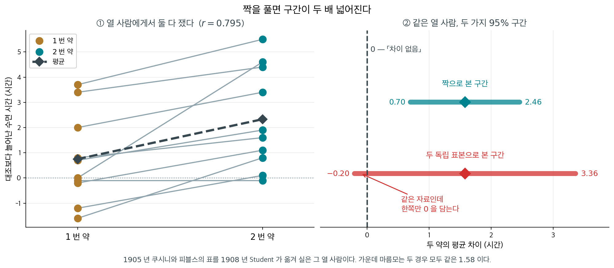
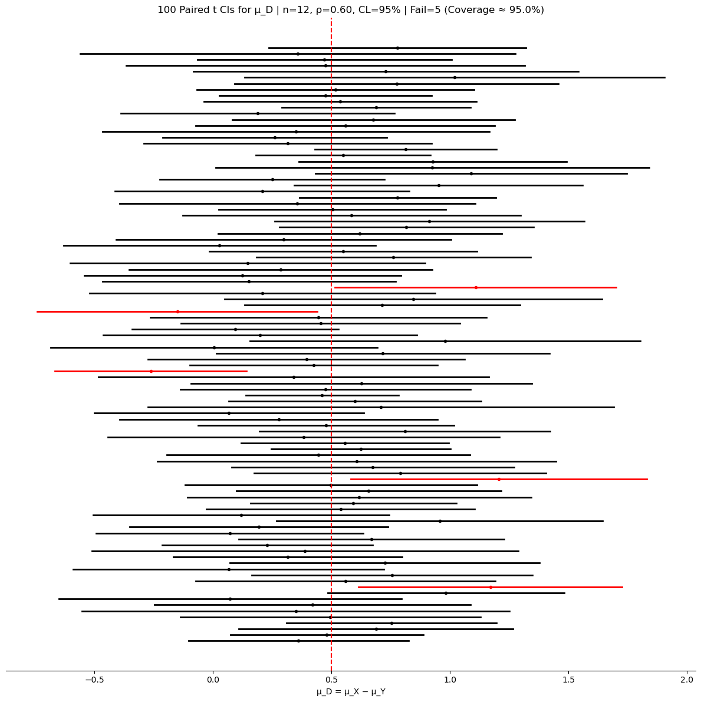
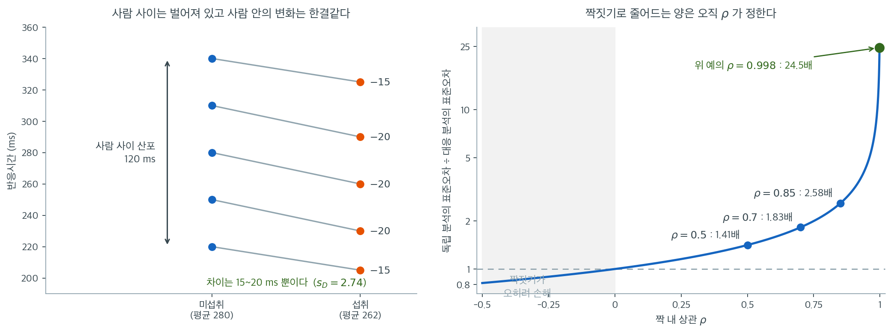
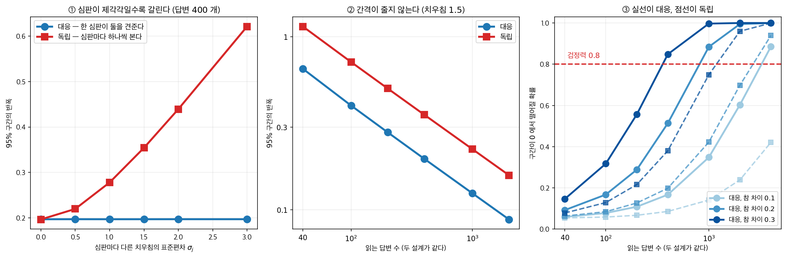

# μ_D (차이의 평균)의 신뢰구간

## 1. 대응표본 신뢰구간

사전과 사후, 왼쪽과 오른쪽, 처리와 대조 — 같은 단위에서 두 값을 얻는 설계가 있다. **짝을 정한 것은 자료가 아니라 설계이고, 짝 안의 상관이 이 설계의 이득을 만든다**(5.9절 [대응표본 차의 평균 표집분포](../../ch05/applications/dbar_paired.md)). 그때는 두 집단의 평균을 따로 재지 않고 **쌍마다 먼저 빼서** 수 하나로 줄인다.

$$
d_i = X_{i,1} - X_{i,2}, \qquad i = 1, \dots, n
$$

이 한 걸음이 이표본 문제를 **일표본 문제로** 바꾼다. $d_1, \dots, d_n$ 은 서로 독립인 $n$ 개의 수이고, 그 평균의 구간은 8.2절 [μ의 신뢰구간](../one_sample_intervals/ci_mu.md)이 세운 것과 글자까지 같다.

$$
\bar{d} \pm t_{1-\alpha/2, \, n-1} \cdot \frac{s_d}{\sqrt{n}}
$$

$\bar d$ 와 $s_d$ 는 차이들의 평균과 표준편차, $n$ 은 **쌍의 개수**이고 자유도는 $n-1$ 이다. 관측값은 $2n$ 개인데 자유도가 $n-1$ 인 것이 이 설계의 값이자 대가를 한꺼번에 보여 준다.

**빼는 것이 왜 이득인가.** $\operatorname{Var}(D) = \sigma_1^2 + \sigma_2^2 - 2\rho\sigma_1\sigma_2$ 이므로 짝 안의 상관 $\rho$ 가 양수이면 분산이 줄어든다. 같은 사람을 두 번 재면 사람마다 다른 기본 수준이 **차에서 사라지고**, 흔히 잡음의 가장 큰 몫이 그것이다. $\S 4$ 가 이 이득을 독립설계와 수로 견준다.

**대가는 자유도다.** 독립 이표본이라면 $n_1 + n_2 - 2$ 를 쓸 수 있는데 여기서는 $n-1$ 뿐이다. 그래서 $\rho$ 가 아주 작으면 짝짓기가 손해가 되고, 그 손익분기점을 $\S 4$ 가 계산한다.

구간이 서는 조건도 일표본과 같은 것 하나로 모인다. **차이 $D$ 가 정규여야 한다.** $X$ 와 $Y$ 를 각각 점검할 일이 아니다 — $X$ 와 $Y$ 가 둘 다 치우쳐 있어도 그 치우침이 상쇄되어 차가 정규에 가까워지는 일이 흔하고, 거꾸로 둘이 정규여도 분산이 크게 다르면 차의 정규성은 영향을 받지 않는다(정규의 차는 정규다). $n$ 이 작으면 이 가정이 그대로 포함확률에 남고, 커지면 중심극한정리가 받쳐 준다. $\sigma_d$ 를 아는 드문 자리에서는 $t$ 대신 $z$ 를 쓰며, $\sigma_d$ 를 모르고 $n$ 이 커서 $z$ 를 쓰는 것은 관행이자 근사다. 유한모집단이면 $n \le 0.1N$ 이 독립 근사를 받쳐 준다.

---

<div class="storybox" markdown>

**그림으로 보는 통계학 1.** 처음으로 $t$ 를 쓴 자료, 그리고 거기 붙은 두 가지 착오

$1905$ 년, 약리학자 **쿠시니와 피블스**가 미시간주 캘러머주의 한 정신병원에서 입원
환자들에게 수면제를 주고 잠든 시간을 쟀다. **광학이성질체** — 같은 분자인데 거울상인
두 형태 — 가 몸에서 다르게 듣는지 보려던 실험이다. 세 해 뒤 더블린의 고셋이 그 표를
가져다 자기가 만든 새 분포의 **첫 보기**로 삼는다. 통계학에서 $t$ 가 처음 쓰인 자리이고,
위의 식이 처음 돌아간 자리다.

고셋이 옮겨 실은 것은 그 가운데 열 사람이다. 수는 **대조보다 늘어난 수면 시간**이다.

| 환자 | $1$ | $2$ | $3$ | $4$ | $5$ | $6$ | $7$ | $8$ | $9$ | $10$ |
|---|---:|---:|---:|---:|---:|---:|---:|---:|---:|---:|
| $1$ 번 약 | $0.7$ | $-1.6$ | $-0.2$ | $-1.2$ | $-0.1$ | $3.4$ | $3.7$ | $0.8$ | $0.0$ | $2.0$ |
| $2$ 번 약 | $1.9$ | $0.8$ | $1.1$ | $0.1$ | $-0.1$ | $4.4$ | $5.5$ | $1.6$ | $4.6$ | $3.4$ |
| 차이 $d_i$ | $1.2$ | $2.4$ | $1.3$ | $1.3$ | $0.0$ | $1.0$ | $1.8$ | $0.8$ | $4.6$ | $1.4$ |

**착오 하나.** 고셋은 원논문의 열 이름을 잘못 읽었다. 그가 「같은 약의 두 이성질체」라고
적은 둘은 사실 **서로 다른 두 약**이었다. 피셔가 자기 교과서에 이 자료를 옮기면서 그
설명까지 함께 퍼졌고, 바로잡힌 것은 $1994$ 년 센과 리처드슨이 원논문과 하나씩 대조해
본 뒤다. $86$ 년이 걸렸다.

**착오 둘** 쪽이 이 절의 이야기다. 이 자료는 열 사람에게서 두 약을 **모두** 잰 짝
자료다. 그런데 뒤에 나온 교과서들은 종종 이것을 두 독립 표본처럼 다루었다. 같은 수가
두 가지 답을 낸다.

<figure markdown>
{ width="940" }
  <figcaption markdown>가운데 마름모는 두 경우 모두 같은 $1.58$ 시간이다. 갈린 것은 폭뿐이다.</figcaption>
</figure>

| 어떻게 보는가 | 자유도 | $95\%$ 구간 | 폭 | $0$ 을 담는가 |
|---|---:|---|---:|---|
| 짝으로 | $n - 1 = 9$ | $(0.70,\ 2.46)$ | $1.76$ | 아니오 |
| 두 독립 표본으로 | $2n - 2 = 18$ | $(-0.20,\ 3.36)$ | $3.57$ | 예 |

짝을 풀면 폭이 $2.03$ 배가 되고 결론이 뒤집힌다($p$ 값으로는 $0.0028$ 과 $0.079$ 다).
까닭은 왼쪽 그림에 있다 — 두 측정의 상관이 $r = 0.795$ 다. **잘 자는 사람은 어느 약에서도
잘 잔다.** 짝을 지어 빼면 그 「사람마다 다름」이 통째로 사라지고, 풀어 놓으면 전부
잡음으로 되돌아온다. 식으로는

$$
\operatorname{Var}(\bar D) = \frac{\sigma_1^2 + \sigma_2^2 - 2\rho\,\sigma_1\sigma_2}{n}
$$

의 마지막 항이 하는 일이다. 이 자료에서 $\sigma_1^2 + \sigma_2^2 = 7.21$ 인데 그 항이
$5.70$ 을 걷어 간다 — 분자의 $79\%$ 다.

그렇다고 짝이 언제나 이기는 것은 아니다. 짝을 지으면 자유도가 $2n-2$ 에서 $n-1$ 로
줄고, $\rho$ 가 $0$ 에 가까우면 그 손해만 남는다. 경계가 어디인지는 연습문제 7 이
$\rho$ 와 $n$ 의 함수로 따진다($n = 12$ 등분산에서 $\rho = 0.112$ 다). 설계를 고르는
일 자체는 $\S 4$ 가 맡는다. 설계를 자료보다 먼저 정해야 하는 까닭도 그것이다 — 짝으로 재어 놓고 독립으로 분석할 수는 있어도,
독립으로 재어 놓고 짝을 지을 수는 없다.

_확인한 곳 — 자료는 A. R. Cushny 와 A. R. Peebles, 「The action of optical isomers.
II: Hyoscines」, 『Journal of Physiology』 $32$($1905$) $501$–$510$ 쪽의 표이고,
Student, 「The probable error of a mean」, 『Biometrika』 $6$($1908$)에 첫 보기로 실렸다 ·
고셋이 열 이름을 잘못 읽어 서로 다른 두 약을 같은 약의 이성질체로 적었고 그 설명이
피셔를 거쳐 퍼졌다는 것은 S. Senn 과 W. Richardson, 「The first t-test」,
『Statistics in Medicine』 $13$($1994$) $785$–$803$ 쪽이 원논문과 대조해 밝힌 것이다 ·
실험이 캘러머주 정신병원의 입원 환자들을 대상으로 했다는 것도 같은 글에 있다 ·
표와 그림의 수는 모두 위 열 사람의 값으로 직접 계산했다_

</div>

---

<div class="exbox" markdown>

**보기 1.** <span class="diff easy" title="쉬움"></span> 대응표본 평균 차이의 신뢰구간. 같은 사람 $10$명에게서 처리 전후를 재어 차이 $d_i$ 를 얻었다.

$$
5,\ 3,\ 4,\ -2,\ 0,\ 6,\ -1,\ 2,\ 3,\ 4
$$

**(1)** $\mu_d$ 의 $95\%$ 신뢰구간을 손으로 구하시오. 관측값이 $20$개인데 자유도가 $9$ 인 까닭을 밝히시오.

**(2)** 짝짓기가 주는 이득을 식으로 적으시오. 이 자료에서 그 이득을 **수로** 계산할 수 있는가.

</div>

??? success "풀이"

    **(1) 차이를 만들면 일표본 문제가 된다.** 합이 $24$ 이므로 $\bar d = 2.4$ 이고, 편차의 제곱합이

    $$
    2.6^2 + 0.6^2 + 1.6^2 + 4.4^2 + 2.4^2 + 3.6^2 + 3.4^2 + 0.4^2 + 0.6^2 + 1.6^2 = 62.4
    $$

    이므로

    $$
    s_d^2 = \frac{62.4}{9} = 6.93333, \qquad s_d = 2.63312,
    \qquad \text{SE} = \frac{2.63312}{\sqrt{10}} = 0.83267
    $$

    이다. $t_{0.975,\,9} = 2.26216$ 이므로

    $$
    2.4 \pm 2.26216 \times 0.83267 = 2.4 \pm 1.88362 = (0.5164,\ 4.2836)
    $$

    **구간이 $0$ 을 담지 않는다.** 처리 전후에 차이가 있다는 증거다.

    **자유도가 $9$ 인 까닭.** 숫자는 $20$개지만 **독립인 정보 단위는 짝 $10$개**다. 짝 안의 두 측정은 같은 사람에게서 나와 강하게 상관되어 있으므로 서로 다른 정보가 아니다. 차이를 만드는 순간 표본은 크기 $10$ 인 일표본이 되고, 그중 하나를 $\bar d$ 를 쓰느라 잃어 $n - 1 = 9$ 다.

    이것을 "$20$개 관측"으로 세어 자유도를 $18$ 이나 $19$ 로 잡으면 임계값이 작아져 구간이 **조용히 좁아진다.** 짝 자료에서 가장 흔한 실수다.

    **(2) 이득은 상관에서 온다.** 차의 분산이

    $$
    \operatorname{Var}(X - Y) = \sigma_X^2 + \sigma_Y^2 - 2\rho\,\sigma_X\sigma_Y
    $$

    이므로 $\rho > 0$ 이면 $2\rho\sigma_X\sigma_Y$ 만큼 **깎인다.** 같은 자료를 짝을 무시하고 독립 이표본으로 다루면 $\sigma_X^2 + \sigma_Y^2$ 를 쓰는 셈이니, 표준오차의 비가

    $$
    \sqrt{\frac{\sigma_X^2 + \sigma_Y^2}{\sigma_X^2 + \sigma_Y^2 - 2\rho\sigma_X\sigma_Y}}
    \;\overset{\sigma_X = \sigma_Y}{=}\; \frac{1}{\sqrt{1-\rho}}
    $$

    다. 등분산이면 $\rho = 0.5$ 에서 $1.41$배, $\rho = 0.8$ 에서 $2.24$배 좁아진다. **짝짓기의 이득은 전부 이 한 항에 있다.**

    **그런데 이 자료로는 그 이득을 계산할 수 없다.** 주어진 것이 차이 $d_i$ 열 개뿐이고 원래의 짝 $(x_i, y_i)$ 가 없다. $\rho$ 를 알려면 두 열이 모두 있어야 한다. $s_d = 2.63312$ 하나로는 $\sigma_X$, $\sigma_Y$, $\rho$ 의 어떤 조합에서 나온 값인지 가릴 수 없다.

    **보고 지침이 여기서 나온다.** 대응자료를 보고할 때는 차이의 요약만 적지 말고 **두 측정의 표준편차와 상관(또는 원자료)** 을 함께 적는다. 그래야 읽는 사람이 짝짓기가 실제로 얼마나 벌어 주었는지 되짚을 수 있고, 뒤이은 연구가 표본크기를 계획할 수 있다.

    **(3) 확인.**

    ```python
    import numpy as np
    import scipy.stats as stats

    # 대응자료는 짝마다 차이를 먼저 만들고 나면
    # 그 뒤로는 **일표본** 문제와 완전히 같아진다.
    # 두 집단의 분산이나 상관을 따로 다룰 필요가 없다.
    differences = np.array([5, 3, 4, -2, 0, 6, -1, 2, 3, 4])
    n = len(differences)          # 관측값 20개가 아니라 짝 10개다
    confidence_level = 0.95

    mean_diff = np.mean(differences)
    std_diff = np.std(differences, ddof=1)
    standard_error = std_diff / np.sqrt(n)

    t_critical = stats.t.ppf(1 - (1 - confidence_level) / 2, n - 1)   # df = 짝의 개수 - 1
    margin_of_error = t_critical * standard_error

    confidence_interval = (mean_diff - margin_of_error, mean_diff + margin_of_error)
    print(f"{confidence_interval = }")
    ```

    출력:

    ```
    confidence_interval = (0.5163777394551403, 4.28362226054486)
    ```

    **(1)과 맞는다.** 구간 $(0.5164,\ 4.2836)$ 이다. 코드에서 `n = len(differences)` 가 $10$ 이고 `df = n - 1` 이 $9$ 인 것이 (1)에서 따진 자유도이며, **관측값 $20$개가 아니라 짝 $10$개를 세는 자리**다.

구간이 0을 담지 않으므로 치료 전후에 차이가 있다는 증거가 된다.

---

## 2. 짝을 무시하면 구간이 어떻게 넓어지는가

$\S 1$ 이 말한 이득을 한 자료에서 수로 본다. 아래 보기가 같은 자료에 대응 구간과 독립 이표본 구간을 **둘 다** 올려, 짝을 쓰지 않을 때 잃는 폭을 잰다.

<div class="exbox" markdown>

**보기 2.** <span class="diff easy" title="쉬움"></span> 치료 전후의 혈압. 한 연구자가 환자 10명의 혈압을 치료 전후로 측정했다. 차이(치료 전 빼기 치료 후)는 다음과 같다.

</div>

??? success "풀이"
    $$
    d = [5, 3, 4, -2, 0, 6, -1, 2, 3, 4]
    $$

    혈압의 평균 차이에 대한 95% 신뢰구간을 구성하라.

**풀이.**

$$
\bar{d} = \frac{5+3+4+(-2)+0+6+(-1)+2+3+4}{10} = \frac{24}{10} = 2.4
$$

$$
s_d \approx 2.633, \qquad df = 9, \qquad t_{0.975,9} \approx 2.262
$$

$$
\text{SE} = \frac{2.633}{\sqrt{10}} \approx 0.833, \qquad \text{ME} = 2.262 \times 0.833 \approx 1.884
$$

$$
\boxed{(0.516,\ 4.284)}
$$

치료 후 혈압의 참 평균 차이가 0.516과 4.284 사이에 있다고 95% 신뢰한다.

<div class="exbox" markdown>

**보기 3.** <span class="diff easy" title="쉬움"></span> 손가락 튕기기 속도. 참가자 5명이 각각 주로 쓰는 손과 그렇지 않은 손으로 10초 동안 손가락을 튕겼다. 순서는 동전 던지기로 무작위화했다.

| 참가자 | 주로 쓰는 손 | 그렇지 않은 손 | 차이 |
|---|---|---|---|
| Jeff | 44 | 35 | 9 |
| David | 42 | 37 | 5 |
| Kim | 40 | 32 | 8 |
| Charlotte | 37 | 31 | 6 |
| Jake | 42 | 36 | 6 |

평균 차이에 대한 95% 신뢰구간을 구성하고 해석하라.


</div>

??? success "풀이"

    $$
    \bar{d} = \frac{9+5+8+6+6}{5} = 6.8
    $$

    $$
    s_d \approx 1.643, \qquad n = 5, \qquad df = 4, \qquad t_{0.975,4} \approx 2.776
    $$

    $$
    \text{SE} = \frac{1.643}{\sqrt{5}} \approx 0.735, \qquad \text{ME} = 2.776 \times 0.735 \approx 2.04
    $$

    $$
    \boxed{(4.76,\ 8.84)}
    $$

    주로 쓰는 손과 그렇지 않은 손의 튕긴 횟수의 참 평균 차이가 $(4.76, 8.84)$ 안에 있다고 95% 신뢰한다.

    ```python
    import numpy as np
    from scipy import stats

    differences = np.array([9, 5, 8, 6, 6])
    n = len(differences)
    mean_diff = np.mean(differences)
    std_diff = differences.std(ddof=1)
    standard_error = std_diff / np.sqrt(n)

    df = n - 1
    confidence_level = 0.95
    alpha = 1 - confidence_level
    t_critical = stats.t(df).ppf(1 - alpha / 2)
    margin_of_error = t_critical * standard_error

    # 같은 구간을 두 가지 방식으로 적었다.
    # 양끝을 적는 쪽은 결론을 읽기 좋고, 중심 ± 오차한계는 정밀도를 읽기 좋다.
    print(f"95% CI: ({mean_diff - margin_of_error:.2f}, {mean_diff + margin_of_error:.2f})")
    print(f"95% CI: {mean_diff:.2f} ± {margin_of_error:.2f}")
    ```

    출력:

    ```
    95% CI: (4.76, 8.84)
    95% CI: 6.80 ± 2.04
    ```

    참가자가 다섯 명뿐인데도 구간이 0에서 멀찍이 떨어져 있다. 사람마다 손가락 튕기는 속도 자체는 크게 다르지만(37회에서 44회) **같은 사람 안에서의 차이**는 5에서 9로 훨씬 고르기 때문이다. 대응설계가 버는 것이 바로 이 부분이다.
<div class="exbox" markdown>

**보기 4.** <span class="diff easy" title="쉬움"></span> 두 시계 (네 단계). 한 러닝 잡지가 GPS로 거리를 재는 시계 A와 B를 비교했다. 러너 다섯 명이 각각 두 시계를 동시에 차고 10 km 코스를 달렸다.

| 러너 | 시계 A | 시계 B | 차이 (A−B) |
|---|---|---|---|
| 1 | 9.8 | 10.1 | −0.3 |
| 2 | 9.8 | 10.0 | −0.2 |
| 3 | 10.1 | 10.2 | −0.1 |
| 4 | 10.1 | 9.9 | 0.2 |
| 5 | 10.2 | 10.1 | 0.1 |

평균 차이에 대한 95% 신뢰구간을 구성하고 해석하라.


</div>

??? success "풀이"
    **1단계: 차이 계산.** $d = [-0.3, -0.2, -0.1, 0.2, 0.1]$.

    **2단계: 조건 확인.**

    - **단순확률표본:** 만족(잡지가 구독자를 무작위로 선정했다).
    - **독립성:** 만족(모집단에 구독자가 적어도 50명 있다).
    - **정규모집단:** $n = 5$로 작으므로 확인이 필요하다. 차이가 대칭이고 이상점이 없으므로 진행해도 안전하다.

    **3단계: 구간 구성.**

    ```python
    import numpy as np
    from scipy import stats

    watch_A = np.array([9.8, 9.8, 10.1, 10.1, 10.2])
    watch_B = np.array([10.1, 10, 10.2, 9.9, 10.1])
    d = watch_A - watch_B

    d_bar = d.mean()
    s = d.std(ddof=1)
    n = d.shape[0]
    df = n - 1

    confidence_level = 0.95
    alpha = 1 - confidence_level
    t_star = stats.t(df).ppf(1 - alpha / 2)
    margin_of_error = t_star * s / np.sqrt(n)
    print(f"{confidence_level:.0%} CI: {d_bar:.4f} ± {margin_of_error:.4f}")
    ```

    출력:

    ```
    95% CI: -0.0600 ± 0.2575
    ```

    **4단계: 구간 해석.** 95% 신뢰수준에서 두 시계가 보고한 거리의 평균 차이는 구간 $(-0.32, 0.20)$ km 안에 있을 것으로 본다. 구간이 0을 포함하므로 시계 A와 B가 보고한 거리 사이에 유의한 차이는 없다.
---

## 3. 짝을 무시해도 포함률은 지켜진다

앞 절이 폭을 보았으니 이제 포함률을 본다. **여기서 놀라운 것은 짝을 무시해도 포함률이 무너지지 않는다는 것**이다 — 독립 구간은 넓어질 뿐 명목값을 지킨다. 그래서 짝짓기의 값은 「틀리지 않게 해 주는 것」이 아니라 **「같은 돈으로 더 좁은 구간을 주는 것」**이다. 거꾸로 독립 자료에 대응 구간을 써도 포함률은 지켜진다 — 자유도만 잃어 조금 넓어진다. **어느 쪽으로 틀려도 구간이 좁아지지는 않는다**는 것이 요점이고, $\S 4$ 의 쪽지가 그 비대칭을 수로 적는다.

<div class="exbox" markdown>

**보기 5.** <span class="diff easy" title="쉬움"></span> 대응표본 신뢰구간의 포함확률. 짝 안의 두 측정이 $\sigma_X = 1.0$, $\sigma_Y = 1.2$, 상관 $\rho = 0.6$ 인 이변량정규를 따르고 $\mu_X - \mu_Y = 0.5$ 다. 짝의 개수는 $n = 12$, 명목 $95\%$ 다.

**(1)** $\sigma_D$ 를 구하시오. 대응 $t$-구간의 포함확률은 얼마인가.

**(2)** 같은 자료를 짝을 **무시하고** 독립 이표본으로 다루면 구간이 얼마나 넓어지는가. 표준오차의 비와 **폭의 비**를 각각 구하시오.

**(3)** 짝짓기가 언제 손해가 되는가. $n = 12$, 등분산에서 손익분기 $\rho$ 를 구하시오.

</div>

??? success "풀이"

    **(1) 상관이 분산을 깎는다.**

    $$
    \sigma_D = \sqrt{\sigma_X^2 + \sigma_Y^2 - 2\rho\sigma_X\sigma_Y}
    = \sqrt{1 + 1.44 - 2(0.6)(1.0)(1.2)}
    = \sqrt{2.44 - 1.44} = 1.00
    $$

    이다. 차이 $D_i = X_i - Y_i$ 는 정규이고 서로 독립이므로, 차이에 $t$-구간을 적용한 것은 **일표본 $t$-구간**이다. 따라서 포함확률은 추축량에 의해 **정확히 $0.95$** 이고 $n$ 과 $\rho$ 에 의존하지 않는다.

    **(2) 표준오차의 비는 $1.56$, 폭의 비는 $1.47$ 이다.** 짝을 무시하면 $\sqrt{\sigma_X^2 + \sigma_Y^2} = \sqrt{2.44} = 1.56205$ 를 쓰게 되므로

    $$
    \frac{\text{SE}_{\text{독립}}}{\text{SE}_{\text{짝}}} = \frac{1.56205}{1.00} = 1.56205
    $$

    **그러나 폭의 비는 이보다 작다.** 짝을 무시하면 자유도가 $n - 1 = 11$ 에서 $2n - 2 = 22$ 로 **늘어나** 임계값이 $2.20099$ 에서 $2.07387$ 로 줄기 때문이다.

    $$
    \frac{\text{폭}_{\text{독립}}}{\text{폭}_{\text{짝}}}
    = \frac{2.07387 \times 1.56205/\sqrt{12}}{2.20099 \times 1.00/\sqrt{12}}
    = \frac{1.87032}{1.27074} = 1.47184
    $$

    **짝짓기는 상관을 얻는 대신 자유도를 내준다.** 여기서는 $\rho = 0.6$ 이 커서 이득이 압도하지만 그 둘이 겨루고 있다는 사실이 (3)의 질문으로 이어진다.

    **(3) 손익분기는 $\rho = 0.112$ 다.** 등분산 $\sigma_X = \sigma_Y = \sigma$ 라 하면 $\sigma_D = \sigma\sqrt{2-2\rho}$ 이고 독립 쪽은 $\sigma\sqrt2$ 이므로, 두 폭이 같아지는 조건은

    $$
    t_{0.025,\,2n-2}\,\sigma\sqrt2 = t_{0.025,\,n-1}\,\sigma\sqrt{2-2\rho}
    \iff \sqrt{1-\rho} = \frac{t_{0.025,\,2n-2}}{t_{0.025,\,n-1}}
    $$

    이다. $n = 12$ 에서 오른쪽이 $2.07387/2.20099 = 0.94225$ 이므로

    $$
    \rho^\ast = 1 - 0.94225^2 = 0.1122
    $$

    다. **$\rho$ 가 $0.112$ 보다 크면 짝짓기가 이기고 작으면 진다.** 몇 가지 $\rho$ 에서 폭의 비(독립/짝)는 이렇다.

    | $\rho$ | $0$ | $0.1$ | $0.1122$ | $0.2$ | $0.5$ | $0.8$ |
    |---|---|---|---|---|---|---|
    | 폭의 비 | $0.942$ | $0.993$ | $1.000$ | $1.054$ | $1.333$ | $2.107$ |

    $\rho = 0$ 이면 짝지은 쪽이 오히려 $6\%$ 넓다. 자유도만 절반으로 잃고 얻는 것이 없기 때문이다.

    **실무에서 문턱이 낮다는 점이 중요하다.** $0.112$ 는 매우 약한 상관이고, 같은 개체를 두 번 재는 설계라면 거의 언제나 넘는다. **그러므로 짝지을 수 있으면 짝지어라.** 다만 문턱은 $n$ 에 따라 달라진다. $n$ 이 커지면 두 임계값이 모두 $1.96$ 으로 수렴해 $\rho^\ast \to 0$ 이 되므로, 큰 표본에서는 상관이 조금만 있어도 짝짓기가 이긴다.

    **(4) 그림.**

    ```python
    #!/usr/bin/env python3
    """대응표본 평균 차이의 신뢰구간을 세 방법으로 만들어 포함확률을 비교한다.

    짝마다 차이를 먼저 구하고 나면 일표본 문제가 된다. 짝지음이 없애 주는
    개체 간 변동이 구간을 얼마나 좁히는지 함께 본다.
    """

    import numpy as np
    import matplotlib.pyplot as plt
    from scipy.stats import t, norm

    plt.rcParams["font.sans-serif"] = ["NanumGothic", "Apple SD Gothic Neo", "Malgun Gothic"]
    plt.rcParams["font.family"] = "sans-serif"
    plt.rcParams["axes.unicode_minus"] = False

    rng_seed = 42        # 아래 그림을 재현하려면 고정한다
    n_simulations = 100
    n = 12
    mu_x, mu_y = 0.5, 0.0
    sigma_x, sigma_y = 1.0, 1.2
    rho = 0.6
    alpha = 0.05
    method = "t"  # 't' | 'z_known' | 'z_plugin'


    def main():
        rng = np.random.default_rng(rng_seed)
        delta_true = mu_x - mu_y
        var_d_true = sigma_x**2 + sigma_y**2 - 2 * rho * sigma_x * sigma_y
        sigma_d_true = np.sqrt(max(var_d_true, 0.0))

        cov = rho * sigma_x * sigma_y
        Sigma = np.array([[sigma_x**2, cov], [cov, sigma_y**2]])
        L = np.linalg.cholesky(Sigma)

        df = n - 1
        t_star = t.ppf(1 - alpha / 2.0, df=df)
        z_star = norm.ppf(1 - alpha / 2.0)

        lowers = np.empty(n_simulations)
        uppers = np.empty(n_simulations)
        centers = np.empty(n_simulations)

        for i in range(n_simulations):
            z = rng.standard_normal(size=(2, n))
            xy = (L @ z).T
            x = xy[:, 0] + mu_x
            y = xy[:, 1] + mu_y
            d = x - y
            dbar = d.mean()
            s_d = d.std(ddof=1)

            if method == "t":
                se, crit = s_d / np.sqrt(n), t_star
            elif method == "z_known":
                se, crit = sigma_d_true / np.sqrt(n), z_star
            else:
                se, crit = s_d / np.sqrt(n), z_star

            lowers[i] = dbar - crit * se
            uppers[i] = dbar + crit * se
            centers[i] = dbar

        covered = (lowers <= delta_true) & (delta_true <= uppers)
        n_fail = int((~covered).sum())
        coverage_pct = 100.0 * covered.mean()

        fig, ax = plt.subplots(figsize=(12, 12))
        for i in range(n_simulations):
            color = "k" if covered[i] else "r"
            ax.plot([lowers[i], uppers[i]], [i, i], lw=2, color=color)
            ax.plot(centers[i], i, marker="o", ms=3, color=color)

        ax.axvline(delta_true, linestyle="--", linewidth=1.5, color="r")
        ax.set_title(
            f"{n_simulations} Paired {method} CIs for μ_D | n={n}, ρ={rho:.2f}, "
            f"CL={int((1 - alpha) * 100)}% | Fail={n_fail} (Coverage ≈ {coverage_pct:.1f}%)")
        ax.set_yticks([])
        for sp in ["left", "right", "top"]:
            ax.spines[sp].set_visible(False)
        ax.set_xlabel("μ_D = μ_X − μ_Y")
        plt.tight_layout()
        plt.show()


    if __name__ == "__main__":
        main()
    ```

    

    **$100$개 중 $95$개가 담았다.** (1)의 참값 $0.95$ 와 맞지만, $100$회의 표준오차가 $0.0218$ 이므로 이 일치는 운이 좋은 것이다. 포함률은 추축량이 이미 정했고 모의실험이 보여 주는 것은 구간의 **모양**이다.

    **폭이 제각각이다.** 폭이 $2t_{0.025,\,11}s_D/\sqrt{12} = 1.27074\,s_D$ 로 $s_D$ 하나에만 비례하는데, $n = 12$ 에서 $s_D$ 가 크게 흔들린다. $\sigma_D = 1$ 이므로 평균 폭은 $1.27074 \times c_4 = 1.24$ 쯤이다.

    **그림이 보여 주지 않는 것이 (2)의 이득이다.** 여기 그려진 구간들은 짝짓기를 **이미 쓴** 결과다. 같은 자료를 짝 없이 다뤘다면 모든 선이 $1.47$배 길어졌을 텐데, 그 비교는 그림에 없고 (2)의 계산에만 있다. 짝짓기의 값은 "구간이 참값을 담는가"가 아니라 "얼마나 좁은가"에 나타나며, **포함률은 둘 중 어느 쪽에서도 $0.95$ 로 같다.**

포함확률 95.0%로 명목값과 맞는다.

이 모의실험에서 짝 안의 상관을 $\rho = 0.6$으로 준 것이 핵심이다. 차이의 표준편차는

$$
\sigma_D = \sqrt{\sigma_X^2 + \sigma_Y^2 - 2\rho\sigma_X\sigma_Y} = \sqrt{1 + 1.44 - 1.44} = 1.00
$$

인데, 같은 자료를 짝을 무시하고 독립 이표본으로 다뤘다면 $\sqrt{\sigma_X^2 + \sigma_Y^2} = 1.562$가 된다. 상관을 살린 덕분에 구간이 **1.56배 좁아진다**. 짝지을 수 있는 자료를 짝짓지 않는 것은 자료를 절반 버리는 것과 비슷한 손해다.

$\rho$를 0으로 바꿔 다시 돌려 보면 이 이득이 사라지고, 음수로 주면 오히려 손해가 된다는 것도 확인할 수 있다.

---

짝짓기의 이득이 $\rho$ 에 어떻게 매여 있는지는 $\rho$ 를 **훑어 보아야** 보인다. 손익분기 하나가 아니라 곡선 전체를 본다.

<div class="exbox" markdown>

**보기 6.** <span class="diff easy" title="쉬움"></span> 대응표본 구간 모의실험. 짝 안의 두 측정이 $\sigma_X = 1.0$, $\sigma_Y = 1.2$, 상관 $\rho$ 인 이변량정규를 따르고 $\mu_X - \mu_Y = 0.5$, $n = 12$ 다.

**(1)** 세 방법($t$, $\sigma_D$ 를 아는 $z$, $s_D$ 를 꽂은 $z$)의 포함률을 닫힌 꼴로 적으시오. $\rho$ 에 의존하는가.

**(2)** $\rho = -0.3,\ 0,\ 0.6,\ 0.9$ 에서 $\sigma_D$ 와 $t$-구간의 **기대 폭**을 구하시오.

**(3)** 모의실험으로 (1)과 (2)를 확인하시오.

</div>

??? success "풀이"

    **(1) 짝을 지으면 일표본 문제가 된다.** $D_i = X_i - Y_i$ 가 서로 독립인 정규확률변수이고

    $$
    D_i \sim N\!\left(\mu_X - \mu_Y,\ \sigma_D^2\right),
    \qquad \sigma_D^2 = \sigma_X^2 + \sigma_Y^2 - 2\rho\sigma_X\sigma_Y
    $$

    이다. 짝 안의 상관은 **$\sigma_D$ 라는 수 하나에 전부 흡수되고** 그 뒤로는 자취를 감춘다. 그러므로

    | 방법 | 포함률 | $\rho$ 에 의존하는가 |
    |---|---|---|
    | $t$ | 정확히 $0.95$ | **아니다** |
    | $z$-known | 정확히 $0.95$ | **아니다** |
    | $z$-plugin | $2F_{t_{11}}(1.96) - 1 = 0.92418$ | **아니다** |

    세 값 모두 $\rho$ 와 무관하다. $t$ 는 추축량 $(\bar D - \mu_D)/(S_D/\sqrt n) \sim t_{n-1}$ 때문에, $z$-known 은 $\bar D$ 가 정확히 정규이고 표준오차가 상수이기 때문에, $z$-plugin 은 담는 사건이 $|t_{11}| \le 1.96$ 이기 때문이다.

    **$z$-plugin 만 $0.95$ 에 못 미친다.** $n = 12$ 에서 $t_{0.975,\,11} = 2.20099$ 인데 $1.96$ 을 쓰니 구간이 $11\%$ 좁다.

    **(2) 상관은 폭만 바꾼다.** $t$-구간의 폭은 $2t_{0.025,\,11}S_D/\sqrt{12} = 1.27074\,S_D$ 이고 $E[S_D] = c_4\sigma_D$ 이므로($n = 12$ 에서 $c_4 = 0.97756$)

    $$
    E[\text{폭}] = 1.27074 \times 0.97756 \times \sigma_D = 1.24222\,\sigma_D
    $$

    다. $\sigma_D = \sqrt{2.44 - 2.4\rho}$ 이므로

    | $\rho$ | $\sigma_D$ | 기대 폭 |
    |---|---|---|
    | $-0.3$ | $1.77764$ | $2.20822$ |
    | $0$ | $1.56205$ | $1.94041$ |
    | $0.6$ | $1.00000$ | $1.24222$ |
    | $0.9$ | $0.52915$ | $0.65732$ |

    **$\rho$ 가 $-0.3$ 에서 $0.9$ 로 가는 동안 폭이 $3.4$배 줄어든다.** 그런데 (1)에 따르면 **포함률은 넷 모두 정확히 $0.95$ 다.** 상관은 구간의 **정확성**이 아니라 **정밀도**를 바꾼다. 음의 상관이면 짝짓기가 오히려 손해라는 것도 이 표에서 보인다.

    **(3) 확인.**

    ```python
    import numpy as np
    import matplotlib.pyplot as plt
    from scipy.stats import t, norm
    from scipy.special import gammaln

    n_simulations = 100
    n = 12
    mu_x, mu_y = 0.5, 0.0
    sigma_x, sigma_y = 1.0, 1.2
    rho = 0.6
    alpha = 0.05
    method = "t"  # 't' | 'z_known' | 'z_plugin'

    rng = np.random.default_rng(42)      # 아래 출력과 그림을 재현하려면 고정한다

    delta_true = mu_x - mu_y
    var_d_true = sigma_x**2 + sigma_y**2 - 2 * rho * sigma_x * sigma_y
    sigma_d_true = np.sqrt(var_d_true)

    # 상관이 있는 짝 (X, Y)를 만들어야 하므로 공분산행렬을 세우고
    # Cholesky 분해 L을 쓴다. 독립인 표준정규 z에 L을 곱하면
    # 공분산이 Sigma인 자료가 된다. Cov(Lz) = L L^T = Sigma 이기 때문이다.
    cov = rho * sigma_x * sigma_y
    Sigma = np.array([[sigma_x**2, cov], [cov, sigma_y**2]])
    L = np.linalg.cholesky(Sigma)

    df = n - 1
    t_star = t.ppf(1 - alpha / 2, df=df)
    z_star = norm.ppf(1 - alpha / 2)

    lowers = np.empty(n_simulations)
    uppers = np.empty(n_simulations)
    centers = np.empty(n_simulations)

    for i in range(n_simulations):
        z_vals = rng.standard_normal(size=(2, n))
        xy = (L @ z_vals).T
        x = xy[:, 0] + mu_x
        y = xy[:, 1] + mu_y
        d = x - y
        dbar = d.mean()
        s_d = d.std(ddof=1)

        if method == "t":
            se, crit = s_d / np.sqrt(n), t_star
        elif method == "z_known":
            se, crit = sigma_d_true / np.sqrt(n), z_star
        else:
            se, crit = s_d / np.sqrt(n), z_star

        lowers[i] = dbar - crit * se
        uppers[i] = dbar + crit * se
        centers[i] = dbar

    covered = (lowers <= delta_true) & (delta_true <= uppers)
    coverage_pct = 100.0 * covered.mean()
    print(f"Paired {method} coverage: {coverage_pct:.1f}%")

    # (2) rho 를 바꾸면 폭만 달라지고 포함률은 그대로다.
    print(f"\n{'rho':>6}{'sigma_D':>10}{'기대폭':>10}{'모의 평균폭':>12}{'포함':>6}")
    for r in (-0.3, 0.0, 0.6, 0.9):
        sd_r = np.sqrt(sigma_x**2 + sigma_y**2 - 2 * r * sigma_x * sigma_y)
        Lr = np.linalg.cholesky(np.array([[sigma_x**2, r * sigma_x * sigma_y],
                                          [r * sigma_x * sigma_y, sigma_y**2]]))
        rng_r = np.random.default_rng(42)
        hit, wsum = 0, 0.0
        for _ in range(n_simulations):
            d_r = (Lr @ rng_r.standard_normal((2, n))).T
            d_r = (d_r[:, 0] + mu_x) - (d_r[:, 1] + mu_y)
            half = t_star * d_r.std(ddof=1) / np.sqrt(n)
            hit += abs(d_r.mean() - delta_true) <= half
            wsum += 2 * half
        # 기대 폭 = 2 t* c4 sigma_D / sqrt(n),  c4 = E[S]/sigma
        c4 = np.exp(gammaln(n / 2) - gammaln((n - 1) / 2)) * np.sqrt(2 / (n - 1))
        exp_w = 2 * t_star * c4 * sd_r / np.sqrt(n)
        print(f"{r:>6.1f}{sd_r:>10.5f}{exp_w:>10.5f}{wsum / n_simulations:>12.5f}{hit:>6d}")
    ```

    출력:

    ```
    Paired t coverage: 95.0%

       rho   sigma_D       기대폭      모의 평균폭    포함
      -0.3   1.77764   2.20822     2.13020    95
       0.0   1.56205   1.94041     1.88188    94
       0.6   1.00000   1.24222     1.23565    95
       0.9   0.52915   0.65732     0.67048    98
    ```

    **(1)과 (2)가 모두 맞는다.** $\sigma_D$ 와 기대 폭이 손으로 구한 표와 같고, 모의 평균 폭도 $2$–$3\%$ 안에서 따라온다($100$개 평균이므로 이 정도는 몬테카를로 오차다).

    **포함 개수가 $95,\ 94,\ 95,\ 98$ 로 $\rho$ 에 따라 추세를 보이지 않는다.** 참값은 넷 모두 정확히 $0.95$ 이고, $100$회의 표준오차가 $0.0218$ 이므로 가장 벗어난 $98$ 도 $1.4$ 표준오차 안이다. **상관이 $-0.3$ 에서 $0.9$ 로 가면서 폭은 $3.4$배 줄었지만 포함률은 제자리다.**

    **이것이 짝짓기를 보는 바른 눈이다.** 짝지어도 안 지어도 구간은 약속한 $95\%$ 를 지킨다. 달라지는 것은 **그 약속을 얼마나 좁은 구간으로 지키는가** 하나뿐이다.

---

## 4. 짝지을 것인가 — 설계를 고르는 문제

여기까지는 **짝이 이미 지어진** 자료를 다루었다. 그 짝을 지을지 말지는 자료를 보기
**전에** 정해야 하는 문제이고, 답은 $\S 1$ 이 적은 한 항에 들어 있다 — 짝 안의 상관
$\rho$ 다.

**대응 설계**에서는 각 단위가 두 조건 모두에서 값을 주거나(반복측정·교차 시험), 두 단위를
교란변수로 짝지어 서로 다른 조건에 배정한다(짝지은 쌍). 피험자 내 차이에 초점을 맞추면
흔히 잡음의 지배적인 원천인 **피험자 간 변동성이 제거된다.**

**독립 설계**에서는 각 집단에 서로 다른 단위가 들어간다. 짝지을 필요도 같은 사람에게 두
처리를 할 필요도 없고(**이월 효과**가 없다), 집단별 표본크기가 같지 않아도 된다. 대가는
피험자 간 변동성이 모두 표준오차에 들어간다는 것이다.

$\S 1$ 에서 본 대로 두 분산의 비가 $1 - \rho$ 이고 표준오차의 비가 $1/\sqrt{1-\rho}$ 이므로,
**짝 내 상관이 양수이면 짝짓기가 도움이 된다.** 다만 자유도를 $2n-2$ 에서 $n-1$ 로
내주므로 $\rho$ 가 아주 작으면 그 손해만 남는다(연습문제 7).

한 연구자가 피험자 $n = 5$명의 반응시간(밀리초)을 카페인 섭취 여부라는 두 조건에서 측정했다.

| 피험자 | 미섭취 ($X_{i1}$) | 섭취 ($X_{i2}$) | 차이 ($D_i$) |
|---|---|---|---|
| 1 | 250 | 230 | 20 |
| 2 | 310 | 290 | 20 |
| 3 | 280 | 260 | 20 |
| 4 | 340 | 325 | 15 |
| 5 | 220 | 205 | 15 |

**대응 분석.** 차이는 $\{20, 20, 20, 15, 15\}$로 $\bar{D} = 18$, $s_D = 2.74$이다. 표준오차는

$$
\text{SE}_{\text{paired}} = \frac{s_D}{\sqrt{n}} = \frac{2.74}{\sqrt{5}} \approx 1.22
$$

**독립 분석(짝짓기를 무시한 경우).** 두 집단을 독립표본으로 취급하면 $\bar{X}_1 = 280$, $\bar{X}_2 = 262$이고 $s_1 = 47.43$, $s_2 = 47.51$이다. 합동 표준오차는

$$
\text{SE}_{\text{indep}} = s_p\sqrt{\frac{1}{n_1} + \frac{1}{n_2}} = 47.47 \times \sqrt{\frac{2}{5}} \approx 30.02
$$

대응 표준오차(1.22)는 독립 표준오차(30.02)보다 약 25배 작다. 짝짓기를 무시하면 기저 반응시간의 큰 피험자 간 변동성(220 ms에서 340 ms까지)이 지배하지만, 피험자 내 차이에서는 그것이 거의 완전히 상쇄된다.

!!! tip "실무 지침"
    짝짓기의 이득은 피험자 간 변동성이 피험자 내 변동성에 비해 클 때 가장 크다. 위 예에서 피험자들의 기저 반응시간은 100 ms 넘게 차이 나지만 처리 효과는 놀랄 만큼 일관되어(15–20 ms) 짝 내 상관이 매우 높다.



왼쪽 그림이 위 보기에서 실제로 일어난 일이다. 피험자들의 기저 반응시간은 220 ms에서 340 ms까지 120 ms나 벌어져 있다. 독립표본 분석은 이 세로 방향의 산포를 전부 잡음으로 취급한다. 그래서 $s_1 = 47.43$, $s_2 = 47.51$이라는 큰 값이 나오고 표준오차가 $30.02$까지 부푼다. 그런데 연결선을 보면 **다섯 개가 거의 평행하다.** 사람마다 출발점은 달라도 카페인이 깎아 내는 양은 15에서 20 ms로 한결같고, 그래서 차이의 표준편차는 $s_D = 2.74$에 그친다. 대응 표준오차는 $1.22$다.

오른쪽 그림은 이 이득의 정체가 오직 짝 내 상관 $\rho$ 하나라는 것을 보여 준다. $\sigma_1 = \sigma_2$일 때 두 분산의 비가 $1 - \rho$이므로, 표준오차의 비는 $1/\sqrt{1-\rho}$가 된다. $\rho = 0.5$면 $1.41$배, $\rho = 0.7$이면 $1.83$배, $\rho = 0.85$면 $2.58$배다. 위 카페인 자료의 상관은 $\rho = 0.998$인데, 여기에 공식을 넣으면 $1/\sqrt{1 - 0.998} = 24.5$배가 나온다. 앞에서 직접 계산한 $30.02 / 1.22 \approx 24.5$와 정확히 같다. **"25배"라는 인상적인 숫자는 우연이 아니라 $\rho$가 1에 붙어 있다는 사실의 다른 표현이다.**

곡선의 모양도 읽어 둘 만하다. $\rho$가 0.5까지 올라가도 이득은 1.41배에 불과하다가, 0.9를 넘어서면서 가파르게 치솟는다. 짝짓기가 **극적으로** 이기는 경우는 짝 내 상관이 아주 높을 때뿐이라는 뜻이다. 반대로 회색으로 칠한 $\rho < 0$ 영역에서는 비가 1보다 작아진다. 짝짓기가 오히려 손해라는 말이고, 짝지을 근거가 없는 대상을 억지로 짝지으면 자유도만 잃는다($n$쌍의 대응 분석은 자유도가 $n-1$, 독립 분석은 $2n-2$다).

그러므로 설계를 고를 때 물어야 할 질문은 "짝지을 수 있는가"가 아니라 **"짝지으면 $\rho$가 얼마나 될 것 같은가"**이다. 같은 사람을 두 번 재는 전후 설계는 대개 $\rho$가 높아 안전한 선택이고, 나이나 성별 같은 약한 예측변수로 짝지은 설계는 $\rho$가 0.2~0.3에 그쳐 이득이 10~20% 수준에 머물 수 있다.

<div class="aibox" markdown>

**AI로 보는 통계학 1.** 점수를 매기지 않고 둘을 나란히 놓는 까닭

설계를 고르는 일이 서비스의 화면 생김새까지 정해 버린 자리가 있다.

$2024$ 년 치앙·정·성·안젤로풀로스·리 등이 「챗봇 아레나」를 발표했다. 언어모형을 사람의
선호로 줄 세우는 공개 플랫폼이고, 논문을 쓸 무렵 사용자 약 $9$ 만 명에게서 투표
$24$ 만 건을 모은 참이었다. 화면은 단순하다. 사용자가 아무 질문이나 적으면 **이름을
가린 두 모형**이 각각 답하고, 사용자는 더 나은 쪽을 고른다. 점수를 매기는 칸은 없다.

왜 점수를 받지 않는가. 논문이 그 선택의 까닭을 한 문장으로 적어 둔다.

> **「우리는 많은 사용자에게서 피드백을 모으므로, 서로 다른 사람들에게 일관된 채점
> 기준을 세우는 것이 어렵다. 따라서 우리는 사용자에게 절대 점수를 요구하는 대신, 두
> 모형의 응답을 견주어 더 나은 쪽에 투표하기만 하면 되는 쌍별 비교 방식을 택한다.」**

이것이 이 절의 물음 그대로다. 심판마다 제 나름의 자가 있어서 어떤 이는 후하게,
어떤 이는 박하게 준다. **그 치우침은 모형의 실력이 아니라 심판의 것**인데, 독립 설계는
그것을 고스란히 짊어진다. 한 사람이 둘을 나란히 보면 그 몫이 차에서 지워진다.

얼마나 지워지는지 재어 보았다. 모형마다 남는 흔들림의 표준편차를 $\sigma_e = 1$ 로 두고
심판의 치우침을 $\sigma_j$ 로 키워 가며 보되, **두 설계가 읽는 답변 수를 똑같이 맞췄다** —
대응은 심판 $n$ 명이 각자 둘을 읽고, 독립은 심판 $2n$ 명이 각자 하나를 읽는다. 이렇게
맞추지 않으면 대응 쪽이 사람 품을 두 배 쓰고 이긴 것이 된다.



- **①** $\sigma_j = 0$ 이면 두 설계가 똑같다(비 $1.00$). 심판이 모두 같은 자를 쓴다면
  짝지을 까닭이 없다. 그런데 치우침이 흔들림만 해지면($\sigma_j = 1$) 독립 쪽 구간이
  $1.41$ 배, $\sigma_j = 1.5$ 에서 $1.80$ 배, $\sigma_j = 3$ 에서 **$3.15$ 배** 넓어진다.
  값이 정확히 $\sqrt{1 + \sigma_j^2/\sigma_e^2}$ 다.
- **②** 답변을 더 읽으면 따라잡히는가. 두 선이 **나란히 내려갈 뿐 간격이 그대로다**
  (비가 $40$ 개에서 $1.76$, $2{,}000$ 개에서 $1.80$). 설계가 주는 이득은 상수배이고,
  표본을 늘려서 메우는 것이 아니다. 독립 설계로 대응 설계를 따라잡으려면 답변을
  $1.80^2 \approx 3.2$ 배 읽어야 한다.
- **③** 참 차이 $0.2$ 를 구간이 $0$ 에서 떼어 놓을 확률이다. 대응은 답변 $400$ 개에서
  $0.51$, $1{,}000$ 개에서 $0.88$ 인데 독립은 같은 자리에서 $0.20$, $0.42$ 다. 점선이
  실선에 닿으려면 가로축을 세 배 넘게 가야 한다.

아레나가 쌍별 비교를 고른 것은 통계적으로 세련되어 보이려는 선택이 아니라 **같은 품으로
더 좁은 구간을 얻는 선택**이다. 덧붙여 그들은 실력이 비슷해 불확실성이 큰 짝에 투표를
몰아주는 비균등 표집을 써서 「안정된 결과에 이르는 데 필요한 투표 수를 줄인다」고 적는다.
설계를 고르는 일과 표본을 어디에 쓸지 정하는 일이 같은 물음의 앞뒤인 셈이다.

_확인한 곳 — Chiang, Zheng, Sheng, Angelopoulos, Li, Li, Zhu, Zhang, Jordan, Gonzalez,
Stoica (2024) *Chatbot Arena: An Open Platform for Evaluating LLMs by Human Preference*
(arXiv:2403.04132) 의 $3.1$ 절 「Interface」에서 인용한 문장, 투표 약 $24$ 만 건과 사용자
약 $9$ 만 명, 이름을 가린 두 모형에 사용자가 아무 질문이나 넣고 더 나은 쪽을 고르는 화면,
그리고 $3$ 절의 비균등 표집으로 필요한 투표 수를 줄인다는 서술. 그림과 표의 수는 모두
직접 계산한 값이며 아레나의 측정값이 아니다_

</div>

### 결정 지침

| 요인 | 대응이 유리 | 독립이 유리 |
|---|---|---|
| 짝 내 상관 $\rho$ | 높음 ($\rho > 0$) | 0에 가깝거나 음수 |
| 이월 효과 | 없거나 통제 가능 | 있고 통제 불가 |
| 실행 여건 | 두 번 측정이 가능 | 재측정이 비현실적 |
| 짝짓기 변수 | 좋은 예측변수가 있음 | 강한 예측변수가 없음 |
| 표본크기 | 제한적(짝짓기가 더 많은 정보를 뽑아낸다) | 넉넉함 |

!!! warning "틀리는 방향이 한쪽뿐이다 — 구간은 좁아지지 않는다"
    설계와 방법을 섞으면 어떻게 되는지는 재어 보면 분명하다. $n = 12$ 쌍, 참 차이
    $0.5$, 명목 $95\%$ 에서 되풀이 $20$ 만 회로 세었다.

    ```python
    import numpy as np
    from scipy import stats

    rng = np.random.default_rng(7)
    M, n = 200_000, 12          # 되풀이 20만, 쌍 12 개
    delta = 0.5                 # 참 평균 차이

    def coverage(x, y, how):
        """how='paired' 면 쌍마다 빼서 일표본 t, 'indep' 면 짝을 무시한 웰치."""
        if how == "paired":
            d = x - y
            center = d.mean(axis=1)
            se = d.std(axis=1, ddof=1) / np.sqrt(n)
            df = n - 1
        else:
            v1, v2 = x.var(axis=1, ddof=1) / n, y.var(axis=1, ddof=1) / n
            center = x.mean(axis=1) - y.mean(axis=1)
            se = np.sqrt(v1 + v2)
            df = (v1 + v2) ** 2 / (v1**2 / (n - 1) + v2**2 / (n - 1))
        t = stats.t.ppf(0.975, df)
        return (np.abs(center - delta) <= t * se).mean(), (2 * t * se).mean()

    # 한글은 고정폭에서 두 칸을 차지하므로 f-string 자리맞춤이 보이는 열과 어긋난다
    print("  rho    방법    포함률    평균 폭")
    for rho in (0.0, 0.7):
        L = np.linalg.cholesky([[1.0, rho], [rho, 1.0]])
        z = rng.standard_normal((M, n, 2)) @ L.T
        x, y = z[:, :, 0] + delta, z[:, :, 1]
        for how, lab in (("paired", "대응"), ("indep", "독립")):
            cov, w = coverage(x, y, how)
            print(f"  {rho:.1f}    {lab}    {cov:.4f}    {w:.4f}")
    ```

    출력:

    ```
      rho    방법    포함률    평균 폭
      0.0    대응    0.9503    1.7563
      0.0    독립    0.9509    1.6822
      0.7    대응    0.9500    0.9627
      0.7    독립    0.9986    1.6699
    ```

    **대응 자료에 독립 구간을 쓰면**($\rho = 0.7$ 의 「독립」 줄) 포함률이 $0.9986$ 으로
    명목값을 크게 넘고 폭이 $0.963$ 에서 $1.670$ 으로 $73\%$ 넓어진다. 상관을 버린 만큼
    표준오차를 부풀려 잡은 결과다. **거꾸로 독립 자료에 대응 구간을 쓰면**($\rho = 0$ 의
    「대응」 줄) 포함률은 $0.9503$ 으로 멀쩡하고 폭만 $4.4\%$ 넓다 — 자유도를
    $2n-2 = 22$ 에서 $n-1 = 11$ 로 내준 값이다.

    **그러니 섞어 쓰는 대가는 둘 다 「넓어짐」이고 어느 쪽도 구간을 좁히지 않는다.**
    잘못은 포함확률이 아니라 **정밀도**에서 치러진다. 같은 결정을 **검정**의 눈으로 보면
    이야기가 달라진다 — 9.4절 [대응표본과 이표본, 언제 무엇을 쓰는가](../../ch09/paired_sample_tests/paired_vs_two_sample.md)에서는
    짝을 무시하면 $p$ 값이 $0.0014$ 에서 $0.31$ 로 뒤집힌다. 구간이 넓어지는 일과
    검정이 못 잡는 일이 같은 사실의 두 얼굴이다.

---

## 연습문제

<div class="drillbox" markdown>

**연습문제 1.** <span class="diff easy" title="쉬움"></span>
대응 자료에서 $n = 10$쌍, $\bar d = 4.5$, $s_d = 2.0$이다. $\mu_D$의 99% 신뢰구간을 구하라.

</div>

??? success "풀이"
    $t_{0.995,9} = 3.250$. $\mathrm{SE} = 2.0/\sqrt{10} \approx 0.633$. 오차한계 = $3.250 \cdot 0.633 \approx 2.06$.

    신뢰구간: $(4.5 - 2.06, 4.5 + 2.06) = (2.44, 6.56)$.

---

<div class="drillbox" markdown>

**연습문제 2.** <span class="diff easy" title="쉬움"></span>
훈련 전후 차이: $5, 3, 8, 2, 7, 1, 6, 4, 9, 5$. (a) $\mu_D$의 95% 신뢰구간. (b) $\alpha = 0.05$에서 훈련이 효과적인가?

</div>

??? success "풀이"
    (a) $\bar D = 50/10 = 5.0$. $s_D = \sqrt{\sum(D_i - 5)^2/9} = \sqrt{60/9} \approx 2.58$.

    $t_{0.975,9} = 2.262$. 오차한계 = $2.262 \cdot 2.58/\sqrt{10} \approx 1.85$.

    신뢰구간: $(3.15, 6.85)$.

    (b) 신뢰구간 전체가 0보다 크다 — 5% 수준에서 훈련이 효과적이다. 평균 향상은 적어도 3.15점이며 추정값은 5점이다.

---

<div class="drillbox" markdown>

**연습문제 3.** <span class="diff med" title="중간"></span>
**대응과 비대응의 차이가 중요한 이유.** 사전·사후 점수의 표준편차가 각각 10이고 $\rho(\mathrm{pre}, \mathrm{post}) = 0.8$이라 하자. 대응으로 다룰 때와 독립으로 다룰 때 평균 차이의 표준오차를 비교하라.

</div>

??? success "풀이"
    독립(비대응) 근사: $\mathrm{Var}(\bar X_{\text{post}} - \bar X_{\text{pre}}) = (\sigma^2 + \sigma^2)/n = 200/n$. 표준오차 = $\sqrt{200/n}$.

    대응: $\mathrm{Var}(\bar D) = \mathrm{Var}(\mathrm{post} - \mathrm{pre})/n = (\sigma^2 + \sigma^2 - 2\rho\sigma^2)/n = 2\sigma^2(1-\rho)/n = 40/n$.

    $n = 10$에서 대응 표준오차 $= \sqrt{4} = 2$, 독립 표준오차 $= \sqrt{20} \approx 4.47$.

    대응이 2배 넘게 조인다. 대응 분석은 피험자 내 상관을 활용하므로 같은 자료로 더 확실한 결론을 준다.

---

<div class="drillbox" markdown>

**연습문제 4.** <span class="diff med" title="중간"></span>
**짝짓기가 통하지 않을 때.** 개입 때문이 아니라 이미 나아지고 있어서 "향상"된 피험자가 있다면? 교란요인을 논하라.

</div>

??? success "풀이"
    대조군이 없는 사전·사후 설계는 다음에 취약하다:

    - **평균으로의 회귀:** 사전 점수가 낮아 선택된 피험자는 개입과 무관하게 다음 번에 더 높은 점수를 내는 경향이 있다.
    - **성숙:** 시간이 지나며 자연히 나아진다(아이가 자라거나 환자가 회복된다).
    - **연습 효과:** 검사를 한 번 치르면 두 번째에 성적이 좋아진다.
    - **역사:** 사전과 사후 사이에 결과에 영향을 주는 다른 사건이 일어난다.

    **해법:** 두 검사를 모두 치르되 개입은 받지 않는 대조군을 추가한다. 그런 다음 **차이의 차이** $\bar D_{\text{treatment}} - \bar D_{\text{control}}$을 비교한다. 이렇게 하면 개입 효과를 다른 시간적 요인에서 분리할 수 있다.

    사전·사후만으로는 시사적인 증거일 뿐이고, 대조가 있는 사전·사후라야 엄밀한 증거가 된다.

---

<div class="drillbox" markdown>

**연습문제 5.** <span class="diff med" title="중간"></span>
**대응 자료에 대한 부호검정.** 차이에 대한 $t$-검정의 비모수적 대안이다. 진술하고 연습문제 2에 적용하라.

</div>

??? success "풀이"
    **부호검정:** 양의 차이($+$)와 음의 차이($-$)의 개수를 센다. $H_0: \mu_D = 0$ 아래에서 50대 50을 기대한다.

    연습문제 2에서는 차이 10개가 모두 양수이다. 검정통계량 = 양수의 개수 = 10.

    $H_0$ 아래에서 $\mathrm{Binomial}(10, 0.5)$이므로 $P(X = 10) = (1/2)^{10} \approx 0.001$이다. 양측 $p$-값 $\approx 0.002$ — 강하게 기각한다.

    **$t$-검정 대비 장점:** 차이의 정규성을 가정하지 않는다. 순서형 자료에도 쓸 수 있다.

    **단점:** 정규성이 성립할 때 검정력이 낮다(차이의 크기를 무시하고 부호만 쓴다). Wilcoxon 부호순위 검정이 절충안이다: $|D_i|$의 순위를 써서 부호검정보다 검정력이 크면서 정규성을 가정하지 않는다.

---

<div class="drillbox" markdown>

**연습문제 6.** <span class="diff med" title="중간"></span>
**교차 설계.** 피험자가 두 처리를 무작위 순서로 모두 받는다. 이 설계를 쓰는 이유와 적절한 분석을 간단히 논하라.

</div>

??? success "풀이"
    **교차 설계:** 각 피험자가 처리 A와 B를 무작위 순서로 받으며 사이에 세척기간을 둔다. 피험자마다 A 반응과 B 반응을 모두 제공한다.

    **장점:**

    - 각 피험자가 자기 자신의 대조가 된다(대응 분석).
    - 같은 수의 피험자로 최대의 정밀도를 얻는다.
    - 피험자 간 변동성을 제거한다.

    **분석:** $D_i = X_{A,i} - X_{B,i}$에 대한 대응 $t$-검정(정규가 아니면 Wilcoxon 부호순위).

    **우려:**

    - **이월 효과:** 앞서 받은 A의 영향이 B에 남을 수 있다. 세척기간이 충분히 길어야 한다.
    - **기간 효과:** 계절적·시간적 패턴(A와 B를 다른 시기에 받는다).
    - **순서 효과:** 처리 사이의 비대칭적인 이월.

    표준적인 분석에서는 필요하면 기간과 순서를 공변량으로 포함한다. 약리학(생물학적 동등성 시험)과 관능 연구에서 많이 쓰인다.

---

<div class="drillbox" markdown>

**연습문제 7.** <span class="diff med" title="중간"></span>
대응 설계는 **자유도를 잃는 대신 상관을 얻는다.** 총 관측수를 $2n$으로 고정했을 때 어느 쪽이 이기는지, $\rho$와 $n$의 함수로 판정하라.

</div>

??? success "풀이"
    **두 구간의 폭.** 관측값의 표준편차를 $\sigma$로 두면

    | | 표준오차 | 자유도 |
    |---|---|---|
    | 대응($n$쌍) | $\sigma\sqrt{2(1-\rho)/n}$ | $n-1$ |
    | 독립(집단당 $n$) | $\sigma\sqrt{2/n}$ | $2n-2$ |

    대응은 분산에서 $(1-\rho)$배 이득을 보지만, **자유도가 절반**이라 $t$ 임계값이 커진다.

    ```python
    import numpy as np
    from scipy import stats

    # 한글은 고정폭 글꼴에서 두 칸을 차지하므로 f-string 의 자리맞춤이
    # (글자 수로 세기 때문에) 눈에 보이는 열과 어긋난다. 머리글은 공백을 직접 적는다.
    print("   n     ρ   대응 폭   독립 폭      비")
    for n in [5, 10, 20, 50]:
        for rho in [0.0, 0.3, 0.5, 0.8]:
            w_p = 2 * stats.t.ppf(0.975, n - 1) * np.sqrt(2 * (1 - rho) / n)
            w_i = 2 * stats.t.ppf(0.975, 2 * n - 2) * np.sqrt(2 / n)
            print(f"{n:4d} {rho:5.1f} {w_p:9.4f} {w_i:9.4f} {w_p / w_i:7.3f}")
        print()
    ```

    ```text
       n     ρ   대응 폭   독립 폭      비
       5   0.0    3.5120    2.9169   1.204
       5   0.3    2.9383    2.9169   1.007
       5   0.5    2.4833    2.9169   0.851
       5   0.8    1.5706    2.9169   0.538

      10   0.0    2.0233    1.8791   1.077
      10   0.3    1.6928    1.8791   0.901
      10   0.5    1.4307    1.8791   0.761
      10   0.8    0.9049    1.8791   0.482

      20   0.0    1.3237    1.2803   1.034
      20   0.3    1.1075    1.2803   0.865
      20   0.5    0.9360    1.2803   0.731
      20   0.8    0.5920    1.2803   0.462

      50   0.0    0.8038    0.7938   1.013
      50   0.3    0.6725    0.7938   0.847
      50   0.5    0.5684    0.7938   0.716
      50   0.8    0.3595    0.7938   0.453
    ```

    **손익분기 상관.** 두 폭이 같아지는 $\rho$는 $(1-\rho)t_{n-1}^2=t_{2n-2}^2$에서

    $$
    \rho^*=1-\left(\frac{t_{2n-2,0.975}}{t_{0.975,\,n-1}}\right)^2
    $$

    | $n$ | 5 | 10 | 20 | 50 | 100 |
    |---|---|---|---|---|---|
    | $\rho^*$ | 0.310 | 0.138 | 0.065 | 0.025 | 0.012 |

    **읽기.**

    1. **$n$이 작을수록 자유도 손실이 뼈아프다.** $n=5$면 $\rho>0.31$이어야 대응이 이긴다. $\rho=0$인데 짝을 지으면 폭이 20% 넓어진다.

    2. **$n$이 조금만 커도 손익분기가 낮아진다.** $n=20$이면 $\rho>0.065$로 충분하다. 실무에서 같은 개체를 두 번 측정하면 $\rho$가 0.5~0.9인 경우가 흔하므로 **거의 언제나 대응이 유리**하다.

    3. **$\rho=0.8$이면 폭이 절반 이하**다. 표본크기로 환산하면 **4배 이상의 효율**이다.

    **주의.** 이 비교는 총 관측수를 고정한 것이다. **비용이 다르면** 결론이 달라진다. 같은 사람을 두 번 재는 비용이 두 사람을 한 번씩 재는 비용보다 싸다면 대응이 더 유리하고, 대상자 모집이 값싼데 반복측정이 비싸면 반대다.

---

<div class="drillbox" markdown>

**연습문제 8.** <span class="diff med" title="중간"></span>
대응 $t$ 구간이 요구하는 정규성은 **차이 $D_i$의 정규성**이지 $X_i$나 $Y_i$ 각각의 정규성이 아니다. 이것이 실무에서 왜 유리한지 예로 보여라.

</div>

??? success "풀이"
    **논리.** 대응 $t$ 절차는 $D_i=X_i-Y_i$를 단일표본으로 다룬다. 따라서 필요한 것은 $D_i\overset{\text{iid}}{\sim}N(\mu_D,\sigma_D^2)$뿐이다.

    **왜 유리한가 — 개체 간 변동이 사라진다.** 실무의 비정규성은 대개 **개체마다 수준이 다른 데서** 온다.

    $$
    X_i=\alpha_i+\varepsilon_{i1},\qquad Y_i=\alpha_i+\delta+\varepsilon_{i2}
    $$

    에서 개체효과 $\alpha_i$가 치우쳐 있어도(소득, 기저 혈압, 세포 수), 차이를 취하면

    $$
    D_i=\varepsilon_{i1}-\varepsilon_{i2}-\delta
    $$

    로 **$\alpha_i$가 소거된다.** 남은 것은 측정오차의 차이이고, 이것은 대칭에 가깝기 마련이다.

    ```python
    import numpy as np
    from scipy import stats

    rng = np.random.default_rng(2024)
    n, M = 15, 20_000
    hit = 0
    sk_x, sk_d = [], []
    for _ in range(M):
        a = rng.lognormal(4, 1, n)                 # 개체 수준: 심하게 치우침
        x = a + rng.normal(0, 3, n)
        y = a + 2.0 + rng.normal(0, 3, n)          # 참 차이 -2
        d = x - y
        h = stats.t.ppf(0.975, n - 1) * d.std(ddof=1) / np.sqrt(n)
        hit += (d.mean() - h <= -2.0 <= d.mean() + h)
        sk_x.append(stats.skew(x))
        sk_d.append(stats.skew(d))
    print(f"X의 평균 왜도 {np.mean(sk_x):6.3f}   D의 평균 왜도 {np.mean(sk_d):6.3f}")
    print(f"대응 t 구간 포함확률 {hit / M:.4f}")
    ```

    ```text
    X의 평균 왜도  1.598   D의 평균 왜도 -0.002
    대응 t 구간 포함확률 0.9492
    ```

    **$X$는 왜도 1.6으로 뚜렷이 치우쳤지만 $D$는 대칭이고, 포함확률이 0.949로 정확하다.**

    **대비 — 독립표본이었다면.** 같은 자료를 짝을 무시하고 분석하면 $\bar X-\bar Y$의 분포가 로그정규 개체효과를 그대로 물려받아 치우친다. $n=15$에서 포함확률이 크게 떨어진다.

    **함의.**

    1. **정규성 진단은 $D$에 대해** 한다. $X$와 $Y$의 히스토그램이 치우쳐도 걱정할 필요가 없다.
    2. **$D$가 치우쳐 있다면** 그것은 개체효과가 아니라 **처리효과가 개체마다 다르다**는 신호일 수 있다. 상호작용을 살펴야 한다.
    3. **로그 차이.** $X$와 $Y$가 곱셈적으로 관련되면($Y_i\approx cX_i$) $\log X_i-\log Y_i$가 더 안정적이다. 이때 추정 대상은 **비의 기하평균**이다.

---

<div class="drillbox" markdown>

**연습문제 9.** <span class="diff med" title="중간"></span>
전후 설계에서 **평균으로의 회귀**가 어떻게 가짜 효과를 만드는지 모의실험으로 보이고, 대처법을 적어라.

</div>

??? success "풀이"
    **상황.** 사전점수가 높은(또는 낮은) 대상자만 골라 개입한 뒤, 사후점수의 변화를 효과로 해석하는 설계다. "고혈압 환자만 뽑아 약을 주고 혈압 하락을 관찰"이 전형이다.

    ```python
    import numpy as np
    from scipy import stats

    rng = np.random.default_rng(31)
    n, rho, M = 200, 0.6, 2_000
    eff_hat = []
    for _ in range(M):
        # 처리효과가 전혀 없는 세계
        pre = rng.normal(120, 15, 4 * n)
        post = 120 + rho * (pre - 120) + rng.normal(0, 15 * np.sqrt(1 - rho**2), 4 * n)
        sel = pre > 140                            # 고혈압자만 선택
        eff_hat.append((post[sel] - pre[sel]).mean())
    e = np.array(eff_hat)
    print(f"참 효과 0인데 관측된 평균 변화 {e.mean():.3f} mmHg")
    print(f"모의실험 간 표준편차 {e.std():.3f}")
    print(f"선택된 인원 평균 {4 * n * stats.norm.sf(140, 120, 15):.0f}명")

    c = (140 - 120) / 15                      # 이론값과 대조
    lam = stats.norm.pdf(c) / stats.norm.sf(c)
    print(f"이론 기대 변화 {-(1 - rho) * 15 * lam:.3f} mmHg")
    ```

    ```text
    참 효과 0인데 관측된 평균 변화 -10.784 mmHg
    모의실험 간 표준편차 1.414
    선택된 인원 평균 73명
    이론 기대 변화 -10.789 mmHg
    ```

    **처리효과가 0인데 10.8 mmHg의 "하락"이 보인다.** 모의실험과 이론값이 정확히 맞는다. 대응 $t$ 구간을 만들면 이 가짜 효과가 압도적으로 유의하게 나온다.

    **왜 그런가.** 사전점수가 140을 넘은 사람들은 **참 수준이 높은 사람**과 **그날 우연히 높게 측정된 사람**이 섞여 있다. 후자는 다시 재면 평균 쪽으로 돌아온다. 이론적으로 선택된 집단의 기대 변화는

    $$
    E[\text{post}-\text{pre}\mid\text{pre}>c]=-(1-\rho)\,E[\text{pre}-\mu\mid\text{pre}>c]
    =-(1-\rho)\,\sigma\frac{\varphi(c^*)}{1-\Phi(c^*)}
    $$

    이다($c^*=(c-\mu)/\sigma$는 표준화한 문턱). 위 설정에서 $c^*=1.333$, $\varphi/(1-\Phi)=1.798$이므로 $-(0.4)(15)(1.798)=-10.79$다. **$\rho$가 1보다 작기만 하면 반드시 음수**다. 측정이 부정확할수록($\rho$가 작을수록) 가짜 효과가 크다.

    **대처.**

    1. **대조군을 둔다.** 가장 확실한 답이다. 같은 선택기준으로 뽑은 대조군도 같은 회귀를 겪으므로, **두 군의 변화를 비교**하면 상쇄된다.

    2. **무작위 배정.** 선택 후 무작위로 처리/대조를 나눈다.

    3. **선택에 쓰지 않은 측정값을 기준선으로.** 선별용 측정과 기준선 측정을 따로 하면 회귀가 제거된다. 임상시험에서 흔히 쓰는 설계다.

    4. **ANCOVA.** 사후점수를 사전점수로 보정한 회귀를 쓴다. 다만 이것도 대조군이 있어야 의미가 있다.

    5. **반복측정으로 기준선 안정화.** 사전점수를 여러 번 재어 평균하면 $\rho$가 커져 회귀가 줄어든다.

    **실무의 함정.** "개선이 가장 필요한 학교/병원/지점을 골라 개입하고 성과를 측정"하는 정책평가가 이 오류에 특히 취약하다. 개입이 없어도 다음 해에는 나아 보인다.

---

<div class="drillbox" markdown>

**연습문제 10.** <span class="diff med" title="중간"></span>
차이 대신 **비**($Y/X$)나 **변화율**에 관심이 있을 때 어떻게 구간을 만드는가? $n=12$인 예로 세 방법을 비교하라.

</div>

??? success "풀이"
    **언제 비가 맞는가.** 기준값의 크기가 개체마다 크게 다를 때다. 매출 100억이 110억이 된 것과 1억이 1.1억이 된 것은 **절대 변화는 다르지만 비는 같다.**

    ```python
    import numpy as np
    from scipy import stats

    pre = np.array([12.0, 45.0, 8.0, 120.0, 33.0, 19.0,
                    75.0, 6.0, 52.0, 28.0, 91.0, 15.0])
    post = np.array([14.1, 50.8, 9.7, 131.5, 39.9, 21.4,
                     86.2, 7.4, 60.1, 33.5, 99.8, 18.2])

    # 방법 1: 로그 차이 (비의 기하평균)
    ld = np.log(post) - np.log(pre)
    n = len(ld)
    t = stats.t.ppf(0.975, n - 1)
    h = t * ld.std(ddof=1) / np.sqrt(n)
    print(f"기하평균 비 {np.exp(ld.mean()):.4f}  "
          f"95% 구간 ({np.exp(ld.mean() - h):.4f}, {np.exp(ld.mean() + h):.4f})")

    # 방법 2: 개별 비의 산술평균
    r = post / pre
    h2 = t * r.std(ddof=1) / np.sqrt(n)
    print(f"비의 평균 {r.mean():.4f}  95% 구간 ({r.mean() - h2:.4f}, {r.mean() + h2:.4f})")

    # 방법 3: 총합의 비 (묶음 추정량) + 부트스트랩
    rng = np.random.default_rng(8)
    B = 20_000
    idx = rng.integers(0, n, (B, n))
    boot = post[idx].sum(1) / pre[idx].sum(1)
    lo, hi = np.percentile(boot, [2.5, 97.5])
    print(f"총합의 비 {post.sum() / pre.sum():.4f}  95% 구간 ({lo:.4f}, {hi:.4f})")
    ```

    ```text
    기하평균 비 1.1652  95% 구간 (1.1352, 1.1959)
    비의 평균 1.1660  95% 구간 (1.1358, 1.1962)
    총합의 비 1.1361  95% 구간 (1.1146, 1.1730)
    ```

    **세 값이 다르다. 다른 양을 추정하기 때문이다.**

    | 방법 | 추정 대상 | 언제 |
    |---|---|---|
    | 로그 차이 | 개별 비의 **기하평균** | 곱셈적 효과, 상대변화가 관심 |
    | 비의 평균 | 개별 비의 **산술평균** | 각 개체를 동등하게 취급 |
    | 총합의 비 | **묶음 비** $\sum Y/\sum X$ | 전체 총량의 변화가 관심 |

    **총합의 비가 가장 작은 이유.** 큰 개체(pre=120, 91)의 증가율이 상대적으로 낮은데, 묶음 비는 크기로 가중하므로 그쪽으로 끌린다. **"평균적인 회사가 16.5% 성장했다"와 "업계 전체가 13.6% 성장했다"는 둘 다 참일 수 있다.**

    **로그 척도를 권하는 이유.**

    1. **비는 1에서 비대칭이다.** 두 배는 2, 절반은 0.5다. 로그를 취하면 $\pm0.69$로 대칭이 된다.
    2. **구간이 항상 양수**다. 비의 산술평균에 대칭 구간을 쓰면 하한이 음수가 될 수 있고, 그것은 무의미하다.
    3. **정규성이 잘 성립한다.** 곱셈적 오차가 로그 척도에서 덧셈적이 된다.

    **보고.** "기하평균 16.5% 증가(95% 신뢰구간 13.5%~19.6%)"처럼, **무엇의 평균인지 명시**한다. 단순히 "16% 증가"라고만 적으면 독자가 어느 정의인지 알 수 없다.

---

<div class="drillbox" markdown>

**연습문제 11.** <span class="diff med" title="중간"></span> 대응 관측값에 대해 공식 $\sigma_D^2 = \sigma_X^2 + \sigma_Y^2 - 2\rho\,\sigma_X\sigma_Y$를 유도하라.

</div>

??? success "풀이"

    $D = X - Y$라 하자. 분산의 성질에 의해:

    $$
    \operatorname{Var}(D) = \operatorname{Var}(X - Y) = \operatorname{Var}(X) + \operatorname{Var}(Y) - 2\operatorname{Cov}(X,Y)
    $$

    상관계수의 정의에 의해 $\operatorname{Cov}(X,Y) = \rho\,\sigma_X\sigma_Y$이므로

    $$
    \sigma_D^2 = \sigma_X^2 + \sigma_Y^2 - 2\rho\,\sigma_X\sigma_Y
    $$

    를 얻는다. $\rho > 0$이면 빼지는 항 $2\rho\,\sigma_X\sigma_Y > 0$ 덕분에 $D$의 분산이, $X$와 $Y$가 독립일 때 나올 값인 $\sigma_X^2 + \sigma_Y^2$보다 작아진다. $\square$

---

<div class="drillbox" markdown>

**연습문제 12.** <span class="diff med" title="중간"></span>
대응 자료를 **독립표본으로 잘못 분석**하면 포함확률이 어떻게 되는지 $\rho$를 바꾸며 확인하라. 방향이 $\rho$의 부호에 따라 어떻게 달라지는가?

</div>

??? success "풀이"
    ```python
    import numpy as np
    from scipy import stats

    rng = np.random.default_rng(77)
    n, M = 20, 20_000
    print(f"{'ρ':>6s} {'대응':>8s} {'독립(오분석)':>13s} "
          f"{'대응 폭':>9s} {'독립 폭':>9s}")
    for rho in [-0.5, -0.2, 0.0, 0.3, 0.6, 0.9]:
        L = np.linalg.cholesky(np.array([[1, rho], [rho, 1]]))
        z = rng.standard_normal((M, n, 2)) @ L.T
        x, y = 10 + z[:, :, 0], 12 + z[:, :, 1]     # 참 차이 -2
        d = x - y

        h = stats.t.ppf(0.975, n - 1) * d.std(1, ddof=1) / np.sqrt(n)
        cov_p = np.mean((d.mean(1) - h <= -2) & (-2 <= d.mean(1) + h))

        sp = np.sqrt((x.var(1, ddof=1) + y.var(1, ddof=1)) / 2)
        hi = stats.t.ppf(0.975, 2 * n - 2) * sp * np.sqrt(2 / n)
        dd = x.mean(1) - y.mean(1)
        cov_i = np.mean((dd - hi <= -2) & (-2 <= dd + hi))

        print(f"{rho:6.1f} {cov_p:8.4f} {cov_i:13.4f} "
              f"{2 * h.mean():9.4f} {2 * hi.mean():9.4f}")
    ```

    ```text
         ρ       대응       독립(오분석)      대응 폭      독립 폭
      -0.5   0.9500        0.8906    1.6001    1.2694
      -0.2   0.9485        0.9258    1.4353    1.2739
       0.0   0.9484        0.9493    1.3068    1.2708
       0.3   0.9495        0.9788    1.0913    1.2714
       0.6   0.9533        0.9971    0.8266    1.2673
       0.9   0.9506        1.0000    0.4132    1.2648
    ```

    **대응 분석은 모든 $\rho$에서 정확히 0.95다.** 차이를 단일표본으로 다루므로 $\rho$가 무엇이든 상관없다.

    **오분석의 방향이 $\rho$의 부호를 따른다.**

    | $\rho$ | 독립 분석 | 성격 |
    |---|---|---|
    | $-0.5$ | **0.891** | **과대기각** — 실제보다 좁은 구간 |
    | $0$ | 0.949 | 정확(독립이므로 당연) |
    | $+0.6$ | 0.997 | 지나치게 보수적 |
    | $+0.9$ | 1.000 | 무의미할 만큼 넓다 |

    **왜 그런가.** 참 분산은 $\sigma_D^2=2\sigma^2(1-\rho)$인데 독립 분석은 $2\sigma^2$을 쓴다.

    - **$\rho>0$**: 참 분산이 작은데 크게 잡으므로 구간이 필요 이상으로 넓다. **결론이 틀리지는 않지만 검정력을 크게 잃는다.** $\rho=0.9$에서 폭이 3배다.
    - **$\rho<0$**: 참 분산이 큰데 작게 잡으므로 구간이 좁다. **포함확률이 무너진다.** 이쪽이 위험하다.

    **$\rho<0$은 언제 생기는가.** 자원 경쟁(한 쌍둥이가 많이 먹으면 다른 쪽이 적게), 총량이 고정된 배분, 순위 자료처럼 **한쪽이 오르면 다른 쪽이 내려가는** 구조다. 드물지만 존재한다.

    **실무 교훈.** $\rho>0$인 흔한 경우에 오분석은 "안전한" 실수처럼 보이지만, **연구비를 낭비하는** 실수다. 같은 결론을 얻는 데 훨씬 많은 표본이 필요해진다.

---

<div class="drillbox" markdown>

**연습문제 13.** <span class="diff med" title="중간"></span>
$n=20$인 대응 자료에 **이상치 쌍 하나**가 섞였을 때 $t$ 구간과 호지스–레만 구간의 반응을 비교하라.

</div>

??? success "풀이"
    ```python
    import numpy as np
    from scipy import stats

    rng = np.random.default_rng(99)
    d = np.round(rng.normal(3.0, 1.5, 20), 2)
    d2 = d.copy()
    d2[0] = 25.0                                   # 기록 오류 한 건

    def t_ci(v):
        n = len(v)
        h = stats.t.ppf(0.975, n - 1) * v.std(ddof=1) / np.sqrt(n)
        return v.mean() - h, v.mean() + h

    def hl_ci(v, alpha=0.05):
        n = len(v)
        w = np.add.outer(v, v)[np.triu_indices(n)] / 2
        w.sort()
        mu = n * (n + 1) / 4
        sd = np.sqrt(n * (n + 1) * (2 * n + 1) / 24)
        k = max(int(np.floor(mu - stats.norm.ppf(1 - alpha / 2) * sd)), 0)
        return w[k], w[len(w) - 1 - k]

    for name, v in [("원자료", d), ("이상치 1개", d2)]:
        lo, hi = t_ci(v)
        l2, h2 = hl_ci(v)
        w = np.add.outer(v, v)[np.triu_indices(len(v))] / 2
        print(f"{name}")
        print(f"  평균 {v.mean():6.3f}   t  ({lo:6.3f}, {hi:6.3f})  폭 {hi - lo:6.3f}")
        print(f"  HL   {np.median(w):6.3f}   HL ({l2:6.3f}, {h2:6.3f})  폭 {h2 - l2:6.3f}")
    ```

    ```text
    원자료
      평균  3.183   t  ( 2.584,  3.783)  폭  1.199
      HL    3.230   HL ( 2.615,  3.820)  폭  1.205
    이상치 1개
      평균  4.278   t  ( 1.917,  6.638)  폭  4.720
      HL    3.340   HL ( 2.625,  4.130)  폭  1.505
    ```

    **원자료에서는 두 구간이 사실상 같다.** 자료가 정규라 HL의 효율 손실이 미미하다(폭 1.199 대 1.205, 0.5% 차이).

    **이상치가 들어오면 갈라진다.**

    | | 중심 이동 | 폭 변화 |
    |---|---|---|
    | $t$ | $3.18\to4.28$ ($+1.10$) | $1.20\to4.72$ (**3.9배**) |
    | HL | $3.23\to3.34$ ($+0.11$) | $1.21\to1.51$ (1.2배) |

    **$t$ 구간은 중심이 1.10 옮겨 가고 폭이 4배**가 된다. 값 하나가 $3.12$에서 $25.0$으로 바뀐 결과다. 이동량은 정확히 $(25.0-3.12)/20=1.094$다.

    **HL은 중심이 0.11만 움직인다.** 왈시 평균 210개 중 이상치가 들어간 것이 20개뿐이고, 중앙값은 그것들에 거의 영향받지 않는다.

    **붕괴점.** HL의 붕괴점은 $1-1/\sqrt2\approx0.29$다. 관측값의 29%까지 오염되어도 추정값이 발산하지 않는다. 평균의 붕괴점은 $1/n$이다.

    **실무 절차.** 이상치를 발견하면

    1. **원인을 확인한다.** 25.0이 기록 오류인지 진짜 반응인지.
    2. **두 결과를 모두 보고한다.** 포함/제외, 또는 $t$/HL.
    3. **결론이 갈리면** 그 사실 자체가 중요한 정보다. "관측값 하나에 결론이 좌우된다"고 명시한다.

---

<div class="drillbox" markdown>

**연습문제 14.** <span class="diff med" title="중간"></span>
대응 자료에서 한쪽 측정이 **결측**된 쌍이 생겼다. 완전사례 분석과 "있는 자료를 모두 쓰되 짝을 깨는" 분석을 비교하라.

</div>

??? success "풀이"
    ```python
    import numpy as np
    from scipy import stats

    rng = np.random.default_rng(21)
    n, M, rho = 20, 10_000, 0.7
    L = np.linalg.cholesky(np.array([[1, rho], [rho, 1]]))
    hit_cc = hit_br = 0
    w_cc = w_br = 0.0

    for _ in range(M):
        z = rng.standard_normal((n, 2)) @ L.T
        x, y = 10 + z[:, 0], 12 + z[:, 1]          # 참 차이 -2
        miss = rng.random(n) < 0.25                # y가 완전 무작위로 25% 결측

        d = (x - y)[~miss]                         # 완전사례 대응 분석
        m = len(d)
        h = stats.t.ppf(0.975, m - 1) * d.std(ddof=1) / np.sqrt(m)
        hit_cc += (d.mean() - h <= -2 <= d.mean() + h)
        w_cc += 2 * h

        yy = y[~miss]                              # 짝을 깨고 독립표본으로
        n1, n2 = len(x), len(yy)
        sp = np.sqrt(((n1 - 1) * x.var(ddof=1) + (n2 - 1) * yy.var(ddof=1))
                     / (n1 + n2 - 2))
        hi = stats.t.ppf(0.975, n1 + n2 - 2) * sp * np.sqrt(1 / n1 + 1 / n2)
        dd = x.mean() - yy.mean()
        hit_br += (dd - hi <= -2 <= dd + hi)
        w_br += 2 * hi

    print(f"완전사례 대응   포함확률 {hit_cc / M:.4f}  평균 폭 {w_cc / M:.4f}")
    print(f"짝 깨고 독립    포함확률 {hit_br / M:.4f}  평균 폭 {w_br / M:.4f}")
    ```

    ```text
    완전사례 대응   포함확률 0.9494  평균 폭 0.8498
    짝 깨고 독립    포함확률 0.9968  평균 폭 1.3792
    ```

    **완전사례 대응 분석이 훨씬 낫다.** 자료의 25%를 버렸는데도 폭이 0.85로, 모든 자료를 쓴 독립 분석(1.38)보다 **38% 좁다.**

    **왜 그런가.** $\rho=0.7$의 이득이 결측으로 잃는 정보보다 훨씬 크다. 쌍 15개의 대응 분석이 $(20,15)$ 두 독립표본보다 정보가 많다.

    **짝을 깨면 보수적이 된다.** 포함확률 0.997은 상관을 무시해 분산을 과대평가한 결과다. **틀리지는 않지만 낭비**다.

    **더 나은 방법들.**

    1. **혼합모형.** 결측이 무작위(MAR)라면 개체를 임의효과로 두는 선형혼합모형이 **모든 관측값을 쓰면서 상관도 반영**한다. 완전사례보다 효율적이다.

    2. **다중대체.** 결측값을 여러 번 대체해 분석하고 루빈의 규칙으로 결합한다. 결측 기전을 모형화할 수 있다는 장점이 있다.

    3. **최대가능도.** 이변량정규를 가정하면 결측이 있어도 직접 최대가능도추정이 가능하다.

    **경고 — 결측 기전.** 위 모의실험은 **완전 무작위 결측**을 가정했다. 실제로는

    - 상태가 나쁜 환자가 추적을 놓치거나,
    - 값이 극단적일 때 측정이 실패하거나,
    - 처리군에서 탈락률이 다르거나

    하는 일이 흔하다. 이런 경우 **완전사례 분석은 편향된다.** 결측 여부와 관측된 변수의 관계를 먼저 조사해야 하며, 결측이 결과와 직접 관련되면(MNAR) 어떤 방법도 가정 없이는 해결하지 못한다.

---

<div class="drillbox" markdown>

**연습문제 15.** <span class="diff hard" title="어려움"></span>
차이가 치우쳐 있을 때 **호지스–레만 구간**(부호순위 검정의 역전)이 대응 $t$ 구간과 어떻게 다른지 확인하라. 무엇을 추정하는지 주의하라.

</div>

??? success "풀이"
    **호지스–레만 추정량.** 모든 **왈시 평균** $(d_i+d_j)/2$($i\le j$)의 중앙값이다. 부호순위 검정을 역전하면 왈시 평균의 순서통계량으로 구간이 나온다.

    **무엇을 추정하는가 — 유사중앙값.** $D$의 평균도 중앙값도 아니고, **$(D_1+D_2)/2$의 중앙값**이다. 대칭분포에서는 셋이 모두 같지만, 치우친 분포에서는 다르다.

    ```python
    import numpy as np
    from scipy import stats

    def hl_ci(d, alpha=0.05):
        n = len(d)
        w = np.add.outer(d, d)[np.triu_indices(n)] / 2     # 왈시 평균
        w.sort()
        mu = n * (n + 1) / 4
        sd = np.sqrt(n * (n + 1) * (2 * n + 1) / 24)
        k = max(int(np.floor(mu - stats.norm.ppf(1 - alpha / 2) * sd)), 0)
        return w[k], w[len(w) - 1 - k]

    # 지수분포(1)의 세 중심
    pm = stats.gamma.ppf(0.5, 2) / 2                       # 유사중앙값
    print(f"Exp(1)  평균 1.0000  중앙값 {np.log(2):.4f}  유사중앙값 {pm:.4f}")

    rng = np.random.default_rng(5)
    n, M = 15, 4_000
    ht = hm = hp = 0
    for _ in range(M):
        d = rng.exponential(1.0, n)
        h = stats.t.ppf(0.975, n - 1) * d.std(ddof=1) / np.sqrt(n)
        ht += (d.mean() - h <= 1.0 <= d.mean() + h)
        lo, hi = hl_ci(d)
        hm += (lo <= 1.0 <= hi)
        hp += (lo <= pm <= hi)
    print(f"t 구간이 평균을 담을 확률        {ht / M:.4f}")
    print(f"HL 구간이 평균을 담을 확률       {hm / M:.4f}")
    print(f"HL 구간이 유사중앙값을 담을 확률  {hp / M:.4f}")
    ```

    ```text
    Exp(1)  평균 1.0000  중앙값 0.6931  유사중앙값 0.8392
    t 구간이 평균을 담을 확률        0.9120
    HL 구간이 평균을 담을 확률       0.8852
    HL 구간이 유사중앙값을 담을 확률  0.9430
    ```

    **핵심 — HL 구간은 평균을 담도록 만들어진 것이 아니다.** 유사중앙값(0.839)에 대해서는 0.943으로 정확하지만, 평균(1.0)에 대해서는 0.885다.

    **흔한 오해.** "비모수 방법이니 분포가정 없이 평균의 구간을 준다"고 생각하는 것이다. **틀렸다.** 부호순위 검정이 평균에 대한 진술이 되려면 **$D$의 분포가 대칭**이어야 한다. 대칭이면 평균=중앙값=유사중앙값이므로 문제가 없다.

    **언제 쓰는가.**

    | 상황 | 권장 |
    |---|---|
    | $D$가 대칭(정규 포함) | HL과 $t$ 모두 타당. 정규면 $t$가 약간 효율적 |
    | $D$가 대칭이고 꼬리가 두꺼움 | **HL이 낫다**(효율 우위) |
    | $D$가 치우침, **평균**이 관심 | $t$ 또는 부트스트랩. **HL은 부적절** |
    | $D$가 치우침, **전형적 값**이 관심 | HL 또는 중앙값 구간 |

    **효율.** 정규분포에서 HL의 점근상대효율이 $3/\pi=0.955$로, $t$에 비해 4.5%만 손해다. 두꺼운 꼬리에서는 HL이 훨씬 앞선다. **대칭성만 확인된다면 기본값으로 삼을 만하다.**

---

<div class="drillbox" markdown>

**연습문제 16.** <span class="diff hard" title="어려움"></span>
무작위 배정된 사전–사후 연구를 분석하는 세 방법 — **변화점수**, **사후점수만**, **ANCOVA** — 의 포함확률과 폭을 비교하라.

</div>

??? success "풀이"
    **설정.** 집단당 $n=30$, 사전–사후 상관 $\rho=0.7$, 참 처리효과 $\tau=1$.

    ```python
    import numpy as np
    from scipy import stats

    rng = np.random.default_rng(3)
    n, M, rho, tau = 30, 5_000, 0.7, 1.0
    res = {"변화점수": [0, 0.0], "사후만": [0, 0.0], "ANCOVA": [0, 0.0]}

    def two_sample(v, g):
        a, b = v[g == 0], v[g == 1]
        sp = np.sqrt(((len(a) - 1) * a.var(ddof=1) + (len(b) - 1) * b.var(ddof=1))
                     / (len(a) + len(b) - 2))
        h = stats.t.ppf(0.975, len(v) - 2) * sp * np.sqrt(1 / len(a) + 1 / len(b))
        return b.mean() - a.mean(), h

    for _ in range(M):
        g = rng.integers(0, 2, 2 * n)                      # 무작위 배정
        pre = rng.normal(0, 1, 2 * n)
        post = rho * pre + np.sqrt(1 - rho**2) * rng.normal(0, 1, 2 * n) + tau * g

        for key, v in [("변화점수", post - pre), ("사후만", post)]:
            est, h = two_sample(v, g)
            res[key][0] += (est - h <= tau <= est + h)
            res[key][1] += 2 * h

        X = np.column_stack([np.ones(2 * n), g, pre])      # ANCOVA
        beta, *_ = np.linalg.lstsq(X, post, rcond=None)
        r = post - X @ beta
        df = 2 * n - 3
        se = np.sqrt((r @ r / df) * np.linalg.inv(X.T @ X)[1, 1])
        h = stats.t.ppf(0.975, df) * se
        res["ANCOVA"][0] += (beta[1] - h <= tau <= beta[1] + h)
        res["ANCOVA"][1] += 2 * h

    for k, (hit, w) in res.items():
        print(f"{k:8s} 포함확률 {hit / M:.4f}   평균 폭 {w / M:.4f}")
    ```

    ```text
    변화점수     포함확률 0.9448   평균 폭 0.8037
    사후만      포함확률 0.9488   평균 폭 1.0405
    ANCOVA   포함확률 0.9442   평균 폭 0.7489
    ```

    **셋 다 편향되지 않았다.** 무작위 배정 덕이다. 포함확률이 모두 0.95 근처다.

    **효율이 다르다.** ANCOVA(0.749) < 변화점수(0.804) < 사후만(1.041).

    **왜 ANCOVA가 이기는가.** 세 방법의 분산은 각각

    $$
    \text{사후만}:\ 2\sigma^2,\qquad
    \text{변화점수}:\ 2\sigma^2(2-2\rho),\qquad
    \text{ANCOVA}:\ 2\sigma^2(1-\rho^2)
    $$

    에 비례한다($\sigma^2$은 사후점수의 분산, 집단당 $n$으로 나눈 것 생략).

    | $\rho$ | 사후만 | 변화점수 | ANCOVA |
    |---|---|---|---|
    | 0.0 | 1.00 | 2.00 | 1.00 |
    | 0.5 | 1.00 | 1.00 | 0.75 |
    | 0.7 | 1.00 | 0.60 | **0.51** |
    | 0.9 | 1.00 | 0.20 | **0.19** |

    **ANCOVA가 언제나 가장 작다.** 사후만 쓰는 경우를 1로 두면 세 비율이 $1$, $2(1-\rho)$, $1-\rho^2$인데, $1-\rho^2=(1-\rho)(1+\rho)\le\min\{1,\ 2(1-\rho)\}$가 모든 $\rho\in[0,1]$에서 성립한다. 사전점수의 회귀계수를 **추정**하기 때문이며, 변화점수는 그 계수를 1로 **고정**하는 셈이다.

    **변화점수의 함정.** $\rho<0.5$이면 변화점수가 사후만 쓰는 것보다 **나쁘다.** 측정 신뢰도가 낮은 척도에서 "변화량"을 분석하는 관행이 여기에 걸린다.

    **결정적인 단서 — 무작위 배정이 아니라면.** 위 결과는 배정이 사전점수와 무관할 때다. **관측연구에서 두 군의 사전점수가 다르면** 세 방법이 서로 다른 답을 주고, 이것이 **로드의 역설**이다. 그때는 인과구조를 먼저 밝혀야 하며, 통계적 효율만으로 방법을 고를 수 없다.

---

<div class="drillbox" markdown>

**연습문제 17.** <span class="diff easy" title="쉬움"></span>
다음 각 상황에서 대응 설계와 독립 설계 중 무엇이 더 적절한지 판단하라: (a) 과외 프로그램 전후 학생들의 시험 점수 비교, (b) 무작위로 뽑은 남성과 여성의 평균 키 비교.

</div>

??? success "풀이"
    **(a) 대응 설계.** 각 학생을 (전후로) 두 번 측정하므로 자연스러운 쌍이 만들어진다. 대응 설계는 기저 능력의 개인차를 감안하여 과외 프로그램의 효과를 분리해 낸다.

    **(b) 독립 설계.** 남성과 여성은 자연스러운 짝짓기가 없는 서로 다른 집단이다. 특정 남성과 특정 여성을 짝지을 의미 있는 방법이 없다. 독립 이표본 접근이 적절하다.

---

<div class="drillbox" markdown>

**연습문제 18.** <span class="diff med" title="중간"></span>
설계 선택을 **비용**까지 넣어 판단하라. 쌍 하나를 만드는 비용이 $c_p$, 개체 하나를 쓰는 비용이 $c_s$일 때 대응이 유리한 조건은 무엇인가?

</div>

??? success "풀이"
    **예산 $B$를 고정한다.**

    | 설계 | 확보 가능한 단위 | 추정량의 분산 |
    |---|---|---|
    | 대응 | $n=B/c_p$쌍 | $2\sigma^2(1-\rho)/n=2\sigma^2(1-\rho)c_p/B$ |
    | 독립 | 집단당 $m=B/(2c_s)$명 | $2\sigma^2/m=4\sigma^2c_s/B$ |

    **대응이 유리할 조건.**

    $$
    2\sigma^2(1-\rho)c_p < 4\sigma^2c_s
    \iff
    \rho > 1-\frac{2c_s}{c_p}
    $$

    | $c_p/c_s$ | 손익분기 $\rho$ | 해석 |
    |---|---|---|
    | 1.0 | $-1.0$ | 대응이 **언제나** 유리 |
    | 2.0 | 0.0 | $\rho>0$이면 대응 |
    | 3.0 | 0.333 | 상관이 어느 정도 있어야 |
    | 4.0 | 0.500 | 상당한 상관이 필요 |
    | 10.0 | 0.800 | 매우 높은 상관이라야 |

    **읽기.**

    1. **$c_p\le2c_s$이면 대응이 언제나 낫다.** 쌍을 만드는 비용이 개체 두 명을 쓰는 비용보다 싸다는 뜻인데, **같은 사람을 두 번 측정**하는 설계가 보통 여기에 해당한다. 모집 비용이 측정 비용보다 크기 때문이다.

    2. **짝짓기가 비싸면 신중해야 한다.** 관측연구에서 성향점수로 대조군을 찾는 데 수백 명을 걸러야 한다면 $c_p$가 매우 크다. 이때 $\rho$가 충분히 크지 않으면 **짝짓지 않고 회귀보정**하는 편이 낫다.

    **고려하지 않은 비용.**

    - **탈락.** 대응 설계에서 한 쌍의 한쪽이 빠지면 그 쌍 전체가 약해진다. 위 계산은 탈락률이 같다고 가정한다.
    - **시간.** 전후 측정은 시간이 걸린다. 결과를 빨리 얻어야 한다면 독립 설계가 나을 수 있다.
    - **분석의 복잡성.** 대응 설계는 결측·이월·기간효과를 다뤄야 해서 분석 비용이 높다.
    - **자유도.** 앞서 본 대로 $n$이 아주 작으면 자유도 손실이 겹친다.

    **실무 절차.** $\rho$를 예비연구나 문헌에서 추정하고, $c_p$와 $c_s$를 실제 견적으로 잡은 뒤 위 조건을 확인한다. **$\rho$를 추측으로 정하는 것이 가장 큰 불확실성**이므로, 여러 $\rho$에서 민감도를 보는 것이 좋다.

---

<div class="drillbox" markdown>

**연습문제 19.** <span class="diff med" title="중간"></span>
짝짓기 변수를 고를 때의 기준을 적어라. 어떤 변수로 짝지어야 이득이 있는가?

</div>

??? success "풀이"
    **원칙 — 결과와 강하게 관련된 변수라야 한다.** 짝짓기의 이득은 짝 내 상관 $\rho$에서 오고, $\rho$는 짝짓기 변수가 결과를 얼마나 설명하는지로 결정된다.

    $$
    \rho\approx R^2_{\text{짝짓기 변수} \to \text{결과}}
    $$

    **좋은 짝짓기 변수의 조건.**

    1. **결과의 강한 예측변수.** 이것이 본질이다. 혈압 연구에서 기저 혈압, 학업 연구에서 사전 성적, 세포실험에서 배양 접시.

    2. **처리 배정 전에 측정 가능.** 처리 후의 값으로 짝지으면 **충돌자 편향**이 생긴다.

    3. **짝을 실제로 만들 수 있을 만큼 흔한 값.** 연속변수는 구간으로 묶거나 최근접 짝짓기를 쓴다. 짝을 찾지 못한 개체를 버리면 표본이 줄고 모집단이 바뀐다.

    4. **관심 변수가 아닐 것.** 짝짓기한 변수의 효과는 **추정할 수 없다.** 성별로 짝지으면 성별 효과를 볼 수 없다.

    **나쁜 짝짓기 변수.**

    | 변수 | 문제 |
    |---|---|
    | 결과와 무관 | 이득이 없고 자유도만 잃는다 |
    | 처리의 결과 | 중간변수를 통제해 효과를 지운다 |
    | 처리와 강하게 관련 | **과잉짝짓기** — 다음 문제 |
    | 관심 있는 변수 | 그 효과를 추정할 수 없게 된다 |

    **이득의 크기.** 앞서 본 손익분기($n=20$에서 $\rho^*=0.065$)를 쓰면, 짝짓기 변수가 결과 분산의 **7% 이상만 설명해도** 대응이 유리하다. 문턱이 낮다.

    **몇 개로 짝지을 것인가.** 변수가 늘수록 $\rho$가 커지지만 **짝을 찾기 어려워진다.** 실무에서는

    - 가장 강한 예측변수 1~2개로 정확히 짝짓고,
    - 나머지는 분석 단계에서 **공변량으로 보정**한다.

    **짝짓기 대 보정.** 회귀로 보정하면 같은 정보를 쓰면서 짝을 찾는 비용이 없다. **무작위 실험에서는 층화나 블록화**가, **관측연구에서는 성향점수 짝짓기나 회귀보정**이 쓰인다. 짝짓기의 고유한 장점은 **모형 가정이 적다**는 것이다.

---

## 정리하며

대응 자료는 **차이를 만들어 일표본 문제로 환원**한다.

$$
\bar d \pm t_{1-\alpha/2,\,n-1}\cdot\frac{s_d}{\sqrt n}
$$

- **$d_i=X_{i1}-X_{i2}$ 를 만드는 순간 이표본 문제가 사라진다.** 남은 것은 차이 하나짜리 표본이고, 앞서 본 일표본 $t$ 구간을 그대로 쓴다.
- **자유도가 $n-1$ 이다.** 쌍의 개수에서 하나를 뺀 것이며, 관측 총수 $2n$ 과는 무관하다.
- **이것이 대응 설계의 이득이다.** 피험자마다 다른 기저 수준이 뺄셈으로 상쇄되므로 $s_d$ 가 개별 측정의 표준편차보다 훨씬 작아질 수 있다. **상관이 높을수록 이득이 크다.**
- **독립을 가정하면 안 된다.** 같은 대상에서 나온 두 측정은 상관되어 있으며, 이표본 공식을 쓰면 표준오차를 과대평가해 구간이 불필요하게 넓어진다.
- **차이의 정규성만 필요하다.** 원래 두 측정이 각각 정규일 필요는 없다.

**짝을 지을지 말지는 자료보다 먼저 정한다.** $\S 4$ 가 그 결정을 다룬다 — 이득은 전부
짝 내 상관 $\rho$ 한 항에 있고(분산의 비가 $1-\rho$), 자유도를 $2n-2$ 에서 $n-1$ 로
내주므로 $\rho$ 가 아주 작으면 손해만 남는다. 같은 결정을 검정의 눈으로 보는 것은
9.4절 [대응표본과 이표본, 언제 무엇을 쓰는가](../../ch09/paired_sample_tests/paired_vs_two_sample.md)이다.


다음 절 **[비율의 대응 구간 (McNemar)](ci_paired_proportions.md)**으로 넘어간다. 같은 짝짓기를 **이진** 결과에 걸면 일치 짝이 대수적으로 상쇄되어, 정보가 결과가 바뀐 사람에게만 남는다.
