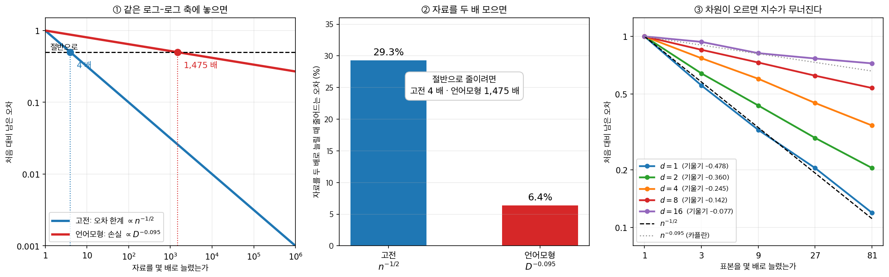
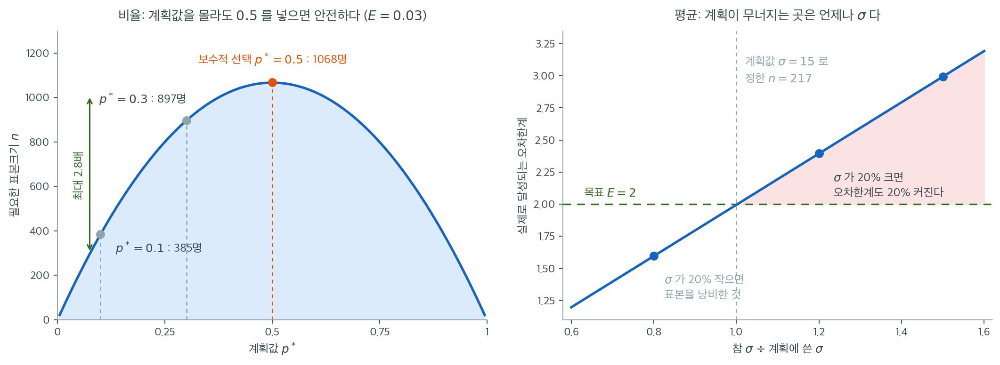
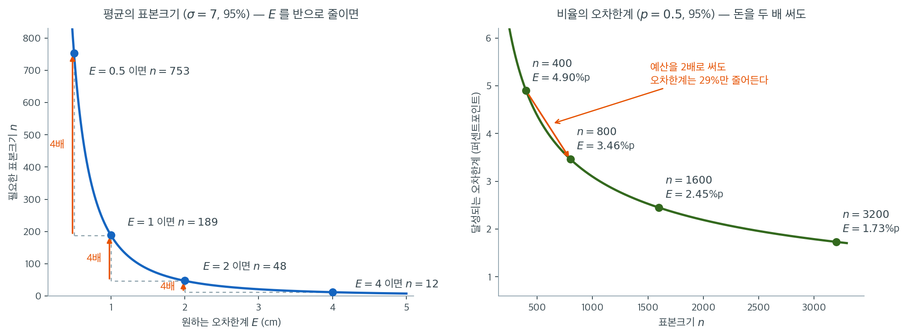
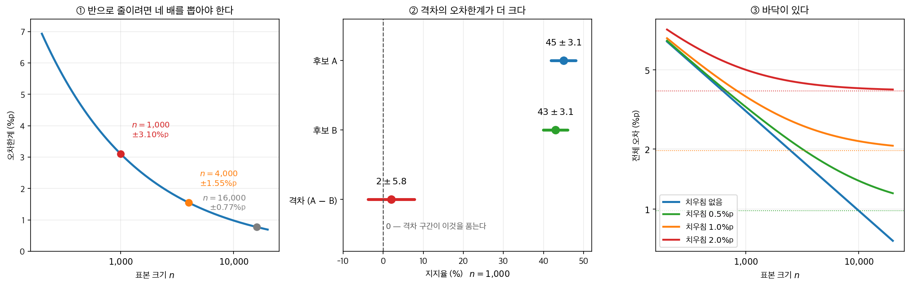

# 표본크기 계산

## 개요

<div class="leadbox" markdown>

**들어가는 이야기** — ±3.1%p 는 「1,000 명」의 다른 이름이다

신문에 실리는 여론조사 기사의 맨 끝에는 거의 언제나 같은 줄이 붙는다 — 「전국 성인 $1{,}000$ 명, $95\%$ 신뢰수준에 표본오차 $\pm 3.1\%$p」. 그 $3.1$ 은 조사기관이 고른 수가 아니다. 조사기관이 고르는 것은 사람 수이고, 그 뒤는 공식이 정한다. 사람 수를 $1{,}000$ 으로 정한 순간 저 수가 따라 나온다. **$\pm 3.1\%$p 는 「$1{,}000$ 명」의 다른 이름이다.**

그래서 그 줄은 거꾸로도 읽힌다. 어느 조사가 오차한계 $\pm 3$ 퍼센트포인트를 약속하려면 $95\%$ 신뢰수준에서 $1{,}068$ 명이 필요하고, 그 약속을 $\pm 1$ 퍼센트포인트로 조이려면 $9{,}604$ 명이다 — **아홉 배를 더 써서 정밀도는 세 배 얻는다.** 오차한계가 공식의 분모에 제곱으로 들어가기 때문이다. 어디에 설지는 자료를 모으기 **전에** 정해야 한다.

그런데 정하려면 공식에 $\sigma$ 나 $p$ 를 넣어야 하고 그 둘은 아직 손에 없다. 알자면 자료가 있어야 하고, 자료를 모으자면 $n$ 이 먼저 있어야 한다. 기사 끝줄이 말해 주지 않는 것이 하나 더 있다 — $\pm 3.1$ 은 **뽑기가 제대로 되었을 때의** 폭일 뿐이어서, 전화를 받지 않는 사람이 늘면 수가 그 폭 밖에서 어긋난다. 아래 상자가 그 바깥 이야기까지 따라간다.

그러면 $n$ 은 무엇으로 정하고, 꽂아 넣은 그 추측이 빗나가면 약속한 오차한계는 어떻게 되는가. 이 쪽은 평균과 비율의 표본크기 공식을 구간의 식에서 거꾸로 유도하고, 그 빈 자리를 무엇으로 메우는지까지 간다.

_확인한 곳 — 이 쪽 「그림으로 보는 통계학 1. 「오차한계 $\pm 3.1\%$p」 밑에 적히지 않는 것」 상자와 그 출처 줄_

</div>

자료를 모으기 전에 적절한 표본크기를 고르는 일은 연구 설계에서 가장 중요한 단계에 속한다. 표본이 너무 작으면 신뢰구간이 넓고 검정력이 낮으며, 불필요하게 크면 자원을 낭비한다. 여기서 **검정력**은 참 효과가 정말 있을 때 그것을 잡아낼 확률 $1 - \beta$ 를 말한다. 형식적인 정의는 9.5절 [제1종 오류와 제2종 오류](../../ch09/errors_and_power/errors.md) 정의 1 에 있다 — 표본크기를 정하는 일이 검정을 배우기보다 **먼저** 오므로 순서가 이렇게 되었다. 이 페이지에서는 평균이나 비율을 추정할 때 $n$을 정하는 핵심 공식을 제시하고 Python 코드로 예시한다.

---

## 1. 평균 추정을 위한 표본크기

표본크기 계산은 새 공식을 배우는 일이 아니다. **구간의 식을 거꾸로 읽는 일**이다. 8.2절 [μ의 신뢰구간](../one_sample_intervals/ci_mu.md)이 세운 오차한계

$$
E = z_{1-\alpha/2} \cdot \frac{\sigma}{\sqrt{n}}
$$

에서 지금까지는 $n$ 을 주고 $E$ 를 읽었다. 이제 **$E$ 를 먼저 정하고 $n$ 을 묻는다.** 양변을 $n$ 에 대해 풀면 그만이다.

$$
\sqrt{n} = \frac{z_{1-\alpha/2} \cdot \sigma}{E}
\quad\Longrightarrow\quad
n = \left\lceil \left(\frac{z_{1-\alpha/2} \cdot \sigma}{E}\right)^2 \right\rceil
$$

$\lceil \cdot \rceil$ 은 천장함수다. **내림이 아니라 올림인 것이 중요하다** — 내리면 오차한계가 $E$ 를 조금 넘어 애초의 요구를 어긴다. 그리고 $\sigma$ 는 모표준편차 자리인데, 자료를 뽑기 **전**이라 손에 없다. 그 자리를 무엇으로 메우는지가 $\S 4$ 의 물음이다.

<div class="aibox" markdown>

**AI로 보는 통계학 1.** 네 배와 천사백 배

위 유도가 준 답은 간결하다. $n = (z_{1-\alpha/2}\sigma/E)^2$ — 오차 한계를 절반으로 줄이려면
자료를 **네 배** 모으면 된다. 제곱이 붙은 자리, 곧 오차가 $n^{-1/2}$ 로 준다는 사실은
측정값이 아니라 **정리**다. 중심극한정리가 그렇게 시킨다.

그런데 같은 물음 — 「얼마나 더 모아야 하는가」 — 을 요즘 언어모형에 던지면 답이 전혀
다르게 생겼다. $2020$ 년 카플란 등이 모형 크기·자료 크기·계산량을 따로따로 바꿔 가며
교차엔트로피 손실을 쟀고, 거듭제곱 법칙 셋을 식 번호까지 붙여 적었다. 자료 쪽이 식
$(1.2)$ 다.

$$
L(D) = \left(\frac{D_c}{D}\right)^{\alpha_D}, \qquad \alpha_D \sim 0.095
$$

지수가 $0.5$ 가 아니라 $0.095$ 다. 그 차이가 얼마나 되는지는 곱셈만 해 보면 안다.



- **①** 두 법칙을 같은 로그–로그 축에 놓으면 기울기가 다섯 배 넘게 벌어진다. 오차를 절반
  으로 줄이는 데 고전 공식은 **$4$ 배**, 카플란의 법칙은 **$1{,}475$ 배**의 자료를 부른다.
- **②** 자료를 두 배 모아서 얻는 것은 $29.3\%$ 대 $6.4\%$ 다. 논문도 모형 크기에 대해
  같은 말을 해 두었다 — **「모수 수를 두 배로 하면 손실이 $2^{-\alpha_N} = 0.95$ 배가
  된다.」**
- **③** 왜 이렇게 다른가. $n^{-1/2}$ 는 **차원이 고정된 모수 하나**를 잴 때의 속도다.
  추정할 것이 $d$ 차원 위의 **함수**가 되면 속도가 무너진다. 최근접이웃 회귀로 직접 재면
  지수가 $d = 1$ 에서 $0.478$, $d = 4$ 에서 $0.245$, $d = 16$ 에서 $0.077$ 이 된다.
  **카플란의 $0.095$ 는 $d = 8$ 과 $d = 16$ 사이에 있다.** (표적으로 쓴 $\sin$ 이
  리프시츠보다 매끄러워서, 실측 지수는 최악의 경우인 $1/(2+d)$ 보다 조금씩 크다.)

이 절의 공식이 틀렸다는 말이 아니다. **그 공식이 서 있는 자리가 좁다**는 말이다.
$n = (z\sigma/E)^2$ 는 「모수 하나를 재는」 문제의 답이고, 그 문제에서는 $\sqrt{n}$ 이
정말로 공짜다. 재려는 것이 함수나 분포 전체가 되는 순간 그 공짜가 사라진다.

$2022$ 년 호프먼 등은 같은 자리에 다른 종류의 답을 보탰다. 자료를 더 모으는 대신 가진
예산을 **어디에 나눌지**를 다시 푼 것이다. 모형 $400$ 개 넘게를 — $7{,}000$ 만부터 $160$
억 개 모수까지, $50$ 억부터 $5{,}000$ 억 토큰까지 — 학습시킨 뒤 이렇게 적었다.
**「계산량 최적 학습에서는 모형 크기와 학습 토큰 수를 똑같이 늘려야 한다. 모형 크기를
두 배로 할 때마다 학습 토큰 수도 두 배로 해야 한다.」** 그때의 큰 모형들이 **학습이
한참 덜 되어 있었다**는 것이 결론이었다. 표본크기를 정하는 일은 거기서도 여전히 핵심이고,
다만 답이 공식 한 줄이 아니라 실험 $400$ 번이다.

_확인한 곳 — Kaplan 외, "Scaling Laws for Neural Language Models", arXiv:$2001.08361$
($2020$)의 식 $(1.1)$–$(1.3)$ 에 적힌 지수 $\alpha_N \sim 0.076$, $\alpha_D \sim 0.095$,
$\alpha_C^{\min} \sim 0.050$ 과 「모수 수를 두 배로 하면 손실이 $2^{-\alpha_N} = 0.95$ 배가
된다」는 문장 · Hoffmann 외, "Training Compute-Optimal Large Language Models",
arXiv:$2203.15556$($2022$)의 초록에서 인용한 결론과 실험 규모($400$ 개 넘는 모형,
$7{,}000$ 만–$160$ 억 모수, $50$ 억–$5{,}000$ 억 토큰). 그림의 수는 모두 직접 계산한
값이며, ③ 의 지수는 내가 돌린 최근접이웃 회귀의 실측값이다_

</div>

---

## 2. 비율 추정을 위한 표본크기

오차한계 $E$ 이내로 모비율 $p$를 추정할 때 보수적인 공식은($p(1-p)$를 최대화하는 $p = 0.5$를 쓴다)

$$
n = \left\lceil \frac{z_{1-\alpha/2}^2}{4E^2} \right\rceil
$$

계획용 추정값 $p_0$이 있다면 더 조인 공식은

$$
n = \left\lceil \frac{z_{1-\alpha/2}^2 \, p_0(1 - p_0)}{E^2} \right\rceil
$$

<div class="exbox" markdown>

**보기 1.** <span class="diff easy" title="쉬움"></span> 표본크기가 오차한계를 어떻게 줄이는가. 평균은 $\sigma \approx 15$ 로, 비율은 계획값 $p^\ast$ 로 계산한다.

**(1)** 비율의 표본크기 공식에서 $p = 1/2$ 이 **최악의 경우**임을 증명하시오. $E = 0.03$, $95\%$ 에서 $p^\ast = 0.1,\ 0.3,\ 0.5$ 의 $n$ 을 구하고, 최대와 최소의 비를 적으시오.

**(2)** 계획 입력이 빗나갔을 때의 위험이 비율과 평균에서 어떻게 다른가. $\sigma = 15$ 로 계획해 $n = 217$ 을 썼는데 참 $\sigma$ 가 $18$ 이었다면 **실제로 달성되는** 오차한계는 얼마인가.

**(3)** 코드로 확인하시오.

</div>

??? success "풀이"

    **(1) $p(1-p)$ 는 $p = 1/2$ 에서 최대다.** 완전제곱으로 정리하면 한 줄이다.

    $$
    p(1-p) = \frac14 - \left(p - \frac12\right)^2 \le \frac14
    $$

    이고 등호는 $p = 1/2$ 일 때뿐이다. $\square$ 비율의 표본크기가

    $$
    n = \left\lceil \frac{z_{1-\alpha/2}^2\,p^\ast(1-p^\ast)}{E^2} \right\rceil
    $$

    이므로, $p^\ast = 1/2$ 를 넣으면 **참 $p$ 가 무엇이든 필요한 $n$ 이상을 확보한다.** 그 결과가 보수적 공식 $n = \lceil z^2/(4E^2)\rceil$ 이다.

    $E = 0.03$, $95\%$ 에서 $z^2/E^2 = 3.84146/0.0009 = 4268.3$ 이므로

    | $p^\ast$ | $p^\ast(1-p^\ast)$ | $n$ | $p^\ast = 0.5$ 대비 |
    |---|---|---|---|
    | $0.1$ | $0.09$ | $385$ | $0.36$ |
    | $0.3$ | $0.21$ | $897$ | $0.84$ |
    | $0.35$ | $0.2275$ | $972$ | $0.91$ |
    | $\mathbf{0.5}$ | $0.25$ | $\mathbf{1068}$ | $1.00$ |

    **최대와 최소의 비가 $1068/385 = 2.77$배**에 그친다. 게다가 포물선이 꼭짓점 근처에서 납작해 $p^\ast$ 가 $0.35$ 와 $0.65$ 사이 어디든 손해가 $9\%$ 미만이다. **모르면 $0.5$ 를 넣으면 된다**는 관행이 여기서 나온다.

    **(2) 비율은 위험이 막혀 있고 평균은 열려 있다.** 비율의 미지 입력 $p$ 는 $p(1-p) \le 1/4$ 라는 **상한**을 갖는다. 최악을 쓰면 끝이다. $\sigma$ 에는 그런 상한이 없다. 위로 열려 있으므로 "가장 안전한 $\sigma$" 라는 것이 존재하지 않는다.

    **게다가 어긋남이 그대로 넘어온다.** $n$ 은 $\sigma^2$ 에 비례하지만, $n$ 을 고정하고 나면 달성되는 오차한계

    $$
    E_{\text{실제}} = z_{1-\alpha/2}\frac{\sigma_{\text{참}}}{\sqrt n}
    $$

    은 $\sigma$ 에 **정비례**한다. $\sigma = 15$ 로 $n = 217$ 을 정했는데 참값이 $18$($20\%$ 과소평가)이었다면

    $$
    E_{\text{실제}} = 1.95996 \times \frac{18}{\sqrt{217}} = 2.3949
    $$

    로 목표 $2$ 의 **$1.20$배**다. $\sigma$ 의 $20\%$ 오차가 $E$ 의 $20\%$ 초과로 그대로 옮아온다. 반대로 참값이 $12$ 였다면 $E_{\text{실제}} = 1.5966$ 으로 목표를 넘겨 달성하되 표본을 낭비한 것이다.

    **그래서 작업 순서가 다르다.** 비율은 모르면 $0.5$ 를 넣고 끝내지만, **평균은 $\sigma$ 의 출처를 반드시 확보해야 한다**(선행 연구, 예비조사, 또는 범위 규칙 $\sigma \approx \text{범위}/4$). 그리고 어느 쪽이든 불확실하면 **큰 쪽으로** 잡는다. 표본을 조금 더 모으는 비용이, 연구를 마친 뒤 구간이 목표보다 넓게 나온 것을 발견하는 비용보다 싸다.

    **(3) 확인.**

    ```python
    import numpy as np
    from scipy import stats

    np.random.seed(42)

    # --- 평균 추정을 위한 표본크기 ---
    # 자료를 모으기 전이라 s가 없으므로 t가 아니라 z를 쓴다.
    # sigma도 모르니 계획용 추정값을 넣는다. 이 값이 틀리면 계산 전체가 틀어지므로
    # 표본크기 계산에서 가장 약한 고리는 언제나 sigma의 사전 추정이다.
    sigma_est = 15
    for E in [1, 2, 3, 5]:
        for conf in [0.90, 0.95, 0.99]:
            z = stats.norm.ppf(1 - (1 - conf) / 2)
            n_needed = int(np.ceil((z * sigma_est / E) ** 2))
            print(f"  E=+/-{E}, {conf*100:.0f}% conf -> n = {n_needed}")

    # --- 비율 추정을 위한 표본크기 (보수적으로 p=0.5) ---
    # p(1-p)가 p=0.5에서 최대 0.25이므로 sqrt(0.25) = 1/2이 되어
    # 공식에 2E가 나타난다. 참 p가 무엇이든 안전한 크기다.
    print("\nSample size for proportion (conservative p=0.5):")
    for E in [0.01, 0.03, 0.05]:
        for conf in [0.95, 0.99]:
            z = stats.norm.ppf(1 - (1 - conf) / 2)
            n_needed = int(np.ceil((z / (2 * E)) ** 2))
            print(f"  E=+/-{E}, {conf*100:.0f}% conf -> n = {n_needed}")
    ```

    출력:

    ```
      E=+/-1, 90% conf -> n = 609
      E=+/-1, 95% conf -> n = 865
      E=+/-1, 99% conf -> n = 1493
      E=+/-2, 90% conf -> n = 153
      E=+/-2, 95% conf -> n = 217
      E=+/-2, 99% conf -> n = 374
      E=+/-3, 90% conf -> n = 68
      E=+/-3, 95% conf -> n = 97
      E=+/-3, 99% conf -> n = 166
      E=+/-5, 90% conf -> n = 25
      E=+/-5, 95% conf -> n = 35
      E=+/-5, 99% conf -> n = 60

    Sample size for proportion (conservative p=0.5):
      E=+/-0.01, 95% conf -> n = 9604
      E=+/-0.01, 99% conf -> n = 16588
      E=+/-0.03, 95% conf -> n = 1068
      E=+/-0.03, 99% conf -> n = 1844
      E=+/-0.05, 95% conf -> n = 385
      E=+/-0.05, 99% conf -> n = 664
    ```

    이어서 (1)의 포물선과 (2)의 위험을 수로 확인한다.

    ```python
    import numpy as np
    from scipy import stats

    # (1) 계획값 p* 에 따른 표본크기. p* = 0.5 가 꼭짓점이다.
    z95, E_p = stats.norm.ppf(0.975), 0.03
    print(f"{'p*':>6}{'p*(1-p*)':>11}{'n':>7}{'0.5 대비':>10}")
    for p_star in (0.1, 0.3, 0.35, 0.5, 0.65, 0.9):
        v = p_star * (1 - p_star)
        print(f"{p_star:>6.2f}{v:>11.4f}"
              f"{int(np.ceil(z95**2 * v / E_p**2)):>7d}{v / 0.25:>10.2f}")

    # (2) sigma 를 잘못 잡으면 달성되는 오차한계가 그만큼 빗나간다.
    print(f"\nn = 217 로 고정했을 때 실제 오차한계 (목표 2)")
    for sigma_true in (12, 15, 18):
        print(f"  참 sigma = {sigma_true}:  E = {z95 * sigma_true / np.sqrt(217):.4f}")
    ```

    출력:

    ```
        p*   p*(1-p*)      n    0.5 대비
      0.10     0.0900    385      0.36
      0.30     0.2100    897      0.84
      0.35     0.2275    972      0.91
      0.50     0.2500   1068      1.00
      0.65     0.2275    972      0.91
      0.90     0.0900    385      0.36

    n = 217 로 고정했을 때 실제 오차한계 (목표 2)
      참 sigma = 12:  E = 1.5966
      참 sigma = 15:  E = 1.9958
      참 sigma = 18:  E = 2.3949
    ```

    **(1)과 맞는다.** $n$ 이 $p^\ast = 0.5$ 에서 $1068$ 로 최대이고 $0.1$ 과 $0.9$ 에서 $385$ 로 최소다. $p^\ast$ 와 $1 - p^\ast$ 가 같은 값을 주는 것도 $p(1-p)$ 가 $1/2$ 에 대해 대칭이기 때문이다.

    **(2)도 맞는다.** 참 $\sigma$ 가 $12,\ 15,\ 18$ 일 때 달성되는 오차한계가 $1.5966,\ 1.9958,\ 2.3949$ 로 $\sigma$ 에 **정비례**한다. $\sigma$ 를 맞게 잡았을 때 $1.9958$ 이 목표 $2$ 를 조금 밑도는 것은 $217$ 이 $216.08$ 을 올림한 값이기 때문이다.

비율 쪽 표를 보면 여론조사가 왜 대개 표본 1,000명 남짓인지 알 수 있다. 95% 신뢰수준에서 오차한계 $\pm 3$%p를 맞추는 데 1,068명이 필요하고, 이를 $\pm 1$%p로 조이려면 9,604명이 필요하다. 아홉 배의 비용으로 정밀도를 세 배 얻는 셈이다.



표본크기 공식의 입력 중 $z_{1-\alpha/2}$와 $E$는 우리가 **고르는** 값이라 틀릴 일이 없다. 위험은 나머지 하나, 자료를 보기 전에 **추측해야 하는** 값에 있다. 비율이면 계획값 $p^*$이고 평균이면 $\sigma$인데, 두 경우의 위험이 전혀 다르다는 점이 중요하다.

왼쪽은 비율 쪽이다. $n = z^2 p^*(1-p^*)/E^2$은 $p^*$에 대한 포물선이고 꼭짓점이 $p^* = 0.5$다. $E = 0.03$, 95%에서 $p^* = 0.5$면 1,068명, $p^* = 0.3$이면 897명, $p^* = 0.1$이면 385명이다. 최대와 최소의 차이가 2.8배밖에 안 되고, 무엇보다 **가장 큰 값이 어디인지 우리가 안다.** 그래서 $p$를 전혀 모를 때 $p^* = 0.5$를 넣는 관행이 성립한다. 조금 손해 보는 대신 **참 $p$가 무엇이든 목표 오차한계를 지키는 것이 보장된다.** 게다가 곡선이 꼭짓점 근처에서 납작해서, $p$가 0.35에서 0.65 사이 어디든 손해가 10% 미만이다.

오른쪽은 평균 쪽이고 사정이 나쁘다. $\sigma$에는 "가장 안전한 값"이 없다. 위로 열려 있기 때문이다. $\sigma = 15$로 계획해 $n = 217$을 정했는데 참 $\sigma$가 18이었다면($20\%$ 과소평가), 실제로 얻는 오차한계는 목표 2가 아니라 $1.96 \times 18/\sqrt{217} = 2.40$이다. $n$은 $\sigma^2$에 비례하지만 달성되는 $E$는 $\sigma$에 **정비례**하므로, $\sigma$의 오차가 그대로 $E$의 오차로 넘어온다. 반대로 $\sigma$를 크게 잡았다면 $E = 1.60$으로 목표를 넘겨 달성하는 대신 표본을 낭비한 것이다.

그래서 계획 단계의 작업 순서는 이렇게 된다. 비율은 모르면 $0.5$를 넣고 끝내면 되지만, **평균은 $\sigma$의 출처를 반드시 확보해야 한다.** 선행 연구, 예비조사, 아니면 범위 규칙 $\sigma \approx \text{범위}/4$다. 그리고 어느 쪽이든 추정값이 불확실하다면 **큰 쪽으로 잡는다.** 표본을 조금 더 모으는 비용이, 연구를 마친 뒤 "구간이 목표보다 넓게 나왔다"는 사실을 발견하는 비용보다 싸기 때문이다.

---

## 3. 역제곱 법칙

두 공식 모두 $E$ 가 **분모에 제곱으로** 들어간다. 그 하나가 표본크기 계획의 거의 전부를 정하므로, 수를 넣어 보고 곡선으로 확인한다.

<div class="exbox" markdown>

**보기 2.** <span class="diff easy" title="쉬움"></span> 공식에 수를 넣어 보기. 평균과 비율 각각 하나씩이다.

**(1) 평균.** 어느 도시 성인 남성의 평균 키를 오차한계 $E = 1$ cm 인 $95\%$ 구간으로 추정하려 한다. 선행 연구에서 $\sigma = 7$ cm 다. 몇 명이 필요한가.

**(2) 비율.** 어떤 안건의 지지율을 $99\%$ 구간, 오차한계 $E = 0.03$ 으로 추정하려 한다. $p$ 의 사전 추정값이 없다. 몇 명이 필요한가.

</div>

??? success "풀이"

    **(1) 평균.** $95\%$ 에서 $z_{0.025} = 1.96$ 이므로

    $$
    n = \left(\frac{1.96 \times 7}{1}\right)^2 = (13.72)^2 = 188.24
    $$

    다. 올림하면 참가자 $189$ 명이다.

    **(2) 비율.** 사전 추정값이 없으므로 $p^\ast = 0.5$ 를 쓴다. $p(1-p)$ 를 최대로 만들어 **가장 보수적인** 답을 주기 때문이다(보기 1). $99\%$ 에서 $z_{0.005} = 2.576$ 이므로

    $$
    n = \frac{(2.576)^2 \times 0.5 \times 0.5}{(0.03)^2} = \frac{6.6358 \times 0.25}{0.0009} = \frac{1.6589}{0.0009} \approx 1843.3
    $$

    다. 올림하면 응답자 $1{,}844$ 명이다. 사전 추정값이 있다면 이보다 줄어든다 — 보기 1 에서 $p^\ast = 0.1$ 이면 $n$ 이 $36\%$ 로 떨어지는 것을 보았다.



공식 $n = (z_{1-\alpha/2}\sigma/E)^2$에서 $E$가 **분모에 제곱으로** 들어간다는 사실이 실무에서 무엇을 뜻하는지는 그림으로 볼 때 가장 분명하다. 왼쪽은 보기 2 (1) 의 키 자료($\sigma = 7$, 95%)로 그린 곡선이다. 오차한계 $\pm 4$ cm로 만족한다면 12명이면 되고, $\pm 2$ cm를 원하면 48명, $\pm 1$ cm면 189명, $\pm 0.5$ cm면 753명이 필요하다. **$E$를 반으로 줄일 때마다 $n$이 네 배가 된다.** 주황색 화살표 세 개가 모두 같은 "4배"인 것이 역제곱 법칙의 모습이다.

오른쪽은 같은 법칙을 예산 쪽에서 본 것이다. 이번에는 $n$을 정하고 얻어지는 $E$를 묻는다. 비율 조사($p = 0.5$, 95%)에서 400명이면 $\pm 4.90$%p, 800명이면 $\pm 3.46$%p다. 돈을 두 배 썼는데 오차한계는 절반이 아니라 $1/\sqrt{2} = 0.707$배, 곧 **29%만** 줄었다. 1600명으로 또 두 배를 써도 $\pm 2.45$%p에 그친다. 곡선이 오른쪽으로 갈수록 납작해지는 것이 바로 이 수확 체감이다.

여기서 나오는 실무적 태도는 두 가지다. 첫째, **목표 오차한계를 정할 때 한 자리 더 욕심내는 비용을 미리 계산하라.** 여론조사가 대개 1,000명 남짓에서 멈추는 것은 $\pm 3$%p가 충분해서라기보다 $\pm 1$%p가 9배 비싸기 때문이다. 둘째, **이미 표본이 큰 상태에서 표본을 더 늘리는 것은 가장 비싼 개선 방법이다.** 3,200명에서 시작하면 한 명을 더 모아 얻는 정밀도가 거의 0이다. 그 단계에서는 측정을 정밀하게 하거나($\sigma$를 줄이거나) 층화 같은 설계로 효율을 올리는 쪽이 훨씬 싸다.

한 가지 덧붙이면, 이 곡선들은 모두 **표집오차만** 다룬다. $n$을 3,200명으로 키워 오차한계를 $\pm 1.73$%p로 만들어도, 응답률이 낮아 생긴 무응답 편향이 2%p라면 그 편향은 조금도 줄지 않는다. $n$을 늘려 줄어드는 것은 곡선이 그리는 부분뿐이다.

<div class="storybox" markdown>

**그림으로 보는 통계학 1.** 「오차한계 $\pm 3.1\%$p」 밑에 적히지 않는 것

신문에 실리는 여론조사 기사의 맨 끝에는 거의 언제나 같은 줄이 붙는다.
「전국 성인 $1{,}000$ 명, $95\%$ 신뢰수준에 표본오차 $\pm 3.1\%$p」. 저 $3.1$ 은
고를 수 있는 수가 아니다. $p^* = 0.5$ 와 $n = 1{,}000$ 을 넣으면

$$
1.96\sqrt{\frac{0.5 \times 0.5}{1000}} = 0.03099
$$

이 나온다. **$\pm 3.1\%$p 는 「$1{,}000$ 명」의 다른 이름이다.**

<figure markdown>
{ width="960" }
  <figcaption markdown>가운데 칸의 빨간 구간이 $0$ 을 품는다. 두 후보의 순서는 이 조사가 정하지 못한다.</figcaption>
</figure>

가운데 칸이 이 상자의 요점이다. 어떤 조사에서 A 가 $45\%$, B 가 $43\%$ 였다고 하자.
기사는 「A 가 $2\%$p 앞섰다」고 적고, 친절한 기사라면 「오차범위 안」이라고 덧붙인다.
그런데 그 $2\%$p 에 붙는 오차한계는 $\pm 3.1$ 이 아니다.

한 조사 안의 두 지지율은 **같은 $1{,}000$ 명을 나눠 가진 값**이라 음의 상관을 갖는다.
A 를 고른 사람은 B 를 고르지 않았으니, A 가 우연히 높게 나오면 B 는 우연히 낮게 나오고
격차는 양쪽으로 더 흔들린다. 다항분포에서

$$
\operatorname{Var}(\hat p_1 - \hat p_2) = \frac{p_1 + p_2 - (p_1 - p_2)^2}{n}
$$

이고, 여기에 수를 넣으면 격차의 오차한계가 $\pm 5.81\%$p — 한 후보에 붙는 값의
**$1.89$ 배**다. $95\%$ 구간이 $[-3.8,\ +7.8]$ 이니 **B 가 앞서 있을 가능성이 구간 안에
그대로 들어 있다.**

$2\%$p 격차를 「유의하다」고 말하려면 얼마나 뽑아야 하는가. 같은 식을 뒤집으면
$n = 8{,}447$ 이다. $1{,}000$ 명짜리 조사 **여덟 배 반**. 선거 때마다 쏟아지는 조사
가운데 이 조건을 채우는 것은 사실상 없다.

오른쪽 칸은 바로 위 문단을 그림으로 옮긴 것이다. 치우침이 $2\%$p 있으면 전체 오차는
$3.92\%$p 아래로 **절대** 내려가지 않는다. 표집오차와 치우침이 같아지는 자리가
$n = 625$ 이니, 그 조사에서는 $625$ 명을 넘는 순간부터 돈이 치우침을 못 이긴다.

그리고 이 치우침은 커지는 쪽으로 움직여 왔다. 퓨리서치센터가 자기네 전화조사
응답률을 공개해 왔는데, $1997$ 년 $36\%$, $2012$ 년 $9\%$, $2018$ 년 $6\%$ 다.
전화를 받는 비율이 $65\%$ 에서 $27\%$ 로, 받은 뒤 응해 주는 비율이 $50\%$ 에서 $25\%$ 로
각각 줄어든 결과다. **$100$ 명에게 걸어 $6$ 명이 답한다.** 그 $6$ 명이 나머지 $94$ 명과
같은 생각을 한다는 보장은 어디에도 없고, 그 보장 없음은 $\pm 3.1$ 안에 들어 있지 않다.

기사 끝줄을 다시 읽으면 이렇게 된다. 「$\pm 3.1\%$p」는 **「$1{,}000$ 명을 제대로
뽑았다면 $20$ 번에 $19$ 번은 이 폭 안」** 이라는 뜻이지, 「이 조사의 수가 $3.1$ 안에서
맞다」는 뜻이 아니다. 앞의 문장은 수학이고 뒤의 문장은 **뽑기가 제대로 되었을 때만** 참이다.

_확인한 곳 — 퓨리서치센터의 응답률·접촉률·협조율 수치. 나머지 수는 모두 위 식에서 직접 계산한 값이다_

</div>

---

## 4. 모르는 σ 를 꽂아야 한다

이 계산에는 돌아가는 고리가 있다. **$n$ 을 정하려면 $\sigma$ 를 알아야 하는데, $\sigma$ 를 알자면 자료가 있어야 하고 자료를 모으려면 $n$ 을 먼저 정해야 한다.** 식을 거꾸로 읽은 대가가 여기서 나온다.

실무에서 그 고리를 끊는 길이 셋이다. **예비조사**로 작은 표본을 먼저 뽑아 $s$ 를 재거나, **선행 연구**의 보고된 산포를 가져다 쓰거나, 아무것도 없으면 **범위 규칙** $\sigma \approx \text{범위}/4$ 로 어림한다. 범위를 $4$ 로 나누는 것은 정규분포에서 관측값의 대부분이 $\mu \pm 2\sigma$ 안에 들어 폭이 약 $4\sigma$ 가 된다는 사실에서 온다.

**어느 길이든 $\sigma$ 를 작게 잡으면 표본이 모자란다.** $n$ 이 $\sigma^2$ 에 비례하므로 $\sigma$ 를 $20\%$ 낮춰 잡으면 $n$ 이 $36\%$ 부족해지고, 그러면 약속한 정밀도에 못 미친 채 조사가 끝난다. **그래서 불확실할 때는 크게 잡는 쪽으로 기운다.** 비율에서 $p = 0.5$ 를 쓰는 관행이 같은 판단이다 — $p(1-p)$ 가 거기서 최대이므로 참 $p$ 가 무엇이든 정밀도가 보장되고, 대가로 표본이 커진다.

$E$ 쪽도 같은 눈으로 보아야 한다. $n$ 이 $E^2$ 에 반비례하므로 **오차한계를 절반으로 줄이려면 표본이 네 배**다($\S 3$). 설계 단계에서 $E$ 를 욕심내는 것이 가장 비싼 결정이다.

---

## 연습문제

<div class="drillbox" markdown>

**연습문제 1.** <span class="diff easy" title="쉬움"></span> 어떤 엔지니어가 케이블의 평균 인장강도를 95% 신뢰수준에서 $\pm 5$ MPa 이내로 추정해야 한다. 예비조사에서 $\sigma \approx 20$ MPa로 나타났다. 필요한 표본크기는?

</div>

??? success "풀이"

    임계값은 $z_{0.025} = 1.96$이다. 공식을 적용하면

    $$
    n = \left\lceil \left(\frac{1.96 \times 20}{5}\right)^2 \right\rceil
      = \left\lceil (7.84)^2 \right\rceil
      = \left\lceil 61.47 \right\rceil
      = 62
    $$

    적어도 관측값 62개가 필요하다. $\square$

---

<div class="drillbox" markdown>

**연습문제 2.** <span class="diff easy" title="쉬움"></span> 어떤 조사자가 99% 신뢰수준에서 후보 지지율을 $\pm 3$ 퍼센트포인트 이내로 추정하려 한다. 보수적인 접근으로 필요한 표본크기를 구하라.

</div>

??? success "풀이"

    $E = 0.03$이고 $z_{0.005} = 2.576$이면,

    $$
    n = \left\lceil \frac{(2.576)^2}{4 \times (0.03)^2} \right\rceil
      = \left\lceil \frac{6.6358}{0.0036} \right\rceil
      = \left\lceil 1843.3 \right\rceil
      = 1844
    $$

    조사자에게 적어도 응답자 1844명이 필요하다. $\square$

---

<div class="drillbox" markdown>

**연습문제 3.** <span class="diff med" title="중간"></span> 모든 $p \in [0,1]$에 대해 $p(1-p) \le 1/4$임을 보이고, 비율에서 $p = 0.5$가 가장 보수적인(가장 큰) 표본크기를 주는 이유를 설명하라.

</div>

??? success "풀이"

    $f(p) = p(1-p) = p - p^2$이라 하자. 미분하면 $f'(p) = 1 - 2p$이고 $p = 1/2$에서 0이 된다. $f''(p) = -2 < 0$이므로 $p = 1/2$은 $[0,1]$에서의 전역 최댓값이며

    $$
    f(1/2) = \frac{1}{2}\left(1 - \frac{1}{2}\right) = \frac{1}{4}
    $$

    표본크기 공식은 $n = z_{1-\alpha/2}^2 \, p(1-p) / E^2$이다. $p(1-p)$가 분자에 있으므로 $p = 1/2$에서의 최댓값이 가장 큰 $n$을 주며, 참 $p$가 무엇이든 충분한 정밀도를 보장한다. $\square$

---

<div class="drillbox" markdown>

**연습문제 4.** <span class="diff med" title="중간"></span> 처음에는 오차한계 $\pm 4$로 계획했다가 나중에 $\pm 2$가 필요하다고 결정했다면 필요한 표본크기는 몇 배가 되는가? 이 관계를 일반적으로 증명하라.

</div>

??? success "풀이"

    표본크기 공식은 $n = (z_{1-\alpha/2} \sigma / E)^2$이다. 오차한계 $E_1$에 대응하는 것을 $n_1$, $E_2$에 대응하는 것을 $n_2$라 하자. 그러면

    $$
    \frac{n_2}{n_1} = \frac{(z_{1-\alpha/2} \sigma / E_2)^2}{(z_{1-\alpha/2} \sigma / E_1)^2} = \left(\frac{E_1}{E_2}\right)^2
    $$

    오차한계를 절반으로 하면($E_2 = E_1/2$) $n_2 / n_1 = 4$이다. 필요한 표본크기가 **네 배**가 된다. $E_1 = 4, E_2 = 2$인 구체적인 경우:

    $$
    \frac{n_2}{n_1} = \left(\frac{4}{2}\right)^2 = 4
    $$

    $\square$

---

<div class="drillbox" markdown>

**연습문제 5.** <span class="diff med" title="중간"></span> 어떤 연구자가 계획용 추정값 $p_0 = 0.30$을 갖고 있으며 오차한계 $\pm 0.04$인 $p$의 95% 신뢰구간을 원한다. 계획용 추정값 공식과 보수적인 공식의 표본크기를 비교하라. 관측값을 몇 개나 아끼는가?

</div>

??? success "풀이"

    $z_{0.025} = 1.96$, $E = 0.04$일 때:

    **보수적인 경우** ($p = 0.5$):

    $$
    n_{\text{cons}} = \left\lceil \frac{(1.96)^2}{4(0.04)^2} \right\rceil = \left\lceil \frac{3.8416}{0.0064} \right\rceil = \left\lceil 600.25 \right\rceil = 601
    $$

    **계획용 추정값** ($p_0 = 0.30$):

    $$
    n_{\text{plan}} = \left\lceil \frac{(1.96)^2 \times 0.30 \times 0.70}{(0.04)^2} \right\rceil = \left\lceil \frac{3.8416 \times 0.21}{0.0016} \right\rceil = \left\lceil \frac{0.8067}{0.0016} \right\rceil = \left\lceil 504.2 \right\rceil = 505
    $$

    계획용 추정값을 쓰면 관측값 $601 - 505 = 96$개를 아낀다. $\square$

---

<div class="drillbox" markdown>

**연습문제 6.** <span class="diff med" title="중간"></span>
$\sigma$를 모를 때는 $z$가 아니라 $t$를 써야 하는데, $t$ 임계값이 $n$에 의존하므로 **반복계산**이 필요하다. 절차를 구현하고 $z$ 공식과 비교하라.

</div>

??? success "풀이"
    **문제.** 필요한 $n$이

    $$
    n\ge\left(\frac{t_{0.975,\,n-1}\,\sigma}{E}\right)^2
    $$

    을 만족해야 하는데, 오른쪽에 $n$이 들어 있다.

    **해법 — 고정점 반복.** $z$ 공식의 답에서 출발해 수렴할 때까지 되풀이한다.

    ```python
    import numpy as np
    from scipy import stats

    def n_t(sigma, E, level=0.95):
        z = stats.norm.ppf(0.5 + level / 2)
        n = max(int(np.ceil((z * sigma / E)**2)), 2)
        for _ in range(100):
            nn = max(int(np.ceil((stats.t.ppf(0.5 + level / 2, n - 1)
                                  * sigma / E)**2)), 2)
            if nn == n:
                return n
            n = nn
        return n

    z = stats.norm.ppf(0.975)
    print(f"{'σ':>5s} {'E':>5s} {'z 공식':>8s} {'t 반복':>8s} {'차이':>6s}")
    for sigma, E in [(20, 5), (10, 2), (15, 10), (5, 4)]:
        n0 = int(np.ceil((z * sigma / E)**2))
        n1 = n_t(sigma, E)
        print(f"{sigma:5.0f} {E:5.0f} {n0:8d} {n1:8d} {n1 - n0:6d}")
    ```

    ```text
        σ     E     z 공식     t 반복     차이
       20     5       62       64      2
       10     2       97       99      2
       15    10        9       11      2
        5     4        7        9      2
    ```

    **차이가 작다.** $n$이 웬만큼만 되면 $t\approx z$이므로 두세 명 차이다.

    **$n$이 작을 때는 무시할 수 없다.** $\sigma=15$, $E=10$이면 9명이 아니라 11명으로 22% 늘고, $\sigma=5$, $E=4$면 7명이 아니라 9명으로 29% 는다. **차이는 항상 두어 명이지만 $n$이 작을수록 비중이 커진다.**

    **수렴은 보장되는가.** $n\mapsto\lceil (t_{n-1}\sigma/E)^2\rceil$은 $n$에 대해 감소(약한 의미로)하고 아래로 유계이므로, 단조 수열이 되어 유한 번에 멈춘다. 위 예에서 모두 3~4회 안에 수렴했다.

    **더 중요한 것.** 이 보정은 몇 명 수준이지만, 앞서 본 **보증(assurance)** 보정은 10~20% 수준이다. 어느 쪽이 실질적인지 분명하다. **$t$ 보정만 하고 $S$의 변동을 무시하면 일관성이 없다.**

    **실무.** 통계 소프트웨어의 표본크기 함수는 대개 $t$ 반복을 내부에서 수행한다. 직접 계산할 때는 $z$ 공식에 **2~3명을 더하는** 어림으로 충분한 경우가 많다.

---

<div class="drillbox" markdown>

**연습문제 7.** <span class="diff med" title="중간"></span>
**유한모집단**에서 필요한 표본크기를 구하는 공식을 유도하고, $N$에 따라 어떻게 변하는지 보여라.

</div>

??? success "풀이"
    **유도.** 비복원추출에서 $\operatorname{Var}(\bar X)=\frac{\sigma^2}{n}\cdot\frac{N-n}{N-1}$이므로, 오차한계 조건은

    $$
    z\sqrt{\frac{\sigma^2}{n}\cdot\frac{N-n}{N-1}}\le E
    $$

    $N-1\approx N$으로 두고 $n$에 대해 풀면

    $$
    n\ \ge\ \frac{n_0}{1+\dfrac{n_0-1}{N}},\qquad n_0=\left(\frac{z\sigma}{E}\right)^2
    $$

    ```python
    import numpy as np
    from scipy import stats

    z = stats.norm.ppf(0.975)
    sigma, E = 15.0, 3.0
    n0 = (z * sigma / E)**2
    print(f"무한모집단 기준 n0 = {np.ceil(n0):.0f}")
    print(f"{'N':>8s} {'필요 n':>8s} {'표집비율':>9s}")
    for N in [200, 500, 1_000, 5_000, 100_000]:
        n = n0 / (1 + (n0 - 1) / N)
        print(f"{N:8d} {np.ceil(n):8.0f} {np.ceil(n) / N:9.3f}")
    ```

    ```text
    무한모집단 기준 n0 = 97
           N     필요 n      표집비율
         200       66     0.330
         500       81     0.162
        1000       88     0.088
        5000       95     0.019
      100000       96     0.001
    ```

    **모집단이 작으면 표본이 줄어든다.** $N=200$이면 97명이 아니라 66명으로 충분하다.

    **$N$이 커지면 빠르게 포화한다.** $N=5{,}000$에서 이미 95명이고, $N=10$만에서도 96명이다. **$N\to\infty$의 극한 97에 거의 도달**한다.

    **중요한 오해 바로잡기.** "모집단이 크면 표본도 커야 한다"는 직관은 **틀렸다.** 위 표가 보여 주듯 $N$이 $n_0$의 20배를 넘으면 $N$은 사실상 무관하다.

    - 인구 5천만 명 나라와 인구 500만 명 나라에서 같은 정밀도를 얻는 데 **같은 표본**이면 된다.
    - 여론조사의 "1,000명이면 충분한가"라는 질문의 답이 여기 있다. 충분하다.

    **$n_0>N$이면 어떻게 되는가.** 공식이 $n<N$을 보장한다. 극단적으로 $n_0\to\infty$면 $n\to N$, 즉 **전수조사**다.

    **주의할 점.**

    1. **$\sigma$는 모집단 표준편차**다. 작은 모집단에서는 이것도 추정하기 어렵다.
    2. **명부(표본틀)가 있어야** 비복원추출이 가능하다. 없으면 FPC를 적용할 근거가 약하다.
    3. **비표집오차는 $N$과 무관**하다. 작은 모집단에서 큰 표집비율을 쓰면 표집오차는 줄지만 측정오차는 그대로다.

---

<div class="drillbox" markdown>

**연습문제 8.** <span class="diff med" title="중간"></span>
비율의 표본크기를 **윌슨 구간 기준**으로 계산하면 왈드 공식과 얼마나 다른가? $p$가 작을 때를 특히 확인하라.

</div>

??? success "풀이"
    **문제.** 왈드 공식 $n=z^2p(1-p)/E^2$는 왈드 구간의 폭을 기준으로 한다. 그런데 실제로 쓸 구간이 윌슨이라면, **윌슨의 반폭이 $E$ 이하가 되는 $n$**을 찾아야 한다.

    ```python
    import numpy as np
    from scipy import stats

    z = stats.norm.ppf(0.975)

    def wilson_half(n, p):
        d = 1 + z**2 / n
        return z / d * np.sqrt(p * (1 - p) / n + z**2 / (4 * n**2))

    print(f"{'p':>6s} {'E':>6s} {'왈드':>7s} {'윌슨':>7s} {'차이':>7s}")
    for p, E in [(0.50, 0.03), (0.10, 0.03), (0.05, 0.02), (0.02, 0.01)]:
        nw = int(np.ceil(z**2 * p * (1 - p) / E**2))
        n = 1
        while wilson_half(n, p) > E:
            n += 1
        print(f"{p:6.2f} {E:6.2f} {nw:7d} {n:7d} {n - nw:+7d}")
    ```

    ```text
         p      E      왈드      윌슨      차이
      0.50   0.03    1068    1064      -4
      0.10   0.03     385     388      +3
      0.05   0.02     457     469     +12
      0.02   0.01     753     792     +39
    ```

    **$p$가 0.5 근처면 왈드가 오히려 약간 크다.** 윌슨 구간이 그 영역에서 왈드보다 좁기 때문이다.

    **$p$가 작아질수록 윌슨이 더 많은 표본을 요구한다.** $p=0.02$에서 39명(5%) 더 필요하다.

    **왜 그런가.** 윌슨 구간의 반폭에는 $z^2/(4n^2)$ 항이 있는데, $p(1-p)/n$이 작아질수록 이 항의 비중이 커진다. 이것은 **경계 근처에서 구간이 쪼그라들지 않게 막는** 장치이고, 그만큼 폭이 넓어진다.

    **더 큰 문제 — 폭 기준 자체가 부적절할 수 있다.** $p=0.02$처럼 작으면 **절대 오차한계보다 상대 정밀도**가 관심사인 경우가 많다.

    ```python
    # 상대 정밀도 20% (즉 E = 0.2p) 를 원한다면
    for p in [0.50, 0.10, 0.05, 0.02, 0.005]:
        E = 0.2 * p
        n = 1
        while wilson_half(n, p) > E:
            n += 1
        print(f"p={p:5.3f}  상대오차 20%를 위한 n = {n:6d}")
    ```

    ```text
    p=0.500  상대오차 20%를 위한 n =     93
    p=0.100  상대오차 20%를 위한 n =    868
    p=0.050  상대오차 20%를 위한 n =   1838
    p=0.020  상대오차 20%를 위한 n =   4747
    p=0.005  상대오차 20%를 위한 n =  19295
    ```

    **희귀한 사건일수록 상대 정밀도를 얻기가 어렵다.** $p=0.005$면 2만 명 가까이 필요하다. 왈드 공식으로 정리하면 $n\approx z^2(1-p)/(0.2^2p)=96(1-p)/p$이고, $p$가 작으면 **$96/p$** 로 간단해진다. $p=0.005$에서 19,200으로 위 표와 잘 맞는다.

    **권고.** $\min(np,\ n(1-p))<10$이 예상되면 **왈드 공식을 쓰지 말고** 위처럼 실제 쓸 구간으로 직접 계산한다. 계산 비용이 0이므로 어림에 의존할 이유가 없다.

---

<div class="drillbox" markdown>

**연습문제 9.** <span class="diff med" title="중간"></span>
표본크기와 신뢰수준·정밀도의 관계를 **비용 곡선**으로 정리하고, 실무에서 어디를 선택해야 하는지 논하라.

</div>

??? success "풀이"
    ```python
    import numpy as np
    from scipy import stats

    sigma = 10.0
    print(f"{'E':>6s} " + " ".join(f"{lv:>8.0%}" for lv in [0.80, 0.90, 0.95, 0.99]))
    for E in [5.0, 3.0, 2.0, 1.5, 1.0, 0.5]:
        row = []
        for lv in [0.80, 0.90, 0.95, 0.99]:
            z = stats.norm.ppf(0.5 + lv / 2)
            row.append(f"{np.ceil((z * sigma / E)**2):8.0f}")
        print(f"{E:6.1f} " + " ".join(row))
    ```

    ```text
         E      80%      90%      95%      99%
       5.0        7       11       16       27
       3.0       19       31       43       74
       2.0       42       68       97      166
       1.5       73      121      171      295
       1.0      165      271      385      664
       0.5      657     1083     1537     2654
    ```

    **두 방향의 비용.**

    - **정밀도**: $n\propto E^{-2}$. $E$를 반으로 줄이면 4배.
    - **신뢰수준**: $n\propto z^2$. 95%에서 99%로 가면 1.73배.

    **정밀도가 훨씬 비싸다.** 95%에서 $E$를 3에서 1.5로 줄이는 비용(43→171, 4배)이 $E=3$에서 신뢰수준을 80%에서 99%로 올리는 비용(19→74, 3.9배)과 비슷하다. 그런데 전자는 **폭이 절반**이 되는 실질적 개선이고, 후자는 **문턱의 조정**일 뿐이다.

    **실무 선택 지침.**

    1. **신뢰수준은 95%를 기본으로.** 관례를 벗어나면 설명 부담이 생긴다. 규제나 안전이 걸린 경우에만 99%.

    2. **정밀도는 의사결정에서 역산한다.** "얼마나 정밀해야 결정이 달라지는가"를 묻는다. 무조건 좁은 구간이 좋은 것이 아니다.

       - 정책 문턱이 50%이고 추정값이 55% 근처로 예상된다면, $E=3$%p면 충분하다($52\sim58$이 모두 문턱 위).
       - $E=1$%p를 위해 표본을 9배로 늘려도 **결정은 바뀌지 않는다.**

    3. **수확체감 지점을 찾는다.** 95%에서 $E=2\to1.5$는 $+74$명, $E=1.5\to1$은 $+214$명, $E=1\to0.5$는 $+1{,}152$명이다. 곡선이 급해지는 곳에서 멈추는 것이 합리적이다.

    4. **비표집오차와 균형을 맞춘다.** 무응답 편향이 2%포인트인데 표집오차를 0.5%포인트로 줄이는 것은 낭비다. **가장 큰 오차원을 먼저** 줄인다.

    **의사결정이론적 관점.** 엄밀하게는 **표본 하나의 한계비용**과 **정보의 한계가치**가 같아지는 곳이 최적이다. 정보의 가치를 계량할 수 있는 경우(품질검사, A/B 시험)에는 실제로 이렇게 푼다. 대부분의 학술연구에서는 그러기 어려워 관례와 예산으로 정한다.

---

<div class="drillbox" markdown>

**연습문제 10.** <span class="diff med" title="중간"></span>
고정 표본크기 설계의 대안인 **순차설계**와 **적응설계**를 소개하고, 각각의 이득과 대가를 적어라.

</div>

??? success "풀이"
    **고정 설계의 한계.** $n$을 미리 정하면

    - 효과가 예상보다 크면 **필요 이상으로 오래** 끌고,
    - 효과가 없으면 **무의미한 연구를 끝까지** 하고,
    - 가정($\sigma$, 기저율)이 틀리면 **검정력이 어긋난다.**

    **1 — 군순차 설계.** 중간분석 시점을 미리 정하고, 각 시점의 임계값을 전체 $\alpha$가 유지되도록 조정한다.

    | 경계 | 성격 |
    |---|---|
    | 포콕 | 모든 시점에 같은 임계값. 초기 중단이 쉽다 |
    | 오브라이언–플레밍 | 초기에는 엄격, 후기에 완화. **최종 $\alpha$가 거의 온전** |
    | 알파 소비함수(랜–드메츠) | 시점 수를 미리 못 정해도 됨. 가장 유연 |

    - **이득**: 효과가 크면 일찍 끝난다. 평균 표본크기가 고정 설계의 60~80%.
    - **대가**: 최대 표본크기는 오히려 크다(5~15%). 중간분석의 운영 비용, 독립 감시위원회 필요.

    **2 — 무익성 중단.** 효과가 없을 것이 분명해지면 조기 종료한다. 윤리적·경제적으로 중요하다.

    - **이득**: 실패할 연구를 일찍 접는다.
    - **대가**: 검정력이 조금 준다. 경계를 너무 공격적으로 잡으면 참 효과를 놓친다.

    **3 — 표본크기 재추정.** 중간에 관측된 $\sigma$나 기저율로 $n$을 다시 계산한다.

    - **눈가림 방식**(처리군 구분 없이 전체 분산만 봄): $\alpha$ 팽창이 거의 없다. **안전하고 널리 쓰인다.**
    - **비눈가림 방식**(관측된 효과크기 사용): $\alpha$ 팽창이 크므로 보정이 필수다. 규제기관이 신중하게 본다.

    **4 — 적응설계 일반.** 용량 선택, 집단 선택, 무작위배정 비율 변경 등.

    - **이득**: 자원을 유망한 팔에 집중. 학습과 확증을 한 연구에.
    - **대가**: 설계·분석이 복잡하고, **사전에 모든 규칙을 명시**해야 한다. 해석이 어려워지고 검토자를 설득하기 힘들다.

    **5 — 베이즈 적응.** 사후분포로 중단·배정을 결정한다. 가능도원리상 중지규칙이 사후분포에 영향을 주지 않는다는 점이 우아하다. 다만 **빈도주의 성질(제1종 오류율)은 모의실험으로 확인**해야 하며, 규제 제출에는 이것이 요구된다.

    **언제 고정 설계가 나은가.**

    - 연구 기간이 짧아 중간분석의 이득이 없을 때.
    - 결과 관측이 오래 걸려(생존 등) 중간에 볼 자료가 적을 때.
    - 운영 역량이 부족할 때. **잘못 운영된 적응설계는 고정 설계보다 나쁘다.**
    - 단순성과 투명성이 중요할 때.

    **공통 원칙.** 어떤 설계든 **모든 규칙을 자료를 보기 전에 문서로 고정**해야 한다. 적응설계의 유연성은 "나중에 마음대로 바꿔도 된다"는 뜻이 아니라, **미리 정해 둔 규칙에 따라 자동으로 조정된다**는 뜻이다.

---

<div class="drillbox" markdown>

**연습문제 11.** <span class="diff med" title="중간"></span>
어떤 회사가 조사 $n = 400$건의 예산을 가지고 있다. 95% 신뢰수준에서 모비율에 대해 달성 가능한 최선의 오차한계는 얼마인가? 예산이 두 배가 되어 $n = 800$이 되면 오차한계는 얼마나 줄어드는가?

</div>

??? success "풀이"
    보수적인 $p = 0.5$를 쓰면:

    $n = 400$일 때:

    $$
    E = 1.96\sqrt{\frac{0.25}{400}} = 1.96 \times 0.025 = 0.049 = 4.9\%
    $$

    $n = 800$일 때:

    $$
    E = 1.96\sqrt{\frac{0.25}{800}} = 1.96 \times 0.01768 = 0.0346 = 3.5\%
    $$

    표본크기를 두 배로 하니 오차한계가 4.9%에서 3.5%로 줄었으며, 감소 인자는 $\sqrt{2} \approx 1.414$이다. 오차한계는 $1/\sqrt{n}$에 비례해 줄어들므로 $n$을 두 배로 해도 정밀도는 50%가 아니라 약 29%만 좋아진다.

---

<div class="drillbox" markdown>

**연습문제 12.** <span class="diff med" title="중간"></span>
계획에 쓴 $\sigma$가 틀렸을 때 표본크기가 얼마나 어긋나는지 정량화하고, 어느 방향의 실수가 더 위험한지 논하라.

</div>

??? success "풀이"
    **$n\propto\sigma^2$이다.** 따라서 $\sigma$를 $f$배로 잘못 잡으면 $n$이 $f^2$배 어긋난다.

    ```python
    import numpy as np
    from scipy import stats

    sigma_true, E = 10.0, 2.0
    z = stats.norm.ppf(0.975)
    n_true = int(np.ceil((z * sigma_true / E)**2))

    # 한글은 고정폭 글꼴에서 두 칸을 차지하므로 f-string 의 자리맞춤이
    # (글자 수로 세기 때문에) 보이는 열과 어긋난다. 머리글은 공백을 직접 적는다.
    print(" 가정한 σ   계획 n  참 n 대비 실제 오차한계")
    for f in [0.70, 0.85, 1.00, 1.20, 1.50]:
        n = int(np.ceil((z * sigma_true * f / E)**2))
        actual_E = z * sigma_true / np.sqrt(n)
        print(f"{sigma_true * f:9.1f} {n:8d} {n / n_true:10.2f} {actual_E:13.3f}")
    ```

    ```text
     가정한 σ   계획 n  참 n 대비 실제 오차한계
          7.0       48       0.49         2.829
          8.5       70       0.72         2.343
         10.0       97       1.00         1.990
         12.0      139       1.43         1.662
         15.0      217       2.24         1.331
    ```

    **과소추정이 훨씬 위험하다.**

    - **$\sigma$를 30% 작게 잡으면** 표본이 절반(48명)이 되고, 실제 오차한계가 2.83으로 **목표의 1.4배**가 된다. 연구가 목표를 달성하지 못한다.
    - **50% 크게 잡으면** 표본이 2.24배가 되어 비용이 늘지만, **결과는 목표보다 정밀**하다.

    **비대칭의 이유.** 표본이 모자라면 **연구 전체가 결론을 내지 못한다.** 표본이 남으면 돈을 더 쓴 것뿐이다. 게다가 부족한 표본은 사후에 고칠 수 없다.

    **$\sigma$를 어디서 얻는가.**

    | 출처 | 신뢰도 | 주의 |
    |---|---|---|
    | 같은 집단의 선행연구 | 높음 | 측정 방법이 같은지 |
    | 다른 집단의 선행연구 | 중간 | 이질성이 크면 위험 |
    | 예비연구($n<30$) | **낮음** | $S$의 변동이 크다 |
    | 범위 $/4$ 어림 | 낮음 | 정규 가정 필요 |
    | 전문가 추측 | 매우 낮음 | 대체로 과소추정 |

    **예비연구의 함정.** $n=20$인 예비연구에서 $S$를 얻었다면, 앞서 본 대로 $S^2$의 95% 구간이 $(0.58s^2,\ 2.13s^2)$다. **$\sigma$의 추정에 40%의 불확실성**이 있고, 이것이 $n$에서는 두 배로 증폭된다.

    **권고.**

    1. **보수적으로 잡는다.** $\sigma$의 신뢰구간 상한이나 그에 가까운 값을 쓴다.
    2. **민감도 표를 만든다.** "σ가 8이면 70명, 10이면 97명, 12면 139명"을 계획서에 함께 적는다.
    3. **내부 예비추정을 계획에 넣는다.** 중간에 $S$를 확인하고 조정하는 절차를 미리 정해 두면, 잘못된 가정에 묶이지 않는다.

---

<div class="drillbox" markdown>

**연습문제 13.** <span class="diff med" title="중간"></span>
**무응답**과 **설계효과**를 반영해 실제 모집 규모를 계산하라. 응답률 65%, 설계효과 1.8, 목표 오차한계 3%포인트인 조사의 경우를 다루어라.

</div>

??? success "풀이"
    **세 단계로 곱한다.**

    $$
    n_{\text{모집}}=\underbrace{\frac{z^2p(1-p)}{E^2}}_{\text{단순임의추출}}\times\underbrace{\text{DEFF}}_{\text{설계}}\times\underbrace{\frac1{r}}_{\text{응답률}}
    $$

    ```python
    import numpy as np
    from scipy import stats

    z = stats.norm.ppf(0.975)
    E, p, deff, resp = 0.03, 0.5, 1.8, 0.65

    n_srs = z**2 * p * (1 - p) / E**2
    n_eff = n_srs * deff
    n_con = n_eff / resp
    print(f"단순임의추출 필요 표본  {np.ceil(n_srs):6.0f}명")
    print(f"설계효과 {deff} 반영       {np.ceil(n_eff):6.0f}명")
    print(f"응답률 {resp:.0%} 반영       {np.ceil(n_con):6.0f}명  ← 실제 접촉 규모")
    print(f"총 배율 {n_con / n_srs:.2f}배")
    ```

    ```text
    단순임의추출 필요 표본    1068명
    설계효과 1.8 반영         1921명
    응답률 65% 반영         2955명  ← 실제 접촉 규모
    총 배율 2.77배
    ```

    **교과서 공식의 1,068명이 실제로는 2,955명**이 된다. 거의 세 배다.

    **각 요인의 성격이 다르다.**

    | 요인 | 무엇을 하는가 | 고칠 수 있나 |
    |---|---|---|
    | 설계효과 | 정보량을 줄임 | 설계를 바꾸면(군집 크기 축소) |
    | 무응답 | 표본크기를 줄임 | 접촉 노력으로 부분적으로 |

    **무응답의 더 큰 문제 — 편향.** 위 계산은 **무응답이 무작위**라고 가정한다. 실제로는 응답자와 비응답자가 다른 경우가 많고, 그때는

    $$
    \text{편향}=\frac{1-r}{1}\times(\bar y_{\text{응답}}-\bar y_{\text{비응답}})
    $$

    만큼 치우친다. 응답률 65%면 비응답자가 35%이고, 두 집단의 차이가 10%포인트만 되어도 **편향이 3.5%포인트**다. 이는 표집오차 3%포인트보다 크다.

    **핵심.** **표본을 늘려도 무응답 편향은 줄지 않는다.** 표집오차는 $1/\sqrt n$으로 줄지만 편향은 그대로다. 1만 명을 조사해도 응답률이 낮으면 1천 명 조사보다 나을 것이 없다.

    **대처.**

    1. **응답률 자체를 높인다.** 반복 접촉, 다중 방식, 보상.
    2. **사후층화 가중.** 인구 특성으로 가중치를 조정한다. 다만 **가중이 분산을 키운다**(설계효과가 더 커진다).
    3. **비응답 추적조사.** 비응답자 일부를 집중 접촉해 차이를 추정한다.
    4. **응답률을 반드시 보고한다.** AAPOR 기준으로 계산해 명시한다.

    **보고 예.** "표본 1,921명(접촉 2,955명, 응답률 65.0%), 설계효과 1.8, 오차한계 $\pm$3.0%포인트(95% 신뢰수준). 표집오차 외의 오차는 반영되지 않았다."

---

<div class="drillbox" markdown>

**연습문제 14.** <span class="diff med" title="중간"></span>
**여러 목표**가 있는 조사에서 표본크기를 어떻게 정하는가? 전체 오차한계 3%p, 세 하위집단 각각 5%p를 원하는 경우를 다루어라.

</div>

??? success "풀이"
    **원칙 — 가장 까다로운 요구가 결정한다.** 각 목표에 필요한 $n$을 모두 계산하고 최대를 취한다.

    ```python
    import numpy as np
    from scipy import stats

    z = stats.norm.ppf(0.975)

    def n_for(E, p=0.5):
        return z**2 * p * (1 - p) / E**2

    # 하위집단 비중이 (0.50, 0.30, 0.20)
    shares = np.array([0.50, 0.30, 0.20])
    n_sub = n_for(0.05)
    n_total_from_sub = n_sub / shares
    print(f"전체 3%p 요구          → n = {np.ceil(n_for(0.03)):6.0f}")
    print(f"하위집단 5%p 요구       → 집단당 n = {np.ceil(n_sub):6.0f}")
    for s, nt in zip(shares, n_total_from_sub):
        print(f"  비중 {s:.2f}인 집단을 위해 전체 n = {np.ceil(nt):6.0f}")
    print(f"\n비례배분으로 모두 만족 → n = {np.ceil(n_total_from_sub.max()):6.0f}")

    # 불비례배분: 작은 집단을 과대표집
    n_alloc = np.full(3, np.ceil(n_sub))
    # n_sub 를 그대로 찍으면 384.146 이 반올림되어 384 로 나오는데, 배분에 쓴
    # 것은 올림한 385 다. 그러면 384 x 3 = 1152 로 옆의 합 1155 와 어긋난다.
    print(f"불비례배분(집단당 {n_alloc[0]:.0f}명씩) → n = {n_alloc.sum():.0f}")
    w = shares
    var_st = (w**2 * 0.25 / n_alloc).sum()
    print(f"  이때 전체 추정의 오차한계 {z * np.sqrt(var_st):.4f}")
    ```

    ```text
    전체 3%p 요구          → n =   1068
    하위집단 5%p 요구       → 집단당 n =    385
      비중 0.50인 집단을 위해 전체 n =    769
      비중 0.30인 집단을 위해 전체 n =   1281
      비중 0.20인 집단을 위해 전체 n =   1921

    비례배분으로 모두 만족 → n =   1921
    불비례배분(집단당 385명씩) → n = 1155
      이때 전체 추정의 오차한계 0.0308
    ```

    **비례배분이면 1,921명이 필요하다.** 가장 작은 집단(20%)에서 385명을 얻으려면 전체를 크게 잡아야 하기 때문이다.

    **불비례배분이 훨씬 효율적이다.** 세 집단에서 385명씩 뽑으면 **총 1,155명**으로 하위집단 요구를 모두 만족하고, 전체 추정의 오차한계도 3.08%p로 목표 3%p에 거의 닿는다. **비례배분의 60% 규모**다.

    **왜 그런가.** 작은 집단을 과대표집하면 그 집단의 추정이 정밀해지고, 전체 추정은 **가중**으로 바로잡는다. 앞서 본 층화추정량 $\sum W_h\hat p_h$를 쓴다.

    **대가.** 불비례배분은 전체 추정의 **설계효과를 1보다 크게** 만든다. 위 예에서

    $$
    \text{DEFF}=\frac{\operatorname{Var}_{\text{층화}}}{0.25/1155}=1.14
    $$

    다. 즉 전체 추정에서는 1,155명이 약 1,014명어치의 정보밖에 못 낸다. **하위집단의 정밀도를 전체의 정밀도와 맞바꾼 것**이다. 전체 3%p를 꼭 지켜야 한다면 불비례배분을 조금 완화해 $n$을 1,250명쯤으로 늘리면 된다.

    **실무 절차.**

    1. **목표를 우선순위로 정렬**한다. 무엇이 주 분석이고 무엇이 부수적인가.
    2. **주 분석의 요구를 반드시 만족**시키고, 나머지는 가능한 범위에서.
    3. **하위집단 분석은 탐색적**이라고 미리 선언하면 요구를 낮출 수 있다.
    4. **예산 제약에서 역산**한다. "$n=1200$으로 할 수 있는 것"을 계산해 이해관계자와 협의한다.

---

<div class="drillbox" markdown>

**연습문제 15.** <span class="diff med" title="중간"></span>
**사후 검정력**(관측된 효과로 계산한 검정력)이 왜 쓸모없는지 설명하고, 대신 무엇을 보고해야 하는지 밝혀라.

</div>

??? success "풀이"
    **사후 검정력이란.** 연구가 끝난 뒤 **관측된 효과크기**를 참값으로 놓고 계산한 검정력이다. "$p=0.08$로 유의하지 않았는데, 검정력이 35%밖에 안 되어서 그렇다"는 식으로 쓰인다.

    **왜 쓸모없는가.**

    **1 — $p$-값의 단조함수일 뿐이다.** 관측된 효과로 계산하면 사후 검정력이 $p$-값만으로 결정된다.

    ```python
    import numpy as np
    from scipy import stats

    z_a = stats.norm.ppf(0.975)
    print(f"{'p-값':>8s} {'관측 z':>8s} {'사후 검정력':>12s}")
    for p in [0.01, 0.05, 0.10, 0.20, 0.50, 0.80]:
        zobs = stats.norm.isf(p / 2)
        power = stats.norm.sf(z_a - zobs) + stats.norm.cdf(-z_a - zobs)
        print(f"{p:8.2f} {zobs:8.3f} {power:12.4f}")
    ```

    ```text
         p-값     관측 z       사후 검정력
        0.01    2.576       0.7310
        0.05    1.960       0.5000
        0.10    1.645       0.3765
        0.20    1.282       0.2493
        0.50    0.674       0.1035
        0.80    0.253       0.0574
    ```

    **$p=0.05$면 사후 검정력이 정확히 50%다.** 언제나 그렇다. $p$-값을 알면 사후 검정력을 알 수 있고 그 반대도 마찬가지이므로, **새로운 정보가 하나도 없다.**

    **2 — 순환논법이다.** "검정력이 낮아서 유의하지 않았다"는 말은 "$p$가 커서 $p$가 컸다"와 같다.

    **3 — 논리가 거꾸로다.** 검정력은 **설계 단계의 개념**이다. 자료를 보기 전에 "이 정도 효과가 있다면 얼마나 잡아낼 수 있는가"를 묻는다. 자료를 본 뒤에는 **불확실성이 이미 자료에 표현되어** 있다.

    **대신 무엇을 보고할 것인가.**

    **1 — 신뢰구간.** 이것이 답이다. 구간의 폭이 정밀도를, 구간의 위치가 배제된 값들을 말해 준다.

    - 구간이 좁고 0을 담으면 → **효과가 작다는 증거**
    - 구간이 넓고 0을 담으면 → **결론을 내기에 자료가 부족**

    **같은 $p>0.05$라도 이 둘은 완전히 다른 상황**이고, 구간은 이를 구별해 준다. 사후 검정력은 구별하지 못한다.

    **2 — 실무적으로 의미 있는 값이 구간에 있는지.** "임상적으로 중요한 최소 차이 5단위가 구간 $(-1.2,\ 3.8)$ 밖이므로, 의미 있는 효과는 배제된다."

    **3 — 동등성 검정.** 앞서 본 TOST로 "효과가 없다"를 적극적으로 주장한다.

    **4 — 설계 단계의 검정력.** 계획서에 적은 검정력과 그 근거를 밝힌다. 이것은 유용하다.

    **예외적으로 유용한 경우.** **관측된 효과가 아닌 다른 값**에서 계산한 검정력은 의미가 있다. "우리가 관심 있는 5단위 차이에 대해 이 연구의 검정력은 40%였다"는 진술은 설계의 한계를 정직하게 드러낸다. 이것은 사후 검정력이 아니라 **설계 검정력을 사후에 보고**하는 것이다.

---

<div class="drillbox" markdown>

**연습문제 16.** <span class="diff med" title="중간"></span>
표본크기 계산의 결과를 **연구계획서에 어떻게 적어야 하는지** 정리하라.

</div>

??? success "풀이"
    **반드시 담아야 할 요소.**

    1. **주 결과변수.** 무엇을 기준으로 계산했는가. 여러 결과가 있다면 어느 것이 주 결과인가.

    2. **목표.** 오차한계인가 검정력인가. 검정력이라면 탐지하려는 효과크기와 그 **임상적·실무적 근거**.

    3. **가정한 값들.** $\sigma$, $p$, 기저율, 상관 등과 그 **출처**(선행연구의 인용, 예비연구의 요약).

    4. **오류율.** $\alpha$, 단측/양측, 다중비교 보정 여부.

    5. **손실 요인.** 탈락률, 무응답률, 설계효과, 부적격률.

    6. **최종 숫자.** 계산 $n$ → 손실 반영 $n$ → 실제 모집 목표.

    7. **민감도.** 가정이 틀렸을 때의 결과.

    8. **사용한 방법이나 소프트웨어.** 공식 또는 함수 이름, 버전.

    **좋은 서술의 예.**

    > 주 결과변수는 12주 시점의 HbA1c 변화량이다. 선행연구(김 외, 2023, $n=84$)에서 표준편차가 0.9%로 보고되었다. 임상적으로 의미 있는 최소 차이를 0.5%로 정했다(당뇨학회 지침). 양측 $\alpha=0.05$, 검정력 80%에서 집단당 52명이 필요하다(비중심 $t$ 분포로 정확히 계산; 정규근사는 51명). 예상 탈락률 15%를 반영해 집단당 62명, 총 124명을 모집한다.
    >
    > 민감도: 표준편차가 1.1%라면 집단당 77명(모집 91명)이 필요하다. 중간분석 시점에 관측된 표준편차를 확인하고, 계획보다 20% 이상 크면 운영위원회가 표본 확대를 검토한다.

    **나쁜 서술의 예와 문제점.**

    | 서술 | 문제 |
    |---|---|
    | "표본크기는 선행연구를 참고해 100명으로 정했다" | 계산이 없다 |
    | "검정력 80%를 위해 $n=64$" | 효과크기와 $\sigma$가 없다 |
    | "$d=0.5$(중간 효과)를 탐지하기 위해" | **왜 0.5인가.** 관례적 기준일 뿐 근거가 아니다 |
    | "예산 제약으로 50명" | 정직하지만, 그 경우 **탐지 가능한 최소 효과**를 함께 적어야 한다 |

    **효과크기의 근거가 핵심이다.** "코헨의 중간 효과"는 근거가 아니다. **그 분야에서 무엇이 의미 있는 차이인지**를 임상적·실무적으로 정당화해야 한다. 이것이 없으면 표본크기 계산 전체가 자의적이다.

    **예산이 먼저 정해진 경우.** 역방향으로 계산해 **탐지 가능한 최소 효과**나 **달성 가능한 오차한계**를 보고한다.

    > 예산상 집단당 30명이 가능하다. 이 규모에서 양측 $\alpha=0.05$, 검정력 80%로 탐지 가능한 최소 차이는 0.66%다. 목표하는 0.5%보다 크므로, 이 연구는 **탐색적**으로 위치시키고 효과크기 추정에 초점을 둔다.

    **정직하게 한계를 적는 것이 계산을 꾸미는 것보다 낫다.** 검토자는 대체로 이를 알아본다.

---

<div class="drillbox" markdown>

**연습문제 17.** <span class="diff hard" title="어려움"></span>
표본크기 공식은 $\sigma$를 아는 것처럼 다룬다. 실제로는 $S$로 구간을 만들므로 **폭이 목표를 넘을 확률**이 상당하다. 이를 계산하고 "보증(assurance)"을 넣어 $n$을 고쳐라.

</div>

??? success "풀이"
    **문제.** $\sigma=10$, 목표 오차한계 $E=2$, 95% 신뢰수준이면 공식은

    $$
    n\ge\left(\frac{z\sigma}{E}\right)^2=\left(\frac{1.96\times10}{2}\right)^2=96.04\ \to\ n=97
    $$

    을 준다. 그런데 실제 반폭은 $t_{n-1}S/\sqrt n$이고 $S$가 확률변수다. **$S$가 $\sigma$보다 크게 나오면 목표를 놓친다.**

    **달성확률.** $(n-1)S^2/\sigma^2\sim\chi^2_{n-1}$이므로

    $$
    P\left(t_{n-1}\frac{S}{\sqrt n}\le E\right)
    =P\left(\chi^2_{n-1}\le\frac{(n-1)nE^2}{t_{n-1}^2\sigma^2}\right)
    $$

    ```python
    import numpy as np
    from scipy import stats

    sigma, E = 10.0, 2.0
    z = stats.norm.ppf(0.975)
    n0 = int(np.ceil((z * sigma / E)**2))
    print(f"σ를 아는 경우의 n = {n0}")

    def assurance(n):
        t = stats.t.ppf(0.975, n - 1)
        thr = (n - 1) * n * E**2 / (t**2 * sigma**2)
        return stats.chi2.cdf(thr, n - 1)

    for n in [n0, 106, 116]:
        print(f"  n = {n:3d}  폭 목표 달성확률 {assurance(n):.4f}")

    print()
    for target in [0.50, 0.80, 0.90, 0.95]:
        n = next(m for m in range(n0, 3 * n0) if assurance(m) >= target)
        print(f"보증 {target:.0%} → n = {n}  (기본 대비 +{n - n0}명)")
    ```

    ```text
    σ를 아는 경우의 n = 97
      n =  97  폭 목표 달성확률 0.4768
      n = 106  폭 목표 달성확률 0.7257
      n = 116  폭 목표 달성확률 0.9117

    보증 50% → n = 98  (기본 대비 +1명)
    보증 80% → n = 110  (기본 대비 +13명)
    보증 90% → n = 116  (기본 대비 +19명)
    보증 95% → n = 120  (기본 대비 +23명)
    ```

    **$n=97$로 계획하면 목표를 달성할 확률이 절반도 안 된다**(0.477).

    **왜 그런가.** 공식은 "$S$가 정확히 $\sigma$와 같다면"을 전제한다. $S$의 분포는 $\sigma$ 주위에 퍼져 있고, 게다가 $t>z$이므로 **두 가지가 모두 불리한 쪽으로** 작용한다. 결과적으로 달성확률이 50% 근처가 된다.

    **보증(assurance)이란.** "목표 정밀도를 달성할 확률"을 미리 정하는 것이다. 90%를 원하면 표본을 20% 늘린다.

    **검정력 계산에도 같은 문제가 있다.** 검정력 80%로 계획했는데 $\sigma$를 $S$로 추정했다면, **실제 검정력의 기댓값**은 80%가 아니다. 베이즈적으로 $\sigma$의 불확실성을 적분한 "기대 검정력"을 쓰는 것이 더 정직하다.

    **실무 권고.**

    1. **보증 80~90%를 기본**으로 삼는다. 비용이 크게 늘지 않는다(위 예에서 13~19%).
    2. **$\sigma$의 출처와 불확실성**을 명시한다. 예비연구 $n$이 작으면 $\sigma$ 자체가 매우 불안정하다.
    3. **내부 예비추정.** 자료를 모으면서 $S$를 확인하고 $n$을 조정하는 설계도 있다. 다만 $\alpha$ 보정이 필요하다.

---

## 정리하며

표본크기 계산을 **한자리에 모아** 정리했다.

$$
n = \left\lceil\left(\frac{z_{1-\alpha/2}\,\sigma}{E}\right)^2\right\rceil
\qquad
n = \left\lceil\left(\frac{z_{1-\alpha/2}}{E}\right)^2 p(1-p)\right\rceil
$$

- **모든 계산이 같은 구조다.** 원하는 정밀도(또는 검정력)를 정하고, 변동의 추정값을 넣고, $n$ 에 대해 푼다.
- **정밀도의 비용이 제곱으로 오른다.** 이 하나의 사실이 연구 설계의 경제학을 지배한다.
- **유한모집단 수정이 필요한 경우는 드물다.** $n/N$ 이 $0.05$ 를 넘을 때만 $n_{\text{조정}}=\frac{n}{1+(n-1)/N}$ 을 쓰며, 모집단이 크면 거의 영향이 없다.
- **계산은 언제나 가정 위에 선다.** $\sigma$ 의 추정값이 틀리면 결과도 틀리므로, 여러 시나리오로 계산해 보고 보수적인 쪽을 택하는 것이 실무다.
- **탈락률을 감안해 부풀린다.** 예상 탈락률이 $20\%$ 면 $n/0.8$ 을 모집한다.

**이것으로 8장이 끝난다.** 점추정에 폭을 붙이는 법, 그 폭이 무엇을 뜻하는지, 모수별로 구간을 만드는 법, 그리고 원하는 폭을 얻기 위한 표본 설계까지 보았다.

다음 절 **[두 집단 비교를 위한 표본크기](two_group_sample_size.md)**로 넘어간다. 추정이 아니라 검정을 목표로 하면 검정력이 계산에 들어온다.
