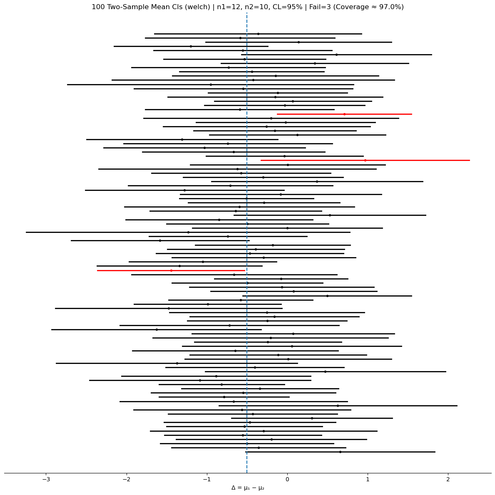
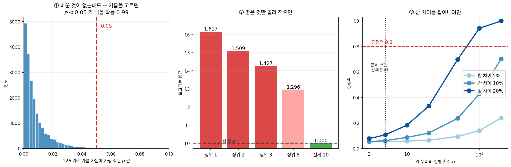

# μ₁ − μ₂의 신뢰구간

## 1. 평균 차이에 대한 이표본 신뢰구간

두 모집단을 비교할 때 우리는 흔히 두 평균의 차이에 관심을 둔다. $\mu_1 - \mu_2$의 신뢰구간은 표본변동을 감안하여 이 차이에 대해 그럴듯한 값들의 범위를 준다.

---

## 2. 상황별 공식

### 분산을 아는 경우 (z-구간)

$$
(\bar{X}_1 - \bar{X}_2) \pm z_{\alpha/2} \times \sqrt{\frac{\sigma_1^2}{n_1} + \frac{\sigma_2^2}{n_2}}
$$

여기서 $\sigma_1^2$과 $\sigma_2^2$은 알려진 모분산이고, $z_{\alpha/2}$는 $P(Z > z_{\alpha/2}) = \alpha/2$를 만족하는 임계값이다.

### 분산을 모르고 서로 다른 경우 — Welch의 t-구간

$$
(\bar{X}_1 - \bar{X}_2) \pm t_{\alpha/2, \, \text{df}} \times \sqrt{\frac{s_1^2}{n_1} + \frac{s_2^2}{n_2}}
$$

여기서 자유도는 **Welch–Satterthwaite 식**으로 계산한다:

$$
\text{df} = \frac{\left(\frac{s_1^2}{n_1} + \frac{s_2^2}{n_2}\right)^2}{\frac{1}{n_1 - 1}\left(\frac{s_1^2}{n_1}\right)^2 + \frac{1}{n_2 - 1}\left(\frac{s_2^2}{n_2}\right)^2}
$$

!!! tip "기본 선택"
    분산이 같다는 강한 근거가 없다면 Welch의 t-구간을 택하라.

### 분산을 모르고 서로 같은 경우 — 합동 t-구간

$$
(\bar{X}_1 - \bar{X}_2) \pm t_{\alpha/2, \, n_1+n_2-2} \times \sqrt{s_p^2\left(\frac{1}{n_1} + \frac{1}{n_2}\right)}
$$

여기서 **합동분산**은

$$
s_p^2 = \frac{(n_1 - 1)s_1^2 + (n_2 - 1)s_2^2}{n_1 + n_2 - 2}
$$

이고 $\text{df} = n_1 + n_2 - 2$이다.

### 큰 표본 (표본분산을 쓰는 z-구간)

$n_1 \ge 30$이고 $n_2 \ge 30$이면 분산을 모르고 서로 달라도 정규근사를 쓸 수 있다:

$$
(\bar{X}_1 - \bar{X}_2) \pm z_{\alpha/2} \times \sqrt{\frac{s_1^2}{n_1} + \frac{s_2^2}{n_2}}
$$

<div class="exbox" markdown>

**보기 1.** <span class="diff easy" title="쉬움"></span> 두 평균 차이의 신뢰구간 계산. 독립인 두 표본에서 $n_1 = 30$, $\bar x_1 = 100$, $s_1 = 15$ 와 $n_2 = 25$, $\bar x_2 = 90$, $s_2 = 20$ 을 얻었다.

**(1)** $\mu_1 - \mu_2$ 의 웰치 $95\%$ 구간을 구하시오. 두 표준오차를 더하지 않고 **분산**을 더하는 까닭을 밝히고, 표준편차를 더했다면 얼마나 틀렸을지 수로 보이시오.

**(2)** 새터스웨이트 자유도가 가질 수 있는 **범위**를 구하시오. 웰치의 자유도가 합동 $t$ 의 자유도 $n_1 + n_2 - 2$ 를 **결코 넘지 못함**을 보이고, 등호가 성립하는 자리를 밝히시오.

</div>

??? success "풀이"

    **(1) 분산이 더해진다.** 두 표본이 독립이므로

    $$
    \operatorname{Var}(\bar X_1 - \bar X_2)
    = \operatorname{Var}(\bar X_1) + \operatorname{Var}(\bar X_2)
    = \frac{\sigma_1^2}{n_1} + \frac{\sigma_2^2}{n_2}
    $$

    이고(차를 빼도 분산은 **더해진다**), 표본값을 넣으면

    $$
    \text{SE} = \sqrt{\frac{225}{30} + \frac{400}{25}} = \sqrt{7.5 + 16} = \sqrt{23.5} = 4.84768
    $$

    이다. **표준편차를 더하면 틀린다.** 가법성이 있는 것은 분산이지 표준편차가 아니다. 더해 보면

    $$
    \sqrt{7.5} + \sqrt{16} = 2.73861 + 4 = 6.73861
    $$

    로 참값보다 $39\%$ 크다. 구간이 그만큼 넓어지므로 **틀리되 보수적인 쪽**이지만, 틀린 것은 틀린 것이다.

    자유도는

    $$
    \nu = \frac{(7.5 + 16)^2}{\frac{7.5^2}{29} + \frac{16^2}{24}}
    = \frac{552.25}{1.93966 + 10.66667} = \frac{552.25}{12.60632} = 43.8074
    $$

    이고 $t_{0.025,\,43.8074} = 2.01562$ 이므로

    $$
    (100 - 90) \pm 2.01562 \times 4.84768 = 10 \pm 9.77107 = (0.2289,\ 19.7711)
    $$

    **구간이 $0$ 을 아슬아슬하게 벗어난다.** 점추정값은 차이가 $10$ 이라 하지만 구간은 $0.23$ 일 수도 $19.77$ 일 수도 있다고 말한다. **"차이가 있다"까지는 말할 수 있어도 "얼마나 있다"는 거의 말하지 못하는 자료다.**

    **(2) 자유도의 범위.** $a = s_1^2/n_1$, $b = s_2^2/n_2$ 로 두면

    $$
    \nu = \frac{(a+b)^2}{\dfrac{a^2}{n_1-1} + \dfrac{b^2}{n_2-1}}
    $$

    이다.

    **위 끝 — 코시–슈바르츠.** 두 벡터 $\left(\sqrt{n_1-1},\ \sqrt{n_2-1}\right)$ 과 $\left(\dfrac{a}{\sqrt{n_1-1}},\ \dfrac{b}{\sqrt{n_2-1}}\right)$ 에 코시–슈바르츠를 쓰면

    $$
    (a+b)^2 \le \big((n_1-1) + (n_2-1)\big)\left(\frac{a^2}{n_1-1} + \frac{b^2}{n_2-1}\right)
    $$

    이므로

    $$
    \nu \le n_1 + n_2 - 2 = 53
    $$

    이고, 등호는 두 벡터가 평행할 때, 곧

    $$
    \frac{a}{n_1-1} = \frac{b}{n_2-1}
    \iff \frac{s_1^2}{s_2^2} = \frac{(n_1-1)n_1}{(n_2-1)n_2} = \frac{29 \times 30}{24 \times 25} = 1.45
    $$

    곧 $s_1/s_2 = 1.2042$ 일 때뿐이다. **웰치의 자유도는 절대로 합동 $t$ 의 자유도를 넘지 못한다.** $\square$

    **아래 끝.** $s_1/s_2 \to 0$ 이면 $a \to 0$ 이라 $\nu \to n_2 - 1 = 24$ 이고, $s_1/s_2 \to \infty$ 면 $\nu \to n_1 - 1 = 29$ 다. 따라서

    $$
    24 \le \nu \le 53
    $$

    이다. 이 자료는 $s_1/s_2 = 0.75$ 이므로 $\nu = 43.81$ 로 범위의 가운데쯤에 있다.

    **뜻.** 웰치는 등분산을 가정하지 않는 대가로 **자유도를 내놓는다.** 그 대가를 수로 보면, 같은 자료의 합동 구간이 $(0.5259,\ 19.4741)$ 로 웰치보다 폭이 $3.0\%$ 좁다. 등분산이 참이면 이 $3\%$ 가 공짜로 얻는 정밀도이고, 거짓이면 그만큼 **틀린 자리에 놓인 좁음**이다. 두 구간 모두 $0$ 을 배제하므로 여기서는 결론이 갈리지 않는다.

    **(3) 확인.**

    ```python
    import numpy as np
    import scipy.stats as stats

    n1, n2 = 30, 25
    mean1, mean2 = 100, 90
    s1, s2 = 15, 20
    confidence_level = 0.95

    # 두 표본이 독립이므로 분산이 더해진다.
    # 표준편차가 아니라 **분산**을 더한 뒤 제곱근이라는 점에 주의.
    standard_error = np.sqrt((s1**2 / n1) + (s2**2 / n2))

    # Welch-Satterthwaite 자유도. 정수가 아니어도 scipy는 받아 준다.
    # 두 표본의 정보량을 하나로 합치는 근사이며, 한쪽 분산이 압도하면
    # 그쪽 표본의 자유도 쪽으로 끌려간다.
    df = ((s1**2 / n1) + (s2**2 / n2))**2 / (
        ((s1**2 / n1)**2 / (n1 - 1)) + ((s2**2 / n2)**2 / (n2 - 1))
    )

    t_critical = stats.t.ppf(1 - (1 - confidence_level) / 2, df)
    margin_of_error = t_critical * standard_error

    confidence_interval = (
        (mean1 - mean2) - margin_of_error,
        (mean1 - mean2) + margin_of_error,
    )
    print(f"{standard_error = :.5f},  {df = :.4f},  {t_critical = :.5f}")
    print(f"{confidence_interval = }")

    # (2) 자유도의 위 끝은 n1+n2-2 다. s1/s2 를 훑어 확인한다.
    print(f"\n{'s1/s2':>7}{'df':>10}")
    for r in (0.01, 0.75, 1.2042, 2.0, 100.0):
        a, b = (r * s2) ** 2 / n1, s2**2 / n2
        print(f"{r:>7.4f}{(a + b) ** 2 / (a**2 / (n1 - 1) + b**2 / (n2 - 1)):>10.4f}")
    print(f"n1-1 = {n1 - 1}, n2-1 = {n2 - 1}, n1+n2-2 = {n1 + n2 - 2}")

    # 같은 자료의 합동 t 구간
    sp2 = ((n1 - 1) * s1**2 + (n2 - 1) * s2**2) / (n1 + n2 - 2)
    se_p = np.sqrt(sp2 * (1 / n1 + 1 / n2))
    t_p = stats.t.ppf(0.975, n1 + n2 - 2)
    print(f"\n합동 t 구간 ({10 - t_p * se_p:.4f}, {10 + t_p * se_p:.4f})"
          f"   폭의 비 {2 * t_p * se_p / (2 * margin_of_error):.4f}")
    ```

    출력:

    ```
    standard_error = 4.84768,  df = 43.8074,  t_critical = 2.01562
    confidence_interval = (0.22892977648461788, 19.77107022351538)

      s1/s2        df
     0.0100   24.0040
     0.7500   43.8074
     1.2042   53.0000
     2.0000   44.2029
    100.0000   29.0070
    n1-1 = 29, n2-1 = 24, n1+n2-2 = 53

    합동 t 구간 (0.5259, 19.4741)   폭의 비 0.9696
    ```

    **(1)과 맞는다.** $\text{SE} = 4.84768$, $\nu = 43.8074$, 구간 $(0.2289,\ 19.7711)$ 이다.

    **(2)도 맞는다.** $s_1/s_2$ 를 훑으면 자유도가 $s_1/s_2 = 1.2042$ 에서 정확히 $53.0000 = n_1+n_2-2$ 로 **꼭짓점을 찍고**, 양쪽으로 가면서 $24$($s_1/s_2 \to 0$)와 $29$($s_1/s_2 \to \infty$)로 내려간다. 코시–슈바르츠가 준 위 끝과 등호 조건이 그대로 나타난다.

    합동 구간의 폭이 웰치의 $0.9696$ 배로 $3.0\%$ 좁고, 두 구간 모두 $0$ 을 배제한다.

구간이 0을 아슬아슬하게 벗어난다. 점추정값은 차이가 10이라고 말하지만, 구간은 0.23만큼 작을 수도 19.77만큼 클 수도 있다고 말한다. "차이가 있다"까지는 말할 수 있어도 "얼마나 있다"는 거의 말하지 못하는 자료다.

---

## 3. 보기

<div class="exbox" markdown>

**보기 2.** <span class="diff easy" title="쉬움"></span> 평균 차이의 95% 신뢰구간 (Welch). 독립인 두 표본: 표본 1은 $n_1 = 30$, $\bar{X}_1 = 100$, $s_1 = 15$이고, 표본 2는 $n_2 = 25$, $\bar{X}_2 = 90$, $s_2 = 20$이다.

</div>

??? success "풀이"

    $$
    \text{SE} = \sqrt{\frac{225}{30} + \frac{400}{25}} = \sqrt{7.5 + 16} = \sqrt{23.5} \approx 4.847
    $$

    Welch–Satterthwaite 자유도:

    $$
    \text{df} = \frac{(7.5 + 16)^2}{\frac{7.5^2}{29} + \frac{16^2}{24}} = \frac{552.25}{12.606} \approx 43.8
    $$

    $t_{0.025, 43} \approx 2.017$이므로:

    $$
    \text{ME} = 2.017 \times 4.847 \approx 9.78
    $$

    $$
    \boxed{(0.22,\ 19.78)}
    $$

    두 모평균의 참 차이가 0.22와 19.78 사이에 있다고 95% 신뢰한다.
---

## 4. 모의실험: 이표본 평균 신뢰구간의 포함확률

<div class="exbox" markdown>

**보기 3.** <span class="diff easy" title="쉬움"></span> 네 방법의 포함확률 비교. $\mu_1 = 0$, $\sigma_1 = 1.0$, $n_1 = 12$ 와 $\mu_2 = 0.5$, $\sigma_2 = 1.5$, $n_2 = 10$ 에서 명목 $95\%$ 구간을 $100$개씩 만든다. 스크립트는 한 번에 한 방법만 돌린다.

**(1)** 이 설정으로 "네 방법의 비교"가 되는가. 웰치와 합동 $t$ 의 포함률 차이가 참으로 $0.010$ 일 때, 그 차이를 가리려면 되풀이가 몇 번 필요한지 구하시오.

**(2)** 네 방법을 **같은 표본**에 돌리면 필요한 되풀이가 얼마나 줄어드는가.

**(3)** 그림을 그려 무엇이 읽히는지 말하시오.

</div>

??? success "풀이"

    **(1) $100$회로는 비교가 되지 않는다.** 포함률 $p$ 의 추정값은 되풀이 $M$ 회에서 표준오차 $\sqrt{p(1-p)/M}$ 를 갖는다. $p \approx 0.95$ 이면 $M = 100$ 에서 $0.0218$ 이다. 가리려는 차이가 $0.010$ 이므로 **오차가 차이의 두 배**다.

    차이의 $95\%$ 구간이 $0$ 을 벗어나려면, 두 방법을 **따로** 돌릴 때 차이의 표준오차가

    $$
    \text{SE}_{\text{차이}} = \sqrt{\frac{p_1(1-p_1) + p_2(1-p_2)}{M}}
    = \frac{0.3082}{\sqrt M}
    $$

    이고 $2 \times 1.96 \times \text{SE}_{\text{차이}} < 0.010$ 을 풀면

    $$
    M > \left(\frac{2 \times 1.96 \times 0.3082}{0.010}\right)^2 = 16{,}000
    $$

    쯤이다. **$100$회의 $160$배가 필요하다.**

    **(2) 같은 표본을 쓰면 짝지은 비교가 된다.** 표본 하나에 네 방법을 모두 적용하면, 그 표본이 유난히 극단적이었던 효과가 네 방법에 **똑같이** 실린다. 그 공통 부분이 차에서 빠지므로 차이의 분산이 크게 줄어든다.

    실제로 웰치와 합동 $t$ 의 포함 지시함수 차 $\mathbf 1_W - \mathbf 1_P$ 는 두 방법의 판정이 갈릴 때만 $0$ 이 아닌데, 그 일이 일어나는 비율이

    $$
    P(W \text{만 담음}) = 0.0104, \qquad P(P \text{만 담음}) = 0.0005
    $$

    로 합쳐 $1.1\%$ 뿐이다. 그래서 차의 표준편차가 $0.1039$ 로 **따로 돌릴 때의 $0.3082$ 보다 세 배 작다.** 필요한 되풀이는

    $$
    M > \left(\frac{2 \times 1.96 \times 0.1039}{0.010}\right)^2 = 1{,}700
    $$

    으로 **약 $1/10$ 로 줄어든다.**

    **이것이 짝짓기의 일반 원리다.** 같은 표본에 여러 방법을 돌리면 표본의 변동이 공통인자가 되어 상쇄된다. 8.4절의 대응표본 설계가 같은 이치이며, 거기서는 짝지은 **사람**이 공통인자다.

    **참값은 되풀이 $200$만 회로 이렇다.** 웰치 $0.9499$, 합동 $t$ $0.9399$, $z$-known $0.9498$, $z$-plugin $0.9317$(몬테카를로 표준오차 $0.0002$). 웰치와 합동 $t$ 의 차이가 $0.0100$ 으로 (1)에서 가정한 값과 맞는다.

    **(3) 그림.**

    ```python
    #!/usr/bin/env python3
    """두 평균의 차이에 대한 신뢰구간을 네 방법으로 만들어 포함확률을 비교한다.

    Welch 는 두 분산이 다를 수 있다고 보고, 합동(pooled)은 같다고 본다.
    분산이 실제로 다를 때 합동 방법의 포함확률이 어떻게 무너지는지가 요점이다.
    """

    import numpy as np
    import matplotlib.pyplot as plt
    from scipy.stats import t, norm

    plt.rcParams["font.sans-serif"] = ["NanumGothic", "Apple SD Gothic Neo", "Malgun Gothic"]
    plt.rcParams["font.family"] = "sans-serif"
    plt.rcParams["axes.unicode_minus"] = False

    rng_seed = 42        # 아래 그림을 재현하려면 고정한다
    n_simulations = 100
    n1, n2 = 12, 10
    mu1, mu2 = 0.0, 0.5
    sigma1, sigma2 = 1.0, 1.5
    alpha = 0.05
    method = "welch"  # 'welch' | 'pooled' | 'z_known' | 'z_plugin'


    def main():
        if rng_seed is not None:
            np.random.seed(rng_seed)

        delta_true = mu1 - mu2
        lowers = np.empty(n_simulations)
        uppers = np.empty(n_simulations)
        centers = np.empty(n_simulations)

        for i in range(n_simulations):
            x = np.random.normal(loc=mu1, scale=sigma1, size=n1)
            y = np.random.normal(loc=mu2, scale=sigma2, size=n2)
            xbar, ybar = x.mean(), y.mean()
            s1, s2 = x.std(ddof=1), y.std(ddof=1)
            diff_hat = xbar - ybar
            centers[i] = diff_hat

            if method == "welch":
                se = np.sqrt(s1**2 / n1 + s2**2 / n2)
                num = (s1**2 / n1 + s2**2 / n2) ** 2
                den = (s1**2 / n1) ** 2 / (n1 - 1) + (s2**2 / n2) ** 2 / (n2 - 1)
                df = num / den
                crit = t.ppf(1 - alpha / 2.0, df=df)
            elif method == "pooled":
                df = n1 + n2 - 2
                sp2 = ((n1 - 1) * s1**2 + (n2 - 1) * s2**2) / df
                se = np.sqrt(sp2 * (1.0 / n1 + 1.0 / n2))
                crit = t.ppf(1 - alpha / 2.0, df=df)
            elif method == "z_known":
                se = np.sqrt(sigma1**2 / n1 + sigma2**2 / n2)
                crit = norm.ppf(1 - alpha / 2.0)
            else:  # z_plugin
                se = np.sqrt(s1**2 / n1 + s2**2 / n2)
                crit = norm.ppf(1 - alpha / 2.0)

            lowers[i] = diff_hat - crit * se
            uppers[i] = diff_hat + crit * se

        covered = (lowers <= delta_true) & (delta_true <= uppers)
        n_fail = int((~covered).sum())
        coverage_pct = 100.0 * covered.mean()

        fig, ax = plt.subplots(figsize=(12, 12))
        for i in range(n_simulations):
            color = "k" if covered[i] else "r"
            ax.plot([lowers[i], uppers[i]], [i, i], lw=2, color=color)
            ax.plot(centers[i], i, marker="o", ms=3, color=color)
        ax.axvline(delta_true, linestyle="--", linewidth=1.5)
        ax.set_title(
            f"{n_simulations} Two-Sample Mean CIs ({method}) | n1={n1}, n2={n2}, "
            f"CL={int((1 - alpha) * 100)}% | Fail={n_fail} (Coverage ≈ {coverage_pct:.1f}%)")
        ax.set_yticks([])
        for sp in ["left", "right", "top"]:
            ax.spines[sp].set_visible(False)
        ax.set_xlabel("Δ = μ₁ − μ₂")
        plt.tight_layout()
        plt.show()


    if __name__ == "__main__":
        main()
    ```

    

    **실패가 셋이다.** 참값 $0.9499$ 에서 기대 실패가 다섯인데 셋이 나왔고, $100$회의 표준오차 $0.0218$ 안이다.

    **폭이 $1.559$ 에서 $4.024$ 까지 $2.58$배 널뛴다.** 일표본 그림보다 심한데, 흔들리는 양이 $s_1$, $s_2$ 둘인 데다 **임계값까지 흔들리기** 때문이다. 새터스웨이트 자유도가 표본마다 달라지므로 $t_{0.025,\,\nu}$ 가 상수가 아니다. 이 $100$개에서 $\nu$ 가 $9.49$ 에서 $19.99$ 까지 오가고, 그에 따라 임계값이 $2.0861$ 에서 $2.2446$ 까지 움직인다.

    **그러나 이 그림은 (1)(2)의 비교에 쓸 수 없다.** 그려진 것은 웰치 하나뿐이고, 실패 개수 $3$ 과 참값 $0.9499$ 의 거리는 되풀이 $100$회의 잡음 안에 있다. **그림은 구간이 어떻게 생겼는지를 보여 주지 포함률이 얼마인지를 말해 주지 않는다.**

포함확률 97.0%로 명목값을 달성한다(100회 모의실험의 표준오차가 2.2%p이므로 95%와 구별되지 않는다). `method`를 `"pooled"`나 `"z_plugin"`으로 바꿔 같은 자료에 다시 돌려 보면 방법마다 어디서 무너지는지 볼 수 있다.

---

포함률이 **어긋나는 쪽과 그 크기**는 설계를 바꿔 가며 세어야 보인다. 특히 합동 $t$ 가 이 설정에서 왜 위험한지는 수로 보는 편이 빠르다.

<div class="exbox" markdown>

**보기 4.** <span class="diff easy" title="쉬움"></span> 두 평균 차이 구간 모의실험. 두 정규모집단이 $\mu_1 = 0$, $\sigma_1 = 1.0$ 과 $\mu_2 = 0.5$, $\sigma_2 = 1.5$ 이고, 표본크기는 $n_1 = 12$, $n_2 = 10$ 이다. **작은 표본 쪽의 분산이 더 크다.** 네 방법으로 명목 $95\%$ 구간을 만든다.

**(1)** 네 방법 가운데 포함률이 **정확히** $0.95$ 인 것은 어느 것인가. 나머지는 어느 쪽으로 어긋나겠는가. 합동 $t$ 가 이 설정에서 특히 위험한 까닭을 **수로** 보이시오.

**(2)** 되풀이 $100$회의 모의실험으로 네 방법의 우열을 가릴 수 있는가.

</div>

??? success "풀이"

    **(1) $z$-known 만 정확하다.** 두 모분산을 알면 표준오차

    $$
    \sqrt{\frac{\sigma_1^2}{n_1} + \frac{\sigma_2^2}{n_2}}
    = \sqrt{\frac{1}{12} + \frac{2.25}{10}} = \sqrt{0.30833} = 0.55528
    $$

    이 **상수**이고 $\bar X_1 - \bar X_2$ 가 정확히 정규이므로 포함률이 $2\Phi(1.96) - 1 = 0.95$ 다. 나머지 셋은 분산을 추정하므로 사정이 다르다.

    **합동 $t$ 는 아래로 어긋난다.** 합동분산의 기댓값은 자유도 가중평균이다.

    $$
    E[S_p^2] = \frac{(n_1-1)\sigma_1^2 + (n_2-1)\sigma_2^2}{n_1+n_2-2}
    = \frac{11 \times 1 + 9 \times 2.25}{20} = 1.5625
    $$

    이것으로 만든 표준오차의 제곱은

    $$
    E[S_p^2]\left(\frac1{n_1} + \frac1{n_2}\right)
    = 1.5625 \times 0.18333 = 0.28646
    $$

    인데 **참값은 $0.30833$ 이다.** 비가 $0.9291$ 이므로 표준오차를 평균적으로 $\sqrt{0.9291} = 0.9639$ 배, 곧 **$3.6\%$ 작게** 잡는다. 구간이 그만큼 좁아지니 포함률이 $0.95$ 아래로 내려간다.

    **까닭은 가중치의 방향이다.** 합동분산은 자유도가 큰 쪽($n_1 - 1 = 11$, 곧 **작은 분산** 쪽)에 더 큰 가중을 준다. 그런데 차이의 분산 $\sigma_1^2/n_1 + \sigma_2^2/n_2$ 에서는 **$n$ 이 작은 쪽**($n_2 = 10$, 곧 **큰 분산** 쪽)이 더 큰 몫을 차지한다. 두 가중이 **반대 방향**이라 과소추정이 생긴다. 큰 분산이 큰 표본에 붙어 있었다면 부호가 뒤집혀 합동 $t$ 가 오히려 보수적이 된다.

    **$s$ 를 꽂은 $z$ 는 더 아래로 어긋난다.** 표준오차는 웰치와 **같은데** 임계값만 $t$ 에서 $z$ 로 줄였다. 웰치의 자유도가 평균 $15.4$ 쯤이므로

    $$
    \frac{z_{0.025}}{t_{0.025,\,15.4}} = \frac{1.95996}{2.12628} = 0.9218
    $$

    로 구간이 $8\%$ 좁다. 넷 가운데 가장 나쁠 것으로 예상된다.

    **웰치는 근사지만 좋은 근사다.** 새터스웨이트 자유도는 $S_1^2/n_1 + S_2^2/n_2$ 를 척도화한 카이제곱으로 **적률을 맞춰** 근사한 것이라 정확하지는 않다. 다만 어긋남이 매우 작다.

    **(2) 되풀이 $100$회로는 가릴 수 없다.** 포함률 $0.95$ 근처에서 $100$회의 몬테카를로 표준오차가 $0.0218$ 인데, 네 방법의 **참값 차이가 그보다 작거나 비슷하다.** 되풀이 $200$만 회로 재면 이렇다.

    | 방법 | 포함률 | 기대 폭 |
    |---|---|---|
    | 웰치 | $0.9499$ | $2.3333$ |
    | 합동 $t$ | $0.9399$ | $2.2012$ |
    | $z$-known | $0.9498$ | $2.1766$ |
    | $z$-plugin | $0.9317$ | $2.1418$ |

    (몬테카를로 표준오차 $0.0002$.) **$z$-known 이 $0.9498$ 로 (1)의 예측 $0.95$ 와 맞고, 웰치가 $0.9499$ 로 그에 붙어 있다.** 합동 $t$ 는 $0.9399$ 로 $1$퍼센트포인트 모자라고 $z$-plugin 은 $0.9317$ 로 $1.8$퍼센트포인트 모자라, 예측한 방향과 순서가 모두 맞는다.

    그런데 가장 큰 차이인 웰치와 $z$-plugin 사이의 $0.018$ 조차 $100$회 오차 $0.0218$ 보다 **작다.**

    **(3) 확인.**

    ```python
    import numpy as np
    import matplotlib.pyplot as plt
    from scipy.stats import t, norm

    np.random.seed(42)          # 아래 출력과 그림을 재현하려면 고정한다

    n_simulations = 100
    # 표본크기도 분산도 서로 다르게 잡았다. 이런 설정에서 합동 t가 무너지고
    # Welch가 버티는지 보려는 것이다.
    n1, n2 = 12, 10
    mu1, mu2 = 0.0, 0.5
    sigma1, sigma2 = 1.0, 1.5
    alpha = 0.05
    method = "welch"  # 'welch' | 'pooled' | 'z_known' | 'z_plugin'

    delta_true = mu1 - mu2
    lowers = np.empty(n_simulations)
    uppers = np.empty(n_simulations)
    centers = np.empty(n_simulations)

    for i in range(n_simulations):
        x = np.random.normal(mu1, sigma1, n1)
        y = np.random.normal(mu2, sigma2, n2)
        xbar, ybar = x.mean(), y.mean()
        s1, s2 = x.std(ddof=1), y.std(ddof=1)
        diff_hat = xbar - ybar
        centers[i] = diff_hat

        if method == "welch":
            se = np.sqrt(s1**2 / n1 + s2**2 / n2)
            num = (s1**2 / n1 + s2**2 / n2)**2
            den = (s1**2 / n1)**2 / (n1 - 1) + (s2**2 / n2)**2 / (n2 - 1)
            df = num / den
            crit = t.ppf(1 - alpha / 2, df=df)
        elif method == "pooled":
            df = n1 + n2 - 2
            sp2 = ((n1 - 1) * s1**2 + (n2 - 1) * s2**2) / df
            se = np.sqrt(sp2 * (1 / n1 + 1 / n2))
            crit = t.ppf(1 - alpha / 2, df=df)
        elif method == "z_known":
            se = np.sqrt(sigma1**2 / n1 + sigma2**2 / n2)
            crit = norm.ppf(1 - alpha / 2)
        else:  # z_plugin
            se = np.sqrt(s1**2 / n1 + s2**2 / n2)
            crit = norm.ppf(1 - alpha / 2)

        lowers[i] = diff_hat - crit * se
        uppers[i] = diff_hat + crit * se

    covered = (lowers <= delta_true) & (delta_true <= uppers)
    coverage_pct = 100.0 * covered.mean()
    print(f"{method} coverage: {coverage_pct:.1f}%")
    ```

    출력:

    ```
    welch coverage: 97.0%
    ```

    **$100$회가 (1)의 순서를 뒤집는다.** 같은 자료에 `method` 만 바꾸면 웰치 $97\%$, 합동 $t$ $95\%$, $z$-known $94\%$, $z$-plugin $93\%$ 가 나온다. 참값은 차례로 $0.9499,\ 0.9399,\ 0.9498,\ 0.9317$ 이므로

    - 웰치가 참값보다 $2$퍼센트포인트 높게 나왔고($0.92$ 표준오차),
    - **합동 $t$ 가 $z$-known 보다 높게 나왔다** — 참값은 반대다.

    되풀이가 모자라면 **순서조차 믿을 수 없다.** 여기서 모의실험이 할 수 있는 일은 "네 방법이 $0.95$ 근처에 있다"는 것까지이고, 그 안의 순위는 (1)의 유도나 $40$만 회짜리 모의실험이 정해야 한다.

같은 자료에 `method`만 바꾸면 합동 $t$ 95%, $z$-known 94%, $z$-plugin 93%가 나온다. 다만 100회짜리 모의실험의 표준오차가 2.2%p나 되므로 이 차이를 방법의 우열로 읽으면 안 된다. 방법 사이의 진짜 차이를 보려면 아래 연습문제 2처럼 10,000회가 필요하다.

<div class="aibox" markdown>

**AI로 보는 통계학 1.** 같은 것을 둘로 갈라 견주었더니

이 절의 구간은 **두 무리가 서로 다른 것**이라는 데서 출발한다. 무리를 가르는 일이
언제나 그렇게 분명하지는 않다.

$2018$ 년 핸더슨·이슬람·바크만·피노·프레컵·미거가 「중요한 것을 다루는 심층 강화학습
(Deep Reinforcement Learning that Matters)」을 AAAI 에 실었다. 그들이 한 일은 단순하다.
하나의 알고리즘(TRPO)을 하나의 환경(HalfCheetah)에서 **하이퍼파라미터를 그대로 둔 채**
열 번 돌렸다. 바꾼 것은 난수 씨앗뿐이다. 그러고는 열 개를 **다섯씩 둘로 갈라** 각각
평균을 내고, 두 무리를 이표본 $t$ 로 견주었다. 논문의 그림 $5$ 설명에 결과가 그대로 있다.

> **「같은 하이퍼파라미터 구성으로 돌린 … 서로 다른 난수 씨앗 다섯 개씩 두 묶음을 평균한
> 것이다. 훈련 분포 전체에 걸친 평균 $2$-표본 $t$-검정은 $t = -9.0916$, $p = 0.0016$ 을
> 냈다.」**

비교한 둘은 **같은 알고리즘이다.** 그런데 구간은 $0$ 을 담지 않았다. 그들의 문장으로

> **「실행 사이의 분산은 난수 씨앗을 바꾸는 것만으로 통계적으로 다른 분포를 만들어 내기에
> 충분하다는 것을 우리는 보인다.」**

아래는 그 일이 어떻게 일어나는지를 재어 본 것이다. 실행 사이의 흩어짐을 변동계수 $0.4$
로 두고(강화학습에서 드물지 않다) 실행 열 개를 만든 다음, 바꾼 것이 **아무것도 없는**
상태에서 가름을 바꿔 가며 보았다.



- **①** 열 개를 다섯씩 가르는 방법은 $126$ 가지다. 어느 **하나**를 미리 정해 두고
  보면 $1$ 종오류는 이름값 $0.05$ 가 맞다. 그런데 $126$ 가지를 모두 보고 가장 갈라
  보이는 것을 고르면, $p < 0.05$ 인 가름이 하나라도 있을 확률이 **$0.992$** 다. 가장
  작은 $p$ 의 중앙값은 $0.0049$ 이고, $0.01$ 보다 작을 확률이 $0.734$ 다. 그렇게 고른
  가름에서 두 무리의 상대 차이는 중앙값 $58.8\%$ 로 보인다. **아무 차이도 없는 곳에서다.**
- **②** 논문이 함께 지적한 것이 「여러 번 돌려 상위 몇 개만 골라 보고하기」다. 열 번
  가운데 가장 좋은 하나를 적으면 평균이 참값보다 $61.7\%$ 높고, 상위 셋을 적으면
  $42.7\%$, 상위 다섯이라도 $29.6\%$ 높다. 열 개를 모두 적어야 $1.000$ 이 된다.
- **③** 그러면 **참** 차이는 몇 번 돌려야 보이는가. 무리마다 다섯 번씩으로는 참 차이가
  $10\%$ 여도 검정력이 $0.062$ 이고 $20\%$ 라도 $0.107$ 이다. 검정력 $0.8$ 에 닿으려면
  **무리마다 $64$ 번**($20\%$ 차이), **$253$ 번**($10\%$), **$1{,}006$ 번**($5\%$) 을
  돌려야 한다. 흔히 쓰는 다섯 번은 참 차이를 찾기에는 턱없이 적으면서, 없는 차이를
  만들어 내기에는 충분하다.

$\mu_1 - \mu_2$ 의 구간이 $0$ 을 담지 않는다는 말은 **두 무리가 다르게 뽑혔다**는 뜻이지
두 방법이 다르다는 뜻이 아니다. 무엇을 하나의 관측으로 셀 것인지, 그리고 무리를 어떻게
가를지를 **자료를 보기 전에** 정해 두어야 하는 까닭이 여기 있다.

_확인한 곳 — Henderson, Islam, Bachman, Pineau, Precup, Meger (2018) *Deep Reinforcement
Learning that Matters*, AAAI-18 (arXiv:1709.06560) 의 그림 $5$ 설명과 「Results」 문단.
인용한 두 문장과 $t = -9.0916$, $p = 0.0016$, 실행 $10$ 회를 다섯씩 가른 설계, 상위 $N$
개만 고르는 관행에 대한 지적이 모두 거기 있다. 그림과 표의 수는 모두 직접 계산한 값이며
핸더슨 등의 측정값이 아니다_

</div>

---

## 5. 핵심 정리

- 두 모평균을 비교할 때는 $\mu_1 - \mu_2$의 신뢰구간을 구성한다.
- 모분산을 모르고 서로 다르면 **Welch의 t-구간**을 쓴다(기본 선택).
- 분산이 같다고 가정하면 **합동 t-구간**이 결합된 분산추정값을 쓴다.
- 신뢰구간의 너비는 표본크기, 표본분산, 신뢰수준에 달려 있다.

---

## 연습문제

<div class="drillbox" markdown>

**연습문제 1.** <span class="diff easy" title="쉬움"></span>
독립인 두 표본: $\sigma_A = 15, n_A = 36$; $\sigma_B = 20, n_B = 49$. $\mathrm{SE}(\bar X_A - \bar X_B)$를 계산하라.

</div>

??? success "풀이"
    $\mathrm{SE} = \sqrt{15^2/36 + 20^2/49} = \sqrt{6.25 + 8.16} = \sqrt{14.41} \approx 3.80$.

---

<div class="drillbox" markdown>

**연습문제 2.** <span class="diff easy" title="쉬움"></span>
표본 1: $\bar X_1 = 55, s_1 = 8, n_1 = 30$. 표본 2: $\bar X_2 = 50, s_2 = 10, n_2 = 35$. $\mu_1 - \mu_2$의 95% 신뢰구간을 구하라.

</div>

??? success "풀이"
    $\mathrm{SE} = \sqrt{64/30 + 100/35} \approx 2.233$. $n$이 크므로 $z$를 쓴다: 오차한계 = $1.96 \cdot 2.233 \approx 4.38$.

    신뢰구간: $(5 - 4.38, 5 + 4.38) = (0.62, 9.38)$. 0을 포함하지 *않는다* — 차이가 있다는 증거이다.

---

<div class="drillbox" markdown>

**연습문제 3.** <span class="diff easy" title="쉬움"></span>
두 교수법에 대한 Welch 신뢰구간: A ($n = 30, \bar X = 78, s = 8$), B ($n = 35, \bar X = 82, s = 10$). $\mu_A - \mu_B$의 95% 신뢰구간을 구하라.

</div>

??? success "풀이"
    $\mathrm{SE} = \sqrt{64/30 + 100/35} \approx 2.234$.

    Welch 자유도: $\nu = (2.133 + 2.857)^2/[2.133^2/29 + 2.857^2/34] = 24.9/0.397 \approx 62.7$. $t_{62}$를 쓴다.

    $t_{0.975, 62} \approx 2.00$. 신뢰구간: $(78 - 82) \pm 2.00 \cdot 2.234 = -4 \pm 4.47 = (-8.47, 0.47)$.

    0을 포함한다 — 5% 수준에서 유의한 차이를 결론지을 수 없다. 대부분 음수여서 방법 B가 더 나을 수 있음을 시사하지만 증거가 결정적이지 않다.

---

<div class="drillbox" markdown>

**연습문제 4.** <span class="diff med" title="중간"></span>
**합동 대 Welch.** 각각 언제 쓰며, 둘을 가르는 가정은 무엇인가?

</div>

??? success "풀이"
    **합동 $t$-검정:** $\sigma_1 = \sigma_2$를 가정한다. 두 표본을 합쳐 공통 $\sigma$를 추정한다. 자유도 $= n_1 + n_2 - 2$.

    **Welch $t$-검정:** $\sigma_1 \ne \sigma_2$를 허용한다. 각각의 분산을 따로 쓴다. Welch-Satterthwaite 공식으로 근사 자유도를 구한다.

    **합동을 쓸 때:** (예컨대 실험설계에 의해) 분산이 같다고 *알려져* 있을 때. 효율 이득이 크지 않다.

    **Welch를 쓸 때:** 기본. 분산이 같을 필요가 없고, 실제로 분산이 같을 때도 합동에 거의 맞먹는 효율을 낸다.

    현대의 권고: 등분산이 구조적으로 보장되지 않는 한 **항상 Welch를 쓰라**. R의 `t.test`는 기본이 Welch이다. 분산이 같은데 Welch를 "잘못" 쓰는 대가는 작지만, 다른데 "잘못" 합동하는 대가는 클 수 있다.

---

<div class="drillbox" markdown>

**연습문제 5.** <span class="diff med" title="중간"></span>
**대응 대 독립.** 피험자 $n = 50$명을 치료 전후로 측정했다. 이 연습문제의 이표본 신뢰구간을 적용해야 하는가?

</div>

??? success "풀이"
    **아니다.** 전후 측정은 같은 피험자를 두 번 잰 것이므로 *대응*되어 있다. 서로 독립이 *아니다*. 이표본 신뢰구간을 쓰면 이들을 독립으로 취급하여 피험자 내 상관을 무시하게 된다.

    **올바른 접근:** 피험자마다 차이 $D_i = \mathrm{post}_i - \mathrm{pre}_i$를 계산하고, $\bar D, s_D$와 자유도 $n - 1$로 $D$에 대한 일표본 신뢰구간을 구한다.

    **왜 중요한가:** 전후가 (흔히 그렇듯) 양의 상관을 가지면 $\mathrm{Var}(D) < \mathrm{Var}(\mathrm{pre}) + \mathrm{Var}(\mathrm{post})$이다. 대응 분석은 표준오차가 작고 신뢰구간이 좁으며 검정력이 크다.

    이표본 신뢰구간은 대응에 관한 정보를 잃고 필요 이상으로 넓은 구간을 준다. 분석은 항상 설계에 맞추어야 한다.

---

<div class="drillbox" markdown>

**연습문제 6.** <span class="diff med" title="중간"></span>
**효과크기.** $\mu_1 - \mu_2$의 신뢰구간과 함께 **Cohen의 $d$** = (효과)/(합동 표준편차)를 보고하라. 해석하라.

</div>

??? success "풀이"
    연습문제 3에서 합동 표준편차 $= \sqrt{((29 \cdot 64) + (34 \cdot 100))/63} = \sqrt{(1856 + 3400)/63} = \sqrt{83.4} \approx 9.13$.

    Cohen의 $d = (78 - 82)/9.13 \approx -0.44$.

    **해석:**

    - $|d| = 0.2$: 작은 효과.
    - $|d| = 0.5$: 중간 효과.
    - $|d| = 0.8$: 큰 효과.

    $d = -0.44$는 "중간에 조금 못 미치는" 효과이다 — 방법 B의 평균이 A의 평균보다 약 0.44 표준편차 위에 있다. 신뢰구간은 유의성에 살짝 못 미쳤지만 효과크기는 무시할 수준이 아니다.

    항상 둘 다 보고하라:

    - **통계적 유의성** (신뢰구간이 0을 배제, $p < \alpha$).
    - **실질적 유의성** (효과크기가 의미 있을 만큼 큰가).

    효과크기는 무차원이어서 연구와 분야를 넘어 비교할 수 있으므로 메타분석에 유용하다. 유의성 검정은 표본크기에 좌우되지만 효과크기는 그렇지 않다.

---

<div class="drillbox" markdown>

**연습문제 7.** <span class="diff med" title="중간"></span>
**새터스웨이트 자유도**가 언제 극단으로 가는지 조사하고, 실무적 의미를 설명하라.

</div>

??? success "풀이"
    **공식.**

    $$
    \nu=\frac{\left(\dfrac{s_1^2}{n_1}+\dfrac{s_2^2}{n_2}\right)^2}
    {\dfrac{(s_1^2/n_1)^2}{n_1-1}+\dfrac{(s_2^2/n_2)^2}{n_2-1}}
    $$

    ```python
    import numpy as np

    def satt(n1, n2, s1, s2):
        a, b = s1**2 / n1, s2**2 / n2
        return (a + b)**2 / (a**2 / (n1 - 1) + b**2 / (n2 - 1))

    print(f"{'n1':>4s} {'n2':>4s} {'s1':>5s} {'s2':>5s} {'ν':>8s} "
          f"{'하한':>6s} {'상한':>6s}")
    for n1, n2, s1, s2 in [(10, 10, 1, 1), (10, 10, 1, 5),
                           (10, 50, 1, 1), (10, 50, 5, 1),
                           (10, 50, 1, 5), (5, 100, 1, 10)]:
        v = satt(n1, n2, s1, s2)
        print(f"{n1:4d} {n2:4d} {s1:5.1f} {s2:5.1f} {v:8.2f} "
              f"{min(n1, n2) - 1:6d} {n1 + n2 - 2:6d}")
    ```

    ```text
      n1   n2    s1    s2        ν     하한     상한
      10   10   1.0   1.0    18.00      9     18
      10   10   1.0   5.0     9.72      9     18
      10   50   1.0   1.0    12.87      9     58
      10   50   5.0   1.0     9.14      9     58
      10   50   1.0   5.0    57.94      9     58
       5  100   1.0  10.0    71.64      4    103
    ```

    **$\nu$는 항상 $\min(n_1,n_2)-1$과 $n_1+n_2-2$ 사이에 있다.** 이것이 정리로 증명되어 있다.

    **두 극단.**

    1. **한쪽 항이 지배하면** $\nu$가 그 집단의 자유도에 가까워진다. $(10,50,5,1)$에서 $s_1^2/n_1=2.5$가 $s_2^2/n_2=0.02$를 압도해 $\nu=9.14\approx n_1-1=9$다. **작은 표본에 큰 분산이면 그 집단의 자유도만 쓰는 셈**이다.

    2. **다른 쪽이 지배하면** 큰 집단의 자유도 쪽으로 간다. $(5,100,1,10)$에서 $\nu=71.6$으로 $n_2-1=99$에 가까워진다.

    3. **두 항이 비슷하면** 합쳐진 자유도에 가까워진다. $(10,10,1,1)$에서 $\nu=18=n_1+n_2-2$로 최댓값이다.

    **실무적 의미.**

    - **표본을 어디에 투자할지 알려 준다.** 분산이 큰 집단의 표본을 늘려야 $\nu$가 오르고 구간이 좁아진다. **분산이 작은 집단을 늘리는 것은 거의 소용이 없다.**

    - **$\nu$가 작으면 결과를 조심한다.** $\nu<10$이면 $t$ 임계값이 2.2를 넘어 구간이 크게 넓어진다. 이런 상황이면 표본 설계를 재검토할 필요가 있다.

    - **$\nu$는 확률변수다.** $s_1$, $s_2$에 의존하므로 표본마다 달라진다. 보고할 때 소수점 한 자리까지 적는 것이 관례다(정수로 반올림하면 정보가 사라진다).

    **최적 배분과의 연결.** 앞서 본 대로 분산이 다르면 $n_2/n_1=\sigma_2/\sigma_1$이 최적이다. 그때 $s_1^2/n_1\approx s_2^2/n_2$가 되어 **$\nu$가 최대에 가까워진다.** 최적 배분이 자유도도 최대화한다.

---

<div class="drillbox" markdown>

**연습문제 8.** <span class="diff med" title="중간"></span>
두 집단 비교에서 **층화**나 **공변량 보정**이 구간을 얼마나 좁히는지 계산하고, 언제 쓸 가치가 있는지 논하라.

</div>

??? success "풀이"
    **원리.** 결과와 상관된 공변량 $X$를 모형에 넣으면 잔차분산이 $\sigma^2(1-R^2)$로 줄어든다.

    $$
    \frac{\text{보정 후 폭}}{\text{보정 전 폭}}\approx\sqrt{1-R^2}
    $$

    ```python
    import numpy as np
    from scipy import stats

    rng = np.random.default_rng(55)
    n, M, tau = 40, 5_000, 1.0                  # 집단당 40명
    print(f"{'R²':>6s} {'단순 폭':>9s} {'보정 폭':>9s} {'비':>7s} "
          f"{'유효 n 배율':>12s}")
    for R2 in [0.0, 0.1, 0.3, 0.5, 0.7, 0.9]:
        w_raw = w_adj = 0.0
        for _ in range(M // 10):
            g = np.repeat([0, 1], n)
            x = rng.normal(0, 1, 2 * n)
            y = tau * g + np.sqrt(R2) * x + np.sqrt(1 - R2) * rng.normal(0, 1, 2 * n)

            a, b = y[g == 0], y[g == 1]
            sp = np.sqrt((a.var(ddof=1) + b.var(ddof=1)) / 2)
            w_raw += 2 * stats.t.ppf(0.975, 2 * n - 2) * sp * np.sqrt(2 / n)

            X = np.column_stack([np.ones(2 * n), g, x])
            beta, *_ = np.linalg.lstsq(X, y, rcond=None)
            r = y - X @ beta
            df = 2 * n - 3
            se = np.sqrt((r @ r / df) * np.linalg.inv(X.T @ X)[1, 1])
            w_adj += 2 * stats.t.ppf(0.975, df) * se
        w_raw /= M // 10
        w_adj /= M // 10
        print(f"{R2:6.1f} {w_raw:9.4f} {w_adj:9.4f} {w_adj / w_raw:7.4f} "
              f"{(w_raw / w_adj)**2:12.2f}")
    ```

    ```text
        R²      단순 폭      보정 폭       비      유효 n 배율
       0.0    0.8916    0.8978  1.0069         0.99
       0.1    0.8823    0.8411  0.9533         1.10
       0.3    0.8904    0.7456  0.8373         1.43
       0.5    0.8886    0.6293  0.7082         1.99
       0.7    0.8896    0.4906  0.5514         3.29
       0.9    0.8861    0.2848  0.3214         9.68
    ```

    **$R^2=0.5$면 폭이 29% 줄고, 표본을 두 배로 늘린 것과 같다.** $R^2=0.9$면 표본 10배에 가까운 효과다.

    **$R^2=0$이면 손해다.** 폭이 0.7% 늘어난다. 자유도를 하나 잃기 때문이다. **무관한 공변량을 넣는 비용은 매우 작지만 이득도 없다.**

    **언제 쓸 가치가 있는가.**

    | $R^2$ | 판단 |
    |---|---|
    | $<0.05$ | 넣을 이유 없음 |
    | 0.1~0.3 | 넣으면 이득(표본 10~40% 절약) |
    | $>0.5$ | **반드시 넣는다** |

    **무작위 실험에서의 주의점.**

    1. **공변량은 배정 전에 측정된 것이어야 한다.** 사후 변수를 넣으면 효과의 일부를 지운다.
    2. **공변량 목록을 사전에 고정**한다. 자료를 보고 고르면 선택 편향이 생긴다.
    3. **무작위 배정이면 편향은 없다.** 공변량을 넣든 안 넣든 추정량은 불편이며, 정밀도만 달라진다. 이 점에서 관측연구와 근본적으로 다르다.

    **층화 대 보정.** 층화(블록화)는 설계 단계에서, 보정은 분석 단계에서 같은 일을 한다.

    - **층화**는 균형을 보장하고 해석이 쉽다. 다만 변수가 많으면 층이 폭발한다.
    - **보정**은 연속변수를 그대로 쓸 수 있고 여러 변수를 다루기 쉽다.
    - **층화했다면 분석에서도 층을 반영**해야 한다. 안 하면 보수적이 된다.

---

<div class="drillbox" markdown>

**연습문제 9.** <span class="diff med" title="중간"></span>
두 집단의 **분포 전체**를 비교하는 구간을 만들고 싶다면 어떤 방법이 있는가?

</div>

??? success "풀이"
    **평균 차이의 한계.** 두 분포가 같은 평균을 가지면서 전혀 다를 수 있다. 처리가 **일부에게만** 효과가 있거나 **분산을 바꾸는** 경우 평균 하나로는 잡히지 않는다.

    **방법 1 — 분위수 차이.** 여러 분위수에서 차이를 재고 각각 구간을 만든다.

    ```python
    import numpy as np

    rng = np.random.default_rng(19)
    x = rng.normal(10, 2, 60)                   # 대조군
    y = rng.normal(10, 4, 60)                   # 처리군: 평균 같고 분산만 큼
    B = 20_000
    bx = x[rng.integers(0, len(x), (B, len(x)))]
    by = y[rng.integers(0, len(y), (B, len(y)))]

    print(f"{'분위수':>7s} {'차이':>8s} {'95% 구간':>20s}")
    for q in [10, 25, 50, 75, 90]:
        d = np.percentile(y, q) - np.percentile(x, q)
        bd = np.percentile(by, q, axis=1) - np.percentile(bx, q, axis=1)
        lo, hi = np.percentile(bd, [2.5, 97.5])
        print(f"{q:6d}% {d:8.3f}   ({lo:7.3f}, {hi:7.3f})")

    d0 = y.mean() - x.mean()
    bd0 = by.mean(1) - bx.mean(1)
    print(f"\n평균 차이 {d0:.3f}   "
          f"({np.percentile(bd0, 2.5):.3f}, {np.percentile(bd0, 97.5):.3f})")
    ```

    ```text
        분위수       차이               95% 구간
        10%   -3.179   ( -5.003,  -1.031)
        25%   -1.515   ( -2.904,  -0.058)
        50%    0.978   ( -1.710,   2.846)
        75%    2.723   (  1.396,   3.443)
        90%    3.411   (  1.747,   5.185)

    평균 차이 0.431   (-0.805, 1.676)
    ```

    **평균 차이는 0에 가깝고 유의하지 않은데, 분위수를 보면 분포가 확연히 다르다.** 아래 꼬리는 낮아지고 위 꼬리는 높아졌다 — 정확히 분산이 커진 모습이다. **분위수 분석이 평균이 놓친 것을 잡아낸다.**

    **방법 2 — 이동-척도 그림(Q-Q plot).** 두 표본의 분위수를 서로 대응시켜 그린다. 직선이면 이동만 있고, 기울기가 1이 아니면 척도가 다르며, 휘어 있으면 모양이 다르다.

    **방법 3 — 콜모고로프-스미르노프 통계량.** 두 경험분포함수의 최대 차이에 대한 구간. 분포가 같은지에 대한 전체적 판단을 준다. 다만 **어디가 다른지**는 말해 주지 않는다.

    **방법 4 — 확률적 우세.** $P(Y>X)$를 추정한다. 만-휘트니 통계량을 $n_1n_2$로 나눈 것이 불편추정량이다.

    ```python
    from scipy import stats
    u = stats.mannwhitneyu(y, x, alternative="two-sided")
    print(f"P(Y > X) 추정 {u.statistic / (len(x) * len(y)):.4f}")
    ```

    ```text
    P(Y > X) 추정 0.5494
    ```

    **0.55로 0.5에 가깝다.** 확률적 우세로도 두 분포의 차이가 잡히지 않는다. **이 지표는 위치 차이에는 민감하지만 척도 차이에는 무디다.**

    **방법 5 — 분위수회귀.** 공변량이 있는 경우로 확장한다. 각 분위수에서 처리효과를 추정하고 구간을 준다.

    **권고.** **그림을 먼저 그린다.** 두 집단의 밀도나 상자그림을 나란히 놓으면 어떤 요약이 필요한지 보인다. 평균 차이 하나만 보고하는 관행은 **분포가 이동만 하는 경우**에나 충분하다.

---

<div class="drillbox" markdown>

**연습문제 10.** <span class="diff med" title="중간"></span>
관측연구에서 두 집단의 평균 차이 구간을 **인과적으로 해석할 수 있는 조건**을 정리하라.

</div>

??? success "풀이"
    **구간 자체는 인과적 주장을 하지 않는다.** $\bar X_1-\bar X_2$의 구간은 **두 모집단 평균의 차이**를 담을 뿐이다. 그것을 "처리의 효과"로 읽으려면 추가 조건이 필요하다.

    **필요한 가정 — 넷.**

    1. **교환가능성(무교란).** 측정한 공변량 $L$을 고정하면 처리 배정이 잠재결과와 독립이다.

       $$
       Y^{(a)}\perp A\mid L
       $$

       **검증할 수 없다.** 무작위 배정에서는 설계로 보장되지만, 관측연구에서는 영역 지식에 기댄 가정이다.

    2. **양(positivity).** 모든 $L$ 값에서 두 처리가 모두 일어날 확률이 양수다. 특정 집단이 언제나 한 처리만 받으면 그 부분에서는 비교가 불가능하다.

    3. **일관성.** 관측된 처리에 대응하는 잠재결과가 관측값과 같다. "처리"가 잘 정의되어야 한다 — "운동"처럼 모호한 노출은 여러 버전이 섞여 있어 위험하다.

    4. **간섭 없음(SUTVA).** 한 개체의 처리가 다른 개체의 결과에 영향을 주지 않는다. 감염병, 교육, 네트워크 효과에서 자주 깨진다.

    **무엇을 해야 하는가.**

    | 단계 | 내용 |
    |---|---|
    | 설계 | 인과그래프를 그려 **조정해야 할 변수**를 정한다 |
    | 보정 | 회귀, 성향점수, 가중, 짝짓기 |
    | 진단 | 보정 후 공변량 균형 확인 |
    | 민감도 | 측정되지 않은 교란이 얼마나 강해야 결론이 뒤집히는가 |
    | 보고 | 가정을 **명시적으로** 나열하고, 어느 것이 취약한지 논의 |

    **흔한 실수 — 넷.**

    1. **중간변수를 보정.** 처리의 결과인 변수를 넣으면 효과의 일부가 지워진다. 앞서 본 과잉짝짓기와 같은 문제다.

    2. **충돌자를 보정.** 처리와 결과의 공통 결과를 넣으면 **없던 연관이 생긴다.** "모든 변수를 넣으면 안전하다"는 직관이 틀린 이유다.

    3. **"보정했으니 인과"라고 말하기.** 보정은 **관측된** 교란만 처리한다. 측정되지 않은 교란은 그대로다.

    4. **구간의 폭을 불확실성 전부로 착각.** 구간은 **표집 불확실성**만 담는다. 인과 가정의 불확실성은 그 안에 없다. 실제 불확실성은 훨씬 크다.

    **정직한 보고의 예.**

    > 보정 후 두 군의 평균 차이는 2.3단위였다(95% 신뢰구간 0.8~3.8). 이를 인과효과로 해석하려면 나이·성별·기저질환으로 조정한 뒤 잔여 교란이 없다는 가정이 필요하다. 로젠바움 민감도 분석에서, 측정되지 않은 요인이 노출 오즈를 1.4배 이상 바꾸면 결론이 유지되지 않는다. 따라서 이 결과는 **인과관계를 시사하되 확정하지 못한다.**

    **한 문장 요약.** **신뢰구간은 "얼마나 다른가"에 답하고, "왜 다른가"에는 답하지 않는다.** 후자는 설계와 가정의 몫이다.

---

<div class="drillbox" markdown>

**연습문제 11.** <span class="diff med" title="중간"></span> $\sigma_1^2 = \sigma_2^2 = \sigma^2$이고 $n_1 = n_2 = n$일 때 Satterthwaite 자유도가 합동 자유도 $n_1 + n_2 - 2$로 간단해짐을 보여라. 분산이 같더라도 표본크기가 다르면 어떻게 되는가?

</div>

??? success "풀이"

    Satterthwaite 공식에 $\sigma_1^2 = \sigma_2^2 = \sigma^2$을 대입하면:

    $$
    \nu = \frac{(\sigma^2/n_1 + \sigma^2/n_2)^2}{\frac{\sigma^4}{n_1^2(n_1-1)} + \frac{\sigma^4}{n_2^2(n_2-1)}}
    = \frac{(1/n_1 + 1/n_2)^2}{\frac{1}{n_1^2(n_1-1)} + \frac{1}{n_2^2(n_2-1)}}
    $$

    $\sigma^4$이 약분된다. $n_1 = n_2 = n$이면:

    $$
    \nu = \frac{(2/n)^2}{2/[n^2(n-1)]} = \frac{4}{n^2} \cdot \frac{n^2(n-1)}{2} = 2(n-1) = n_1 + n_2 - 2
    $$

    즉 표본크기가 같으면 Satterthwaite 자유도가 정확히 합동 자유도와 일치한다.

    표본크기가 다르면 분산이 같더라도 이 등식은 성립하지 않는다. 예를 들어 $n_1 = 10$, $n_2 = 20$이면

    $$
    \nu = \frac{(0.1 + 0.05)^2}{\frac{0.01}{9} + \frac{0.0025}{19}} = \frac{0.0225}{0.0012427} \approx 18.1
    $$

    로 $n_1 + n_2 - 2 = 28$보다 작다. 등분산일 때 합동 방법이 자유도를 더 많이 쓰므로 약간 더 효율적인 것이며, Welch는 그 대가로 등분산 가정에서 벗어날 자유를 얻는다. $\square$

---

<div class="drillbox" markdown>

**연습문제 12.** <span class="diff med" title="중간"></span>
등분산 **사전검정**(레빈 검정 등)을 해서 합동/웰치를 고르는 2단계 절차의 문제를 논하라.

</div>

??? success "풀이"
    **흔한 관행.** "레빈 검정이 유의하지 않으면 합동 $t$, 유의하면 웰치"를 쓴다. 통계 소프트웨어의 출력이 이를 부추긴다.

    **문제 1 — 조건부 절차의 수준이 명목과 다르다.** 최종 절차는 "자료에 따라 선택된 방법"이므로, 그 표집분포는 두 절차 중 어느 것도 아니다. 전체 제1종 오류율이 5%를 벗어난다.

    **문제 2 — 사전검정의 검정력이 낮다.** 등분산 검정은 $n$이 작을 때 힘이 없다. $n_1=n_2=10$에서 $\sigma_2/\sigma_1=2$여도 레빈 검정이 이를 잡아낼 확률은 절반이 안 된다. **가장 필요한 상황에서 작동하지 않는다.**

    **문제 3 — $F$ 검정은 정규성에 극도로 민감하다.** 앞서 보았듯 분산에 관한 절차는 첨도에 취약하다. 꼬리가 두꺼운 자료에서 $F$ 검정이 등분산을 기각하면, 그것이 분산 차이 때문인지 첨도 때문인지 알 수 없다.

    **문제 4 — 애초에 필요 없다.** 웰치가 등분산일 때도 거의 손해가 없다. 위 문제의 $(20,20,1,1)$ 행에서 합동 0.9528, 웰치 0.9535였다. **잃는 것이 없는데 왜 검정을 하는가.**

    **효율 손실의 크기.** $\sigma_1=\sigma_2$, $n_1=n_2=n$일 때 웰치의 자유도는 대략 $n-1$에서 $2n-2$ 사이에 있다. 자유도가 줄면 $t$ 임계값이 커지는데,

    ```python
    import numpy as np
    from scipy import stats

    print(f"{'n':>5s} {'합동 df':>8s} {'웰치 평균 df':>12s} {'폭 비':>8s}")
    rng = np.random.default_rng(1)
    for n in [5, 10, 20, 50]:
        x = rng.normal(0, 1, (20_000, n))
        y = rng.normal(0, 1, (20_000, n))
        v1, v2 = x.var(1, ddof=1), y.var(1, ddof=1)
        df = (v1 / n + v2 / n)**2 / ((v1 / n)**2 / (n - 1) + (v2 / n)**2 / (n - 1))
        tw = stats.t.ppf(0.975, df).mean()
        tp = stats.t.ppf(0.975, 2 * n - 2)
        print(f"{n:5d} {2 * n - 2:8d} {df.mean():12.1f} {tw / tp:8.4f}")
    ```

    ```text
        n    합동 df     웰치 평균 df      폭 비
        5        8          6.8   1.0373
       10       18         16.5   1.0074
       20       38         36.3   1.0017
       50       98         96.1   1.0003
    ```

    **$n=10$이면 웰치 구간이 0.7% 넓을 뿐**이고, $n=50$이면 0.03%다. $n=5$에서도 3.7%다. **이것이 웰치를 쓰는 전체 비용**이다.

    **권고.**

    1. **등분산 사전검정을 하지 않는다.**
    2. **언제나 웰치를 쓴다.** 이것이 현대적 표준이며, 여러 교과서와 논문이 명시적으로 권한다.
    3. **등분산 가정이 이론적으로 정당한 특수한 경우**(같은 측정기기, 같은 공정)에만 합동을 고려하고, 그때도 이득이 미미함을 안다.

    **일반 원리.** **자료를 보고 방법을 고르는 절차는 그 자체로 하나의 절차**이며, 구성요소의 성질을 물려받지 않는다. 정규성 검정 후 $t$/비모수를 고르는 관행도 같은 문제를 안고 있다.

---

<div class="drillbox" markdown>

**연습문제 13.** <span class="diff med" title="중간"></span>
웰치 구간이 **비정규성**에 얼마나 견디는지 모의실험으로 확인하라. 두 집단의 분포가 서로 다를 때 특히 주의할 점은 무엇인가?

</div>

??? success "풀이"
    ```python
    import numpy as np
    from scipy import stats

    rng = np.random.default_rng(4)
    M = 20_000

    def welch_cover(x, y, n1, n2, true=0.0):
        v1, v2 = x.var(1, ddof=1), y.var(1, ddof=1)
        se = np.sqrt(v1 / n1 + v2 / n2)
        df = (v1 / n1 + v2 / n2)**2 / ((v1 / n1)**2 / (n1 - 1)
                                       + (v2 / n2)**2 / (n2 - 1))
        h = stats.t.ppf(0.975, df) * se
        d = x.mean(1) - y.mean(1)
        below = np.mean(d + h < true)
        above = np.mean(d - h > true)
        return 1 - below - above, below, above

    cases = [
        ("정규 / 정규", lambda m: rng.normal(0, 1, m), lambda m: rng.normal(0, 1, m), 15, 15),
        ("지수 / 지수", lambda m: rng.exponential(1, m) - 1,
         lambda m: rng.exponential(1, m) - 1, 15, 15),
        ("지수 / 정규", lambda m: rng.exponential(1, m) - 1,
         lambda m: rng.normal(0, 1, m), 15, 15),
        ("지수 / 지수 (n=50)", lambda m: rng.exponential(1, m) - 1,
         lambda m: rng.exponential(1, m) - 1, 50, 50),
        ("t(3) / t(3)", lambda m: rng.standard_t(3, m),
         lambda m: rng.standard_t(3, m), 20, 20),
    ]
    for name, g1, g2, n1, n2 in cases:
        c, lo, hi = welch_cover(g1((M, n1)), g2((M, n2)), n1, n2)
        print(f"{name:20s} 포함 {c:.4f}   아래 누락 {lo:.4f}   위 누락 {hi:.4f}")
    ```

    ```text
    정규 / 정규              포함 0.9513   아래 누락 0.0239   위 누락 0.0248
    지수 / 지수              포함 0.9567   아래 누락 0.0209   위 누락 0.0224
    지수 / 정규              포함 0.9456   아래 누락 0.0406   위 누락 0.0138
    지수 / 지수 (n=50)       포함 0.9526   아래 누락 0.0242   위 누락 0.0233
    t(3) / t(3)          포함 0.9573   아래 누락 0.0222   위 누락 0.0205
    ```

    **포함확률은 대체로 잘 유지된다.** 최악이 0.9456이다. 앞서 분산 구간이 0.72로 무너진 것과 대조적이다.

    **그러나 꼬리의 균형이 깨진다.** "지수/정규" 조합에서

    - 아래 누락 4.1%, 위 누락 1.4%

    로 **한쪽이 세 배**다. 명목은 각각 2.5%여야 한다.

    **왜 그런가.** 두 집단의 **왜도가 다르면** 왜도가 상쇄되지 않는다. 같은 분포끼리면 $\bar X_1-\bar X_2$의 왜도가 서로 지워져 "지수/지수"에서 0.0209 대 0.0224로 균형이 잡힌다. **비정규성 자체보다 두 집단의 비대칭이 다른 것이 문제**다.

    **실무적 함의.**

    1. **양측 구간은 꽤 안전하다.** 두 꼬리의 오차가 부분적으로 상쇄된다.
    2. **단측 결론은 위험하다.** "처리군이 대조군보다 크다"를 주장할 때, 어느 쪽 꼬리인지에 따라 실제 오류율이 4%일 수도 1.4%일 수도 있다.
    3. **두 집단의 분포 모양을 비교**해야 한다. 히스토그램을 나란히 그려 왜도가 비슷한지 본다.

    **대처.** 왜도가 크게 다르면

    - **변환**으로 양쪽을 대칭화한다(같은 변환을 써야 한다).
    - **순열검정**이나 부트스트랩. 다만 순열검정은 $H_0$가 "두 분포가 같다"이므로, 분산이 다르면 평균 차이 검정으로 쓸 때 주의해야 한다.
    - **분포를 모형화**한다. 두 집단이 서로 다른 감마나 로그정규를 따른다면 그렇게 적합하는 것이 정직하다.

---

<div class="drillbox" markdown>

**연습문제 14.** <span class="diff med" title="중간"></span>
평균 차이 대신 **다른 대조**(비, 표준화 효과크기, 분위수 차이)에 관심이 있을 때 각각 구간을 어떻게 만드는지 정리하라.

</div>

??? success "풀이"
    ```python
    import numpy as np
    from scipy import stats

    rng = np.random.default_rng(88)
    x = rng.lognormal(1.0, 0.5, 40)          # 집단 1
    y = rng.lognormal(0.7, 0.5, 45)          # 집단 2
    z = stats.norm.ppf(0.975)

    # 1) 평균 차이 (웰치)
    n1, n2 = len(x), len(y)
    v1, v2 = x.var(ddof=1), y.var(ddof=1)
    se = np.sqrt(v1 / n1 + v2 / n2)
    df = (v1 / n1 + v2 / n2)**2 / ((v1 / n1)**2 / (n1 - 1) + (v2 / n2)**2 / (n2 - 1))
    h = stats.t.ppf(0.975, df) * se
    print(f"평균 차이   {x.mean() - y.mean():7.4f}  "
          f"({x.mean() - y.mean() - h:7.4f}, {x.mean() - y.mean() + h:7.4f})")

    # 2) 로그 척도 차이 → 기하평균의 비
    lx, ly = np.log(x), np.log(y)
    sl = np.sqrt(lx.var(ddof=1) / n1 + ly.var(ddof=1) / n2)
    dfl = (lx.var(ddof=1) / n1 + ly.var(ddof=1) / n2)**2 / (
        (lx.var(ddof=1) / n1)**2 / (n1 - 1) + (ly.var(ddof=1) / n2)**2 / (n2 - 1))
    hl = stats.t.ppf(0.975, dfl) * sl
    dl = lx.mean() - ly.mean()
    print(f"기하평균 비 {np.exp(dl):7.4f}  "
          f"({np.exp(dl - hl):7.4f}, {np.exp(dl + hl):7.4f})")

    # 3) 코헨의 d (합동 표준편차 기준) + 부트스트랩 구간
    sp = np.sqrt(((n1 - 1) * v1 + (n2 - 1) * v2) / (n1 + n2 - 2))
    dcoh = (x.mean() - y.mean()) / sp
    B = 20_000
    bx = x[rng.integers(0, n1, (B, n1))]
    by = y[rng.integers(0, n2, (B, n2))]
    spb = np.sqrt(((n1 - 1) * bx.var(1, ddof=1) + (n2 - 1) * by.var(1, ddof=1))
                  / (n1 + n2 - 2))
    db = (bx.mean(1) - by.mean(1)) / spb
    print(f"코헨의 d    {dcoh:7.4f}  "
          f"({np.percentile(db, 2.5):7.4f}, {np.percentile(db, 97.5):7.4f})")

    # 4) 중앙값 차이 (부트스트랩)
    mb = np.median(bx, 1) - np.median(by, 1)
    print(f"중앙값 차이 {np.median(x) - np.median(y):7.4f}  "
          f"({np.percentile(mb, 2.5):7.4f}, {np.percentile(mb, 97.5):7.4f})")
    ```

    ```text
    평균 차이    0.8968  ( 0.3329,  1.4608)
    기하평균 비  1.3590  ( 1.1250,  1.6418)
    코헨의 d     0.7099  ( 0.3063,  1.1280)
    중앙값 차이  0.6539  (-0.0641,  1.6675)
    ```

    **세 구간은 "차이 없음"을 배제하지만 중앙값 차이는 0을 담는다.** $n_1=40$, $n_2=45$에서 중앙값은 평균보다 표집변동이 커서 구간이 넓기 때문이다(폭 1.73 대 1.13). **어느 대조를 고르느냐가 결론을 바꿀 수 있다.**

    | 대조 | 무엇을 말하는가 | 언제 |
    |---|---|---|
    | 평균 차이 | 원 척도의 절대 차이 | 총량이 중요할 때 |
    | 기하평균 비 | **몇 배** 차이 | 곱셈적 구조, 치우친 자료 |
    | 코헨의 $d$ | 변동 대비 차이 | 척도가 임의적일 때, 메타분석 |
    | 중앙값 차이 | 전형적인 값의 차이 | 이상치가 있을 때 |

    **코헨의 $d$에 대한 경고.**

    1. **분모가 달라지면 값이 달라진다.** 합동 $S_p$, 대조군의 $S$, 잔차 표준편차 중 무엇을 쓰는지 명시해야 한다.
    2. **소표본에서 편향된다.** 헤지스의 보정 $g=d(1-3/(4(n_1+n_2)-9))$을 쓴다.
    3. **"0.2/0.5/0.8 = 작음/중간/큼"은 근거가 아니다.** 코헨 자신이 임시적 기준이라고 밝혔다. 분야의 맥락에서 해석해야 한다.
    4. **모집단의 이질성에 의존한다.** 같은 절대 효과라도 동질적인 집단에서는 $d$가 크게 나온다.

    **권고.** **원 척도의 차이를 우선 보고**하고, 효과크기는 보조로 덧붙인다. 척도에 실질적 의미가 있는데도 표준화 효과크기만 적으면 독자가 실무적 중요성을 판단할 수 없다.

---

<div class="drillbox" markdown>

**연습문제 15.** <span class="diff med" title="중간"></span>
두 집단 비교 모의실험을 설계할 때 **무엇을 격자로 훑어야 하는지** 정리하고, 흔히 빠뜨리는 조합을 지적하라.

</div>

??? success "풀이"
    **훑어야 할 축.**

    | 축 | 값 | 왜 |
    |---|---|---|
    | 표본크기 | $n\in\{5,10,20,50,100\}$ | 소표본에서 절차가 갈린다 |
    | **표본크기 비** | $n_1/n_2\in\{1,\ 2,\ 5\}$ | 불균형이 합동 구간을 무너뜨린다 |
    | 분산비 | $\sigma_1/\sigma_2\in\{1,\ 2,\ 4\}$ | 등분산 가정의 위배 정도 |
    | **분산비의 방향** | 큰 표본이 큰 분산 / 작은 분산 | **두 방향의 결과가 정반대** |
    | 분포 | 정규, 지수, $t_3$, 오염, 로그정규 | 왜도와 첨도 |
    | **두 집단의 분포 조합** | 같음 / 다름 | 왜도가 상쇄되는지 |
    | 참 차이 | 0(수준), 여러 값(검정력) | |
    | 신뢰수준 | 0.90, 0.95, 0.99 | 꼬리로 갈수록 근사가 나빠짐 |

    **흔히 빠뜨리는 조합 — 다섯.**

    1. **표본크기 비와 분산비의 교차.** $n_1=n_2$만 보면 합동 $t$가 멀쩡해 보인다. 앞서 본 대로 **불균형과 이분산이 함께** 있어야 문제가 드러난다. 게다가 방향까지 봐야 한다.

    2. **두 집단이 서로 다른 분포.** 둘 다 지수분포로 두면 왜도가 상쇄되어 절차가 실제보다 좋아 보인다. **한쪽만 치우친** 조합을 반드시 넣는다.

    3. **극단적 불균형.** $n_1=5$, $n_2=50$ 같은 경우. 실무에서 흔한데(희귀군 대 대조군) 모의실험에서는 빠지기 쉽다.

    4. **참 차이가 0이 아닌 경우.** 포함확률만 보면 $\delta=0$으로 충분해 보이지만, **구간의 폭과 검정력**은 $\delta$에 따라 달라진다. 특히 비율이나 분산비처럼 모수공간에 경계가 있으면 그렇다.

    5. **작은 신뢰수준.** 95%만 확인하고 99%를 건너뛰면, 꼬리에서 근사가 무너지는 것을 놓친다.

    **평가 지표도 여럿이어야 한다.**

    - **포함확률** — 기본.
    - **평균 폭과 폭의 분포** — 효율.
    - **좌우 누락의 균형** — 단측 결론의 타당성.
    - **실패율** — 계산이 불가능한 경우(자유도 정의 안 됨, 분산 0 등).

    **결과 제시.** 조합이 많으므로 표보다 **그림**이 낫다. 가로축에 $n$, 세로축에 포함확률, 선을 분산비로 나누고, 패널을 분포로 나누는 격자 그림이 표준적이다.

    **보고의 정직성.** 훑은 격자를 **모두** 보고한다. 유리한 조합만 골라 실으면 앞서 경고한 모의실험판 $p$-해킹이다. 결과가 많으면 본문에 요약하고 부록에 전체를 싣는다.

---

<div class="drillbox" markdown>

**연습문제 16.** <span class="diff hard" title="어려움"></span> 근사적인 $t$ 추축량의 처음 두 적률을 $t_\nu$ 분포의 적률에 맞추어 Satterthwaite 자유도를 유도하라.

</div>

??? success "풀이"

    분산이 다른 이표본 모형에서 추축량은

    $$
    T = \frac{(\bar{X}_1 - \bar{X}_2) - (\mu_1 - \mu_2)}{\sqrt{S_1^2/n_1 + S_2^2/n_2}}
    $$

    분모에는 독립인 두 카이제곱 확률변수의 가중합이 들어 있다. $V = S_1^2/n_1 + S_2^2/n_2$라 하자. 적률 맞추기로 $V$를 $c \cdot W$($W \sim \chi^2_\nu / \nu$, $\nu$는 유효 자유도)로 근사한다.

    $V$의 처음 두 적률을 맞추면:

    - $E[V] = \sigma_1^2/n_1 + \sigma_2^2/n_2$
    - $\operatorname{Var}(V) = \frac{2\sigma_1^4}{n_1^2(n_1-1)} + \frac{2\sigma_2^4}{n_2^2(n_2-1)}$

    축척된 $\chi^2_\nu$에 대해 $W = c \chi^2_\nu/\nu$이면 $E[W] = c$이고 $\operatorname{Var}(W) = 2c^2/\nu$이다. $c = E[V]$로 두고 분산을 맞추면:

    $$
    \frac{2(E[V])^2}{\nu} = \operatorname{Var}(V)
    \quad\Longrightarrow\quad
    \nu = \frac{2(E[V])^2}{\operatorname{Var}(V)} = \frac{(\sigma_1^2/n_1 + \sigma_2^2/n_2)^2}{\frac{\sigma_1^4}{n_1^2(n_1-1)} + \frac{\sigma_2^4}{n_2^2(n_2-1)}}
    $$

    $\sigma_i^2$을 $s_i^2$으로 바꾸면 실무에서 쓰는 Satterthwaite 공식이 된다. $\square$

---

<div class="drillbox" markdown>

**연습문제 17.** <span class="diff hard" title="어려움"></span>
합동 $t$ 구간과 웰치 구간의 포함확률을 **여러 $(n_1,n_2,\sigma_1,\sigma_2)$ 조합**에서 비교하라. 합동 구간이 언제 관대하고 언제 보수적인지 규칙을 찾아라.

</div>

??? success "풀이"
    ```python
    import numpy as np
    from scipy import stats

    rng = np.random.default_rng(17)
    M = 20_000
    print(f"{'n1':>4s} {'n2':>4s} {'σ1':>4s} {'σ2':>4s} "
          f"{'합동':>8s} {'웰치':>8s}")
    cases = [(10, 10, 1, 3), (10, 30, 1, 3), (30, 10, 1, 3),
             (10, 30, 3, 1), (20, 20, 1, 1), (5, 50, 1, 4)]
    for n1, n2, s1, s2 in cases:
        x = rng.normal(0, s1, (M, n1))
        y = rng.normal(0, s2, (M, n2))
        v1, v2 = x.var(1, ddof=1), y.var(1, ddof=1)
        d = x.mean(1) - y.mean(1)

        sp2 = ((n1 - 1) * v1 + (n2 - 1) * v2) / (n1 + n2 - 2)
        hp = stats.t.ppf(0.975, n1 + n2 - 2) * np.sqrt(sp2 * (1 / n1 + 1 / n2))

        se = np.sqrt(v1 / n1 + v2 / n2)
        df = (v1 / n1 + v2 / n2)**2 / ((v1 / n1)**2 / (n1 - 1)
                                       + (v2 / n2)**2 / (n2 - 1))
        hw = stats.t.ppf(0.975, df) * se

        print(f"{n1:4d} {n2:4d} {s1:4d} {s2:4d} "
              f"{np.mean(np.abs(d) <= hp):8.4f} {np.mean(np.abs(d) <= hw):8.4f}")
    ```

    ```text
      n1   n2   σ1   σ2       합동       웰치
      10   10    1    3   0.9417   0.9498
      10   30    1    3   0.9961   0.9528
      30   10    1    3   0.7898   0.9494
      10   30    3    1   0.7865   0.9465
      20   20    1    1   0.9528   0.9535
       5   50    1    4   1.0000   0.9496
    ```

    **웰치는 모든 경우에 0.95 근처다.** 0.9465~0.9535.

    **합동 구간의 규칙이 분명하다.**

    | 상황 | 합동 구간 | 방향 |
    |---|---|---|
    | $n_1=n_2$, $\sigma$ 다름 | 0.9417 | 약간 관대 |
    | **작은 표본이 큰 분산** | 0.9961, 1.0000 | **지나치게 보수적** |
    | **큰 표본이 큰 분산** | 0.7898, 0.7865 | **심각하게 관대** |
    | $\sigma$ 같음 | 0.9528 | 정확 |

    **규칙 한 줄.** **분산이 큰 쪽의 표본이 크면 합동 구간이 관대해지고(위험), 작으면 보수적이 된다.**

    **왜 그런가.** 합동분산 $S_p^2$은 자유도로 가중한다.

    $$
    S_p^2=\frac{(n_1-1)S_1^2+(n_2-1)S_2^2}{n_1+n_2-2}
    $$

    반면 $\bar X_1-\bar X_2$의 참 분산은 $\sigma_1^2/n_1+\sigma_2^2/n_2$로 **표본크기의 역수**로 가중한다. 두 가중이 반대 방향이다.

    - $n_1=30$, $\sigma_1=1$, $n_2=10$, $\sigma_2=3$이면 참 분산은 $1/30+9/10=0.933$인데, $S_p^2(1/n_1+1/n_2)\approx3.0\times0.133=0.40$으로 **절반 이하**를 쓴다. 구간이 너무 좁아 포함확률이 0.79로 무너진다.

    **$n_1=n_2$이면 안전하다.** 그때 $S_p^2(2/n)=(S_1^2+S_2^2)/n$이 되어 웰치와 분자가 같아진다. 자유도만 다르고, 그 차이가 작다(0.9417 대 0.9498).

    **결론.** **웰치를 기본값으로 쓴다.** 등분산이 확실하고 $n_1=n_2$일 때만 합동 구간이 약간 유리하며, 그 이득은 무시할 만하다. R의 `t.test`가 웰치를 기본으로 삼는 이유다.

---

## 정리하며

두 평균 차의 구간은 **표준오차를 어떻게 합치느냐**로 갈린다.

$$
(\bar X_1-\bar X_2)\pm(\text{임계값})\times\sqrt{\frac{s_1^2}{n_1}+\frac{s_2^2}{n_2}}
$$

- **분산이 더해진다는 것이 핵심이다.** 두 표본이 독립이므로 차의 분산이 분산의 합이며(3장 정리 3), 표준오차는 그 제곱근이다. **표준오차끼리 더하는 것이 아니다.**
- **웰치가 기본값이다.** 등분산을 가정하지 않고 새터스웨이트 자유도를 쓴다. 분산이 실제로 같아도 손해가 거의 없고, 다르면 합동 방법보다 훨씬 낫다.
- **합동 $t$ 구간은 등분산을 가정한다.** 두 표본분산을 자유도로 가중평균해 하나의 $s_p^2$ 을 쓰며, 자유도가 $n_1+n_2-2$ 로 커지는 것이 이득이다. **가정이 맞을 때만 그렇다.**
- **"먼저 등분산 검정을 하고 고른다"는 나쁜 관행이다.** 2단계 절차가 전체 오류율을 왜곡하며, 그냥 웰치를 쓰는 편이 낫다.
- **구간이 $0$ 을 포함하는지가 검정과 이어진다.** 포함하면 수준 $\alpha$ 양측검정에서 기각하지 못한다는 뜻이며, 9장의 쌍대성이 그것이다.

다음 절 **$p_1-p_2$ 의 신뢰구간**으로 넘어간다.
