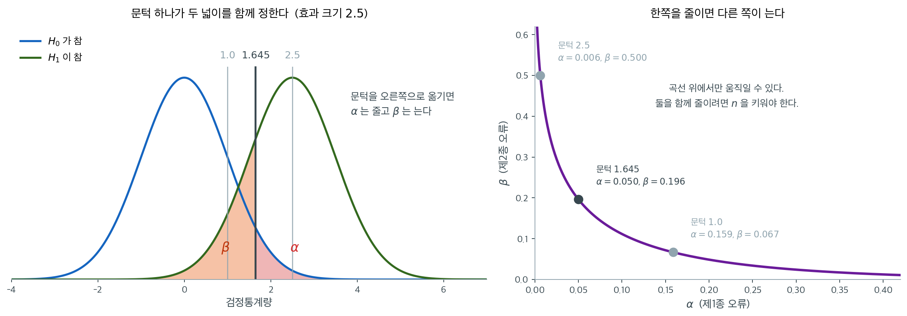
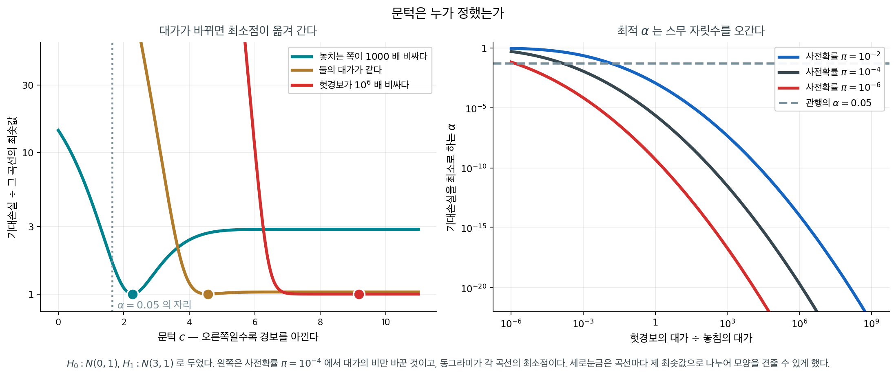
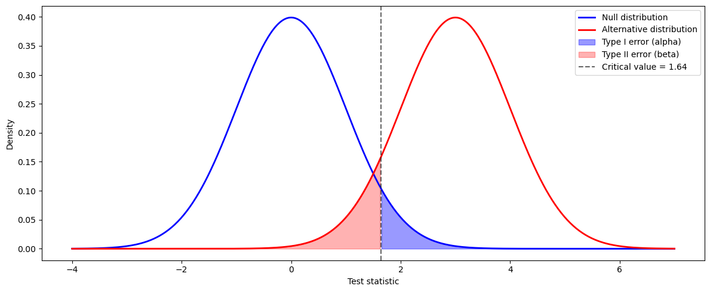

# 제1종 오류와 제2종 오류

## 개요

<div class="leadbox" markdown>

**들어가는 이야기** — 경보가 다섯 번 울린 밤

$1983$ 년 $9$ 월 $26$ 일 자정이 지난 시각, 모스크바 남쪽 세르푸호프-$15$ 의 조기경보 지휘소에서 당직을 서던 **스타니슬라프 페트로프** 중령 앞에서 경보가 울렸다. 미국에서 대륙간탄도탄 한 발이 발사되었다는 것이었고, 곧 넷이 더해져 다섯이 되었다. 그가 할 일은 위로 보고하는 것이었다. 그는 **설비 고장이라고 보고했다.** 그가 본 것 하나가 이것이었다 — 선제공격이라면 다섯 발일 리가 없다. 뒤에 밝혀진 원인은 구름에 반사된 햇빛이 위성 궤도와 겹친 것이었다. 아래 상자가 그가 무엇을 보고 그렇게 판단했는지를 따라간다.

그날 밤의 두 갈래가 이 쪽이 다루는 두 오류다. 없는 공격을 있다고 하는 것과, 있는 공격을 없다고 하는 것. 문턱을 $1.645$ 에 두면 $(\alpha,\ \beta) = (0.050,\ 0.196)$ 이다. 앞이 제$1$ 종 오류의 확률이고 뒤가 제$2$ 종 오류의 확률이다. **문턱이 하나뿐인데 그것이 두 넓이를 함께 정하므로** 한쪽을 줄이면 다른 쪽이 늘고, 가능한 조합은 곡선 하나 위에만 있다.

그러면 그 곡선 어디에 설 것인가. 두 오류의 대가를 넣고 풀면 답이 닫힌 꼴로 나오는데, **놓치는 쪽이 천 배 비싼 상황을 넣어도 최적 $\alpha$ 가 $0.012$ 로 $0.05$ 보다 작게** 나온다. 그 일이 애초에 드물기 때문이다 — **사전확률이 대가의 비를 이긴다.** 대가의 비만으로 정해지지 않는다는 뜻인데, 그러면 무엇이 더 필요한가. 대가를 적어 두지 않아도 **문턱을 고르는 순간 대가에 관한 가정이 들어간다.** 이 쪽이 두 오류를 정의하고 둘 사이의 맞바뀜을 그린다.

_확인한 곳 — 이 쪽 「문턱은 누가 정했는가」 상자와 그 출처 줄_

</div>

가설검정을 수행할 때 생길 수 있는 오류는 두 종류이다. 이 오류들을 이해하는 것은 통계검정 결과를 올바르게 해석하고, 잘못된 결론의 위험을 최소화하는 연구를 설계하는 데 필수적이다.

---

## 1. 제1종 오류 (거짓 양성)

**제1종 오류**는 귀무가설 $H_0$이 참인데도 이를 잘못 기각하고 대립가설 $H_a$를 택할 때 생긴다. 재판에서 무고한 사람에게 유죄를 선고하는 것에 해당한다.

$$\alpha = P(\text{Type I Error}) = P(\text{Reject } H_0 \mid H_0 \text{ is true})$$

**유의수준** $\alpha$는 제1종 오류를 범할 확률의 허용 상한이다. 흔한 선택은 $\alpha = 0.05$, $0.01$, $0.10$이다.

**예시**: 어떤 제약회사가 실제로는 효과가 없는 새 약을 시험한다. 연구가 그 약이 효과적이라고 잘못 결론지으면($H_0$을 기각하면) 제1종 오류이다.

---

## 2. 제2종 오류 (거짓 음성)

**제2종 오류**는 귀무가설 $H_0$이 거짓인데도 기각하지 못할 때 생긴다. 재판에서 유죄인 사람을 무죄로 방면하는 것에 해당한다.

$$\beta = P(\text{Type II Error}) = P(\text{Fail to reject } H_0 \mid H_a \text{ is true})$$

$\beta$가 작을수록 거짓인 귀무가설을 유지할 위험이 작다.

**예시**: 약이 실제로 듣는데 연구가 그 효과를 탐지하지 못하고 위약과 유의한 차이가 없다고 결론짓는다면 제2종 오류이다.

---

## 3. 네 칸 가운데 둘만 오류다

| | $H_0$이 참 | $H_0$이 거짓 |
|---|---|---|
| **$H_0$ 기각** | 제1종 오류 ($\alpha$) | 올바른 판정 (검정력 = $1 - \beta$) |
| **$H_0$ 기각 못함** | 올바른 판정 | 제2종 오류 ($\beta$) |

---

## 4. α와 β의 맞바꿈
두 오류 사이에는 본래적인 맞바꿈이 있다.

- **$\alpha$를 낮추면**($H_0$을 기각하기 어렵게 하면) 제1종 오류의 가능성은 줄지만 제2종 오류의 가능성은 커진다.
- **$\alpha$를 높이면** $H_0$을 기각하기 쉬워져 $\beta$는 줄지만 거짓 양성의 가능성은 커진다.



왼쪽에서 **문턱은 하나뿐인데 그것이 두 넓이를 함께 정한다.** 세로선을 오른쪽으로 밀면 붉은 넓이($\alpha$)가 줄어드는 만큼 주황 넓이($\beta$)가 늘어난다. 두 넓이가 서로 다른 곡선 아래에 있지만 같은 선을 경계로 삼기 때문이며, 그래서 한쪽만 줄이는 문턱은 존재하지 않는다.

오른쪽은 문턱을 끝까지 훑으며 두 오류를 짝지어 그린 것이다. **가능한 조합이 이 곡선 위에만 있다.** 문턱을 $1.645$로 두면 $(\alpha, \beta) = (0.050, 0.196)$이고, $\alpha$를 $0.006$까지 낮추려면 $\beta$를 $0.5$까지 올려야 한다. 절반의 경우 진짜 효과를 놓친다는 뜻이다.

**이 곡선 자체를 아래로 당기는 방법은 따로 있다.** 표본크기를 키우거나 효과가 더 크면 두 분포가 멀어져 곡선 전체가 원점 쪽으로 내려간다. 문턱을 고르는 일은 곡선 위에서 자리를 고르는 일일 뿐이고, 곡선을 바꾸는 일은 설계의 문제다.

적절한 균형은 맥락에 달려 있다.

- 의학 시험에서는 제1종 오류(효과 없는 약의 승인)의 대가가 매우 클 수 있으므로 $\alpha$를 낮게 잡는다.
- 선별검사에서는 제2종 오류(질병을 놓치는 것)의 대가가 더 클 수 있으므로 $\alpha$를 높여(민감도를 높여) 쓴다.

<div class="storybox" markdown>

**그림으로 보는 통계학 1.** 문턱은 누가 정했는가

1983 년 9 월 26 일 자정이 지난 시각, 모스크바 남쪽 세르푸호프-15 의 조기경보 지휘소에서
당직을 서던 스타니슬라프 페트로프 중령 앞에서 경보가 울렸다. 미국에서 대륙간탄도탄 한 발이
발사되었다는 것이었고, 곧 넷이 더해져 다섯이 되었다. 그가 할 일은 위로 보고하는 것이었다.

그는 설비 고장이라고 보고했다. 까닭 가운데 하나가 이것이었다 — **선제공격이라면 다섯 발일
리가 없다.** 상대를 무력화하려는 첫 타격이라면 수백 발이 한꺼번에 와야 한다. 지상 레이더도
아무것도 잡지 못하고 있었다. 뒤에 밝혀진 원인은 추분 무렵의 높은 구름에 반사된 햇빛이
위성 궤도와 겹친 것이었다. 이 일은 1998 년까지 비밀이었다.

위 곡선은 문턱을 옮기면 두 오류가 맞바뀐다는 것까지 말해 준다. **그런데 곡선 위의 어느 점을
고를지는 말해 주지 않는다.** 거기에 필요한 것이 둘 더 있다 — 두 오류의 **대가**와, 그 일이
애초에 일어날 **사전확률**이다. 넣어서 풀면 닫힌 꼴이 나온다. $H_0: N(0,1)$,
$H_1: N(\delta,1)$ 에서 기대손실

$$
L(c) = (1-\pi)\,C_{\mathrm{I}}\,[1 - \Phi(c)] + \pi\,C_{\mathrm{II}}\,\Phi(c - \delta)
$$

를 최소로 하는 문턱은

$$
c^{*} = \frac{\delta}{2} + \frac{1}{\delta}\,
        \log\!\left[\frac{(1-\pi)\,C_{\mathrm{I}}}{\pi\,C_{\mathrm{II}}}\right]
$$

이다. 대가의 비와 사전확률이 **로그로** 들어온다.

<figure markdown>
{ width="900" }
  <figcaption markdown>$\delta = 3$ 으로 두었다. 왼쪽은 사전확률 $\pi = 10^{-4}$ 에서 대가의 비만 바꾼 것이고, 동그라미가 각 곡선의 최소점이다.</figcaption>
</figure>

$\delta = 3$, $\pi = 10^{-4}$ 로 두고 재 보면

| 헛경보의 대가 $\div$ 놓침의 대가 | 최적 문턱 $c^{*}$ | 최적 $\alpha$ |
|---|---|---|
| $1/1000$ (놓치는 쪽이 훨씬 비싸다) | $2.27$ | $1.2 \times 10^{-2}$ |
| $1$ | $4.57$ | $2.4 \times 10^{-6}$ |
| $1000$ | $6.87$ | $3.2 \times 10^{-12}$ |
| $10^{6}$ | $9.18$ | $2.3 \times 10^{-20}$ |

눈여겨볼 것은 첫 줄이다. **놓치는 쪽이 천 배 비싸도 최적 $\alpha$ 가 $0.012$ 로 $0.05$보다
작다.** 그 일이 애초에 드물기 때문이다. 사전확률이 $10^{-4}$ 이면 경보가 울려도 대개는
헛것이고, 그 사실이 대가의 비를 이긴다.

그러니 $\alpha = 0.05$ 는 결정 규칙이 아니다. 오른쪽 그림의 가로 점선 하나이고, 그 선이 곡선과
만나는 곳은 두 축 위의 **한 점**뿐이다. 그 점이 지금 내 문제의 자리일 까닭은 없다.
$0.05$ 라는 수가 어디서 왔는지는 [유의수준](../foundations/significance_level.md) 쪽에
적어 두었다.

마지막으로 공평하게 적어 둘 것이 있다. 그날 밤 페트로프가 저 식을 풀 수 있었던 것은 아니다.
$C_{\mathrm{I}}$ 과 $C_{\mathrm{II}}$ 를 수로 적을 수 있는 사람은 아무도 없었다. 그것이
$0.05$ 를 쓸 이유가 되지는 않는다. **대가를 적어 두지 않아도 문턱을 고르는 순간 대가에 관한
가정이 들어간다**는 것이 요점이다. 적어 두지 않으면 그 가정은 사라지는 것이 아니라 보이지 않게
될 뿐이다.

_확인한 곳 — $1983$ 년 $9$ 월 $26$ 일 모스크바 시각 $0$ 시 $15$ 분 직후 세르푸호프-$15$ 에서 미국 대륙간탄도탄 **다섯 발**의 발사 경보가 울린 것, 원인이 **고고도 구름에 반사된 햇빛**과 몰니야 궤도 위성의 겹침이었다는 것, 이 일이 $1998$ 년 상관 보틴체프의 회고록으로 비로소 공개되었다는 것. 손실함수와 최적 문턱의 수는 모두 직접 계산한 값이다_

</div>

---

## 5. 오류율에 영향을 주는 요인

각 오류의 확률에 영향을 주는 요인은 넷이다 — 표본크기 $n$, 효과크기, 유의수준
$\alpha$, 자료의 변동성 $\sigma$. $\alpha$ 만 분석자가 직접 고르고 나머지 셋은
설계와 자료가 정한다.

**$n$ 만 두 오류를 함께 줄인다.** $\alpha$ 를 건드리면 절 $4$ 가 보인 맞바꿈이
그대로 일어나고, 효과크기와 $\sigma$ 는 고를 수 있는 것이 아니다. 그래서 실무에서
오류율을 낮추는 길은 사실상 표본을 키우는 것 하나다.

네 요인이 **검정력** 쪽에서 어떻게 작동하는지는 9.5절
[검정력 분석](power.md) 절 $2$ 가 하나씩 따로 다룬다.

<div class="exbox" markdown>

**보기 1.** <span class="diff easy" title="쉬움"></span> 실업률. 시장이 $H_0: p = 0.09$ 대 $H_1: p \neq 0.09$를 검정한다.

</div>

??? success "풀이"
    - **제1종 오류**: 이 도시의 실업률이 실제로 9%인데 시장이 9%와 다르다고 잘못 결론짓는다.
    - **제2종 오류**: 이 도시의 실업률이 실제로 9%와 다른데 시장이 그 차이를 탐지하지 못한다.

## 6. 오류의 기하

두 오류를 **그림의 넓이**로 보면 맞바꿈이 왜 생기는지가 한눈에 들어온다.
귀무분포와 대립분포를 겹쳐 그리고, 임계값 하나가 두 넓이를 동시에 정하는
것을 보면 된다.

<div class="defn" markdown>

### 정의 1. 제1종 오류, 제2종 오류, 검정력 { .dfn }

| | $H_0$ 참 | $H_1$ 참 |
|---|---|---|
| **$H_0$ 기각** | 제1종 오류 ($\alpha$) | 올바름 (검정력 $= 1 - \beta$) |
| **$H_0$ 기각 못함** | 올바름 | 제2종 오류 ($\beta$) |

- **제1종 오류율** ($\alpha$): $H_0$이 실제로 참일 때 기각할 확률. 연구자가 정하는 유의수준이며 흔히 0.05이다.
- **제2종 오류율** ($\beta$): $H_1$이 실제로 참일 때 $H_0$을 기각하지 못할 확률.
- **검정력** ($1 - \beta$): $H_1$이 참일 때 $H_0$을 올바르게 기각할 확률.

</div>

귀무분포가 $N(\mu_0, 1)$이고 대립분포가 $N(\mu_1, 1)$($\mu_1 > \mu_0$)인 단측검정을 생각하자. 수준 $\alpha$의 우측검정에서 임계값은

$$
z_{\text{crit}} = \mu_0 + z_{1-\alpha}.
$$

그러면 이렇게 된다.

$$
\alpha = P(Z \geq z_{\text{crit}} \mid H_0) = 1 - \mathcal{N}(z_{1-\alpha}) = \alpha,
$$

$$
\beta = P(Z < z_{\text{crit}} \mid H_1) = \mathcal{N}\!\left(z_{\text{crit}} - \mu_1\right),
$$

$$
\text{Power} = 1 - \beta = 1 - \mathcal{N}\!\left(z_{1-\alpha} - (\mu_1 - \mu_0)\right).
$$

### 두 분포 그리기

<div class="exbox" markdown>

**보기 2.** <span class="diff easy" title="쉬움"></span> 두 오류를 한 그림에. 귀무분포 $N(0,1)$과 대립분포 $N(3,1)$을 겹쳐 그리고 $\alpha = 0.05$인 우측검정의 두 오류를 색칠한다.

**(1)** 임계값과 $\beta$를 계산하고, 두 오류가 **서로 다른 곡선** 아래에서 재어진다는 것이 무슨 뜻인지 말하시오.

**(2)** 임계값을 옮기면 두 오류가 맞바뀐다. $\alpha + \beta$를 가장 작게 하는 임계값을 구하고, 그것이 $\alpha = 0.05$가 주는 자리와 같은지 보시오.

</div>

??? success "풀이"

    **(1) 해석적으로.** $\alpha = 0.05$인 우측검정의 임계값은 귀무분포의 상위 $5\%$ 자리이므로

    $$
    z_c = \mu_0 + z_{0.95} = 0 + 1.644854 = 1.644854
    $$

    다. $\beta$는 **같은 임계값**을 대립분포에서 재는 것이다.

    $$
    \beta = P(Z < z_c \mid H_1) = \Phi(z_c - \mu_1) = \Phi(1.644854 - 3) = \Phi(-1.355146) = 0.087686
    $$

    이고 검정력은 $1 - \beta = 0.912314$다.

    **"서로 다른 곡선"의 뜻.** 두 넓이 모두 $x$축의 같은 점 $z_c$에서 잘리지만, $\alpha$는 **파란** 곡선 아래에서 오른쪽을, $\beta$는 **빨간** 곡선 아래에서 왼쪽을 잰다. 그러므로 둘은 같은 확률공간의 보완사건이 아니고 $\alpha + \beta$가 1이 될 이유가 없다. 여기서는 $0.05 + 0.088 = 0.138$이다. 두 수는 **서로 다른 가정 아래의 확률**이며, 어느 쪽이 참인지 우리는 모른다.

    **(2) 해석적으로.** 임계값을 $c$로 두면

    $$
    \alpha(c) = 1 - \Phi(c) = \Phi(-c), \qquad \beta(c) = \Phi(c - 3)
    $$

    이다. $c$가 커지면 $\alpha$는 줄고 $\beta$는 는다. **하나를 줄이면 다른 하나가 커진다.** 합을 최소로 만드는 $c$는 미분해서 찾는다.

    $$
    \frac{d}{dc}\{\alpha(c)+\beta(c)\} = -\varphi(c) + \varphi(c-3) = 0
    \quad\Longrightarrow\quad
    \varphi(c) = \varphi(c-3)
    $$

    정규밀도는 $\varphi(u) \propto e^{-u^2/2}$이라 이 등식은 $c^2 = (c-3)^2$, 곧 $c = 1.5$를 준다. **두 분포의 중점이다.** 이계도함수가 양수임은 $c = 1.5$에서 $\varphi'(c) - \varphi'(c-3) = -1.5\varphi(1.5) + 1.5\varphi(-1.5) \cdot(-1)$을 따질 것 없이, $c \to \pm\infty$에서 합이 1로 가고 중간에서 작아진다는 것으로 충분하다. 최솟값은 대칭성에 의해

    $$
    \alpha(1.5) + \beta(1.5) = 2\Phi(-1.5) = 2 \times 0.066807 = 0.133614
    $$

    이다. **$\alpha = 0.05$가 주는 $c = 1.645$는 이 자리가 아니다.** 거기서는 합이 $0.137686$으로 최소보다 $3\%$ 크다. 수준 $\alpha$를 고정하는 관행은 두 오류의 **합**을 최소화하는 것이 아니라 **1종 오류를 우선 보호**하겠다는 선택이다.

    **수치적으로.**

    ```python
    import numpy as np
    import matplotlib.pyplot as plt
    from scipy import stats

    plt.rcParams["font.sans-serif"] = ["NanumGothic", "Apple SD Gothic Neo", "Malgun Gothic"]
    plt.rcParams["font.family"] = "sans-serif"
    plt.rcParams["axes.unicode_minus"] = False

    null_loc = 0
    alt_loc = 3
    alpha = 0.05

    x = np.linspace(null_loc - 4, alt_loc + 4, 400)
    y_null = stats.norm.pdf(x, loc=null_loc)
    y_alt = stats.norm.pdf(x, loc=alt_loc)

    z_crit = stats.norm.ppf(1 - alpha, loc=null_loc)

    fig, ax = plt.subplots(figsize=(12, 5))
    ax.plot(x, y_null, "b-", lw=2, label="Null distribution")
    ax.plot(x, y_alt, "r-", lw=2, label="Alternative distribution")

    # 제1종 오류: 귀무분포에서 임계값 오른쪽. H0가 참인데 기각하는 경우다.
    mask_t1 = x >= z_crit
    ax.fill_between(x[mask_t1], y_null[mask_t1], alpha=0.4, color="blue",
                    label="Type I error (alpha)")

    # 제2종 오류: 대립분포에서 임계값 왼쪽. H1이 참인데 기각하지 못하는 경우다.
    # 두 오류가 **다른 곡선** 아래에서 재어진다는 점이 이 그림의 요점이다.
    mask_t2 = x <= z_crit
    ax.fill_between(x[mask_t2], y_alt[mask_t2], alpha=0.3, color="red",
                    label="Type II error (beta)")

    ax.axvline(z_crit, color="black", linestyle="--", alpha=0.6,
               label=f"Critical value = {z_crit:.2f}")
    ax.set_xlabel("Test statistic")
    ax.set_ylabel("Density")
    ax.legend()
    plt.tight_layout()
    plt.show()

    # (1) 임계값과 두 오류.
    print(f"z_c = {z_crit:.6f}")
    print(f"alpha = {stats.norm.sf(z_crit, loc=null_loc):.6f}"
          f"   beta = {stats.norm.cdf(z_crit, loc=alt_loc):.6f}"
          f"   power = {stats.norm.sf(z_crit, loc=alt_loc):.6f}")

    # (2) 임계값을 옮기며 두 오류의 맞바꿈을 본다.
    print(f"\n{'c':>6} {'alpha':>9} {'beta':>9} {'합':>9}")
    for c in (1.0, 1.5, z_crit, 2.0, 2.5, 3.0):
        a_, b_ = stats.norm.sf(c), stats.norm.cdf(c - alt_loc)
        mark = "  <- alpha=0.05" if abs(c - z_crit) < 1e-9 else (
            "  <- 합이 최소" if c == 1.5 else "")
        print(f"{c:>6.3f} {a_:>9.6f} {b_:>9.6f} {a_ + b_:>9.6f}{mark}")
    print(f"\n이론 최솟값 2*Phi(-1.5) = {2 * stats.norm.cdf(-1.5):.6f}")
    ```

    출력:

    ```
    z_c = 1.644854
    alpha = 0.050000   beta = 0.087685   power = 0.912315

         c     alpha      beta         합
     1.000  0.158655  0.022750  0.181405
     1.500  0.066807  0.066807  0.133614  <- 합이 최소
     1.645  0.050000  0.087685  0.137685  <- alpha=0.05
     2.000  0.022750  0.158655  0.181405
     2.500  0.006210  0.308538  0.314747
     3.000  0.001350  0.500000  0.501350

    이론 최솟값 2*Phi(-1.5) = 0.133614
    ```

    

    (1)에서 구한 $z_c = 1.644854$, $\beta = 0.087685$, 검정력 $0.912315$가 그대로 나왔다. (2)의 최솟값 $0.133614$도 $c = 1.5$ 줄에서 확인된다.

    같은 세로 점선(임계값 $1.645$)이 두 곡선을 각각 자른다. 파란 곡선에서 오른쪽으로 잘린 조각이 $\alpha$, 빨간 곡선에서 왼쪽으로 잘린 조각이 $\beta$다.

    표가 맞바꿈을 수로 보인다. $c$를 $1.0$에서 $3.0$으로 옮기는 동안 $\alpha$는 $0.159$에서 $0.00135$로 **118배 줄고** $\beta$는 $0.0228$에서 $0.500$으로 **22배 는다.** 점선을 오른쪽으로 옮기면 파란 조각이 줄고 빨간 조각이 느는 것이다. 임계값 하나로 두 오류를 동시에 통제할 수는 없다.

    표가 $c = 1.5$를 중심으로 **대칭**인 것도 눈여겨보라. $c = 1.0$과 $c = 2.0$의 합이 둘 다 $0.181405$이고, $\alpha$와 $\beta$가 자리만 바뀌어 있다. 두 분포가 폭이 같고 중심만 다르기 때문이다.

    둘 다 줄이는 방법은 하나뿐이다. **표본을 키워 두 곡선을 좁게 만드는 것**이다. 그러면 표준오차 단위로 잰 분리 $\mu_1 - \mu_0$이 커지고, 같은 $\alpha$에서 $\beta$가 작아진다. 보기 2가 그 효과를 수로 보인다.

### 분리 정도에 따른 검정력 계산

<div class="exbox" markdown>

**보기 3.** <span class="diff easy" title="쉬움"></span> 분리 정도에 따른 검정력. $\alpha = 0.05$ 우측검정에서 두 분포의 분리 $s = \mu_1 - \mu_0$을 1부터 5까지 바꿔 본다(두 분포 모두 표준편차 1).

**(1)** 검정력을 $s$의 함수로 닫힌 꼴로 쓰고 다섯 값을 구하시오.

**(2)** 검정력이 $s$에 대해 선형으로 오르지 않는다. **어느 $s$에서 가장 빨리 오르는지** 미분으로 구하고, 양 끝의 증가량을 견주시오.

</div>

??? success "풀이"

    **(1) 해석적으로.** 임계값은 $H_0$ 아래에서 정해지므로 $s$와 무관하게 $z_c = z_{0.95} = 1.644854$다. 검정력은 이 문턱을 대립분포에서 재는 것이고, 대립분포가 $N(s, 1)$이므로

    $$
    1-\beta(s) = P(Z > z_c \mid Z \sim N(s,1)) = 1 - \Phi(z_c - s) = \Phi(s - z_c)
    $$

    이다. 다섯 값은 다음과 같다.

    | $s$ | $s - z_c$ | 검정력 $\Phi(s-z_c)$ | $\beta$ |
    |---|---|---|---|
    | 1 | $-0.644854$ | $0.259511$ | $0.740489$ |
    | 2 | $0.355146$ | $0.638760$ | $0.361240$ |
    | 3 | $1.355146$ | $0.912315$ | $0.087685$ |
    | 4 | $2.355146$ | $0.990742$ | $0.009258$ |
    | 5 | $3.355146$ | $0.999603$ | $0.000397$ |

    **(2) 해석적으로.** 검정력을 $s$로 미분하면 누적분포함수의 미분이므로 밀도가 나온다.

    $$
    \frac{d}{ds}\Phi(s - z_c) = \varphi(s - z_c)
    $$

    표준정규밀도 $\varphi$는 인수가 0일 때 최대이므로, **증가가 가장 빠른 자리는 $s = z_c = 1.645$**이고 그때 기울기는 $\varphi(0) = 0.398942$다. 곧 **검정력이 $1/2$을 지나는 바로 그 자리**에서 가장 가파르다. 거기서 멀어지면 양쪽 모두 완만해지는데, $\varphi$가 지수적으로 줄기 때문에 멀어질수록 급격히 평평해진다.

    $s = 1 \to 2$의 증가량은 $0.638760 - 0.259511 = 0.379249$, $s = 4 \to 5$는 $0.999603 - 0.990742 = 0.008861$이다. **42.8배** 차이다.

    **수치적으로.**

    ```python
    for sep in [1, 2, 3, 4, 5]:
        z_c = stats.norm.ppf(0.95)
        # loc=sep은 "대립분포에서 재라"는 뜻이다. 임계값 z_c 자체는 sep과 무관하다.
        # H0 아래에서 정해지는 값이기 때문이다.
        power = 1 - stats.norm.cdf(z_c, loc=sep)
        beta = 1 - power
        print(f"Separation = {sep}: beta = {beta:.4f}, Power = {power:.4f}")

    # (2) 기울기와 한 칸 증가량.
    z_c = stats.norm.ppf(0.95)
    print(f"\n{'s':>3} {'검정력':>10} {'기울기 phi(s-z_c)':>18} {'한 칸 증가':>11}")
    prev = None
    for s in (1, 2, 3, 4, 5):
        pw = stats.norm.cdf(s - z_c)
        inc = "" if prev is None else f"{pw - prev:>11.6f}"
        print(f"{s:>3} {pw:>10.6f} {stats.norm.pdf(s - z_c):>18.6f} {inc}")
        prev = pw
    print(f"\n기울기가 최대인 s = z_c = {z_c:.6f},"
          f"  그때 기울기 = {stats.norm.pdf(0):.6f}")
    print(f"증가량 비 (1->2) / (4->5) = "
          f"{(stats.norm.cdf(2 - z_c) - stats.norm.cdf(1 - z_c)) / (stats.norm.cdf(5 - z_c) - stats.norm.cdf(4 - z_c)):.1f}")
    ```

    출력:

    ```
    Separation = 1: beta = 0.7405, Power = 0.2595
    Separation = 2: beta = 0.3612, Power = 0.6388
    Separation = 3: beta = 0.0877, Power = 0.9123
    Separation = 4: beta = 0.0093, Power = 0.9907
    Separation = 5: beta = 0.0004, Power = 0.9996

      s        검정력     기울기 phi(s-z_c)      한 칸 증가
      1   0.259511           0.324050
      2   0.638760           0.374560    0.379249
      3   0.912315           0.159271    0.273555
      4   0.990742           0.024915    0.078428
      5   0.999603           0.001434    0.008861

    기울기가 최대인 s = z_c = 1.644854,  그때 기울기 = 0.398942
    증가량 비 (1->2) / (4->5) = 42.8
    ```

    (1)의 다섯 값이 그대로 나왔고, (2)의 기울기 최대 자리 $s = 1.644854$와 증가량 비 $42.8$도 확인된다.

    **검정력이 선형으로 오르지 않는다.** 분리가 1에서 2로 갈 때 $0.26$에서 $0.64$로 크게 뛰지만, 4에서 5로 갈 때는 $0.991$에서 $0.9996$으로 거의 움직이지 않는다. 기울기 열이 그 까닭을 보인다. $s = 2$ 근처에서 $0.375$이던 것이 $s = 5$에서 $0.0014$로 **260배** 줄어든다. 정규분포의 꼬리가 지수적으로 얇아지기 때문이다.

    분리가 1일 때 검정력이 $0.26$이라는 것도 새겨 둘 만하다. **효과가 표준오차만큼 있어도 네 번 중 세 번은 놓친다.** "효과가 있으면 검정이 잡아낼 것"이라는 기대는 대체로 근거가 없다.

    실무로 옮기면 이렇다. 분리 $s$는 $(\mu_1-\mu_0)\sqrt n/\sigma$이므로 $\sqrt n$에 비례한다. 지금 $s = 1$인 설계라면 $s = 3$으로 가는 데 표본이 **아홉 배** 든다. 그 투자로 검정력이 $0.26$에서 $0.91$로 오른다. 반면 $s = 4$에서 $s = 5$로 가는 데에도 표본이 $1.56$배 드는데 얻는 것은 $0.009$뿐이다. **투자할 자리는 곡선의 가파른 구간**이다.

---

### 읽는 법

$\mu_0 = 0$, $\mu_1 = 3$, $\alpha = 0.05$일 때 이렇게 된다.

- **임계값**은 $z_{\text{crit}} \approx 1.645$이다.
- **제1종 오류**(귀무곡선 아래에서 1.645 오른쪽의 파란 영역)는 정확히 $\alpha = 0.05$이다.
- **제2종 오류**(대립곡선 아래에서 1.645 왼쪽의 빨간 영역)는 $\beta = \mathcal{N}(1.645 - 3) = \mathcal{N}(-1.355) \approx 0.088$이다.
- **검정력**은 $1 - 0.088 = 0.912$로, 크기 3인 효과를 탐지할 확률이 91.2%이다.

분리 $\mu_1 - \mu_0$이 커지면(효과크기가 커지면) 대립분포가 오른쪽으로 이동하여 귀무분포와의 겹침이 줄고 $\beta$가 작아진다. 반대로 효과가 작으면 겹침이 커지고 검정력이 낮아진다.

---

## 연습문제

<div class="drillbox" markdown>

**연습문제 1.** <span class="diff easy" title="쉬움"></span>
제1종 오류와 제2종 오류를 진술하라. 분할표를 제시하라.

</div>

??? success "풀이"
    |  | $H_0$ 참 | $H_0$ 거짓 |
    |---|---|---|
    | $H_0$ 기각 | **제1종 오류** ($\alpha$) | 올바름 ($1 - \beta$, 검정력) |
    | 기각 못함 | 올바름 ($1 - \alpha$) | **제2종 오류** ($\beta$) |

    제1종: 거짓 양성($\alpha$ = 유의수준).
    제2종: 거짓 음성($\beta = 1 - $ 검정력).

---

<div class="drillbox" markdown>

**연습문제 2.** <span class="diff easy" title="쉬움"></span>
시장이 도시의 실업률을 전국 수치 9%와 견주어 $H_0: p = 0.09$를 검정한다. 이 맥락에서 제1종 오류와 제2종 오류를 기술하라.

</div>

??? success "풀이"
    **제1종:** 도시의 실업률이 실제로 9%인데($H_0$ 참) 시장이 다르다고 결론짓는다($H_0$ 기각). 대가: 잘못된 보도자료, 불필요한 정책 대응.

    **제2종:** 도시의 실업률이 9%와 다른데($H_0$ 거짓) 시장이 탐지하지 못한다(기각 못함). 대가: 놓친 통찰, 도시가 전국 평균과 같다는 잘못된 믿음.

---

<div class="drillbox" markdown>

**연습문제 3.** <span class="diff easy" title="쉬움"></span>
**다중검정.** $\alpha = 0.05$에서 검정 100개를 돌리면 모든 $H_0$이 참일 때 잘못된 기각의 기댓값은?

</div>

??? success "풀이"
    모든 $H_0$이 참이면 각 검정이 독립적으로 확률 $0.05$로 기각한다. 기각 수의 기댓값: $100 \cdot 0.05 = 5$.

    적어도 한 번 잘못 기각할 가족단위 확률: $1 - (0.95)^{100} \approx 0.994$ — 순전한 잡음에서 "유의한" 결과를 보게 될 것이 거의 확실하다.

    **보정:**

    - **Bonferroni:** $\alpha/m = 0.0005$에서 검정한다. 보수적이며 가족단위 오류 $\le 0.05$.
    - **Holm-Bonferroni:** 단계적 하강 방식으로 약간 더 강력하다.
    - **Benjamini-Hochberg (FDR):** 양성으로 선언한 것 중 잘못된 기각의 기대 비율을 통제한다. 덜 보수적이다.

    고차원 상황(유전체학, A/B 검정 플랫폼)에서 타당한 추론을 하려면 사전등록과 Bonferroni류 보정이 필수적이다.

---

<div class="drillbox" markdown>

**연습문제 4.** <span class="diff med" title="중간"></span>
**제1종·제2종의 맞바꿈.** $\alpha$와 $\beta$를 동시에 0으로 만들 수 없는 이유는?

</div>

??? success "풀이"
    표본크기가 고정되어 있으면 $\alpha$를 줄이는 것(기각을 어렵게 하는 것)이 대개 $\beta$를 *키운다*(참인 대립가설을 더 자주 놓친다).

    둘을 동시에 줄이려면 표본크기 $n$을 늘려야 한다. $n$이 고정되어 있으면 맞바꿈을 피할 수 없다.

    극단적인 경우:

    - 결코 기각하지 않음: $\alpha = 0$, $\beta = 1$ (참 효과를 항상 놓친다).
    - 항상 기각함: $\alpha = 1$, $\beta = 0$ (항상 탐지하지만 항상 거짓 경보이다).

    실무적 균형: 먼저 $\alpha = 0.05$를 고르고, 원하는 $\beta$(보통 검정력 80%에 해당하는 0.20)를 달성하도록 $n$을 설계한다.

---

<div class="drillbox" markdown>

**연습문제 5.** <span class="diff med" title="중간"></span>
**검정력.** 검정력을 정의하라. 약물시험에서 $H_0: \mu = 0$ 대 $H_1: \mu = 5$, $\sigma = 10$, $\alpha = 0.05$(단측), $n = 30$일 때 검정력을 계산하라.

</div>

??? success "풀이"
    검정력 = $1 - \beta = P(\text{기각} \mid H_1$ 참$)$.

    $H_0$ 아래: $\bar X \sim N(0, 100/30)$, $\mathrm{SE} = \sqrt{100/30} \approx 1.83$. $\bar X > z_{0.05} \cdot 1.83 = 3.00$이면 기각한다.

    $H_1$ ($\mu = 5$) 아래: $\bar X \sim N(5, 100/30)$. 검정력 = $P(\bar X > 3 \mid \mu = 5) = P(Z > (3 - 5)/1.83) = P(Z > -1.09) = 0.862$.

    검정력 ≈ 86%. 괜찮지만 아주 높지는 않다. 관례적인 목표는 80%이다.

---

<div class="drillbox" markdown>

**연습문제 6.** <span class="diff med" title="중간"></span>
**목표 검정력을 위한 표본크기.** 연습문제 5의 설정에서 검정력 90%를 얻으려면 $n$이 얼마여야 하는가?

</div>

??? success "풀이"
    단측검정에서 검정력 $1 - \beta$를 위한 표본크기:

    $$
    n = \left(\frac{(z_{1-\alpha} + z_{1-\beta})\sigma}{\mu - \mu_0}\right)^2
    $$

    여기서 $z_{0.05} = 1.645$, $z_{0.10} = 1.282$, $\sigma = 10$, 효과 = 5이므로:

    $n = ((1.645 + 1.282) \cdot 10/5)^2 = (5.854)^2 \approx 34.3$. 올림하면 $n = 35$.

    (검정력 86%를 준) 연습문제 5의 $n = 30$보다 조금 크다. 공식이 맞바꿈을 확인해 준다: 검정력을 높이려면 자료가 더 필요하다.

---

<div class="drillbox" markdown>

**연습문제 7.** <span class="diff med" title="중간"></span>
**거짓발견비율(FDR)** 과 제1종 오류율의 차이를 밝히고, $\alpha=0.05$인 검정에서 "유의한 결과가 틀릴 확률"이 얼마인지 계산하라.

</div>

??? success "풀이"
    **두 확률의 방향이 다르다.**

    $$
    \alpha=P(\text{기각}\mid H_0\text{ 참}),\qquad
    \text{FDR}=P(H_0\text{ 참}\mid\text{기각})
    $$

    **조건이 뒤집혀 있다.** 베이즈 정리로 연결된다.

    $$
    \text{FDR}=\frac{\alpha\pi_0}{\alpha\pi_0+(1-\beta)(1-\pi_0)}
    $$

    여기서 $\pi_0$는 검정된 가설 중 $H_0$이 참인 비율이다.

    ```python
    import numpy as np

    print(f"{'π0':>6s} {'검정력':>8s} {'FDR':>8s}")
    for pi0 in [0.5, 0.8, 0.9, 0.99]:
        for pw in [0.80, 0.50, 0.20]:
            fdr = 0.05 * pi0 / (0.05 * pi0 + pw * (1 - pi0))
            print(f"{pi0:6.2f} {pw:8.2f} {fdr:8.4f}")
    ```

    ```text
        π0      검정력      FDR
      0.50     0.80   0.0588
      0.50     0.50   0.0909
      0.50     0.20   0.2000
      0.80     0.80   0.2000
      0.80     0.50   0.2857
      0.80     0.20   0.5000
      0.90     0.80   0.3600
      0.90     0.50   0.4737
      0.90     0.20   0.6923
      0.99     0.80   0.8609
      0.99     0.50   0.9083
      0.99     0.20   0.9612
    ```

    **$\alpha=0.05$인데 FDR이 0.06에서 0.96까지 걸친다.** "$p<0.05$이면 5%만 틀린다"는 생각이 완전히 잘못임을 보여 준다.

    **결정적인 두 요인.**

    1. **$\pi_0$(가설의 사전 그럴듯함).** 유전체 전장연관분석처럼 $\pi_0\approx0.9999$인 영역에서는 $\alpha=0.05$가 무의미하다. **이것이 $5\times10^{-8}$ 같은 문턱을 쓰는 이유**다.

    2. **검정력.** 검정력이 낮으면 참인 발견을 놓쳐 분모의 둘째 항이 작아진다. **검정력이 낮은 분야는 발표된 결과의 신뢰도가 낮다.**

    **이오아니디스의 주장.** "발표된 연구 결과의 대부분은 거짓이다"라는 논문의 핵심 계산이 바로 이것이다. 여기에 편향($p$-해킹)과 여러 팀의 경쟁을 더하면 FDR이 더 올라간다.

    **어떻게 낮추는가.**

    | 방법 | 효과 |
    |---|---|
    | **검정력 높이기** | 분모의 참 발견을 늘림. **가장 효과적** |
    | $\alpha$ 낮추기 | 분자를 줄임. 다만 검정력도 함께 떨어짐 |
    | 가설을 잘 고르기 | $\pi_0$를 낮춤. 이론적 근거가 있는 가설만 검정 |
    | 사전등록·재현 | 편향 제거 |

    **주의.** 위 계산의 $\pi_0$는 알 수 없는 양이다. 그래서 정확한 FDR을 계산할 수는 없고, **어느 범위인지 가늠**하는 데 쓴다. 다중검정 상황에서는 자료에서 $\pi_0$를 추정하는 방법(스토리의 $q$-값)이 있다.

---

<div class="drillbox" markdown>

**연습문제 8.** <span class="diff med" title="중간"></span>
제1종·제2종 오류를 **진단검사의 언어**로 옮기고, 유병률이 예측도에 미치는 영향을 계산하라.

</div>

??? success "풀이"
    **대응표.**

    | 검정 | 진단검사 |
    |---|---|
    | $H_0$ 참 | 질병 없음 |
    | $H_0$ 거짓 | 질병 있음 |
    | 기각 | 검사 양성 |
    | $\alpha$ | 1 − 특이도 |
    | $1-\beta$(검정력) | 민감도 |
    | FDR | 1 − 양성예측도 |

    ```python
    import numpy as np

    sens, spec = 0.95, 0.95            # 민감도·특이도 모두 95%
    print(f"{'유병률':>8s} {'양성예측도':>10s} {'음성예측도':>10s} "
          f"{'양성 1000명 중 참':>16s}")
    for prev in [0.50, 0.10, 0.01, 0.001]:
        ppv = sens * prev / (sens * prev + (1 - spec) * (1 - prev))
        npv = spec * (1 - prev) / (spec * (1 - prev) + (1 - sens) * prev)
        print(f"{prev:8.3f} {ppv:10.4f} {npv:10.4f} {1000 * ppv:16.0f}")
    ```

    ```text
         유병률      양성예측도      음성예측도     양성 1000명 중 참
       0.500     0.9500     0.9500              950
       0.100     0.6786     0.9942              679
       0.010     0.1610     0.9995              161
       0.001     0.0187     0.9999               19
    ```

    **민감도·특이도가 95%로 좋은데도, 유병률이 0.1%면 양성예측도가 1.9%다.** 양성 판정을 받은 1,000명 중 19명만 실제 환자다.

    **왜 그런가.** 유병률 0.1%, 인구 100만 명이면

    - 환자 1,000명 중 **950명이 양성**(참양성),
    - 건강한 999,000명 중 **49,950명이 양성**(거짓양성).

    거짓양성이 참양성의 **53배**다. 특이도 95%는 "5%가 거짓양성"인데, 건강한 사람이 압도적으로 많아 절대 수가 커진다.

    **실무적 함의.**

    1. **선별검사에는 매우 높은 특이도가 필요하다.** 유병률이 낮을수록 그렇다. 99.9% 특이도라도 유병률 0.1%면 PPV가 50%다.

    2. **2단계 검사 전략.** 민감한 검사로 선별하고, 양성자만 특이한 검사로 확진한다. 두 번째 단계에서는 **유병률이 이미 크게 올라가** 있으므로 PPV가 높다.

    3. **검사 전 확률이 결정적이다.** 증상이 있는 환자와 무증상 선별에서 같은 검사의 의미가 전혀 다르다.

    4. **음성예측도는 거꾸로 좋다.** 유병률이 낮으면 음성은 거의 확실히 맞는다. **"아니다"를 배제하는 데는 유용**하다.

    **통계적 검정과의 연결.** 앞 문제의 FDR이 정확히 $1-\text{PPV}$다. $\pi_0$가 유병률의 여집합에 해당한다. **"유의한 결과"를 "양성 판정"으로 읽으면 같은 계산**이다.

---

<div class="drillbox" markdown>

**연습문제 9.** <span class="diff med" title="중간"></span>
**제3종 오류**와 **제4종 오류**라 불리는 개념들을 소개하고, 왜 제1·2종만큼 중요한지 논하라.

</div>

??? success "풀이"
    **제3종 오류 — 정의가 여럿이다.**

    **(a) 카이저·겔먼의 정의 — 방향을 틀리는 것.** 앞서 본 S-오류와 같다. $H_0$을 옳게 기각했지만 **효과의 부호를 반대로** 결론 내리는 경우다. 검정력이 낮을 때 나타난다.

    **(b) 모스텔러의 정의 — 틀린 질문에 옳게 답하는 것.** 통계적 절차는 완벽했으나 **문제 설정 자체가 잘못된** 경우다.

    - 관심은 "이 정책이 효과가 있는가"인데 "평균 차이가 0인가"를 검정.
    - 관심은 "환자가 나아지는가"인데 대리 지표(바이오마커)를 검정.
    - 관심은 "일반 인구"인데 표본은 대학생.

    **(c) 제4종 오류 — 옳은 답을 잘못 해석하거나 쓰는 것.** 분석은 정확한데 결론이나 정책 권고가 자료를 넘어서는 경우다.

    **왜 이것들이 더 중요할 수 있는가.**

    1. **$\alpha$와 $\beta$는 통제할 수 있지만 제3·4종은 그렇지 않다.** 표본을 늘려도 틀린 질문은 여전히 틀린 질문이다. $n\to\infty$에서 제3종 오류는 사라지지 않는다.

    2. **더 흔하다.** 실무에서 잘못된 결론의 원인을 따져 보면, $p$-값의 계산 오류보다 **문제 설정·측정·해석의 오류**가 압도적으로 많다.

    3. **통계 교육이 다루지 않는다.** 교과서는 $\alpha$와 $\beta$에 지면을 쏟지만, 제3종 오류에 대한 훈련은 거의 없다.

    **구체적인 예 — 대리 지표의 함정.**

    | 연구 | 대리 지표 | 실제 결과 |
    |---|---|---|
    | 항부정맥제 | 부정맥 억제(개선) | **사망률 증가** |
    | 특정 호르몬 요법 | 대리 지표 개선 | 임상 결과는 악화 |
    | 골밀도 약물 | 골밀도 상승 | 골절 감소는 미미 |

    **통계적으로는 흠잡을 데 없는 검정**이었지만, 검정한 질문이 진짜 질문이 아니었다.

    **대처.**

    | 오류 | 대처 |
    |---|---|
    | 제3종(a) 부호 | 검정력 확보. M/S-오류 계산 |
    | 제3종(b) 질문 | **이해관계자와 질문을 먼저 합의.** 추정 대상(estimand)을 명시 |
    | 제4종 해석 | 결론이 자료의 범위를 넘지 않는지 점검. 동료 검토 |

    **추정 대상(estimand) 개념.** 최근 임상시험 지침이 강조하는 것이 이것이다. "무엇을, 누구에게서, 어떤 조건에서, 어떻게 요약하는가"를 **분석 전에 명시**하도록 한다. 제3종 오류를 줄이려는 제도적 장치다.

    **한 문장.** **$\alpha$와 $\beta$는 답의 품질을, 제3·4종은 질문과 해석의 품질을 말한다.** 전자가 아무리 좋아도 후자가 틀리면 결과가 무용하다.

---

<div class="drillbox" markdown>

**연습문제 10.** <span class="diff med" title="중간"></span>
두 오류의 **상대적 비용**을 실제 상황에서 어떻게 판단하는지 사례를 통해 정리하라.

</div>

??? success "풀이"

    | 상황 | $H_0$ | 제1종 오류의 결과 | 제2종 오류의 결과 | 어느 쪽이 더 나쁜가 |
    |---|---|---|---|---|
    | 신약 승인 | 효과 없음 | 효과 없는 약을 승인 | 좋은 약을 놓침 | **제1종**(환자 피해, 자원 낭비) |
    | 부작용 감시 | 안전함 | 안전한 약에 경고 | **위험한 약을 방치** | **제2종** |
    | 형사재판 | 무죄 | 무고한 사람 처벌 | 범인을 놓침 | **제1종**(관례) |
    | 암 선별검사 | 정상 | 불필요한 정밀검사·불안 | **암을 놓침** | 대개 **제2종** |
    | 품질관리 | 공정 정상 | 정상 공정을 멈춤 | **불량품 출하** | 제품에 따라 |
    | 화재경보 | 화재 없음 | 오경보 | **화재 미감지** | **제2종** |
    | 스팸 필터 | 정상 메일 | **중요 메일 차단** | 스팸 통과 | **제1종** |
    | 신용 승인 | 상환 가능 | 좋은 고객 거절 | 부실 대출 | 금액에 따라 |

    **판단의 축 넷.**

    1. **되돌릴 수 있는가.** 되돌릴 수 없는 쪽이 더 나쁘다. 사망이나 형 집행은 되돌릴 수 없고, 추가 검사는 되돌릴 수 있다.

    2. **누가 피해를 보는가.** 개인인가 사회인가. 피해가 집중되는가 분산되는가. 스팸 필터에서 중요 메일 차단이 심각한 이유는 **피해가 개인에게 집중**되기 때문이다.

    3. **후속 절차가 있는가.** 선별검사의 거짓양성은 확진검사가 걸러 준다. **2단계 구조가 있으면 1단계에서 민감도를 우선**할 수 있다.

    4. **빈도.** 드문 사건이면 절대 수로 환산해야 한다. 앞서 본 유병률 계산이 그 예다.

    **같은 문제에서 방향이 뒤집히는 경우.**

    **신약 승인과 부작용 감시가 같은 약에 대해 반대 방향이다.**

    - 효능 평가: "효과가 없다"를 $H_0$으로 두고 강한 증거를 요구한다.
    - 안전성 평가: "안전하다"를 $H_0$으로 두면 안 된다. 오히려 **위험 신호에 민감**해야 한다.

    실제로 안전성 분석에서는 $\alpha$를 0.10이나 0.20으로 높이거나, 아예 가설검정 대신 **신호 탐지**의 틀을 쓴다.

    **정량화 시도.** 앞서 본 손실함수 접근으로 최적 $\alpha$를 구할 수 있다. 다만

    - 두 오류의 비용을 같은 단위(생명, 금액, 효용)로 환산해야 하고,
    - 그 환산 자체가 가치판단이다.

    **그래서 통계학자 혼자 정할 수 없다.** 규제기관, 임상의, 환자 대표, 경제학자가 함께 판단해야 한다.

    **실무 권고.**

    1. **$H_0$을 정하기 전에 두 오류의 결과를 글로 적어 본다.** 이 과정에서 방향이 잘못되었음을 발견하는 경우가 많다.
    2. **$\alpha=0.05$를 자동으로 쓰지 않는다.** 상황에 맞게 조정하고 그 근거를 밝힌다.
    3. **검정력을 반드시 함께 계획**한다. $\beta$를 무시하면 제2종 오류의 비용을 0으로 취급하는 셈이다.

<div class="drillbox" markdown>

**연습문제 11.** <span class="diff easy" title="쉬움"></span> $\mu_0 = 0$, $\mu_1 = 2$, $\sigma = 1$, $\alpha = 0.05$인 단측검정에서 $\beta$와 검정력을 해석적으로 계산하라.

</div>

??? success "풀이"

    임계값은 $z_{\text{crit}} = z_{0.95} = 1.645$이다. $H_1$ 아래에서 검정통계량은 $N(2, 1)$을 따른다. 따라서

    $$
    \beta = P(Z < 1.645 \mid Z \sim N(2,1)) = \mathcal{N}(1.645 - 2) = \mathcal{N}(-0.355) \approx 0.3613.
    $$

    검정력은

    $$
    1 - \beta = 1 - 0.3613 = 0.6387.
    $$

    크기 2인 효과를 탐지할 확률이 약 64%이다. $\square$

---


<div class="drillbox" markdown>

**연습문제 12.** <span class="diff easy" title="쉬움"></span> 어떤 임상시험이 $\alpha = 0.05$(양측)에서 효과 $\delta = 0.5$(Cohen의 $d$)를 검정력 80%로 탐지해야 한다. 집단당 최소 표본크기를 유도하라.

</div>

??? success "풀이"

    양측검정의 검정력 식은

    $$
    1 - \beta = \mathcal{N}\!\left(\delta\sqrt{\frac{n}{2}} - z_{1-\alpha/2}\right).
    $$

    $1 - \beta = 0.80$으로 놓으면 $z_{0.80} = 0.8416$이고 $z_{0.975} = 1.960$이다. 풀면:

    $$
    0.8416 = \delta\sqrt{\frac{n}{2}} - 1.960,
    $$

    $$
    \delta\sqrt{\frac{n}{2}} = 2.8016,
    $$

    $$
    \sqrt{\frac{n}{2}} = \frac{2.8016}{0.5} = 5.6032,
    $$

    $$
    \frac{n}{2} = 31.40, \qquad n = 62.8.
    $$

    양측 5% 수준에서 $d = 0.5$인 중간 효과를 검정력 80%로 탐지하려면 집단당 적어도 $n = 63$명(총 126명)이 필요하다. $\square$

---


<div class="drillbox" markdown>

**연습문제 13.** <span class="diff med" title="중간"></span> 표본크기를 $n$에서 $4n$으로 늘리면 (표준오차 단위로) 귀무분포와 대립분포의 "유효 분리"가 두 배가 됨을 보여라. 목표 검정력을 달성하는 데 필요한 표본크기에 대해 이것이 무엇을 함의하는가?

</div>

??? success "풀이"

    표본크기가 $n$이면 검정은 $\bar{X} \sim N(\mu, \sigma^2/n)$에 기반한다. 표준오차 단위의 분리는

    $$
    \delta = \frac{\mu_1 - \mu_0}{\sigma / \sqrt{n}} = \frac{(\mu_1 - \mu_0)\sqrt{n}}{\sigma}.
    $$

    $n$을 $4n$으로 바꾸면:

    $$
    \delta' = \frac{(\mu_1 - \mu_0)\sqrt{4n}}{\sigma} = 2\delta.
    $$

    즉 표본크기를 네 배로 하면 유효 분리가 두 배가 된다. 더 일반적으로, 효과크기가 고정되어 있을 때 목표 검정력을 달성하는 데 필요한 표본크기는

    $$
    n = \left(\frac{(z_{1-\alpha} + z_{1-\beta})\sigma}{\mu_1 - \mu_0}\right)^2.
    $$

    이 공식은 $n$이 효과크기의 제곱에 반비례함을 보여준다. $\square$

---


<div class="drillbox" markdown>

**연습문제 14.** <span class="diff med" title="중간"></span> $\alpha$와 $\beta$의 맞바꿈을 설명하라. 다른 조건을 고정한 채 $\alpha$를 0.05에서 0.01로 낮추면 $\beta$와 검정력은 어떻게 되는가?

</div>

??? success "풀이"

    $\alpha$를 낮추면 (우측검정에서) 임계값이 오른쪽으로 옮겨간다: $z_{0.99} = 2.326 > z_{0.95} = 1.645$. $H_0$을 기각하기 어려워지므로:

    - $\alpha$가 줄어든다(제1종 오류가 줄어든다).
    - 더 엄격해진 임계값 아래로 대립분포가 더 많이 들어가므로 $\beta$가 커진다(제2종 오류가 늘어난다).
    - 검정력 $= 1 - \beta$가 줄어든다.

    $\mu_1 = 3$인 예에서:

    - $\alpha = 0.05$일 때: $\beta = \mathcal{N}(1.645 - 3) = \mathcal{N}(-1.355) \approx 0.088$, 검정력 $\approx 0.912$.
    - $\alpha = 0.01$일 때: $\beta = \mathcal{N}(2.326 - 3) = \mathcal{N}(-0.674) \approx 0.250$, 검정력 $\approx 0.750$.

    두 오류를 동시에 줄이는 유일한 방법은 표본크기를 늘리는 것이다. $\square$

---


<div class="drillbox" markdown>

**연습문제 15.** <span class="diff med" title="중간"></span> 이 시각화에서 두 분포의 분산은 같다. 대립분포의 분산이 더 크면 무엇이 달라지는가? 새 그림을 그리거나 기술하라.

</div>

??? success "풀이"

    대립분포가 $\sigma_1 > 1$인 $N(\mu_1, \sigma_1^2)$이면 귀무분포 $N(\mu_0, 1)$보다 넓고 납작하다. 주요 결과는:

    - 대립곡선이 퍼지므로 임계값 아래로 들어가는 넓이가 커진다. $\beta$가 커지고 검정력이 낮아진다.
    - 평균이 잘 떨어져 있어도 두 분포의 겹침이 커진다.
    - 검정력 공식은 다음이 된다:

    $$
    \text{Power} = 1 - \mathcal{N}\!\left(\frac{z_{\text{crit}} - \mu_1}{\sigma_1}\right),
    $$

    $\sigma_1 > 1$일 때 등분산인 경우보다 작다.

    시각적으로는 빨간 곡선이 낮고 넓어지며, 임계값 왼쪽의 빨간 제2종 오류 영역이 더 커진다. $\square$

---


<div class="drillbox" markdown>

**연습문제 16.** <span class="diff med" title="중간"></span>
$\alpha$를 바꿀 때 $\beta$가 어떻게 움직이는지 정확히 계산하고, 두 오류의 합을 최소화하는 $\alpha$를 찾아라.

</div>

??? success "풀이"
    **설정.** $H_0:\mu=0$, $H_1:\mu=2$, $\sigma=1$, 단측검정.

    ```python
    import numpy as np
    from scipy import stats

    mu1 = 2.0
    print(f"{'α':>8s} {'임계값 c':>10s} {'β':>8s} {'검정력':>8s} {'α+β':>8s}")
    for a in [0.20, 0.10, 0.05, 0.02, 0.01, 0.001]:
        c = stats.norm.ppf(1 - a)
        b = stats.norm.cdf(c, loc=mu1)
        print(f"{a:8.3f} {c:10.3f} {b:8.4f} {1 - b:8.4f} {a + b:8.4f}")

    # α + β 를 최소화하는 α
    grid = np.linspace(1e-5, 0.5, 50_000)
    cs = stats.norm.ppf(1 - grid)
    tot = grid + stats.norm.cdf(cs, loc=mu1)
    i = np.argmin(tot)
    print(f"\n최소 α+β: α = {grid[i]:.4f}, c = {cs[i]:.4f}, "
          f"합 = {tot[i]:.4f}")
    ```

    ```text
           α      임계값 c        β      검정력      α+β
       0.200      0.842   0.1234   0.8766   0.3234
       0.100      1.282   0.2362   0.7638   0.3362
       0.050      1.645   0.3612   0.6388   0.4112
       0.020      2.054   0.5214   0.4786   0.5414
       0.010      2.326   0.6279   0.3721   0.6379
       0.001      3.090   0.8622   0.1378   0.8632

    최소 α+β: α = 0.1587, c = 1.0000, 합 = 0.3173
    ```

    **$\alpha+\beta$가 $c=\mu_1/2=1$에서 최소다.** 두 밀도가 교차하는 지점이다.

    **왜 그런가.** $\alpha+\beta=\{1-\Phi(c)\}+\Phi(c-\mu_1)$을 $c$로 미분하면

    $$
    -\varphi(c)+\varphi(c-\mu_1)=0
    \iff \varphi(c)=\varphi(c-\mu_1)
    \iff c=\frac{\mu_1}2
    $$

    **두 밀도가 같아지는 곳**이며, 이는 우도비가 1인 지점이다. 손실이 대칭이고 사전확률이 같을 때의 베이즈 규칙과 일치한다.

    **$\alpha=0.05$가 최적이 아니다.** 이 설정에서 최적은 0.159이고, $\alpha=0.05$를 쓰면 합이 0.411로 최소(0.317)보다 30% 크다.

    **그래도 $\alpha=0.05$를 쓰는 이유.**

    1. **두 오류의 비용이 같다는 가정이 대개 틀리다.** 앞서 본 대로 제1종 오류가 더 비싼 경우가 많다.
    2. **$\mu_1$을 모른다.** 최적 $\alpha$는 $\mu_1$에 의존하는데, 그것을 안다면 검정할 이유가 없다.
    3. **$H_0$와 $H_1$이 대등하지 않다.** 가설검정의 틀 자체가 비대칭이다.

    **그래도 배울 점.** $\alpha$를 극단적으로 낮추면 $\beta$가 폭발한다. $\alpha=0.001$에서 $\beta=0.86$이다. **문턱을 낮추자는 제안은 반드시 표본 증가와 함께** 논의되어야 한다.

---


<div class="drillbox" markdown>

**연습문제 17.** <span class="diff med" title="중간"></span>
대립분포의 **분산이 더 큰** 경우 그림이 어떻게 달라지고 검정력에 어떤 영향을 주는지 계산하라.

</div>

??? success "풀이"
    **상황.** $H_0$ 아래 $N(0,1)$, $H_1$ 아래 $N(2,\sigma_1^2)$인 단측검정($\alpha=0.05$).

    ```python
    import numpy as np
    from scipy import stats

    za = stats.norm.ppf(0.95)
    print(f"임계값 c = {za:.4f}  (H0 분포로 정함)")
    # 한글은 고정폭에서 두 칸을 차지하므로 f-string 자리맞춤이 보이는 열과 어긋난다
    print("    σ1     검정력   H1 아래 c의 z")
    for s in [0.5, 1.0, 1.5, 2.0, 3.0]:
        print(f"{s:6.1f} {stats.norm.sf(za, loc=2, scale=s):9.4f} "
              f"{(za - 2) / s:13.4f}")
    ```

    ```text
    임계값 c = 1.6449  (H0 분포로 정함)
        σ1     검정력   H1 아래 c의 z
       0.5    0.7612       -0.7103
       1.0    0.6388       -0.3551
       1.5    0.5936       -0.2368
       2.0    0.5705       -0.1776
       3.0    0.5471       -0.1184
    ```

    **분산이 커질수록 검정력이 떨어진다.** $\sigma_1=0.5$에서 0.761, $\sigma_1=3$에서 0.547이다.

    **그림에서 무엇이 달라지나.**

    - **$H_1$ 곡선이 낮고 넓어진다.** 봉우리는 여전히 2에 있지만 퍼진다.
    - **$\beta$ 영역(임계값 왼쪽의 $H_1$ 밀도)이 커진다.** 왼쪽 꼬리가 두꺼워져 $H_0$ 영역으로 더 많이 새어 든다.
    - **$\alpha$ 영역은 그대로다.** 임계값이 $H_0$ 분포로만 정해지기 때문이다.

    **검정력이 0.5에 수렴한다.** $\sigma_1\to\infty$이면

    $$
    P(X>c\mid H_1)=1-\Phi\!\left(\frac{c-\mu_1}{\sigma_1}\right)\to1-\Phi(0)=0.5
    $$

    **분산이 무한대면 동전 던지기와 같다.** 신호가 잡음에 완전히 묻힌다.

    **실무적 의미.**

    1. **처리가 분산도 키우면 검정력 계산이 낙관적이 된다.** 등분산 가정으로 계산한 표본이 부족해진다.

    2. **처리효과가 개체마다 다르면** 대립가설 아래 분산이 커진다. 어떤 사람에게는 크게, 어떤 사람에게는 전혀 듣지 않는 약이 그런 경우다. **평균 효과만 보면 검정력이 낮아 보인다.**

    3. **분산 자체가 결과일 수 있다.** 평균은 같은데 분산이 달라지는 처리라면 평균 검정은 무력하다. 앞서 본 분위수 비교나 분산비 검정이 필요하다.

    4. **설계에서 대비해야 한다.** 검정력 계산에 $H_1$ 아래의 분산을 반영하거나, 보수적으로 큰 $\sigma$를 쓴다.

---


<div class="drillbox" markdown>

**연습문제 18.** <span class="diff med" title="중간"></span>
$d=0.5$를 검정력 80%로 탐지하는 임상시험의 표본을 **정확히** 계산하고, 정규근사와 비교하라.

</div>

??? success "풀이"
    **정확한 계산.** $t$ 검정의 검정력은 **비중심 $t$ 분포**로 구한다.

    $$
    \text{검정력}=P\left(|T|>t_{1-\alpha/2,\,\nu}\right),
    \qquad T\sim t_\nu(\lambda),\quad \lambda=d\sqrt{\frac n2},\ \nu=2n-2
    $$

    ```python
    import numpy as np
    from scipy import stats

    def power_t(n, d=0.5, alpha=0.05):
        nu = 2 * n - 2
        lam = d * np.sqrt(n / 2)
        tc = stats.t.ppf(1 - alpha / 2, nu)
        return stats.nct.sf(tc, nu, lam) + stats.nct.cdf(-tc, nu, lam)

    n_exact = next(m for m in range(5, 500) if power_t(m) >= 0.80)
    n_norm = 2 * (stats.norm.ppf(0.975) + stats.norm.ppf(0.80))**2 / 0.5**2
    print(f"정확(비중심 t): 집단당 n = {n_exact}   검정력 {power_t(n_exact):.4f}")
    print(f"정규근사:       집단당 n = {n_norm:.2f} → {int(np.ceil(n_norm))}")
    print(f"정규근사 n 에서의 실제 검정력 {power_t(int(np.ceil(n_norm))):.4f}")

    print()
    for d in [0.2, 0.3, 0.5, 0.8, 1.0]:
        ne = next(m for m in range(5, 3000) if power_t(m, d) >= 0.80)
        nn = int(np.ceil(2 * (stats.norm.ppf(0.975)
                              + stats.norm.ppf(0.80))**2 / d**2))
        print(f"d = {d:.1f}:  정확 {ne:4d}   근사 {nn:4d}   차이 {ne - nn:+3d}")
    ```

    ```text
    정확(비중심 t): 집단당 n = 64   검정력 0.8015
    정규근사:       집단당 n = 62.79 → 63
    정규근사 n 에서의 실제 검정력 0.7952

    d = 0.2:  정확  394   근사  393   차이  +1
    d = 0.3:  정확  176   근사  175   차이  +1
    d = 0.5:  정확   64   근사   63   차이  +1
    d = 0.8:  정확   26   근사   25   차이  +1
    d = 1.0:  정확   17   근사   16   차이  +1
    ```

    **차이가 언제나 한 명이다.** 정규근사가 $t$ 임계값이 $z$보다 크다는 사실을 무시하기 때문이며, 그 효과가 대략 "+1명"으로 나타난다.

    **실무 규칙.** **$z$ 공식으로 계산하고 집단당 1~2명을 더한다.** 널리 쓰이는 어림이며, $d\ge0.2$ 범위에서 잘 맞는다.

    **$d=0.5$의 의미.** 두 집단의 분포가 상당히 겹친다. 겹치는 정도를 계산하면

    ```python
    d = 0.5
    print(f"우월확률 P(X1 > X2) = {stats.norm.cdf(d / np.sqrt(2)):.4f}")
    print(f"겹침(중복 계수) = {2 * stats.norm.cdf(-d / 2):.4f}")
    ```

    ```text
    우월확률 P(X1 > X2) = 0.6382
    겹침(중복 계수) = 0.8026
    ```

    **처리군의 한 사람이 대조군의 한 사람보다 클 확률이 64%** 다(우연이면 50%). 두 분포의 **80%가 겹친다.** "중간 효과"라는 이름이 주는 인상보다 훨씬 약하다.

    **표본의 현실.** 집단당 64명, 총 128명은 적지 않은 규모다. 그런데 $d=0.5$는 많은 분야에서 **낙관적인** 가정이다. $d=0.3$이면 352명이 필요하다.

---


<div class="drillbox" markdown>

**연습문제 19.** <span class="diff med" title="중간"></span>
**ROC 곡선**이 제1종·제2종 오류의 그림과 어떤 관계인지 설명하고, 검정의 전체적 성능을 어떻게 요약하는지 밝혀라.

</div>

??? success "풀이"
    **연결.** 임계값 $c$를 움직이면 $(\alpha,\ 1-\beta)$ 쌍이 하나씩 나온다. 이 점들을 이은 것이 **ROC 곡선**이다.

    | 검정 용어 | 진단 용어 |
    |---|---|
    | $\alpha$ (제1종 오류율) | 거짓양성률 (1 − 특이도) |
    | $1-\beta$ (검정력) | 참양성률 (민감도) |
    | 임계값 $c$ | 판정 문턱 |

    ```python
    import numpy as np
    from scipy import stats

    def auc_normal(delta, sigma1=1.0):
        """두 정규분포 N(0,1), N(delta, sigma1²) 의 ROC 곡선 아래 넓이"""
        return stats.norm.cdf(delta / np.sqrt(1 + sigma1**2))

    print(f"{'δ':>5s} {'AUC':>8s} {'α=0.05 에서의 검정력':>20s}")
    for d in [0.0, 0.5, 1.0, 2.0, 3.0]:
        c = stats.norm.ppf(0.95)
        print(f"{d:5.1f} {auc_normal(d):8.4f} {stats.norm.sf(c, loc=d):20.4f}")
    ```

    ```text
        δ      AUC       α=0.05 에서의 검정력
      0.0   0.5000               0.0500
      0.5   0.6382               0.1261
      1.0   0.7602               0.2595
      2.0   0.9214               0.6388
      3.0   0.9831               0.9123
    ```

    **AUC의 해석.** $P(X_1>X_0)$, 즉 **무작위로 뽑은 $H_1$ 관측값이 $H_0$ 관측값보다 클 확률**이다. 앞서 본 우월확률과 같은 양이며, 만–휘트니 통계량의 기댓값이기도 하다.

    **AUC가 요약하는 것과 놓치는 것.**

    - **요약**: 모든 임계값에서의 성능을 하나로. **임계값 선택과 무관**한 지표다.
    - **놓치는 것**: 실제로 쓸 임계값 근처의 성능. AUC가 같아도 곡선의 **모양**이 다르면 특정 $\alpha$에서의 검정력이 크게 다를 수 있다.

    **부분 AUC.** 실무에서 $\alpha\le0.1$만 쓴다면 그 구간의 넓이만 보는 것이 낫다. 선별검사에서 흔히 쓰인다.

    **검정 비교에 쓰기.** 두 검정의 ROC 곡선을 겹쳐 그려

    - 한 곡선이 다른 곡선 **위에 완전히** 있으면 그 검정이 모든 $\alpha$에서 우월하다(**일양 우월**).
    - **교차하면** $\alpha$에 따라 우열이 바뀐다. 이때 AUC 하나로 비교하는 것은 오해를 부른다.

    **주의.** AUC는 **유병률과 무관**하다. 사전확률이 낮으면 AUC가 높아도 양성예측도가 낮을 수 있다. 진단검사의 실제 유용성은 AUC가 아니라 **결정곡선 분석**이나 순이득으로 판단해야 한다.

---


<div class="drillbox" markdown>

**연습문제 20.** <span class="diff med" title="중간"></span>
제1종·제2종 오류의 그림을 **강의에 쓸 때** 학생들이 흔히 오해하는 점들을 정리하고, 어떻게 그려야 하는지 제안하라.

</div>

??? success "풀이"
    **흔한 오해 여섯.**

    **1 — "$\alpha$와 $\beta$는 두 곡선이 겹치는 부분"이라고 생각한다.**
    틀렸다. $\alpha$는 **$H_0$ 곡선의 임계값 오른쪽 넓이**, $\beta$는 **$H_1$ 곡선의 임계값 왼쪽 넓이**다. 서로 다른 곡선의 넓이이며 겹침과 직접 관계가 없다.

    **2 — 곡선이 자료의 분포라고 생각한다.**
    그림의 곡선은 **검정통계량(대개 $\bar X$)의 표집분포**다. 개별 관측값의 분포가 아니다. $n$이 커지면 이 곡선이 좁아지지만 자료의 분포는 그대로다.

    **3 — $n$이 커지면 곡선이 "멀어진다"고 생각한다.**
    봉우리의 위치($\mu_0$, $\mu_1$)는 그대로이고 **폭이 좁아진다.** 그림을 표준오차 단위로 다시 그리면 분리가 커진 것처럼 보이는데, 이 두 관점을 구별해 주어야 한다.

    **4 — $\beta$를 "$H_0$을 채택할 확률"로 읽는다.**
    $\beta$는 **$H_1$이 참일 때** 기각하지 못할 확률이다. 조건이 빠지면 의미가 없다.

    **5 — $H_1$이 하나의 값이라고 생각한다.**
    그림은 $\mu_1$ 하나를 고른 것이다. 실제 $H_1$은 $\mu\ne\mu_0$인 모든 값이며, $\beta$는 $\mu$마다 다르다. **검정력함수를 함께 보여 주는 것**이 이 오해를 막는다.

    **6 — 두 곡선의 높이를 비교한다.**
    밀도의 높이가 아니라 **넓이**가 확률이다. 특히 분산이 다른 경우에 혼동이 심하다.

    **그림을 그릴 때의 제안.**

    | 요소 | 제안 |
    |---|---|
    | 가로축 | $\bar X$ 척도와 $z$ 척도를 **둘 다** 표시 |
    | 곡선 이름 | "$H_0$ 아래 $\bar X$의 분포"처럼 **완전한 이름**으로 |
    | 색칠 | $\alpha$와 $\beta$를 **다른 색**으로, 곡선과 연결해 표시 |
    | 임계값 | 세로선 하나로 두 곡선을 관통시켜 **같은 문턱**임을 강조 |
    | 동적 요소 | 임계값·$n$·$\mu_1$을 슬라이더로 움직이는 그림이 가장 효과적 |
    | 함께 제시 | **검정력함수**($\mu$에 대한 곡선)를 나란히 |

    **가장 효과적인 보조 그림 — 검정력함수.** 두 밀도 그림은 $\mu_1$ 하나에 대한 스냅숏이다. 검정력함수는 **모든 $\mu$에 대한 요약**이므로 둘을 나란히 놓으면 "$\beta$가 $\mu_1$에 의존한다"는 핵심이 바로 보인다.

    **두 번째 보조 그림 — 표집분포의 실물.** 실제로 표본을 여러 번 뽑아 $\bar x$의 히스토그램을 그려 보이면, "곡선이 무엇인가"라는 근본적 오해(오해 2)가 해소된다. 모의실험 한 번이 설명 열 마디보다 낫다.

    **피해야 할 것.** 두 곡선을 **다른 세로 축척**으로 그리는 것. 넓이 비교가 불가능해진다.


---

## 정리하며

검정에는 **두 가지 실수**가 있고 서로 맞바꿈 관계다.

| | $H_0$ 참 | $H_0$ 거짓 |
|---|---|---|
| 기각 | **제1종 오류** ($\alpha$) | 옳음 (검정력 $1-\beta$) |
| 기각 못함 | 옳음 | **제2종 오류** ($\beta$) |

- **$\alpha$ 는 우리가 정하고 $\beta$ 는 따라 나온다.** $\alpha$ 를 낮추면 기각이 어려워져 $\beta$ 가 커진다. **둘을 동시에 줄이는 유일한 방법은 표본을 늘리는 것이다.**
- **비대칭이 의도된 것이다.** $\alpha$ 만 직접 통제하는 것은 $H_0$ 을 기본값으로 두는 재판의 논리 그대로이며, 거짓 기각을 거짓 유지보다 심각하게 본다는 뜻이다.
- **$\beta$ 는 하나의 수가 아니다.** 참 효과크기에 따라 달라지므로 "이 검정의 검정력"이라 말하려면 **어떤 효과크기에 대해서인지** 함께 적어야 한다.
- **검정력이 낮은 연구는 두 가지로 위험하다.** 실제 효과를 놓치고, 우연히 유의해진 경우 **효과크기를 과대추정한다**(승자의 저주).
- **사후 검정력 계산은 쓸모가 없다.** $p$ 값에서 역산한 값이라 새로운 정보를 담지 않는다.

다음 절 **[검정력 분석](power.md)**으로 넘어간다.
