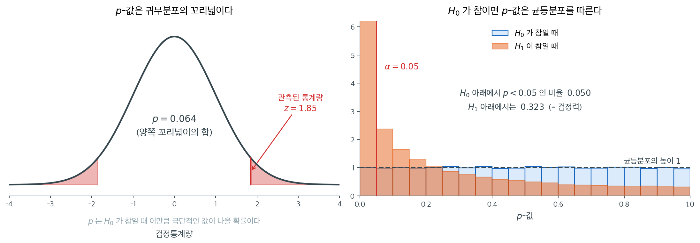
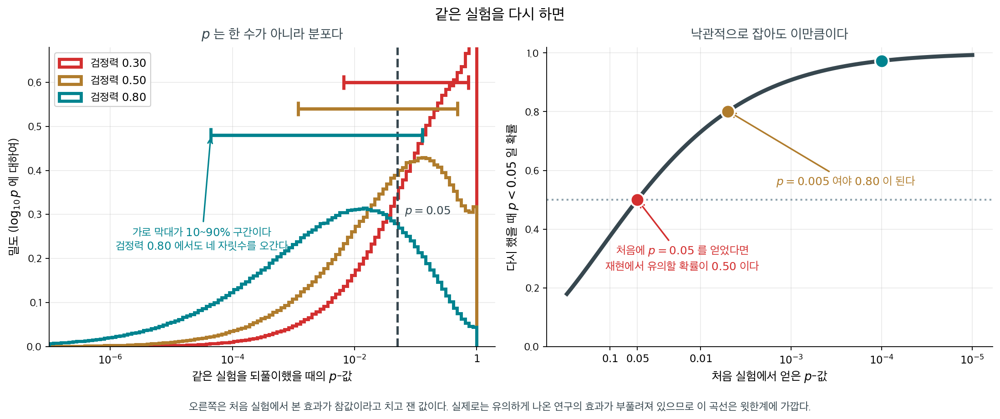
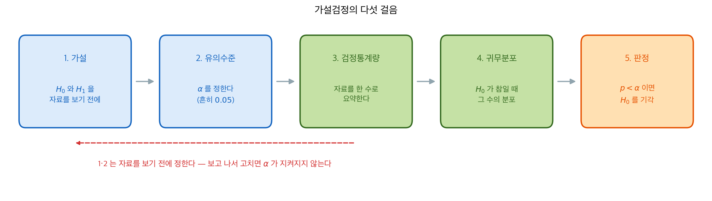
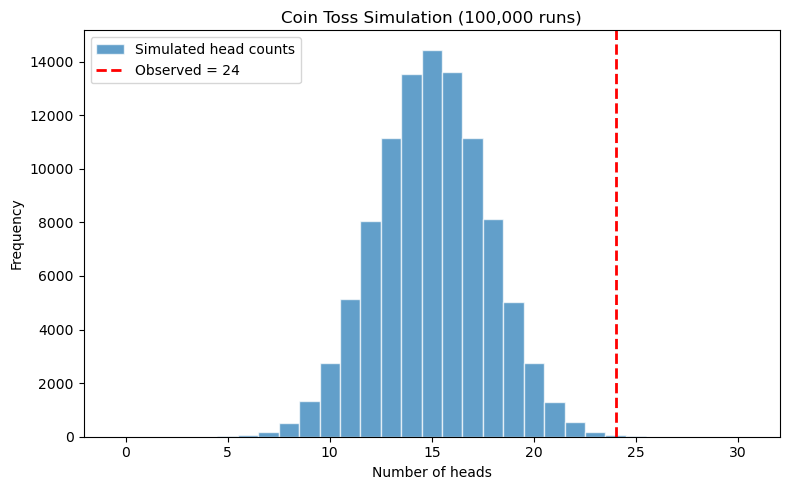

# 검정통계량과 p-값

## 1. 검정통계량

**검정통계량**은 표본자료로부터 계산한 값으로, 이론적 분포에서 나온 문턱과 비교하여 귀무가설 $H_0$을 기각할지 판단하는 데 쓰인다. 어떤 검정통계량을 쓸지는 자료의 종류와 검정하려는 가설에 달려 있다. 표준적인 검정통계량으로 z-통계량, t-통계량, 카이제곱 통계량이 있다.

- **$z$-통계량**: 모분산을 알거나, 표본이 크거나, 자료가 정규분포를 따를 때 쓸 수 있다.
- **$t$-통계량**: 모분산을 모르고 표본이 작을 때 쓸 수 있다. 자료가 정규모집단에서 나왔다고 가정한다.
- **$\chi^2$-통계량**: 보통 범주형 자료에서 독립성이나 적합도를 검정하는 데 쓴다.
- **$f$-통계량**: 주로 분산분석(ANOVA)과 회귀분석에서 집단 간 분산을 비교하고 집단 평균이 유의하게 다른지 검정하는 데 쓴다. 모형이 설명하는 분산을 설명되지 않은 분산으로 나누어 계산한다.

검정통계량을 계산하는 공식은 검정마다 다르다. 예를 들어 모평균을 검정할 때 흔히 쓰는 z-통계량의 공식은

$$ z = \frac{\bar{x} - \mu_0}{\sigma/\sqrt{n}} $$

여기서 $\bar{x}$는 표본평균, $\mu_0$은 귀무가설 아래의 평균, $\sigma$는 모표준편차, $n$은 표본크기이다.

---

## 2. 유의수준 (α)과 오류의 종류
가설검정의 오류를 이해하는 것은 통계검정 결과를 올바르게 해석하는 데 필수적이다. 가설검정을 수행할 때 생길 수 있는 오류는 두 종류이다.

- **제1종 오류**: 흔히 "거짓 양성"이라 불리는 제1종 오류는 귀무가설 $H_0$이 참인데도 이를 잘못 기각하고 대립가설 $H_a$를 택할 때 생긴다. 재판에서 무고한 사람에게 유죄를 선고하는 것에 해당한다. **유의수준** $\alpha$는 귀무가설을 기각하기 위해 우리가 정한 문턱이며, 제1종 오류를 범할 잠재적 위험, 즉 $H_0$이 참일 때 이를 기각할 확률을 나타낸다. 예를 들어 $\alpha = 0.05$로 두면 $H_0$을 잘못 기각할 위험이 5%이다.

$$\alpha=P(\text{Type I Error})=P(\text{Reject } H_0 \mid H_0)$$

- **제2종 오류**: "거짓 음성"이라고도 하는 제2종 오류는 귀무가설 $H_0$이 거짓인데도 기각하지 못하고 잘못 유지할 때 생긴다. 재판에서 유죄인 사람을 무죄로 방면하는 것에 해당한다. 제2종 오류를 범할 확률은 $\beta$로 표기한다. $\beta$가 작을수록 거짓인 $H_0$을 유지할 위험이 작다. $\beta$의 여집합이 **검정의 검정력**이며, $H_0$이 거짓일 때 이를 올바르게 기각할 확률을 나타낸다. 다시 말해 검정력은 효과가 있을 때 그것을 탐지하는 능력이다.

$$\beta=P(\text{Type II Error})=P(\text{Accept } H_0 \mid H_a)$$

$\alpha$와 $\beta$의 균형은 가설검정에서 결정적이다. $\alpha$를 낮추면 제1종 오류의 가능성은 줄지만 제2종 오류의 위험은 커지고, 그 반대도 마찬가지이다. 따라서 적절한 유의수준의 선택은 검정의 맥락과 두 오류가 각각 초래하는 결과에 달려 있다.

---

## 3. p-값과 그 해석

**p-값**은 귀무가설($H_0$)에 반하는 증거를 정량화하는 가설검정의 근본 개념이다. 구체적으로 p-값은 귀무가설이 참이라는 가정 아래, 표본자료에서 계산한 검정통계량만큼 또는 그보다 극단적인 값을 관측할 확률이다. 관측된 자료가 $H_0$과 부합하는지, 아니면 $H_0$을 기각하고 대립가설($H_a$)을 택할 만큼 충분한 증거를 주는지 판단하는 데 도움을 준다.

p-값은 $H_0$이 성립한다는 가정 아래 관측된 자료가 얼마나 이례적인지를 잰다:

- **작은 p-값**($p \leq \alpha$)은 관측된 자료가 귀무가설 아래에서 의심스럽다는 뜻이다. $H_0$에 반하는 강한 증거를 시사하므로 **기각**하게 된다. 다시 말해 p-값이 작을수록 귀무가설로 관측된 자료를 설명하기 어려워진다. 예를 들어 유의수준을 $\alpha = 0.05$로 두었는데 검정의 p-값이 $p = 0.01$이면, $H_0$이 참이라는 가정 아래 이 표본만큼 극단적인 자료를 볼 확률이 1%뿐이라는 뜻이다. 따라서 $H_0$을 기각한다.

- **큰 p-값**($p > \alpha$)은 자료가 귀무가설과 충분히 어긋나지 않는다는 뜻이다. 이 경우 $H_0$을 기각할 증거가 부족하므로 **기각하지 못한다**. 이는 $H_0$이 참임을 뜻하지 않는다. 다만 자료가 그에 반하는 충분히 강한 증거를 주지 못했을 뿐이다. 예를 들어 p-값이 $p = 0.20$이고 $\alpha = 0.05$이면 자료가 $H_0$ 아래에서 그럴듯하다고 결론짓고 귀무가설을 기각하지 않는다.



왼쪽이 정의 그대로다. $H_0$ 아래에서 검정통계량이 따르는 분포를 그리고, 관측된 값보다 **극단적인 쪽의 넓이**를 재면 그것이 $p$다. 양측검정이면 양쪽 꼬리를 모두 세므로 한쪽 넓이의 두 배가 된다.

오른쪽은 덜 알려졌지만 더 중요한 사실이다. **$H_0$이 참이면 $p$-값 자체가 $[0, 1]$ 위의 균등분포를 따른다.** 파란 막대가 어느 구간에서나 높이 1로 평평한 것이 그것이며, $p < 0.05$인 비율이 정확히 $0.05$가 나오는 것도 여기서 따라 나온다. **유의수준 $\alpha$가 곧 제1종 오류율이 되는 이유가 이 균등성이다.**

주황 막대는 실제로 효과가 있을 때의 $p$-값 분포다. 0 쪽으로 쏠리지만 **여전히 큰 값도 자주 나온다.** 이 예에서 $p < 0.05$인 비율은 0.32에 그치며, 효과가 있는데도 열 번 중 일곱 번은 잡아내지 못한다는 뜻이다. 그 비율이 검정력이고, 9.3절의 주제다.

여기서 흔한 오해를 하나 짚어 두자. **$p$-값은 $H_0$이 참일 확률이 아니다.** 위 정의의 조건이 어느 쪽인지 보면 분명하다. $p$는 "$H_0$이 참일 때 이런 자료가 나올 확률"이지 "이런 자료일 때 $H_0$이 참일 확률"이 아니다. 뒤쪽을 계산하려면 사전확률이 필요하며, 그것이 6.3절 ★ 의 베이즈 방법이다.

정리하면, p-값은 관측된 자료가 귀무가설과 양립 가능한지 평가하는 도구이다. p-값이 낮을수록 $H_0$에 반하는 증거가 강하고, 높을수록 증거가 약하며, 유의수준 $\alpha$에 비추어 귀무가설을 기각할지 유지할지 안내한다.

<div class="storybox" markdown>

**그림으로 보는 통계학 1.** 같은 실험을 다시 하면

2016 년 3 월, 미국통계학회가 1839 년 창립 이래 처음으로 **통계 실무의 한 가지 주제에 대해
공식 성명**을 냈다. 주제가 $p$-값이었다. 여섯 조항 가운데 셋째가 이렇다.

> 과학적 결론과 사업·정책 결정은 $p$-값이 어떤 문턱을 넘었는지만으로 내려서는 안 된다.

학회가 왜 그런 말까지 해야 했는가. 위 오른쪽 그림이 이미 단서를 주었다 — 효과가 있을 때도
$p$ 가 큰 값으로 자주 나온다. 그 흔들림의 **크기**를 자릿수로 재어 보면 이렇다.

<figure markdown>
{ width="900" }
  <figcaption markdown>왼쪽은 참 효과를 고정해 놓고 실험을 되풀이한 것이고, 오른쪽은 처음 실험에서 **본** 효과가 참값이라고 치고 잰 값이다.</figcaption>
</figure>

| 검정력 | $p$ 의 $10\%$ 분위 | 중앙값 | $90\%$ 분위 |
|---|---|---|---|
| $0.30$ | $0.0066$ | $0.150$ | $0.730$ |
| $0.50$ | $0.0012$ | $0.050$ | $0.483$ |
| $0.80$ | $0.000044$ | $0.005$ | $0.129$ |

연구 설계에서 흔히 목표로 삼는 **검정력 $0.80$ 에서도** $p$ 가 $0.000044$ 에서 $0.129$
사이를 오간다. 거의 네 자릿수다. $p$-값은 자료로 계산하는 **추정량**이고, 다른 추정량과
똑같이 표집분포를 갖는다. 그런데 평균이나 회귀계수와 달리 **그 폭을 함께 적어 주는 관행이
없다.** $p = 0.03$ 이라고 보고할 때, 그 수가 얼마나 흔들리는 수인지는 아무도 적지 않는다.

오른쪽이 더 실감 난다. 처음 실험에서 $p = 0.05$ 를 얻었다고 하자. 그때 **본** 효과가
그대로 참값이라고 쳐도, 같은 실험을 다시 했을 때 $p < 0.05$ 가 나올 확률이 **$0.500$**
이다. 동전 던지기다. $0.80$ 을 얻으려면 처음에 $p = 0.005$ 여야 한다.

게다가 $0.500$ 은 **윗한계**다. 유의하게 나온 연구의 효과크기는 평균적으로 부풀려져 있으므로
([검정력](../errors_and_power/power.md) 쪽에서 다룬다) 참값은 본 것보다 작고, 재현 확률은
그만큼 더 낮다.

그래서 2019 년에 학회지 『The American Statistician』이 특집호를 내면서 「$p < 0.05$ 너머의
세계로」라는 사설을 실었고, 같은 무렵 『네이처』에 「통계적 유의성을 은퇴시키자」는 글이
팔백 명이 넘는 서명과 함께 올랐다. 다만 한 가지는 구별해 두는 편이 좋다 — **2016 년의
성명은 학회의 공식 입장이지만, 2019 년의 더 센 권고는 사설이지 학회의 정책이 아니다.**

읽는 법은 바뀌지 않았다. $p$ 는 여전히 위 정의 그대로다. 바뀐 것은 **그 수 하나에 얼마나
기댈 수 있는가**에 대한 눈높이다. 같은 이야기를 신뢰구간 쪽에서 한 번 더 만난다 —
[구간도 다음 실험을 $83\%$ 밖에 담지 못한다](../../ch08/foundations/coverage.md).

_확인한 곳 — 미국통계학회가 $1839$ 년 $11$ 월 $27$ 일 보스턴에서 창립되었다는 것과 $2016$ 년 $p$ 값 성명이 학회가 통계 실무의 한 주제에 대해 낸 첫 공식 입장이었다는 것, $2019$ 년에 『The American Statistician』이 「$p < 0.05$ 너머의 세계로」 특집호를 내고 같은 무렵 『Nature』에 유의성 은퇴를 주장하는 글이 $800$ 명 넘는 서명과 함께 실린 것. 표와 그림의 수는 모두 직접 계산하거나 모의실험한 값이다_

</div>

---

## 4. 검정의 이름

### 검정의 이름 — 가설

$$\begin{array}{lll}
\text{양측}&&\displaystyle\text{$H_0$ : $\mu=\mu_0$ vs $H_1$ : $\mu\neq\mu_0$}\\
\text{좌측}&&\displaystyle\text{$H_0$ : $\mu=\mu_0$ vs $H_1$ : $\mu<\mu_0$}\\
\text{우측}&&\displaystyle\text{$H_0$ : $\mu=\mu_0$ vs $H_1$ : $\mu>\mu_0$}\\
\end{array}$$

### 검정의 이름 — 자료

$$\begin{array}{lll}
\text{일표본}&&\displaystyle\{x_1,\cdots,x_n\}\\
\text{이표본}&&\displaystyle\{x_1,\cdots,x_n\}\ \text{그리고}\ \{y_1,\cdots,y_m\}\\
\text{대응표본}&&\displaystyle\{(x_1,y_1),\cdots,(x_n,y_n)\}\\
\end{array}$$

### 검정의 이름 — 표집분포

$$\begin{array}{lll}
\text{$z$ 검정}&&\displaystyle\text{표집분포를 $z$로 나타낸다}\\
\text{$t$ 검정}&&\displaystyle\text{표집분포를 $t$로 나타낸다}\\
\text{$f$ 검정}&&\displaystyle\text{표집분포를 $f$로 나타낸다}\\
\text{$\chi^2$ 검정}&&\displaystyle\text{표집분포를 $\chi^2$로 나타낸다}\\
\end{array}$$

### 이름 짓는 규칙

$$\begin{array}{ccc}
\text{양측}&\text{이표본}&\text{$z$ 검정}\\
\uparrow&\uparrow&\uparrow\\
\text{가설}&\text{자료}&\text{표집분포}\\
\end{array}$$

---

## 5. 가설검정의 단계

가설검정은 표본자료에 근거하여 모수에 관한 가정을 평가하는 체계적인 과정이다. 그 단계들은 결론의 무결성과 정확성을 보장하는 데 결정적이다.

아래에서 볼 검정들은 대상이 평균이든 비율이든 분산이든 **같은 다섯 걸음**을 밟는다.



달라지는 것은 3번과 4번, 곧 자료를 어떤 수로 요약하고 그 수가 $H_0$ 아래에서 어떤 분포를 따르는가뿐이다. 평균이면 $t$, 비율이면 $z$, 분산이면 $\chi^2$이 그 자리에 들어간다. 나머지 세 걸음은 검정이 바뀌어도 그대로다.

**달라지는 것은 3번과 4번뿐이다** — 자료를 어떤 수로 요약하고 그 수가 $H_0$ 아래에서 어떤
분포를 따르는가. 평균이면 $t$, 비율이면 $z$, 분산이면 $\chi^2$ 이 그 자리에 들어간다.
나머지 세 걸음은 검정이 바뀌어도 그대로이고, 9.2절 [일표본 검정](../one_sample_tests/z_test_mean.md)부터 보는 검정들이 모두 이 틀 안에 있다.

그림 아래의 붉은 화살표가 실무에서 가장 자주 깨지는 규칙이다. **1번과 2번은 자료를 본 뒤에
고치면 안 된다.** 결과를 보고 가설의 방향을 바꾸거나 $\alpha$ 를 올리면 그 순간 5번의
판정이 약속한 오류율을 지키지 못한다. 9.6절 [분석의 자유는 곱해진다](../multiple_testing/p_hacking_demo.md)이
그 일이 수로 어떻게 나타나는지 보인다.

### 1단계: 가설 설정

가설검정의 첫 단계는 서로 맞서는 두 가설을 세우는 것이다.

- **귀무가설 ($H_0$)**: 모집단에 효과나 차이가 없다고 가정한다. 검정이 도전하고자 하는 기준 가설 역할을 한다.
- **대립가설 ($H_a$)**: 효과나 차이가 있다고 상정한다. 증거가 귀무가설을 기각할 만하다면 택하게 되는 가설이다.

예를 들어 새 약이 혈압을 낮추는지 조사한다면 가설은 다음과 같을 수 있다:

- $H_0$: 이 약에 의한 혈압의 평균 감소량은 0이다.
- $H_a$: 이 약에 의한 혈압의 평균 감소량은 0보다 크다.

### 2단계: 적절한 검정의 선택

올바른 통계검정을 고르는 일은 결정적이며 자료의 종류와 가설에 달려 있다. 어떤 검정을 고르느냐가 검정통계량을 계산하는 방식과 가설을 평가하는 방식을 좌우한다. 고려할 요인으로는 자료의 측정 수준, 표본크기, 자료가 정규분포를 따르는지 여부가 있다. 표준적인 검정으로는 z-검정, t-검정, 카이제곱 검정, 분산분석이 있다.

### 3단계: 유의수준의 결정

유의수준($\alpha$)은 귀무가설을 기각하는 문턱이다. 참인 귀무가설을 기각하는 제1종 오류를 범할 확률을 나타낸다. $\alpha$의 전형적인 값은 0.05, 0.01, 0.10이다. 편향을 피하려면 자료를 분석하기 전에 이 값을 정해야 한다.

### 4단계: 검정통계량의 계산

검정통계량은 표본자료로부터 계산한 값으로, 귀무가설이 참이라는 가정 아래 특정 확률분포를 따른다. 검정통계량은 관측된 자료를 귀무가설 아래의 표집분포와 견준다. 예를 들어 평균에 대한 z-검정에서 검정통계량은 다음과 같이 계산한다:

$$ z = \frac{\bar{x} - \mu_0}{\sigma/\sqrt{n}} $$

여기서 $\bar{x}$는 표본평균, $\mu_0$은 귀무가설 아래의 평균, $\sigma$는 모표준편차, $n$은 표본크기이다.

### 5단계: p-값의 결정

p-값은 귀무가설 아래에서 관측된 통계량만큼 또는 그보다 극단적인 검정통계량을 관측할 확률이다. 귀무가설을 기각할지 결정하는 데 결정적인 척도이다. p-값이 $\alpha$보다 작으면 귀무가설에 반하는 강한 증거를 시사한다.

### 6단계: 판정

p-값과 미리 정한 유의수준에 따라 다음과 같이 판정한다:

- p-값 $\leq \alpha$이면 귀무가설을 기각한다.
- p-값 $> \alpha$이면 귀무가설을 기각하지 않는다.

### 7단계: 가설검정의 마무리

마지막 단계는 연구 질문의 맥락에서 결과를 해석하는 것이다. 판정의 함의를 살피고, 있을 수 있는 오류를 논하며, 필요하다면 후속 연구를 제안하는 일이 여기에 포함된다.

## 6. 분포 공식 없이 p 값을 얻기

절 $3$ 은 $p$ 값을 「귀무가설 아래에서 관측된 것만큼 극단적인 결과가 나올 확률」로
적었다. 그 정의를 **글자 그대로** 따르면 분포 공식이 필요 없다 — 귀무가설 아래의
세상을 여러 번 만들어 세기만 하면 된다. 동전 $40$ 번에 앞면 $24$ 번으로 해 본다.

<div class="exbox" markdown>

**보기 1.** <span class="diff easy" title="쉬움"></span> 동전 던지기 한 번의 실험. $H_0$이 참일 때 한 판이 어떻게 생겼는지부터 본다.

**(1)** $H_0$ 아래에서 앞면 수 $X$의 기댓값과 표준편차를 구하고, 관측값 24가 평균에서 몇 표준편차 떨어져 있는지 말하시오.

**(2)** 열 판을 돌렸을 때 그중 24 이상이 나오는 판이 **몇 판쯤** 나오리라 기대하는가. 실제로 열 판을 돌려 확인하시오.

</div>

??? success "풀이"

    **(1) 해석적으로.** $H_0\colon p = 0.5$ 아래에서 $X \sim \text{Bin}(30,\,0.5)$이므로

    $$
    E[X] = np = 30 \times 0.5 = 15, \qquad
    \text{SD}(X) = \sqrt{np(1-p)} = \sqrt{30 \times 0.25} = \sqrt{7.5} = 2.738613
    $$

    이다. 관측값 24는

    $$
    \frac{24 - 15}{2.738613} = 3.286335
    $$

    이므로 **평균에서 3.29 표준편차 위**에 있다. 정규분포라면 오른쪽 꼬리 확률이 $5\times10^{-4}$쯤 되는 자리다(정확한 이항 값은 보기 3에서 구한다).

    **(2) 해석적으로.** $P(X \ge 24) = 0.000715$이므로(보기 3) 열 판에서 24 이상이 나오는 판의 수는 $\text{Bin}(10,\,0.000715)$를 따르고 기댓값은

    $$
    10 \times 0.000715 = 0.00715
    $$

    이다. **열 판을 한 묶음으로 보면 140묶음에 한 번쯤** 그런 판이 나온다는 뜻이다. 그러니 열 판에서는 거의 확실히 한 판도 나오지 않는다.

    **수치적으로.**

    ```python
    import numpy as np

    np.random.seed(42)

    TOTAL_TOSSES = 30
    OBSERVED_HEADS = 24
    PROB_HEAD_FAIR = 0.5
    NUM_SIMULATIONS = 100_000

    def single_experiment(n_tosses=TOTAL_TOSSES, p=PROB_HEAD_FAIR):
        """공정한 동전을 n_tosses번 던진 한 판을 흉내 내고 앞면 횟수를 돌려준다."""
        # 0/1을 30개 뽑아 더할 필요가 없다. 앞면 횟수의 분포가 곧 Bin(30, 0.5)다.
        return np.random.binomial(n_tosses, p)

    # H0가 참일 때 한 판을 돌리면 무엇이 나오는지 몇 번 본다.
    print([single_experiment() for _ in range(10)])
    ```

    출력:

    ```
    [14, 20, 17, 16, 12, 12, 11, 18, 16, 17]
    ```

    열 판의 평균이 $15.3$으로 이론값 $15$ 언저리이고, 가장 큰 값이 $20$, 가장 작은 값이 $11$이다. 둘 다 평균에서 두 표준편차 안쪽이다. **24에 닿은 판은 하나도 없다.** (2)에서 기대값이 $0.00715$였으니 당연한 결과다.

    공정한 동전에서 앞면은 15 언저리를 오간다. 관측된 24가 이 범위에서 얼마나 떨어져 있는지가 이 검정의 전부다.

<div class="exbox" markdown>

**보기 2.** <span class="diff easy" title="쉬움"></span> 모의실험 되풀이하기. 이번에는 $N = 100{,}000$판을 돌려 24 이상이 나온 판을 센다.

**(1)** 참 꼬리확률을 $p^* = 0.000715453$(보기 3에서 구한다)이라 할 때, 이 **개수**가 따르는 분포와 그 기댓값·표준편차를 구하시오. 모의실험 $p$-값의 표준오차는 얼마인가.

**(2)** 모의실험을 돌려 실제 개수를 세고, (1)의 예측과 몇 표준편차 떨어져 있는지 확인하시오.

</div>

??? success "풀이"

    **(1) 해석적으로.** $N$판은 서로 독립이고 각 판이 "24 이상"일 확률이 $p^*$로 같다. 그러므로 개수 $Y$는

    $$
    Y \sim \text{Bin}(N,\, p^*), \qquad N = 100{,}000,\ p^* = 0.000715453
    $$

    를 따르고

    $$
    E[Y] = N p^* = 71.545, \qquad
    \text{SD}(Y) = \sqrt{N p^*(1-p^*)} = \sqrt{71.494} = 8.4554
    $$

    이다. 모의실험 $p$-값은 $\hat p = Y/N$이므로 표준오차는 이것을 $N$으로 나눈

    $$
    \text{SE}(\hat p) = \sqrt{\frac{p^*(1-p^*)}{N}} = \frac{8.4554}{100{,}000} = 8.455 \times 10^{-5}
    $$

    이다. **참값의 12%쯤 되는 상대오차**다. 꼬리확률처럼 작은 수를 모의실험으로 재면 상대오차가 이렇게 크다. 이를 반으로 줄이려면 $N$을 네 배로 늘려야 한다.

    **(2) 수치적으로.**

    ```python
    def simulate_coin_tosses(n_simulations=NUM_SIMULATIONS,
                             n_tosses=TOTAL_TOSSES,
                             p=PROB_HEAD_FAIR):
        """실험을 n_simulations번 반복하고 앞면 횟수 배열을 돌려준다."""
        return np.random.binomial(n_tosses, p, size=n_simulations)

    # 여기서 세는 것은 "H0가 참일 때 관측값만큼 극단적인 일이 얼마나 자주 일어나는가"다.
    # 그것이 p-값의 정의다. 이항분포 공식을 몰라도 이 논리는 그대로 성립한다.

    head_counts = simulate_coin_tosses()
    extreme = np.sum(head_counts >= OBSERVED_HEADS)
    pct = extreme / NUM_SIMULATIONS * 100

    print(f"Times with >= {OBSERVED_HEADS} heads: {extreme:,}")
    print(f"Percentage: {pct:.4f}%")

    # (1) 의 예측과 견준다.
    p_star = 0.000715453
    mean_y = NUM_SIMULATIONS * p_star
    sd_y = np.sqrt(NUM_SIMULATIONS * p_star * (1 - p_star))
    print(f"예측 개수 {mean_y:.3f} ± {sd_y:.4f}"
          f"   관측과의 거리 {(extreme - mean_y) / sd_y:+.3f} SD")

    # 모의실험 p-값의 표준오차는 관측된 비율로도 잴 수 있다.
    p_hat = extreme / NUM_SIMULATIONS
    se_hat = np.sqrt(p_hat * (1 - p_hat) / NUM_SIMULATIONS)
    print(f"p-hat = {p_hat:.6f},  SE = {se_hat:.3e},"
          f"  95% 구간 ({p_hat - 1.96 * se_hat:.6f}, {p_hat + 1.96 * se_hat:.6f})")
    ```

    출력:

    ```
    Times with >= 24 heads: 71
    Percentage: 0.0710%
    예측 개수 71.545 ± 8.4554   관측과의 거리 -0.064 SD
    p-hat = 0.000710,  SE = 8.423e-05,  95% 구간 (0.000545, 0.000875)
    ```

    10만 번 중 71번이다. 모의실험 $p$-값은 $0.00071$이 된다.

    (1)이 예측한 $71.545$에 대해 관측값이 $71$이니 **0.064 표준편차** 떨어져 있다. 이보다 더 잘 맞을 수는 없을 정도다. 다만 그것은 운이기도 하다. 표준편차가 $8.46$이므로 예컨대 $60$이나 $83$이 나와도 전혀 이상하지 않았다.

    관측된 비율로 잰 95% 구간 $(0.000545,\ 0.000875)$가 참값 $0.000715$를 담는다. 구간의 폭이 참값의 절반 가까이 되므로, **모의실험만으로는 "0.0007 언저리"라는 정도까지만 말할 수 있다.**

<div class="exbox" markdown>

**보기 3.** <span class="diff easy" title="쉬움"></span> 정확한 값과 견주기. 이산분포의 꼬리확률을 누적분포함수로 구할 때 가장 흔한 실수가 부등호를 한 칸 어긋나게 쓰는 것이다.

**(1)** $P(X \ge 24)$를 $F(x) = P(X \le x)$로 쓰면 $1 - F(23)$인가 $1 - F(24)$인가. 틀린 쪽을 쓰면 **몇 배** 어긋나는지 수로 답하시오.

**(2)** 두 값을 모두 계산해 (1)을 확인하고, 보기 2의 모의실험 값과 견주시오.

</div>

??? success "풀이"

    **(1) 해석적으로.** $X$가 정수값만 가지므로 $\{X \ge 24\}$의 여집합은 $\{X \le 23\}$이다. 따라서

    $$
    P(X \ge 24) = 1 - F(23)
    $$

    가 옳다. $1 - F(24) = P(X \ge 25)$는 **$X = 24$인 경우를 통째로 빠뜨린다.** 연속분포라면 한 점의 확률이 0이라 아무 차이가 없지만 이산분포에서는 그렇지 않다.

    빠뜨리는 양이 얼마나 되는지 보자.

    $$
    P(X = 24) = \binom{30}{24}\left(\tfrac12\right)^{30} = \frac{593{,}775}{1{,}073{,}741{,}824} = 0.000553
    $$

    인데 전체가 $P(X \ge 24) = 0.000715$다. **한 점이 꼬리 전체의 77.3%를 차지한다.** 그러므로 틀린 쪽은

    $$
    1 - F(24) = 0.000715 - 0.000553 = 0.000162
    $$

    를 주고, 비는

    $$
    \frac{0.000715453}{0.000162458} = 4.404
    $$

    이다. **4.4배 작게 보고하게 된다.** 꼬리 끝으로 갈수록 이항 PMF가 가파르게 줄어들기 때문에, 극단값일수록 맨 앞 한 항이 꼬리를 거의 다 차지하고 이 실수의 대가가 커진다.

    **(2) 수치적으로.**

    ```python
    from scipy.stats import binom

    # P(X >= 24) = 1 - P(X <= 23) 이다. cdf에 24가 아니라 **23**을 넣어야 한다.
    # 이산분포에서 부등호를 하나 어긋나게 쓰는 것이 가장 흔한 실수다.
    p_exact = 1 - binom.cdf(OBSERVED_HEADS - 1, TOTAL_TOSSES, PROB_HEAD_FAIR)
    print(f"Exact binomial P(X >= {OBSERVED_HEADS}): {p_exact:.6f}")

    # 한 칸 어긋나게 쓰면 어떻게 되는가.
    p_wrong = 1 - binom.cdf(OBSERVED_HEADS, TOTAL_TOSSES, PROB_HEAD_FAIR)
    pmf24 = binom.pmf(OBSERVED_HEADS, TOTAL_TOSSES, PROB_HEAD_FAIR)
    print(f"틀린 1 - F(24)          : {p_wrong:.6f}   (= P(X >= 25))")
    print(f"빠뜨린 P(X = 24)        : {pmf24:.6f}"
          f"   꼬리에서 차지하는 몫 {pmf24 / p_exact:.1%}")
    print(f"비 (옳은 값)/(틀린 값)  : {p_exact / p_wrong:.3f}")
    print(f"모의실험 값             : {pct / 100:.6f}"
          f"   차이 {abs(pct / 100 - p_exact) / se_hat:.3f} SE")
    ```

    출력:

    ```
    Exact binomial P(X >= 24): 0.000715
    틀린 1 - F(24)          : 0.000162   (= P(X >= 25))
    빠뜨린 P(X = 24)        : 0.000553   꼬리에서 차지하는 몫 77.3%
    비 (옳은 값)/(틀린 값)  : 4.404
    모의실험 값             : 0.000710   차이 0.065 SE
    ```

    유도한 $77.3\%$와 $4.404$가 그대로 나왔다.

    모의실험의 $0.00071$과 정확한 값 $0.000715$는 모의실험 표준오차의 **0.065배**밖에 떨어져 있지 않다. 보기 2에서 본 대로 $\text{SE} \approx 8.4\times10^{-5}$이므로 이 정도 일치는 기대할 만하다(연습문제 3).

    여기서 두 방법의 역할이 갈린다. **정확한 이항 계산은 자릿수를 몇 개든 줄 수 있고, 모의실험은 $N$이 주는 만큼만 준다.** 분포를 아는 문제에서 모의실험을 쓸 이유는 없다. 모의실험이 값진 것은 분포를 모르는 문제에서이고, 이 페이지는 **같은 답을 두 길로 얻어 두 길이 모두 옳음을 확인하는** 연습이다.

<div class="exbox" markdown>

**보기 4.** <span class="diff easy" title="쉬움"></span> 결과를 히스토그램으로. 보기 2의 10만 판을 막대그림으로 그리고 관측값 24에 세로선을 긋는다.

**(1)** 이 그림에서 읽히는 것을 수치와 함께 적으시오.

**(2)** 이 그림이 **가리는 것**과 **잘못 읽히기 쉬운 곳**은 어디인가.

</div>

??? success "풀이"

    유도할 답이 있는 문제가 아니다. **그림에서 무엇이 읽히고 무엇이 읽히지 않는가**가 이 보기의 전부이므로, 눈으로 본 것을 수치로 바꿔 가며 읽는다.

    ```python
    import matplotlib.pyplot as plt

    plt.rcParams["font.sans-serif"] = ["NanumGothic", "Apple SD Gothic Neo", "Malgun Gothic"]
    plt.rcParams["font.family"] = "sans-serif"
    plt.rcParams["axes.unicode_minus"] = False

    # 그림에서 읽을 수치를 미리 찍어 둔다.
    counts = np.bincount(head_counts, minlength=TOTAL_TOSSES + 1)
    print(f"모의 평균 {head_counts.mean():.4f}  표준편차 {head_counts.std(ddof=1):.4f}"
          f"   (이론 15, {np.sqrt(7.5):.4f})")
    print(f"최솟값 {head_counts.min()}  최댓값 {head_counts.max()}")
    print(f"가장 높은 막대: x = {counts.argmax()}, 높이 {counts.max():,}")
    for x in (22, 23, 24, 25, 26):
        print(f"  x = {x}: 높이 {counts[x]:>5,}"
              f"   가장 높은 막대의 {counts[x] / counts.max():.3%}")

    # 앞면 수가 정수이므로 계급 경계를 반 칸씩 밀어 막대 하나가 값 하나를 담게 한다.
    fig, ax = plt.subplots(figsize=(8, 5))
    bins = np.arange(0, TOTAL_TOSSES + 2) - 0.5
    ax.hist(head_counts, bins=bins, edgecolor="white", alpha=0.7,
            label="Simulated head counts")
    # 관측값 자리에 세로선을 긋는다. 그 오른쪽 막대들의 넓이 비율이 곧 p-값이다.
    ax.axvline(OBSERVED_HEADS, color="red", linestyle="--", linewidth=2,
               label=f"Observed = {OBSERVED_HEADS}")
    ax.set_xlabel("Number of heads")
    ax.set_ylabel("Frequency")
    ax.set_title(f"Coin Toss Simulation ({NUM_SIMULATIONS:,} runs)")
    ax.legend()
    plt.tight_layout()
    plt.show()
    ```

    출력:

    ```
    모의 평균 14.9923  표준편차 2.7302   (이론 15, 2.7386)
    최솟값 4  최댓값 26
    가장 높은 막대: x = 15, 높이 14,442
      x = 22: 높이   535   가장 높은 막대의 3.704%
      x = 23: 높이   180   가장 높은 막대의 1.246%
      x = 24: 높이    56   가장 높은 막대의 0.388%
      x = 25: 높이    12   가장 높은 막대의 0.083%
      x = 26: 높이     3   가장 높은 막대의 0.021%
    ```

    

    **(1) 읽히는 것.** 히스토그램이 좌우대칭의 종 모양으로 $x = 15$에 봉우리를 두고 있다. 모의 평균 $14.9923$과 표준편차 $2.7302$가 이론값 $15$, $2.7386$과 소수점 둘째 자리까지 맞으므로 **모의실험이 $\text{Bin}(30,\,0.5)$를 제대로 재현했다**고 읽을 수 있다. 막대 높이는 $x=15$에서 $14{,}442$이고 $x = 15 \pm 3$인 12와 18에서 $8{,}000$ 남짓이다.

    빨간 선이 그은 24는 봉우리에서 멀찍이 떨어져 있고, **그 오른쪽에는 눈에 보이는 막대가 없다.** 이것이 그림이 전하려는 전부다. 관측된 24가 $H_0$ 아래에서 일어날 법한 자리가 아니라는 것.

    **(2) 가리는 것 — 꼬리의 크기.** 세로축이 선형 빈도라 $0$부터 $14{,}500$까지를 한 화면에 담는다. $x = 24$의 막대는 높이 $56$으로 가장 높은 막대의 $0.388\%$이고, 세로 500화소 남짓한 그림에서 **1화소 남짓**이다. $x = 25$는 $12$, $x = 26$은 $3$이라 아예 그려지지 않는다. 그러므로 이 그림만 보고는 $P(X \ge 24)$가 $0.0007$인지 $0.00001$인지 **분간할 수 없다.** $p$-값을 그림에서 읽어 내겠다면 로그 세로축을 쓰거나 꼬리 구간만 따로 확대해야 한다.

    **잘못 읽히기 쉬운 곳 — 선의 자리.** 막대는 정수에 **중심을 두고** 그려져 있고 빨간 선은 $x = 24$에 그어져 있다. 그러니 "선 오른쪽 막대의 넓이"를 글자 그대로 재면 $x = 24$ 막대의 **오른쪽 절반만** 세게 되어 $p$-값을 과소평가한다. 우리가 원하는 영역은 $\{X \ge 24\}$이므로 선은 $x = 23.5$에 그어야 맞다. 보기 3에서 본 부등호 한 칸 문제가 그림에서는 이 모습으로 나타난다.

    **또 하나 — 모의실험의 해상도.** 10만 판에서 나온 최댓값이 $26$이다. $x = 27$ 이상은 한 번도 나오지 않았으므로 이 그림은 그 구간에 대해 "확률이 $10^{-5}$보다 작다"는 것 말고는 아무 말도 하지 못한다. 실제로 $P(X \ge 27) = 4\times10^{-6}$이라 10만 판에서 0.4판이 기대되는 값이다. **모의실험으로는 $1/N$보다 작은 확률을 볼 수 없다.**

### 읽는 법

100,000번의 모의실험에서 앞면이 24번 이상 나온 비율은 5%를 크게 밑돈다. 정확한 이항 p-값은 $P(X \geq 24 \mid n=30, p=0.5) \approx 0.0007$이다. 어떤 합리적인 유의수준보다도 훨씬 작으므로 $H_0$을 기각하고 이 동전이 앞면 쪽으로 치우쳐 있다고 결론짓는다.

---

---

## 연습문제

<div class="drillbox" markdown>

**연습문제 1.** <span class="diff easy" title="쉬움"></span>
**채식하는 청소년.** Evie가 학생 25명을 표본으로 뽑았더니 20%가 채식주의자였다. $H_0: p = 0.06$ 대 $H_1: p > 0.06$을 검정한다. 정확한 p-값을 계산하라.

</div>

??? success "풀이"
    관측값: $n = 25$ 중 채식주의자 $X = 5$명. $H_0$ 아래에서 $X \sim \mathrm{Binomial}(25, 0.06)$.

    p-값: $P(X \ge 5) = 1 - P(X \le 4) = 1 - \sum_{k=0}^4 \binom{25}{k}(0.06)^k (0.94)^{25-k}$.

    수치로: $P(X \le 4) \approx 0.9849$이므로 $p \approx 0.0151$.

    이 학교의 채식 비율이 6%를 넘는다는 증거이다. $\alpha = 0.05$에서 $H_0$을 기각하지만 $\alpha = 0.01$에서는 기각하지 못한다.

    정규근사를 쓰면 $z = (0.20 - 0.06)/\sqrt{0.06 \cdot 0.94/25} \approx 2.95$, $p \approx 0.0016$이 된다 — 정확한 값보다 거의 열 배 작다. $np_0 = 1.5 < 10$이므로 정규근사 조건이 깨져 있어, 이런 경우에는 정확한 이항검정을 써야 한다.

---

<div class="drillbox" markdown>

**연습문제 2.** <span class="diff easy" title="쉬움"></span>
**여러 언어를 쓰는 미국인.** $\hat p = 40/120 \approx 0.333$으로 $H_0: p = 0.26$ 대 $H_1: p > 0.26$을 검정한다. 정규근사로 p-값을 계산하라.

</div>

??? success "풀이"
    $\mathrm{SE} = \sqrt{0.26 \cdot 0.74/120} \approx 0.0400$. $z = (0.333 - 0.26)/0.0400 \approx 1.83$.

    p-값: $P(Z > 1.83) = 1 - \Phi(1.83) \approx 0.034$. $\alpha = 0.05$에서 $H_0$을 기각한다.

    결론: 미국인의 26% 넘는 비율이 여러 언어를 쓴다는 증거이다.

    확인: $np_0 = 31.2 \ge 10$, $n(1-p_0) = 88.8 \ge 10$. 검정의 오류율까지 명목 수준에 가깝기를 요구하는 [보수적 기준](../../ch04/discrete_distributions/binomial.md#언제-쓸-수-있는가-5와-10)을 넉넉히 만족하므로 정규근사에 기댄 p-값을 믿어도 된다.

---

<div class="drillbox" markdown>

**연습문제 3.** <span class="diff med" title="중간"></span>
**p-값을 형식적으로 정의**하고 $H_0$ 아래 검정통계량 분포와의 관계를 설명하라.

</div>

??? success "풀이"
    **p-값:** $H_0$ 아래에서 관측된 값만큼 또는 그보다 극단적인 검정통계량을 얻을 확률.

    형식적으로: $p = P_{H_0}(T \ge t_{\text{obs}})$ (단측) 또는 $p = 2 \min[P_{H_0}(T \ge t_{\text{obs}}), P_{H_0}(T \le t_{\text{obs}})]$ (양측).

    관측된 통계량 너머 귀무분포의 꼬리 넓이로 계산한다.

    $H_0$ 아래에서 p-값 자체는 $[0, 1]$ 위의 **균등분포**를 따른다(확률적분변환). 이것이 "$p \le \alpha$이면 기각한다"는 판정 규칙을 정당화한다 — 제1종 오류율이 정확히 $\alpha$가 된다.

---

<div class="drillbox" markdown>

**연습문제 4.** <span class="diff med" title="중간"></span>
**p-값에 대한 흔한 오해.** 세 가지를 들라.

</div>

??? success "풀이"
    1. **"$p$-값은 $H_0$이 참일 확률이다."** 틀렸다. p-값은 $H_0$을 가정한 확률이지 $H_0$에 관한 확률이 아니다. $P(H_0 \mid \text{자료})$를 얻으려면 사전분포와 Bayes 정리가 필요하다.

    2. **"$1 - p$는 $H_1$이 참일 확률이다."** 틀렸다. 같은 혼동이다.

    3. **"$p < 0.05$는 효과가 크다는 뜻이다."** 틀렸다. p-값은 효과크기와 표본크기 둘 다에 의존한다. $n = 10^6$이면 무의미할 만큼 작은 효과도 $p < 10^{-10}$일 수 있다. **표본크기를 붙들어 매도 그렇다** — 키 자료에서 $n$ 을 둘 다 $250$ 으로 맞추고 효과만 $d = 0.26$ 에서 $0.75$ 로 세 배 키우면 $p$ 가 $4.9 \times 10^{-5}$ 에서 $5.8 \times 10^{-16}$ 로 **열한 자릿수** 움직인다. $p$ 가 $|t|$ 에 지수적으로 반응하기 때문이고, 그래서 **$p$ 의 지수는 효과가 얼마나 큰지를 재는 눈금이 아니다.** p-값과 함께 항상 효과크기와 신뢰구간을 보고하라.

    다른 오해: "p = 0.05는 오류 확률이 5%라는 뜻이다"(절차가 아니라 가설에 관한 확률 진술로 오해), "$p > 0.05$이면 $H_0$이 참이다"(기각하지 못하는 것 ≠ 받아들이는 것).

---

<div class="drillbox" markdown>

**연습문제 5.** <span class="diff med" title="중간"></span>
**모의실험 기반 p-값.** 채식주의자 보기로 보여라.

</div>

??? success "풀이"
    ```python
    import numpy as np
    rng = np.random.default_rng(42)
    p0, n, x_obs = 0.06, 25, 5
    n_sim = 10_000
    samples = rng.binomial(n, p0, size=n_sim)
    # p-값의 정의를 그대로 코드로 옮긴 것이다.
    # "H0가 참일 때 관측값 이상이 나오는 비율"을 세면 된다.
    p_value = (samples >= x_obs).mean()
    print(f"Simulated p-value: {p_value:.4f}")
    ```

    출력:

    ```
    Simulated p-value: 0.0158
    ```

    정확한 이항 계산은 $P(X \ge 5 \mid n = 25,\, p = 0.06) = 0.01505$이다. 모의실험이 0.0158을 주었고, 이 추정값의 표준오차가 $\sqrt{0.015 \times 0.985/10000} \approx 0.0012$이므로 차이는 오차 범위 안이다.

    **모의실험의 장점:**

    - 표준적인 통계량만이 아니라 어떤 검정통계량에도 통한다.
    - 연속성 보정을 자동으로 처리한다.
    - 귀무분포의 *모양*을 드러낸다(히스토그램).

    **단점:**

    - 몬테카를로 오차: $\mathrm{SE} \approx \sqrt{p(1-p)/n_{\text{sim}}}$. $p = 0.015$이고 $n_{\text{sim}} = 10^4$이면 $\mathrm{SE} \approx 0.0012$로 상대오차가 약 8%이다. 자릿수를 더 얻으려면 $n_{\text{sim}}$을 크게 늘려야 한다.
    - 둘 다 가능할 때는 해석적 계산보다 느리다.

---

<div class="drillbox" markdown>

**연습문제 6.** <span class="diff med" title="중간"></span>
**p-값과 효과크기.** p-값만으로 충분하지 않은 이유는?

</div>

??? success "풀이"
    p-값은 **효과크기**와 **표본크기**를 뒤섞는다:

    - 작은 효과 + 아주 큰 $n$: $p$는 작지만 실질적 유의성은 무시할 만하다.
    - 큰 효과 + 작은 $n$: $p$는 크지만(유의하지 않지만) 효과는 중요할 수 있다.

    두 개의 A/B 검정:

    - 검정 1: 집단당 100,000명, 전환율 51% 대 50%. $p \approx 0.00001$. 효과: 1퍼센트포인트.
    - 검정 2: 집단당 50명, 전환율 70% 대 50%. $p \approx 0.04$. 효과: 20퍼센트포인트.

    p-값으로는 검정 1이 훨씬 "유의하지만" 효과는 검정 2가 훨씬 크다.

    **항상 보고할 것:**

    - 효과크기(원 단위 또는 Cohen의 $d$ 같은 표준화 값).
    - 신뢰구간(그럴듯한 효과의 범위).
    - p-값($H_0$에 반하는 증거).

    이 셋이 함께 있어야 이야기가 온전해진다. p-값만으로는 빈약하다.

---

<div class="drillbox" markdown>

**연습문제 7.** <span class="diff med" title="중간"></span>
$H_0$이 참이면 $p$-값이 **균등분포**를 따른다는 성질을 증명하고, 이산분포에서 왜 깨지는지 수치로 보여라.

</div>

??? success "풀이"
    **연속인 경우의 증명.** 검정통계량 $T$의 $H_0$ 아래 분포함수를 $F$라 하고 $F$가 연속·순증가라 하자. 단측 $p$-값은 $P=1-F(T)$다. $F(T)\sim\text{Unif}(0,1)$이므로(확률적분변환) $P=1-F(T)$도 균등분포다. $\square$

    **따라서** $P(P\le\alpha)=\alpha$가 모든 $\alpha$에서 성립한다. **이것이 "수준 $\alpha$ 검정"의 의미**다.

    ```python
    import numpy as np
    from scipy import stats

    rng = np.random.default_rng(7)
    M, n = 100_000, 20

    x = rng.normal(0, 1, (M, n))
    t = x.mean(1) / (x.std(1, ddof=1) / np.sqrt(n))
    pv = 2 * stats.t.sf(np.abs(t), n - 1)
    print(f"t 검정 — KS 적합도 p = {stats.kstest(pv, 'uniform').pvalue:.4f}")
    for a in [0.01, 0.05, 0.10, 0.20]:
        print(f"   P(p ≤ {a:.2f}) = {np.mean(pv <= a):.4f}")

    print("\n이항 n=20, p0=0.5 양측 정확검정")
    k = np.arange(21)
    pmf = stats.binom.pmf(k, 20, 0.5)
    pvs = np.array([stats.binomtest(int(j), 20, 0.5).pvalue for j in k])
    for a in [0.01, 0.05, 0.10, 0.20]:
        print(f"   P(p ≤ {a:.2f}) = {pmf[pvs <= a].sum():.4f}")
    ```

    ```text
    t 검정 — KS 적합도 p = 0.5350
       P(p ≤ 0.01) = 0.0101
       P(p ≤ 0.05) = 0.0502
       P(p ≤ 0.10) = 0.1005
       P(p ≤ 0.20) = 0.2001

    이항 n=20, p0=0.5 양측 정확검정
       P(p ≤ 0.01) = 0.0026
       P(p ≤ 0.05) = 0.0414
       P(p ≤ 0.10) = 0.0414
       P(p ≤ 0.20) = 0.1153
    ```

    **연속인 경우는 완벽하다.** 네 지점 모두 명목과 일치한다.

    **이산인 경우는 어긋난다.**

    - $\alpha=0.01$에서 실제 0.0026으로 **4분의 1**에 불과하다.
    - $\alpha=0.05$와 $\alpha=0.10$의 값이 **같다**(0.0414). 그 사이에 도달 가능한 $p$-값이 없기 때문이다.

    **이산분포에서는 $P(P\le\alpha)\le\alpha$만 성립한다.** 등호가 아니라 부등호다. 이를 **초균등(super-uniform)** 이라 하며, 검정이 **타당하지만 보수적**임을 뜻한다.

    **도달 가능한 $p$-값의 집합.** $n=20$, $p_0=0.5$에서 양측 $p$-값이 취할 수 있는 값은

    $$
    \{1,\ 0.824,\ 0.503,\ 0.263,\ 0.115,\ 0.041,\ 0.012,\ 0.0026,\ \dots\}
    $$

    로 유한하다. 0.05와 0.01 사이에는 **아무 값도 없다.**

    **함의 셋.**

    1. **보수성.** 실제 수준이 명목보다 낮아 검정력을 잃는다. 앞서 본 중간-$p$가 대처법이다.
    2. **다중검정 보정이 지나치게 보수적이 된다.** 이산 $p$-값에 벤자미니–호크버그를 그냥 적용하면 발견을 크게 놓친다. **이산성을 반영한 보정**이 따로 개발되어 있다.
    3. **$p$-값 결합에도 영향.** 피셔 결합은 균등성을 전제하므로, 이산 $p$를 결합하면 보수적이 된다.

---

<div class="drillbox" markdown>

**연습문제 8.** <span class="diff med" title="중간"></span>
여러 독립 연구의 $p$-값을 **결합**하는 방법(피셔, 스토퍼)을 설명하고, 두 방법이 갈리는 예를 들어라.

</div>

??? success "풀이"
    **피셔의 방법.** $H_0$ 아래에서 $-2\log P_i\sim\chi^2_2$이므로

    $$
    X^2=-2\sum_{i=1}^k\log p_i\ \sim\ \chi^2_{2k}
    $$

    **스토퍼의 방법.** $Z_i=\Phi^{-1}(1-p_i)$를 평균 내어

    $$
    Z=\frac{\sum_i Z_i}{\sqrt k}\ \sim\ N(0,1)
    $$

    ```python
    import numpy as np
    from scipy import stats

    cases = [[0.04, 0.06, 0.08], [0.20, 0.20, 0.20], [0.001, 0.9, 0.9]]
    print(f"{'p-값들':>22s} {'피셔 p':>9s} {'스토퍼 p':>10s}")
    for ps in cases:
        X = -2 * np.sum(np.log(ps))
        pf = stats.chi2.sf(X, 2 * len(ps))
        z = np.sum(stats.norm.isf(ps)) / np.sqrt(len(ps))
        print(f"{str(ps):>22s} {pf:9.4f} {stats.norm.sf(z):10.4f}")
    ```

    ```text
                      p-값들      피셔 p      스토퍼 p
        [0.04, 0.06, 0.08]    0.0089     0.0033
           [0.2, 0.2, 0.2]    0.1399     0.0725
         [0.001, 0.9, 0.9]    0.0271     0.3804
    ```

    **첫 두 줄에서는 결론이 같다.** 각각의 $p$가 비슷할 때는 두 방법이 대체로 일치하며, 스토퍼가 조금 더 민감하다.

    **셋째 줄에서 정반대다.** $p=(0.001,\ 0.9,\ 0.9)$에서

    - **피셔**: 0.027로 기각. $-2\log(0.001)=13.8$이 지배한다.
    - **스토퍼**: 0.380으로 비기각. $z=(3.09-1.28-1.28)/\sqrt3=0.30$으로 상쇄된다.

    **성격의 차이.**

    | | 피셔 | 스토퍼 |
    |---|---|---|
    | 민감한 상황 | **하나라도 아주 작을 때** | 여러 개가 **고르게** 작을 때 |
    | 큰 $p$의 영향 | 작다($\log$가 완만) | 크다(음의 $z$로 상쇄) |
    | 가중 가능 | 어렵다 | **쉽다**(연구 크기로 가중) |
    | 방향 | 무시 | 반영 |

    **어느 쪽이 맞는가 — 질문에 달렸다.**

    - **"어느 하나라도 효과가 있는가"** 라면 피셔가 적절하다.
    - **"전반적으로 같은 방향의 효과가 있는가"** 라면 스토퍼가 적절하다. 메타분석의 정신에 더 가깝다.

    **주의할 점 넷.**

    1. **독립성이 필요하다.** 같은 자료를 다른 방법으로 분석한 $p$들은 결합하면 안 된다.
    2. **$H_0$의 의미.** 결합 검정의 $H_0$는 "**모든** 연구에서 $H_0$가 참"이다. 기각해도 "적어도 하나"를 말할 뿐이다.
    3. **출판 편향.** 유의한 연구만 모아 결합하면 당연히 유의하게 나온다.
    4. **효과크기를 잃는다.** $p$-값만 결합하면 **효과의 크기와 방향**이 사라진다. 원 자료나 효과크기가 있으면 **제대로 된 메타분석**이 훨씬 낫다.

---

<div class="drillbox" markdown>

**연습문제 9.** <span class="diff med" title="중간"></span>
$p$-값을 대체하거나 보완하는 지표들 — **$s$-값**, 우도비, 베이즈 인자 — 를 소개하고 각각의 장단점을 적어라.

</div>

??? success "풀이"
    **1 — $s$-값(놀람값, surprisal).**

    $$
    s=-\log_2 p
    $$

    "$H_0$과 모든 보조가정이 옳을 때, 이 자료는 공정한 동전을 $s$번 던져 모두 앞면이 나온 것만큼 놀랍다"로 읽는다.

    ```python
    import numpy as np

    print(f"{'p':>8s} {'s = -log2(p)':>14s}")
    for p in [0.5, 0.1, 0.05, 0.01, 0.005, 0.001]:
        print(f"{p:8.3f} {-np.log2(p):14.2f}")
    ```

    ```text
           p   s = -log2(p)
       0.500           1.00
       0.100           3.32
       0.050           4.32
       0.010           6.64
       0.005           7.64
       0.001           9.97
    ```

    - **장점**: $p=0.05$가 "동전 4.3번 연속 앞면" 정도의 놀라움임을 직관적으로 보여 준다. **대단하지 않다.** 척도가 선형이라 $p=0.05$와 $p=0.01$의 차이(2.3비트)를 가늠하기 쉽다.
    - **단점**: 새 정보는 없다. $p$의 단조변환일 뿐이다.

    **2 — 우도비.** $\ell(\hat\theta)/\ell(\theta_0)$. "자료가 어느 쪽을 몇 배 더 지지하는가."

    - **장점**: 증거의 직접적 측도. 사전분포가 필요 없다. 옮겨 담기 쉽다(연구를 합칠 때 곱하면 된다).
    - **단점**: 복합가설에서는 최대를 취해야 하는데, 그러면 모수 개수의 차이를 보정하지 않아 복잡한 모형에 유리해진다.

    **3 — 베이즈 인자.** 앞서 본 대로 주변가능도의 비.

    - **장점**: $H_0$을 지지하는 증거도 표현할 수 있다(BF$<1$). 모형 복잡도가 자동으로 벌점을 받는다.
    - **단점**: 사전분포에 민감하다. 앞서 본 예에서 BF가 1.5배 차이 났다. 계산이 무겁다.

    **4 — 신뢰구간.** 사실 가장 실용적인 답이다.

    - **장점**: 효과의 크기와 정밀도를 함께 준다. 검정 결과를 포함한다(0을 담는지). 실무적 중요성을 판단할 수 있다.
    - **단점**: 하나의 문턱을 원하는 상황에는 답하지 않는다.

    **비교 표.**

    | 지표 | 답하는 질문 | 사전분포 | 효과크기 |
    |---|---|---|---|
    | $p$-값 | $H_0$ 아래에서 자료가 드문가 | 불필요 | 없음 |
    | $s$-값 | 얼마나 놀라운가 | 불필요 | 없음 |
    | 우도비 | 어느 쪽을 몇 배 지지하는가 | 불필요 | 간접 |
    | 베이즈 인자 | 어느 모형이 자료를 더 잘 예측했나 | **필요** | 간접 |
    | 신뢰구간 | 효과가 얼마나 큰가 | 불필요 | **직접** |

    **권고.** **신뢰구간을 중심으로 보고**하고, $p$-값을 덧붙이며, 필요하면 $s$-값으로 증거의 강도를 표현한다. 모형 비교가 목적이면 베이즈 인자나 정보기준을 쓴다.

    **가장 중요한 한 가지.** 어떤 지표를 쓰든, **$H_0$ 외의 모든 가정**(무작위 표본, 모형, 측정, 결측 처리)이 옳아야 그 값이 의미를 갖는다. $p$-값이 작다는 것은 "$H_0$이 틀렸다"가 아니라 "**이 모형 전체 중 무언가가 자료와 맞지 않는다**"는 신호다.

---

<div class="drillbox" markdown>

**연습문제 10.** <span class="diff hard" title="어려움"></span>
$H_1$이 참일 때 $p$-값의 분포를 조사하라. 검정력 80%인 연구를 **똑같이 반복**하면 다시 유의할 확률은 얼마인가?

</div>

??? success "풀이"
    **핵심 — $p$-값은 확률변수다.** $H_1$ 아래에서도 표본마다 달라지며, 그 변동이 매우 크다.

    ```python
    import numpy as np
    from scipy import stats

    rng = np.random.default_rng(7)
    M = 100_000
    za = stats.norm.ppf(0.975)

    print(f"{'설계 검정력':>10s} {'P(p<0.05)':>11s} {'P(p<0.01)':>11s} "
          f"{'p의 중앙값':>12s}")
    for pw in [0.50, 0.80, 0.95]:
        nc = za + stats.norm.ppf(pw)          # 비중심 모수
        z = rng.normal(nc, 1, M)
        p = 2 * stats.norm.sf(np.abs(z))
        print(f"{pw:10.0%} {np.mean(p < 0.05):11.3f} {np.mean(p < 0.01):11.3f} "
              f"{np.median(p):12.4f}")
    ```

    ```text
        설계 검정력   P(p<0.05)   P(p<0.01)       p의 중앙값
           50%       0.499       0.268       0.0502
           80%       0.801       0.591       0.0050
           95%       0.951       0.849       0.0003
    ```

    **검정력 80%인 연구를 반복하면 80%의 확률로 다시 유의하다.** 당연해 보이지만, 이 숫자를 직시할 필요가 있다. **다섯 번 중 한 번은 "재현 실패"** 로 보일 것이다.

    **검정력 50%면 절반만 재현된다.** 실제 문헌의 많은 연구가 검정력 50% 이하로 추정되므로, **재현율이 낮은 것은 부정행위가 없어도 예상되는 일**이다.

    **$p$-값의 변동이 크다.** 검정력 80%인 설계에서 $p$-값의 사분위를 보면

    ```python
    nc = za + stats.norm.ppf(0.80)
    p = 2 * stats.norm.sf(np.abs(rng.normal(nc, 1, M)))
    q = np.percentile(p, [5, 25, 50, 75, 95])
    print("  5%, 25%, 50%, 75%, 95% 백분위:",
          " ".join(f"{v:.4f}" for v in q))
    ```

    ```text
      5%, 25%, 50%, 75%, 95% 백분위: 0.0000 0.0005 0.0051 0.0332 0.2428
    ```

    **같은 연구를 반복하면 $p$-값이 0.0000에서 0.24까지 흔들린다.** 20배가 아니라 **수천 배**의 변동이다. 이것을 "$p$-값의 춤(dance of the $p$-values)"이라 부른다.

    **함의.**

    1. **$p=0.049$와 $p=0.051$의 차이는 무의미하다.** 같은 자료를 다시 모으면 순서가 뒤바뀔 수 있다.
    2. **$p$-값을 소수 셋째 자리까지 보고하는 관행이 과잉 정밀이다.**
    3. **재현 연구의 표본을 더 크게** 잡아야 한다. 원 연구와 같은 $n$으로는 검정력이 부족하다.
    4. **효과크기와 구간으로 판단**하는 것이 훨씬 안정적이다. 구간의 변동은 $p$-값의 변동보다 훨씬 작다.

<div class="drillbox" markdown>

**연습문제 11.** <span class="diff med" title="중간"></span> 동전이 어느 쪽으로든 치우쳤는지(양측) 검정하도록 모의실험을 고쳐라. 즉 $P(X \leq 6 \text{ 또는 } X \geq 24 \mid n=30, p=0.5)$을 모의실험으로 추정하라.

</div>

??? success "풀이"

    ```python
    head_counts = np.random.binomial(30, 0.5, size=100_000)
    extreme_two_sided = np.sum((head_counts >= 24) | (head_counts <= 6))
    p_two_sided = extreme_two_sided / 100_000
    print(f"Two-sided simulated p-value: {p_two_sided:.4f}")
    ```

    출력:

    ```
    Two-sided simulated p-value: 0.0014
    ```

    $p = 0.5$에서 이항분포가 15를 중심으로 대칭이므로 $P(X \leq 6) = P(X \geq 24)$이고, 따라서 양측 p-값은 단측의 정확히 두 배인 $2 \times 0.000715 = 0.00143$이다. 모의실험이 0.0014를 주어 이를 재현한다.

    대칭은 $p_0 = 0.5$이기 때문에 성립한다. $p_0$이 0.5가 아니면 이항분포가 치우쳐서 "양쪽 꼬리를 어떻게 자를 것인가"가 그 자체로 골칫거리가 된다. $\square$

---


<div class="drillbox" markdown>

**연습문제 12.** <span class="diff med" title="중간"></span> 여집합과 이항 PMF의 마지막 몇 항을 써서 정확한 이항 p-값 $P(X \geq 24 \mid n=30, p=0.5)$을 손으로 계산하라.

</div>

??? success "풀이"

    $$
    P(X \geq 24) = \sum_{k=24}^{30} \binom{30}{k} (0.5)^{30}.
    $$

    $(0.5)^{30} = 1/1{,}073{,}741{,}824$이므로:

    - $\binom{30}{24} = \binom{30}{6} = 593{,}775$
    - $\binom{30}{25} = \binom{30}{5} = 142{,}506$
    - $\binom{30}{26} = \binom{30}{4} = 27{,}405$
    - $\binom{30}{27} = \binom{30}{3} = 4{,}060$
    - $\binom{30}{28} = \binom{30}{2} = 435$
    - $\binom{30}{29} = \binom{30}{1} = 30$
    - $\binom{30}{30} = 1$

    합: $593{,}775 + 142{,}506 + 27{,}405 + 4{,}060 + 435 + 30 + 1 = 768{,}212$.

    $$
    P(X \geq 24) = \frac{768{,}212}{1{,}073{,}741{,}824} \approx 0.000716.
    $$

    모의실험 추정값과 일치한다. $\square$

---


<div class="drillbox" markdown>

**연습문제 13.** <span class="diff med" title="중간"></span> 모의실험 수가 늘어날 때 모의실험 기반 p-값이 정확한 p-값으로 수렴하는 이유를 설명하라. 모의실험 p-값의 표준오차는 얼마인가?

</div>

??? success "풀이"

    각 모의실험은 지시함수 $I_i = \mathbf{1}(X_i \geq k)$를 낳고 $P(I_i = 1) = p^*$(참 p-값)이다. 모의실험 p-값은 $\hat{p} = \bar{I} = \sum I_i / N$이다. 대수의법칙에 의해 $N \to \infty$이면 $\hat{p} \to p^*$이다.

    $\hat{p}$의 표준오차는

    $$
    SE = \sqrt{\frac{p^*(1-p^*)}{N}}.
    $$

    $p^* \approx 0.0007$이고 $N = 100{,}000$이면:

    $$
    SE = \sqrt{\frac{0.0007 \times 0.9993}{100{,}000}} \approx 0.000084.
    $$

    모의실험 p-값의 95% 신뢰구간은 대략 $0.0007 \pm 0.00016$이다. 모의실험을 늘리면 이 불확실성이 줄어든다. $\square$

---


<div class="drillbox" markdown>

**연습문제 14.** <span class="diff med" title="중간"></span> 모의실험 p-값이 $p^* = 0.05$일 때 95% 신뢰구간의 반너비가 0.005 이하가 되려면 모의실험이 몇 번 필요한가?

</div>

??? success "풀이"

    $1.96 \times SE \leq 0.005$가 필요하므로 $SE \leq 0.00255$이다. 다음을 놓으면

    $$
    \sqrt{\frac{0.05 \times 0.95}{N}} \leq 0.00255,
    $$

    $$
    \frac{0.0475}{N} \leq 0.00255^2 = 6.5025 \times 10^{-6},
    $$

    $$
    N \geq \frac{0.0475}{6.5025 \times 10^{-6}} \approx 7{,}305.
    $$

    적어도 7,305번의 모의실험이 필요하다. 실무에서는 $N = 10{,}000$을 흔한 최소값으로 삼는다. $\square$

---


<div class="drillbox" markdown>

**연습문제 15.** <span class="diff med" title="중간"></span> 30번 던져 앞면이 24번 나왔다고 하자. $p$에 대해 $\text{Beta}(1,1)$(균등) 사전분포를 쓰는 베이즈 접근으로 사후분포와 사후확률 $P(p > 0.5 \mid \text{자료})$를 계산하라.

</div>

??? success "풀이"

    $\text{Beta}(1,1)$ 사전분포에서 $n=30$번 시행 중 $k=24$번 앞면을 관측하면 사후분포는

    $$
    p \mid \text{data} \sim \text{Beta}(1 + 24,\; 1 + 6) = \text{Beta}(25, 7).
    $$

    동전이 앞면 쪽으로 치우쳐 있을 사후확률은

    $$
    P(p > 0.5 \mid \text{data}) = 1 - I_{0.5}(25, 7),
    $$

    여기서 $I_x(a,b)$는 정규화된 불완전 베타 함수이다. Python으로 `1 - stats.beta.cdf(0.5, 25, 7)`을 계산하면 $\approx 0.9997$이다. $p > 0.5$일 사후확률이 99.97%이다. $\square$

---


<div class="drillbox" markdown>

**연습문제 16.** <span class="diff med" title="중간"></span>
정확한 이항검정 대신 **중간-$p$ 값**을 쓰면 보수성이 줄어든다. 정의하고, $n$에 따른 실제 수준을 확인하라.

</div>

??? success "풀이"
    **문제.** 이산분포에서 정확검정은 보수적이다. $P(T\ge t_{\text{obs}})$가 $t_{\text{obs}}$에서의 확률질량을 **통째로** 포함하기 때문이다.

    **중간-$p$.** 관측값의 확률질량을 **절반만** 센다.

    $$
    p_{\text{mid}}=P(T>t_{\text{obs}})+\tfrac12P(T=t_{\text{obs}})
    $$

    ```python
    import numpy as np
    from scipy import stats

    print(f"{'n':>5s} {'정확검정':>10s} {'중간-p':>10s}")
    for n in [10, 20, 30, 50]:
        k = np.arange(n + 1)
        pmf = stats.binom.pmf(k, n, 0.5)
        exact = np.array([stats.binomtest(int(j), n, 0.5).pvalue for j in k])
        midp = np.empty(n + 1)
        for j in k:
            one = (stats.binom.cdf(j - 1, n, 0.5) + 0.5 * pmf[j] if j <= n / 2
                   else stats.binom.sf(j, n, 0.5) + 0.5 * pmf[j])
            midp[j] = min(2 * one, 1)
        print(f"{n:5d} {pmf[exact <= 0.05].sum():10.4f} "
              f"{pmf[midp <= 0.05].sum():10.4f}")
    ```

    ```text
        n       정확검정       중간-p
       10     0.0215     0.0215
       20     0.0414     0.0414
       30     0.0428     0.0428
       50     0.0328     0.0649
    ```

    **정확검정은 늘 0.05에 못 미친다.** $n=10$에서 2.15%, $n=50$에서 3.28%다. **$n$이 커져도 단조롭게 좋아지지 않는다** — 이산성의 톱니 때문이다.

    **중간-$p$는 보수성을 줄이지만 보장을 잃는다.** $n=50$에서 6.49%로 **명목을 넘는다.**

    **성격의 차이.**

    | | 정확검정 | 중간-$p$ |
    |---|---|---|
    | 보장 | $\le\alpha$ (모든 경우) | 없음 |
    | 평균 수준 | 명목보다 낮음 | 명목에 가까움 |
    | 검정력 | 낮음 | 높음 |

    **언제 쓰는가.**

    - **규제나 안전**이 걸린 경우: 정확검정. 보장이 필요하다.
    - **탐색적 분석, 여러 검정의 결합**: 중간-$p$. 평균적으로 정확한 것이 낫다.
    - **메타분석에서 여러 연구의 $p$를 결합**할 때 특히 중간-$p$가 권장된다. 정확 $p$를 결합하면 보수성이 누적된다.

    **관련 개념.** 무작위화 검정은 경계에서 동전을 던져 **정확히 $\alpha$** 를 달성한다. 중간-$p$는 그 무작위화를 "기댓값으로 대체"한 것으로 볼 수 있다. 실무에서 무작위화를 쓰지 않는 이유(같은 자료가 다른 결론을 줌)를 중간-$p$는 피한다.

---


<div class="drillbox" markdown>

**연습문제 17.** <span class="diff med" title="중간"></span>
동전 던지기 검정의 **정확한 검정력**을 계산하라. $n=30$에서 $p=0.7$을 탐지할 확률은 얼마이며, 검정력 80%를 위해 몇 번 던져야 하는가?

</div>

??? success "풀이"
    **정확한 계산.** 기각역을 먼저 정하고, 대립가설 아래의 확률을 더한다.

    ```python
    import numpy as np
    from scipy import stats

    def exact_power(n, p1, p0=0.5, alpha=0.05):
        k = np.arange(n + 1)
        pv = np.array([stats.binomtest(int(j), n, p0).pvalue for j in k])
        reject = pv <= alpha
        return stats.binom.pmf(k, n, p1)[reject].sum(), \
               stats.binom.pmf(k, n, p0)[reject].sum()

    print(f"{'n':>5s} {'실제 수준':>10s} {'p=0.6':>8s} {'p=0.7':>8s} {'p=0.8':>8s}")
    for n in [20, 30, 50, 100, 200]:
        lvl = exact_power(n, 0.5)[1]
        row = [exact_power(n, p)[0] for p in [0.6, 0.7, 0.8]]
        print(f"{n:5d} {lvl:10.4f} " + " ".join(f"{v:8.4f}" for v in row))

    print()
    for p1 in [0.6, 0.7, 0.8]:
        n = next(m for m in range(5, 2000) if exact_power(m, p1)[0] >= 0.80)
        print(f"p1 = {p1}: 검정력 80%를 위해 n = {n}")
    ```

    ```text
        n      실제 수준    p=0.6    p=0.7    p=0.8
       20     0.0414   0.1272   0.4164   0.8042
       30     0.0428   0.1771   0.5888   0.9389
       50     0.0328   0.2371   0.7822   0.9937
      100     0.0352   0.4621   0.9790   1.0000
      200     0.0400   0.7868   0.9999   1.0000

    p1 = 0.6: 검정력 80%를 위해 n = 199
    p1 = 0.7: 검정력 80%를 위해 n = 49
    p1 = 0.8: 검정력 80%를 위해 n = 20
    ```

    **$n=30$에서 $p=0.7$을 탐지할 확률은 58.9%** 다. 절반을 조금 넘는다.

    **검정력이 효과크기에 극도로 민감하다.** $p=0.6$을 탐지하려면 199번, $p=0.8$이면 20번이다. **10배 차이**다.

    $n\propto1/(p_1-p_0)^2$이므로 $(0.1)^2$ 대 $(0.3)^2$의 비인 9배에 가깝다(이산성과 분산 차이 때문에 정확히 맞지는 않는다).

    **검정력 곡선의 계단.** 정확검정의 검정력은 $n$에 대해 **단조가 아니다.** 기각역이 이산적으로 바뀌기 때문이다. 위 표에서 실제 수준도 $n=50$에서 0.0328로 떨어졌다가 $n=200$에서 0.0400으로 오른다.

    **정규근사와 비교.** $n=30$, $p_1=0.7$에서 정규근사 검정력은

    $$
    \Phi\!\left(\frac{|0.7-0.5|\sqrt{30}-1.96\sqrt{0.25}}{\sqrt{0.21}}\right)=\Phi(0.253)=0.60
    $$

    로 0.589와 잘 맞는다. $n$이 작을 때는 **정확 계산을 쓰는 것이 안전**하다.

---


<div class="drillbox" markdown>

**연습문제 18.** <span class="diff med" title="중간"></span>
모의실험 기반 검정을 **순차적으로** 중단하여 계산을 줄이는 방법을 설명하고, 주의점을 적어라.

</div>

??? success "풀이"
    **동기.** $B=10^5$번의 모의실험은 비싸다. 그런데 **대부분의 경우 결론이 일찍 분명해진다.** $b$가 빠르게 쌓이면 $p$가 크다는 것이 명백하고, 전혀 안 쌓이면 $p$가 작다는 것이 명백하다.

    **절차 — 브잘의 방법.** 각 단계에서 $b$를 보고

    - $b$가 상한 경계를 넘으면 "$p>\alpha$"로 중단,
    - 최대 $B$에 도달할 때까지 $b$가 하한 아래면 "$p\le\alpha$"로 중단

    한다. 경계는 **잘못 판정할 확률이 $\epsilon$ 이하**가 되도록 설계한다.

    ```python
    import numpy as np

    rng = np.random.default_rng(9)
    Bmax, alpha = 100_000, 0.05
    M = 2_000

    def sequential(u, h=20):
        """b가 h에 도달하면 조기 중단. 반환: (판정, 사용한 모의실험 수)"""
        b = 0
        for i in range(1, Bmax + 1):
            b += rng.random() < u
            if b >= h:                       # 충분히 많이 쌓임 → p 는 크다
                return "비기각", i
            if i >= Bmax:
                break
        return ("기각" if (b + 1) / (i + 1) <= alpha else "비기각"), i

    used = []
    for u in rng.random(M):                  # H0 아래의 참 p-값
        _, i = sequential(u)
        used.append(i)
    used = np.array(used)
    print(f"평균 사용 횟수 {used.mean():10.1f}  (고정 B = {Bmax:,d})")
    print(f"중앙값 {np.median(used):10.1f}   90 백분위 {np.percentile(used, 90):10.1f}")
    print(f"절약 비율 {1 - used.mean() / Bmax:.3%}")
    ```

    ```text
    평균 사용 횟수      130.3  (고정 B = 100,000)
    중앙값       39.0   90 백분위      176.1
    절약 비율 99.870%
    ```

    **평균 130번이면 끝난다.** 고정 $B=10^5$ 대비 **99.9%를 절약**한다.

    **왜 이렇게 효율적인가.** $H_0$ 아래에서 참 $p$-값이 균등분포이므로, 대부분의 경우 $p$가 크고 $b=20$에 금방 도달한다. **계산이 오래 걸리는 것은 $p$가 작은 경우뿐**이고, 그런 경우는 드물다.

    **주의점.**

    1. **중단 경계를 미리 정한다.** "결과를 보고 더 돌릴지 결정"하면 앞서 본 선택적 중지의 문제가 생긴다.

    2. **판정의 오류 확률을 명시한다.** 순차 절차는 "$p\le\alpha$인지"를 **정확히** 답하는 것이 아니라 **높은 확률로** 답한다. 그 확률을 설계에 넣어야 한다.

    3. **$p$-값 자체가 필요하면 쓸 수 없다.** 이 방법은 "기각/비기각"만 준다. $p$-값을 보고해야 한다면 정해진 $B$를 다 돌려야 한다.

    4. **다중검정에서 특히 유용하다.** 유전체 분석처럼 검정이 수백만 개면, 대부분은 일찍 중단되고 소수의 유망한 것에만 계산을 집중할 수 있다. 이때 **FDR 문턱에 맞춰 경계를 설계**한다.

    **관련.** 이 구조는 왈드의 **순차확률비검정(SPRT)** 과 같은 계보다. 표본을 하나씩 보며 세 가지(수용·기각·계속) 중 하나를 고르는 절차로, 고정 표본 검정보다 평균 표본크기가 작다는 것이 증명되어 있다.

---


<div class="drillbox" markdown>

**연습문제 19.** <span class="diff hard" title="어려움"></span>
모의실험 $p$-값을 $b/B$로 계산하면 **제1종 오류율이 명목을 넘을 수 있다.** 이유를 밝히고 $(b+1)/(B+1)$이 왜 옳은지 보여라.

</div>

??? success "풀이"
    **설정.** $B$번의 모의실험에서 관측값만큼 극단적인 경우가 $b$번 나왔다. 두 후보는

    $$
    \hat p_{\text{단순}}=\frac bB,\qquad \hat p_{\text{보정}}=\frac{b+1}{B+1}
    $$

    **핵심 관찰.** $H_0$ 아래에서 참 $p$-값은 $U\sim\text{Unif}(0,1)$이고, $b\mid U\sim\text{Bin}(B,U)$다. 따라서 $b$의 주변분포는 **$\{0,1,\dots,B\}$ 위의 균등분포**다(베타–이항에서 $\alpha=\beta=1$).

    $$
    P(b=j)=\int_0^1\binom Bj u^j(1-u)^{B-j}\,du=\frac1{B+1}
    $$

    **따라서 정확히 계산된다.**

    $$
    P\!\left(\frac bB\le\alpha\right)=\frac{\lfloor\alpha B\rfloor+1}{B+1},
    \qquad
    P\!\left(\frac{b+1}{B+1}\le\alpha\right)=\frac{\lfloor\alpha(B+1)\rfloor}{B+1}\le\alpha
    $$

    ```python
    import numpy as np

    print(f"{'B':>7s} {'단순 b/B':>10s} {'보정 (b+1)/(B+1)':>18s}")
    for B in [20, 100, 1000, 10000]:
        a = 0.05
        print(f"{B:7d} {(np.floor(a * B) + 1) / (B + 1):10.4f} "
              f"{np.floor(a * (B + 1)) / (B + 1):18.4f}")
    print()
    for B in [19, 99, 999, 9999]:
        a = 0.05
        print(f"{B:7d} {(np.floor(a * B) + 1) / (B + 1):10.4f} "
              f"{np.floor(a * (B + 1)) / (B + 1):18.4f}")
    ```

    ```text
          B     단순 b/B     보정 (b+1)/(B+1)
         20     0.0952             0.0476
        100     0.0594             0.0495
       1000     0.0509             0.0500
      10000     0.0501             0.0500

         19     0.0500             0.0500
         99     0.0500             0.0500
        999     0.0500             0.0500
       9999     0.0500             0.0500
    ```

    **$B=20$이면 단순 판이 9.5%, 즉 명목의 두 배다.** $B=100$에서도 5.94%다.

    **보정 판은 모든 $B$에서 0.05 이하**다. $\lfloor\alpha(B+1)\rfloor\le\alpha(B+1)$이므로 대수적으로 보장된다.

    **$B=99$처럼 $\alpha(B+1)$이 정수면 둘이 같다.** 이것이 $B$를 $999$, $9999$처럼 잡는 관행의 이유다. **"$B$를 $10^k-1$로 잡으라"**는 조언이 여기서 나온다.

    **또 하나의 이유 — $b=0$.** 단순 판은 $p$-값이 **정확히 0**이 될 수 있다. 확률이 0이라는 주장은 불가능하며, 로그를 취하는 후속 계산(피셔 결합 등)에서 발산한다. 보정 판은 최솟값이 $1/(B+1)$이다.

    **해석.** $(b+1)/(B+1)$은 **관측값 자체를 재표본의 하나로 포함**시키는 것과 같다. 순열검정에서 항등순열을 반드시 포함하는 관행과 같은 논리다.

---


<div class="drillbox" markdown>

**연습문제 20.** <span class="diff hard" title="어려움"></span>
동전 자료에 대해 **$p$-값과 베이즈 인자**를 함께 계산하고, 둘이 같은 방향을 가리키는 경우와 어긋나는 경우를 찾아라.

</div>

??? success "풀이"
    **베이즈 인자.** $H_0:p=0.5$ 대 $H_1:p\sim\text{Beta}(a,b)$일 때

    $$
    \text{BF}_{10}=\frac{\int_0^1\binom nk p^k(1-p)^{n-k}\pi(p)\,dp}{\binom nk(1/2)^n}
    =\frac{B(k+a,\ n-k+b)}{B(a,b)\,(1/2)^n}
    $$

    ```python
    import numpy as np
    from scipy import stats
    from scipy.special import betaln

    def bf10(n, k, a=1.0, b=1.0):
        return np.exp(betaln(k + a, n - k + b) - betaln(a, b) - n * np.log(0.5))

    print(f"{'n':>6s} {'k':>6s} {'p-값':>10s} {'BF10(균등)':>12s} "
          f"{'BF10(제프리스)':>14s}")
    for n, k in [(30, 24), (30, 21), (100, 61), (1000, 531)]:
        pv = stats.binomtest(k, n, 0.5).pvalue
        print(f"{n:6d} {k:6d} {pv:10.5f} {bf10(n, k):12.3f} "
              f"{bf10(n, k, 0.5, 0.5):14.3f}")
    ```

    ```text
         n      k        p-값     BF10(균등)     BF10(제프리스)
        30     24    0.00143       58.333         46.736
        30     21    0.04277        2.421          1.704
       100     61    0.03520        1.392          0.913
      1000    531    0.05368        0.270          0.173
    ```

    **같은 방향인 경우.** $n=30$, $k=24$에서 $p=0.0014$이고 BF도 58배다. 둘 다 $H_0$에 강하게 불리하다.

    **어긋나는 경우 — 세 줄.**

    | $n$ | $p$-값 | BF$_{10}$ | 해석의 충돌 |
    |---|---|---|---|
    | 30 | 0.043 | 2.4 | "유의"하지만 증거는 **약함** |
    | 100 | 0.035 | 1.4 | "유의"하지만 증거는 **거의 없음** |
    | 1000 | 0.054 | 0.27 | 경계인데 오히려 **$H_0$의 증거** |

    **핵심 — $p\approx0.05$는 강한 증거가 아니다.** $n=100$에서 $p=0.035$인데 베이즈 인자는 1.39로, 사전확률 1:1이면 사후확률이 0.58에 불과하다. **동전 던지기와 별로 다르지 않은 확신**이다.

    **린들리의 역설.** 마지막 줄이 극적이다. $n=1000$, $k=531$에서 $p=0.054$로 "거의 유의"한데, BF$_{10}=0.27$로 **$H_0$ 쪽이 3.7배 유리**하다. $n$이 커지면 같은 $p$-값이 점점 약한 증거가 된다.

    **왜 그런가.** $p$-값은 **$H_0$ 아래에서 자료가 얼마나 드문가**만 잰다. 베이즈 인자는 **$H_1$ 아래에서도 얼마나 그럴듯한지** 비교한다. $H_1$이 $p\in(0,1)$ 전체에 퍼져 있으면, $n$이 클 때 $\hat p=0.531$ 근처에 배분된 사전확률이 아주 작아 **$H_1$도 이 자료를 잘 예측하지 못한다.** 이를 오컴의 면도날 효과라 한다.

    **실무적 함의.**

    1. **$p<0.05$를 "확실"로 읽으면 안 된다.** 여러 연구에서 $p\approx0.05$인 결과의 베이즈 인자가 2.5~3.4에 그친다고 보고된다. 이것이 "$\alpha$를 0.005로 낮추자"는 제안의 근거 중 하나다.

    2. **$n$을 함께 봐야 한다.** 같은 $p$-값이라도 $n$이 크면 증거가 약하다.

    3. **베이즈 인자도 만능이 아니다.** 사전분포에 의존하며, 위 표에서 균등과 제프리스만 비교해도 값이 1.5배 차이 난다.

    **권고.** 둘 중 하나를 고르기보다 **효과크기와 그 구간**을 보고하는 것이 가장 유익하다. $n=30$, $k=24$에서 $p$의 95% 윌슨 구간은 $(0.627,\ 0.905)$로, 0.5를 배제하되 여전히 넓다.


---

<div class="drillbox" markdown>

**연습문제 21.** <span class="diff med" title="중간"></span>
**일반화 우도비검정**의 구성과 윌크스 정리를 설명하고, 자유도를 어떻게 세는지 예로 보여라.

</div>

??? success "풀이"
    **구성.** 모수공간 $\Theta$와 귀무공간 $\Theta_0\subset\Theta$에 대해

    $$
    \Lambda=\frac{\sup_{\theta\in\Theta_0}L(\theta)}{\sup_{\theta\in\Theta}L(\theta)}\in(0,1],
    \qquad
    G^2=-2\log\Lambda
    $$

    $\Lambda$가 작으면(제약을 걸었을 때 가능도가 많이 떨어지면) 기각한다.

    **윌크스 정리.** 정칙 조건 아래 $H_0$이 참이면

    $$
    G^2\ \xrightarrow{d}\ \chi^2_r,\qquad r=\dim\Theta-\dim\Theta_0
    $$

    **자유도는 "제약의 개수"** 다.

    **자유도 세기 — 네 예.**

    | 모형 | $\dim\Theta$ | $\dim\Theta_0$ | $r$ |
    |---|---|---|---|
    | $N(\mu,\sigma^2)$에서 $H_0:\mu=0$ | 2 | 1 | 1 |
    | $N(\mu,\sigma^2)$에서 $H_0:\mu=0,\sigma=1$ | 2 | 0 | 2 |
    | 다항 $k$범주에서 균등성 | $k-1$ | 0 | $k-1$ |
    | 회귀 $p$개 변수 중 $q$개가 0 | $p+1$ | $p+1-q$ | $q$ |

    **예 — 이항.** $H_0:p=0.5$, $n=30$, $k=22$.

    $$
    G^2=2\left\{k\log\frac{\hat p}{p_0}+(n-k)\log\frac{1-\hat p}{1-p_0}\right\}
    $$

    ```python
    import numpy as np
    from scipy import stats

    n, k, p0 = 30, 22, 0.5
    ph = k / n
    G2 = 2 * (k * np.log(ph / p0) + (n - k) * np.log((1 - ph) / (1 - p0)))
    print(f"G² = {G2:.4f}   df = 1   p = {stats.chi2.sf(G2, 1):.4f}")
    ```

    ```text
    G² = 6.7939   df = 1   p = 0.0091
    ```

    **주의할 정칙 조건.**

    1. **$\theta_0$가 모수공간의 내부점이어야 한다.** 분산성분처럼 $H_0:\sigma_b^2=0$이 경계면 극한분포가 $\chi^2$가 아니라 **혼합분포** $\tfrac12\chi^2_0+\tfrac12\chi^2_1$이다. 그냥 $\chi^2_1$을 쓰면 보수적이 된다.

    2. **모형이 겹쳐 있어야(nested) 한다.** 겹치지 않는 모형 비교에는 윌크스 정리가 적용되지 않는다. AIC나 복스 검정을 쓴다.

    3. **식별 가능해야 한다.** 혼합모형의 성분 수 검정처럼 $H_0$ 아래에서 일부 모수가 식별되지 않으면 극한분포가 표준이 아니다.

    4. **$n$이 충분해야 한다.** 소표본에서는 $\chi^2$ 근사가 나쁘다. **바틀렛 보정**이나 부트스트랩으로 개선한다.

    **왜 우도비를 쓰는가.**

    - **불변이다.** 모수를 다시 매개화해도 $\Lambda$가 변하지 않는다. 왈드 검정은 그렇지 않다.
    - **일반적이다.** 어떤 겹친 모형 쌍에도 적용된다.
    - **좋은 성질.** 넓은 조건에서 점근적으로 최적(국소최강력)이다.

---

<div class="drillbox" markdown>

**연습문제 22.** <span class="diff med" title="중간"></span>
**왈드·점수·우도비** 세 검정을 같은 자료에 적용하고, 왜 다른 답을 주는지 설명하라.

</div>

??? success "풀이"
    **세 검정의 기하.** 로그가능도 $\ell(\theta)$를 그렸을 때

    | 검정 | 무엇을 재는가 | 필요한 것 |
    |---|---|---|
    | **왈드** | $\hat\theta$와 $\theta_0$의 **가로 거리** | $\hat\theta$와 $\hat I(\hat\theta)$ |
    | **점수** | $\theta_0$에서의 **기울기** | $\theta_0$에서의 미분만 |
    | **우도비** | $\ell(\hat\theta)-\ell(\theta_0)$, **세로 거리** | 양쪽 모두 |

    ```python
    import numpy as np
    from scipy import stats

    n, k, p0 = 30, 22, 0.5
    ph = k / n

    wald = (ph - p0) / np.sqrt(ph * (1 - ph) / n)          # 분산을 p̂ 로
    score = (ph - p0) / np.sqrt(p0 * (1 - p0) / n)         # 분산을 p0 로
    G2 = 2 * (k * np.log(ph / p0) + (n - k) * np.log((1 - ph) / (1 - p0)))

    print(f"왈드   z = {wald:7.4f}   p = {2 * stats.norm.sf(abs(wald)):.4f}")
    print(f"점수   z = {score:7.4f}   p = {2 * stats.norm.sf(abs(score)):.4f}")
    print(f"우도비 G² = {G2:7.4f}   p = {stats.chi2.sf(G2, 1):.4f}")
    print(f"정확 이항        p = {stats.binomtest(k, n, p0).pvalue:.4f}")
    ```

    ```text
    왈드   z =  2.8900   p = 0.0039
    점수   z =  2.5560   p = 0.0106
    우도비 G² =  6.7939   p = 0.0091
    정확 이항        p = 0.0161
    ```

    **네 값이 0.0039에서 0.0161까지 네 배 차이**가 난다. 모두 같은 자료, 같은 가설이다.

    **왜 다른가.** 세 검정은 **점근적으로 동등**하지만 유한표본에서는 다르다.

    - **왈드**가 가장 작은 $p$를 준다. 분산을 $\hat p=0.733$에서 계산하는데, $\hat p(1-\hat p)=0.196$이 $p_0(1-p_0)=0.25$보다 작아 **표준오차를 과소평가**한다.
    - **점수**가 가장 보수적이다. $H_0$ 아래의 분산을 쓰므로 이 방향의 편향이 없다.
    - **우도비**가 중간이다.
    - **정확검정**이 가장 크다. 이산성의 보수성이 더해진다.

    **어느 것을 믿을 것인가.**

    1. **점수 검정이 일반적으로 가장 낫다.** $H_0$ 아래의 정보만 쓰므로 경계 근처에서 안정적이다. 비율에서는 이것이 윌슨 구간과 쌍대다.

    2. **왈드는 피한다.** 경계 근처에서 심각하게 나쁘고, **모수화에 의존**한다. $p$로 검정하느냐 $\log\frac p{1-p}$로 검정하느냐에 따라 답이 달라진다.

    3. **우도비는 불변이라 안전하다.** 계산이 조금 더 들지만 왈드보다 언제나 낫다.

    4. **$n$이 작으면 정확검정**을 쓴다.

    **왈드의 모수화 의존성 확인.**

    ```python
    eta = np.log(ph / (1 - ph))                   # 로짓 척도에서의 왈드
    se_eta = np.sqrt(1 / k + 1 / (n - k))
    w2 = eta / se_eta
    print(f"로짓 척도 왈드 z = {w2:.4f}   p = {2 * stats.norm.sf(abs(w2)):.4f}")
    ```

    ```text
    로짓 척도 왈드 z = 2.4502   p = 0.0143
    ```

    **같은 왈드 검정인데 $p$가 0.0039에서 0.0143으로 3.7배 바뀐다.** 점수와 우도비는 이런 일이 없다.

---

<div class="drillbox" markdown>

**연습문제 23.** <span class="diff med" title="중간"></span>
**순열검정**의 원리를 설명하고, 두 집단 비교에 적용하라. 어떤 가정이 필요한가?

</div>

??? success "풀이"
    **원리.** $H_0$이 "**두 집단의 분포가 같다**"면, 관측된 집단 표지는 자료와 무관하다. 따라서 표지를 무작위로 섞어 만든 통계량들이 $H_0$ 아래의 분포를 **정확히** 준다.

    ```python
    import numpy as np

    rng = np.random.default_rng(11)
    x = np.array([12.1, 15.3, 9.8, 14.2, 11.7, 13.5, 16.1, 10.9])
    y = np.array([17.2, 14.8, 19.3, 16.5, 15.9, 18.1, 13.7])
    obs = x.mean() - y.mean()

    pooled = np.concatenate([x, y])
    n1 = len(x)
    B = 99_999
    diffs = np.empty(B)
    for i in range(B):
        perm = rng.permutation(pooled)
        diffs[i] = perm[:n1].mean() - perm[n1:].mean()

    p_perm = (np.sum(np.abs(diffs) >= abs(obs)) + 1) / (B + 1)
    print(f"관측 차이 {obs:.4f}")
    print(f"순열검정 p = {p_perm:.4f}")

    from scipy import stats
    print(f"웰치 t 검정 p = {stats.ttest_ind(x, y, equal_var=False).pvalue:.4f}")
    ```

    ```text
    관측 차이 -3.5500
    순열검정 p = 0.0073
    웰치 t 검정 p = 0.0053
    ```

    **두 방법이 같은 결론을 준다**(0.0073 대 0.0053). 자료가 정규에 가까우면 대체로 그렇다. 순열검정의 장점은 **정규성을 가정하지 않고도** 이 결과를 얻는다는 점이다. 여기서 순열 쪽이 조금 큰 것은 순열분포의 이산성 때문이다.

    **필요한 가정 — 교환가능성.** $H_0$ 아래에서 관측값의 **순서를 바꿔도 결합분포가 변하지 않아야** 한다. 무작위 배정 실험에서는 설계가 이를 보장한다.

    **주의할 점 넷.**

    1. **$H_0$이 "분포가 같다"이지 "평균이 같다"가 아니다.** 두 집단의 분산이 다르면 평균이 같아도 교환가능성이 깨진다. 그때 순열검정을 "평균 차이 검정"으로 쓰면 **수준이 어긋난다.**

       - 대처: 스튜던트화한 통계량(웰치 $t$)을 순열분포에 넣으면 이 문제가 크게 완화된다.

    2. **$(b+1)/(B+1)$을 쓴다.** 앞서 본 이유 그대로이며, 순열검정에서는 **항등순열이 항상 유효한 순열**이라는 점에서 더 자연스럽다.

    3. **가능한 순열 수의 한계.** $n_1=8$, $n_2=7$이면 $\binom{15}8=6435$가지뿐이다. 도달 가능한 최소 $p$-값이 $1/6435=0.00016$이므로, 그보다 작은 $p$는 나올 수 없다. **소표본에서는 정확 열거**가 가능하고 더 낫다.

    4. **관측연구에서는 근거가 약하다.** 교환가능성이 설계로 보장되지 않으므로, 다른 검정과 같은 가정 문제를 안는다.

    **언제 쓰는가.**

    - **무작위 배정 실험**: 가장 자연스럽다. "무작위화 검정"이라 부르며, 분포가정이 전혀 필요 없다.
    - **비표준 통계량**: 중앙값 차이, 최댓값, 복잡한 요약통계의 분포를 이론적으로 구하기 어려울 때.
    - **소표본**: 점근이론을 믿을 수 없을 때.

---

## 정리하며

검정통계량은 **관측된 자료가 $H_0$ 아래에서 얼마나 극단적인지**를 하나의 수로 요약한다.

$$
z=\frac{\bar x-\mu_0}{\sigma/\sqrt n}
$$

- **구조가 언제나 같다.** (추정값 $-$ 귀무가설 값) $\div$ 표준오차. $z$·$t$·$\chi^2$·$F$ 가 갈리는 것은 표준오차를 무엇으로 추정하고 어떤 분포를 참조하느냐뿐이다.
- **$p$ 값은 $H_0$ 이 참일 확률이 아니다.** $H_0$ **이 참이라고 가정했을 때** 이만큼 또는 더 극단적인 자료를 볼 확률이며, 조건이 걸리는 방향이 반대다.
- **두 오류가 맞바꿈 관계다.** $\alpha$ 를 낮추면 제1종 오류는 줄지만 $\beta$ 가 늘어 검정력 $1-\beta$ 가 떨어진다. 둘 다 줄이는 유일한 방법은 표본을 늘리는 것이다.
- **작은 $p$ 값이 큰 효과를 뜻하지 않는다.** $n$ 이 크면 실질적으로 무의미한 차이도 아주 작은 $p$ 값을 낸다. **효과크기와 신뢰구간을 함께 보아야 한다.**

다음 절 **[유의수준과 판정 규칙](significance_level.md)**으로 넘어간다.
