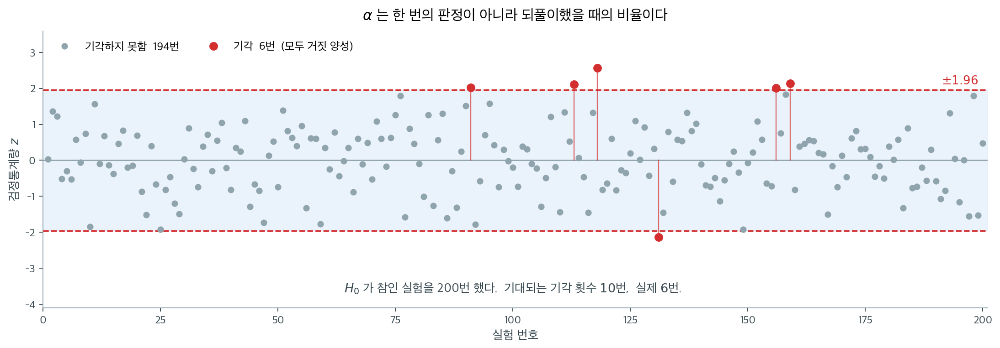
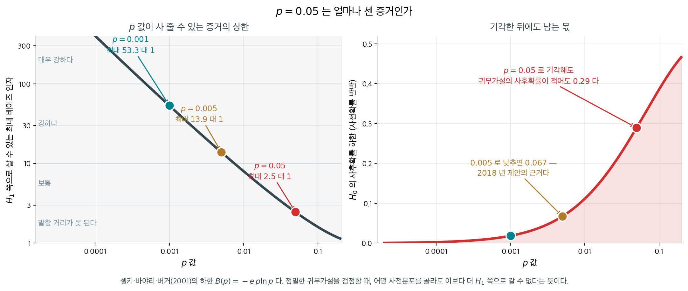
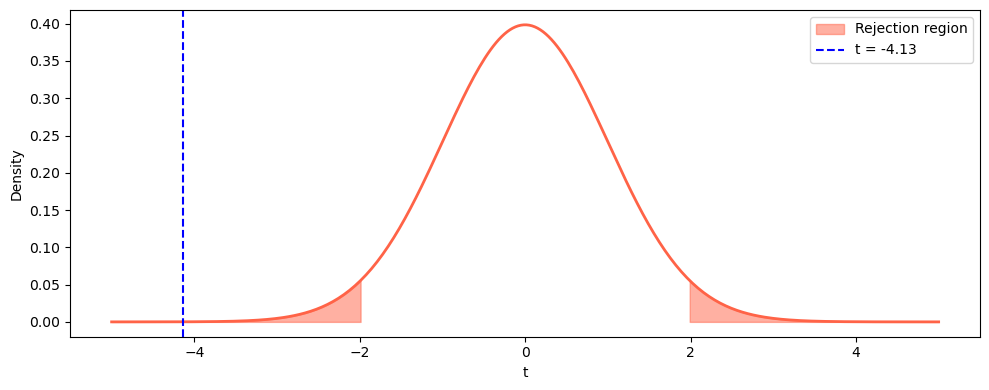
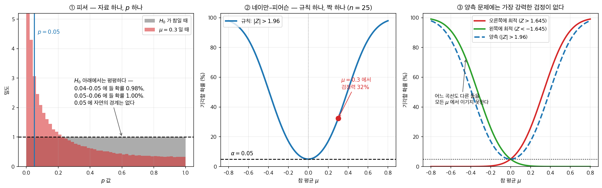
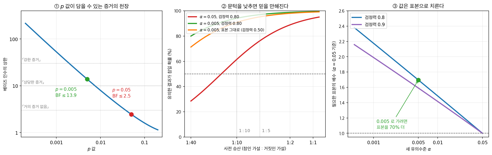

# 유의수준과 판정 규칙

## 개요

같은 연구가 $p = 0.049$ 로 끝나면 「유의한 결과를 얻었다」가 되어 논문에 실리고, $p = 0.051$ 로 끝나면 「유의하지 않았다」가 되어 서랍에 들어간다. 두 수의 차이는 $0.002$ 다. 자료가 그만큼 달라서가 아니라 **문턱이 거기 그어져 있어서** 운명이 갈린다. 그 문턱이 하필 $0.05$ 인 까닭은 무엇이고, 그 수는 무엇을 약속하는가.

그렇다면 $p = 0.05$ 는 증거로서 얼마나 센가. 이 물음에는 수로 답할 수 있다. 가장 유리하게 따져도 $H_1$ 쪽으로 살 수 있는 베이즈 인자가 $2.46$ 대 $1$ 이고, $H_0$ 의 사후확률이 $0.289$ 아래로 내려가지 않는다 — 유의하다고 선언한 뒤에도 열에 셋쯤은 여전히 $H_0$ 일 수 있다는 뜻이다. $0.05$ 라는 수가 풍기는 「스무 번에 한 번」이라는 느낌과는 자릿수가 다른 셈이다. $p = 0.005$ 로 조이면 같은 수가 $13.9$ 대 $1$ 과 $0.067$ 이 된다. $2018$ 년에 통계학자와 과학자 일흔 명 남짓이 문턱을 거기로 낮추자고 제안한 근거가 그 표다. 아래 상자가 그 셈과, 피셔 자신이 뒤에 이 읽기를 부정한 일까지 따라간다.

그러면 $\alpha$ 를 $0.05$ 에 두는 관행은 무엇을 약속하고 무엇은 약속하지 않는가. 이 쪽은 그 문턱으로 기각과 기각 못함을 가르는 판정 규칙을 세우고, 그 규칙이 지켜 주는 것이 정확히 무엇인지를 밝힌다.

_확인한 곳 — 이 쪽 「편리하므로」 상자와 그 출처 줄_

귀무가설과 대립가설을 세운 다음 단계는 제1종 오류의 위험을 얼마나 감수할지 정하는 것이다. **유의수준** $\alpha$는 $H_0$이 실제로 참일 때 이를 기각할 확률의 상한이다. 이 문턱은 자료를 모으기 *전에* 고르며 장기적인 거짓 양성 비율을 통제한다. $\alpha$를 고르는 일은 잘못된 기각의 비용과 실제 효과를 탐지하지 못하는 비용을 저울질하는 일이다.

---

## 1. 판정 규칙

$\alpha$를 정하고 나면 기각/기각 못함의 판정에 이르는 동등한 방법이 두 가지 있다. 두 방법은 언제나 같은 결론을 준다.

- **p-값 접근.** 자료에서 p-값을 계산하고 $p \leq \alpha$이면 $H_0$을 기각한다. p-값은 $H_0$ 아래에서 관측된 자료가 얼마나 극단적인지를 재므로, 이를 $\alpha$와 비교하면 증거가 미리 정한 문턱을 넘는지 바로 답이 나온다.

- **임계값 접근.** 수준 $\alpha$에서 기각역의 경계를 이루는 임계값을 구하고, 검정통계량이 그 영역에 들어가면 $H_0$을 기각한다. 임계값으로 기각하는 것은 $p \leq \alpha$를 확인하는 것과 동등하다.

??? example "풀이 보기: 두 접근, 같은 판정"

    $\sigma = 10$을 알고 $n = 25$인 표본에서 $\bar{x} = 53.5$를 얻었을 때 $\alpha = 0.05$에서 $H_0: \mu = 50$ 대 $H_1: \mu \neq 50$을 검정한다고 하자.

    **임계값 접근.** 기각역은 $|Z| > z_{0.025} = 1.96$이다. 검정통계량은

    $$
    Z = \frac{53.5 - 50}{10/\sqrt{25}} = \frac{3.5}{2} = 1.75
    $$

    $|1.75| < 1.96$이므로 $H_0$을 기각하지 못한다.

    **p-값 접근.** 양측 p-값은 $2\,P(Z > 1.75) \approx 2(0.0401) = 0.0802$이다. $0.0802 > 0.05$이므로 역시 $H_0$을 기각하지 못한다. 두 접근이 일치한다.

---

## 2. α 는 한 번의 판정에 관한 말이 아니다

$\alpha = 0.05$를 "이 결론이 95% 맞다"는 뜻으로 읽기 쉽지만 그렇지 않다. $\alpha$가 약속하는 것은 **같은 절차를 되풀이했을 때의 비율**이다.



$H_0$이 참인 실험을 200번 했다. 점 하나가 실험 하나의 검정통계량이고, 파란 띠가 기각하지 않는 영역이다. **띠를 벗어난 붉은 점들은 모두 거짓 양성이다.** $H_0$이 참인데도 기각했으니 전부 틀린 판정이며, 자료에 아무 문제가 없어도 이런 일은 반드시 일어난다.

중요한 것은 그 빈도다. 200번 중 기대되는 기각 횟수가 $0.05 \times 200 = 10$번이고 이 실험에서는 6번 나왔다. $\alpha$를 정한다는 것은 **이 비율을 얼마로 두겠다고 미리 약속하는 일**이지, 눈앞의 판정 하나가 옳을 확률을 정하는 일이 아니다.

여기서 두 가지가 따라 나온다. 첫째, **붉은 점 하나만 떼어 놓고 보면 옳은 판정과 구별할 수 없다.** 어느 것이 거짓 양성인지는 그림을 그린 우리만 안다. 둘째, **검정을 많이 할수록 붉은 점의 개수도 늘어난다.** 20번 하면 평균 1번, 200번 하면 평균 10번이다. 9.6절 [가족단위 오류율](../multiple_testing/fwer.md)이 다루는 문제가 바로 이것이다.

---

## 3. 흔히 쓰는 유의수준

$\alpha$의 선택은 제1종 오류가 초래하는 실질적 결과에 달려 있다. 결과가 심각할수록 $\alpha$를 작게 잡는데, 그러면 검정이 엄격해지지만 $H_0$을 기각하기는 어려워진다.

| $\alpha$ | 엄격함 | 전형적인 용도 |
|---|---|---|
| 0.10 | 관대함 | 탐색적 연구, 선별 |
| 0.05 | 보통 | 대부분의 과학 연구(관례적 기본값) |
| 0.01 | 엄격함 | 거짓 양성의 대가가 큰 연구 |
| 0.001 | 매우 엄격함 | 유전체학, 입자물리학 |

!!! warning "$\alpha$는 증거가 아니다"

    유의수준 $\alpha$는 미리 정한 오류율 통제 장치이지 증거의 척도가 아니다. 관측된 결과가 $H_0$과 얼마나 어긋나는지를 정량화하는 것은 자료에서 계산한 p-값이다. $\alpha = 0.01$이 "더 강한 증거"를 요구한다고 말하는 것은 흔한 오해이며, 실제로는 p-값이 넘어야 할 더 까다로운 문턱을 정할 뿐이다.

<div class="storybox" markdown>

**그림으로 보는 통계학 1.** 편리하므로

위의 표는 $0.05$ 를 「관례적 기본값」이라 적는다. 그 관례가 어디서 왔는지 물어볼 만하다.

$1925$ 년 피셔의 『연구자를 위한 통계적 방법』에 이런 문장이 있다 — $P = .05$, 곧 스무 번에 한 번에 해당하는 값이 $1.96$ 으로 거의 $2$ 이니, 유의한지 아닌지를 판단하는 한계로 이 점을 잡는 것이 **편리하다**.

**편리하다.** 그것이 이유의 전부였다. 그리고 실제로 편리했다 — 그 시절에는 정확한 $p$ 값을 그때그때 계산할 수 없었으므로, 그는 몇 개의 유의수준에서의 **임계값만** 표로 실었다. 쓰는 사람은 표에 있는 수와 견주는 수밖에 없었고, 표에 있는 수가 곧 관례가 되었다.

피셔 자신은 뒤에 이 읽기를 부정했다. $1956$ 년에 그는 **해마다 어떤 상황에서나 쓰는 고정된 유의수준을 가진 과학자는 없으며, 사안마다 증거와 생각에 비추어 판단한다**고 적었다. 오늘날의 고정 $\alpha$ 는 네이만–피어슨의 결정이론에서 온 것이고, 성격이 다른 두 틀이 교과서에서 뒤섞인 결과다.

**그렇다면 $p = 0.05$ 는 증거로서 얼마나 센가.** 이 물음에는 수로 답할 수 있다.

<figure markdown>
{ width="900" }
  <figcaption markdown>셀키·바야리·버거($2001$)의 하한이다. 정밀한 귀무가설을 검정할 때 **어떤 사전분포를 골라도** 이보다 더 $H_1$ 쪽으로 갈 수 없다.</figcaption>
</figure>

$$
B(p) = -e\,p\ln p \qquad (p < 1/e)
$$

| $p$ | $H_1$ 쪽으로 살 수 있는 최대 베이즈 인자 | $H_0$ 의 사후확률 하한 |
|---|---|---|
| $0.05$ | $\mathbf{2.46}$ 대 $1$ | $\mathbf{0.289}$ |
| $0.01$ | $7.99$ 대 $1$ | $0.111$ |
| $0.005$ | $13.9$ 대 $1$ | $0.067$ |
| $0.001$ | $53.3$ 대 $1$ | $0.018$ |

**$p = 0.05$ 는 기껏해야 $2.5$ 대 $1$ 이다.** 「스무 번에 한 번」이라는 말이 주는 인상 — $19$ 대 $1$ — 과는 전혀 다르다. 사전확률을 반반으로 두면 기각한 뒤에도 귀무가설에 **$29\%$ 가 남는다.** 제프리스의 흔한 기준으로 읽으면 $2.5$ 대 $1$ 은 「말할 거리가 못 되는」 증거다.

$2018$ 년에 통계학자와 과학자 일흔 명 남짓이 **유의수준을 $0.005$ 로 낮추자**고 제안한 근거가 이 표다. $0.005$ 면 최대 $13.9$ 대 $1$ 이 되어 비로소 「강한」 증거의 문턱에 닿는다.

이것이 $\alpha$ 를 바꾸면 해결된다는 뜻은 아니다. $p$ 값은 애초에 증거의 세기를 재도록 만들어진 양이 아니고, 위의 경고가 말하는 바도 그것이다. **다만 $0.05$ 라는 수가 자연이나 수학에서 온 것이 아니라 $1925$ 년의 표 한 장에서 왔다는 사실은 알아 둘 만하다.**

_확인한 곳 — 피셔의 『Statistical Methods for Research Workers』($1925$)에 「$P = .05$, 곧 스무 번에 한 번에 해당하는 값이 $1.96$ 으로 거의 $2$ 이니, 유의한지 아닌지를 판단하는 한계로 이 점을 잡는 것이 **편리하다**」는 문장이 있다는 것, 피셔가 $1956$ 년에 「**해마다, 어떤 상황에서나 고정된 유의수준으로 가설을 기각하는 과학자는 없다** — 사안마다 자기 증거와 생각에 비추어 판단한다」고 적은 것, $2018$ 년에 일흔 명 넘는 저자가 유의수준을 $0.005$ 로 낮추자고 제안한 것. 증거의 상한 $B(p) = -ep\ln p$ 로 계산한 수는 모두 직접 구한 값이다_

</div>

## 4. 기각역을 그림으로 보기

절 $1$ 의 판정 규칙을 통계량 척도에서 그려 본다. 양측과 단측의 임계값이 어떻게
갈리는지, 그리고 관측값이 어느 쪽에 떨어지는지를 눈으로 짚는 것이 이 절의 몫이다.

<div class="exbox" markdown>

**보기 1.** <span class="diff easy" title="쉬움"></span> 기각역과 검정통계량. 평균 170 cm, 표준편차 8 cm인 정규분포에서 키 $n = 250$개를 만들어 $H_0\colon \mu = 172$를 $\alpha = 0.05$ 양측으로 검정한다. 표본에서 $\bar x = 169.9806$, $s = 7.728430$이 나왔다.

**(1)** 표준오차와 임계값을 구해 기각역을 **$t$ 척도와 cm 척도 둘 다로** 적고, 검정통계량을 계산해 판정하시오.

**(2)** cm 척도 기각역의 반너비가 $n$에 어떻게 달려 있는지 쓰고, 그 반너비가 2 cm가 되려면 $n$이 얼마여야 하는지 구하시오.

</div>

??? success "풀이"

    **(1) 해석적으로.** 표준오차는

    $$
    \text{SE} = \frac{s}{\sqrt n} = \frac{7.728430}{\sqrt{250}} = \frac{7.728430}{15.811388} = 0.488789
    $$

    이다. 양측이므로 $\alpha$를 두 꼬리에 반씩 나누어 $t_{0.975,\,249} = 1.969537$을 쓴다. $t$ 척도의 기각역은

    $$
    \lvert t \rvert > 1.969537
    $$

    이고, 양변에 $\text{SE}$를 곱하고 $\mu_0$을 더하면 cm 척도가 된다.

    $$
    \bar x < 172 - 1.969537 \times 0.488789 = 171.0373
    \quad \text{또는} \quad
    \bar x > 172 + 0.962688 = 172.9627
    $$

    검정통계량은

    $$
    t = \frac{169.980617 - 172}{0.488789} = \frac{-2.019383}{0.488789} = -4.131402
    $$

    이다. $\lvert t \rvert = 4.1314 > 1.9695$이므로 **기각**한다. cm 척도로 보아도 $\bar x = 169.98$이 왼쪽 경계 $171.04$보다 작으니 같은 결론이다. **두 척도는 같은 부등식을 단위만 바꿔 쓴 것**이므로 언제나 같은 판정을 준다.

    **(2) 해석적으로.** cm 척도 기각역의 반너비는

    $$
    h(n) = t_{1-\alpha/2,\,n-1}\cdot \frac{s}{\sqrt n}
    $$

    이다. $t_{1-\alpha/2,\,n-1}$은 $n$이 커지면 $z_{1-\alpha/2} = 1.96$으로 빠르게 수렴하므로, 사실상 $h(n) \propto 1/\sqrt n$이다. **표본을 네 배로 늘리면 기각역이 절반으로 좁아진다.** $h = 2$가 되는 $n$은 $z_{1-\alpha/2}$로 어림하면

    $$
    n \approx \left(\frac{1.959964 \times 7.728430}{2}\right)^2 = (7.573)^2 = 57.4
    $$

    인데, 이 크기에서는 $t$가 아직 $z$보다 꽤 크므로 $t$로 다시 풀어야 한다. 아래 코드에서 보듯 답은 $n = 60$이다.

    **수치적으로.**

    ```python
    import numpy as np
    import matplotlib.pyplot as plt
    from scipy import stats

    np.random.seed(42)
    data = stats.norm.rvs(loc=170, scale=8, size=250)

    mu0 = 172
    n = len(data)
    df = n - 1
    xbar = data.mean()
    s = data.std(ddof=1)
    se = s / np.sqrt(n)

    alpha = 0.05
    # 양측이므로 alpha를 두 꼬리에 반씩 나눈다. ppf에 1 - alpha/2를 넣는 이유다.
    t_crit = stats.t.ppf(1 - alpha / 2, df)
    t_stat = (xbar - mu0) / se

    print(f"x-bar = {xbar:.2f}, SE = {se:.2f}")
    print(f"t-stat = {t_stat:.4f}, t-crit = +/-{t_crit:.4f}")
    # 기각역을 t 척도가 아니라 cm 척도로도 적어 둔다.
    # 실무자에게는 "표본평균이 171.04 아래면 기각"이 t보다 읽기 쉽다.
    print(f"Rejection boundaries: {mu0 - t_crit*se:.2f} and {mu0 + t_crit*se:.2f}")
    print(f"더 정밀하게: x-bar = {xbar:.6f}, s = {s:.6f}, SE = {se:.6f}")
    print(f"             t = {t_stat:.6f},  경계 "
          f"{mu0 - t_crit * se:.6f} / {mu0 + t_crit * se:.6f}")
    print(f"             p = {2 * stats.t.sf(abs(t_stat), df):.3e}")

    # (2) 반너비가 2 cm 아래로 내려가는 첫 n 을 찾는다.
    # **격자에서 argmin/argmax 로 찾지 말 것.** 조건을 만족하는 칸이 하나도
    # 없어도 0 을 돌려주므로, 조건을 만족하는 n 이 실제로 있는지부터 확인한다.
    ns = np.arange(10, 400)
    half = stats.t.ppf(0.975, ns - 1) * s / np.sqrt(ns)
    ok = np.flatnonzero(half <= 2.0)
    assert ok.size > 0, "반너비가 2 cm 이하가 되는 n 이 격자 안에 없다"
    n2 = ns[ok[0]]
    print(f"\n반너비 <= 2 cm 인 첫 n = {n2}  (반너비 {half[ok[0]]:.4f} cm)"
          f"   바로 앞 n = {n2 - 1} 은 {half[ok[0] - 1]:.4f} cm")
    print(f"z 어림: n = {(stats.norm.ppf(0.975) * s / 2) ** 2:.1f}")
    ```

    출력:

    ```
    x-bar = 169.98, SE = 0.49
    t-stat = -4.1314, t-crit = +/-1.9695
    Rejection boundaries: 171.04 and 172.96
    더 정밀하게: x-bar = 169.980617, s = 7.728430, SE = 0.488789
                 t = -4.131402,  경계 171.037312 / 172.962688
                 p = 4.927e-05

    반너비 <= 2 cm 인 첫 n = 60  (반너비 1.9965 cm)   바로 앞 n = 59 은 2.0140 cm
    z 어림: n = 57.4
    ```

    (1)에서 손으로 구한 값이 모두 그대로 나왔다. $\text{SE} = 0.488789$, $t = -4.131402$, 경계 $171.037312$와 $172.962688$이 소수점 여섯째 자리까지 일치한다. (2)의 답도 $n = 60$이고, $z$ 어림이 준 $57.4$는 세 칸 모자란다.

    자료를 평균 170에서 만들었으니 $H_0\colon \mu = 172$는 실제로 거짓이고, 검정이 그것을 잡아냈다($\lvert t \rvert = 4.13 > 1.97$, $p = 4.9\times10^{-5}$).

    주목할 것은 기각역의 좁기다. $n = 250$이라 표준오차가 $0.49$ cm밖에 안 되고, 그래서 표본평균이 172에서 **0.963 cm**만 벗어나도 기각된다. 효과크기로 보면 $d = 2/7.73 = 0.259$로 코헨의 기준에서 "작은" 효과인데도 $p$가 $5\times10^{-5}$다. **표본이 크면 실질적으로 사소한 차이도 통계적으로 유의해진다.** 그러므로 $p$-값만 보고 "큰 차이"라고 읽으면 안 되고, 효과크기와 신뢰구간을 함께 보아야 한다.

<div class="exbox" markdown>

**보기 2.** <span class="diff easy" title="쉬움"></span> 기각역 그리기. 보기 1의 검정을 $t$ 척도에서 그린다. 곡선은 $H_0$ 아래 $T$의 밀도, 붉게 칠한 두 꼬리가 기각역, 파란 점선이 관측된 통계량이다.

**(1)** 이 그림에서 읽히는 것을 수치와 함께 적으시오.

**(2)** 이 그림이 **가리는 것**은 무엇인가. $p$-값을 이 그림에서 읽어 낼 수 있는가.

</div>

??? success "풀이"

    유도할 답이 있는 문제가 아니다. **그림에서 무엇이 읽히고 무엇이 읽히지 않는가**가 이 보기의 전부이므로, 눈으로 본 것을 수치로 바꿔 가며 읽는다.

    ```python
    plt.rcParams["font.sans-serif"] = ["NanumGothic", "Apple SD Gothic Neo", "Malgun Gothic"]
    plt.rcParams["font.family"] = "sans-serif"
    plt.rcParams["axes.unicode_minus"] = False

    # 기각역은 자료를 보기 전에 정해지는 영역이다. 관측된 통계량이 칠해진
    # 구역 안에 떨어지면 기각한다. p-값 방식과 결론은 언제나 같다.
    x_t = np.linspace(-5, 5, 300)
    y_t = stats.t.pdf(x_t, df)

    # 그림에서 읽을 수치를 미리 찍어 둔다.
    print(f"꼭대기 밀도 f(0)        = {stats.t.pdf(0, df):.6f}")
    print(f"임계값에서의 밀도 f(tc) = {stats.t.pdf(t_crit, df):.6f}")
    print(f"관측값에서의 밀도 f(t)  = {stats.t.pdf(t_stat, df):.8f}"
          f"   꼭대기의 1/{stats.t.pdf(0, df) / stats.t.pdf(t_stat, df):.0f}")
    print(f"칠한 꼬리 넓이 (한쪽)   = {stats.t.sf(t_crit, df):.6f}  (두쪽 합 "
          f"{2 * stats.t.sf(t_crit, df):.4f})")
    print(f"그림 밖 |t| > 5 의 질량 = {2 * stats.t.sf(5, df):.3e}")
    print(f"P(|T| > |t|) = {2 * stats.t.sf(abs(t_stat), df):.3e}"
          f"   칠한 왼쪽 꼬리의 {stats.t.cdf(t_stat, df) / stats.t.cdf(-t_crit, df):.4%}")

    fig, ax = plt.subplots(figsize=(10, 4))
    ax.plot(x_t, y_t, "tomato", lw=2)
    ax.fill_between(x_t[x_t <= -t_crit], stats.t.pdf(x_t[x_t <= -t_crit], df),
                    color="tomato", alpha=0.5, label="Rejection region")
    ax.fill_between(x_t[x_t >= t_crit], stats.t.pdf(x_t[x_t >= t_crit], df),
                    color="tomato", alpha=0.5)
    ax.axvline(t_stat, color="blue", linestyle="--", label=f"t = {t_stat:.2f}")
    ax.set_xlabel("t")
    ax.set_ylabel("Density")
    ax.legend()
    plt.tight_layout()
    plt.show()
    ```

    출력:

    ```
    꼭대기 밀도 f(0)        = 0.398542
    임계값에서의 밀도 f(tc) = 0.057714
    관측값에서의 밀도 f(t)  = 0.00010028   꼭대기의 1/3974
    칠한 꼬리 넓이 (한쪽)   = 0.025000  (두쪽 합 0.0500)
    그림 밖 |t| > 5 의 질량 = 1.082e-06
    P(|T| > |t|) = 4.927e-05   칠한 왼쪽 꼬리의 0.0985%
    ```

    

    **(1) 읽히는 것.** 종 모양 곡선이 0에 봉우리를 두고 좌우대칭이다. 꼭대기 밀도가 $0.398542$로 표준정규의 $0.398942$와 거의 같은데, 자유도가 249라 $t$가 이미 정규에 매우 가깝기 때문이다. 붉게 칠한 두 꼬리는 $\lvert t \rvert > 1.9695$이고 넓이가 각각 $0.025$, 합이 정확히 $\alpha = 0.05$다. **색칠된 넓이가 유의수준 그 자체**라는 것이 이 그림이 가르치려는 바다.

    파란 점선이 $t = -4.13$에 서 있고 왼쪽 기각역 **안**에 확실히 들어가 있다. 그러므로 기각이다. 점선 자리의 밀도는 $0.00010$으로 꼭대기의 $1/3974$이라, 곡선이 이 근처에서는 바닥에 눌려 보인다.

    **(2) 가리는 것 — 얼마나 깊이 들어갔는가.** 그림만 보면 점선이 경계 $-1.97$보다 왼쪽에 있다는 것까지는 알 수 있지만, 그것이 "조금" 넘은 것인지 "한참" 넘은 것인지는 **읽을 수 없다.** 수로 보면 점선 왼쪽의 넓이는 $2.46\times10^{-5}$로 칠해진 왼쪽 꼬리 전체 $0.025$의 $0.0985\%$, 곧 **천분의 일**이다. 선형 세로축에서는 이 넓이가 한 화소도 되지 않으므로 그림에서 $p$-값을 읽어 낼 길이 없다. **$p$-값은 수로 보고해야 하고, 이런 그림은 판정의 논리를 보일 뿐 증거의 세기를 보이지 못한다.**

    **가로 범위도 자의적이다.** $x$를 $[-5, 5]$로 잘랐는데 이 바깥의 질량은 $1.08\times10^{-6}$뿐이라 분포를 자르는 데에는 문제가 없다. 그러나 관측값이 $t = -6$이었다면 점선이 그림 밖으로 나가 **아예 보이지 않았을 것**이다. 통계량이 강할수록 그림이 못 쓰게 되는 셈이다.

    **$H_1$이 없다.** 이 그림에는 $H_0$ 아래의 분포 하나뿐이다. 그래서 2종 오류도 검정력도 여기서는 보이지 않는다. 그 둘을 보려면 $H_1$ 아래의 분포를 겹쳐 그려야 하며, 9.2절의 두 분포 그림이 그 일을 한다.

    끝으로, 이 그림은 $t$ 척도라 **자유도만 알면 자료와 무관하게 언제나 같은 모양**이다. 자료가 하는 일은 파란 점선을 어디에 놓을지 정하는 것뿐이다. 거꾸로 말하면 cm 같은 실제 단위의 감각은 이 그림에서 완전히 사라진다. 보기 1에서 cm 척도 경계를 따로 적어 둔 이유가 그것이다.

<div class="exbox" markdown>

**보기 3.** <span class="diff easy" title="쉬움"></span> 기각값 구하기. $\text{df} = 100$, $\alpha = 0.05$에서 좌측·우측·양측 임계값을 본다.

**(1)** $t$ 분포의 대칭성에서 $t_{\alpha,\,\text{df}} = -t_{1-\alpha,\,\text{df}}$를 보이고, 세 임계값을 구하시오.

**(2)** 단측검정의 임계값이 더 안쪽에 있으니 검정력이 크다. 비중심모수 $\lambda = 2$인 대립가설에서 그 **이득이 얼마**이고, $\lambda = -3$처럼 **방향이 반대**인 대립가설에서 그 **대가가 얼마**인지 수로 답하시오.

</div>

??? success "풀이"

    **(1) 해석적으로.** 밀도가 0에 대해 대칭이므로 누적분포함수가 $F(-x) = 1 - F(x)$를 만족한다. 정의상 $F(t_{1-\alpha}) = 1-\alpha$이므로

    $$
    F(-t_{1-\alpha}) = 1 - F(t_{1-\alpha}) = 1 - (1-\alpha) = \alpha
    $$

    이고, $F$가 순증가라 $\alpha$를 주는 점은 하나뿐이다. 따라서 $t_{\alpha} = -t_{1-\alpha}$다.

    단측이므로 $\alpha$를 나누지 않고 꼬리 하나에 5%를 통째로 준다. $\text{df} = 100$에서

    $$
    t_{0.05,\,100} = -1.6602, \qquad t_{0.95,\,100} = +1.6602
    $$

    이고, 같은 자유도의 양측 임계값은 $\alpha$를 반씩 나누므로

    $$
    t_{0.975,\,100} = 1.9840
    $$

    이다. $1.6602 < 1.9840$이라 **단측 쪽 문턱이 더 낮다.**

    **(2) 해석적으로.** $H_1$ 아래에서 $T$는 비중심모수 $\lambda$인 비중심 $t$를 따른다. 우측검정의 검정력은 $P(T'_{100,\lambda} > 1.6602)$ 하나이고, 양측검정은 $P(T'_{100,\lambda} > 1.9840) + P(T'_{100,\lambda} < -1.9840)$이다. **문턱이 낮다는 것만으로 우측검정이 유리해지는 것은 $\lambda > 0$일 때뿐**이고, $\lambda < 0$이면 우측검정의 검정력이 $\alpha$보다도 작아진다.

    **수치적으로.**

    ```python
    df = 100
    alpha = 0.05
    x = np.linspace(-5, 5, 300)
    y = stats.t.pdf(x, df)

    # 단측이므로 alpha를 나누지 않는다. 꼬리 하나에 5%를 통째로 준다.
    t_lo = stats.t.ppf(alpha, df)
    print(f"Left-tailed critical value: {t_lo:.4f}")

    t_hi = stats.t.ppf(1 - alpha, df)
    print(f"Right-tailed critical value: {t_hi:.4f}")

    t_two = stats.t.ppf(1 - alpha / 2, df)
    print(f"Two-tailed critical value : +/-{t_two:.4f}")
    print(f"대칭성 확인: t_lo + t_hi = {t_lo + t_hi:.1e}")

    def power_one(lam):      # 우측 단측검정
        return stats.nct.sf(t_hi, df, lam)

    def power_two(lam):      # 양측검정
        return stats.nct.sf(t_two, df, lam) + stats.nct.cdf(-t_two, df, lam)

    print(f"\n{'lambda':>7} {'우측 단측':>10} {'양측':>8} {'차이':>9}")
    for lam in (-3.0, -1.0, 0.0, 1.0, 2.0, 3.0):
        p1, p2 = power_one(lam), power_two(lam)
        print(f"{lam:>7.1f} {p1:>10.4f} {p2:>8.4f} {p1 - p2:>+9.4f}")
    ```

    출력:

    ```
    Left-tailed critical value: -1.6602
    Right-tailed critical value: 1.6602
    Two-tailed critical value : +/-1.9840
    대칭성 확인: t_lo + t_hi = -6.7e-16

     lambda      우측 단측       양측        차이
       -3.0     0.0000   0.8440   -0.8440
       -1.0     0.0042   0.1677   -0.1636
        0.0     0.0500   0.0500   -0.0000
        1.0     0.2573   0.1677   +0.0896
        2.0     0.6337   0.5083   +0.1253
        3.0     0.9090   0.8440   +0.0650
    ```

    $t_{0.05,100} + t_{0.95,100}$이 $-6.7\\times10^{-16}$으로 부동소수점 반올림 한 단위에 지나지 않아 (1)의 대칭성이 확인된다.

    **이득.** $\lambda = 2$에서 우측 단측검정의 검정력은 $0.6337$, 양측검정은 $0.5083$이다. 차이가 $0.1253$, 곧 **12.5%포인트**다. $\lambda = 1$에서는 $0.0896$, $\lambda = 3$에서는 $0.0650$으로, 이득은 중간 세기의 효과에서 가장 크다. 효과가 아주 크면 둘 다 거의 1이라 차이가 사라지기 때문이다.

    **대가.** $\lambda = -3$에서 양측검정의 검정력은 $0.8440$인데 우측 단측검정은 $1.9\times10^{-6}$이다. **사실상 0이다.** 실제로 존재하는 큰 효과를 방향이 반대라는 이유만으로 통째로 놓친다. $\lambda = 0$, 곧 $H_0$이 참일 때는 두 검정 모두 정확히 $0.05$를 주므로 1종 오류율에는 차이가 없다.

    그러므로 단측검정은 **반대 방향의 효과가 나와도 아무 조치를 하지 않을 때에만** 정당하다. 그 판단은 자료를 보기 전에 끝나 있어야 한다.

### 읽는 법

- **양측검정**에서는 어느 방향에서든 $H_0$에 반하는 증거가 나올 수 있다. p-값은 $2P(T \geq |t_{\text{obs}}|)$이다.
- **단측검정**에서는 한쪽 방향의 이탈만 보므로 그 방향의 효과를 탐지할 검정력은 커지지만 반대 방향에는 전혀 없다.
- **원래 단위의 기각역**은 기각으로 이어지는 실제 측정값(예: cm 단위의 키)을 보여준다. 실무자에게는 $t$-통계량 척도보다 직관적인 경우가 많다.
- $\alpha$를 0.05에서 0.01로 낮추면 기각역이 줄어들고(임계값이 바깥으로 이동하고) $H_0$을 기각하는 데 더 강한 증거가 필요해진다.

<div class="storybox" markdown>

**그림으로 보는 통계학 2.** 검정은 누가 만들었는가

짧은 답이 없다. 세 겹이기 때문이다.

**첫 겹.** 자료를 놓고 「우연이라면 이럴 확률이 얼마인가」를 처음 계산해 발표한 사람은
$1710$ 년의 [존 아버스넛](../../ch16/one_sample_nonparametric/sign_test.md)이다. 런던의
세례 기록 $82$ 해분을 놓고 반반인 주사위라면 그럴 확률이 얼마인지를 셌다.

**둘째 겹.** 그것을 **방법**으로 세운 사람은 피셔다. [찻잔 여덟 개](hypotheses.md)에서
귀무가설이 나왔고 $0.05$ 라는 수도 그의 책에서 나왔다(§$3$ 의 상자). 그의
산출물은 **$p$ 값 하나**다. 대립가설도, 미리 정한 $\alpha$ 도, 제2종 오류도 없다.

**셋째 겹.** 그런데 이 쪽이 다루는 **기각역**, 그리고 제1종·제2종 오류와 검정력은
피셔의 것이 아니다. 예지 네이만과 **이곤 피어슨**(칼 피어슨의 아들)이 $1928$ 년과
$1933$ 년에 내놓은 것이다. $1933$ 년 논문 $291$ 쪽의 한 문단에 그들의 틀이 다 들어 있다.

> 「특정한 가설에 관한 한, 확률론에 바탕을 둔 어떤 검정도 그 가설의 참·거짓에 대해
> **그 자체로 값진 증거를 줄 수는 없다**고 우리는 생각하는 편이다. 그러나 검정의 목적을
> 다른 관점에서 볼 수도 있다. 각 가설이 참인지 거짓인지 알기를 바라지 않은 채, 그것들에
> 대한 **우리의 행동을 다스릴 규칙**을 찾을 수 있다 — 그것을 따르면 긴 경험의 흐름
> 속에서 너무 자주 틀리지는 않게 되는 그런 규칙 말이다. (…) 그런 규칙은 **특정한 경우에**
> $H$ 가 참인지 거짓인지에 대해서는 아무것도 말해 주지 않는다.」

같은 사람이 같은 무렵 [신뢰구간을 내놓으며](../../ch08/one_sample_intervals/ci_p.md) 한
말과 똑같은 논리다. 네이만에게 확률은 **절차**에 붙는 것이지 눈앞의 결론에 붙는 것이
아니었다.



- **①** 피셔가 내놓는 것. 귀무가설이 참이면 $p$ 는 **균등**하다 — $0.04$–$0.05$ 에 들
  확률이 $0.98\%$, $0.05$–$0.06$ 에 들 확률이 $1.00\%$ 로 같다. $0.05$ 에 자연의 경계는
  없고, 그래서 피셔에게 $p$ 는 문턱이 아니라 **눈금**이었다.
- **②** 네이만–피어슨이 내놓는 것. 가설 둘과 규칙 하나, 그리고 그 규칙에 붙는
  $(\alpha,\ 1-\beta)$ 짝이다. $n = 25$, $|Z| > 1.96$ 이라는 규칙은 $\mu = 0$ 에서 $5\%$,
  $\mu = 0.3$ 에서 $32\%$ 로 기각한다. **이 수들은 자료를 보기 전에 다 정해진다.**
- **③** 그러나 「가장 강력한 검정」이 늘 하나로 정해지지는 않는다. 위 $3$ 절의 둘째 줄이
  그 이야기다 — 오른쪽에 최적인 규칙은 $\mu = 0.4$ 에서 검정력 $63.9\%$ 로 양측의
  $51.6\%$ 를 이기지만, $\mu = -0.4$ 에서는 $0.0\%$ 다. 세 곡선이 교차한다. 양측 문제에
  **UMP 검정은 없다.**

**그리고 두 사람은 사이가 나빴다.** $1955$ 년 피셔가 왕립통계학회지에 「통계적 방법과
과학적 귀납」을 실었다. 요약의 첫 문장이 이렇다. **「과학 연구에 쓰이는 흔한 유의성
검정을, 마치 일종의 수납 절차(acceptance procedure)인 것처럼, 왈드의 뜻에서 「결정」으로
이어지는 것처럼 재해석하려는 시도는 여러 오해에서 비롯했고 보아하니 더 많은 오해를
낳았다.」** 이어서 — **「자연과학과 개인적 접촉이 없는 수학자들은 그런 말들에 자주
오도되어 왔다.」**

피셔는 네이만이 「자연 지식의 개선」을 위한 자기 작업을 **「수납 절차라고 알려진 저
기술적·상업적 장치의 말로 재해석했다」**고 적고, 영국 해군이 납품 자재를 검사하는 일을
예로 든 뒤 그 일과 과학적 발견 사이의 유비가 「결정적으로 오도한다」고 했다. 그러고는
선을 넘는다.

> 「배경에는 **이념의 차이**도 있지 싶다. **러시아인들은** 순수과학 연구가 기술적 성과에
> 맞춰질 수 있고 또 맞춰져야 한다는 이상에, 국가의 $5$ 개년 계획이라는 포괄적인 조직적
> 노력 속에서 익숙해져 있다.」

네이만은 폴란드 사람이었고, 두 사람은 한때 유니버시티 칼리지 런던의 같은 건물에서 층을
달리해 일했다.

그래서 「검정은 누가 만들었는가」의 답은 **한 사람이 아니고, 더 곤란하게는 한 틀도
아니다.** 오늘 교과서가 가르치는 절차 — 귀무가설을 세우고(피셔), $\alpha = 0.05$ 를 미리
정하고(네이만–피어슨), $p$ 값을 보고하고(피셔), 「기각한다」고 적는(네이만–피어슨) —
는 둘을 섞은 것이고, **두 사람 모두 그 섞인 것을 거부했을 것이다.** 이 쪽이 기각역을
그리고 앞 절이 $p$ 값을 재는 까닭이 거기 있다. 둘은 같은 자료에서 나오지만 같은 물음의
답이 아니다.

_확인한 곳 — J. Neyman · E. S. Pearson, "On the Problem of the Most Efficient Tests of
Statistical Hypotheses", 『Philosophical Transactions of the Royal Society A』 $231$ 권
$289$–$337$ 쪽($1933$)의 $291$ 쪽에서 인용한 문단 · R. A. Fisher, "Statistical Methods and
Scientific Induction", 『Journal of the Royal Statistical Society B』 $17$ 권 $1$ 호
$69$–$78$ 쪽($1955$)의 요약과 본문에서 인용한 네 대목(수납 절차·자연과학과의 접촉·영국
해군의 보기·러시아인과 $5$ 개년 계획). 그림의 수는 모두 직접 계산한 값이다_

</div>

---

<div class="storybox" markdown>

**그림으로 보는 통계학 3.** $0.05$ 를 고치자는 제안

이 쪽의 모든 계산이 $\alpha = 0.05$ 에서 돌아갔다. 개요의 붉은 화살표는
「$\alpha$ 를 자료를 본 뒤에 올리지 마라」고 적었지, **$0.05$ 가 옳은 수인지**는 묻지
않았다. 지난 십 년 사이 그 물음이 통계학계의 한복판에 들어왔다.

$2016$ 년, 미국통계학회가 **$p$ 값에 관한 성명**을 낸다. 학회가 특정 통계 방법에 대해
공식 입장을 낸 것은 그때가 처음이었다. 여섯 개의 원칙 가운데 하나가 「$p < 0.05$ 같은
문턱 하나로 과학적 결론이나 정책 결정을 내려서는 안 된다」였다.

$2018$ 년, **벤저민을 비롯한 $72$ 명**이 『네이처 휴먼 비헤이비어』에 「통계적 유의성을
다시 정의하자」를 싣는다. 새로운 발견을 주장하는 자리에서는 문턱을 **$0.005$ 로
낮추자**는 것. 같은 학술지 같은 해에 **레이컨스를 비롯한 $88$ 명**이 「당신의 알파를
정당화하라」로 받아친다. 문턱을 옮길 것이 아니라 왜 그 문턱인지를 매번 적으라는 것.
$2019$ 년에는 **암라인·그린랜드·맥셰인**이 『네이처』에 「통계적 유의성을 은퇴시키자」를
쓰고, **$854$ 명**이 서명했다. 무게를 가려 두는 편이 좋다 — **$2016$ 년의 성명은 학회의 공식 입장이지만, 뒤의 둘은 서명이 많아도 논문과 사설이지 어느 학회의 정책도 아니다.**

숫자를 들여다보면 양쪽이 무엇을 보고 있었는지가 드러난다.

<figure markdown>
{ width="960" }
  <figcaption markdown>세 칸은 각각 **증거**, **믿음**, **값**을 잰다. 셋을 함께 보아야 논쟁이 보인다.</figcaption>
</figure>

왼쪽 칸이 벤저민 쪽의 논거다. $p$ 값 하나가 품을 수 있는 증거에는 **천장**이 있다.
$H_0$ 에 맞서는 베이즈 인수는 대립가설을 아무리 유리하게 골라도

$$
\mathrm{BF} \;\leq\; \frac{-1}{e\,p\ln p} \qquad (p < 1/e)
$$

를 넘지 못한다. 이 상한에 수를 넣으면

| $p$ | $0.05$ | $0.01$ | $0.005$ | $0.001$ |
|---|---:|---:|---:|---:|
| 증거의 천장 | $2.5$ | $8.0$ | $13.9$ | $53.3$ |

$p = 0.05$ 는 **아무리 좋게 봐도 $2.5$ 대 $1$** 이다. 베이즈 인수를 해석하는 관행적인
눈금에서 $3$ 미만은 「말할 만한 것이 못 된다」에 해당한다. **유의하다고 선언하는 그
자리가 증거로는 거의 빈손**이라는 것이 이 한 줄의 뜻이다. $0.005$ 로 내려가면 $13.9$ 가
되어 비로소 「상당한 증거」 칸에 들어간다.

가운데 칸은 그 효과를 다른 각도에서 본 것이다. 시도하는 가설 $11$ 개 가운데 하나가
참이라 하자(사전 승산 $1:10$). 검정력 $0.8$ 에서

| | $\alpha = 0.05$ | $\alpha = 0.005$ |
|---|---:|---:|
| 유의한 결과가 참일 확률 | $61.5\%$ | $94.1\%$ |

$0.05$ 에서는 「유의하다」고 발표된 것의 **$5$ 분의 $2$ 가 거짓**이다. 재현 위기를 둘러싼
논의가 이 수를 거듭 가리켰다.

오른쪽 칸이 레이컨스 쪽이 든 값이다. 문턱을 $0.05$ 에서 $0.005$ 로 낮추면서 검정력
$0.8$ 을 지키려면 표본이 **$1.70$ 배**, 곧 $70\%$ 더 필요하다. 늘리지 않으면 같은
표본의 검정력이 $0.80$ 에서 **$0.50$** 으로 주저앉는다. 동전 던지기와 같아진다는 뜻이다.
그 비용을 누가 치르는가 — 큰 표본을 살 수 있는 분야와 그러지 못하는 분야가 갈린다.
가운데 칸의 주황 선이 그 경우이고, 초록 선보다 늘 아래에 있다.

그래서 세 번째 진영이 나온다. 암라인 쪽의 주장은 **문턱 자체를 없애자**는 것이다.
$0.049$ 와 $0.051$ 사이에 자연의 경계가 있을 리 없는데, 「유의함/유의하지 않음」이라는
두 칸이 그 사이에 벽을 세운다. 왼쪽 칸의 곡선이 그 주장을 뒷받침한다 — **연속적으로
내려가는 곡선 어디에도 꺾이는 데가 없다.**

이 책이 $\alpha = 0.05$ 로 계산하는 것은 그것이 옳아서가 아니라 **표준이기 때문**이다.
적어도 $p = 0.05$ 를 손에 들었을 때 그것이 $2.5$ 대 $1$ 짜리 증거라는 것은 알고
있는 편이 낫다.

_확인한 곳 — $2016$ 년 미국통계학회 성명(『The American Statistician』 $70$ 권 $2$ 호 $129$–$133$ 쪽)이 학회의 첫 공식 입장이었다는 것, 벤저민 외 $72$ 명의 「Redefine statistical significance」(『Nature Human Behaviour』 $2$ 권 $6$–$10$ 쪽)와 레이컨스 외 $88$ 명의 「Justify your alpha」(같은 권 $168$–$171$ 쪽), 암라인·그린랜드·맥셰인의 『Nature』 $567$ 권 $305$–$307$ 쪽과 $854$ 명의 서명. 표의 수는 모두 직접 계산한 값이다_

</div>

---

## 연습문제

<div class="drillbox" markdown>

**연습문제 1.** <span class="diff easy" title="쉬움"></span>
어떤 제약회사가 독립인 약 20개를 검정하는데 모두 귀무가설이 참이다($H_0$이 20개 모두에 대해 참). 각 검정이 $\alpha = 0.05$를 쓴다면 거짓 양성의 기댓값은 얼마인가?

</div>

??? success "풀이"
    각 검정은 독립적으로 $\alpha = 0.05$의 확률로 거짓 양성을 낸다. 검정이 20개이면:

    $$
    E[\text{false positives}] = 20 \times 0.05 = 1.0
    $$

    거짓 양성이 적어도 하나 나올 확률은:

    $$
    P(\text{at least one FP}) = 1 - (1 - 0.05)^{20} = 1 - 0.95^{20} \approx 1 - 0.358 = 0.642
    $$

    모든 귀무가설이 참인데도 거짓 발견이 적어도 하나 나올 확률이 64.2%이다. 다중검정 문제를 보여준다: 검정 하나당 5%의 오류율은 여러 검정에 걸쳐 오류가 쌓이는 것을 막아 주지 않는다.

---

<div class="drillbox" markdown>

**연습문제 2.** <span class="diff med" title="중간"></span>
어떤 연구자가 $\alpha = 0.05$로 두고 p-값 0.03을 얻었다. 다른 연구자는 같은 가설을 $\alpha = 0.01$에서 검정한다. 각자 어떤 결론을 내리며, 같은 자료가 왜 다른 결론으로 이어지는가?

</div>

??? success "풀이"
    $\alpha = 0.05$에서: $p = 0.03 < 0.05$이므로 $H_0$을 기각한다. 5% 수준에서 통계적으로 유의하다.

    $\alpha = 0.01$에서: $p = 0.03 > 0.01$이므로 $H_0$을 기각하지 못한다. 1% 수준에서는 유의하지 않다.

    같은 자료가 다른 결론으로 이어지는 것은 유의수준이 자료를 모으기 전에 연구자가 고른 문턱이며 제1종 오류의 위험을 얼마나 감수할지를 반영하기 때문이다. 더 보수적인 연구자(작은 $\alpha$)는 $H_0$을 기각하는 데 더 강한 증거를 요구한다. 자료 자체는 변하지 않고 판정 규칙만 바뀐다.

---

<div class="drillbox" markdown>

**연습문제 3.** <span class="diff med" title="중간"></span>
제1종 오류와 제2종 오류의 차이를 설명하라. 유의수준 $\alpha$가 통제하는 것은 어느 쪽인가?

</div>

??? success "풀이"

    - **제1종 오류(거짓 양성):** $H_0$이 실제로 참인데 기각한다. 확률 = $\alpha$.
    - **제2종 오류(거짓 음성):** $H_0$이 실제로 거짓인데 기각하지 못한다. 확률 = $\beta$.

    유의수준 $\alpha$는 제1종 오류율을 직접 통제한다: $\alpha = 0.05$로 두면 $H_0$이 참일 때 (반복 실험에서) 이를 잘못 기각하는 비율이 최대 5%임이 보장된다.

    제2종 오류율 $\beta$는 참 모수값(효과크기), 표본크기, $\alpha$에 달려 있다. 연구자가 직접 정하지는 않지만 $n$을 늘리거나 $\alpha$를 키우면 줄일 수 있다. 검정력 = $1 - \beta$는 참인 효과를 올바르게 탐지할 확률이다.

---

<div class="drillbox" markdown>

**연습문제 4.** <span class="diff med" title="중간"></span>
어떤 학술지가 게재 조건으로 $\alpha = 0.05$를 요구한다. "서랍 속 문제"를 설명하고, 그것이 어떻게 출판된 문헌의 거짓 양성 비율을 5% 너머로 부풀리는지 설명하라.

</div>

??? success "풀이"
    **서랍 속 문제**(출판 편향)란 유의한 결과($p < 0.05$)를 얻은 연구는 출판되고 유의하지 않은 결과($p \geq 0.05$)를 얻은 연구는 출판되지 않은 채 ("서랍에") 남는 경향을 말한다.

    이것이 출판된 문헌의 거짓 양성 비율을 부풀리는 이유는:

    1. 20개 연구실이 효과가 없는 현상을 독립적으로 연구하면 평균적으로 1곳이 우연히 $p < 0.05$를 얻는다.
    2. 그 1곳은 출판하고 나머지 19곳은 출판하지 않는다.
    3. 독자는 참인 비율 5%(20개 중 1개)가 아니라 100%의 적중률(출판된 연구 1개, 유의한 결과 1개)을 보게 된다.

    그 결과 출판된 문헌에는 거짓 양성이 과대 대표된다. 사전등록(결과와 무관하게 출판하기로 약속)과 등록 보고서(자료 수집 전에 동료심사)가 이 문제를 완화하려고 고안된 장치이다.

---

<div class="drillbox" markdown>

**연습문제 5.** <span class="diff med" title="중간"></span>
"$\alpha$를 0.005로 낮추자"는 제안과 그에 대한 반론을 정리하고, 판단하라.

</div>

??? success "풀이"
    **제안의 요지.** 2018년 여러 통계학자가 공동으로 **새로운 발견의 문턱을 $p<0.005$로 낮추고, $0.005<p<0.05$는 "시사적(suggestive)"으로 부르자**고 제안했다.

    **찬성 논거.**

    1. **$p\approx0.05$는 약한 증거다.** 앞서 본 대로 그때 베이즈 인자가 2.5~3.4에 불과하다. $p<0.005$면 14~26으로 "강한 증거" 범주에 든다.

    2. **재현성 위기와 맞물린다.** 심리학·의학의 대규모 재현 연구에서 재현율이 40~60%였다. 문턱을 낮추면 거짓 양성이 줄어든다.

    3. **거짓발견비율(FDR)이 개선된다.** 사전 오즈가 1:10이고 검정력 0.8일 때

       $$
       \text{FDR}=\frac{\alpha\pi_0}{\alpha\pi_0+(1-\beta)(1-\pi_0)}
       $$

       ```python
       for a, pw in [(0.05, 0.8), (0.005, 0.8), (0.05, 0.5), (0.005, 0.5)]:
           pi0 = 10 / 11
           fdr = a * pi0 / (a * pi0 + pw * (1 - pi0))
           print(f"α={a:.3f} 검정력={pw:.1f} → FDR = {fdr:.3f}")
       ```

       ```text
       α=0.050 검정력=0.8 → FDR = 0.385
       α=0.005 검정력=0.8 → FDR = 0.059
       α=0.050 검정력=0.5 → FDR = 0.500
       α=0.005 검정력=0.5 → FDR = 0.091
       ```

       **FDR이 38.5%에서 5.9%로 떨어진다.** 극적인 개선이다.

    4. **즉시 실행 가능하다.** 통계 교육이나 문화를 바꾸는 것보다 문턱 하나를 바꾸는 것이 쉽다.

    **반대 논거.**

    1. **표본이 70% 더 필요하다.** $(z_{0.9975}/z_{0.975})^2=(2.807/1.960)^2=2.05$이므로, 같은 검정력을 유지하려면 **표본이 두 배**다. 희귀질환이나 값비싼 실험에서는 불가능하다.

    2. **문제의 원인이 문턱이 아니다.** $p$-해킹, 선택적 보고, HARKing, 낮은 검정력이 진짜 원인이다. 문턱을 낮추면 **같은 행위가 더 강한 유인**을 받는다.

    3. **이분법을 강화한다.** "0.004는 발견, 0.006은 아님"은 "0.049 대 0.051"과 같은 문제다. **문턱 자체를 버리자**는 것이 더 근본적인 제안이다.

    4. **탐색적 연구를 억누른다.** 새로운 분야에서는 약한 신호도 후속 연구의 가치가 있다.

    5. **분야마다 다르다.** 입자물리학은 이미 $5\sigma$($p<3\times10^{-7}$)를 쓰고, 유전체학은 $5\times10^{-8}$을 쓴다. **획일적인 문턱 자체가 문제**다.

    **균형 잡힌 판단.**

    - **확증 연구**에서는 엄격한 문턱이 합당하다. 다만 $\alpha$를 낮추면서 **표본과 검정력을 함께** 계획해야 한다.
    - **탐색 연구**에서는 문턱보다 **사전등록·전체 보고·효과크기 보고**가 더 효과적이다.
    - **문턱을 쓰지 않는 것**이 가장 낫다. 효과크기와 구간을 보고하고, 의사결정이 필요한 맥락에서만 손실함수로 문턱을 정한다.

    **실무 권고.** $\alpha$를 얼마로 정하든 **연구 시작 전에 정하고 사전등록**한다. 이것이 값보다 중요하다.

---

<div class="drillbox" markdown>

**연습문제 6.** <span class="diff med" title="중간"></span>
**이산분포에서는 명목 $\alpha$를 정확히 달성할 수 없다.** 이 사실이 실무에 어떤 영향을 주는지 정리하라.

</div>

??? success "풀이"
    **사실.** 검정통계량이 유한하거나 셀 수 있는 값만 가지면, 기각역의 확률도 그 값들의 부분합으로만 표현된다. **$0.05$가 그 집합에 없으면 도달할 수 없다.**

    ```python
    import numpy as np
    from scipy import stats

    n = 20
    k = np.arange(n + 1)
    pmf = stats.binom.pmf(k, n, 0.5)
    print("단측 기각역 {X ≥ c} 의 크기")
    for c in range(11, 18):
        print(f"  c = {c:2d}:  α = {stats.binom.sf(c - 1, n, 0.5):.5f}")
    ```

    ```text
    단측 기각역 {X ≥ c} 의 크기
      c = 11:  α = 0.41190
      c = 12:  α = 0.25172
      c = 13:  α = 0.13159
      c = 14:  α = 0.05766
      c = 15:  α = 0.02069
      c = 16:  α = 0.00591
      c = 17:  α = 0.00129
    ```

    **0.05를 넘지 않으려면 $c=15$를 써야 하고, 그때 실제 수준은 0.0207이다.** 명목의 절반도 안 된다. $c=14$를 쓰면 0.0577로 초과한다.

    **실무적 영향 다섯.**

    1. **검정력을 잃는다.** 실제 수준이 0.021이면 그에 맞는 검정력밖에 못 낸다. $n$을 늘려도 이 손실은 계속 나타난다(다만 상대적 크기는 준다).

    2. **표본크기 계산이 어긋난다.** 정규근사로 계산한 $n$이 실제로는 검정력을 달성하지 못할 수 있다. **정확 계산으로 확인**해야 한다.

    3. **다중검정 보정이 과하게 보수적이 된다.** 유전체나 역학의 희귀 사건 자료에서 특히 심하다. 도달 가능한 최소 $p$-값이 $\alpha/m$보다 크면 **그 검정은 애초에 기각될 수 없다.**

    4. **여러 검정을 비교할 때 수준이 다르다.** 검정 A의 실제 수준이 0.021, 검정 B가 0.043이면 검정력 비교가 공정하지 않다.

    5. **$p$-값 결합이 보수적이 된다.** 앞서 본 대로다.

    **대처.**

    | 방법 | 내용 | 대가 |
    |---|---|---|
    | 보수적 수용 | 실제 수준이 낮은 것을 받아들임 | 검정력 손실 |
    | **중간-$p$** | 관측값 질량을 반만 셈 | 보장 상실 |
    | 무작위화 | 경계에서 동전을 던짐 | 재현 불가 |
    | 이산성 반영 보정 | 도달 가능한 $p$만으로 보정 | 계산 복잡 |
    | $n$ 늘리기 | 이산성의 상대적 영향 축소 | 비용 |

    **권고.** **실제 수준을 계산해 보고**한다. "명목 5%, 실제 2.1%"라고 적으면 독자가 검정력을 올바로 해석할 수 있다. 이 한 줄이 빠져 있는 논문이 대부분이다.

---

<div class="drillbox" markdown>

**연습문제 7.** <span class="diff med" title="중간"></span>
$\alpha$를 고정하면 **$n$이 커질수록 무엇이 일어나는지** 설명하라. "충분히 큰 표본에서는 모든 귀무가설이 기각된다"는 말의 의미는?

</div>

??? success "풀이"
    **사실.** 참 효과가 0이 아닌 한(아무리 작아도), $n\to\infty$에서 검정력이 1로 간다.

    $$
    \text{검정력}=\Phi\!\left(\frac{|\delta|\sqrt n}{\sigma}-z_{1-\alpha/2}\right)\to1
    $$

    ```python
    import numpy as np
    from scipy import stats

    za = stats.norm.ppf(0.975)
    print(f"{'n':>8s} " + " ".join(f"{'δ='+str(d):>9s}"
                                   for d in [0.5, 0.1, 0.01, 0.001]))
    for n in [100, 1_000, 10_000, 100_000, 1_000_000]:
        row = [stats.norm.sf(za - d * np.sqrt(n)) for d in [0.5, 0.1, 0.01, 0.001]]
        print(f"{n:8d} " + " ".join(f"{v:9.4f}" for v in row))
    ```

    ```text
           n     δ=0.5     δ=0.1    δ=0.01   δ=0.001
         100    0.9988    0.1685    0.0314    0.0256
        1000    1.0000    0.8854    0.0501    0.0269
       10000    1.0000    1.0000    0.1685    0.0314
      100000    1.0000    1.0000    0.8854    0.0501
     1000000    1.0000    1.0000    1.0000    0.1685
    ```

    **$\delta=0.001$이라는 미미한 효과도 $n=10^6$에서 17%, $n=10^8$이면 거의 확실히 탐지된다.** 표의 대각선을 보면 $n$이 100배가 될 때마다 탐지 가능한 $\delta$가 10분의 1로 줄어드는 것이 보인다.

    **"모든 귀무가설은 거짓이다"** 라는 주장(마이헐, 코헨)의 요지가 이것이다. 실제 세계에서 두 처리의 효과가 **소수점 이하 무한 자리까지 정확히 같을** 가능성은 없다. 따라서 표본만 충분하면 언제나 기각된다.

    **함의.**

    1. **유의성은 표본크기의 함수다.** 빅데이터 분석에서 모든 것이 "유의"하게 나오는 이유다. $n=10^7$이면 상관계수 0.001도 $z=\sqrt{10^7}\times0.001=3.16$으로 $p=0.002$다.

    2. **점 귀무가설의 검정이 무의미해진다.** 진짜 질문은 "효과가 0인가"가 아니라 "**효과가 실무적으로 의미 있는 크기인가**"다.

    3. **$\alpha$를 $n$에 따라 조정하자는 제안**이 있다. 예컨대 $\alpha_n\propto1/\sqrt n$이나 BIC 기반 문턱. 베이즈 인자는 앞서 본 린들리의 역설을 통해 **자동으로 이 조정을 한다.**

    **대처.**

    | 방법 | 내용 |
    |---|---|
    | **효과크기와 구간 보고** | 가장 단순하고 확실 |
    | **동등성/비열등성 검정** | 문턱 $\Delta$를 명시 |
    | **구간 귀무가설** | $H_0:\lvert \delta\rvert\le\Delta$를 검정 |
    | 베이즈 인자 | $n$에 따라 자동 조정 |
    | 최소 중요 차이 | 분야의 합의된 문턱 사용 |

    **구간 귀무가설이 핵심이다.** "$\delta=0$"이 아니라 "$|\delta|<0.1$"을 $H_0$으로 두면, $n$이 커져도 **참인 $H_0$는 기각되지 않는다.** 이것이 문제를 근본적으로 해결한다.

---

<div class="drillbox" markdown>

**연습문제 8.** <span class="diff med" title="중간"></span>
**사전등록**이 $\alpha$의 의미를 어떻게 지키는지 설명하고, 무엇을 등록해야 하는지 목록을 만들어라.

</div>

??? success "풀이"
    **문제.** $\alpha=0.05$라는 보장은 "**하나의, 미리 정해진 검정**을 하나의 자료에 적용"할 때만 성립한다. 실제로는

    - 여러 결과변수 중 유의한 것을 고르고,
    - 여러 공변량 조합을 시도하고,
    - 이상치 제거 기준을 바꿔 보고,
    - 표본을 더 모을지 자료를 보고 정하고,
    - 유의해진 뒤 가설을 적는다(HARKing).

    이런 **연구자의 자유도**가 실제 오류율을 크게 부풀린다. 시뮬레이션 연구들은 몇 가지 흔한 자유도만 결합해도 실제 오류율이 **60%를 넘을 수 있다**고 보고한다.

    **사전등록이 하는 일.** 자료를 보기 **전에** 분석 계획을 공개 저장소에 시간 도장과 함께 기록한다. 그러면

    - 자유도가 사라져 $\alpha$가 명목값을 지키고,
    - 탐색적 분석과 확증적 분석이 **구분**되며,
    - 사후 변경이 있으면 그 사실이 드러난다.

    **등록해야 할 항목.**

    | 범주 | 항목 |
    |---|---|
    | 가설 | 주 가설, 방향(단측/양측), 부수 가설 |
    | 설계 | 집단, 배정 방법, 눈가림 |
    | 표본 | 계획 $n$, 근거(검정력 계산 전체), 중단 규칙 |
    | 변수 | **주 결과변수 하나**, 부 결과변수, 공변량 |
    | 분석 | 검정 방법, 모형 식, $\alpha$, 다중비교 보정 |
    | 자료 처리 | 이상치 기준, 결측 처리, 변환, 제외 기준 |
    | 탐색 | 어느 분석이 탐색적인지 **미리 선언** |

    **가장 중요한 두 가지.**

    1. **주 결과변수를 하나로.** 이것만으로도 자유도의 상당 부분이 사라진다.
    2. **중단 규칙.** "$n=200$까지 모은다"인지 "유의해질 때까지"인지가 결정적이다.

    **오해 바로잡기.**

    - **"사전등록하면 계획을 못 바꾼다"** — 아니다. 바꾸되 **바꿨다고 밝히면** 된다. 그 분석은 탐색적으로 보고한다.
    - **"탐색적 연구는 사전등록이 불가능하다"** — 탐색적임을 **선언**하는 것 자체가 등록이다. 문제는 탐색을 확증인 척하는 것이다.
    - **"사전등록은 창의성을 막는다"** — 예상 못 한 발견은 여전히 보고할 수 있다. 다만 **후속 확증 연구가 필요하다**고 적어야 한다.

    **효과의 증거.** 사전등록이 의무화된 임상시험 분야에서, 등록 제도 도입 전후로 "긍정적 결과"의 비율이 57%에서 8%로 떨어졌다는 분석이 있다. **제도가 실제로 작동한다.**

    **한 문장.** 사전등록은 $\alpha$를 지키기 위한 **행정 절차가 아니라 통계적 전제조건**이다.

---

<div class="drillbox" markdown>

**연습문제 9.** <span class="diff med" title="중간"></span>
**"유의하다"** 는 표현의 흔한 오용 사례를 모으고, 각각을 어떻게 고쳐 써야 하는지 적어라.

</div>

??? success "풀이"

    | 잘못된 표현 | 무엇이 문제인가 | 고쳐 쓰기 |
    |---|---|---|
    | "유의한 효과가 있었다" | 크기를 말하지 않음 | "평균이 3.2단위 높았다(95% CI 1.1~5.3, $p=0.004$)" |
    | "유의하지 않았으므로 효과가 없다" | 증거 없음 $\ne$ 없다는 증거 | "차이가 0.4단위였고 구간이 $-2.1$~2.9로 넓어 결론을 내기 어렵다" |
    | "매우 유의하다($p<0.001$)" | 유의성에 정도가 없음 | "$p=0.0003$이었다" 또는 효과크기를 강조 |
    | "거의 유의하다($p=0.06$)" | 문턱을 넘지 못한 것을 넘은 것처럼 | "$p=0.06$이었다. 구간이 $-0.1$~4.3으로 0을 간신히 담는다" |
    | "유의한 상관이 있다($r=0.08$, $p<0.001$)" | $n$이 커서 유의할 뿐 | "상관이 0.08로 매우 약하지만 $n=5000$이라 통계적으로는 유의하다" |
    | "A는 유의, B는 비유의 → A와 B가 다르다" | 차이의 차이를 검정하지 않음 | "A와 B의 효과 차이를 직접 검정하니 $p=0.42$였다" |
    | "치료가 유의하게 효과적이다" | "significant"의 일상 의미와 혼동 | "치료로 회복률이 15%p 높아졌다(95% CI 5~25%p)" |

    **가장 심각한 셋.**

    **1 — 비유의를 "효과 없음"으로 읽기.** 의학 문헌 분석에서 이 오류가 매우 흔하다고 보고된다. 앞서 본 대로 **구간이 넓으면 큰 효과도 배제하지 못한다.**

    **2 — 두 결과의 유의성을 비교.** "처리군에서는 유의했으나 대조군에서는 아니었다"는 **상호작용을 검정한 것이 아니다.** 한쪽 $p=0.049$, 다른 쪽 $p=0.051$이어도 그렇게 쓸 수 있다.

    **3 — 일상어와의 혼동.** 영어 "significant"는 "중요한"이라는 뜻을 함께 가져, 일반 독자가 오해한다. 한국어 "유의(有意)"도 마찬가지다. **보도자료에는 아예 쓰지 않는 것**이 낫다.

    **좋은 보고의 뼈대.**

    > 효과의 방향과 크기 → 불확실성(구간) → 실무적 의미 → ($p$-값은 괄호에)

    예:

    > 개입군의 평균 점수가 대조군보다 3.2점 높았다(95% 신뢰구간 1.1~5.3점, $p=0.004$). 임상적으로 의미 있다고 보는 최소 차이 2점을 구간의 하한이 아슬아슬하게 밑돌므로, 효과가 있다는 근거는 있으나 그 크기가 충분한지는 불확실하다.

    **"유의"라는 단어를 쓰지 않고도 모든 것을 말할 수 있다.** 여러 학술지가 이미 그 방향으로 지침을 바꾸고 있다.

---

<div class="drillbox" markdown>

**연습문제 10.** <span class="diff hard" title="어려움"></span>
$\alpha$를 **손실함수**로 정하는 방법을 세우고, 두 오류의 비용과 $H_0$의 사전확률에 따라 최적 $\alpha$가 어떻게 달라지는지 계산하라.

</div>

??? success "풀이"
    **기대손실.** 제1종 오류의 비용을 $c_1$, 제2종 오류의 비용을 $c_2$, $H_0$이 참일 사전확률을 $\pi_0$라 하면

    $$
    L(\alpha)=c_1\,\alpha\,\pi_0+c_2\,\beta(\alpha)\,(1-\pi_0)
    $$

    이를 최소화하는 $\alpha$를 찾는다. $\beta(\alpha)$는 $\alpha$의 감소함수이므로 내부 최솟값이 존재한다.

    ```python
    import numpy as np
    from scipy import stats

    n, d = 50, 0.4                        # 표본크기와 효과크기

    def beta(a):
        za = stats.norm.isf(a / 2)
        nc = d * np.sqrt(n)
        return stats.norm.cdf(za - nc) - stats.norm.cdf(-za - nc)

    grid = np.linspace(1e-4, 0.5, 20_000)
    bg = np.array([beta(a) for a in grid])

    print(f"{'π0':>5s} {'c1':>4s} {'c2':>4s} {'최적 α':>9s} {'검정력':>8s}")
    for pi0, c1, c2 in [(0.5, 1, 1), (0.5, 1, 4), (0.5, 4, 1),
                        (0.9, 1, 1), (0.9, 10, 1)]:
        loss = c1 * grid * pi0 + c2 * bg * (1 - pi0)
        i = np.argmin(loss)
        print(f"{pi0:5.1f} {c1:4d} {c2:4d} {grid[i]:9.4f} {1 - bg[i]:8.3f}")
    ```

    ```text
       π0   c1   c2      최적 α      검정력
      0.5    1    1    0.0971    0.879
      0.5    1    4    0.2425    0.952
      0.5    4    1    0.0316    0.751
      0.9    1    1    0.0148    0.653
      0.9   10    1    0.0011    0.336
    ```

    **읽기.**

    1. **두 오류의 비용이 같고 사전확률이 반반이면 최적 $\alpha$가 0.097이다.** 관례인 0.05보다 크다.

    2. **$H_0$이 대체로 참인 영역이면 $\alpha$를 낮춰야 한다.** $\pi_0=0.9$에서 0.015다. 유전체 탐색처럼 **대부분의 가설이 거짓 후보**인 상황이 여기에 해당하며, 이것이 엄격한 문턱을 쓰는 이유다.

    3. **제2종 오류가 비싸면 $\alpha$를 올린다.** $c_2=4c_1$이면 0.24다. 안전성 선별검사(놓치면 큰일)가 그런 경우다.

    4. **제1종 오류가 비싸면 낮춘다.** $\pi_0=0.9$, $c_1=10c_2$면 0.001이고 검정력이 0.34로 떨어진다. **신약 승인**이 이런 구조다.

    **$\alpha=0.05$는 어디서 오는가.** 위 어느 조합에서도 정확히 0.05가 나오지 않는다. **0.05는 최적화의 결과가 아니라 관례**다. 피셔가 "편의상" 제안한 것이 굳어졌다.

    **이 접근의 한계.**

    - **$c_1$, $c_2$, $\pi_0$를 정해야 한다.** 대부분의 연구에서 이를 정량화하기 어렵다.
    - **효과크기 $d$에 의존한다.** 위 계산은 $d=0.4$를 가정했다. $d$가 다르면 최적 $\alpha$도 달라진다.
    - **$n$도 함께 정해야 한다.** 엄밀하게는 $(\alpha,n)$을 동시에 최적화해야 한다.

    **그래도 유용한 이유.** 정확한 숫자를 못 내더라도 **"이 상황에서는 $\alpha$를 낮춰야 한다/올려야 한다"** 는 방향을 알려 준다. $\alpha=0.05$를 무비판적으로 쓰는 것보다 낫다.

<div class="drillbox" markdown>

**연습문제 11.** <span class="diff easy" title="쉬움"></span> $n = 25$, $\alpha = 0.05$, $\mu_0 = 100$인 양측검정에서 $s = 15$일 때 임계값을 $t$ 단위와 원래 단위로 계산하라.

</div>

??? success "풀이"

    자유도: $\text{df} = 24$. 임계 $t$-값은

    $$
    t_{0.975,\,24} = 2.0639 \quad (\text{표 또는 } \texttt{stats.t.ppf(0.975, 24)}).
    $$

    표준오차는 $SE = 15/\sqrt{25} = 3.0$이다. 원래 단위의 기각 경계는

    $$
    100 \pm 2.0639 \times 3.0 = 100 \pm 6.19,
    $$

    이므로 기각역은 $\bar{x} < 93.81$ 또는 $\bar{x} > 106.19$이다. $\square$

---


<div class="drillbox" markdown>

**연습문제 12.** <span class="diff easy" title="쉬움"></span> 어떤 연구자가 $H_0\colon \mu = 50$을 $H_1\colon \mu > 50$에 대해 검정하여 $\text{df} = 29$에서 $t = 1.80$을 얻었다. p-값을 구하고 $\alpha = 0.05$에서 판정하라.

</div>

??? success "풀이"

    우측검정의 p-값은

    $$
    p = P(T_{29} \geq 1.80) = 1 - F_{T_{29}}(1.80).
    $$

    Python으로 `1 - stats.t.cdf(1.80, 29)`를 계산하면 $\approx 0.0411$이다.

    $0.0411 < 0.05$이므로 $H_0$을 기각하고 5% 수준에서 $\mu > 50$이라는 유의한 증거가 있다고 결론짓는다. $\square$

---


<div class="drillbox" markdown>

**연습문제 13.** <span class="diff med" title="중간"></span> 참 효과가 가설의 방향에 있을 때 단측검정이 양측검정보다 강력한 이유를 설명하라. 그 대가는 무엇인가?

</div>

??? success "풀이"

    수준 $\alpha$의 단측검정에서는 기각확률 전체가 한쪽 꼬리에 몰리므로 임계값이 $t_{1-\alpha/2}$가 아니라 $t_\alpha$이다. $t_\alpha < t_{1-\alpha/2}$이므로 임계값을 넘기가 쉬워져 검정력이 커진다.

    수치로 보면 $n$이 큰 $\alpha = 0.05$에서 단측 임계값은 $z_{0.05} = 1.645$이고 양측은 $z_{0.025} = 1.960$이다. 1.645와 1.960 사이의 검정통계량은 단측검정에서는 기각되지만 양측검정에서는 기각되지 않는다.

    대가는 단측검정이 반대 방향의 효과에 대해 **검정력이 0**이라는 점이다. 양의 효과를 검정하는데 참 효과가 음수이면 그 효과가 아무리 커도 결코 $H_0$을 기각할 수 없다. $\square$

---


<div class="drillbox" markdown>

**연습문제 14.** <span class="diff med" title="중간"></span> (대칭인 분포에서) 양측검정의 p-값이 단측 p-값의 두 배임을 보여라. 이 관계가 깨질 수 있는 경우는?

</div>

??? success "풀이"

    ($t$-분포처럼) 대칭인 분포에서는 $P(T \leq -|t|) = P(T \geq |t|)$이다. 양측 p-값은

    $$
    p_{\text{two}} = P(|T| \geq |t_{\text{obs}}|) = P(T \leq -|t_{\text{obs}}|) + P(T \geq |t_{\text{obs}}|) = 2P(T \geq |t_{\text{obs}}|) = 2p_{\text{one}}.
    $$

    이 관계는 다음의 경우 깨진다:

    - 검정통계량의 **귀무분포가 비대칭**일 때(예: 카이제곱, $F$-분포).
    - 대응하는 분위수에서 두 꼬리의 확률질량이 같지 않을 수 있는 **이산분포**에 기반한 검정일 때. $\square$

---


<div class="drillbox" markdown>

**연습문제 15.** <span class="diff med" title="중간"></span> $\alpha$가 0.10에서 0.01로 줄어들 때 양측 기각역이 어떻게 변하는지 그리거나 기술하라. 제2종 오류의 확률은 어떻게 되는가?

</div>

??? success "풀이"

    $\alpha$가 줄어들면:

    - 임계값 $\pm t_{1-\alpha/2}$가 0에서 더 멀어진다(예: $n$이 클 때 $\alpha=0.10$의 $\pm 1.645$에서 $\alpha=0.01$의 $\pm 2.576$으로).
    - 각 꼬리의 색칠된 기각역이 줄어든다.
    - $H_0$을 기각하기 어려워지므로 제1종 오류의 확률이 줄어든다.

    그러나 **제2종 오류**의 확률($\beta$)은 커진다. 문턱이 엄격해지면 $H_1$이 참이어도 $H_0$을 기각하지 못할 가능성이 커진다. 검정력 $= 1 - \beta$가 줄어든다. 근본적인 맞바꿈을 보여준다: 표본크기를 함께 늘리지 않는 한 한쪽 오류를 줄이면 다른 쪽이 커진다. $\square$

---


<div class="drillbox" markdown>

**연습문제 16.** <span class="diff med" title="중간"></span>
이산분포에서 기각역을 어떻게 정하는가? **무작위화 검정**의 정의와, 실무에서 쓰지 않는 이유를 밝혀라.

</div>

??? success "풀이"
    **문제.** 앞서 본 대로 이항에서 $\{X\ge15\}$는 $\alpha=0.0207$, $\{X\ge14\}$는 $0.0577$이다. **정확히 0.05인 기각역이 없다.**

    **무작위화 검정.** 경계값에서 확률 $\gamma$로 기각한다.

    $$
    \phi(x)=\begin{cases}1 & x\ge15\\ \gamma & x=14\\ 0 & x\le13\end{cases}
    $$

    $\gamma$는 수준이 정확히 $\alpha$가 되도록 정한다.

    $$
    P(X\ge15)+\gamma\,P(X=14)=0.05
    $$

    ```python
    import numpy as np
    from scipy import stats

    n, p0, alpha = 20, 0.5, 0.05
    a_hi = stats.binom.sf(14, n, p0)          # P(X ≥ 15)
    pmf14 = stats.binom.pmf(14, n, p0)
    gamma = (alpha - a_hi) / pmf14
    print(f"P(X ≥ 15) = {a_hi:.5f}")
    print(f"P(X = 14)  = {pmf14:.5f}")
    print(f"γ = {gamma:.4f}   →  수준 {a_hi + gamma * pmf14:.5f}")

    # 검정력 비교
    for p1 in [0.6, 0.7, 0.8]:
        pw0 = stats.binom.sf(14, n, p1)
        pw1 = pw0 + gamma * stats.binom.pmf(14, n, p1)
        print(f"p1 = {p1}: 비무작위화 {pw0:.4f}   무작위화 {pw1:.4f}")
    ```

    ```text
    P(X ≥ 15) = 0.02069
    P(X = 14)  = 0.03696
    γ = 0.7928   →  수준 0.05000
    p1 = 0.6: 비무작위화 0.1256   무작위화 0.2242
    p1 = 0.7: 비무작위화 0.4164   무작위화 0.5683
    p1 = 0.8: 비무작위화 0.8042   무작위화 0.8907
    ```

    **수준이 정확히 0.05가 되고 검정력이 크게 오른다.** $p_1=0.7$에서 0.416에서 0.568로 36% 개선이다.

    **이론적으로는 최적이다.** 네이만–피어슨 보조정리의 엄밀한 진술에는 이 무작위화가 들어 있으며, 무작위화 검정이 **진짜 UMP 검정**이다.

    **그런데 실무에서 쓰지 않는다. 왜인가.**

    1. **같은 자료가 다른 결론을 준다.** $X=14$를 관측하면 동전을 던져 결론을 정하는 셈이다. **재현 불가능**하고, 두 연구자가 다른 답을 낸다.

    2. **설명할 수 없다.** "당신의 약은 효과가 있습니다. 동전이 앞면이 나왔거든요"는 받아들여지지 않는다.

    3. **자료 외의 정보를 쓴다.** 결론이 자료가 아니라 난수에 의존하는 것이 **조건부성 원리**에 어긋난다.

    4. **이득이 크지 않은 경우가 많다.** $n$이 크면 이산성의 영향이 작아진다.

    **대신 쓰는 것.**

    | 방법 | 성격 |
    |---|---|
    | 보수적 검정 | 실제 수준이 낮은 것을 감수 |
    | **중간-$p$** | 무작위화의 "기댓값" 판. 재현 가능 |
    | $n$ 늘리기 | 근본적 해결 |

    **중간-$p$가 실질적인 답이다.** 위 예에서 $\gamma=0.793$ 대신 $\gamma=0.5$를 쓰는 것에 해당하며, 무작위화 없이 보수성의 상당 부분을 회복한다.

---


<div class="drillbox" markdown>

**연습문제 17.** <span class="diff med" title="중간"></span>
모수가 **둘 이상**이면 기각역이 영역이 된다. 타원형 기각역과 직사각형 기각역을 비교하라.

</div>

??? success "풀이"
    **상황.** $H_0:\boldsymbol\mu=\mathbf0$을 검정한다. 두 가지 기각역을 비교한다.

    - **타원**(호텔링 $T^2$ 계열): $\mathbf x^\top\Sigma^{-1}\mathbf x>\chi^2_{p,0.95}$
    - **직사각형**(개별 검정 + 본페로니): 어느 좌표든 $|x_j|>z_{1-\alpha/(2p)}$

    ```python
    import numpy as np
    from scipy import stats

    rng = np.random.default_rng(3)
    M, p = 40_000, 2
    z = stats.norm.ppf(1 - 0.05 / (2 * p))
    crit = stats.chi2.ppf(0.95, p)

    print(f"{'ρ':>5s} {'타원 수준':>10s} {'본페 수준':>10s} "
          f"{'타원 검정력':>12s} {'본페 검정력':>12s}")
    for rho in [0.0, 0.5, 0.9]:
        S = np.array([[1, rho], [rho, 1]])
        L = np.linalg.cholesky(S)
        Si = np.linalg.inv(S)
        out = {}
        for d in [np.zeros(2), np.array([2.0, 0.0])]:
            x = rng.standard_normal((M, p)) @ L.T + d
            ell = np.einsum("ij,jk,ik->i", x, Si, x) > crit
            box = (np.abs(x) > z).any(1)
            out[d[0]] = (ell.mean(), box.mean())
        print(f"{rho:5.1f} {out[0.0][0]:10.4f} {out[0.0][1]:10.4f} "
              f"{out[2.0][0]:12.4f} {out[2.0][1]:12.4f}")
    ```

    ```text
        ρ      타원 수준      본페 수준       타원 검정력       본페 검정력
      0.0     0.0497     0.0485       0.4197       0.4253
      0.5     0.0499     0.0464       0.5329       0.4175
      0.9     0.0511     0.0366       0.9895       0.4144
    ```

    **타원은 상관과 무관하게 정확히 0.05다.** $\Sigma^{-1}$이 상관을 자동으로 보정한다.

    **본페로니는 상관이 커질수록 보수적이 된다.** $\rho=0.9$에서 실제 수준이 0.037이다. 두 검정이 거의 같은 사건이 되어 "둘 중 하나라도"의 이득이 사라지기 때문이다.

    **상관이 크면 타원이 압도적이다.** $\rho=0.9$에서 0.990 대 0.414다. $(2,0)$ 방향의 이동은 **두 좌표가 함께 움직인다는 $H_0$의 구조를 정면으로 위배**하므로 마할라노비스 거리가 매우 커진다. 직사각형은 이 정보를 전혀 쓰지 못한다.

    **그렇다면 직사각형은 언제 유리한가 — 차원이 높고 효과가 희박할 때.**

    ```python
    rng = np.random.default_rng(5)
    # 한글은 고정폭에서 두 칸을 차지하므로 f-string 자리맞춤이 보이는 열과 어긋난다
    print("   p    타원 검정력    본페 검정력")
    for p in [2, 5, 10, 20]:
        z = stats.norm.ppf(1 - 0.05 / (2 * p))
        crit = stats.chi2.ppf(0.95, p)
        d = np.zeros(p)
        d[0] = 3.0                                # 한 좌표만 이동, 상관 없음
        x = rng.standard_normal((M, p)) + d
        print(f"{p:4d} {np.mean((x**2).sum(1) > crit):12.4f} "
              f"{np.mean((np.abs(x) > z).any(1)):12.4f}")
    ```

    ```text
       p    타원 검정력    본페 검정력
       2       0.7703       0.7808
       5       0.6278       0.6791
      10       0.4886       0.5951
      20       0.3574       0.5179
    ```

    **$p$가 커질수록 직사각형이 앞선다.** $p=20$에서 0.514 대 0.356이다. 타원은 **모든 방향의 잡음을 다 더하므로**, 신호가 한 좌표에만 있으면 그것이 희석된다.

    **정리 — 기각역의 모양은 대립의 모양에 맞춘다.**

    | 대립의 성격 | 유리한 기각역 |
    |---|---|
    | 상관 구조를 위배하는 이동 | **타원** |
    | 모든 좌표에 고르게 퍼진 효과 | **타원** |
    | 소수 좌표에만 큰 효과(희박) | **직사각형/최댓값** |
    | 방향이 예상됨 | **대비(1차원 투영)** |

    **실무 권고.** 직사각형은 **어느 모수가 문제인지 바로 알 수 있다**는 해석상의 장점도 크다. 타원이 기각되어도 원인을 알려면 사후 분석이 필요하다. $p$가 $n$에 가까우면 $\Sigma$ 추정이 불안정해 타원 자체를 쓸 수 없다는 점도 고려한다.

---


<div class="drillbox" markdown>

**연습문제 18.** <span class="diff med" title="중간"></span>
기각역과 신뢰구간의 **쌍대성**을 그림으로 설명하고, 신뢰구간에서 기각역을 읽는 법을 정리하라.

</div>

??? success "풀이"
    **두 관점.**

    - **기각역**: $\theta_0$를 고정하고, 어떤 **자료**가 기각을 낳는지 본다. 표본공간의 부분집합이다.
    - **신뢰구간**: 자료를 고정하고, 어떤 **$\theta_0$** 가 기각되지 않는지 본다. 모수공간의 부분집합이다.

    **둘은 같은 집합의 두 단면이다.** $(\mathbf x,\theta_0)$ 평면에서 "기각하지 않음" 영역을

    $$
    A=\left\{(\mathbf x,\theta_0):\ \theta_0\in C(\mathbf x)\right\}
    =\left\{(\mathbf x,\theta_0):\ \mathbf x\notin R(\theta_0)\right\}
    $$

    로 두면, **$\theta_0$를 고정한 가로 단면이 수용역**이고 **$\mathbf x$를 고정한 세로 단면이 신뢰구간**이다.

    ```python
    import numpy as np
    from scipy import stats

    n, s, alpha = 25, 15.0, 0.05
    t = stats.t.ppf(1 - alpha / 2, n - 1)
    se = s / np.sqrt(n)

    print("가로 단면 — μ0 를 고정했을 때의 수용역 (x̄ 의 범위)")
    for mu0 in [95, 100, 105]:
        print(f"  μ0 = {mu0:3d}:  ({mu0 - t * se:.3f}, {mu0 + t * se:.3f})")

    print("\n세로 단면 — x̄ 를 고정했을 때의 신뢰구간 (μ 의 범위)")
    for xbar in [98, 102, 107]:
        print(f"  x̄ = {xbar:3d}:  ({xbar - t * se:.3f}, {xbar + t * se:.3f})")

    print("\n쌍대성 확인")
    for mu0, xbar in [(100, 105), (100, 107), (105, 107)]:
        in_ci = abs(xbar - mu0) <= t * se
        print(f"  μ0={mu0}, x̄={xbar}:  구간에 {'포함' if in_ci else '미포함'}, "
              f"검정은 {'비기각' if in_ci else '기각'}")
    ```

    ```text
    가로 단면 — μ0 를 고정했을 때의 수용역 (x̄ 의 범위)
      μ0 =  95:  (88.808, 101.192)
      μ0 = 100:  (93.808, 106.192)
      μ0 = 105:  (98.808, 111.192)

    세로 단면 — x̄ 를 고정했을 때의 신뢰구간 (μ 의 범위)
      x̄ =  98:  (91.808, 104.192)
      x̄ = 102:  (95.808, 108.192)
      x̄ = 107:  (100.808, 113.192)

    쌍대성 확인
      μ0=100, x̄=105:  구간에 포함, 검정은 비기각
      μ0=100, x̄=107:  구간에 미포함, 검정은 기각
      μ0=105, x̄=107:  구간에 포함, 검정은 비기각
    ```

    **띠 모양.** 수용역의 집합 $A$는 $(\bar x,\mu_0)$ 평면에서 **기울기 1의 대각 띠**다. 폭이 $2t\,s/\sqrt n$으로 일정하다. 가로로 자르면 수용역, 세로로 자르면 신뢰구간이 나온다.

    **신뢰구간에서 읽을 수 있는 것.**

    | 읽는 법 | 얻는 것 |
    |---|---|
    | 구간이 $\theta_0$를 담는가 | $H_0:\theta=\theta_0$의 기각 여부 |
    | 구간이 0을 담는가 | "효과 없음"의 기각 여부 |
    | 구간의 폭 | 검정의 정밀도(간접적으로 검정력) |
    | $\theta_0$가 경계에 얼마나 가까운가 | $p$-값의 대략적 크기 |
    | 구간이 실무적 문턱을 담는가 | 실무적 중요성 |

    **$p$-값까지 읽기.** 대칭 구간이라면

    $$
    p\approx2\left\{1-\Phi\!\left(\frac{|\hat\theta-\theta_0|}{\text{반폭}/z_{1-\alpha/2}}\right)\right\}
    $$

    로 근사할 수 있다. 구간의 반폭이 $z$ 배의 표준오차이기 때문이다.

    **왜 구간이 더 유익한가.** **검정은 하나의 $\theta_0$에 대한 답이지만, 구간은 모든 $\theta_0$에 대한 답을 한꺼번에** 준다. 정보량이 비교가 안 된다. 이것이 "검정보다 구간을 보고하라"는 권고의 근거다.

---


<div class="drillbox" markdown>

**연습문제 19.** <span class="diff hard" title="어려움"></span>
기각역의 **모양**이 어디서 오는지 설명하라. 왜 평균 검정에서는 $|t|>c$이고 분산 검정에서는 양쪽 꼬리가 비대칭인가?

</div>

??? success "풀이"
    **원리 — 기각역은 가능도비가 큰 쪽부터 채운다.** 네이만–피어슨의 논리를 복합 대립가설로 확장하면, 기각역은

    $$
    C=\left\{\mathbf x:\ \frac{\sup_{\theta\in\Theta_1}L(\theta)}{\sup_{\theta\in\Theta_0}L(\theta)}>k\right\}
    $$

    형태가 된다. **이 부등식을 통계량에 대해 풀면 모양이 나온다.**

    **평균 검정 — 대칭.** 정규 $N(\mu,\sigma^2)$에서 $H_0:\mu=\mu_0$, $H_1:\mu\ne\mu_0$이면 우도비가

    $$
    \Lambda^{-2/n}\propto1+\frac{t^2}{n-1}
    $$

    로 **$t^2$의 증가함수**다. 따라서 $\Lambda$가 작다는 것은 $|t|$가 크다는 것이고, 기각역이 $|t|>c$다. **$t$ 분포가 0에 대해 대칭이므로 양쪽 임계값의 절댓값이 같다.**

    **분산 검정 — 비대칭.** $H_0:\sigma^2=\sigma_0^2$에서 $W=(n-1)S^2/\sigma_0^2\sim\chi^2_{n-1}$인데, **카이제곱분포가 비대칭**이다. 동등꼬리 기각역

    $$
    W<\chi^2_{0.025,\,\nu}\quad\text{또는}\quad W>\chi^2_{0.975,\,\nu}
    $$

    는 양쪽 꼬리 확률을 각각 0.025로 맞춘 것이지, 밀도의 높이를 맞춘 것이 아니다.

    ```python
    import numpy as np
    from scipy import stats

    for nu in [5, 10, 20, 50]:
        lo = stats.chi2.ppf(0.025, nu)
        hi = stats.chi2.ppf(0.975, nu)
        print(f"ν = {nu:3d}:  ({lo:7.3f}, {hi:7.3f})   "
              f"거리 {nu - lo:6.3f} / {hi - nu:6.3f}   "
              f"밀도 {stats.chi2.pdf(lo, nu):.5f} / {stats.chi2.pdf(hi, nu):.5f}")
    ```

    ```text
    ν =   5:  (  0.831,  12.833)   거리  4.169 /  7.833   밀도 0.06651 / 0.00999
    ν =  10:  (  3.247,  20.483)   거리  6.753 / 10.483   밀도 0.02854 / 0.00817
    ν =  20:  (  9.591,  34.170)   거리 10.409 / 14.170   밀도 0.01528 / 0.00650
    ν =  50:  ( 32.357,  71.420)   거리 17.643 / 21.420   밀도 0.00784 / 0.00462
    ```

    **경계에서 밀도가 다르다.** $\nu=5$에서 왼쪽 임계점의 밀도가 오른쪽의 **6.7배**다. 이는 동등꼬리 구성이 **최단 기각역이 아님**을 뜻한다.

    **최단 기각역을 원한다면** 양쪽 경계에서 밀도가 같도록 잡아야 한다. 그러면 꼬리 확률이 0.025씩이 아니게 되고, 대신 기각역의 **길이**가 최소가 된다.

    **왜 그래도 동등꼬리를 쓰는가.**

    1. **단측 결론이 명확하다.** "$\sigma^2$이 너무 크다"와 "너무 작다"를 각각 2.5%로 통제한다.
    2. **신뢰구간과의 쌍대성이 깔끔하다.**
    3. **계산과 소통이 쉽다.**

    **일반 규칙.** 기각역의 모양은 **검정통계량의 $H_0$ 아래 분포**가 결정한다. 대칭이면 대칭, 치우쳤으면 비대칭이다. 밀도의 비가 $\nu=5$의 6.7배에서 $\nu=50$의 1.7배로 줄어드는 것은 카이제곱이 정규에 가까워지기 때문이며, $\nu\to\infty$에서 1로 간다.

---


<div class="drillbox" markdown>

**연습문제 20.** <span class="diff hard" title="어려움"></span>
**편향된 검정**이란 무엇인가? 카이제곱 분산검정이 편향됨을 보이고, 그 의미를 설명하라.

</div>

??? success "풀이"
    **정의.** 검정이 **불편**이라는 것은

    $$
    \inf_{\theta\in\Theta_1}\text{검정력}(\theta)\ \ge\ \sup_{\theta\in\Theta_0}\text{검정력}(\theta)=\alpha
    $$

    즉 **대립가설 아래의 기각확률이 언제나 $\alpha$ 이상**이라는 뜻이다. 그렇지 않으면 **편향**이다. 편향된 검정은 "참일 때보다 거짓일 때 덜 기각하는" 구간이 있어 비상식적이다.

    ```python
    import numpy as np
    from scipy import stats

    n = 10
    nu = n - 1
    lo = stats.chi2.ppf(0.025, nu)
    hi = stats.chi2.ppf(0.975, nu)
    print(f"기각역: W < {lo:.3f} 또는 W > {hi:.3f}")
    print(f"{'σ²/σ0²':>8s} {'검정력':>10s}")
    for r in [0.5, 0.7, 0.9, 0.95, 1.0, 1.05, 1.1, 1.3, 2.0]:
        pw = stats.chi2.cdf(lo / r, nu) + stats.chi2.sf(hi / r, nu)
        mark = "  ← α 미만" if pw < 0.05 else ""
        print(f"{r:8.2f} {pw:10.4f}{mark}")
    ```

    ```text
    기각역: W < 2.700 또는 W > 19.023
      σ²/σ0²        검정력
        0.50     0.2020
        0.70     0.0808
        0.90     0.0478  ← α 미만
        0.95     0.0476  ← α 미만
        1.00     0.0500
        1.05     0.0550
        1.10     0.0622
        1.30     0.1113
        2.00     0.3934
    ```

    **$\sigma^2/\sigma_0^2=0.90$과 $0.95$에서 검정력이 0.048 미만으로 $\alpha=0.05$보다 작다.** $H_0$이 **거짓인데도 참일 때보다 덜 기각**한다. 편향이다.

    **왜 생기는가.** 동등꼬리 기각역이 $W$의 분포가 비대칭이라는 사실을 반영하지 못한다. $\sigma^2$이 조금 작아지면 $W$의 분포가 왼쪽으로 이동하는데, 왼쪽 꼬리에서 얻는 기각확률보다 오른쪽 꼬리에서 잃는 것이 더 크다.

    **불편 검정으로 고치려면** 임계값 $(a,b)$를 다음 두 조건으로 정한다.

    $$
    P(a<W<b)=1-\alpha,\qquad
    \left.\frac{\partial}{\partial\sigma^2}P(\text{기각})\right|_{\sigma^2=\sigma_0^2}=0
    $$

    둘째 조건이 검정력함수가 $\sigma_0^2$에서 최소가 되게 만든다. 계산하면 $a\,f(a)=b\,f(b)$ 꼴의 조건이 나오며, 앞 문제에서 본 "양 경계의 밀도를 맞추는" 구성과 닮았다.

    **실무적 의미.**

    1. **편향의 크기가 작다.** 위 표에서 0.0476 대 0.05로 0.24%포인트 차이다. **실무적으로는 무시할 만하다.**

    2. **$n$이 커지면 사라진다.** 카이제곱이 정규에 가까워지면서 비대칭이 줄기 때문이다.

    3. **그래도 개념적으로 중요하다.** "최적 검정"을 정의하려면 무엇을 최적화할지 정해야 하는데, **불편성이 그 제약 중 하나**다. 양측 대립에서 UMP가 없을 때 "일양최강력 불편(UMPU) 검정"을 찾는 것이 표준적인 길이다.

    4. **$t$ 검정은 불편이다.** 대칭 덕에 이런 문제가 없다. 실제로 양측 $t$ 검정이 UMPU임이 알려져 있다.


---

<div class="drillbox" markdown>

**연습문제 21.** <span class="diff med" title="중간"></span>
가설검정의 결과를 **논문에 어떻게 보고해야 하는지** 표준 양식을 만들어라.

</div>

??? success "풀이"
    **필수 요소 아홉.**

    1. **가설.** 무엇을 검정했는가. 단측인지 양측인지.
    2. **검정 방법.** 이름과 변형(웰치/합동, 정확/근사).
    3. **검정통계량과 자유도.** $t(28)=2.41$ 형태.
    4. **$p$-값.** 정확한 값. "$p<0.05$"가 아니라 "$p=0.023$".
    5. **효과크기.** 원 척도와 표준화 척도 둘 다면 더 좋다.
    6. **신뢰구간.** **가장 중요한 항목**이다.
    7. **표본크기.** 집단별로.
    8. **가정 확인.** 정규성, 등분산, 독립성을 어떻게 확인했는가.
    9. **다중비교 여부.** 몇 개의 검정을 했고 보정했는가.

    **좋은 보고의 예.**

    > 처리군($n=32$)의 평균 반응시간은 412 ms(SD 68), 대조군($n=30$)은 458 ms(SD 74)였다. 웰치의 이표본 $t$ 검정에서 $t(59.4)=-2.55$, 양측 $p=0.013$이었다. 평균 차이는 $-46$ ms(95% 신뢰구간 $-82$ ~ $-10$ ms), 코헨의 $d$는 $-0.65$(95% CI $-1.15$ ~ $-0.14$)다. 잔차의 Q-Q 그림에서 정규성 위배는 보이지 않았다. 이 분석은 사전등록된 주 결과이며, 부수 분석 세 건은 표 3에 별도로 보고한다.

    **나쁜 보고와 문제점.**

    | 서술 | 문제 |
    |---|---|
    | "두 군은 유의하게 달랐다($p<0.05$)" | 방향·크기·구간이 모두 없다 |
    | "$p=0.0000$" | 0이 될 수 없다. "$p<0.001$"로 |
    | "$t$ 검정 결과 차이가 있었다" | 어느 $t$ 검정인지, 통계량도 없음 |
    | "정규성을 만족했다($p=0.3$)" | 정규성 검정으로 정규성을 "확인"할 수 없다 |
    | "유의한 결과만 표에 실었다" | 선택적 보고. 전부 실어야 한다 |

    **자주 빠뜨리는 것.**

    - **효과의 방향.** "차이가 있었다"만 적고 어느 쪽이 큰지 안 적는 경우가 놀랍도록 많다.
    - **자유도.** 웰치는 소수 자유도가 나오는데 이를 적어야 어떤 검정인지 알 수 있다.
    - **제외된 관측값.** 몇 개를, 왜 뺐는지.
    - **탐색적 분석의 표시.** 사전 계획과 사후 분석을 구분하지 않으면 독자가 $p$-값을 올바로 해석할 수 없다.

    **한 줄 원칙.** **다른 연구자가 당신의 보고만 읽고 메타분석에 넣을 수 있어야 한다.** 그러려면 효과크기, 표준오차(또는 구간), 표본크기가 반드시 있어야 한다. $p$-값만으로는 불가능하다.

---

<div class="drillbox" markdown>

**연습문제 22.** <span class="diff hard" title="어려움"></span>
**네이만–피어슨 보조정리**를 진술하고, 단순가설 대 단순가설에서 우도비 검정이 최강력임을 증명하라.

</div>

??? success "풀이"
    **진술.** $H_0:\theta=\theta_0$ 대 $H_1:\theta=\theta_1$(둘 다 단순가설)에서, 기각역

    $$
    C=\left\{\mathbf x:\ \frac{L(\theta_1;\mathbf x)}{L(\theta_0;\mathbf x)}>k\right\}
    $$

    가 $P_{\theta_0}(C)=\alpha$를 만족하면, $C$는 **수준 $\alpha$인 모든 검정 중 검정력이 최대**다.

    **증명.** $\phi$를 $C$의 지시함수, $\psi$를 다른 수준 $\alpha$ 검정의 검정함수라 하자($0\le\psi\le1$, $E_{\theta_0}[\psi]\le\alpha$).

    핵심은 다음 부등식이 **모든 $\mathbf x$에서** 성립한다는 것이다.

    $$
    \left\{\phi(\mathbf x)-\psi(\mathbf x)\right\}\left\{L_1(\mathbf x)-kL_0(\mathbf x)\right\}\ \ge\ 0
    $$

    - $L_1>kL_0$이면 $\phi=1\ge\psi$이므로 두 인수가 모두 $\ge0$.
    - $L_1<kL_0$이면 $\phi=0\le\psi$이므로 두 인수가 모두 $\le0$.
    - $L_1=kL_0$이면 둘째 인수가 0.

    양변을 적분하면

    $$
    \int(\phi-\psi)L_1\ \ge\ k\int(\phi-\psi)L_0=k\left\{\alpha-E_{\theta_0}[\psi]\right\}\ \ge\ 0
    $$

    이므로 $E_{\theta_1}[\phi]\ge E_{\theta_1}[\psi]$, 즉 $C$의 검정력이 더 크다. $\square$

    **직관.** 가능도비가 큰 표본부터 기각역에 넣는 것이 "**제1종 오류 예산 $\alpha$를 가장 효율적으로 쓰는**" 방법이다. 배낭 문제에서 가치/무게 비가 높은 것부터 담는 것과 같은 논리다.

    **예 — 정규평균.** $N(\mu,\sigma^2)$, $\sigma$ 기지, $H_0:\mu=0$ 대 $H_1:\mu=\delta>0$이면

    $$
    \frac{L_1}{L_0}=\exp\left\{\frac{\delta}{\sigma^2}\sum x_i-\frac{n\delta^2}{2\sigma^2}\right\}>k
    \iff \bar x>c
    $$

    로 **$\bar X$가 크면 기각**하는 통상의 $z$ 검정이 나온다. $\delta$의 구체적인 값이 $c$에 들어가지 않으므로, **모든 $\delta>0$에 대해 같은 검정**이다. 이 경우 검정이 **일양최강력(UMP)** 이 된다.

    **한계.**

    1. **양측 대립에서는 UMP가 없다.** $\delta>0$과 $\delta<0$에서 최강력 기각역의 방향이 반대라, 하나의 검정이 둘 다 최적일 수 없다. 이때는 **불편성**이나 **불변성**을 추가로 요구해 최적 검정을 특정한다.
    2. **복합가설·다차원 모수**에서는 일반적으로 UMP가 없다. 우도비 검정이 그 대안으로 쓰인다.
    3. **이산분포에서는 정확히 $\alpha$를 못 맞춘다.** 엄밀한 진술에는 경계에서의 무작위화가 들어간다.

---

## 정리하며

$\alpha$ 는 **자료를 보기 전에 정하는** 제1종 오류의 상한이다.

- **두 판정 방식은 언제나 같은 답을 준다.** $p\le\alpha$ 로 판단하든 검정통계량이 기각역에 드는지로 판단하든 동등하다. 기각역의 경계가 곧 $p=\alpha$ 인 지점이기 때문이다.
- **$\alpha$ 의 선택은 통계가 아니라 비용의 문제다.** 거짓 기각의 대가가 클수록 작게 잡는다. 물리학의 $5\sigma$ 관례나 규제 심사의 엄격한 기준이 그 예다.
- **$0.05$ 에 특별한 근거는 없다.** 관례일 뿐이며, $p=0.049$ 와 $p=0.051$ 사이에 실질적인 차이는 없다. **문턱을 절벽처럼 읽는 것이 가장 흔한 오용이다.**
- **$\alpha$ 는 증거의 강도가 아니다.** 판정 규칙일 뿐이며, 증거의 강도를 보려면 $p$ 값 자체와 효과크기를 보아야 한다.
- **자료를 본 뒤에 $\alpha$ 를 바꾸면 그 순간 의미가 사라진다.** 사전에 고정해야 장기 거짓 양성률이 통제된다.

다음 절 **[신뢰구간과 검정의 쌍대성](duality.md)**으로 넘어간다. 여기까지 세운 판정 규칙이 **8장에서 만든 신뢰구간과 같은 것**임을 보이고 나서, 9.2절부터 검정을 하나씩 다룬다.
