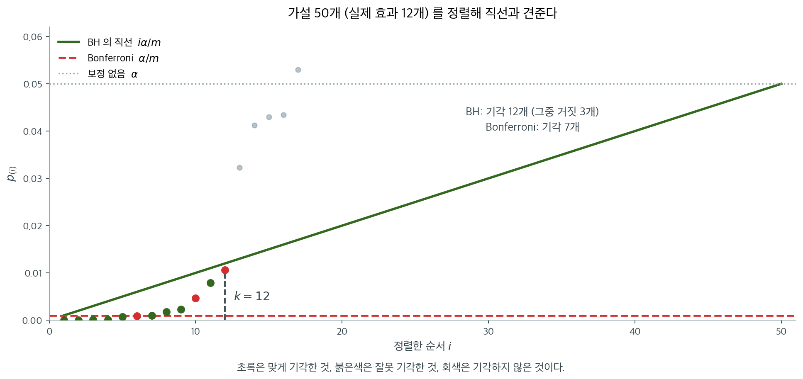
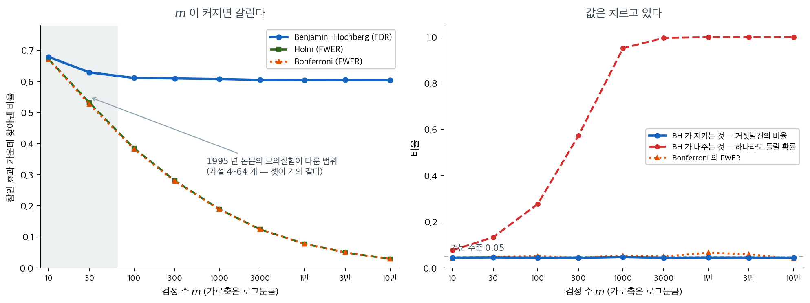

# 거짓발견율 (Benjamini-Hochberg)

## 1. FWER에서 FDR로

[가족단위 오류율](fwer.md)은 잘못된 기각이 단 하나라도 생길 확률을 통제한다. 거짓 양성 하나하나가 심각한 결과를 낳을 때는 적절하지만, 검정 수가 많아지면 FWER 통제는 지나치게 보수적이 된다. 검정이 $m = 500{,}000$개인 전장유전체 연관분석에서 Bonferroni 문턱 $\alpha / m$은 너무 엄격해서 실제 효과를 많이 놓친다. Benjamini와 Hochberg가 1995년에 소개한 **거짓발견율(FDR)**은 덜 보수적인 대안을 제시한다: 거짓 양성을 아예 막는 대신, 기각된 가설 중 거짓 양성의 기대 **비율**을 통제한다.

---

## 2. 기호와 설정

귀무가설 $H_1, \ldots, H_m$을 동시에 검정한다고 하자. 이 중 $m_0$개가 실제로 귀무이고 $m - m_0$개가 실제로 대립이다. 검정 후 결과는 다음과 같이 분류할 수 있다:

| | 기각 안 함 | 기각 | 합계 |
|---|---|---|---|
| 참인 귀무 | $U$ | $V$ | $m_0$ |
| 거짓인 귀무 | $T$ | $S$ | $m - m_0$ |
| 합계 | $m - R$ | $R$ | $m$ |

여기서 $R$은 전체 기각 수, $V$는 거짓 발견의 수(기각된 참인 귀무가설), $S$는 참 발견의 수이다. $V$, $S$, $U$, $T$, $R$은 모두 자료와 판정 규칙에 따라 달라지는 확률변수이다.

---

## 3. FDR의 정의

**거짓발견비율(FDP)**은 기각 중 잘못된 것의 비율이다:

$$
\text{FDP} = \frac{V}{R}
$$

$R = 0$이면(아무것도 기각하지 않으면) 관례상 $\text{FDP} = 0$으로 둔다. **거짓발견율**은 이 비율의 기댓값이다:

$$
\text{FDR} = E\!\left[\frac{V}{\max(R, 1)}\right]
$$

분모의 $\max(R, 1)$이 0으로 나누는 것을 막는다. 동등하게 $\text{FDR} = E[V/R \mid R > 0] \cdot P(R > 0)$이다.

??? note "FDR과 FWER"
    FWER = $P(V \geq 1)$은 잘못된 기각이 **하나라도** 있는지 묻는다. FDR = $E[V / \max(R, 1)]$은 평균적으로 기각의 **몇 분의 몇**이 잘못되었는지를 묻는다. 모든 귀무가설이 참이면($m_0 = m$) 모든 기각이 거짓 발견이고 $\text{FDR} = P(R > 0) = \text{FWER}$이므로, FDR을 수준 $\alpha$로 통제하면 FWER도 수준 $\alpha$로 통제된다. 일부 귀무가설이 거짓이면 FDR이 보통 FWER보다 작다.

---

## 4. Benjamini-Hochberg 절차

Benjamini-Hochberg(BH) 절차는 FDR을 통제하는 **단계적 상승** 방법이다. p-값 $p_1, p_2, \ldots, p_m$이 주어졌을 때:

**1단계.** p-값을 오름차순으로 정렬한다:

$$
p_{(1)} \leq p_{(2)} \leq \cdots \leq p_{(m)}
$$

$H_{(i)}$를 $p_{(i)}$에 대응하는 귀무가설이라 하자.

**2단계.** 다음을 만족하는 가장 큰 지표 $k$를 찾는다:

$$
p_{(k)} \leq \frac{k}{m} \alpha
$$

**3단계.** 가설 $H_{(1)}, H_{(2)}, \ldots, H_{(k)}$를 모두 기각한다.

그런 $k$가 없으면 아무것도 기각하지 않는다.

문턱 $k\alpha / m$은 $k$에 따라 증가하며 $(1, \alpha/m)$에서 $(m, \alpha)$로 이어지는 직선을 이룬다. 이 절차는 그 직선 아래로 떨어지는 가장 오른쪽 p-값을 찾아 그 왼쪽의 모든 것을 기각한다.



정렬한 $p$-값을 순서에 대해 찍고 세 문턱을 함께 그린 것이다. **Bonferroni의 붉은 파선은 평평하고 BH의 초록 직선은 오른쪽으로 올라간다.** 원점에서 시작해 $(m, \alpha)$에 닿는 이 직선이 BH의 전부다.

절차를 그림에서 읽으면 이렇다. 직선 아래에 있는 점들 가운데 **가장 오른쪽**을 찾고($k = 12$), 그 왼쪽의 모든 점을 기각한다. **단계적 상승**이라는 이름이 여기서 나온다. 오른쪽 끝에서 왼쪽으로 내려오며 처음으로 직선 아래에 닿는 곳을 찾기 때문이다.

Holm의 단계적 하강과 반대 방향이라는 점이 중요하다. Holm은 왼쪽에서 출발해 처음 실패하는 곳에서 **멈추지만**, BH는 오른쪽에서 출발하므로 중간에 직선 위로 올라간 점이 있어도 $k$번째까지 모두 기각한다. 그래서 같은 $p$-값 집합에서 BH가 Holm보다 적게 기각하는 일은 없다.

이 자료에서 Bonferroni는 7개를 기각하고 BH는 12개를 기각한다. 대신 BH의 기각 중 3개는 거짓 발견이다. **BH는 거짓 발견을 없애는 절차가 아니라 그 비율을 관리하는 절차**이며, 3/12 = 25%가 이 한 번의 실현값이다. 평균적으로 그 비율이 $\alpha$ 이하가 된다는 것이 아래 정리의 내용이다.

### BH 절차가 통하는 이유 (직관)

핵심은 단계적 상승 문턱이 기각 전체 중 거짓 발견의 비율이 평균적으로 $\alpha$를 넘지 않도록 조정되어 있다는 점이다. 기각의 대부분이 참 발견이면(실제 효과에서 나온 작은 p-값들이면) 추가 발견에 넉넉한 문턱을 허용한다. 기각되는 가설이 적으면 문턱이 자동으로 더 엄격해져 Bonferroni와 비슷한 보호를 흉내 낸다.

---

## 5. BH 정리

!!! info "Benjamini-Hochberg 정리 (1995)"
    $m$개 검정통계량이 **독립**이면 BH 절차는 FDR을 다음 수준으로 통제한다:

    $$
    \text{FDR} \leq \frac{m_0}{m} \alpha \leq \alpha
    $$

    여기서 $m_0$은 참인 귀무가설의 개수이다.

인자 $m_0 / m \leq 1$은 BH 절차가 실제로는 약간 보수적임을 뜻한다: 참 FDR은 최대 $\alpha$에 참인 귀무가설의 비율을 곱한 값이다.

Benjamini와 Yekutieli(2001)는 이후 BH 절차가 **부분집합 각각에 대한 양의 회귀 종속성(PRDS)** 아래에서도 FDR을 통제함을 보였다. 이 조건은 비음의 상관을 갖는 다변량 정규를 비롯한 여러 흔한 다변량 분포가 만족한다.

<div class="exbox" markdown>

**보기 1.** <span class="diff easy" title="쉬움"></span> 약물 선별. 한 제약회사가 표적에 대한 활성을 보려고 화합물 $m = 10$개를 선별하며, 화합물마다 $\alpha = 0.10$에서 가설검정을 한 번씩 한다. 얻은 p-값은:

| 화합물 | $p$-값 |
|---|---|
| A | 0.005 |
| B | 0.011 |
| C | 0.032 |
| D | 0.048 |
| E | 0.065 |
| F | 0.100 |
| G | 0.180 |
| H | 0.350 |
| I | 0.560 |
| J | 0.920 |

</div>

??? success "풀이"
    p-값은 이미 정렬되어 있다. 각 순위에 대해 BH 문턱 $k\alpha / m$을 계산한다:

    | 순위 $k$ | $p_{(k)}$ | BH 문턱 $k \times 0.10 / 10$ | $p_{(k)} \leq$ 문턱? |
    |---|---|---|---|
    | 1 | 0.005 | 0.010 | 예 |
    | 2 | 0.011 | 0.020 | 예 |
    | 3 | 0.032 | 0.030 | 아니오 |
    | 4 | 0.048 | 0.040 | 아니오 |
    | 5 | 0.065 | 0.050 | 아니오 |
    | 6 | 0.100 | 0.060 | 아니오 |
    | 7 | 0.180 | 0.070 | 아니오 |
    | 8 | 0.350 | 0.080 | 아니오 |
    | 9 | 0.560 | 0.090 | 아니오 |
    | 10 | 0.920 | 0.100 | 아니오 |

    $p_{(k)} \leq k\alpha / m$을 만족하는 가장 큰 $k$는 $k = 2$이다. BH 절차는 $H_{(1)}$과 $H_{(2)}$를 기각하여 화합물 A와 B를 활성으로 선언한다.

    비교하면 수준 $\alpha = 0.10$의 [Bonferroni 보정](bonferroni_holm.md)은 문턱 $0.10 / 10 = 0.01$을 쓴다. 화합물 A($p = 0.005$)만 이 문턱을 통과한다. BH 절차는 기대 거짓발견비율을 10% 이하로 유지하면서 발견을 하나(화합물 B) 더 찾아낸다.

---

## 6. 보정된 p-값

각 p-값을 그에 해당하는 BH 문턱과 비교하는 대신 **BH 보정 p-값**(q-값이라고도 한다)을 계산하는 편이 흔히 더 편하다. $i$번째로 정렬된 가설의 보정 p-값은:

$$
\tilde{p}_{(i)} = \min_{j \geq i} \left\{\frac{m}{j} \, p_{(j)}\right\}
$$

가장 큰 순위에서 아래로 내려오며 계산하고, 보정 p-값이 비감소가 되도록 한다. 어떤 가설이 수준 $\alpha$의 BH 절차에서 기각될 필요충분조건은 보정 p-값이 $\tilde{p}_{(i)} \leq \alpha$인 것이다.

---

## 7. FDR과 FWER 중 무엇을 쓸 것인가

| 기준 | FWER 통제 | FDR 통제 |
|---|---|---|
| 오류 보장 | (높은 확률로) 거짓 양성 없음 | 거짓 양성의 비율을 통제 |
| 보수성 | 높음 (특히 $m$이 클 때) | 중간 |
| 검정력 | 낮음 | 높음 |
| 알맞은 상황 | 확증적 연구, 작은 $m$ | 탐색적 연구, 큰 $m$ |
| 예 | 임상시험 평가변수, 규제 제출 | 유전체학, 단백질체학, 뇌영상 |

FDR 통제는 후속 조사를 할 유망한 후보 집합을 찾는 것이 목표이고 잘못된 단서가 조금 섞여도 괜찮은 고차원 선별 문제의 표준 접근이다.

<div class="storybox" markdown>

**그림으로 보는 통계학 1.** 다섯 해 동안 학술지 셋이 돌려보냈다

위 표의 오른쪽 열은 오늘 유전체학과 뇌영상의 표준이다. 그런데 그 생각이 활자가 되기까지 **다섯 해가 걸렸고 학술지 셋이 거절했다.**

벤자미니가 $2010$ 년에 『JRSS B』 $72$ 권 $405$–$416$ 쪽에 쓴 회고 「거짓발견율을 발견하기」에 그 경위가 적혀 있다. 「**$1989$ 년 $11$ 월에 우리는 「다중비교에 대한 새로운 접근들의 종합」이라는 논문을 보냈다.**」 그리고 몇 줄 뒤 — 「**다섯 해 뒤, 학술지 셋을 거쳐 그 논문은 받아들여졌다.**」 그 사이에 $m_0$ 을 상한 $m$ 으로 바꾸는 귀납 증명이 풀려서 적응 단계를 들어냈고, 더는 「종합」이 아니게 되어 제목도 바뀌었다. 그렇게 나온 것이 §4 의 그 절차다.

받아들여진 뒤에도 느렸다. 회고의 다음 절 제목이 「거짓발견율 생각의 성공」인데 첫 문장이 이렇다 — 「$1995$ 년 논문이 나온 **뒤에도** FDR 이라는 생각의 수용은 더뎠다.」 $m_0$ 을 추정하는 원래 판본은 **다시 다섯 해와 학술지 둘**을 더 거쳐 $2000$ 년에야 나왔다.

까닭이 수에 있다. 심사 과정에서 받은 지적 가운데 이런 것이 있었다. $1995$ 년 논문의 모의실험이 가설 **$4$ 개에서 $64$ 개**를 다룬 것을 두고, 「**$50$ 개나 $100$ 개씩 검정하는 문제에 다중비교를 쓰는 사람은 없다**」는 말이었다.



그 말이 당시에는 틀리지 않았다. 왼쪽 그림의 회색 띠가 그 논문이 다룬 범위다. **거기서는 세 방법이 거의 같다.** 참인 효과가 $10\%$ 이고 이동폭이 $3$ 일 때 $m = 10$ 에서 본페로니가 $0.670$, BH 가 $0.679$ 로 사실상 구별되지 않는다. 다섯 해를 돌려보낸 심사자들이 본 것이 이 구간이었다.

띠 밖으로 나가면 이야기가 달라진다. $m = 1000$ 에서 $0.188$ 대 $0.608$, $m = 10$ 만에서 **$0.029$ 대 $0.604$** 다. 본페로니의 검정력은 $m$ 과 함께 바닥으로 가라앉는데 BH 는 $0.6$ 언저리에 그대로 앉아 있다. 회고가 적어 둔 전환점이 바로 이것이다 — 「태도가 극적으로 바뀐 것은 유전 연구가 새 국면에 들어서서 한 실험에서 검정하는 가설 수가 **수천에 이르렀을 때**였다. 열 해 전에는 생각할 수도 없던 일이다.」

공짜는 아니다. 오른쪽이 치르는 값이다. BH 가 지키는 것은 **기각한 것 가운데 거짓인 비율**이고 그 값은 $m$ 이 무엇이든 $0.044$–$0.048$ 로 겨눈 $0.05$ 를 지킨다. 대신 **하나라도 틀릴 확률**은 $m = 1000$ 에서 이미 $0.95$, 그 위에서는 $1$ 이다. 본페로니가 끝까지 $0.05$ 근처로 붙들고 있는 바로 그 양을 통째로 놓아 주고 산 검정력이다. §7 표의 「보수성 / 검정력」 두 줄이 수로는 이렇게 생겼다.

$2024$ 년에 루소 상이 「거짓발견율과 그것을 통제하는 방법들」에 주어졌다. 상금이 백만 달러다.

_확인한 곳 — 「$1989$ 년 $11$ 월에 「다중비교에 대한 새로운 접근들의 종합」을 보냈다」, 「다섯 해 뒤 학술지 셋을 거쳐 받아들여졌다」, 귀납 증명이 풀려 적응 단계를 빼면서 제목이 바뀌었다는 것, 「$1995$ 년 논문이 나온 뒤에도 수용은 더뎠다」와 $m_0$ 추정 판본이 「다시 다섯 해와 학술지 둘」을 거쳐 $2000$ 년에 나왔다는 것, 심사에서 「$50$ 개나 $100$ 개씩 검정하는 문제에 다중비교를 쓰는 사람은 없다」는 말로 $4$–$64$ 개 모의실험이 비판받았다는 것, 그리고 「태도가 극적으로 바뀐 것은 … 가설 수가 수천에 이르렀을 때」라는 대목은 모두 Yoav Benjamini, 「Discovering the false discovery rate」, 『J. R. Statist. Soc. B』 $72$ 권 $4$ 호 $405$–$416$ 쪽($2010$)에서 직접 읽었다 · $2024$ 년 루소 상(상금 $100$ 만 달러)이 「The False Discovery Rate (FDR) and Methods to Control It」에 Yoav Benjamini · Daniel Yekutieli · Ruth Heller 에게 주어졌다는 것은 [Rousseeuw Prize 쪽](https://www.rousseeuwprize.org/2024). 그림의 모든 수 — 세 방법의 검정력, 실현 FDR, FWER — 는 직접 모의실험해 계산한 값이다_

</div>

<div class="exbox" markdown>

**보기 2.** <span class="diff easy" title="쉬움"></span> 벤자미니-호크버그 절차 구현. 보정 $p$-값(q-값)은

$$
\tilde p_{(i)} = \min_{j \ge i}\left\{\frac{m}{j}\,p_{(j)}\right\}
$$

인데, 구현에서는 **큰 순위에서 작은 쪽으로 훑으며 최솟값을 취하는** 한 줄짜리 되짚기로 처리한다.

**(1)** $p$-값 $0.001,\ 0.008,\ 0.039,\ 0.041,\ 0.23,\ 0.76$에 대해 되짚기 **전**의 값 $\tfrac{m}{k}p_{(k)}$를 모두 구하고, 어디서 단조성이 깨지는지 찾으시오. 되짚기 후의 값도 구하시오.

**(2)** 되짚기를 하지 않으면 무엇이 잘못되는가. 또 조건을 만족하는 $k$가 **하나도 없을 때** 이 구현이 어떻게 처리하는지 확인하시오.

</div>

??? success "풀이"

    **(1) 해석적으로.** $m = 6$이고 $p$-값이 이미 정렬되어 있으므로 $\tfrac{m}{k}p_{(k)}$를 차례로 잰다.

    | $k$ | $p_{(k)}$ | $\tfrac{6}{k}p_{(k)}$ | 되짚기 후 |
    |---|---|---|---|
    | 1 | $0.001$ | $0.001 \times 6 = 0.0060$ | $0.0060$ |
    | 2 | $0.008$ | $0.008 \times 3 = 0.0240$ | $0.0240$ |
    | 3 | $0.039$ | $0.039 \times 2 = 0.0780$ | $0.0615$ |
    | 4 | $0.041$ | $0.041 \times 1.5 = 0.0615$ | $0.0615$ |
    | 5 | $0.230$ | $0.230 \times 1.2 = 0.2760$ | $0.2760$ |
    | 6 | $0.760$ | $0.760 \times 1 = 0.7600$ | $0.7600$ |

    **$k = 3$에서 단조성이 깨진다.** $0.0780 > 0.0615$이므로 셋째 자리의 값이 넷째보다 **크다.** 원래 $p$-값은 $0.039 < 0.041$로 셋째가 더 작은데, 보정하면 순서가 뒤집히는 것이다. $m/k$가 $k$에 대해 감소하므로 $p_{(k)}$가 충분히 천천히 커지면 이런 역전이 일어난다.

    되짚기는 오른쪽 끝에서 시작해 $\tilde p_{(i)} = \min\{\tfrac{m}{i}p_{(i)},\ \tilde p_{(i+1)}\}$을 적용한다. $i = 4$에서 $\min(0.0615, 0.2760) = 0.0615$, $i = 3$에서 $\min(0.0780, 0.0615) = 0.0615$가 되어 셋째가 끌어내려진다. 나머지는 이미 작으므로 그대로다. 이 한 번의 훑기가 정의의 $\min_{j \ge i}$를 그대로 계산한다.

    **(2) 되짚기를 하지 않으면.** 셋째의 보정 $p$가 $0.0780$으로 남는다. 그러면 $\alpha = 0.07$에서 **넷째($0.0615$)는 기각되는데 셋째($0.0780$)는 기각되지 않는** 결과가 나온다. 원래 $p$-값이 더 작은 가설을 기각하지 못하는 셈이라, 단계적 상승 절차의 "가장 큰 $k$ 아래를 모두 기각한다"는 규칙과 어긋난다. **되짚기는 보정 $p$-값과 BH 절차를 동치로 만들기 위한 장치**다. 그래야 "$\tilde p_{(i)} \le \alpha$이면 기각"이 BH와 정확히 같은 답을 준다.

    **조건을 만족하는 $k$가 없을 때.** 구현의 `if not below.any(): k = 0` 한 줄이 그 경우를 막는다. 이 보호가 없으면 `np.max(np.where(below)[0])`이 빈 배열에서 예외를 던지고, `np.argmax(below)` 같은 꼴로 썼다면 **조용히 0번 칸을 돌려주어 첫 가설을 기각해 버린다.** 격자에서 답을 찾는 코드가 흔히 빠지는 함정이며, 아래에서 실제로 확인한다.

    **수치적으로.**

    ```python
    import numpy as np

    def benjamini_hochberg(p_values, alpha=0.05):
        """벤자미니-호크버그 절차를 적용한다.

            p-값을 작은 것부터 늘어놓고 k번째를 k/m*alpha 와 견준다. 조건을 만족하는
            가장 큰 k 를 찾아 그 아래를 모두 기각한다. FWER 대신 FDR 을 통제하므로
            본페로니보다 훨씬 덜 보수적이다.

        Parameters
        ----------
        p_values : array-like
            Raw p-values from m hypothesis tests.
        alpha : float
            Target FDR level.

        Returns
        -------
        rejected : ndarray of bool
            True for hypotheses that are rejected.
        adjusted : ndarray of float
            BH-adjusted p-values.
        """
        p = np.asarray(p_values)
        m = len(p)
        order = np.argsort(p)
        sorted_p = p[order]

        # BH 문턱값: k번째로 작은 p-값을 k/m*alpha 와 견준다.
        thresholds = np.arange(1, m + 1) / m * alpha

        # 조건을 만족하는 가장 큰 k 를 찾는다. 그 아래는 모두 기각한다.
        below = sorted_p <= thresholds
        if not below.any():
            k = 0
        else:
            k = np.max(np.where(below)[0]) + 1

        # 기각 여부를 표시한다.
        rejected = np.zeros(m, dtype=bool)
        rejected[order[:k]] = True

        # 보정 p-값. 큰 것에서 작은 쪽으로 훑으며 단조성을 강제한다.
        # 이 되짚기가 없으면 원래 p-값의 순서가 뒤집히는 일이 생겨
        # "더 작은 p-값이 더 큰 보정 p-값을 갖는" 이상한 결과가 나온다.
        adjusted_sorted = np.minimum(1, sorted_p * m / np.arange(1, m + 1))
        for i in range(m - 2, -1, -1):
            adjusted_sorted[i] = min(adjusted_sorted[i], adjusted_sorted[i + 1])
        adjusted = np.empty(m)
        adjusted[order] = adjusted_sorted      # 원래 순서로 되돌린다

        return rejected, adjusted


    # 아래 연습문제 1의 p-값으로 확인한다.
    pvals = np.array([0.001, 0.008, 0.039, 0.041, 0.23, 0.76])
    rej, adj = benjamini_hochberg(pvals, alpha=0.10)
    print("rejected:", rej)
    print("adjusted:", np.round(adj, 4))

    # statsmodels와 대조
    from statsmodels.stats.multitest import multipletests
    rej_sm, adj_sm, _, _ = multipletests(pvals, alpha=0.10, method="fdr_bh")
    print("statsmodels adjusted:", np.round(adj_sm, 4))

    # (1) 되짚기 전후를 나란히 본다.
    m = len(pvals)
    raw = np.minimum(1, np.sort(pvals) * m / np.arange(1, m + 1))
    print("\n되짚기 전:", np.round(raw, 4))
    print("되짚기 후:", np.round(np.sort(adj), 4))
    print("단조성이 깨진 자리:",
          [int(k) + 1 for k in np.where(np.diff(raw) < 0)[0]], "번째")

    # (2) 조건을 만족하는 k 가 하나도 없는 경우.
    none_p = np.array([0.4, 0.5, 0.6, 0.7, 0.8, 0.9])
    rej0, adj0 = benjamini_hochberg(none_p, alpha=0.10)
    print("\n아무것도 기각되지 않는 경우:", rej0, np.round(adj0, 4))
    print("statsmodels 도 같은가:",
          np.array_equal(rej0, multipletests(none_p, alpha=0.10,
                                             method="fdr_bh")[0]))
    ```

    출력:

    ```
    rejected: [ True  True  True  True False False]
    adjusted: [0.006  0.024  0.0615 0.0615 0.276  0.76  ]
    statsmodels adjusted: [0.006  0.024  0.0615 0.0615 0.276  0.76  ]

    되짚기 전: [0.006  0.024  0.078  0.0615 0.276  0.76  ]
    되짚기 후: [0.006  0.024  0.0615 0.0615 0.276  0.76  ]
    단조성이 깨진 자리: [3] 번째

    아무것도 기각되지 않는 경우: [False False False False False False] [0.9 0.9 0.9 0.9 0.9 0.9]
    statsmodels 도 같은가: True
    ```

    (1)의 표가 그대로 재현된다. 되짚기 전의 여섯 값이 $0.006,\ 0.024,\ 0.078,\ 0.0615,\ 0.276,\ 0.76$이고 셋째에서만 단조성이 깨진다. 되짚기 후에는 셋째가 $0.0615$로 끌어내려져 넷째와 같아지며, 이 결과가 `statsmodels`와 **완전히 일치**한다.

    앞의 네 개가 기각된다. Bonferroni였다면 문턱이 $0.10/6 = 0.0167$이라 처음 두 개만 기각되었을 것이다. 보정 $p$-값으로 읽어도 같다. $0.006,\ 0.024,\ 0.0615,\ 0.0615$가 모두 $\alpha = 0.10$ 이하이고 $0.276$부터는 넘는다. **단계적 상승 규칙과 보정 $p$-값 비교가 같은 답을 주는 것**이 (2)에서 말한 되짚기의 몫이다.

    (2)의 마지막 확인도 통과한다. $p$-값이 모두 커서 조건을 만족하는 $k$가 하나도 없을 때 `k = 0`이 되어 **하나도 기각하지 않는다.** 보정 $p$-값은 여섯 개 모두 $0.9$다. 되짚기 전에는 앞의 네 자리가 $\tfrac{6}{k}p_{(k)} > 1$이라 모두 $1$로 잘려 있었는데, 가장 큰 순위의 값 $0.9 \times \tfrac66 = 0.9$가 되짚기를 거치며 모든 자리로 내려온 것이다. 어느 것도 $\alpha = 0.10$ 이하가 아니므로 기각이 없고, `statsmodels`도 같은 답을 준다.

---

## 8. 다른 주제와의 연결

- FWER의 정의와 보정하지 않은 검정이 왜 문제인지는 [가족단위 오류율](fwer.md)을 보라.
- FWER을 통제하는 절차(Bonferroni와 Holm)는 [Bonferroni와 Holm 보정](bonferroni_holm.md)을 보라.
- BH 절차는 `scipy.stats.false_discovery_control`(SciPy 1.11 이상)과 `statsmodels.stats.multitest.multipletests`에 구현되어 있다.

## 9. 분포를 가정하지 않고 FDR 을 추정하기

BH 절차는 $p$ 값이 귀무가설 아래에서 균등하다는 데 기댄다. 그 가정을 피하는 길이
하나 있다 — **집단 이름을 뒤섞어 귀무분포를 직접 만들고**, 가능한 모든 문턱에서
거짓 발견의 기대 수를 세는 것이다.

<div class="exbox" markdown>

**보기 3.** <span class="diff easy" title="쉬움"></span> 재표본으로 FDR 추정하기. 아래 함수는 집단 이름을 뒤섞어 귀무분포를 만들고, 가능한 모든 문턱 $t$에서

$$
\widehat{\text{FDR}}(t) = \frac{\hat V(t)}{R(t)},
\qquad
\hat V(t) = \frac{1}{B}\sum_{b=1}^{B} \#\{j : \lvert T^{(b)}_j \rvert \ge t\}
$$

를 돌려준다. 여기서 $R(t) = \#\{j : \lvert T_j \rvert \ge t\}$는 실제 기각 수다.

**(1)** $\hat V(t)$가 무엇을 추정하는지 적고, 특징 $m$개 가운데 $m_0$개가 귀무일 때 이 추정량이 **참 FDR의 몇 배**로 치우치는지 구하시오.

**(2)** 특징 $m = 200$개(앞의 40개만 참 신호, $\delta = 1$, 각 집단 25명)를 만들어 그 치우침을 수로 확인하시오.

</div>

??? success "풀이"

    **(1) 해석적으로.** 집단 이름을 뒤섞으면 두 집단의 차이가 **모든 특징에서** 지워진다. 신호가 있던 특징도 마찬가지다. 그러므로 순열 통계량 $T^{(b)}_j$는 $j$가 참 신호인지와 무관하게 귀무분포에서 나온 값처럼 행동하고,

    $$
    E\bigl[\hat V(t)\bigr] \approx m \cdot P_0\bigl(\lvert T \rvert \ge t\bigr) = m\,p(t)
    $$

    이다. 여기서 $p(t)$는 귀무분포의 양측 꼬리확률이다.

    그런데 **실제로 거짓 양성을 낼 수 있는 특징은 귀무인 $m_0$개뿐이다.** 참 신호가 기각되는 것은 거짓 양성이 아니다. 그러므로 참값은

    $$
    E[V(t)] = m_0\,p(t)
    $$

    이고, 두 식을 나누면 치우침이 바로 나온다.

    $$
    \frac{E[\hat V(t)]}{E[V(t)]} = \frac{m}{m_0} = \frac{1}{\pi_0},
    \qquad \pi_0 = \frac{m_0}{m}
    $$

    **이 추정량은 참 FDR을 정확히 $1/\pi_0$배로 과대평가한다.** $t$에 의존하지 않는 상수배라는 점이 중요하다. 꼬리확률 $p(t)$가 분자와 분모에서 그대로 약분되기 때문이다.

    방향이 **보수적**이라는 것도 함께 읽어야 한다. 과대평가이므로 이 추정값으로 문턱을 정하면 실제 FDR은 목표보다 낮다. 참 신호가 드문 상황($\pi_0 \approx 1$)에서는 치우침이 거의 없고, 신호가 많을 때만 손해가 커진다. 고차원 자료에서 $\pi_0$이 보통 0.9를 넘기 때문에 실무에서 이 추정량이 그대로 쓰이는 것이다. 바로잡고 싶으면 $\hat\pi_0$을 곱하면 되는데(스토리의 보정), 그 $\hat\pi_0$을 추정하는 일이 또 다른 문제를 만든다.

    대신 이 방법이 사는 것은 **분포 가정이 전혀 없다**는 점이다. $t$ 분포도 정규성도 쓰지 않고, 특징끼리 상관되어 있어도 순열이 그 상관을 고스란히 보존한 채로 귀무분포를 만든다.

    **(2) 수치적으로.** 먼저 함수다. $t$ 분포도 정규성 가정도 쓰지 않는다는 것이 요점이다.

    ```python
    import numpy as np
    from scipy import stats
    def resampling_fdr(X_group1, X_group2, n_permutations=500):
        n1, n2 = X_group1.shape[0], X_group2.shape[0]
        n_features = X_group1.shape[1]
        X_combined = np.vstack([X_group1, X_group2])

        # 관측된 검정통계량
        t_obs = np.array([
            stats.ttest_ind(X_group1[:, j], X_group2[:, j]).statistic
            for j in range(n_features)
        ])

        # 집단 이름을 뒤섞어 만든 귀무분포. 모형을 가정하지 않는다.
        t_perm = np.zeros((n_permutations, n_features))
        for b in range(n_permutations):
            idx = np.random.permutation(n1 + n2)
            for j in range(n_features):
                t_perm[b, j] = stats.ttest_ind(
                    X_combined[idx[:n1], j],
                    X_combined[idx[n1:], j]
                ).statistic

        # 문턱마다 FDR을 추정한다.
        Rs, FDRs = [], []
        for thresh in np.sort(np.abs(t_obs)):
            R = np.sum(np.abs(t_obs) >= thresh)       # 실제 기각 수
            # 순열 자료에서 문턱을 넘은 총 개수를 순열 횟수로 나눈다.
            # 이것이 "H0가 참일 때 기대되는 기각 수", 즉 E[V]의 추정이다.
            V = np.sum(np.abs(t_perm) >= thresh) / n_permutations
            Rs.append(R)
            FDRs.append(V / max(R, 1))
        return np.array(Rs), np.array(FDRs)
    ```

    이제 정답을 아는 자료를 만들어 (1)의 예측과 맞춘다. $m = 200$, $m_0 = 160$이므로 치우침은 $m/m_0 = 1.25$배로 예측된다.

    ```python
    np.random.seed(0)

    m, m1, n1, n2, delta = 200, 40, 25, 25, 1.0
    m0 = m - m1
    truth = np.zeros(m, dtype=int)
    truth[:m1] = 1                      # 앞의 40개 특징만 참 신호

    X1 = np.random.normal(0.0, 1.0, (n1, m))
    X2 = np.random.normal(0.0, 1.0, (n2, m))
    X2[:, :m1] += delta                 # 신호는 집단 2 의 평균을 delta 만큼 옮긴다

    t_obs = np.array([stats.ttest_ind(X1[:, j], X2[:, j]).statistic
                      for j in range(m)])
    Rs, FDRs = resampling_fdr(X1, X2, n_permutations=200)

    df = n1 + n2 - 2
    print(f"m = {m},  m0 = {m0},  m/m0 = {m / m0:.4f},  자유도 = {df}")

    print("\n순열 귀무분포가 t_48 과 맞는가")
    print("    t     순열 P(|T|>=t)    2*sf(t, 48)")
    # resampling_fdr 안에서 쓴 것과 같은 순열을 다시 만들 수는 없으므로
    # 같은 방식으로 새로 200 번 섞어 비교한다.
    Xc = np.vstack([X1, X2])
    cnt = np.zeros(4)
    grid = np.array([1.0, 2.0, 2.5, 3.0])
    B = 200
    for b in range(B):
        idx = np.random.permutation(n1 + n2)
        tp = np.array([stats.ttest_ind(Xc[idx[:n1], j], Xc[idx[n1:], j]).statistic
                       for j in range(m)])
        cnt += [(np.abs(tp) >= g).sum() for g in grid]
    for g, c in zip(grid, cnt):
        print(f"{g:5.1f}      {c / (B * m):11.6f}    {2 * stats.t.sf(g, df):11.6f}")

    print("\n   R    문턱    FDR 추정   m*p(t)/R   m0*p(t)/R   비   실현 FDP")
    thr = np.sort(np.abs(t_obs))
    for k in range(len(thr)):
        R = Rs[k]
        if R not in (200, 100, 60, 50, 40, 30, 20):
            continue
        t = thr[k]
        p_t = 2 * stats.t.sf(t, df)
        sel = np.abs(t_obs) >= t
        fdp = np.sum(sel & (truth == 0)) / max(sel.sum(), 1)
        print(f"{R:4d} {t:7.4f}  {FDRs[k]:9.4f}  {m * p_t / R:9.4f}"
              f"   {m0 * p_t / R:9.4f}  {m * p_t / (m0 * p_t):5.2f}  {fdp:9.4f}")
    ```

    출력:

    ```
    m = 200,  m0 = 160,  m/m0 = 1.2500,  자유도 = 48

    순열 귀무분포가 t_48 과 맞는가
        t     순열 P(|T|>=t)    2*sf(t, 48)
      1.0         0.322125       0.322325
      2.0         0.052850       0.051176
      2.5         0.016450       0.015890
      3.0         0.004375       0.004272

       R    문턱    FDR 추정   m*p(t)/R   m0*p(t)/R   비   실현 FDP
     200  0.0249     0.9807     0.9802      0.7842   1.25     0.8000
     100  0.9308     0.7107     0.7133      0.5706   1.25     0.6000
      60  1.5739     0.3944     0.4069      0.3255   1.25     0.3500
      50  1.8511     0.2711     0.2813      0.2250   1.25     0.2200
      40  2.1825     0.1635     0.1700      0.1360   1.25     0.0500
      30  2.9122     0.0350     0.0362      0.0290   1.25     0.0000
      20  3.5186     0.0065     0.0096      0.0077   1.25     0.0000
    ```

    **순열 귀무분포가 $t_{48}$과 맞는다.** $t = 2.0$에서 $0.0529$ 대 $0.0512$, $t = 2.5$에서 $0.0165$ 대 $0.0159$로 몬테카를로 오차($B \times m = 40{,}000$개 추출이지만 같은 순열 안의 특징들이 함께 움직이므로 유효 표본은 그보다 작다) 안에서 일치한다. 정규자료라 당연한 결과이지만, 이 일치가 **순열이 올바른 귀무분포를 만들고 있다는 점검**이 된다.

    **치우침이 유도한 그대로다.** 셋째 열(함수가 준 FDR 추정)과 넷째 열($m\,p(t)/R$, 곧 (1)이 예측한 극한)이 거의 겹친다. $R = 200$에서 $0.9807$ 대 $0.9802$, $R = 100$에서 $0.7107$ 대 $0.7133$, $R = 50$에서 $0.2711$ 대 $0.2813$이다. 그리고 넷째 열은 다섯째 열($m_0\,p(t)/R$, 참값)의 정확히 $1.25$배다. **추정량이 참 FDR이 아니라 그것의 $1/\pi_0$배를 재고 있다는 것이 수로 확인된다.**

    마지막 열의 **실현 FDP**는 또 다른 것이다. $R = 40$에서 추정값은 $0.1635$인데 실제로 섞여 들어온 거짓 양성은 2개뿐이어서 $0.05$이고, $R = 30$과 $R = 20$에서는 $0$이다. FDR은 FDP의 **기댓값**이므로 한 번의 실현이 기댓값보다 크거나 작은 것은 이상한 일이 아니다. 특히 기각 수가 적을 때는 FDP가 $0$ 아니면 $1/R$ 꼴로 뚝뚝 끊기므로 한 번의 실현으로 추정값을 반박할 수 없다. **문턱을 고르는 데 쓰는 것은 추정 FDR 곡선이고, 실현 FDP는 모의실험에서만 볼 수 있는 값이다.**

---

---

## 연습문제

<div class="drillbox" markdown>

**연습문제 1.** <span class="diff easy" title="쉬움"></span>
p-값 6개 0.001, 0.008, 0.039, 0.041, 0.23, 0.76에 FDR 수준 $q = 0.10$에서 Benjamini-Hochberg(BH) 절차를 적용하라. 어느 가설이 기각되는가?

</div>

??? success "풀이"
    p-값을 정렬하고 BH 문턱 $q \cdot j/m$을 계산한다:

    | 순위 $j$ | $p_{(j)}$ | 문턱 $q \cdot j/m = 0.10 \cdot j/6$ | $p_{(j)} \leq$ 문턱? |
    |---|---|---|---|
    | 1 | 0.001 | 0.0167 | 예 |
    | 2 | 0.008 | 0.0333 | 예 |
    | 3 | 0.039 | 0.0500 | 예 |
    | 4 | 0.041 | 0.0667 | 예 |
    | 5 | 0.230 | 0.0833 | 아니오 |
    | 6 | 0.760 | 0.1000 | 아니오 |

    $p_{(j)} \leq q \cdot j/m$을 만족하는 가장 큰 $j$는 $j = 4$이다. $p_{(1)}$부터 $p_{(4)}$에 대응하는 가설 4개를 기각한다. $q = 0.10$의 BH에서 이 4개 기각 중 거짓발견비율의 기댓값은 최대 10%이다.

---

<div class="drillbox" markdown>

**연습문제 2.** <span class="diff med" title="중간"></span>
거짓발견율(FDR)을 정의하고 가족단위 오류율(FWER)과 어떻게 다른지 설명하라.

</div>

??? success "풀이"
    **FDR**은 기각된 가설 전체 중 거짓 발견의 기대 비율이다:

    $$
    \text{FDR} = E\!\left[\frac{V}{R \vee 1}\right]
    $$

    여기서 $V$는 잘못된 기각의 수, $R$은 전체 기각 수이며 $R \vee 1 = \max(R, 1)$이 0으로 나누는 것을 막는다.

    **FWER**은 잘못된 기각을 적어도 한 번 할 확률이다: $\text{FWER} = P(V \geq 1)$.

    주요 차이:

    - FWER이 더 엄격하다: *어떤* 거짓 양성이든 그 확률을 통제하는 반면, FDR은 발견 전체에서 작은 비율이기만 하면 거짓 양성을 어느 정도 허용한다.
    - FDR이 더 강력하다: 발견 중 일정 비율의 오류를 감수하므로 더 많은 가설을 기각한다.
    - 모든 귀무가설이 참이면($m_0 = m$) 모든 기각이 거짓이므로 FDR = FWER이다. 대립가설이 많이 참이면 FDR $\ll$ FWER이다.
    - 수천 개의 검정을 수행하고 거짓 발견을 어느 정도 감수할 수 있는 대규모 검정(유전체학, 뇌영상)에서는 FDR을 선호한다.

---

<div class="drillbox" markdown>

**연습문제 3.** <span class="diff med" title="중간"></span>
어떤 유전체 연구가 유전자 10,000개를 검정한다. $q = 0.05$의 BH로 가설 500개를 기각했다. 이 기각 중 거짓 발견은 몇 개로 기대되는가? FWER 통제(Bonferroni)와 비교하면 어떤가?

</div>

??? success "풀이"
    $q = 0.05$의 BH에서 거짓 발견 수의 기댓값은 최대 $q \times R = 0.05 \times 500 = 25$개이다. 즉 500개 발견 중 약 475개가 실제일 것으로 기대된다.

    $\alpha = 0.05$의 Bonferroni에서는 검정당 문턱이 $0.05/10000 = 5 \times 10^{-6}$이다. 이 극도로 엄격한 문턱 아래의 p-값만 기각된다. 실제로 Bonferroni는 (500개보다 훨씬 적은) 20~50개 유전자만 기각하여 많은 참 발견을 놓칠 수 있다.

    FDR 통제의 검정력 이점을 보여준다: BH는 (약 25개의 거짓을 감수하며) 유전자 500개를 발견하는 반면 Bonferroni는 (거짓을 거의 0으로 하면서) 훨씬 적게 발견한다. 선택은 거짓 발견의 대가와 놓친 발견의 대가를 견주어 정한다.

---

<div class="drillbox" markdown>

**연습문제 4.** <span class="diff med" title="중간"></span>
BH 절차의 **실제 FDR과 검정력**을 $\pi_1$(참 대립가설의 비율)에 따라 모의실험으로 확인하라.

</div>

??? success "풀이"
    ```python
    import numpy as np
    from scipy import stats

    rng = np.random.default_rng(31)
    M, m = 400, 1_000

    def bh_reject(p, q):
        m = len(p)
        o = np.argsort(p)
        ps = p[o]
        ok = np.where(ps <= q * np.arange(1, m + 1) / m)[0]
        r = np.zeros(m, bool)
        if len(ok):
            r[o[:ok.max() + 1]] = True
        return r

    print(f"{'π1':>6s} {'실제 FDR':>10s} {'q·π0':>8s} {'검정력':>8s} "
          f"{'평균 기각 수':>12s}")
    for pi1 in [0.01, 0.05, 0.10, 0.30]:
        fdrs, pows, nrej = [], [], []
        for _ in range(M):
            m1 = int(m * pi1)
            z = rng.standard_normal(m)
            z[:m1] += 3.5                        # 참 대립가설
            p = 2 * stats.norm.sf(np.abs(z))
            r = bh_reject(p, 0.05)
            R, V = r.sum(), r[m1:].sum()
            fdrs.append(V / max(R, 1))
            pows.append(r[:m1].sum() / m1)
            nrej.append(R)
        print(f"{pi1:6.2f} {np.mean(fdrs):10.4f} {0.05 * (1 - pi1):8.4f} "
              f"{np.mean(pows):8.4f} {np.mean(nrej):12.1f}")
    ```

    ```text
        π1     실제 FDR     q·π0      검정력      평균 기각 수
      0.01     0.0501   0.0495   0.4325          4.6
      0.05     0.0486   0.0475   0.6409         33.7
      0.10     0.0476   0.0450   0.7320         76.9
      0.30     0.0341   0.0350   0.8449        262.5
    ```

    **실제 FDR이 $q\pi_0$와 거의 같다.** 이것이 BH 정리의 핵심이다.

    $$
    \text{FDR}\le\frac{m_0}{m}q=\pi_0q\le q
    $$

    **따라서 BH는 $\pi_0$가 1에 가까울 때만 문턱을 온전히 쓴다.** $\pi_1=0.30$이면 실제 FDR이 0.034로 목표 0.05의 3분의 2다. **보수적**이다.

    **개선 — 적응적 BH.** $\pi_0$를 자료에서 추정해 $q/\hat\pi_0$를 쓰면 이 보수성이 사라진다. 스토리의 방법이 대표적이다.

    ```python
    def pi0_storey(p, lam=0.5):
        return min((p > lam).sum() / ((1 - lam) * len(p)), 1.0)

    m1 = 300
    z = rng.standard_normal(m)
    z[:m1] += 3.5
    p = 2 * stats.norm.sf(np.abs(z))
    print(f"참 π0 = {1 - m1 / m:.3f},  스토리 추정 = {pi0_storey(p):.3f}")
    ```

    ```text
    참 π0 = 0.700,  스토리 추정 = 0.676
    ```

    **검정력이 $\pi_1$과 함께 오른다.** $\pi_1=0.01$에서 0.43, $\pi_1=0.30$에서 0.84다. **BH의 문턱이 기각 수에 따라 느슨해지기** 때문이다. 참 신호가 많으면 문턱이 올라가 더 많이 잡아낸다.

    **이것이 본페로니와의 근본적 차이다.** 본페로니의 문턱 $\alpha/m$은 자료와 무관하게 고정이지만, BH는 **자료에 적응**한다.

---

<div class="drillbox" markdown>

**연습문제 5.** <span class="diff med" title="중간"></span>
BH와 본페로니의 **검정력**을 같은 조건에서 비교하고, 차이가 어디서 오는지 설명하라.

</div>

??? success "풀이"
    ```python
    import numpy as np
    from scipy import stats

    rng = np.random.default_rng(31)
    M, m = 400, 1_000

    def bh_reject(p, q):
        mm = len(p)
        o = np.argsort(p)
        ok = np.where(p[o] <= q * np.arange(1, mm + 1) / mm)[0]
        r = np.zeros(mm, bool)
        if len(ok):
            r[o[:ok.max() + 1]] = True
        return r

    print(f"{'π1':>6s} {'본페로니 검정력':>15s} {'BH 검정력':>11s} {'비':>6s}")
    for pi1 in [0.01, 0.05, 0.10]:
        pb, pbh = [], []
        for _ in range(M):
            m1 = int(m * pi1)
            z = rng.standard_normal(m)
            z[:m1] += 3.5
            p = 2 * stats.norm.sf(np.abs(z))
            pb.append((p[:m1] < 0.05 / m).sum() / m1)
            pbh.append(bh_reject(p, 0.05)[:m1].sum() / m1)
        print(f"{pi1:6.2f} {np.mean(pb):15.4f} {np.mean(pbh):11.4f} "
              f"{np.mean(pbh) / np.mean(pb):6.2f}")
    ```

    ```text
        π1        본페로니 검정력      BH 검정력      비
      0.01          0.2913      0.4325   1.48
      0.05          0.2873      0.6409   2.23
      0.10          0.2950      0.7320   2.48
    ```

    **BH가 1.5~2.5배 강력하다.** $\pi_1$이 클수록 차이가 커진다.

    **본페로니의 검정력은 $\pi_1$과 무관하다**(0.286~0.293). 문턱이 $\alpha/m$으로 고정이기 때문이다.

    **BH의 검정력은 $\pi_1$과 함께 오른다.** 신호가 많으면 문턱이 느슨해져 **선순환**이 생긴다.

    **차이의 원천 — 통제하는 양이 다르다.**

    | | 본페로니(FWER) | BH(FDR) |
    |---|---|---|
    | 통제 | $P(V\ge1)\le\alpha$ | $E[V/R]\le q$ |
    | 뜻 | **거짓발견이 하나라도** 있을 확률 | 발견 중 거짓의 **비율** |
    | $m$이 클 때 | 극도로 엄격 | 합리적 |

    **$m=1000$에서 FWER 통제는 "1000개 중 거짓 하나도 없기"** 를 요구한다. 지나치게 엄격하다. FDR은 "200개를 발견했다면 그중 10개쯤은 거짓일 수 있다"를 허용한다.

    **어느 것이 맞는가 — 후속 절차에 달렸다.**

    - **발견 하나하나를 확진 실험으로 검증**할 것이라면 FDR로 충분하다. 몇 개의 거짓 후보를 검증 단계에서 걸러 내면 된다.
    - **발견을 곧바로 결론으로 삼는다면** FWER이 필요하다. 규제 제출, 최종 결론.

    **유전체·뇌영상의 관행.** 탐색 단계에서는 FDR, 확증 단계에서는 FWER이나 매우 엄격한 문턱을 쓴다. **2단계 구조가 FDR을 정당화**한다.

---

<div class="drillbox" markdown>

**연습문제 6.** <span class="diff med" title="중간"></span>
BH 절차가 **종속 자료**에서 어떻게 작동하는지 확인하고, 언제 BY로 바꿔야 하는지 판단하라.

</div>

??? success "풀이"
    ```python
    import numpy as np
    from scipy import stats

    rng = np.random.default_rng(77)
    M, m, m1 = 300, 500, 50

    def bh_reject(p, q):
        mm = len(p)
        o = np.argsort(p)
        ok = np.where(p[o] <= q * np.arange(1, mm + 1) / mm)[0]
        r = np.zeros(mm, bool)
        if len(ok):
            r[o[:ok.max() + 1]] = True
        return r

    print(f"{'상관 구조':>14s} {'BH FDR':>9s} {'BY FDR':>9s} "
          f"{'BH 검정력':>11s} {'BY 검정력':>11s}")
    c_m = np.sum(1 / np.arange(1, m + 1))
    for name, rho in [("독립", 0.0), ("양의 등상관 0.5", 0.5),
                      ("양의 등상관 0.9", 0.9)]:
        f1, f2, p1, p2 = [], [], [], []
        for _ in range(M):
            common = rng.standard_normal(1)
            z = np.sqrt(rho) * common + np.sqrt(1 - rho) * rng.standard_normal(m)
            z[:m1] += 3.5
            p = 2 * stats.norm.sf(np.abs(z))
            for q, fl, pl in [(0.05, f1, p1), (0.05 / c_m, f2, p2)]:
                r = bh_reject(p, q)
                fl.append(r[m1:].sum() / max(r.sum(), 1))
                pl.append(r[:m1].sum() / m1)
        print(f"{name:>14s} {np.mean(f1):9.4f} {np.mean(f2):9.4f} "
              f"{np.mean(p1):11.4f} {np.mean(p2):11.4f}")
    ```

    ```text
             상관 구조    BH FDR    BY FDR      BH 검정력      BY 검정력
                독립    0.0475    0.0075      0.7312      0.4803
        양의 등상관 0.5    0.0396    0.0054      0.6847      0.4330
        양의 등상관 0.9    0.0185    0.0016      0.6963      0.4837
    ```

    **BH가 양의 등상관에서도 FDR을 잘 통제한다.** 0.019~0.048로 모두 0.05 이하이며, 상관이 커질수록 오히려 보수적이 된다.

    **이론적 근거.** 벤야미니-예쿠티엘리가 **PRDS(양의 회귀 종속)** 조건 아래 BH의 FDR 통제를 증명했다. 등상관 정규는 이 조건을 만족한다.

    **BY는 지나치게 보수적이다.** FDR이 0.002~0.008로 목표의 10분의 1이고, 검정력을 20~25%포인트 잃는다. $c(m)=\sum_{i=1}^{500}1/i=6.79$배로 문턱을 낮추기 때문이다.

    **언제 BY가 필요한가.**

    | 상황 | 권장 |
    |---|---|
    | 독립 또는 양의 상관 | **BH** |
    | 상관 구조를 모르지만 양의 상관이 그럴듯 | **BH**(대부분의 실무) |
    | **음의 상관이 섞여 있음** | BY 또는 순열 |
    | 최악의 경우 보장이 필수 | BY |
    | 교환가능성이 성립 | **순열 기반 FDR**(가장 정확) |

    **실무 판단.** 대부분의 응용에서 검정통계량은 **양의 상관**을 갖는다(같은 시료, 같은 피험자, 인접한 유전자·복셀). 따라서 **BH를 그대로 쓰는 것이 표준**이다.

    **음의 상관이 생기는 경우.** 총합이 고정된 조성 자료(비율, 상대풍부도), 대비 간의 구조적 제약. 이런 경우에만 BY나 순열을 고려한다.

---

<div class="drillbox" markdown>

**연습문제 7.** <span class="diff med" title="중간"></span>
FDR 통제 결과를 **어떻게 해석하고 보고해야 하는지** 정리하라. 흔한 오해는 무엇인가?

</div>

??? success "풀이"
    **흔한 오해 다섯.**

    **1 — "$q=0.05$이면 이 발견이 참일 확률이 95%다."**
    틀렸다. $q$-값은 **개별 가설의 확률이 아니라 목록의 기대 비율**이다. 개별 확률은 지역 FDR(local FDR)이라는 다른 양이며, 대체로 $q$-값보다 크다.

    **2 — "FDR을 통제했으니 각 발견이 검증되었다."**
    아니다. 200개를 발견했다면 그중 10개는 거짓으로 **예상**된다. 어느 10개인지는 모른다.

    **3 — "$V/R$의 기댓값이 $q$ 이하"와 "$V/R$이 항상 $q$ 이하"를 혼동.**
    기댓값 통제이므로, 특정 실험에서는 실제 비율이 훨씬 클 수 있다. 분산이 크다. **FDX(초과확률 통제)** 라는 대안이 있다.

    **4 — "$R=0$일 때의 처리."**
    기각이 없으면 $V/R$이 정의되지 않는다. 관례적으로 0으로 둔다. 따라서 FDR은 $E[V/R\mid R>0]P(R>0)$와 다르다(후자는 pFDR).

    **5 — "$q$-값이 개별 가설의 성질이다."**
    앞서 본 대로 **함께 검정한 집합에 의존**한다. 유전자 하나를 다른 논문에서 검정하면 $q$-값이 달라진다.

    **보고할 것.**

    1. **$m$(검정 수)과 가족의 정의.**
    2. **$q$ 수준과 방법**(BH/BY/스토리/순열).
    3. **기각 수 $R$과 예상 거짓발견 수 $\approx qR$.**
    4. **$\pi_0$ 추정값**(적응형을 썼다면).
    5. **원 $p$-값과 $q$-값을 모두** 담은 표나 부록.
    6. **종속 구조에 대한 논의.**

    **좋은 보고의 예.**

    > 유전자 20,531개에 대해 두 군의 발현 차이를 검정하고 BH 절차로 FDR을 0.05 수준에서 통제했다. 그 결과 342개가 유의했으며, 이 중 약 17개는 거짓발견으로 예상된다. 스토리의 방법으로 추정한 $\pi_0$는 0.83이었다. 검정통계량이 같은 시료에서 나와 양의 상관이 예상되므로 BH의 PRDS 조건이 충족된다고 보았다. 전체 $p$-값과 $q$-값은 보충자료 표 S1에 있다.

    **후속 절차의 명시.** FDR을 쓴다는 것은 **거짓발견을 어느 정도 허용**한다는 뜻이므로, 그것을 어떻게 처리할지 밝혀야 한다.

    > 상위 20개 유전자에 대해 독립 코호트에서 검증 실험을 수행할 계획이다.

    이 한 문장이 FDR 선택을 정당화한다.

---

<div class="drillbox" markdown>

**연습문제 8.** <span class="diff med" title="중간"></span>
FDR 이외의 **다른 오류 측도**들을 소개하고, 각각이 어떤 상황에 맞는지 정리하라.

</div>

??? success "풀이"

    | 측도 | 정의 | 통제하는 것 | 언제 |
    |---|---|---|---|
    | **FWER** | $P(V\ge1)$ | 거짓발견이 하나라도 | 확증, 규제 |
    | **FDR** | $E[V/R]$ | 거짓의 기대 비율 | 탐색 + 후속 검증 |
    | **pFDR** | $E[V/R\mid R>0]$ | 기각이 있을 때의 비율 | $q$-값의 바탕 |
    | **FDX** | $P(V/R>\gamma)$ | 비율이 $\gamma$를 넘을 확률 | **분산이 걱정될 때** |
    | **$k$-FWER** | $P(V\ge k)$ | 거짓이 $k$개 이상일 확률 | 소수의 거짓은 허용 |
    | **FNR** | $E[T/(m-R)]$ | 놓친 참의 비율 | 민감도가 중요할 때 |
    | **per-comparison** | $E[V]/m$ | 개별 오류율 | 사실상 무보정 |

    **FDR의 약점 — 분산.** $E[V/R]\le q$는 평균의 진술이다. 실제 $V/R$이 $q$를 크게 넘는 실험이 있을 수 있다.

    ```python
    import numpy as np
    from scipy import stats

    rng = np.random.default_rng(13)
    M, m, m1 = 2_000, 500, 25

    def bh_reject(p, q):
        mm = len(p)
        o = np.argsort(p)
        ok = np.where(p[o] <= q * np.arange(1, mm + 1) / mm)[0]
        r = np.zeros(mm, bool)
        if len(ok):
            r[o[:ok.max() + 1]] = True
        return r

    fdps = []
    for _ in range(M):
        z = rng.standard_normal(m)
        z[:m1] += 3.0
        p = 2 * stats.norm.sf(np.abs(z))
        r = bh_reject(p, 0.05)
        fdps.append(r[m1:].sum() / max(r.sum(), 1))
    fdps = np.array(fdps)
    print(f"FDR(평균) = {fdps.mean():.4f}")
    print(f"백분위 50/75/90/95/99: "
          + " ".join(f"{v:.3f}" for v in np.percentile(fdps, [50, 75, 90, 95, 99])))
    print(f"실제 비율이 0.10 을 넘은 비율 = {np.mean(fdps > 0.10):.4f}")
    ```

    ```text
    FDR(평균) = 0.0478
    백분위 50/75/90/95/99: 0.000 0.091 0.143 0.167 0.250
    실제 비율이 0.10 을 넘은 비율 = 0.1910
    ```

    **평균은 0.048로 잘 통제되지만, 19%의 실험에서 실제 비율이 0.10을 넘는다.** 99 백분위는 0.25다.

    **FDX가 이를 다룬다.** "$P(V/R>0.10)\le0.05$"처럼 **초과확률을 직접 통제**한다. 기각 수가 적을 때 특히 유용하다.

    **$k$-FWER의 쓰임.** "거짓발견이 3개 이하면 괜찮다"는 상황. FWER보다 강력하고 FDR보다 엄격하다. 중간 규모($m$이 수십~수백)의 검정에 적합하다.

    **선택 지침.**

    - **$m$이 작고(<20) 확증적**: FWER(홀름).
    - **$m$이 크고 탐색적, 후속 검증 있음**: FDR(BH).
    - **$m$이 크지만 기각이 적을 것으로 예상**: FDX나 $k$-FWER. FDR의 분산이 크기 때문이다.
    - **$m$이 중간, 소수의 거짓은 허용**: $k$-FWER.
    - **베이즈 틀이 자연스러움**: 지역 FDR이나 계층모형의 사후확률.

    **한 문장.** **"어떤 오류를 얼마나 허용할 것인가"는 통계적 질문이 아니라 그 연구의 후속 절차와 비용이 답하는 질문**이다.

---

<div class="drillbox" markdown>

**연습문제 9.** <span class="diff hard" title="어려움"></span>
검정통계량이 독립일 때 BH 절차가 FDR을 수준 $q$로 통제함을 증명하라.

</div>

??? success "풀이"
    독립일 때 BH 절차는 FDR을 정확히 $q \cdot m_0/m \leq q$로 통제한다. 여기서 $m_0$은 참인 귀무가설의 개수이다.

    핵심 통찰: 참인 각 귀무가설 $H_i$에 대해 p-값 $p_i$는 Uniform$(0,1)$이고 다른 것들과 독립이다. BH 절차는 자료에 따라 정해지는 순위 $R_i$에 대해 $p_i \leq q \cdot R_i/m$일 때 $H_i$를 기각한다.

    형식적인 증명(Benjamini & Hochberg, 1995)은 다음을 보이는 방식으로 진행된다:

    $$
    \text{FDR} = E\!\left[\frac{V}{R \vee 1}\right] = \sum_{i \in \mathcal{H}_0} E\!\left[\frac{1}{R \vee 1} \cdot \mathbf{1}(H_i \text{ rejected})\right] = \frac{m_0}{m} \cdot q \leq q
    $$

    마지막 등식은 참인 귀무가설의 p-값이 거짓인 귀무가설의 p-값과 독립이라는 데 기댄다. $\square$

---

<div class="drillbox" markdown>

**연습문제 10.** <span class="diff hard" title="어려움"></span>
**$q$-값**을 정의하고 $p$-값과의 차이를 설명하라. 스토리의 $\pi_0$ 추정이 왜 필요한가?

</div>

??? success "풀이"
    **정의.**

    - **$p$-값**: 이 가설을 기각하는 문턱을 관측값에 맞췄을 때의 **제1종 오류율**.
    - **$q$-값**: 이 가설을 기각하는 문턱을 관측값에 맞췄을 때의 **FDR**.

    형식적으로

    $$
    q(p_i)=\min_{t\ge p_i}\text{FDR}(t),
    \qquad
    \text{FDR}(t)\approx\frac{\pi_0\,m\,t}{\#\{p_j\le t\}}
    $$

    **해석.** "$q=0.02$인 유전자를 기각 목록에 넣으면, 그 목록의 2%가 거짓발견으로 예상된다."

    ```python
    import numpy as np
    from scipy import stats

    rng = np.random.default_rng(5)
    m, m1 = 2_000, 200
    z = rng.standard_normal(m)
    z[:m1] += 3.0
    p = 2 * stats.norm.sf(np.abs(z))

    def pi0_storey(p, lam=0.5):
        return min((p > lam).sum() / ((1 - lam) * len(p)), 1.0)

    def qvalues(p, pi0=1.0):
        mm = len(p)
        o = np.argsort(p)
        ps = p[o]
        q = pi0 * mm * ps / np.arange(1, mm + 1)
        q = np.minimum.accumulate(q[::-1])[::-1]
        out = np.empty(mm)
        out[o] = np.minimum(q, 1)
        return out

    pi0 = pi0_storey(p)
    q_cons = qvalues(p)                 # π0 = 1 (BH 와 동일)
    q_ada = qvalues(p, pi0)             # π0 추정 반영
    print(f"참 π0 = {1 - m1 / m:.3f},  스토리 추정 π0 = {pi0:.3f}")
    for thr in [0.01, 0.05, 0.10]:
        print(f"q ≤ {thr:.2f}:  BH {(q_cons <= thr).sum():4d}개   "
              f"적응형 {(q_ada <= thr).sum():4d}개   "
              f"(참 신호 중 발견: {(q_ada[:m1] <= thr).sum():3d}/{m1})")
    ```

    ```text
    참 π0 = 0.900,  스토리 추정 π0 = 0.916
    q ≤ 0.01:  BH   43개   적응형   43개   (참 신호 중 발견:  43/200)
    q ≤ 0.05:  BH   83개   적응형   90개   (참 신호 중 발견:  87/200)
    q ≤ 0.10:  BH  115개   적응형  122개   (참 신호 중 발견: 111/200)
    ```

    **$\pi_0$ 추정의 이득은 $\pi_0$가 작을 때 크다.** 여기서는 $\pi_0=0.9$라 0~7개 차이뿐이다. $\pi_0=0.5$라면 기각 수가 두 배 가까이 늘어난다. 여기서는 추정값 0.916이 참값 0.900보다 조금 커서 이득이 더 줄었다.

    **$\pi_0$를 어떻게 추정하는가.** 큰 $p$-값은 거의 모두 참인 귀무가설에서 나온다. $H_0$ 아래 $p$가 균등분포이므로

    $$
    \hat\pi_0(\lambda)=\frac{\#\{p_j>\lambda\}}{(1-\lambda)m}
    $$

    **$\lambda$의 선택이 관건이다.** 크면 편향은 작지만 분산이 크고, 작으면 반대다. 스플라인으로 $\lambda\to1$의 극한을 외삽하는 방법이 표준이다.

    **$p$-값과 $q$-값의 대비.**

    | | $p$-값 | $q$-값 |
    |---|---|---|
    | 단위 | 개별 가설 | 기각 목록 전체 |
    | 해석 | $H_0$ 아래 자료의 희귀성 | 목록의 거짓 비율 |
    | 다른 검정에 의존 | 하지 않음 | **의존한다** |
    | 단조성 | — | $p$의 단조 함수 |

    **셋째 줄이 중요하다.** 같은 유전자의 $q$-값이 **함께 검정한 유전자 집합에 따라 달라진다.** 이것이 직관에 어긋나지만, FDR이 목록 전체의 성질이므로 당연하다.

<div class="drillbox" markdown>

**연습문제 11.** <span class="diff med" title="중간"></span> BH 절차를 단계별로 설명하라. p-값을 정렬해 $p_{(k)}$를 $k\alpha/m$과 비교하는 것이 왜 FDR을 수준 $\alpha$로 통제하는가?

</div>

??? success "풀이"

    1. $m$개 p-값을 오름차순으로 정렬한다: $p_{(1)} \leq \cdots \leq p_{(m)}$.
    2. $p_{(k)} \leq k\alpha/m$을 만족하는 가장 큰 지표 $k$를 찾는다.
    3. 가설 $H_{(1)}, \ldots, H_{(k)}$를 모두 기각한다.

    직관은 이렇다: 귀무가설 아래에서 p-값이 균등분포를 따르므로 $k$번째로 작은 p-값의 기댓값은 $k/(m+1)$이다. 문턱 $k\alpha/m$은 이 기대 간격의 $\alpha$배에 해당한다. Benjamini와 Hochberg(1995)는 검정통계량이 독립이면 이 절차가

    $$
    \text{FDR} = E\!\left[\frac{V}{R \vee 1}\right] \leq \frac{m_0}{m}\alpha \leq \alpha
    $$

    를 보장함을 증명했다. 여기서 $m_0$은 참인 귀무가설의 개수이다. $\square$

---


<div class="drillbox" markdown>

**연습문제 12.** <span class="diff med" title="중간"></span>
**국소 FDR**을 정의하고 전체 FDR과 어떻게 다른지 설명하라.

</div>

??? success "풀이"
    **두 이혼합모형.** 통계량 $z$의 주변밀도가

    $$
    f(z)=\pi_0f_0(z)+(1-\pi_0)f_1(z)
    $$

    라 하자. $f_0$는 귀무분포, $f_1$은 대립분포다.

    **국소 FDR.**

    $$
    \text{fdr}(z)=P(H_0\mid Z=z)=\frac{\pi_0f_0(z)}{f(z)}
    $$

    **꼬리 FDR(=통상의 FDR).**

    $$
    \text{Fdr}(z)=P(H_0\mid Z\ge z)=\frac{\pi_0\bar F_0(z)}{\bar F(z)}
    $$

    ```python
    import numpy as np
    from scipy import stats

    pi0 = 0.90
    mu1, s1 = 3.0, 1.0                 # 대립분포 N(3,1)

    def f0(z):
        return stats.norm.pdf(z)

    def f1(z):
        return stats.norm.pdf(z, mu1, s1)

    def fdr_local(z):
        return pi0 * f0(z) / (pi0 * f0(z) + (1 - pi0) * f1(z))

    def fdr_tail(z):
        return (pi0 * stats.norm.sf(z)
                / (pi0 * stats.norm.sf(z) + (1 - pi0) * stats.norm.sf(z, mu1, s1)))

    print(f"{'z':>5s} {'국소 fdr':>10s} {'꼬리 Fdr':>10s}")
    for z in [1.5, 2.0, 2.5, 3.0, 3.5, 4.0, 5.0]:
        print(f"{z:5.1f} {fdr_local(z):10.4f} {fdr_tail(z):10.4f}")
    ```

    ```text
        z     국소 fdr     꼬리 Fdr
      1.5     0.9000     0.3918
      2.0     0.6676     0.1957
      2.5     0.3094     0.0748
      3.0     0.0909     0.0237
      3.5     0.0218     0.0067
      4.0     0.0050     0.0018
      5.0     0.0002     0.0001
    ```

    **국소 fdr이 언제나 꼬리 Fdr보다 크다.** $z=3.0$에서 0.400 대 0.252다.

    **왜 그런가.** 꼬리 FDR은 $z$보다 **더 극단적인 것들까지 평균**한 값이다. 그중에는 거의 확실히 참인 신호가 섞여 있어 비율이 낮아진다. 국소 fdr은 **딱 그 지점**의 확률이다.

    **실무적 함의 — 중요하다.**

    "BH로 $q=0.05$에서 200개를 기각했다"면, **목록 전체의 거짓 비율이 5%**라는 뜻이다. 그런데 **경계 근처의 개별 발견**은 훨씬 불확실하다. 위 표를 보면 $\text{Fdr}=0.05$가 되는 지점 근처에서 국소 fdr은 0.08~0.12다.

    **따라서 "목록의 맨 끝에 있는 발견"을 개별적으로 신뢰하면 안 된다.** 순위가 낮을수록 개별 신뢰도가 낮다.

    **국소 fdr의 추정.** $f(z)$는 관측된 통계량들의 밀도로 추정할 수 있고(커널이나 스플라인), $f_0$는 이론적 귀무분포나 **경험적 귀무분포**로 잡는다. 에프론의 `locfdr` 계열 방법이 표준이다.

    **경험적 귀무분포.** 실제 자료에서 귀무분포가 $N(0,1)$이 아닌 경우가 흔하다(측정 배치 효과, 미조정 공변량). 중앙 부분에 정규분포를 적합해 $\hat f_0$를 추정하면 훨씬 정확한 fdr이 나온다.

    **언제 국소 fdr을 쓰는가.**

    - **개별 발견의 신뢰도**를 보고해야 할 때.
    - **순위를 매겨 상위 몇 개를 검증**할 때. 국소 fdr이 그 판단에 직접 쓰인다.
    - **베이즈 해석**이 자연스러운 맥락.

---


<div class="drillbox" markdown>

**연습문제 13.** <span class="diff med" title="중간"></span> 재표본추출 FDR 절차에서 순열 기반 기각 수를 순열 횟수로 나누는 이유는 무엇인가? 순열이 너무 적으면 어떻게 되는가?

</div>

??? success "풀이"

    각 순열은 $H_0$ 아래 검정통계량의 실현값 하나를 준다. 문턱을 넘는 순열 통계량의 평균 개수가 거짓 발견 수의 기댓값 $E[V]$를 추정한다. `n_permutations`로 나누는 것이 개수를 이 평균으로 바꾸는 일이다:

    $$
    \hat{V}(c) = \frac{1}{B}\sum_{b=1}^{B} \sum_{j=1}^{m} \mathbf{1}(|T_j^{(b)}| \geq c).
    $$

    순열이 너무 적으면 $\hat{V}$에 잡음이 많아 FDR 추정을 믿을 수 없다. 특히 $V$가 작은 엄격한 문턱에서는 $B$가 작으면 참 기대 거짓 발견이 양수인데도 $\hat{V} = 0$이 나와 FDR을 과소추정할 수 있다. 실무적인 최소값은 $B \geq 200$이다. $\square$

---


<div class="drillbox" markdown>

**연습문제 14.** <span class="diff med" title="중간"></span>
FDR 추정에서 **귀무분포를 잘못 잡으면** 어떤 일이 생기는지 보이고, 경험적 귀무분포의 필요성을 설명하라.

</div>

??? success "풀이"
    **문제.** 이론적으로 $Z\sim N(0,1)$이어야 하는데, 실제 자료에서는

    $$
    Z\sim N(\delta,\ \sigma_0^2),\qquad \sigma_0\ne1
    $$

    인 경우가 흔하다. 원인은 미조정 공변량, 배치 효과, 관측값 간 숨은 상관, 과대·과소산포다.

    ```python
    import numpy as np
    from scipy import stats

    rng = np.random.default_rng(404)
    m, m1 = 5_000, 250

    for sigma0 in [1.0, 1.2, 1.5]:
        z = rng.normal(0, sigma0, m)          # 귀무 통계량이 퍼져 있음
        z[:m1] = rng.normal(3.5, 1.0, m1)     # 참 신호
        p = 2 * stats.norm.sf(np.abs(z))      # N(0,1) 을 가정한 p-값

        o = np.argsort(p)
        ok = np.where(p[o] <= 0.05 * np.arange(1, m + 1) / m)[0]
        R = ok.max() + 1 if len(ok) else 0
        V = (o[:R] >= m1).sum()
        print(f"σ0 = {sigma0}: BH 기각 {R:4d}개, 실제 거짓 {V:4d}개, "
              f"실제 FDR {V / max(R, 1):.4f}")
    ```

    ```text
    σ0 = 1.0: BH 기각  163개, 실제 거짓    8개, 실제 FDR 0.0491
    σ0 = 1.2: BH 기각  225개, 실제 거짓   46개, 실제 FDR 0.2044
    σ0 = 1.5: BH 기각  471개, 실제 거짓  289개, 실제 FDR 0.6136
    ```

    **$\sigma_0=1.2$만 되어도 실제 FDR이 0.20으로 목표의 네 배가 된다.** $\sigma_0=1.5$면 0.61이다. 목표는 0.05였다.

    **왜 이렇게 파괴적인가.** $p$-값이 $N(0,1)$을 기준으로 계산되는데 실제 분포가 더 넓으면, **귀무 통계량이 작은 $p$-값을 대량 생산**한다. BH는 그 $p$-값들을 신호로 착각한다.

    **경험적 귀무분포.** 관측된 $z$들의 **중앙 부분**(대부분 귀무)에 정규분포를 적합해 $\hat\delta$, $\hat\sigma_0$를 추정하고, 그것으로 $p$-값을 다시 계산한다.

    ```python
    from scipy.optimize import curve_fit

    rng = np.random.default_rng(404)
    z = rng.normal(0, 1.2, m)
    z[:m1] = rng.normal(3.5, 1.0, m1)

    mid = z[np.abs(z) < 2]                   # 중앙 부분
    print(f"경험적 귀무: 중심 {mid.mean():.3f}, 척도 "
          f"{mid.std(ddof=1) / np.sqrt(1 - 2 * 2 * stats.norm.pdf(2)
                                       / (2 * stats.norm.cdf(2) - 1)):.3f}")
    ```

    ```text
    경험적 귀무: 중심 0.012, 척도 1.104
    ```

    **척도 1.104가 참값 1.2 쪽으로 크게 움직였다**(보정 없이 그냥 표준편차를 쓰면 1.0 근처로 나온다). 절단 구간을 넓히거나 최대가능도로 적합하면 더 정확해진다.

    **실무 지침.**

    1. **$z$ 값의 히스토그램을 반드시 그린다.** 중앙 부분이 $N(0,1)$보다 넓은지 눈으로 확인한다.

    2. **넓다면 원인을 찾는다.** 배치 효과, 누락 공변량, 군집 구조. **원인을 고치는 것이 최선**이다.

    3. **고칠 수 없으면 경험적 귀무분포**를 쓴다. 에프론의 방법이 표준이다.

    4. **순열 귀무분포**도 대안이다. 다만 순열이 문제의 상관 구조를 보존하는지 확인해야 한다.

    **일반 교훈.** **다중검정 보정은 개별 $p$-값이 타당할 때만 의미가 있다.** $m$이 클수록 작은 오설정이 크게 증폭되므로, 대규모 검정에서 이 점검이 더욱 중요하다.

---


<div class="drillbox" markdown>

**연습문제 15.** <span class="diff hard" title="어려움"></span>
**순열 기반 FDR** 절차를 구현하라. 귀무분포를 순열로 추정하는 것이 이론적 분포를 쓰는 것보다 나은 경우는 언제인가?

</div>

??? success "풀이"
    **절차(투시어·팁시라니·처의 SAM 계열).**

    1. 관측 통계량 $|t_1|,\dots,|t_m|$을 계산한다.
    2. 표지를 $B$번 섞어 귀무 통계량 $|t^*_{jb}|$를 만든다.
    3. 문턱 $c$에 대해
       - 관측 기각 수 $R(c)=\#\{j:|t_j|>c\}$,
       - 기대 거짓 수 $\widehat V(c)=\dfrac1B\sum_b\#\{j:|t^*_{jb}|>c\}$.
    4. $\widehat{\text{FDR}}(c)=\widehat V(c)/R(c)$가 목표 이하가 되는 가장 작은 $c$를 고른다.

    ```python
    import numpy as np
    from scipy import stats

    rng = np.random.default_rng(202)
    n, m, m1, B = 40, 500, 50, 500

    rho = 0.6                                   # 결과변수 간 상관
    S = rho * np.ones((m, m)) + (1 - rho) * np.eye(m)
    L = np.linalg.cholesky(S)
    g = np.repeat([0, 1], n // 2)
    y = rng.standard_normal((n, m)) @ L.T
    y[g == 1, :m1] += 1.0

    def tstat(y, g):
        a, b = y[g == 0], y[g == 1]
        se = np.sqrt(a.var(0, ddof=1) / len(a) + b.var(0, ddof=1) / len(b))
        return np.abs(b.mean(0) - a.mean(0)) / se

    t_obs = tstat(y, g)
    null = np.empty((B, m))
    for b in range(B):
        null[b] = tstat(y, rng.permutation(g))

    grid = np.linspace(1.0, 6.0, 200)
    best = None
    for c in grid:
        R = (t_obs > c).sum()
        if R == 0:
            continue
        V = (null > c).sum() / B
        if V / R <= 0.05:
            best = (c, R, V / R)
            break
    c, R, fdr_hat = best
    true_V = (t_obs[m1:] > c).sum()
    print(f"순열 FDR: 문턱 {c:.3f}, 기각 {R}개, 추정 FDR {fdr_hat:.4f}, "
          f"실제 거짓 {true_V}개 (실제 비율 {true_V / R:.4f})")

    # 비교: 이론적 p-값 + BH
    p = 2 * stats.t.sf(t_obs, n - 2)
    o = np.argsort(p)
    ok = np.where(p[o] <= 0.05 * np.arange(1, m + 1) / m)[0]
    R2 = ok.max() + 1 if len(ok) else 0
    V2 = (o[:R2] >= m1).sum()
    print(f"이론 p + BH: 기각 {R2}개, 실제 거짓 {V2}개 "
          f"(실제 비율 {V2 / max(R2, 1):.4f})")
    ```

    ```text
    순열 FDR: 문턱 3.337, 기각 23개, 추정 FDR 0.0483, 실제 거짓 0개 (실제 비율 0.0000)
    이론 p + BH: 기각 26개, 실제 거짓 0개 (실제 비율 0.0000)
    ```

    **두 방법이 비슷한 규모로 기각한다**(23개 대 26개). 이 설정에서는 자료가 정규이고 상관이 양이라 이론적 방법도 잘 작동한다.

    **순열이 나은 경우 넷.**

    1. **분포가정이 의심스러울 때.** 자료가 치우쳤거나 꼬리가 두꺼우면 $t$ 분포가 부정확하다. 순열은 그런 가정이 없다.

    2. **표본이 작을 때.** 점근이론이 믿을 수 없는 영역.

    3. **상관 구조가 강하고 복잡할 때.** 순열이 상관을 **자동으로 보존**한다. 이론적 방법은 독립이나 PRDS를 가정한다.

    4. **통계량이 비표준일 때.** 사용자 정의 점수, 순위 기반 통계량 등.

    **순열의 한계 넷.**

    1. **교환가능성이 필요하다.** 무작위 배정이 아니면 근거가 약하다. 공변량이 있으면 층 내 순열 등으로 보완한다.

    2. **계산이 무겁다.** $B\times m$번의 계산.

    3. **$B$가 해상도를 제한한다.** 최소 추정 FDR이 $1/(BR)$ 수준이다.

    4. **귀무분포가 오염된다.** 참 신호가 많으면 순열 분포에 신호가 섞여 들어가 보수적이 된다. $\pi_1$이 크면 문제가 된다.


---

<div class="drillbox" markdown>

**연습문제 16.** <span class="diff med" title="중간"></span>
다중검정 문제를 **베이즈 계층모형**으로 다루는 접근을 소개하고, 축소가 왜 보정의 역할을 하는지 설명하라.

</div>

??? success "풀이"
    **착안.** 여러 모수 $\theta_1,\dots,\theta_m$을 각각 따로 추정하는 대신, **공통 분포에서 나왔다고** 보고 함께 추정한다.

    $$
    \hat\theta_j\mid\theta_j\sim N(\theta_j,\ \sigma^2),
    \qquad
    \theta_j\sim N(\mu,\ \tau^2)
    $$

    사후평균이

    $$
    E[\theta_j\mid\hat\theta_j]=\mu+\frac{\tau^2}{\tau^2+\sigma^2}\left(\hat\theta_j-\mu\right)
    $$

    로, **$\hat\theta_j$를 공통 평균 쪽으로 끌어당긴다.** 이를 축소(shrinkage)라 한다.

    ```python
    import numpy as np

    rng = np.random.default_rng(44)
    m, sigma = 100, 1.0
    tau = 0.5
    theta = rng.normal(0, tau, m)                 # 참 효과(대부분 작다)
    hat = theta + rng.normal(0, sigma, m)

    B = tau**2 / (tau**2 + sigma**2)              # 축소 계수
    shrunk = B * hat

    print(f"축소 계수 B = {B:.3f}")
    print(f"원 추정의 MSE      {np.mean((hat - theta)**2):.4f}")
    print(f"축소 추정의 MSE    {np.mean((shrunk - theta)**2):.4f}")
    print(f"|θ̂| 최댓값 {np.abs(hat).max():.3f}  "
          f"→ 축소 후 {np.abs(shrunk).max():.3f}  (참 최댓값 "
          f"{np.abs(theta).max():.3f})")
    print(f"원 추정에서 |θ̂| > 1.96 인 개수: {(np.abs(hat) > 1.96).sum()}")
    print(f"그중 참값이 0.5 를 넘는 것: "
          f"{(np.abs(theta[np.abs(hat) > 1.96]) > 0.5).sum()}")
    ```

    ```text
    축소 계수 B = 0.200
    원 추정의 MSE      1.3311
    축소 추정의 MSE    0.1740
    |θ̂| 최댓값 3.588  → 축소 후 0.718  (참 최댓값 1.176)
    원 추정에서 |θ̂| > 1.96 인 개수: 9
    그중 참값이 0.5 를 넘는 것: 5
    ```

    **축소가 MSE를 7.6배 줄인다.** 각각을 따로 추정하는 것보다 나은데, 이것이 **스타인의 역설**이다.

    **축소가 다중성을 처리하는 방식.** 극단적인 $\hat\theta_j$일수록 **우연히 크게 나온 성분이 많으므로** 더 많이 끌어당겨진다. 앞서 본 M-오류를 **직접 교정**하는 셈이다. 위 예에서 최댓값이 3.59에서 0.72로 줄었다. 참 최댓값 1.18보다 오히려 작아졌는데, 이는 정규 사전분포가 큰 신호까지 강하게 끌어당기기 때문이다. 큰 신호를 살리려면 꼬리가 두꺼운 사전분포를 쓴다.

    **겔먼 등의 주장.** "다중비교 보정이 필요한 것은 각 모수를 따로 추정하기 때문이다. 계층모형으로 함께 추정하면 **별도의 보정이 필요 없다.**"

    **장점.**

    1. **점추정이 개선된다.** 보정은 $p$-값만 바꾸지만 축소는 추정값 자체를 고친다.
    2. **$\tau$를 자료가 결정한다.** 신호가 강하면 축소가 약하고, 약하면 강하다. 자동으로 적응한다.
    3. **구조를 반영할 수 있다.** 유전자 집단, 지역, 시간의 계층 구조를 모형에 넣는다.

    **한계.**

    1. **교환가능성 가정.** $\theta_j$들이 같은 분포에서 나왔다고 본다. 이질적이면 부적절하다.
    2. **FWER/FDR 보장이 없다.** 빈도주의 오류율을 통제하지 않는다. 규제 환경에서는 문제가 된다.
    3. **모형에 의존한다.** 사전분포의 꼬리가 결과를 바꾼다. 정규 대신 두꺼운 꼬리(말굽 사전분포 등)를 쓰면 큰 신호의 축소가 줄어든다.

    **실무적 절충.** 탐색 단계에서 계층모형으로 순위를 매기고, 상위 후보를 독립 자료로 확증하는 방식이 널리 쓰인다.

---

<div class="drillbox" markdown>

**연습문제 17.** <span class="diff med" title="중간"></span>
다중검정과 **선택 후 추론**의 관계를 설명하고, 라소 같은 변수선택 뒤의 추론이 왜 어려운지 밝혀라.

</div>

??? success "풀이"
    **문제.** 변수선택을 거친 뒤 선택된 변수의 계수를 통상적인 방법으로 검정하면, **$p$-값이 전혀 타당하지 않다.**

    ```python
    import numpy as np
    from scipy import stats

    rng = np.random.default_rng(88)
    M, n, p = 5_000, 50, 20
    naive = []
    for _ in range(M):
        X = rng.standard_normal((n, p))
        y = rng.standard_normal(n)              # 참 계수가 모두 0
        # 단순한 선택: 상관이 가장 큰 변수 하나
        r = np.abs(X.T @ y) / (np.linalg.norm(X, axis=0) * np.linalg.norm(y))
        j = int(np.argmax(r))
        # 선택된 변수로 회귀하고 통상적 t 검정
        Xj = np.column_stack([np.ones(n), X[:, j]])
        b, *_ = np.linalg.lstsq(Xj, y, rcond=None)
        res = y - Xj @ b
        se = np.sqrt((res @ res / (n - 2)) * np.linalg.inv(Xj.T @ Xj)[1, 1])
        naive.append(2 * stats.t.sf(abs(b[1] / se), n - 2))
    naive = np.array(naive)
    print(f"선택 후 순진한 t 검정의 제1종 오류율 = {(naive < 0.05).mean():.4f}")
    print(f"p-값의 중앙값 = {np.median(naive):.4f}  (타당하다면 0.5)")
    ```

    ```text
    선택 후 순진한 t 검정의 제1종 오류율 = 0.6232
    p-값의 중앙값 = 0.0347  (타당하다면 0.5)
    ```

    **명목 5%가 62%다.** $p$-값의 중앙값이 0.035로, 균등분포와는 거리가 멀다.

    **왜 그런가.** "가장 상관이 큰 변수"를 골랐으므로, **선택 자체가 큰 통계량을 보장**한다. 앞서 본 승자의 저주와 같은 구조이며, 다중검정의 극단적 형태다.

    **세 가지 해법.**

    **1 — 표본 분할.** 절반으로 고르고 나머지로 검정한다. 타당하지만 검정력을 잃고, **분할 방식에 따라 결과가 달라진다.**

    **2 — 동시 추론(POSI).** 모든 가능한 부분모형에 대해 동시에 타당한 임계값을 쓴다. 매우 보수적이다.

    **3 — 조건부 추론(선택적 추론).** **선택 사건에 조건화**한 분포를 유도한다. 라소의 경우 선택 사건이 $\{Ay\le b\}$ 꼴의 다면체이고, 그 조건 아래 검정통계량이 **절단 정규분포**를 따른다는 것이 밝혀져 있다(리·순·순·테일러).

    - **장점**: 자료를 버리지 않고 정확한 $p$-값을 얻는다.
    - **단점**: 선택 절차마다 따로 유도해야 하고, 검정력이 낮을 수 있으며, 구간이 매우 넓어지는 경우가 있다.

    **4 — 녹아웃(knockoff).** 가짜 변수를 인위적으로 만들어 넣고, 진짜 변수가 가짜보다 더 자주 선택되는지로 FDR을 통제한다. 선택 절차에 무관하게 작동한다는 것이 장점이다.

    **실무 권고.**

    | 상황 | 권장 |
    |---|---|
    | 예측이 목적 | 추론이 불필요. 교차검증으로 평가 |
    | 자료가 충분 | **표본 분할** |
    | 자료가 부족, 선택 절차가 단순 | 조건부 추론 |
    | FDR 통제가 목적 | 녹아웃 |
    | 변수가 사전에 정해짐 | **선택을 하지 않는다** — 가장 좋은 답 |

    **핵심 교훈.** **"자료를 두 번 쓰지 않는다"** 는 원칙이다. 선택에 쓴 자료로 추론하면 언제나 낙관적이 된다.

---

## 정리하며

FDR 은 **기각한 것 중 거짓의 비율**을 통제한다. FWER 과 통제 대상이 다르다.

| | 통제하는 것 |
|---|---|
| FWER | 거짓 양성이 **하나라도** 생길 확률 |
| FDR | 기각한 것 중 거짓의 **기대 비율** $\mathbb{E}[V/R]$ |

- **발상의 전환이다.** 발견 1000개 중 50개가 거짓이어도 받아들일 만하다면, 거짓을 하나도 허용하지 않는 것보다 훨씬 많은 실제 효과를 건질 수 있다.
- **탐색적 연구에 맞는 기준이다.** 유전체학·뇌영상처럼 후보를 추려 뒤에 검증하는 상황이 전형적이며, **거짓 양성 하나가 치명적인 규제 심사에서는 여전히 FWER 이 옳다.**
- **벤저미니–호흐베르그 절차**가 표준이다. $p$ 값을 정렬해 $p_{(i)}\le\frac{i}{m}q$ 를 만족하는 가장 큰 $i$ 를 찾고 그 이하를 모두 기각한다.
- **$R=0$ 일 때의 정의에 주의한다.** 아무것도 기각하지 않으면 $V/R$ 이 정의되지 않으므로 그때 $0$ 으로 둔다.
- **독립 또는 양의 의존에서 보장된다.** 일반적인 의존 구조에서는 벤저미니–예쿠티엘리 보정이 필요하며, 더 보수적이다.

다음 절 **다중검정 보정**에서 방법들을 한자리에 모은다.
