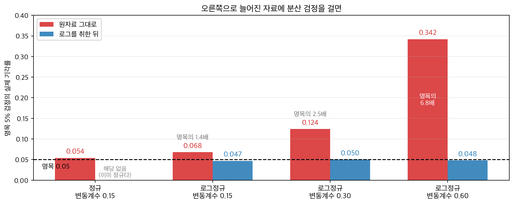
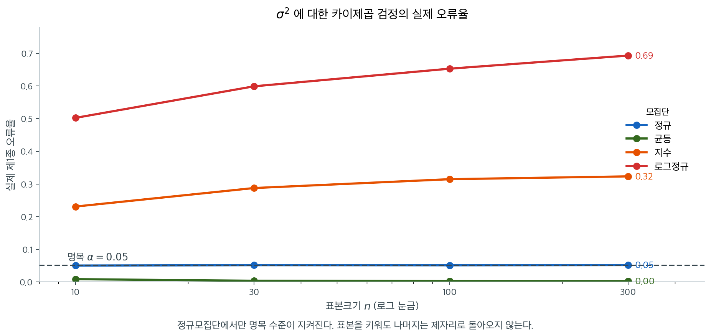
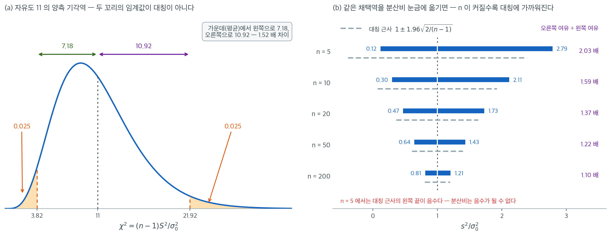

# 모분산에 대한 카이제곱 검정

## 개요

분산이 바로 관심인 자리가 오늘 적지 않다 — 응답 지연의 **안정성**, 모형이 내놓는 점수의 흔들림, 배치마다의 처리량. 평균은 그대로인데 꼬리만 두꺼워지는 변화는 평균 검정으로는 보이지 않는다. 그런데 그런 양은 거의 언제나 오른쪽으로 길게 늘어져 있다 — 종 모양과는 거리가 멀다. 흔들림이 큰 지연시간 자료에 이 쪽의 검정을 원자료 그대로 걸면 명목 $5\%$ 가 실제로는 $34\%$ 가 되고, 로그를 취한 뒤에 걸면 $0.048$ 로 제자리에 돌아온다. 다만 그때는 **묻는 것도 바뀐다** — 아래 상자가 그 사정을 따라간다.

<figure markdown>
  { width=880 }
  <figcaption markdown>왼쪽 끝의 정규 자료는 $0.054$ 로 제자리다. 오른쪽으로 갈수록 **자료가 더 늘어지고 빨간 막대만 솟는다** — 변동계수 $0.60$ 에서는 명목의 $6.8$ 배다. 로그를 취하면 어느 변동계수에서도 $0.05$ 에 붙는데, 까닭은 로그정규의 로그가 **정규**이고 이 검정이 요구하는 것이 바로 그것이기 때문이다. 다만 공짜는 아니다 — 로그를 취한 뒤 검정하는 것은 $\sigma^2$ 이 아니라 $\log$ 척도의 분산에 대한 물음이어서 **묻는 것 자체가 바뀐다.** 수는 $\S 5$ 의 모의 결과다.</figcaption>
</figure>

이 검정이 안고 있는 어려움은 둘이다. 하나는 **힘이 약하다는 것**이다. 공정의 표준편차가 목표 $2.0$ 이 아니라 $2.1$ 로 관측되었다. 다섯 퍼센트 어긋난 것을 $5\%$ 수준에서 잡아내려면 관측값이 몇 개 있어야 할까 — $n = 12$ 에서 $p = 0.35$, $n = 200$ 에서도 $p = 0.15$ 이고, 조건을 끊김 없이 만족하는 $n$ 은 $538$ 부터다. **다섯 퍼센트 어긋난 것을 잡으려면 관측값이 오백 개 넘게 있어야 한다는 뜻이다.**

다른 하나가 더 나쁘다. **그렇게 모은 뒤에도 약속이 지켜지지 않을 수 있다.** 자료가 지수분포면 명목 $5\%$ 검정이 실제로는 $32\%$ 를, 대수정규면 $69\%$ 를 기각한다. 무엇이 그것을 정하는지는 분명하다 — 치우침이 아니라 꼬리의 두께다. 평균 검정에서는 중심극한정리가 구해 주던 자리인데, 분산 검정에서는 왜 표본을 늘려도 되살아나지 않는가. 이 쪽이 카이제곱 검정을 세우고 그 두 어려움을 함께 잰다.

제조 현장에서 공정의 변동성을 통제하는 일은 공정 평균을 통제하는 일만큼 중요할 때가 많다. 볼트의 평균 지름은 목표에 맞지만 분산이 지나치게 큰 기계는 공차를 벗어난 부품을, 따라서 불량품을 너무 많이 만든다. 마찬가지로 금융에서 투자자는 포트폴리오 수익률의 변동성이 특정 문턱을 넘는지 검정하고 싶을 수 있다. 분산에 대한 카이제곱 검정은 모분산 $\sigma^2$이 가설의 값 $\sigma_0^2$과 같은지, 크거나 작은지를 검정하는 형식적 절차이다. 약한 비정규성에 비교적 로버스트한 평균 검정과 달리 이 검정은 정규분포에서 벗어나는 데 매우 민감하다.

---

## 1. 가설

$X_1, X_2, \ldots, X_n$을 $N(\mu, \sigma^2)$ 모집단에서 뽑은 확률표본이라 하자. 귀무가설은 분산의 특정 값을 지정한다.

$$
H_0\colon \sigma^2 = \sigma_0^2
$$

대립가설은 연구 질문에 따라 다음 세 형태 중 하나이다.

| 대립가설 | 해석 |
|---|---|
| $H_1\colon \sigma^2 \neq \sigma_0^2$ | 양측: 분산이 $\sigma_0^2$과 다르다 |
| $H_1\colon \sigma^2 > \sigma_0^2$ | 우측: 분산이 $\sigma_0^2$보다 크다 |
| $H_1\colon \sigma^2 < \sigma_0^2$ | 좌측: 분산이 $\sigma_0^2$보다 작다 |

---

## 2. 검정통계량

검정통계량은 표본분산 $S^2$이 가설의 값 $\sigma_0^2$에서 얼마나 떨어져 있는지를 자유도로 축척하여 잰다. 직관적으로 $\sigma^2 = \sigma_0^2$이면 $S^2$이 $\sigma_0^2$에 가까워야 하고, 비 $(n-1)S^2 / \sigma_0^2$은 ($\chi^2_{n-1}$ 분포의 평균인) $n-1$에 가까워야 한다.

$$
\chi^2 = \frac{(n-1)S^2}{\sigma_0^2}
$$

$H_0$과 정규성 가정 아래에서 이 통계량은 자유도 $n - 1$인 카이제곱분포를 따른다.

$$
\chi^2 = \frac{(n-1)S^2}{\sigma_0^2} \sim \chi^2_{n-1}
$$

이 결과는 $(n-1)S^2/\sigma^2 = \sum_{i=1}^n (X_i - \bar{X})^2/\sigma^2$이 선형 제약 하나(편차의 합이 0)를 받는 표준정규 제곱들의 합이어서 자유도가 $n-1$이 된다는 사실에서 나온다.

---

## 3. 기각역

유의수준 $\alpha$에서 기각역은 대립가설에 따라 달라진다.

**양측** ($H_1\colon \sigma^2 \neq \sigma_0^2$): 다음이면 $H_0$을 기각한다.

$$
\chi^2 < \chi^2_{1-\alpha/2,\, n-1} \quad \text{or} \quad \chi^2 > \chi^2_{\alpha/2,\, n-1}
$$

**우측** ($H_1\colon \sigma^2 > \sigma_0^2$): 다음이면 $H_0$을 기각한다.

$$
\chi^2 > \chi^2_{\alpha,\, n-1}
$$

**좌측** ($H_1\colon \sigma^2 < \sigma_0^2$): 다음이면 $H_0$을 기각한다.

$$
\chi^2 < \chi^2_{1-\alpha,\, n-1}
$$

여기서 $\chi^2_{p,\, n-1}$은 $P(\chi^2_{n-1} \leq \chi^2_{p,\, n-1}) = p$를 만족하는 값, 즉 카이제곱분포의 $p$ 분위수이다.

!!! note "카이제곱분포의 비대칭성"
    정규분포나 $t$-분포와 달리 카이제곱분포는 대칭이 아니다. 따라서 양측 기각역은 아래쪽 꼬리와 위쪽 꼬리에 서로 다른 임계값을 쓰며, 양측검정을 단순한 절댓값 조건으로 나타낼 수 없다.

귀무분포 $\chi^2_{n-1}$ 이 대칭이 아니므로 「양측 $p$ 값은 작은 쪽 꼬리의 두 배」라는
관례가 무엇을 하는지 따져 둔다.

<div class="exbox" markdown>

**보기 1.** <span class="diff easy" title="쉬움"></span> 일표본 분산 검정 계산기. 양측 p-값을 **작은 쪽 꼬리의 두 배**로 정의해 구현하려 한다. 귀무분포 $\chi^2_{n-1}$은 대칭이 아니므로 이 관례가 무엇을 하는지 따져 두어야 한다.

**(1)** 이 p-값으로 "$p < \alpha$일 때 기각"하는 것이 위 등꼬리 기각역과 **정확히 같은** 규칙임을 보이고, 따라서 실제 크기가 정확히 $\alpha$임을 보이시오.

**(2)** 그럼에도 이 검정은 **편향**되어 있다. 곧 $\sigma^2 \ne \sigma_0^2$인데도 기각확률이 $\alpha$보다 작아지는 구간이 있다. $n = 12$에서 그 구간과 최소 기각확률을 구하시오.

</div>

??? success "풀이"

    **(1) 두 규칙이 같다.** $F$를 $\chi^2_{n-1}$의 분포함수라 하자. $F$는 $(0,\infty)$에서 **엄격히 증가**하는 연속함수이므로 역함수가 있다. 관측값을 $x$라 쓰면

    $$
    2\min\{F(x),\, 1 - F(x)\} < \alpha
    \iff \min\{F(x),\, 1 - F(x)\} < \frac{\alpha}{2}
    $$

    이고, 최솟값이 $\alpha/2$보다 작다는 것은 둘 중 **적어도 하나**가 그렇다는 뜻이다.

    $$
    \iff F(x) < \frac{\alpha}{2} \;\text{ 또는 }\; 1 - F(x) < \frac{\alpha}{2}
    \iff x < \chi^2_{\alpha/2,\,n-1} \;\text{ 또는 }\; x > \chi^2_{1-\alpha/2,\,n-1}
    $$

    마지막 단계가 $F$의 엄격한 증가성이다. 두 조건은 $\alpha < 1$이면 동시에 성립할 수 없으므로 기각확률은 두 확률의 합이고

    $$
    P(\text{기각} \mid H_0) = \frac{\alpha}{2} + \frac{\alpha}{2} = \alpha
    $$

    이다. **분포가 비대칭이어도 크기는 정확히 $\alpha$다.** 비대칭이 만드는 것은 크기의 어긋남이 아니라 두 임계값까지의 **거리**가 다르다는 것뿐이며, 그것은 위에서 본 $3.82$와 $21.92$다. $\square$

    **(2) 크기는 맞지만 편향되어 있다.** 기각확률을 $\theta = \sigma^2/\sigma_0^2$의 함수로 적는다. 참 분산이 $\sigma^2$이면 $(n-1)S^2/\sigma^2 \sim \chi^2_{n-1}$이므로 검정통계량은

    $$
    X = \frac{(n-1)S^2}{\sigma_0^2} = \theta \cdot W,
    \qquad W \sim \chi^2_{n-1}
    $$

    이다. $a = \chi^2_{\alpha/2,\,n-1}$, $b = \chi^2_{1-\alpha/2,\,n-1}$로 줄여 쓰면 $X < a$ 또는 $X > b$는 $W < a/\theta$ 또는 $W > b/\theta$와 같으므로

    $$
    \pi(\theta) = F\!\left(\frac{a}{\theta}\right) + 1 - F\!\left(\frac{b}{\theta}\right)
    $$

    이고 $\pi(1) = \alpha$다. 미분하면

    $$
    \pi'(\theta) = -\frac{a}{\theta^2} f\!\left(\frac{a}{\theta}\right)
    + \frac{b}{\theta^2} f\!\left(\frac{b}{\theta}\right),
    \qquad
    \pi'(1) = b f(b) - a f(a)
    $$

    이다. **검정이 편향되지 않으려면 $\theta = 1$이 $\pi$의 최솟값이어야 하므로 $\pi'(1) = 0$, 곧 $a f(a) = b f(b)$가 필요하다.** 등꼬리 분할은 $F(a) = \alpha/2$와 $1 - F(b) = \alpha/2$를 맞추었을 뿐이므로 이 조건을 만족할 이유가 없다. $n = 12$($\nu = 11$)에서

    $$
    a f(a) = 0.098989, \qquad b f(b) = 0.173872,
    \qquad \pi'(1) = +0.074882 > 0
    $$

    이다. 기울기가 양수이므로 $\theta$가 1보다 조금 **작은** 쪽에서 $\pi(\theta) < \alpha$다. 분산이 참으로 목표보다 작은데도 기각할 확률이 명목보다 낮아진다는 뜻이다.

    **수치로 확인한다.**

    ```python
    from scipy.stats import chi2

    def test_variance_one_sample(n, s2, sigma0, alt="two-sided", alpha=0.05):
        """H0: sigma^2 = sigma0^2. **정규모집단**을 가정한다.

        이 가정은 형식적인 단서가 아니다. 평균 검정과 달리 여기서는
        중심극한정리가 도와주지 않아서 n을 키워도 비정규성이 상쇄되지 않는다.
        s2에는 ddof=1로 계산한 표본분산을 넣는다.
        """
        df = n - 1
        chi2_stat = df * s2 / (sigma0 ** 2)
        if alt == "two-sided":
            # 카이제곱분포는 비대칭이라 "양쪽 꼬리"를 나누는 방식이 여럿이다.
            # 여기서는 작은 쪽 꼬리를 두 배 하는 관례를 따랐다. 간단하고
            # 신뢰구간과 어긋나지 않지만, 확률이 반씩 나뉘지는 않는다.
            p = 2 * min(chi2.cdf(chi2_stat, df), 1 - chi2.cdf(chi2_stat, df))
        elif alt == "less":
            p = chi2.cdf(chi2_stat, df)
        else:
            p = 1 - chi2.cdf(chi2_stat, df)
        return chi2_stat, p, (p < alpha)
    ```

    ```python
    from scipy.optimize import brentq, minimize_scalar

    nu, alpha = 11, 0.05
    a = chi2.ppf(alpha / 2, nu)        # 왼쪽 임계값
    b = chi2.ppf(1 - alpha / 2, nu)    # 오른쪽 임계값
    print(f"등꼬리 임계값:  a = {a:.6f},  b = {b:.6f}")

    # (1) 함수가 쓰는 p-값이 두 임계값에서 정확히 alpha 인가.
    #     sigma0 = 1 로 두면 chi2 = (n-1) s2 이므로 s2 = x/(n-1) 을 넣으면 된다.
    for x, name in ((a, "a"), (b, "b")):
        for eps in (-1e-6, 1e-6):
            _, p, rej = test_variance_one_sample(12, (x + eps) / nu, 1.0)
            print(f"  chi2 = {name}{eps:+.0e} : p = {p:.12f}  기각 {rej}")

    # (2) 검정력 함수와 편향
    def power(theta):
        """theta = sigma^2/sigma0^2 일 때 기각확률."""
        return chi2.cdf(a / theta, nu) + chi2.sf(b / theta, nu)

    fa, fb = chi2.pdf(a, nu), chi2.pdf(b, nu)
    print(f"\na f(a) = {a * fa:.6f},  b f(b) = {b * fb:.6f},  "
          f"기울기 pi'(1) = {b * fb - a * fa:+.6f}")
    res = minimize_scalar(power, bounds=(0.3, 3.0), method="bounded",
                          options={"xatol": 1e-12})
    left = brentq(lambda th: power(th) - alpha, 0.3, 0.9)
    print(f"pi(1) = {power(1.0):.6f}   최소 검정력 {res.fun:.6f} at theta = {res.x:.6f}")
    print(f"검정력이 명목 아래로 내려가는 구간 = ({left:.6f}, 1)")
    print("\n  theta   검정력")
    for th in (0.80, 0.85, 0.90, 0.9414, 0.97, 1.00, 1.05, 1.20):
        print(f"  {th:.4f}  {power(th):.6f}")
    ```

    출력:

    ```
    등꼬리 임계값:  a = 3.815748,  b = 21.920049
      chi2 = a-1e-06 : p = 0.049999948116  기각 True
      chi2 = a+1e-06 : p = 0.050000051885  기각 False
      chi2 = b-1e-06 : p = 0.050000015864  기각 False
      chi2 = b+1e-06 : p = 0.049999984136  기각 True

    a f(a) = 0.098989,  b f(b) = 0.173872,  기울기 pi'(1) = +0.074882
    pi(1) = 0.050000   최소 검정력 0.047778 at theta = 0.941417
    검정력이 명목 아래로 내려가는 구간 = (0.884423, 1)

      theta   검정력
      0.8000  0.062191
      0.8500  0.053607
      0.9000  0.048942
      0.9414  0.047778
      0.9700  0.048314
      1.0000  0.050000
      1.0500  0.055249
      1.2000  0.087465
    ```

    기각 여부가 두 임계값에서 정확히 뒤집힌다. $a$를 백만분의 일만큼 밑돌면 기각하고 넘어서면 기각하지 않으며, $b$에서는 방향이 반대다. (1)에서 증명한 동등성이 그대로 보인다. 크기도 $\pi(1) = 0.050000$으로 정확하다.

    편향도 유도한 대로다. $\theta$가 $0.884$에서 $1$ 사이일 때 기각확률이 명목 $0.05$ 아래로 내려가고, $\theta = 0.9414$에서 최소 $0.0478$을 찍는다. **분산이 참으로 6% 작은데도 그 사실을 잡아낼 확률이, 분산이 정확히 맞을 때 헛되게 기각할 확률보다 낮다.** 명목을 지키는 것과 좋은 검정인 것은 다른 문제다.

    고치는 길은 $\pi'(1) = 0$이 되도록 $F(b) - F(a) = 1 - \alpha$를 지키면서 $a f(a) = b f(b)$를 함께 맞추는 것이다. 그러면 왼쪽 꼬리에 $\alpha/2$보다 많은 확률을 떼어 주게 된다. 실무에서 거의 쓰이지 않는 까닭은 표가 없고 신뢰구간과 짝이 맞지 않기 때문인데, **그래서 쓰는 검정이 등꼬리라는 점과 그것이 편향이라는 점을 함께 알아 두는 것으로 충분하다.**

---

## 4. 비대칭 기각역을 손으로 잡아 본다

평균 검정에서는 기각역이 $\pm$ 한 수로 끝났다. 카이제곱은 비대칭이라 **양쪽 임계값을 따로 찾아야** 하고, 그 번거로움이 분포의 모양에서 바로 나온다는 것을 한 자료로 확인한다.

한 제조사가 시리얼 상자 충전 중량의 분산이 $\sigma_0^2 = 4$ 그램$^2$(즉 $\sigma_0 = 2$ 그램)이라고 주장한다. 품질검사자가 상자 $n = 25$개를 표본으로 뽑아 표본분산 $S^2 = 6.1$ 그램$^2$을 얻었다. $\alpha = 0.05$에서 분산이 주장된 값을 넘는지 검정하라.

**1단계.** 가설을 세운다.

$$
H_0\colon \sigma^2 = 4 \qquad H_1\colon \sigma^2 > 4
$$

**2단계.** 검정통계량을 계산한다.

$$
\chi^2 = \frac{(25 - 1)(6.1)}{4} = \frac{24 \times 6.1}{4} = \frac{146.4}{4} = 36.6
$$

**3단계.** 임계값을 구한다. 자유도 24, $\alpha = 0.05$의 우측검정에서 이렇게 된다.

$$
\chi^2_{0.95,\, 24} = 36.415
$$

**4단계.** 판정한다. $\chi^2 = 36.6 > 36.415$이므로 $H_0$을 기각한다. 5% 수준에서 모분산이 4 그램$^2$을 넘는다고 결론지을 충분한 증거가 있다.

$p$-값은 $P(\chi^2_{24} > 36.6) \approx 0.048$이다.

같은 증거($r = s^2/\sigma_0^2$)를 고정한 채 표본크기만 키우면 판정이 어떻게
달라지는지 본다.

<div class="exbox" markdown>

**보기 2.** <span class="diff easy" title="쉬움"></span> 같은 증거, 커지는 표본. 표준편차가 목표 $2.0$이 아니라 $2.1$로 관측되었다. 곧 관측된 분산비가

$$
r = \frac{s^2}{\sigma_0^2} = \frac{2.1^2}{2.0^2} = 1.1025
$$

이다. 이 $r$을 고정한 채 표본크기만 키운다.

**(1)** 우측 단측 p-값을 $r$과 $n$만으로 쓰는 근사식을 세우고, 그 식으로 $p < 0.05$가 되는 가장 작은 $n$을 구하시오.

**(2)** 정확한 값과 견주어 근사가 어디서 맞고 어디서 어긋나는지 보이시오.

</div>

??? success "풀이"

    **(1) 해석적으로.** 검정통계량은 $\chi^2 = (n-1)r$이고 귀무분포 $\chi^2_{n-1}$의 평균은 $n-1$, 분산은 $2(n-1)$이다. 그러므로 관측값이 귀무분포의 중심에서 표준편차 단위로 얼마나 떨어져 있는지는

    $$
    z = \frac{(n-1)r - (n-1)}{\sqrt{2(n-1)}}
    = (r - 1)\sqrt{\frac{n-1}{2}}
    $$

    이고, $\chi^2_{n-1}$을 정규로 근사하면 $p \approx \bar\Phi(z)$다. **$r$이 고정되어 있으면 증거의 세기가 $\sqrt{n}$으로만 자란다.** $n$을 네 배 늘려야 $z$가 두 배가 된다.

    $p < 0.05$는 $z > z_{0.95} = 1.64485$를 뜻하므로

    $$
    (r-1)\sqrt{\frac{n-1}{2}} > 1.64485
    \iff n > 1 + 2\left(\frac{1.64485}{r-1}\right)^2
    $$

    이고 $r - 1 = 0.1025$를 넣으면

    $$
    n > 1 + 2\left(\frac{1.64485}{0.1025}\right)^2 = 1 + 2(16.0473)^2 = 516.04
    $$

    이다. 이 근사식에 따르면 **$n = 517$**이다. 표준편차가 5% 벗어난 것을 5% 수준에서 잡아내는 데 오백 개가 넘는 관측값이 필요하다.

    같은 식을 거꾸로 읽으면 더 쓸모 있다. 필요한 표본크기가 $(r-1)^{-2}$로 커지므로, **표준편차가 5%가 아니라 2.5%만 벗어난 경우라면**($r = 1.025^2 = 1.050625$) 같은 식이 $n > 2112.3$, 곧 $n \ge 2113$을 준다. 거의 네 배다.

    **(2) 수치적으로.** 먼저 보기의 세 표본크기를 돌린다.

    ```python
    stat, p, reject = test_variance_one_sample(
        n=12, s2=2.1**2, sigma0=2.0, alt="greater"
    )
    print("chi2:", stat, "p:", p, "reject:", reject)

    # 표본분산은 그대로 두고 표본크기만 키우면 어떻게 되는지 본다.
    for n in [12, 50, 200]:
        st, pv, rj = test_variance_one_sample(n=n, s2=2.1**2, sigma0=2.0, alt="greater")
        print(f"n={n:>4}: chi2={st:8.2f}  p={pv:.4f}  reject={rj}")
    ```

    출력:

    ```
    chi2: 12.127500000000001 p: 0.35413619761553705 reject: False
    n=  12: chi2=   12.13  p=0.3541  reject=False
    n=  50: chi2=   54.02  p=0.2885  reject=False
    n= 200: chi2=  219.40  p=0.1532  reject=False
    ```

    표준편차가 2.0이 아니라 2.1이라는 같은 증거를 놓고도 $n = 12$에서는 $p = 0.35$, $n = 200$에서도 $p = 0.15$다. 분산은 평균보다 추정하기 어렵고, 그래서 검정하기도 어렵다.

    이제 (1)의 근사식과 맞추어 보고, $p < 0.05$가 되는 가장 작은 $n$을 **격자가 아니라 전수 탐색으로** 찾는다.

    ```python
    import math

    import numpy as np
    from scipy.stats import chi2, norm
    from scipy.optimize import brentq

    r = 2.1**2 / 2.0**2
    z95 = norm.ppf(0.95)

    print(f"r = {r},  r - 1 = {r - 1:.4f}")
    print("    n      정확 p     단순근사 p    WH 근사 p")
    for n in (12, 50, 200, 538, 1000):
        nu = n - 1
        z1 = (r - 1) * math.sqrt(nu / 2)                             # (1) 의 식
        z2 = (r**(1 / 3) - 1 + 2 / (9 * nu)) * math.sqrt(9 * nu / 2)  # 윌슨-힐퍼티
        print(f"{n:5d}   {chi2.sf(nu * r, nu):.6f}    {norm.sf(z1):.6f}"
              f"    {norm.sf(z2):.6f}")

    # p < 0.05 인 n 을 2 부터 20000 까지 모두 훑는다. "첫 칸" 만 보지 않는다.
    ns = np.arange(2, 20_001)
    pv = chi2.sf((ns - 1) * r, ns - 1)
    ok = ns[pv < 0.05]
    print(f"\np < 0.05 인 n 의 개수 = {len(ok)},  가장 작은 n = {ok.min()},"
          f"  그 구간이 연속인가 = {bool(np.all(np.diff(ok) == 1))}")
    print(f"p 가 n 에 대해 단조감소인가 = {bool(np.all(np.diff(pv) < 0))}"
          f"   (최대 p = {pv.max():.6f} at n = {ns[pv.argmax()]})")

    print(f"\n단순근사가 주는 n      = {1 + 2 * (z95 / (r - 1))**2:.2f}")
    wh = brentq(lambda nu: (r**(1 / 3) - 1 + 2 / (9 * nu)) * math.sqrt(9 * nu / 2) - z95,
                10, 1e6)
    print(f"윌슨-힐퍼티가 주는 n   = {wh + 1:.2f}")
    ```

    출력:

    ```
    r = 1.1025,  r - 1 = 0.1025
        n      정확 p     단순근사 p    WH 근사 p
       12   0.354136    0.405016    0.353926
       50   0.288478    0.305955    0.288326
      200   0.153248    0.153288    0.153206
      538   0.049927    0.046521    0.049925
     1000   0.012817    0.010987    0.012819

    p < 0.05 인 n 의 개수 = 19463,  가장 작은 n = 538,  그 구간이 연속인가 = True
    p 가 n 에 대해 단조감소인가 = False   (최대 p = 0.358162 at n = 8)

    단순근사가 주는 n      = 516.04
    윌슨-힐퍼티가 주는 n   = 537.51
    ```

    **(1)의 답 $517$은 틀렸다.** 정확한 답은 $538$이다. 왜 어긋나는지가 이 보기에서 가장 쓸모 있는 부분이다.

    표의 셋째 열을 보면 단순근사가 $n = 12$에서 $0.4050$을 주는데 정확값은 $0.3541$이다. $\chi^2$ 분포는 오른쪽으로 치우쳐 있는데 정규근사는 대칭이라, **오른쪽 꼬리확률을 체계적으로 작게 잡는다.** p-값을 작게 잡으면 필요한 $n$도 작게 잡게 되므로 $516$이라는 낙관적인 답이 나온다. $n = 200$에서 $0.153288$ 대 $0.153248$로 거의 맞는 것은 자유도가 커져 치우침이 가셨기 때문이다.

    치우침을 미리 펴 주는 근사를 쓰면 바로잡힌다. **윌슨–힐퍼티 변환**은 $(\chi^2_\nu/\nu)^{1/3}$이 평균 $1 - 2/(9\nu)$, 분산 $2/(9\nu)$인 정규에 가깝다는 것이고, 그러면

    $$
    p \approx \bar\Phi\!\left(\left[r^{1/3} - 1 + \frac{2}{9\nu}\right]\sqrt{\frac{9\nu}{2}}\right)
    $$

    이다. 이 식은 $n = 12$에서도 $0.353926$으로 정확값 $0.354136$과 소수 셋째 자리까지 맞고, 필요한 $n$을 $537.51$, 곧 **$538$**로 정확히 짚는다.

    표본크기를 찾을 때 "조건을 만족하는 첫 칸"만 보면 위험하다는 것도 함께 확인했다. **p-값은 $n$에 대해 단조감소가 아니다.** $n = 2$에서 $0.294$로 시작해 $n = 8$에서 $0.358$까지 **올라갔다가** 내려온다. 자유도가 아주 작을 때는 귀무분포의 퍼짐 자체가 빠르게 바뀌기 때문이다. 그래서 위 코드는 $n$을 $20{,}000$까지 전부 훑어 조건을 만족하는 $n$이 $538$부터 **끊김 없이** 이어지는지까지 확인했다.

    !!! warning "이 계산은 모두 정규모집단을 전제한다"
        위의 $538$은 자료가 정규분포를 따를 때의 수다. 평균 검정과 달리 분산 검정에는 **중심극한정리의 보호가 없어서 표본을 키워도 비정규성이 상쇄되지 않는다.** 실제 오류율이 모집단 첨도만의 함수로 남고 $n$이 커지면 오히려 더 나빠진다는 것은 [5.10절의 비정규 모집단에서의 분산비](../../ch05/applications/var_ratio_nonnormal.md)에서 유도했다. 그 쪽의 결론을 한 줄로 옮기면, 꼬리가 무거운 자료에서는 $538$개를 모아도 명목 5%가 지켜지지 않는다.

---

## 5. 가정과 민감성

카이제곱 분산 검정에는 다음이 필요하다.

- **정규성**: 모집단이 정규분포를 따라야 한다. 가장 결정적인 가정이다.
- **확률표본추출**: 관측값이 독립이고 동일한 분포를 따라야 한다.
- **$\sigma_0^2$이 주어짐**: 가설의 분산 $\sigma_0^2$은 자료에서 추정한 값이 아니라 지정된 값이다.



모집단만 바꿔 가며 같은 검정을 되풀이한 결과다. 참 분산을 그대로 $\sigma_0^2$에 넣었으므로 **네 곡선 모두 $0.05$에 있어야 한다.** 실제로는 정규모집단에서만 그렇다.

지수모집단에서 명목 5% 검정이 실제로는 32%를, 로그정규에서는 69%를 기각한다. 대칭이지만 꼬리가 얇은 균등모집단에서는 반대로 거의 기각하지 않아($0.00$) 검정력을 잃는다. **어느 쪽이든 약속한 수준이 지켜지지 않는다.**

가장 중요한 것은 곡선들이 **$n$이 커져도 $0.05$로 돌아오지 않는다**는 점이다. 오히려 지수모집단에서는 $0.23 \to 0.32$로 올라간다. 중심극한정리가 구해 주는 것은 표본평균이지 표본분산이 아니며, $(n-1)S^2/\sigma^2 \sim \chi^2$이라는 명제 자체가 정규성에서 나온 것이라 표본을 늘려도 되살아나지 않는다. 5.10절에서 분산비에 대한 $F$ 검정을 두고 같은 이야기를 했다.

!!! warning "비정규성에 대한 극도의 민감성"
    분산에 대한 카이제곱 검정은 정규성에서 벗어나는 데 **로버스트하지 않다**. 약한 치우침이나 두꺼운 꼬리만으로도 실제 제1종 오류율이 명목 $\alpha$와 크게 달라질 수 있다. 모집단의 첨도가 $S^2$의 분산에 직접 영향을 준다: 초과첨도가 $\gamma_2$인 분포에서 $\text{Var}(S^2) \approx 2\sigma^4(1 + \gamma_2/2)/(n-1)$이며, 이는 (정규에서 $\gamma_2 = 0$인) 카이제곱 이론이 예측하는 것보다 훨씬 클 수 있다. 정규성이 의심스러우면 Levene 검정이나 붓스트랩 기반 방법 같은 대안을 고려하라.

---

### 기각역은 좌우가 같지 않다



평균에 대한 검정에서 양측 기각역의 두 임계값은 $\pm 1.96$ 처럼 부호만 다른 같은 수다. 분산에서는 그렇지 않다. 왼쪽 그림은 위 보기 1 과 같은 자유도 11($n = 12$)에서 $\alpha = 0.05$ 양측 기각역을 그린 것이다. 두 꼬리에 각각 확률 0.025씩을 똑같이 떼어 주었는데도 임계값은 3.82와 21.92로, 분포의 중심인 11에서 왼쪽으로는 7.18밖에 가지 않는 반면 오른쪽으로는 10.92를 간다. **같은 확률 0.025를 사는 데 오른쪽에서는 1.52배 먼 거리를 치러야 한다.** 표본분산은 0 아래로 내려갈 수 없어 왼쪽이 벽에 막혀 있는 반면, 오른쪽은 얼마든지 커질 수 있기 때문이다.

오른쪽 그림은 같은 채택역을 읽기 쉬운 눈금 $s^2/\sigma_0^2$ 위로 옮긴 것이다. $n = 5$이면 채택역이 $(0.12,\ 2.79)$로, 표본분산이 목표의 약 8분의 1에서 2.8배 사이이기만 하면 무엇이든 통과한다. 위쪽 여유를 아래쪽 여유로 나눈 값은 $n = 5, 10, 20, 50, 200$에서 각각 2.03, 1.59, 1.37, 1.22, 1.10이다. **자유도가 커질수록 대칭에 가까워지지만 그 속도가 대단히 느려서, $n = 200$은 되어야 좌우 여유가 10% 안으로 들어온다.**

회색 점선은 같은 채택역을 정규근사 $1 \pm 1.96\sqrt{2/(n-1)}$로 대신 구한 것이다. $n = 200$에서는 $(0.80,\ 1.20)$으로 정확한 값 $(0.81,\ 1.21)$과 거의 같지만, $n = 5$에서는 왼쪽 끝이 $-0.39$까지 내려간다. 분산비가 음수일 수는 없으므로 그 근사는 뜻을 잃는다. 작은 표본에서 정규근사 대신 카이제곱 분위수를 그대로 써야 하는 이유다. 연습문제 6에서 분산이 두 배임을 잡는 데 32개, 절반임을 잡는 데 38개가 필요하다고 계산되는 것도 결국 이 비대칭이 검정력 쪽으로 나타난 모습이다.

---

<div class="aibox" markdown>

**AI로 보는 통계학 1.** 눈금을 바꾸면 수준이 돌아온다, 다만 묻는 것도 바뀐다

위 절은 이 검정이 정규성에서 벗어나는 데 얼마나 약한지를 보였다. 그러면 **분산이 바로
관심인 자리**는 어떻게 할 것인가. 오늘 그런 자리가 적지 않다 — 응답 지연의 **안정성**,
모델이 내놓는 점수의 흔들림, 배치마다의 처리량. 평균은 그대로인데 꼬리만 두꺼워지는
회귀는 평균 검정으로는 보이지 않는다.

문제는 그런 양이 거의 언제나 **로그정규에 가깝다**는 것이다. 위 경고가 바로 그 경우를
말한다. 가장 싼 대응은 검정을 바꾸는 것이 아니라 **눈금을 바꾸는 것**이다.

```python
import numpy as np
from scipy import stats

rng = np.random.default_rng(43)
N, REP, MU = 200, 4000, 100.0

def reject_rate(draw, sigma0):
    """참 표준편차가 sigma0 인 자료에서 카이제곱 분산검정이 기각하는 비율."""
    rej = 0
    for _ in range(REP):
        x = draw()
        stat = (N - 1) * x.var(ddof=1) / sigma0 ** 2
        rej += 2 * min(stats.chi2.cdf(stat, N - 1), stats.chi2.sf(stat, N - 1)) < 0.05
    return rej / REP

print("          자료   변동계수   원자료 그대로   로그를 취한 뒤")
print(f"{'정규':>14}{0.15:>11.2f}"
      f"{reject_rate(lambda: rng.normal(MU, 15.0, N), 15.0):>15.3f}{'—':>16}")
for cv in (0.15, 0.30, 0.60):
    s2 = np.log(1 + cv ** 2)
    raw = lambda: rng.lognormal(np.log(MU) - s2 / 2, np.sqrt(s2), N)
    logged = lambda: np.log(rng.lognormal(np.log(MU) - s2 / 2, np.sqrt(s2), N))
    print(f"{'로그정규':>14}{cv:>11.2f}{reject_rate(raw, MU * cv):>15.3f}"
          f"{reject_rate(logged, np.sqrt(s2)):>16.3f}")
```

출력:

```
          자료   변동계수   원자료 그대로   로그를 취한 뒤
            정규       0.15          0.054               —
          로그정규       0.15          0.068           0.047
          로그정규       0.30          0.124           0.050
          로그정규       0.60          0.342           0.048
```

**로그를 취하면 수준이 제자리로 돌아온다.** 변동계수 $0.60$ 짜리 지연시간에서 원자료로
검정하면 명목 $5\%$ 가 실제로는 $34\%$ 인데, 로그를 취하면 $0.048$ 이다. 까닭은 간단하다 —
로그정규의 로그는 **정규**이고, 이 검정이 요구하는 것이 바로 그것이다. 첫 줄의 정규자료가
$0.054$ 인 것과 같은 자리로 돌아온 셈이다.

**그런데 같은 가설을 검정하고 있지 않다.** 로그 눈금의 분산은 원래 눈금의 **상대 변동**에
대한 진술이다. 로그정규에서 $\operatorname{Var}(\ln X) = \ln(1 + \text{CV}^2)$ 이므로,
로그로 세운 귀무가설은 「표준편차가 $20$ ms 를 넘지 않는다」가 아니라 「**변동계수**가
$0.2$ 를 넘지 않는다」가 된다. 평균이 함께 움직이는 자료에서는 두 문장이 전혀 다르다 —
지연이 두 배로 늘면서 변동계수가 그대로이면, 로그 쪽 검정은 아무 말도 하지 않는다.

**그러니 순서는 「검정을 고르는 일」이 아니라 「무엇을 약속했는지 적는 일」이다.** 운영
약속이 절대 단위(ms)로 적혀 있으면 눈금을 바꿀 수 없고, 그때는 17장의 붓스트랩이나
순열검정처럼 분포를 가정하지 않는 길로 가거나, 애초에 분산 대신 **$p99$ 같은 분위수를
직접 재는** 편이 정직하다. 분산은 정규자료에서만 「꼬리의 크기」를 뜻한다.

</div>

## 연습문제

<div class="drillbox" markdown>

**연습문제 1.** <span class="diff easy" title="쉬움"></span>
어떤 제조사가 볼트 지름의 분산이 최대 $\sigma_0^2 = 0.04$ mm$^2$이라고 주장한다. 볼트 $n = 20$개의 표본에서 $s^2 = 0.06$을 얻었다. $\alpha = 0.05$에서 우측 카이제곱 검정을 수행하라.

</div>

??? success "풀이"
    $H_0: \sigma^2 \leq 0.04$ 대 $H_1: \sigma^2 > 0.04$.

    검정통계량은:

    $$
    \chi^2 = \frac{(n-1)s^2}{\sigma_0^2} = \frac{19 \times 0.06}{0.04} = \frac{1.14}{0.04} = 28.5
    $$

    임계값은 $\chi^2_{0.95,\,19} = 30.14$이다. $28.5 < 30.14$이므로 $H_0$을 **기각하지 못한다**. 5% 수준에서 분산이 0.04 mm$^2$을 넘는다고 결론지을 증거가 부족하다.

<div class="drillbox" markdown>

**연습문제 2.** <span class="diff easy" title="쉬움"></span>
연습문제 1의 검정에 대해 p-값을 계산하고 해석하라.

</div>

??? success "풀이"
    p-값은 $P(\chi^2_{19} > 28.5)$이다. 카이제곱 표나 소프트웨어로 구하면 $P(\chi^2_{19} > 28.5) \approx 0.075$이다.

    p-값 0.075는 $\alpha = 0.05$보다 크므로 기각하지 못한다는 판정이 확인된다. 분산이 높아졌을 수 있다는 어느 정도의 증거는 있지만(p-값이 아주 크지는 않다) 5% 수준에서 기각할 만큼 강하지는 않다.

<div class="drillbox" markdown>

**연습문제 3.** <span class="diff med" title="중간"></span>
분산에 대한 카이제곱 검정이 평균에 대한 $t$-검정보다 정규성 가정을 훨씬 엄격하게 요구하는 이유를 설명하라.

</div>

??? success "풀이"
    평균에 대한 $t$-검정은 중심극한정리의 혜택을 받는다: 모집단 분포와 무관하게 $n$이 적당하면 $\bar{X}$가 근사적으로 정규이다. 따라서 표본이 크면 $t$-검정은 비정규성에 로버스트하다.

    분산에 대한 카이제곱 검정에는 그런 보호막이 없다. $S^2$의 분포는 $\sigma^2$뿐 아니라 모집단의 **첨도**에도 의존한다. 정규가 아닌 모집단에서는 $(n-1)S^2/\sigma^2$이 근사적으로도 카이제곱분포를 따르지 않으며, $S^2$에 대한 중심극한정리의 수렴은 훨씬 느리다. 첨도가 $\text{Var}(S^2)$을 부풀려, 꼬리가 두꺼운 자료에서 카이제곱 임계값이 지나치게 관대해진다(너무 자주 기각한다).

<div class="drillbox" markdown>

**연습문제 4.** <span class="diff med" title="중간"></span>
어떤 품질관리 공정이 충전기의 분산을 감시한다. 과거 자료에 따르면 충전량이 약간 오른쪽으로 치우쳐 있다. 분산이 달라졌는지 검정하는 데 카이제곱 검정을 써야 하는가? 아니라면 대안을 제안하라.

</div>

??? success "풀이"
    자료가 오른쪽으로 치우쳐 정규성 가정을 위반하므로 카이제곱 검정을 **쓰지 말아야** 한다. 약한 치우침만으로도 카이제곱 검정의 제1종 오류율이 명목 $\alpha$와 크게 달라질 수 있다.

    대안은 다음과 같다:

    - **붓스트랩 검정**: 자료를 재표본추출하여 $\sigma^2$의 붓스트랩 신뢰구간을 만든다. 분포 가정이 필요 없다.
    - **Levene 검정**: 기간별로 중앙값으로부터의 절대편차를 비교하여 분산이 달라졌는지 검정한다.
    - **변환 후 Bartlett 검정**: 로그나 Box-Cox 변환으로 치우침을 줄인 뒤 변환된 자료에 카이제곱 검정을 쓴다.

<div class="drillbox" markdown>

**연습문제 5.** <span class="diff med" title="중간"></span>
분산 검정 대신 **공정능력지수**를 쓰는 방법을 보이고, 그 불확실성을 정량화하라.

</div>

??? success "풀이"
    **정의.** 규격 하한 LSL, 상한 USL에 대해

    $$
    C_p=\frac{\text{USL}-\text{LSL}}{6\sigma},
    \qquad
    C_{pk}=\min\left\{\frac{\text{USL}-\mu}{3\sigma},\ \frac{\mu-\text{LSL}}{3\sigma}\right\}
    $$

    $C_p$는 **산포만**, $C_{pk}$는 **중심 이탈까지** 반영한다.

    ```python
    import numpy as np
    from scipy import stats

    LSL, USL = 9.5, 10.5
    n, xbar, s = 30, 10.05, 0.12

    Cp = (USL - LSL) / (6 * s)
    Cpk = min((USL - xbar) / (3 * s), (xbar - LSL) / (3 * s))
    print(f"Ĉp = {Cp:.4f},  Ĉpk = {Cpk:.4f}")

    # Cp 의 신뢰구간: σ 의 카이제곱 구간을 뒤집는다
    nu = n - 1
    lo = Cp * np.sqrt(stats.chi2.ppf(0.025, nu) / nu)
    hi = Cp * np.sqrt(stats.chi2.ppf(0.975, nu) / nu)
    print(f"Cp 의 95% 구간 ({lo:.4f}, {hi:.4f})")

    # 규격 이탈 비율
    below = stats.norm.cdf(LSL, xbar, s)
    above = stats.norm.sf(USL, xbar, s)
    print(f"추정 불량률 {1e6 * (below + above):.1f} ppm")
    ```

    ```text
    Ĉp = 1.3889,  Ĉpk = 1.2500
    Cp 의 95% 구간 (1.0332, 1.7439)
    추정 불량률 90.7 ppm
    ```

    **$\hat C_p=1.39$인데 구간이 1.03~1.74다.** $n=30$에서 **폭이 점추정값의 절반**이다.

    **이것이 결정적인 실무 문제다.** 흔히 "$C_p\ge1.33$이면 합격"이라는 기준을 쓰는데, 점추정값 1.39는 그 기준을 넘지만 **구간의 하한 1.04는 넘지 못한다.** 합격을 주장하기에는 근거가 약하다.

    **합격을 주장하려면 얼마나 필요한가.**

    ```python
    for n in [30, 50, 100, 200, 500]:
        nu = n - 1
        # Ĉp 가 얼마여야 구간 하한이 1.33 을 넘는가
        need = 1.33 / np.sqrt(stats.chi2.ppf(0.025, nu) / nu)
        print(f"n={n:4d}: 구간 하한이 1.33 을 넘으려면 Ĉp ≥ {need:.3f}")
    ```

    ```text
    n=  30: 구간 하한이 1.33 을 넘으려면 Ĉp ≥ 1.788
    n=  50: 구간 하한이 1.33 을 넘으려면 Ĉp ≥ 1.657
    n= 100: 구간 하한이 1.33 을 넘으려면 Ĉp ≥ 1.545
    n= 200: 구간 하한이 1.33 을 넘으려면 Ĉp ≥ 1.475
    n= 500: 구간 하한이 1.33 을 넘으려면 Ĉp ≥ 1.418
    ```

    **$n=30$에서는 $\hat C_p$가 1.79는 되어야 "1.33 이상"을 주장할 수 있다.** 표준 관행인 "$n=30$으로 능력 조사"가 얼마나 부실한지 보여 준다.

    **왜 분산 검정보다 나은가.**

    1. **규격과 직접 연결된다.** "분산이 목표를 넘는가"가 아니라 "불량이 얼마나 나오는가"를 답한다.
    2. **중심 이탈을 반영한다**($C_{pk}$).
    3. **구간이 직관적**이다.

    **주의.**

    - **정규성에 의존**한다. 불량률 계산이 특히 그렇다. 치우친 자료에서는 비정규 공정능력지수를 쓴다.
    - **공정이 안정**해야 한다. 관리 상태가 아니면 $C_p$가 무의미하다.
    - **$C_p$와 $C_{pk}$를 함께** 보고한다. $C_p$만 높고 $C_{pk}$가 낮으면 중심이 어긋난 것이다.

<div class="drillbox" markdown>

**연습문제 6.** <span class="diff med" title="중간"></span>
**여러 집단의 분산 동질성**을 검정하는 방법(바틀렛·레빈·브라운–포사이드)을 비교하라.

</div>

??? success "풀이"
    ```python
    import numpy as np
    from scipy import stats

    rng = np.random.default_rng(72)
    M, k, n = 3_000, 4, 20          # 집단 4개, 각 20개

    print(f"{'분포':>7s} {'바틀렛':>9s} {'레빈(평균)':>11s} "
          f"{'BF(중앙값)':>11s}")
    for name, gen in [("정규", lambda s: rng.normal(0, 1, s)),
                      ("t(5)", lambda s: rng.standard_t(5, s)),
                      ("지수", lambda s: rng.exponential(1, s)),
                      ("균등", lambda s: rng.uniform(-1.7, 1.7, s))]:
        c = np.zeros(3)
        for _ in range(M):
            g = [gen(n) for _ in range(k)]
            c[0] += stats.bartlett(*g).pvalue < 0.05
            c[1] += stats.levene(*g, center="mean").pvalue < 0.05
            c[2] += stats.levene(*g, center="median").pvalue < 0.05
        print(f"{name:>7s} {c[0] / M:9.4f} {c[1] / M:11.4f} "
              f"{c[2] / M:11.4f}")
    ```

    ```text
         분포       바틀렛      레빈(평균)     BF(중앙값)
         정규    0.0460      0.0553      0.0327
       t(5)    0.2440      0.0523      0.0340
         지수    0.4837      0.2233      0.0513
         균등    0.0000      0.0557      0.0227
    ```

    **바틀렛이 비정규에서 완전히 무너진다.** 지수분포에서 0.484로 명목의 열 배다. 균등분포에서는 3,000회 중 한 번도 기각하지 않아 반대 방향으로 어긋난다.

    **브라운–포사이드(중앙값 기준 레빈)가 가장 강건하다.** 네 분포 모두에서 0.023~0.051로, 명목을 넘지 않는다(꼬리가 얇은 분포에서 다소 보수적이다).

    **레빈(평균 기준)이 중간이다.** 지수분포에서 0.223으로 명목의 네 배다.

    **왜 이런 차이가 나는가.**

    - **바틀렛**은 로그 분산을 직접 비교하므로 4차 적률에 그대로 노출된다.
    - **레빈·BF**는 절대편차 $|x_{ij}-c_i|$를 만들어 **평균 비교 문제로 바꾼다.** 중심극한정리의 보호를 받는다.
    - **중앙값을 중심으로** 쓰면 절대편차 자체의 치우침이 줄어 더 강건해진다.

    **검정력은 어떤가.** 강건성의 대가로 검정력을 잃는다. 정규분포에서 분산이 실제로 다를 때, 바틀렛이 가장 강력하다.

    **실무 권고.**

    | 상황 | 권장 |
    |---|---|
    | 정규성이 확실 | 바틀렛 |
    | **일반적인 경우** | **브라운–포사이드** |
    | 두 집단의 평균 비교가 목적 | **검정하지 말고 웰치를 쓴다** |
    | 분산 자체가 관심 | BF + 분산비 구간 |

    **가장 중요한 권고.** 앞서 여러 번 본 대로, **평균 비교를 위한 사전검정으로 쓰지 않는다.** 웰치를 그냥 쓰면 된다.

<div class="drillbox" markdown>

**연습문제 7.** <span class="diff med" title="중간"></span>
**허용구간**을 소개하고 신뢰구간·예측구간과 구별하라. 분산 검정 대신 쓸 수 있는가?

</div>

??? success "풀이"
    **세 구간의 대상이 다르다.**

    | 구간 | 담는 것 |
    |---|---|
    | 신뢰구간 | 모수 $\mu$ |
    | 예측구간 | **다음 한 개**의 관측값 |
    | **허용구간** | 모집단의 **일정 비율 $P$** |

    **허용구간의 정의.** "신뢰도 $1-\alpha$로 모집단의 $P$ 이상을 담는 구간"이다. **두 개의 확률**이 들어간다.

    $$
    \bar x\pm k_2(n,P,1-\alpha)\,s
    $$

    ```python
    import numpy as np
    from scipy import stats

    def k2(n, P=0.95, conf=0.95):
        """양측 허용구간의 계수 (하워 근사)"""
        nu = n - 1
        z = stats.norm.ppf(0.5 + P / 2)
        chi = stats.chi2.ppf(1 - conf, nu)
        return z * np.sqrt(nu * (1 + 1 / n) / chi)

    n, xbar, s = 30, 10.05, 0.12
    t = stats.t.ppf(0.975, n - 1)
    print(f"신뢰구간(μ)     ±{t * s / np.sqrt(n):.4f}  → "
          f"({xbar - t * s / np.sqrt(n):.4f}, {xbar + t * s / np.sqrt(n):.4f})")
    hp = t * s * np.sqrt(1 + 1 / n)
    print(f"예측구간(다음 1개) ±{hp:.4f}  → "
          f"({xbar - hp:.4f}, {xbar + hp:.4f})")
    for P in [0.90, 0.95, 0.99]:
        k = k2(n, P)
        print(f"허용구간(P={P:.2f})  ±{k * s:.4f}  → "
              f"({xbar - k * s:.4f}, {xbar + k * s:.4f})")
    ```

    ```text
    신뢰구간(μ)     ±0.0448  → (10.0052, 10.0948)
    예측구간(다음 1개) ±0.2495  → (9.8005, 10.2995)
    허용구간(P=0.90)  ±0.2568  → (9.7932, 10.3068)
    허용구간(P=0.95)  ±0.3060  → (9.7440, 10.3560)
    허용구간(P=0.99)  ±0.4021  → (9.6479, 10.4521)
    ```

    **폭이 크게 다르다.** 신뢰구간 0.09, 예측구간 0.50, 95% 허용구간 0.61이다.

    **규격과 직접 비교할 수 있다.** 규격이 $(9.5,\ 10.5)$일 때

    - 95% 허용구간 $(9.744,\ 10.356)$이 **규격 안에 들어간다** → "95% 신뢰도로 제품의 95% 이상이 규격을 만족한다"고 주장할 수 있다.
    - 99% 허용구간 $(9.648,\ 10.452)$도 규격 안이다 → 99% 수준까지 주장할 수 있다. 다만 중심이 10.05로 규격 중앙(10.0)에서 약간 벗어나 있어, 상한 쪽 여유가 하한 쪽의 절반이다.

    **이것이 분산 검정보다 훨씬 유용하다.** "$\sigma^2$이 $\sigma_0^2$를 넘는가"라는 간접적 질문 대신, **"제품의 몇 %가 규격을 만족하는가"라는 직접적 질문**에 답한다.

    **$n$의 영향.**

    ```python
    for n in [10, 30, 100, 1000]:
        print(f"n={n:5d}: k2(95%, 95%) = {k2(n):.3f}  "
              f"(n→∞ 이면 z = {stats.norm.ppf(0.975):.3f})")
    ```

    ```text
    n=   10: k2(95%, 95%) = 3.382  (n→∞ 이면 z = 1.960)
    n=   30: k2(95%, 95%) = 2.550  (n→∞ 이면 z = 1.960)
    n=  100: k2(95%, 95%) = 2.233  (n→∞ 이면 z = 1.960)
    n= 1000: k2(95%, 95%) = 2.036  (n→∞ 이면 z = 1.960)
    ```

    **$n$이 작으면 계수가 크게 부풀려진다.** $n=10$에서 3.38로 $z=1.96$의 1.73배다. 모수의 불확실성을 반영한 정직한 대가다.

    **주의.** 허용구간은 **정규성에 크게 의존**한다. 꼬리의 비율을 다루므로 분포 형태가 결정적이다. 비모수 허용구간(순서통계량 기반)도 있으나 훨씬 큰 $n$이 필요하다.

<div class="drillbox" markdown>

**연습문제 8.** <span class="diff med" title="중간"></span>
분산 검정을 **측정시스템 분석**에 적용하는 법을 보여라. 반복성과 재현성을 어떻게 나누는가?

</div>

??? success "풀이"
    **분산 성분 분해.** 측정값의 총 변동을

    $$
    \sigma^2_{\text{총}}=\underbrace{\sigma^2_{\text{부품}}}_{\text{실제 차이}}
    +\underbrace{\sigma^2_{\text{반복성}}+\sigma^2_{\text{재현성}}}_{\text{측정오차 }\sigma^2_{\text{GRR}}}
    $$

    로 나눈다.

    - **반복성**: 같은 검사자가 같은 부품을 반복 측정할 때의 변동(기기 자체).
    - **재현성**: 검사자가 바뀔 때의 변동.

    ```python
    import numpy as np

    rng = np.random.default_rng(11)
    n_part, n_op, n_rep = 10, 3, 3
    sd_part, sd_op, sd_rep = 1.0, 0.25, 0.30

    part = rng.normal(0, sd_part, n_part)
    op = rng.normal(0, sd_op, n_op)
    y = np.empty((n_part, n_op, n_rep))
    for i in range(n_part):
        for j in range(n_op):
            y[i, j] = part[i] + op[j] + rng.normal(0, sd_rep, n_rep)

    # 분산분석식 적률법
    grand = y.mean()
    ms_part = n_op * n_rep * ((y.mean((1, 2)) - grand)**2).sum() / (n_part - 1)
    ms_op = n_part * n_rep * ((y.mean((0, 2)) - grand)**2).sum() / (n_op - 1)
    cell = y.mean(2)
    ms_int = (n_rep * ((cell - y.mean((1, 2))[:, None]
                        - y.mean((0, 2))[None, :] + grand)**2).sum()
              / ((n_part - 1) * (n_op - 1)))
    ms_err = ((y - cell[:, :, None])**2).sum() / (n_part * n_op * (n_rep - 1))

    v_rep = ms_err
    v_op = max((ms_op - ms_int) / (n_part * n_rep), 0)
    v_int = max((ms_int - ms_err) / n_rep, 0)
    v_part = max((ms_part - ms_int) / (n_op * n_rep), 0)
    v_grr = v_rep + v_op + v_int
    v_tot = v_grr + v_part

    # 한글은 고정폭에서 두 칸을 차지하므로 f-string 자리맞춤이 보이는 열과 어긋난다
    print("      성분        분산      표준편차       총 변동 비중")
    for name, v in [("반복성", v_rep), ("재현성(검사자)", v_op),
                    ("상호작용", v_int), ("GRR 합계", v_grr),
                    ("부품", v_part), ("총계", v_tot)]:
        print(f"{name:>10s} {v:9.4f} {np.sqrt(v):9.4f} "
              f"{100 * v / v_tot:11.1f}%")
    print(f"\n%GRR (표준편차 기준) = "
          f"{100 * np.sqrt(v_grr / v_tot):.1f}%")
    ```

    ```text
          성분        분산      표준편차       총 변동 비중
           반복성    0.0696    0.2638         7.2%
      재현성(검사자)    0.0259    0.1610         2.7%
          상호작용    0.0066    0.0810         0.7%
        GRR 합계    0.1021    0.3195        10.5%
            부품    0.8676    0.9315        89.5%
            총계    0.9697    0.9847       100.0%

    %GRR (표준편차 기준) = 32.4%
    ```

    **%GRR이 32.4%다**($\sqrt{0.105}$). 판정 기준은

    | %GRR | 판정 |
    |---|---|
    | $<10\%$ | 우수 |
    | 10~30% | 조건부 허용 |
    | $>30\%$ | **부적합** |

    **이 측정시스템은 간신히 부적합**이다. 측정오차가 표준편차 기준으로 총 변동의 32%를 차지한다. 분산 기준으로는 10.5%인데, **표준편차 기준이 관행**이라는 점에 주의한다 — 같은 자료가 10.5%로도 32.4%로도 보고될 수 있다.

    **분산 검정과의 연결.** 각 성분이 0인지 검정하는 것이 분산 검정이다.

    - $H_0:\sigma^2_{\text{검사자}}=0$ → 검사자 간 차이가 없는가.
    - $H_0:\sigma^2_{\text{상호작용}}=0$ → 검사자와 부품의 상호작용이 있는가.

    **그런데 검정보다 크기가 중요하다.** "$\sigma^2_{\text{검사자}}>0$"은 거의 언제나 참이며, **그것이 얼마나 큰가**가 실무적 질문이다. 이것이 앞서 본 "점 귀무가설의 무의미함"의 또 다른 사례다.

    **주의 — 부품의 변동에 의존한다.** %GRR은 **분모에 부품 변동이 들어간다.** 동질적인 부품만 골라 조사하면 %GRR이 나쁘게 나온다. 부품을 **공정의 실제 범위를 대표하도록** 골라야 한다.

<div class="drillbox" markdown>

**연습문제 9.** <span class="diff med" title="중간"></span>
분산 검정의 **표본크기**를 정확히 계산하고, 규격 검증에 필요한 규모를 제시하라.

</div>

??? success "풀이"
    ```python
    import numpy as np
    from scipy import stats

    def power_upper(n, r, alpha=0.05):
        """상단 단측: H0: σ² ≤ σ0², 참 비율이 r 일 때의 검정력"""
        nu = n - 1
        return stats.chi2.sf(stats.chi2.ppf(1 - alpha, nu) / r, nu)

    print(f"{'r = σ²/σ0²':>11s} {'검정력 80% 에 필요한 n':>22s} "
          f"{'검정력 90%':>12s}")
    for r in [1.25, 1.5, 2.0, 2.5, 3.0]:
        n80 = next(m for m in range(5, 5000) if power_upper(m, r) >= 0.80)
        n90 = next(m for m in range(5, 5000) if power_upper(m, r) >= 0.90)
        print(f"{r:11.2f} {n80:22d} {n90:12d}")
    ```

    ```text
     r = σ²/σ0²        검정력 80% 에 필요한 n      검정력 90%
           1.25                    245          343
           1.50                     74          105
           2.00                     26           37
           2.50                     16           22
           3.00                     11           16
    ```

    **분산이 25% 늘어난 것을 탐지하려면 245개**가 필요하다. 표준편차로는 12% 증가에 불과한 변화다.

    **표준편차 척도로 환산하면 감각이 달라진다.**

    | $\sigma/\sigma_0$ | $r$ | 필요한 $n$ |
    |---|---|---|
    | 1.12 | 1.25 | 245 |
    | 1.22 | 1.50 | 74 |
    | 1.41 | 2.00 | 26 |
    | 1.73 | 3.00 | 11 |

    **표준편차가 12% 늘어난 것을 잡으려면 245개**다. 공정 감시에서 이 정도 변화를 놓치고 싶지 않다면, 표본이 그만큼 필요하다.

    **규격 검증의 관점.** 앞서 본 $C_p$ 기준으로 다시 보면

    ```python
    for n in [30, 50, 100, 200, 500, 1000]:
        nu = n - 1
        need = 1.33 / np.sqrt(stats.chi2.ppf(0.025, nu) / nu)
        print(f"n={n:5d}: Ĉp ≥ {need:.3f} 이어야 'Cp ≥ 1.33' 을 주장 가능")
    ```

    ```text
    n=   30: Ĉp ≥ 1.788 이어야 'Cp ≥ 1.33' 을 주장 가능
    n=   50: Ĉp ≥ 1.657 이어야 'Cp ≥ 1.33' 을 주장 가능
    n=  100: Ĉp ≥ 1.545 이어야 'Cp ≥ 1.33' 을 주장 가능
    n=  200: Ĉp ≥ 1.475 이어야 'Cp ≥ 1.33' 을 주장 가능
    n=  500: Ĉp ≥ 1.418 이어야 'Cp ≥ 1.33' 을 주장 가능
    n= 1000: Ĉp ≥ 1.391 이어야 'Cp ≥ 1.33' 을 주장 가능
    ```

    **$n=1000$이어도 $\hat C_p$가 1.39는 되어야 한다.** 분산 추정의 어려움을 극명하게 보여 준다.

    **실무 권고 넷.**

    1. **분산 관련 조사에는 $n\ge100$**을 기본으로 삼는다. 30은 너무 작다.
    2. **공정 감시에는 누적 방법**(CUSUM, EWMA)을 쓴다. 여러 시점의 정보를 모아 작은 이동을 탐지한다.
    3. **한 번의 큰 조사보다 지속적인 감시**가 낫다.
    4. **비정규성을 반드시 확인**한다. $n$을 아무리 키워도 앞서 본 대로 카이제곱 검정은 회복되지 않는다.

<div class="drillbox" markdown>

**연습문제 10.** <span class="diff med" title="중간"></span>
분산 검정을 수행하기 전에 확인할 **점검 목록**을 만들어라.

</div>

??? success "풀이"

    **1 — 정말 분산이 관심사인가.**

    - [ ] 진짜 질문이 "산포가 큰가"인가, 아니면 "규격을 벗어나는 비율"인가.
    - [ ] 후자라면 **공정능력지수나 허용구간**이 낫다.
    - [ ] "평균 비교를 위한 사전검정"이라면 **하지 않는다.** 웰치를 쓴다.

    **2 — 자료의 구조.**

    - [ ] 관측값이 **독립**인가. 같은 배치, 같은 시점, 같은 기기에서 나온 것들이 섞이지 않았는가.
    - [ ] 여러 변동원이 섞여 있지 않은가. 섞여 있다면 **분산 성분 분석**이 맞다.
    - [ ] 시간 추세가 있는가. 있으면 "분산"이 무엇을 뜻하는지 불분명해진다.

    **3 — 분포.**

    - [ ] **Q-Q 그림**을 그렸는가. 이것이 가장 중요하다.
    - [ ] 왜도와 첨도를 계산했는가.
    - [ ] 이상치가 있는가. **하나만 있어도 $S^2$이 크게 흔들린다.**
    - [ ] 비정규라면 변환, 부트스트랩, 강건 측도 중 무엇을 쓸지 정했는가.

    **4 — $\sigma_0$.**

    - [ ] 어디서 왔는가. 규격인가 과거 자료인가.
    - [ ] 과거 자료라면 그것도 추정값이다. 그 불확실성을 고려했는가.
    - [ ] 자료를 본 뒤에 정하지 않았는가.

    **5 — 표본크기.**

    - [ ] 앞 문제의 표를 보고 검정력을 확인했는가.
    - [ ] $n<50$이면 **어떤 결론도 매우 불확실**하다는 점을 인정했는가.

    **6 — 방향.**

    - [ ] 단측인가 양측인가. 사전에 정했는가.
    - [ ] 단측이면 어느 쪽인가. 공정관리라면 대개 상단.

    **7 — 보고.**

    - [ ] $\sigma$ 척도로 변환했는가.
    - [ ] **신뢰구간**을 함께 적었는가.
    - [ ] 정규성 진단 결과를 적었는가.
    - [ ] 실무적 문턱(규격, 목표 $C_p$)과 비교했는가.

    **가장 흔한 세 가지 실패.**

    1. **Q-Q 그림을 안 그린다.** 그러고 나온 $p$-값은 앞서 본 대로 실제 수준이 0.29일 수 있다.
    2. **$n=20$쯤으로 결론을 낸다.** 구간이 점추정값의 두 배 폭이라는 사실을 무시한다.
    3. **평균 검정의 사전검정으로 쓴다.** 앞서 여러 번 본 2단계 절차의 문제.

    **한 문장.** **분산 검정은 정규성과 표본크기 양쪽에 까다로운 절차이며, 대부분의 실무 질문에는 더 나은 도구가 있다.**

<div class="drillbox" markdown>

**연습문제 11.** <span class="diff easy" title="쉬움"></span> 어떤 기계가 목표 분산 $\sigma_0^2 = 0.01$ mL$^2$으로 병을 채운다. 병 $n = 25$개의 표본에서 $s^2 = 0.015$를 얻었다. $\alpha = 0.05$에서 $H_0\colon \sigma^2 = 0.01$ 대 $H_1\colon \sigma^2 > 0.01$을 검정하라.

</div>

??? success "풀이"

    검정통계량은

    $$
    \chi^2 = \frac{24 \times 0.015}{0.01} = 36.0.
    $$

    $H_0$ 아래에서 $\chi^2 \sim \chi^2_{24}$이다. 임계값은 $\chi^2_{0.95,\,24} = 36.415$이다. $36.0 < 36.415$이므로 아슬아슬하게 $H_0$을 기각하지 못한다. p-값은 $P(\chi^2_{24} \geq 36.0) \approx 0.055$이다. $\square$

---


<div class="drillbox" markdown>

**연습문제 12.** <span class="diff easy" title="쉬움"></span> $n = 20$, $\alpha = 0.05$의 양측검정에서 임계값 $\chi^2_{L}$과 $\chi^2_{U}$ 및 $\chi^2$의 채택역을 구하라.

</div>

??? success "풀이"

    $\text{df} = 19$, $\alpha/2 = 0.025$일 때:

    $$
    \chi^2_L = \chi^2_{0.025,\,19} = 8.907, \qquad \chi^2_U = \chi^2_{0.975,\,19} = 32.852.
    $$

    채택역($H_0$을 기각하지 못하는 영역)은 $8.907 \leq \chi^2 \leq 32.852$이다. $\square$

---


<div class="drillbox" markdown>

**연습문제 13.** <span class="diff easy" title="쉬움"></span> 어떤 품질 엔지니어가 측정값 $n = 15$개를 모아 $s = 3.2$를 얻었다. $\sigma^2$의 95% 신뢰구간을 구성하고 이를 써서 $H_0\colon \sigma^2 = 9$를 검정하라.

</div>

??? success "풀이"

    $\sigma^2$의 $100(1-\alpha)\%$ 신뢰구간은

    $$
    \left(\frac{(n-1)S^2}{\chi^2_{1-\alpha/2,\,n-1}},\; \frac{(n-1)S^2}{\chi^2_{\alpha/2,\,n-1}}\right).
    $$

    $n=15$, $s^2 = 10.24$, $\text{df}=14$, $\chi^2_{0.975,14} = 26.119$, $\chi^2_{0.025,14} = 5.629$이므로:

    $$
    \left(\frac{14 \times 10.24}{26.119},\; \frac{14 \times 10.24}{5.629}\right) = \left(\frac{143.36}{26.119},\; \frac{143.36}{5.629}\right) = (5.49,\; 25.47).
    $$

    $\sigma_0^2 = 9$가 구간 $(5.49, 25.47)$ 안에 있으므로 $\alpha = 0.05$에서 $H_0\colon \sigma^2 = 9$를 기각하지 못한다. $\square$

---


<div class="drillbox" markdown>

**연습문제 14.** <span class="diff med" title="중간"></span> 분산에 대한 카이제곱 검정이 정규성 가정에 민감한 이유를 설명하라. 모집단의 꼬리가 두꺼우면 어떻게 되는가?

</div>

??? success "풀이"

    검정통계량 $(n-1)S^2/\sigma_0^2 \sim \chi^2_{n-1}$은 자료가 정규분포에서 나올 때에만 정확히 성립한다. 표본분산의 카이제곱분포는 모집단의 4차 적률(첨도)에 의존한다. 꼬리가 두꺼운 분포(예: 자유도가 작은 $t$-분포)에서는 표본분산 $S^2$의 변동이 카이제곱분포가 예측하는 것보다 크다. 그 결과 실제 제1종 오류율이 명목 $\alpha$보다 훨씬 커져 검정을 믿을 수 없게 된다. 이런 경우에는 로버스트한 대안(예: Levene 검정이나 붓스트랩 방법)을 택한다. $\square$

---


<div class="drillbox" markdown>

**연습문제 15.** <span class="diff med" title="중간"></span> 정규성 아래에서 $(n-1)S^2/\sigma^2$의 분포를 유도하라.

</div>

??? success "풀이"

    $X_1, \dots, X_n \overset{\text{iid}}{\sim} N(\mu, \sigma^2)$이라 하자. $Z_i = (X_i - \mu)/\sigma \overset{\text{iid}}{\sim} N(0,1)$로 두면 $\sum Z_i^2 \sim \chi^2_n$이다. 표본분산은

    $$
    S^2 = \frac{1}{n-1}\sum_{i=1}^n (X_i - \bar{X})^2.
    $$

    상수 벡터의 직교여공간으로 사영하면 차원이 1 줄어들므로, Cochran 정리에 의해 $\sum (X_i - \bar{X})^2 / \sigma^2 \sim \chi^2_{n-1}$이다. 따라서

    $$
    \frac{(n-1)S^2}{\sigma^2} = \frac{\sum(X_i - \bar{X})^2}{\sigma^2} \sim \chi^2_{n-1}.
    $$

    $H_0\colon \sigma^2 = \sigma_0^2$ 아래에서 $\sigma^2$ 자리에 $\sigma_0^2$을 넣으면 검정통계량이 된다. $\square$

---


<div class="drillbox" markdown>

**연습문제 16.** <span class="diff med" title="중간"></span>
분산 검정의 **검정력**을 계산하고 표본크기를 정하라. 평균 검정과 비교하면 얼마나 비싼가?

</div>

??? success "풀이"
    **검정력.** 참 분산비를 $r=\sigma^2/\sigma_0^2$라 하면 $W=(n-1)S^2/\sigma_0^2\sim r\,\chi^2_{n-1}$이므로

    $$
    \text{검정력}(r)=P\!\left(\chi^2_{\nu}<\frac{\chi^2_{\alpha/2,\,\nu}}{r}\right)
    +P\!\left(\chi^2_{\nu}>\frac{\chi^2_{1-\alpha/2,\,\nu}}{r}\right)
    $$

    ```python
    import numpy as np
    from scipy import stats

    def power_var(n, r, alpha=0.05):
        nu = n - 1
        lo = stats.chi2.ppf(alpha / 2, nu)
        hi = stats.chi2.ppf(1 - alpha / 2, nu)
        return stats.chi2.cdf(lo / r, nu) + stats.chi2.sf(hi / r, nu)

    rs = [0.5, 0.67, 1.5, 2.0, 3.0]
    print(f"{'n':>5s} " + " ".join(f"{'r='+str(r):>9s}" for r in rs))
    for n in [10, 20, 30, 50, 100, 200]:
        print(f"{n:5d} " + " ".join(f"{power_var(n, r):9.4f}" for r in rs))

    print()
    for r in [1.5, 2.0, 3.0, 0.5]:
        n = next(m for m in range(5, 5000) if power_var(m, r) >= 0.80)
        print(f"σ²/σ0² = {r}: 검정력 80%에 필요한 n = {n}")
    ```

    ```text
        n     r=0.5    r=0.67     r=1.5     r=2.0     r=3.0
       10    0.2020    0.0914    0.1833    0.3934    0.7057
       20    0.4650    0.1770    0.2911    0.6289    0.9255
       30    0.6842    0.2687    0.3910    0.7829    0.9830
       50    0.9152    0.4494    0.5623    0.9324    0.9993
      100    0.9987    0.7787    0.8289    0.9974    1.0000
      200    1.0000    0.9788    0.9806    1.0000    1.0000

    σ²/σ0² = 1.5: 검정력 80%에 필요한 n = 93
    σ²/σ0² = 2.0: 검정력 80%에 필요한 n = 32
    σ²/σ0² = 3.0: 검정력 80%에 필요한 n = 13
    σ²/σ0² = 0.5: 검정력 80%에 필요한 n = 38
    ```

    **분산이 50% 늘어난 것을 탐지하려면 93개가 필요하다.** 두 배가 되어야 32개다.

    **비대칭에 주목하라.** $r=2.0$(두 배)에는 32개, $r=0.5$(절반)에는 38개다. **같은 "두 배 차이"인데 표본이 다르다.** 카이제곱분포의 비대칭 때문이며, 앞서 본 편향된 검정의 또 다른 표현이다.

    **평균 검정과 비교.**

    ```python
    za, zb = stats.norm.ppf(0.975), stats.norm.ppf(0.80)
    print(f"평균이 0.5σ 이동: n = {np.ceil((za + zb)**2 / 0.5**2):.0f}")
    print(f"평균이 1.0σ 이동: n = {np.ceil((za + zb)**2 / 1.0**2):.0f}")
    ```

    ```text
    평균이 0.5σ 이동: n = 32
    평균이 1.0σ 이동: n = 8
    ```

    **"분산이 두 배"와 "평균이 0.5σ 이동"이 비슷한 난이도**(32개)다. 그런데 분산이 두 배라는 것은 **표준편차가 1.41배**로, 눈에 띄게 큰 변화다. 반면 평균 0.5σ 이동은 앞서 본 대로 "중간 효과"에 불과하다.

    **결론 — 분산 검정은 비싸다.** 같은 "체감 크기"의 변화를 탐지하는 데 훨씬 많은 표본이 든다. 이유는

    1. $S^2$의 상대표준오차가 $\sqrt{2/(n-1)}$로 $\bar X$의 $1/\sqrt n$보다 크고,
    2. 분산 척도에서의 변화가 원 척도에서는 제곱근으로 압축되기 때문이다.

    **실무 함의.** 공정의 산포를 감시하려면 **평균 감시보다 훨씬 큰 표본**이나 **누적합 기반 방법**이 필요하다. 이것이 $\bar X$ 관리도와 $S$ 관리도를 함께 쓰되, 후자에 더 많은 자료를 쓰는 관행의 배경이다.

---


<div class="drillbox" markdown>

**연습문제 17.** <span class="diff med" title="중간"></span>
분산에 대한 **단측검정**을 구성하고, 공정관리에서 어느 방향이 중요한지 논하라.

</div>

??? success "풀이"
    **두 방향의 단측검정.**

    $$
    H_0:\sigma^2\le\sigma_0^2\ \text{대}\ H_1:\sigma^2>\sigma_0^2
    \quad\Rightarrow\quad W>\chi^2_{1-\alpha,\,\nu}\ \text{이면 기각}
    $$

    $$
    H_0:\sigma^2\ge\sigma_0^2\ \text{대}\ H_1:\sigma^2<\sigma_0^2
    \quad\Rightarrow\quad W<\chi^2_{\alpha,\,\nu}\ \text{이면 기각}
    $$

    ```python
    import numpy as np
    from scipy import stats

    n, s2, sigma0sq = 15, 0.0025, 0.0020
    nu = n - 1
    W = nu * s2 / sigma0sq
    print(f"W = {W:.4f}  (자유도 {nu})")
    print(f"양측 p = {2 * min(stats.chi2.cdf(W, nu), stats.chi2.sf(W, nu)):.4f}")
    print(f"상단 단측 p (σ² > σ0²) = {stats.chi2.sf(W, nu):.4f}")
    print(f"하단 단측 p (σ² < σ0²) = {stats.chi2.cdf(W, nu):.4f}")

    print(f"\n임계값: 상단 {stats.chi2.ppf(0.95, nu):.3f}, "
          f"하단 {stats.chi2.ppf(0.05, nu):.3f}")
    print(f"→ 상단 단측이면 s² 가 "
          f"{stats.chi2.ppf(0.95, nu) * sigma0sq / nu:.6f} 를 넘으면 기각")
    ```

    ```text
    W = 17.5000  (자유도 14)
    양측 p = 0.4610
    상단 단측 p (σ² > σ0²) = 0.2305
    하단 단측 p (σ² < σ0²) = 0.7695

    임계값: 상단 23.685, 하단 6.571
    → 상단 단측이면 s² 가 0.003384 를 넘으면 기각
    ```

    **어느 방향이 중요한가 — 대부분 "커지는 쪽"이다.**

    | 상황 | 관심 방향 | 이유 |
    |---|---|---|
    | 제조 공정의 산포 | **커지는 쪽** | 불량 증가 |
    | 측정기기의 정밀도 | **커지는 쪽** | 신뢰도 저하 |
    | 금융 변동성 | 양쪽 | 위험 관리와 기회 |
    | 시험 문제의 변별력 | **작아지는 쪽** | 변별이 안 됨 |
    | 공정 개선 검증 | **작아지는 쪽** | 개선을 입증 |

    **공정관리에서는 대개 상단 단측이 맞다.** 분산이 줄어드는 것은 좋은 일이므로 경보할 이유가 없다.

    **그런데 주의할 점.** 분산이 **갑자기 작아지는 것**이 이상 신호일 수 있다.

    - 측정기기가 고장 나 같은 값을 반복 출력.
    - 자료가 인위적으로 다듬어짐.
    - 표본이 실제로는 한 배치에서만 나옴.

    **따라서 감시 목적이라면 양쪽을 보되, 하한 경보를 "품질 개선"이 아니라 "이상 확인 필요"로 해석**하는 것이 실무적이다.

    **$S$ 관리도의 관행.** 하한 관리한계를 그리되, 그것을 벗어나면 **개선의 원인을 조사**한다. 진짜 개선이면 관리한계를 다시 계산한다.

    **단측검정의 이득.** 상단 단측이면 임계값이 23.685 대신(양측의 26.119) 낮아져 검정력이 오른다. 다만 앞서 본 대로 방향을 **사전에 확정**해야 한다.

---


<div class="drillbox" markdown>

**연습문제 18.** <span class="diff med" title="중간"></span>
분산 검정을 **부트스트랩**으로 수행하는 법을 보이고, 카이제곱 검정과 비교하라.

</div>

??? success "풀이"
    **방법.** $\log S^2$의 표집분포를 재표본으로 근사한다. $H_0$를 강제하기 위해 자료를 **척도 조정**한다.

    ```python
    import numpy as np
    from scipy import stats

    rng = np.random.default_rng(88)
    x = rng.exponential(2.0, 40)          # 참 분산 4
    sigma0sq = 2.5
    n, B = len(x), 9_999
    s2 = x.var(ddof=1)

    # ① 카이제곱 검정
    W = (n - 1) * s2 / sigma0sq
    p_chi = 2 * min(stats.chi2.cdf(W, n - 1), stats.chi2.sf(W, n - 1))

    # ② 부트스트랩: H0 가 참이 되도록 자료를 척도 조정한 뒤 재표본
    xc = (x - x.mean()) * np.sqrt(sigma0sq / s2) + x.mean()
    idx = rng.integers(0, n, (B, n))
    s2b = xc[idx].var(1, ddof=1)
    t_obs = np.log(s2 / sigma0sq)
    tb = np.log(s2b / sigma0sq)
    p_boot = (np.sum(np.abs(tb) >= abs(t_obs)) + 1) / (B + 1)

    print(f"s² = {s2:.4f}  (σ0² = {sigma0sq})")
    print(f"카이제곱 p = {p_chi:.4f}")
    print(f"부트스트랩 p = {p_boot:.4f}")
    ```

    ```text
    s² = 3.0517  (σ0² = 2.5)
    카이제곱 p = 0.3245
    부트스트랩 p = 0.5945
    ```

    **두 $p$-값이 두 배 차이 난다**(0.32 대 0.59). 이 표본에서는 결론이 같지만, 경계 근처였다면 갈렸을 것이다.

    **부트스트랩 쪽이 옳다.** 자료가 지수분포라 첨도가 6이고, 카이제곱 검정은 $S^2$의 변동을 절반으로 과소평가해 $p$-값을 지나치게 작게 만든다. 앞서 여러 번 확인한 현상이다.

    **수준을 모의실험으로 확인하면.**

    ```python
    rng = np.random.default_rng(3)
    M, n, B = 1_000, 40, 999
    c_chi = c_boot = 0
    for _ in range(M):
        y = rng.exponential(1.0, n)        # 참 분산 1
        s2 = y.var(ddof=1)
        W = (n - 1) * s2 / 1.0
        c_chi += 2 * min(stats.chi2.cdf(W, n - 1),
                         stats.chi2.sf(W, n - 1)) < 0.05
        yc = (y - y.mean()) / np.sqrt(s2) + y.mean()
        ib = rng.integers(0, n, (B, n))
        s2b = yc[ib].var(1, ddof=1)
        c_boot += (np.sum(np.abs(np.log(s2b)) >= abs(np.log(s2))) + 1) \
            / (B + 1) < 0.05
    print(f"지수분포, n=40: 카이제곱 {c_chi / M:.4f}, "
          f"부트스트랩 {c_boot / M:.4f}")
    ```

    ```text
    지수분포, n=40: 카이제곱 0.2900, 부트스트랩 0.1310
    ```

    **카이제곱의 실제 수준이 0.290이다.** 명목의 여섯 배다. 부트스트랩은 0.131로 여전히 완벽하지 않지만 **절반 이하로 개선**된다.

    **부트스트랩도 완벽하지 않은 이유.** $n=40$에서 지수분포의 $S^2$ 표집분포는 여전히 심하게 치우쳐 있고, 백분위 부트스트랩은 **일차정확**이라 그 치우침을 완전히 보정하지 못한다. BCa나 부트스트랩-$t$를 쓰면 더 낫다.

    **권고.** 분산 검정이 꼭 필요하면 **정규성을 진단**하고, 위배가 보이면 부트스트랩이나 첨도 보정을 쓴다. 그러고도 수준이 완전하지 않다는 점을 인정하고 결과를 조심스럽게 해석한다.

---


<div class="drillbox" markdown>

**연습문제 19.** <span class="diff med" title="중간"></span>
분산 검정 결과를 **어떻게 보고하고 해석해야 하는지** 정리하라.

</div>

??? success "풀이"
    **보고할 것 일곱.**

    1. **$\sigma$ 척도로 변환.** 분산은 단위가 제곱이라 읽기 어렵다.
    2. **$\sigma_0$와 그 근거.** 규격, 과거 공정, 기기 사양.
    3. **검정통계량과 자유도.** $\chi^2_{14}=17.5$.
    4. **$p$-값과 단측/양측.**
    5. **$\sigma$의 신뢰구간.** 비대칭 그대로.
    6. **정규성 진단 결과.** **이것이 없으면 결과를 믿을 수 없다.**
    7. **표본크기.** 분산 추정에 $n$이 결정적이다.

    **좋은 보고의 예.**

    > 볼베어링 15개의 지름 표준편차는 0.050 mm였다($s^2=0.0025$ mm²). 규격 상한인 0.045 mm와 비교하는 상단 단측 카이제곱 검정에서 $\chi^2_{14}=17.28$, $p=0.241$이었다. 표준편차의 95% 신뢰구간은 0.037~0.079 mm로, 규격값 0.045를 담는다. 샤피로–윌크 검정과 Q-Q 그림에서 정규성 위배의 증거는 없었다($p=0.62$). 구간의 상한이 규격의 1.75배이므로, **규격 초과를 배제하지 못한다** — 표본을 늘려 재확인할 필요가 있다.

    **해석의 주의 다섯.**

    1. **"기각하지 못함"이 "규격을 만족함"이 아니다.** 앞서 본 대로 $n=15$에서는 구간이 매우 넓어 큰 초과도 배제하지 못한다.

    2. **$n$이 작으면 사실상 아무것도 말할 수 없다.** $n=10$이면 $\sigma$의 구간이 대략 $(0.69s,\ 1.83s)$로 2.7배 폭이다.

    3. **정규성이 깨지면 $p$-값이 무의미하다.** 앞 문제에서 본 대로 실제 수준이 0.25까지 간다.

    4. **분산이 관심사가 아닐 수 있다.** 진짜 질문이 "규격을 벗어나는 제품의 비율"이라면, 그것을 직접 추정하는 것이 낫다(공정능력지수, 허용구간).

    5. **$\sigma$와 $\sigma^2$의 혼동.** "분산이 두 배"는 "표준편차가 1.41배"다. 보고할 때 어느 척도인지 반드시 명시한다.

    **더 유용한 대안 지표.**

    | 목적 | 지표 |
    |---|---|
    | 규격 대비 산포 | **공정능력지수** $C_p=(\text{USL}-\text{LSL})/(6\sigma)$ |
    | 규격 이탈 비율 | 불량률 추정과 구간 |
    | 미래 개체의 범위 | **허용구간** |
    | 두 공정 비교 | 분산비와 그 구간 |

    **한 문장.** **분산 검정의 결과는 거의 언제나 "정밀도가 부족하다"로 요약된다.** 구간을 함께 보고하면 그 사실이 드러나고, 독자가 올바로 해석할 수 있다.

---


<div class="drillbox" markdown>

**연습문제 20.** <span class="diff hard" title="어려움"></span>
분산 검정의 **첨도 보정판**을 구현하고, 카이제곱 검정과 비교하라.

</div>

??? success "풀이"
    **착안.** $\log S^2$의 점근분산이 $(\gamma_2+2)/(n-1)$이므로, 표본첨도를 넣어 보정한다.

    $$
    Z=\frac{\log S^2-\log\sigma_0^2}{\sqrt{(\hat\gamma_2+2)/(n-1)}}
    $$

    ```python
    import numpy as np
    from scipy import stats

    rng = np.random.default_rng(5)
    n, M = 30, 20_000
    nu = n - 1
    lo = stats.chi2.ppf(0.025, nu)
    hi = stats.chi2.ppf(0.975, nu)

    cases = [("정규", lambda s: rng.normal(0, 1, s), 1.0),
             ("t(5)", lambda s: rng.standard_t(5, s), 5 / 3),
             ("지수", lambda s: rng.exponential(1, s), 1.0)]
    print(f"{'분포':>7s} {'카이제곱':>10s} {'첨도 보정':>10s}")
    for name, gen, var in cases:
        x = gen((M, n))
        s2 = x.var(1, ddof=1)
        chi = nu * s2 / var
        rej_chi = (chi < lo) | (chi > hi)
        kur = stats.kurtosis(x, axis=1, bias=False)
        z = (np.log(s2) - np.log(var)) / np.sqrt((kur + 2) / nu)
        print(f"{name:>7s} {rej_chi.mean():10.4f} "
              f"{np.mean(np.abs(z) > 1.96):10.4f}")
    ```

    ```text
         분포       카이제곱      첨도 보정
         정규     0.0492     0.0733
       t(5)     0.1766     0.1323
         지수     0.2830     0.1711
    ```

    **개선되지만 충분하지 않다.** 지수분포에서 0.283 → 0.171, $t_5$에서 0.177 → 0.132다.

    **정규에서는 손해다.** 0.049 → 0.073. 첨도를 추정하느라 변동이 늘었다.

    **왜 완전히 고쳐지지 않는가.**

    1. **$\hat\gamma_2$의 추정오차가 크다.** $n=30$에서 표본첨도의 표준오차가 대략 $\sqrt{24/n}=0.89$인데, 지수분포의 참 $\gamma_2=6$을 그 정도 오차로 추정하는 것은 매우 부정확하다.

    2. **$\hat\gamma_2$ 자체가 8차 적률에 의존**한다. 두꺼운 꼬리에서는 그 적률이 거의 추정 불가능하다.

    3. **점근이론이 느리게 수렴**한다. $\log S^2$의 정규근사 자체가 $n=30$에서 부정확하다.

    **더 나은 대안.**

    | 방법 | 성격 |
    |---|---|
    | **부트스트랩(로그 척도)** | 첨도를 추정하지 않고 재표본이 반영 |
    | 보넷의 절사 첨도 | 이상치의 영향을 줄인 $\hat\gamma_2$ |
    | 순열 | 일표본에서는 적용이 어렵다 |
    | **분포를 모형화** | 지수라면 $\sigma=\mu$이므로 평균만 추정 |

    **가장 실용적인 결론.** **비정규가 의심되면 분산 검정 자체를 다시 생각한다.** 정말 궁금한 것이 "산포가 목표보다 큰가"라면, 사분위범위나 MAD 같은 **강건한 산포 측도**를 목표와 비교하는 것이 더 안정적이고 해석도 쉽다.


---

## 정리하며

분산 검정은 카이제곱 추축량을 쓴다.

$$
\chi^2=\frac{(n-1)S^2}{\sigma_0^2}\sim\chi^2_{n-1}
$$

- **분포가 비대칭이라 양측검정의 두 임계값이 대칭이 아니다.** 평균 검정처럼 $\pm$ 로 적을 수 없다.
- **정규성에 매우 민감하다.** 본문이 지적하듯 평균 검정과 결정적으로 다른 점이며, **약한 비정규성에도 제1종 오류율이 명목값을 크게 벗어난다.** 4장과 8장에서 재어 본 대로 로그정규 자료에서는 사실상 쓸 수 없다.
- **표본을 늘려도 나아지지 않는다.** 중심극한정리가 도와주는 것은 평균이지 분산이 아니다.
- **응용은 분명하다.** 공정 변동 관리, 포트폴리오 변동성 검정처럼 **평균이 아니라 흔들림 자체가 관심사**인 상황이다.
- **정규성이 의심스러우면 15장으로 간다.** 레빈 검정이나 부트스트랩이 훨씬 안전하다.

다음 절부터 **[이표본 검정](../two_sample_tests/z_test_two_means.md)**으로 넘어간다. 두 집단을 비교하는 문제다.
