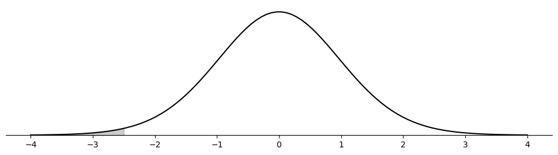
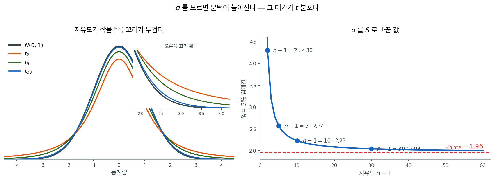
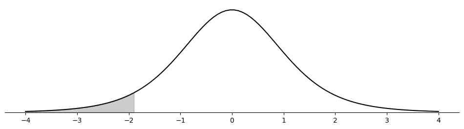
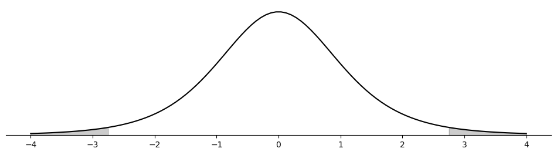
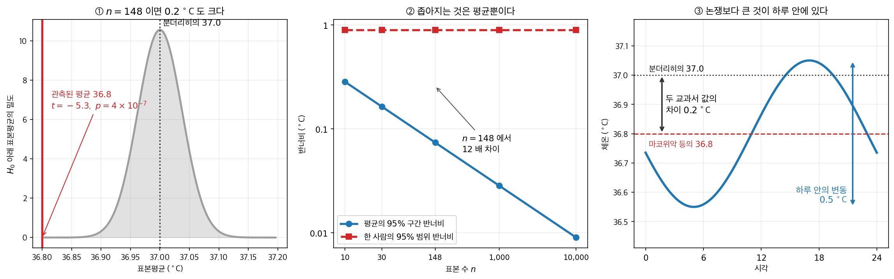
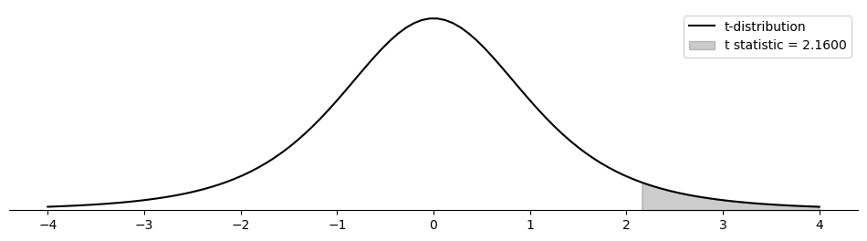
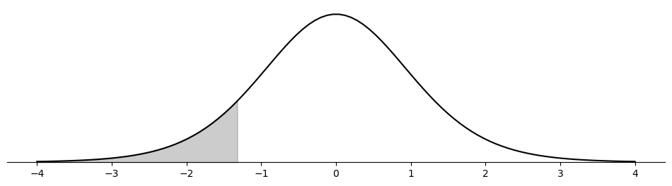

# 평균에 대한 일표본 t-검정

## 개요

실무에서 모표준편차 $\sigma$를 아는 경우는 거의 없다. 평균에 대한 $z$-검정은 $\sigma$를 요구하므로 현실의 대부분 문제에 곧바로 쓸 수 없다. 일표본 $t$-검정은 $\sigma$를 표본표준편차 $S$로 바꾸어 이 문제를 해결한다. 이 대체는 추가적인 불확실성을 낳는데($S$ 자체가 확률변수이다), $t$-분포는 표준정규보다 두꺼운 꼬리로 이 추가 변동을 반영한다. 표본크기가 커지면 $S$가 $\sigma$로 수렴하고 $t$-분포가 표준정규로 수렴하여 $t$-검정과 $z$-검정이 같아진다.

---

## 1. 가설

$X_1, X_2, \ldots, X_n$을 평균이 $\mu$이고 분산 $\sigma^2$을 모르는 모집단에서 뽑은 확률표본이라 하자. 귀무가설은 평균의 특정 값을 지정한다:

$$
H_0\colon \mu = \mu_0
$$

대립가설은 다음 세 형태 중 하나이다:

| 대립가설 | 해석 |
|---|---|
| $H_1\colon \mu \neq \mu_0$ | 양측: 평균이 $\mu_0$과 다르다 |
| $H_1\colon \mu > \mu_0$ | 우측: 평균이 $\mu_0$보다 크다 |
| $H_1\colon \mu < \mu_0$ | 좌측: 평균이 $\mu_0$보다 작다 |

---

## 2. 검정통계량

검정통계량은 표본평균 $\bar{X}$가 가설의 값 $\mu_0$에서 추정된 표준오차 몇 개만큼 떨어져 있는지를 잰다. 구조는 $z$-통계량과 같고 $\sigma$ 자리에 $S$가 들어간다:

$$
t = \frac{\bar{X} - \mu_0}{S / \sqrt{n}}
$$

여기서 $S = \sqrt{\frac{1}{n-1}\sum_{i=1}^n (X_i - \bar{X})^2}$은 표본표준편차이다.

$H_0$ 아래에서 모집단이 정규이면 이 통계량은 자유도 $n - 1$인 스튜던트 $t$-분포를 따른다:

$$
t = \frac{\bar{X} - \mu_0}{S / \sqrt{n}} \sim t_{n-1}
$$

$t_{n-1}$ 분포는 표준정규 $N(0,1)$보다 꼬리가 두꺼운데, 이는 $\sigma$를 추정하는 데서 오는 추가 불확실성을 반영한다. $n \to \infty$이면 $t_{n-1} \to N(0,1)$이고 $t$-검정은 $z$-검정으로 환원된다.

!!! note "왜 자유도가 n - 1인가?"
    표본표준편차 $S$는 $\bar{X}$를 추정하는 데 자유도 하나가 소모되므로 분모에 $n - 1$을 쓴다. $n$개의 편차 $X_i - \bar{X}$는 제약 $\sum(X_i - \bar{X}) = 0$을 만족하므로, 산포에 관한 자유로운 정보는 $n - 1$개뿐이다.

<div class="exbox" markdown>

**보기 1.** <span class="diff easy" title="쉬움"></span> 교사 경력에 대한 t 통계량. Rory는 자기 학군의 교사들이 평균적으로 경력 5년 미만이라고 의심한다. 교사 25명을 표본으로 모아 $\bar x = 4$년, $s = 2$년을 얻었다.

$$H_0: \mu = 5 \quad \text{vs} \quad H_1: \mu < 5$$

**(1)** $t$ 통계량과 p-값을 손으로 구하고, $\alpha = 0.05$의 기각역을 $\bar x$의 값으로 환산하시오.

**(2)** 코드로 확인하시오.

**(3)** 모집단이 정규라면 이 검정의 제1종 오류율이 $\sigma$의 값과 상관없이 **정확히** $\alpha$가 되는 까닭을 밝히고, 치우친 모집단에서 실제 오류율을 모의로 재시오.

</div>

??? success "풀이"

    **(1) 해석적으로.** 표준오차가

    $$
    \frac{s}{\sqrt{n}} = \frac{2}{\sqrt{25}} = \frac{2}{5} = 0.4
    $$

    로 깔끔하게 나오므로

    $$
    t = \frac{\bar x - \mu_0}{s/\sqrt{n}} = \frac{4 - 5}{0.4} = -2.5
    $$

    이고 자유도는 $n - 1 = 24$다. 좌측 p-값은

    $$
    p = P(T_{24} \le -2.5) = 0.009827
    $$

    이다. 임계값은 $t_{0.05,\,24} = -1.71088$이므로 기각역을 $\bar x$로 환산하면

    $$
    \bar x < 5 - 1.71088 \times 0.4 = 4.31565
    $$

    다. 관측된 $\bar x = 4$는 경계보다 $0.32$년 더 아래여서 **여유 있게** 기각역 안에 있다.

    **(2) 수치적으로.**

    ```python
    import matplotlib.pyplot as plt
    import numpy as np
    from scipy import stats

    def plot_t_statistic(statistic, df, ax, alternative='two-sided'):
        """t 분포를 그리고 p-값에 해당하는 꼬리를 칠한다.

        대립가설의 방향에 따라 칠하는 쪽이 달라진다. 양측이면 양쪽을 모두
        칠하므로 넓이가 두 배가 되고, 그래서 양측 p-값이 단측의 두 배다.
        """
        x = np.linspace(-4, 4, 100)
        y = stats.t(df).pdf(x)
        ax.plot(x, y, '-k')

        if alternative == 'less':
            x_fill = np.linspace(-4, statistic, 100)
            y_fill = stats.t(df).pdf(x_fill)
            ax.fill_between(x_fill, y_fill, color='k', alpha=0.2)
        elif alternative == 'greater':
            x_fill = np.linspace(statistic, 4, 100)
            y_fill = stats.t(df).pdf(x_fill)
            ax.fill_between(x_fill, y_fill, color='k', alpha=0.2)
        elif alternative == 'two-sided':
            x_fill_left = np.linspace(-4, -abs(statistic), 100)
            y_fill_left = stats.t(df).pdf(x_fill_left)
            ax.fill_between(x_fill_left, y_fill_left, color='k', alpha=0.2)
            x_fill_right = np.linspace(abs(statistic), 4, 100)
            y_fill_right = stats.t(df).pdf(x_fill_right)
            ax.fill_between(x_fill_right, y_fill_right, color='k', alpha=0.2)

        ax.spines['left'].set_visible(False)
        ax.spines['right'].set_visible(False)
        ax.spines['top'].set_visible(False)
        ax.spines['bottom'].set_position("zero")
        ax.set_yticks(())

    # sigma 를 모르므로 s 를 쓴다. 그래서 z 가 아니라 t 로 간다.
    mu_0 = 5
    x_bar = 4
    s = 2
    n = 25

    statistic = (x_bar - mu_0) / (s / np.sqrt(n))
    df = n - 1                      # s를 자료에서 추정했으므로 하나를 잃는다
    p_value = stats.t(df).cdf(statistic)

    print(f"T-statistic: {statistic:.4f}")
    print(f"P-value    : {p_value:.4f}")

    fig, ax = plt.subplots(figsize=(12, 3))
    plot_t_statistic(statistic, df=df, ax=ax, alternative='less')
    plt.show()
    ```

    출력:

    ```
    T-statistic: -2.5000
    P-value    : 0.0098
    ```

    

    $p = 0.0098$로 1% 수준에서도 기각된다. Rory의 의심을 자료가 강하게 뒷받침한다.

    유도한 $t = -2.5$와 $p = 0.009827$이 출력의 $-2.5000$, $0.0098$과 맞는다.

    **(3) 정규모집단에서는 크기가 정확히 $\alpha$다.** $X_1, \ldots, X_n$이 독립인 $N(\mu_0, \sigma^2)$이면

    $$
    T = \frac{\bar X - \mu_0}{S/\sqrt{n}} \sim t_{n-1}
    $$

    이 **근사가 아니라 등식**이고, 이 분포에 $\sigma$가 들어 있지 않다. $T$는 $\sigma$에 의존하지 않는 **추축량**이다. 그러므로 $\sigma$가 얼마든

    $$
    P(T < t_{\alpha,\,n-1}) = \alpha
    $$

    가 정확히 성립한다. $n$이 작아도 그렇다. $\sigma$를 모른다는 사실이 손해를 주는 곳은 오류율이 아니라 **임계값의 크기**다($1.7109$ 대 정규의 $1.6449$).

    **깨지는 것은 정규성이고, 어긋나는 양은 왜도가 정한다.**

    ```python
    import numpy as np
    from scipy import stats

    rng = np.random.default_rng(3)
    M, n = 400_000, 25
    c_left = stats.t(n - 1).ppf(0.05)        # 좌측 임계값 (우측은 대칭이라 -c_left)
    c_two = stats.t(n - 1).ppf(0.975)        # 양측 임계값

    print(f"n = {n},  되풀이 {M:,}회,  명목 수준 0.05")
    print(f"{'모집단':>10s} {'왜도':>7s} {'좌측':>8s} {'우측':>8s} {'양측':>8s}")
    for label, draw, mu, g1 in [
        ("정규", lambda s: rng.normal(0, 1, s), 0.0, 0.0),
        ("지수", lambda s: rng.exponential(1, s), 1.0, 2.0),
        ("로그정규", lambda s: rng.lognormal(0, 1, s), np.exp(0.5), 6.1849),
    ]:
        x = draw((M, n))
        # 참 평균 mu 를 귀무가설값으로 넣는다. 곧 H0 가 참인 세상이다.
        t = (x.mean(1) - mu) / (x.std(1, ddof=1) / np.sqrt(n))
        print(f"{label:>10s} {g1:7.2f} {(t < c_left).mean():8.4f} "
              f"{(t > -c_left).mean():8.4f} {(np.abs(t) > c_two).mean():8.4f}")
    print(f"\n몬테카를로 오차 = sqrt(0.05*0.95/{M}) "
          f"= {np.sqrt(0.05 * 0.95 / M):.5f}")
    ```

    출력:

    ```
    n = 25,  되풀이 400,000회,  명목 수준 0.05
           모집단      왜도       좌측       우측       양측
            정규    0.00   0.0500   0.0501   0.0502
            지수    2.00   0.1033   0.0214   0.0769
          로그정규    6.18   0.1626   0.0089   0.1245

    몬테카를로 오차 = sqrt(0.05*0.95/400000) = 0.00034
    ```

    **정규 줄의 세 값이 모두 $0.05$다.** 몬테카를로 오차가 $0.00034$이니 $0.0500$, $0.0501$, $0.0502$는 모두 $0.05$와 구별되지 않는다. 추축량 논증이 수로 확인된 것이다.

    치우친 모집단에서는 어긋나는 **방향이 꼬리마다 다르다.** 오른쪽으로 치우친 자료에서는 $\bar X$가 작게 나올 때 $S$도 함께 작아져 $T$의 왼쪽 꼬리가 두꺼워진다. 그래서 이 보기처럼 **좌측검정은 위험해지고**($0.05 \to 0.1033 \to 0.1626$) 우측검정은 보수적이 된다($0.05 \to 0.0214 \to 0.0089$). 양측은 두 효과가 일부 상쇄되어 중간에 놓인다. 왜도가 $2$에서 $6.18$로 커질 때 어긋남도 함께 커진다는 점에 주의하라. 이 어긋남이 $n$에 따라 어떻게 줄어드는지는 [5.3절](../../ch05/applications/standard_error.md)에서 다룬 바 있다.

    Rory의 자료에서는 교사 경력이 오른쪽으로 치우쳐 있을 가능성이 높다(경력은 $0$에서 막히고 위로만 열려 있다). 그렇다면 좌측검정인 이 검정의 실제 오류율은 $5\%$보다 **클** 수 있으므로, $p = 0.0098$을 명목 그대로 읽는 것은 위험한 쪽으로 기운 읽기다.

---

## 3. 기각역

유의수준 $\alpha$에서 기각역은 대립가설에 따라 달라진다.

**양측** ($H_1\colon \mu \neq \mu_0$): 다음이면 $H_0$을 기각한다.

$$
|t| > t_{\alpha/2,\, n-1}
$$

**우측** ($H_1\colon \mu > \mu_0$): 다음이면 $H_0$을 기각한다.

$$
t > t_{\alpha,\, n-1}
$$

**좌측** ($H_1\colon \mu < \mu_0$): 다음이면 $H_0$을 기각한다.

$$
t < -t_{\alpha,\, n-1}
$$

여기서 $t_{\alpha,\, n-1}$은 $P(t_{n-1} > t_{\alpha,\, n-1}) = \alpha$를 만족하는 $t_{n-1}$ 분포의 상위 $\alpha$ 임계값이다.



$z$ 대신 $t$를 쓰는 이유가 왼쪽에 있다. **$\sigma$를 $S$로 바꾸면 분모가 상수에서 확률변수로 바뀌고, 그 흔들림이 꼬리를 두껍게 만든다.** 자유도가 작을수록 두껍고, 커질수록 정규분포에 가까워진다.

오른쪽이 그 대가를 수로 옮긴 것이다. 자유도 $2$에서 양측 5% 임계값이 $4.30$으로 $1.96$의 두 배를 넘고, $10$에서 $2.23$, $30$에서 $2.04$로 내려와 결국 $1.96$에 붙는다. **$\sigma$를 모른다는 사실 하나 때문에 문턱이 이만큼 높아지며, 그 대가는 표본이 작을수록 크다.**

실무 기준으로 $n$이 30을 넘으면 $t$와 $z$의 차이가 3% 남짓이라 어느 쪽을 써도 결론이 거의 같다. 그러나 $n$이 한 자리 수이면 차이가 결정적이므로 반드시 $t$를 써야 한다.

<div class="exbox" markdown>

**보기 2.** <span class="diff easy" title="쉬움"></span> Miriam의 검정에서 p-값. Miriam은 관측값 $n = 7$개로 $H_0: \mu = 18$ 대 $H_1: \mu < 18$을 검정해 $t = -1.9$를 얻었다. 원자료는 남아 있지 않다.

**(1)** 통계량과 자유도만으로 p-값을 구할 수 있는 까닭을 말하고, $\alpha = 0.05$에서의 결론을 임계값과 견주어 내리시오.

**(2)** 같은 $t = -1.9$에서 자유도를 키우면 p-값이 어떻게 변하는지 표로 만들고, 그 극한값이 무엇인지 밝히시오.

</div>

??? success "풀이"

    **(1) 통계량이 이미 모든 정보를 담고 있다.** $t$ 통계량은 $\bar x$, $s$, $n$을 하나의 수로 뭉친 것이고, 귀무분포 $t_{n-1}$은 자유도 하나로 정해진다. 그러니 p-값을 계산하는 데 필요한 것은 **통계량과 자유도뿐**이다. $\bar x$가 $17$이었는지 $4$였는지는 p-값에 영향을 주지 않는다.

    $n = 7$이므로 $\text{df} = 6$이고

    $$
    p = P(T_6 \le -1.9) = 0.0531
    $$

    이다. 임계값으로 보면 $t_{0.05,\,6} = -1.94318$이고 $-1.9 > -1.94318$이므로 기각역 **바깥**이다. 두 읽기가 당연히 일치한다. $p > 0.05 \iff t > t_{0.05,\,6}$이기 때문이다.

    **(2) 수치적으로.**

    ```python
    n = 7
    df = n - 1
    # 원자료 없이 t 통계량만 있어도 p-값을 구할 수 있다.
    # 필요한 것은 통계량과 자유도뿐이다.
    statistic = -1.9
    p_value = stats.t(df).cdf(statistic)
    print(f"{statistic = :.4f}")
    print(f"{p_value = :.4f}")

    fig, ax = plt.subplots(figsize=(12, 3))
    plot_t_statistic(statistic, df=df, ax=ax, alternative='less')
    plt.show()
    ```

    출력:

    ```
    statistic = -1.9000
    p_value = 0.0531
    ```

    

    $p = 0.0531$로 0.05를 아슬아슬하게 넘어 기각하지 못한다. 같은 $t = -1.9$라도 자유도가 크면 이야기가 달라진다. $\text{df} = 30$이면 $p = 0.0335$로 기각된다. 자유도가 6밖에 안 되어 꼬리가 두꺼운 것이 여기서 결론을 가른다.

    자유도를 키워 가며 같은 통계량의 p-값을 재면 이렇다.

    ```python
    import numpy as np
    from scipy import stats

    statistic = -1.9
    print(f"{'df':>6s} {'임계값':>10s} {'p-값':>9s}")
    for df in [6, 10, 20, 30, 60, 120, 1000]:
        print(f"{df:6d} {stats.t(df).ppf(0.05):10.4f} {stats.t(df).cdf(statistic):9.4f}")
    # 자유도를 무한히 키운 극한이 표준정규다.
    print(f"{'∞':>6s} {stats.norm.ppf(0.05):10.4f} {stats.norm.cdf(statistic):9.4f}")
    ```

    출력:

    ```
        df        임계값       p-값
         6    -1.9432    0.0531
        10    -1.8125    0.0433
        20    -1.7247    0.0360
        30    -1.6973    0.0335
        60    -1.6706    0.0311
       120    -1.6577    0.0299
      1000    -1.6464    0.0289
         ∞    -1.6449    0.0287
    ```

    **p-값은 자유도의 감소함수이고 극한은 $\Phi(-1.9) = 0.0287$이다.** 본문이 말한 $\text{df} = 30$의 $0.0335$가 표에 그대로 있다. 자유도가 $6$인 Miriam의 $0.0531$은 그 극한보다 $0.0244$나 크다. **$t_6$의 꼬리가 정규보다 두꺼워 같은 거리가 더 흔한 일로 읽힌다**는 뜻이다.

    결론이 갈리는 지점을 거꾸로 찾아볼 수도 있다. $p = 0.05$가 되는 통계량은 임계값 그 자체이므로, $t = -1.9$로 기각하려면 임계값이 $-1.9$보다 커야 하고 표에서 그것은 $\text{df} \ge 10$일 때다. **관측값 세 개만 더 있었다면 결론이 뒤집혔다.**

<div class="exbox" markdown>

**보기 3.** <span class="diff easy" title="쉬움"></span> Caterina의 검정에서 p-값. Caterina는 관측값 $n = 6$개로 $H_0: \mu = 0$ 대 $H_1: \mu \neq 0$을 검정해 $t = 2.75$를 얻었다. 원자료도, $\bar x$도, $s$도 남아 있지 않다.

**(1)** 양측 p-값과, 같은 자료를 단측으로 검정했을 때의 p-값을 구하시오.

**(2)** $\bar x$와 $s$를 모르는데도 **$\mu$의 95% 신뢰구간이 $0$을 담지 않는다**는 것을 보일 수 있다. 보이시오.

</div>

??? success "풀이"

    **(1) 해석적으로.** $\text{df} = n - 1 = 5$이고 통계량이 양수이므로

    $$
    p_{\ne} = 2\,P(T_5 \ge 2.75) = 2 \times 0.020155 = 0.040310
    $$

    이다. 단측(큼)이었다면 그 절반인 $p_{>} = 0.020155$다. 보기 2에서 본 관계가 그대로 적용된다 — 통계량의 부호가 대립가설의 방향과 같으므로 단측이 양측의 정확히 절반이다.

    **(2) 수치적으로.**

    ```python
    n = 6
    df = n - 1
    statistic = 2.75
    # 양측이므로 한쪽 꼬리를 두 배 한다.
    p_value = stats.t(df).sf(statistic) * 2
    print(f"{statistic = :.4f}")
    print(f"{p_value = :.4f}")

    fig, ax = plt.subplots(figsize=(12, 3))
    plot_t_statistic(statistic, df=df, ax=ax, alternative='two-sided')
    plt.show()
    ```

    출력:

    ```
    statistic = 2.7500
    p_value = 0.0403
    ```

    

    양측인데도 $p = 0.0403 < 0.05$로 기각된다. 만약 Caterina가 단측으로 검정했다면 $p = 0.0201$이었을 것이다.

    **신뢰구간과 검정은 같은 사건이다.** $\mu$의 양측 $95\%$ $t$-구간은

    $$
    \bar x \pm t_{0.025,\,5}\,\frac{s}{\sqrt{6}}, \qquad t_{0.025,\,5} = 2.570582
    $$

    이다. 여기서 $\bar x$와 $s$를 따로 알 필요가 없다. 통계량의 정의 $t = \bar x / (s/\sqrt{6}) = 2.75$가 $\bar x = 2.75 \cdot s/\sqrt{6}$을 주므로, 구간 전체를 $s/\sqrt{6}$을 단위로 적을 수 있다.

    $$
    \left(\,(2.75 - 2.570582)\frac{s}{\sqrt 6},\ \ (2.75 + 2.570582)\frac{s}{\sqrt 6}\,\right)
    = \left(0.179418\,\frac{s}{\sqrt 6},\ \ 5.320582\,\frac{s}{\sqrt 6}\right)
    $$

    $s > 0$이므로 **아래끝이 양수**이고 따라서 구간은 $0$을 담지 않는다. $\bar x$와 $s$를 몰라도 결론이 정해진 것이다.

    이것은 우연이 아니라 **쌍대성**이다. 일반적으로

    $$
    \lvert t \rvert > t_{\alpha/2,\,n-1}
    \iff
    \mu_0 \notin \left(\bar x \pm t_{\alpha/2,\,n-1}\frac{s}{\sqrt n}\right)
    $$

    가 동치다. 양변 모두 $\lvert \bar x - \mu_0 \rvert > t_{\alpha/2,\,n-1}\,s/\sqrt n$을 다르게 쓴 것일 뿐이다. 그러므로 **구간의 포함률과 검정의 크기는 정확히 더해 $1$이 된다.** 정규모집단에서 둘은 각각 $0.95$와 $0.05$이고, 정규성이 깨지면 **같은 양만큼** 함께 어긋난다. 보기 4의 표에서 양측 크기가 $0.1245$였던 로그정규 설정이라면 같은 구간의 포함률이 $0.8755$라는 뜻이다.

---

## 4. 풀이 보기

한 식품 제조사가 시리얼 상자에 평균 $\mu_0 = 500$ 그램이 들어 있다고 주장한다. 어떤 소비자 단체가 내용량이 부족하다고 의심하여 상자 $n = 16$개를 무작위로 모아 $\bar{x} = 496.2$ 그램, $s = 4.8$ 그램을 얻었다. $\alpha = 0.05$에서 평균 충전 중량이 500 그램보다 적은지 검정하라.

**1단계.** 가설을 세운다:

$$
H_0\colon \mu = 500 \qquad H_1\colon \mu < 500
$$

**2단계.** 검정통계량을 계산한다:

$$
t = \frac{496.2 - 500}{4.8 / \sqrt{16}} = \frac{-3.8}{1.2} = -3.167
$$

**3단계.** 임계값을 구한다. 자유도 15, $\alpha = 0.05$의 좌측검정에서:

$$
-t_{0.05,\, 15} = -1.753
$$

**4단계.** 판정한다. $t = -3.167 < -1.753$이므로 $H_0$을 기각한다. 5% 수준에서 평균 충전 중량이 500 그램보다 적다고 결론지을 충분한 증거가 있다.

$p$-값은 $P(t_{15} < -3.167) \approx 0.003$으로 $H_0$에 반하는 강한 증거이다.

<div class="storybox" markdown>

**그림으로 보는 통계학 1.** $37.0$ 은 어디서 왔는가

일표본 검정은 **알려진 값 하나**를 자료와 견준다. 그 「알려진 값」이 교과서에 실린 상수일
때, 검정은 교과서를 상대로 서는 셈이 된다. 체온이 그런 자리였다.

$37.0\,^\circ$C 라는 수는 $1868$ 년 독일 의사 **카를 분더리히**가 세웠다. 그는 환자 수만
명의 겨드랑이 온도를 재어 그 평균을 정상값으로 적었고, 그 수가 백이십 년 동안 교과서에
남았다.

$1992$ 년에 **마코위악**과 와서먼, 르바인이 그것을 다시 쟀다. 메릴랜드 백신개발센터에서
시겔라 백신 시험에 자원한 $18$–$40$ 세 건강한 성인 **$148$ 명**의 입안 온도를 전자
체온계로 사흘 동안 하루 한두 번에서 네 번씩 재었다. 결과는 **$36.8\,^\circ$C** 였고,
논문의 결론은 한 문장으로 못 박혀 있다 — **「섭씨 $37$ 도는 임상 체온계측과 관련된 개념으로서
폐기되어야 한다.」**



**①** 이 쪽의 검정으로 보면 싱겁게 끝난다. 표준편차는 논문 초록에 없지만 같은 초록이
적은 정상 상한 $37.7\,^\circ$C 에서 되짚으면 $s \approx (37.7-36.8)/1.96 = 0.46\,^\circ$C
이고, $n = 148$ 이면 표준오차가 $0.038$ 이다. $t = -5.3$, $p = 4 \times 10^{-7}$ —
평균의 $95\%$ 구간 $[36.73,\ 36.88]$ 이 $37.0$ 을 담지 않는다.

**②** 그런데 여기서 멈추면 위험하다. $n$ 을 키우면 **평균의 구간**은 $1/\sqrt{n}$ 으로
좁아지지만 **한 사람의 범위**는 꿈쩍도 하지 않는다. $n = 148$ 에서 전자가 $\pm 0.07$,
후자가 $\pm 0.90\,^\circ$C 로 **$12$ 배** 차이다. 「정상 체온은 $36.8$ 이다」는 **평균에
관한 말이지 당신에 관한 말이 아니다.** 일표본 검정이 답해 주는 것은 왼쪽이고, 체온계를
들고 알고 싶은 것은 오른쪽이다.

**③** 그리고 같은 논문이 보고한 더 큰 수가 있다. 체온은 하루 안에서 새벽 $6$ 시에 가장
낮고 오후 $4$–$6$ 시에 가장 높으며, 그 **평균 진폭이 $0.5\,^\circ$C** 다. 분더리히와
마코위악이 다툰 $0.2\,^\circ$C 보다 **두 배 반** 크다. 같은 사람을 아침에 재느냐 저녁에
재느냐가 백이십 년의 논쟁보다 큰 차이를 만든다.

끝이 더 흥미롭다. $2020$ 년 스탠퍼드의 프로치프 등이 세 집단의 기록을 이어 붙여 보았다 —
남북전쟁 참전군인 $23{,}710$ 명($1860$–$1940$), NHANES I 의 $15{,}301$ 명($1971$–$1975$),
스탠퍼드 진료기록 $150{,}280$ 명($2007$–$2017$). 나이·키·몸무게를 보정하고 나면 평균
체온이 **출생 십 년마다 $0.03\,^\circ$C 씩 단조롭게 내려갔다.** 참전군인 집단 **안에서도**
같은 기울기가 나와 측정 오차로 돌리기 어렵다는 것이 그들의 논거다.

$0.03$ 에 열다섯 십 년을 곱하면 $0.45\,^\circ$C 다. **분더리히가 틀렸던 것이 아니라 우리가
변한 것일 수 있다.** 일표본 검정이 기각한 $H_0$ 은 「지금 사람들의 평균이 $37.0$ 이다」였지
「$1868$ 년에 틀렸다」가 아니었던 셈이다.

_확인한 곳 — Mackowiak · Wasserman · Levine, "A critical appraisal of 98.6 degrees F,
the upper limit of the normal body temperature, and other legacies of Carl Reinhold August
Wunderlich", 『JAMA』 $268$ 권 $1578$–$1580$ 쪽($1992$)의 초록 — 메릴랜드 백신개발센터에서
시겔라 백신 시험 자원자 $18$–$40$ 세 $148$ 명의 입안 온도를 전자 체온계로 사흘간 하루
$1$–$4$ 회 잰 것, 평균 $36.8\,^\circ$C, 정상 상한 $37.7\,^\circ$C, 새벽 $6$ 시 최저와
오후 $4$–$6$ 시 최고에 평균 진폭 $0.5\,^\circ$C, 그리고 「섭씨 $37$ 도는 폐기되어야 한다」는
결론 · Protsiv 외, "Decreasing human body temperature in the United States since the
industrial revolution", 『eLife』 $9$:e$49555$($2020$)의 초록 — 세 집단의 규모와 기간,
출생 십 년마다 $0.03\,^\circ$C 의 단조 감소, 참전군인 집단 안에서도 같은 감소가 나타나
측정 오차로 보기 어렵다는 논거. 그림의 수는 모두 직접 계산한 값이며, 표준편차는 논문이
보고한 상한에서 되짚은 값이다_

</div>

<div class="exbox" markdown>

**보기 4.** <span class="diff easy" title="쉬움"></span> Jude의 자동 음료 충전기. 표시량이 530 mL인 충전기에서 음료 $n = 20$개를 뽑아 $\bar x = 528$ mL, $s = 4$ mL를 얻었다.

$$H_0: \mu = 530 \quad \text{vs} \quad H_1: \mu \neq 530$$

**(1)** $t$ 통계량과 양측 p-값을 구하고 $\alpha = 0.05$에서 판정하시오.

**(2)** $\mu$의 $95\%$ 신뢰구간을 구해 (1)과 같은 결론이 나오는지 확인하고, **부족량이 얼마나 되는지** 구간으로 답하시오.

</div>

??? success "풀이"

    **(1) 해석적으로.** 표준오차는

    $$
    \frac{s}{\sqrt n} = \frac{4}{\sqrt{20}} = \frac{4}{4.472136} = 0.894427
    $$

    이고

    $$
    t = \frac{528 - 530}{0.894427} = -\frac{2\sqrt{20}}{4} = -\frac{\sqrt{20}}{2} = -\sqrt 5 = -2.236068
    $$

    이다. 자료가 깔끔해서 통계량이 $-\sqrt 5$라는 닫힌 꼴로 나온다. 자유도 $19$에서

    $$
    p = 2\,P(T_{19} \le -2.236068) = 0.037541
    $$

    이고 임계값 $t_{0.025,\,19} = 2.093024$보다 $\lvert t \rvert$가 크므로 $\alpha = 0.05$에서 $H_0$을 **기각한다.**

    **(2) 신뢰구간으로.** 같은 재료로 구간을 만들면

    $$
    528 \pm 2.093024 \times 0.894427 = 528 \pm 1.872058 = (526.128,\ 529.872)
    $$

    이다. $530$이 위끝 $529.872$보다 크므로 구간 밖이고, 보기 6에서 본 쌍대성대로 (1)과 같은 결론이다. 부족량 $530 - \mu$의 구간은 양끝을 뒤집어

    $$
    (530 - 529.872,\ 530 - 526.128) = (0.128,\ 3.872)\ \text{mL}
    $$

    가 된다.

    **(3) 수치적으로.**

    ```python
    import numpy as np
    from scipy import stats

    mu_0, x_bar, s, n = 530, 528, 4, 20
    se = s / np.sqrt(n)
    df = n - 1
    statistic = (x_bar - mu_0) / se
    p_value = 2 * stats.t(df).cdf(statistic)
    t_crit = stats.t(df).ppf(0.975)
    lo, hi = x_bar - t_crit * se, x_bar + t_crit * se

    print(f"표준오차 = {se:.6f}")
    print(f"t = {statistic:.5f}   (-sqrt(5) = {-np.sqrt(5):.5f})")
    print(f"양측 p = {p_value:.5f}")
    print(f"임계값 t(0.025, {df}) = {t_crit:.5f}")
    print(f"95% 신뢰구간 = ({lo:.4f}, {hi:.4f})")
    print(f"구간이 530 을 담는가: {lo <= mu_0 <= hi}")
    print(f"부족량 530 - mu 의 95% 구간 = "
          f"({mu_0 - hi:.4f}, {mu_0 - lo:.4f}) mL")
    print(f"표시량에 대한 비율 = ({(mu_0 - hi) / mu_0 * 100:.3f}%, "
          f"{(mu_0 - lo) / mu_0 * 100:.3f}%)")
    ```

    출력:

    ```
    표준오차 = 0.894427
    t = -2.23607   (-sqrt(5) = -2.23607)
    양측 p = 0.03754
    임계값 t(0.025, 19) = 2.09302
    95% 신뢰구간 = (526.1279, 529.8721)
    구간이 530 을 담는가: False
    부족량 530 - mu 의 95% 구간 = (0.1279, 3.8721) mL
    표시량에 대한 비율 = (0.024%, 0.731%)
    ```

    유도한 세 값이 모두 맞는다. 통계량이 $-\sqrt 5$라는 것도 출력이 확인해 준다.

    **그런데 기각했다는 것과 고쳐야 한다는 것은 다른 이야기다.** 부족량의 구간이 $(0.13,\ 3.87)$ mL이고 표시량에 대한 비율로는 $(0.02\%,\ 0.73\%)$다. 아래끝은 **사실상 $0$과 구별되지 않는 크기**다. 자료가 말해 주는 것은 "평균이 $530$보다 작다는 쪽이 맞을 듯하다"일 뿐이고, **얼마나 작은지는 거의 아무것도 말해 주지 못한다.**

    p-값 하나만 보고 "유의한 미달이 확인되었다"고 적으면 이 사정이 가려진다. 보기 1에서 본 것의 짝이 되는 교훈이다 — 표본이 크면 작은 차이도 유의해지고, **유의한 차이가 반드시 큰 차이는 아니다.**

<div class="exbox" markdown>

**보기 5.** <span class="diff easy" title="쉬움"></span> 일표본 t 검정 — 간단한 예. 관측값은 $78, 83, 68, 72, 88$ 다섯 개다.

$$H_0 : \mu = 70 \quad\text{vs}\quad H_1: \mu > 70$$

**(1)** $\bar x$, $s^2$, 표준오차, $t$ 를 손으로 구하고 $\alpha = 0.05$에서 임계값과 견주어 판정하시오.

**(2)** 코드로 확인하고, 같은 통계량을 **양측**으로 계산하면 결론이 어떻게 달라지는지 말하시오.

</div>

??? success "풀이"

    **(1) 해석적으로.** 합이 $78 + 83 + 68 + 72 + 88 = 389$이므로

    $$
    \bar x = \frac{389}{5} = 77.8
    $$

    이다. 편차는 $0.2,\ 5.2,\ -9.8,\ -5.8,\ 10.2$이고 제곱의 합은

    $$
    0.04 + 27.04 + 96.04 + 33.64 + 104.04 = 260.8
    $$

    이다. 자유도 $n - 1 = 4$로 나누어

    $$
    s^2 = \frac{260.8}{4} = 65.2, \qquad s = \sqrt{65.2} = 8.074652,
    \qquad \frac{s}{\sqrt 5} = 3.611094
    $$

    를 얻는다. 따라서

    $$
    t = \frac{77.8 - 70}{3.611094} = \frac{7.8}{3.611094} = 2.160010
    $$

    이다. 단측(큼) 임계값은 $t_{0.05,\,4} = 2.131847$이고 $2.160010 > 2.131847$이므로 **기각한다.** p-값으로는

    $$
    p = P(T_4 \ge 2.160010) = 0.048444
    $$

    로 $0.05$를 $0.0016$만큼 밑돈다. **아슬아슬한 기각**이다.

    **(2) 수치적으로.**

    ```python
    samples = np.array([78, 83, 68, 72, 88])

    n = samples.shape[0]
    df = n - 1
    x_bar = samples.mean()
    s = samples.std(ddof=1)
    mu = 70

    confidence_level = 0.95
    alpha = 1 - confidence_level
    t_score = (x_bar - mu) / (s / np.sqrt(n))
    # H1이 mu > 70인 단측이므로 오른쪽 꼬리만 센다.
    # 여기에 양측 공식 sf(abs(t))*2 를 쓰면 p-값이 두 배가 되어
    # 이 자료에서는 결론이 뒤집힌다(0.0484 대 0.0969).
    p_value = stats.t(df=df).sf(t_score)

    print(f"Test statistic (t-score): {t_score:.4f}")
    print(f"p-value                 : {p_value:.4f}")

    if p_value <= alpha:
        print("Reject H_0: Sufficient evidence to support the alternative hypothesis.")
    else:
        print("Fail to reject H_0: Insufficient evidence to support the alternative hypothesis.")

    fig, ax = plt.subplots(figsize=(12, 3))
    plot_t_statistic(t_score, df=df, ax=ax, alternative='greater')
    ax.legend(["t-distribution", f"t statistic = {t_score:.4f}"])
    plt.show()
    ```

    출력:

    ```
    Test statistic (t-score): 2.1600
    p-value                 : 0.0484
    Reject H_0: Sufficient evidence to support the alternative hypothesis.
    ```

    

    $p = 0.0484$로 0.05를 겨우 밑돌아 기각된다. 이 보기는 단측과 양측의 차이가 결론을 가르는 경우다. 양측으로 계산하면 $p = 0.0969$가 되어 기각하지 못한다. 대립가설의 방향을 세워 두었으면 p-값도 그 방향으로 계산해야 한다.

    $\bar x = 77.8$로 가설값 70보다 한참 크지만 $n = 5$에 $s = 8.07$이라 표준오차가 3.61이나 되어 이만큼 아슬아슬해진다.

    유도한 $t = 2.160010$과 $p = 0.048444$가 출력의 $2.1600$, $0.0484$와 맞는다.

    **양측으로 계산하면 결론이 뒤집힌다.** $p_{\ne} = 2 \times 0.048444 = 0.096888$이 되어 $0.05$의 거의 두 배다. 임계값으로 보아도 $t_{0.025,\,4} = 2.776445$여서 $2.160010$이 한참 못 미친다.

    **자유도가 $4$뿐이라는 것이 여기서 결정적이다.** 같은 $t = 2.16$을 자유도 $30$에서 얻었다면 양측 p-값이 $0.0388$로 기각된다. $t_4$의 꼬리가 그만큼 두껍다. 관측값 다섯 개로는 $\bar x$가 가설값보다 $7.8$이나 커도 단측에서 겨우 기각할 뿐이다.

    방향을 **자료를 보기 전에** 세워 두었다면 단측이 정당하고, 그러면 $p = 0.0484$가 맞는 값이다. 보기 2에서 본 대로 $\bar x$를 보고 나서 "크다 쪽"을 고르는 것은 실제 오류율을 $10\%$로 올린다. 그 경우 $0.0484$는 **명목값일 뿐 실제 오류율이 아니다.**

<div class="exbox" markdown>

**보기 6.** <span class="diff easy" title="쉬움"></span> 우유 표시량 검정. 어떤 공장의 우유 용기에 128온스라고 표시되어 있다. 용기 12개의 표본에서 $\bar x = 127.2$ oz, $s = 2.1$ oz를 얻었다.

$$H_0: \mu = 128 \quad \text{vs} \quad H_1: \mu < 128$$

**(1)** $t$ 통계량과 p-값을 손으로 구하고 $\alpha = 0.05$에서 판정하시오.

**(2)** 참 평균이 정말 $127.2$이고 $\sigma = 2.1$이라면 이 검정이 그것을 잡아낼 확률은 얼마인가. **비중심 $t$** 로 정확히 구하고, 정규근사로 어림한 값과 견주시오.

</div>

??? success "풀이"

    **(1) 해석적으로.** 표준오차는

    $$
    \frac{s}{\sqrt n} = \frac{2.1}{\sqrt{12}} = \frac{2.1}{3.464102} = 0.606218
    $$

    이고

    $$
    t = \frac{127.2 - 128}{0.606218} = \frac{-0.8}{0.606218} = -1.319658
    $$

    이다. 자유도 $11$에서 좌측 p-값은

    $$
    p = P(T_{11} \le -1.319658) = 0.106878
    $$

    이고 임계값 $t_{0.05,\,11} = -1.795885$보다 통계량이 **크므로** 기각역 바깥이다. $H_0$을 기각하지 못한다.

    **(2) 수치적으로.**

    ```python
    # 표시량 128 에 못 미치는지를 묻는 단측검정이다. 그래서 아래에서 cdf 를 쓴다.
    mu_0 = 128
    x_bar = 127.2
    s = 2.1
    n = 12
    statistic = (x_bar - mu_0) / (s / np.sqrt(n))
    df = n - 1
    p_value = stats.t(df).cdf(statistic)

    print(f"{statistic = :.4f}")
    print(f"{p_value = :.4f}")

    alpha = 0.05
    if p_value <= alpha:
        print("Reject H_0 in favor of H_1")
    else:
        print("Fail to reject H_0")

    fig, ax = plt.subplots(figsize=(12, 3))
    plot_t_statistic(statistic, df=df, ax=ax, alternative='less')
    plt.show()
    ```

    출력:

    ```
    statistic = -1.3197
    p_value = 0.1069
    Fail to reject H_0
    ```

    

    평균이 표시량보다 0.8 oz 모자라지만 기각하지 못한다. $n = 12$에 $s = 2.1$이면 표준오차가 0.61이라 0.8 oz의 부족은 표준오차 1.3배 남짓에 지나지 않는다. "기각하지 못했다"가 "용기가 제대로 채워졌다"는 뜻이 아니라는 점이 중요하다. 이 자료는 $\mu = 128$도, $\mu = 126.4$도 배제하지 못한다.

    **검정력은 비중심 $t$ 가 필요하다.** 참 평균이 $\mu = 127.2$라면 통계량

    $$
    T = \frac{\bar X - 128}{S/\sqrt{12}}
    $$

    의 분자가 $0$을 중심으로 돌지 않고 $\mu - \mu_0 = -0.8$만큼 밀려 있다. 이때 $T$가 따르는 것은 중심 $t$가 아니라 **비중심 모수**

    $$
    \delta = \frac{\mu - \mu_0}{\sigma/\sqrt n} = \frac{-0.8}{0.606218} = -1.319658
    $$

    인 비중심 $t_{11}(\delta)$다. 검정력은 그 분포가 기각역에 주는 확률

    $$
    1 - \beta = P\!\left(T_{11}(\delta) < t_{0.05,\,11}\right) = P\!\left(T_{11}(-1.319658) < -1.795885\right)
    $$

    이다. 손으로 적을 닫힌 꼴이 없으므로 수로 구한다.

    ```python
    import numpy as np
    from scipy import stats

    mu_0, mu_true, sigma, n = 128, 127.2, 2.1, 12
    df = n - 1
    ncp = (mu_true - mu_0) / (sigma / np.sqrt(n))     # 비중심 모수
    crit = stats.t(df).ppf(0.05)                      # 좌측 임계값

    print(f"비중심 모수 delta = {ncp:.6f}")
    print(f"좌측 임계값       = {crit:.6f}")
    print(f"비중심 t 로 구한 정확한 검정력 = "
          f"{stats.nct(df, ncp).cdf(crit):.4f}")
    print(f"정규근사 (z 임계값을 쓴 어림)  = "
          f"{stats.norm.cdf(-stats.norm.ppf(0.95) - ncp):.4f}")
    print(f"정규근사 (t 임계값을 쓴 어림)  = "
          f"{stats.norm.cdf(crit - ncp):.4f}")
    ```

    출력:

    ```
    비중심 모수 delta = -1.319658
    좌측 임계값       = -1.795885
    비중심 t 로 구한 정확한 검정력 = 0.3422
    정규근사 (z 임계값을 쓴 어림)  = 0.3725
    정규근사 (t 임계값을 쓴 어림)  = 0.3170
    ```

    **정확한 검정력은 $0.3422$다.** 자주 쓰는 정규근사 $1 - \Phi(z_{0.05} - \lvert\delta\rvert)$는 $0.3725$로 **$0.030$ 과대평가**한다. 그 어림은 $S$의 변동을 아예 무시하고 임계값마저 $1.6449$로 낮춰 잡은 것이다. 거꾸로 $t$ 임계값 $-1.795885$를 쓰면서 분포만 정규로 두면 $0.3170$으로 **과소평가**한다. 두 어림이 정확값을 양쪽에서 끼고 있고, 어느 쪽도 $n = 12$에서는 쓸 만하지 않다. **작은 표본의 검정력은 비중심 $t$로 계산해야 한다.**

    실무적으로 더 중요한 수는 $0.3422$ 자체다. **참 부족량이 정확히 관측된 만큼($0.8$ oz)이더라도 이 검정이 그것을 잡아낼 확률은 세 번에 한 번뿐이다.** 그러니 "기각하지 못했다"는 결과는 거의 아무 정보도 아니다. 위에서 $\mu = 128$도 $\mu = 126.4$도 배제하지 못한다고 한 것이 바로 이 사정의 신뢰구간 쪽 표현이다.

---

## 5. 가정

일표본 $t$-검정에는 다음이 필요하다:

- **확률표본추출**: 관측값이 독립이고 동일한 분포를 따른다.
- **정규성**: 모집단이 정규분포를 따르거나, $n$이 중심극한정리가 적용될 만큼 크다.

---

## 6. 로버스트성

$t$-검정은 정규성에서 벗어나도 꽤 로버스트하며, 특히 표본이 중간 이상으로 크면 그렇다. 모의실험 연구들은 $n \geq 30$이면 적당히 치우치거나 꼬리가 두꺼운 분포에서도 실제 제1종 오류율이 명목 $\alpha$에 가깝게 유지됨을 보여준다. 표본이 더 작으면($n < 15$) 모집단이 심하게 치우쳤거나 꼬리가 두꺼울 때 검정을 믿기 어렵다.

정규성 가정이 가장 중요한 때에 대한 지침:

- **$n < 15$**: 정규성이 중요하다. Q-Q 그림이나 Shapiro-Wilk 검정으로 확인하라. 정규성이 의심스러우면 비모수적 대안(예: Wilcoxon 부호순위 검정)을 고려하라.
- **$15 \leq n < 30$**: 정규성에서 약간 벗어나는 것은 견딜 만하다. 심하게 치우치거나 꼬리가 두꺼운 분포에서만 검정을 믿기 어렵다.
- **$n \geq 30$**: 중심극한정리가 $\bar{X}$의 표집분포를 근사적으로 정규로 만들어 주므로 대부분의 실제 분포에서 $t$-검정이 믿을 만하다.

!!! warning "이상점은 여전히 문제이다"
    $n$이 커도 개별 이상점이 $S$를 부풀리고 $\bar{X}$를 옮겨 실제 효과를 가리거나 없는 효과를 만들어낼 수 있다. $t$-검정을 적용하기 전에 항상 자료에 이상점이 있는지 살펴보라.

---

## 7. t 검정을 못 쓸 때 — 어디로 가는가

절 $6$ 은 $t$ 검정이 중간 정도의 비정규성에 견딘다고 했다. 견디지 못하는 자리에서
쓸 수 있는 길이 넷이고, 각각 제 쪽이 있다. 여기서는 **무엇을 검정하는 것이
달라지는지**만 못박아 둔다.

| 대안 | 검정하는 것 | 가정 | 쪽 |
|---|---|---|---|
| 부호검정 | 중앙값 | 연속성뿐 | 16.2 [부호검정](../../ch16/one_sample_nonparametric/sign_test.md) |
| Wilcoxon 부호순위 | $0$ 에 대한 대칭 중심 | 차이의 분포가 대칭 | 16.2 [Wilcoxon 부호순위검정](../../ch16/one_sample_nonparametric/wilcoxon_signed_rank.md) |
| 붓스트랩 | 평균 (그대로) | 표본이 모집단을 대표 | 17.3 [단일 평균에 대한 붓스트랩 검정](../../ch17/bootstrap_testing/single_mean.md) |
| 순열 | 분포가 같은지 | 교환가능성 | 17.4 [순열검정의 기초](../../ch17/permutation/foundations.md) |

**바꿔 타면 가설이 바뀐다는 것이 요점이다.** $t$ 검정은 평균을 묻고 부호검정은
중앙값을 묻는다. 치우친 분포에서 둘은 같은 값이 아니므로, 「$t$ 가 안 되니
부호검정으로」는 같은 질문에 다른 답을 구하는 것이 아니라 **다른 질문으로 옮겨
가는 것**이다. 중앙값 자체가 관심사라면 그것이 옳은 이동이고, 평균이 관심사라면
붓스트랩 쪽이 맞다.

---

---

## 연습문제

<div class="drillbox" markdown>

**연습문제 1.** <span class="diff easy" title="쉬움"></span>
시리얼: 주장된 평균 500 g. 표본 $n = 25$, $\bar X = 490$, $s = 15$. $\alpha = 0.01$에서 검정하라.

</div>

??? success "풀이"
    $H_0: \mu = 500$ 대 $H_1: \mu \ne 500$.

    $t = (490 - 500)/(15/\sqrt{25}) = -10/3 = -3.33$.

    임계값: $t_{0.005, 24} = \pm 2.797$. $|t| = 3.33 > 2.797$. **기각한다.**

    평균이 500 g보다 작다는 강한 증거이다.

---

<div class="drillbox" markdown>

**연습문제 2.** <span class="diff easy" title="쉬움"></span>
**단측검정.** 연습문제 1과 같은 자료로 $H_1: \mu < 500$(평균이 주장보다 낮다고 의심)을 검정하라.

</div>

??? success "풀이"
    임계값: $t_{0.01, 24} = -2.492$. $t = -3.33 < -2.492$. **기각한다.**

    p-값: $P(T_{24} < -3.33) \approx 0.0014$.

    판정은 그대로 기각이다. 다만 $\alpha$ 전부를 한쪽 꼬리에 두므로 p-값이 양측의 절반이다.

---

<div class="drillbox" markdown>

**연습문제 3.** <span class="diff easy" title="쉬움"></span>
**효과크기.** 시리얼 문제에서 Cohen의 $d$를 계산하라.

</div>

??? success "풀이"
    Cohen의 $d = (\bar X - \mu_0)/s = (490 - 500)/15 = -0.67$.

    해석:

    - $|d| = 0.2$: 작음.
    - $|d| = 0.5$: 중간.
    - $|d| = 0.8$: 큼.

    $d = -0.67$은 "중간에서 큰 쪽"이다. 통계적 유의성과 의미 있는 효과크기가 함께 있으므로 시리얼 중량에 실제 문제가 있다는 신호이다.

    항상 p-값과 함께 효과크기를 보고하라. (특히 $n$이 클 때) p-값만으로는 사소한 효과에도 신호가 켜질 수 있다.

---

<div class="drillbox" markdown>

**연습문제 4.** <span class="diff easy" title="쉬움"></span>
**다중검정.** 어떤 품질보증 엔지니어가 생산라인 20곳에 $t$-검정을 돌린다. $\alpha = 0.05$에서 모든 귀무가설이 참일 때 가족단위 거짓 양성 비율은?

</div>

??? success "풀이"
    $P(\text{적어도 한 번 잘못 기각}) = 1 - (1 - 0.05)^{20} \approx 0.642$.

    잘못된 기각 수의 기댓값: $20 \cdot 0.05 = 1$.

    가족단위 오류를 $\alpha = 0.05$로 통제하려면 Bonferroni를 써서 각각을 $\alpha/20 = 0.0025$에서 검정한다. 매우 보수적이다.

    대안 — FDR(Benjamini-Hochberg): 양성으로 선언한 것 중 거짓 양성의 기대 비율을 통제한다. 덜 보수적이며 고처리량 검정의 표준이다.

    보정하지 않으면 다중검정 상황에서 거짓 경보가 사실상 확실하다.

---

<div class="drillbox" markdown>

**연습문제 5.** <span class="diff med" title="중간"></span>
**$t$-검정의 조건.** 진술하고 설명하라.

</div>

??? success "풀이"
    1. **확률표본 / 독립성:** $X_i$가 독립이다(적어도 교환 가능해야 한다). 비복원 추출이면 표본추출 비율이 10% 미만이어야 한다.

    2. **정규성:** 바탕 모집단이 근사적으로 정규이거나, $n$이 중심극한정리로 $\bar X$가 근사적으로 정규가 될 만큼 커야 한다.

    $n$이 작고(30 미만) 자료가 정규가 아니면 $t$-검정의 크기가 틀릴 수 있다. Q-Q 그림으로 정규성을 확인하라.

    꼬리가 매우 두껍거나 심하게 치우친 자료: Wilcoxon 부호순위(비모수)나 붓스트랩 검정을 쓰라.

---

<div class="drillbox" markdown>

**연습문제 6.** <span class="diff med" title="중간"></span>
**검정력을 위한 표본크기.** $\sigma \approx 15$라고 할 때 $\alpha = 0.01$에서 5 g 감소를 탐지할 검정력 90%를 얻으려면 $n$이 얼마여야 하는가?

</div>

??? success "풀이"
    $n = ((z_{\alpha/2} + z_\beta) \sigma/\Delta)^2$ ($n$이 어느 정도 클 것이므로 $z$로 근사한다).

    $z_{0.005} = 2.576$, $z_{0.10} = 1.282$. $\Delta = 5$, $\sigma = 15$.

    $n = ((2.576 + 1.282) \cdot 15/5)^2 = (11.57)^2 \approx 134$.

    작은 효과를 높은 검정력으로 탐지하려면 표본이 커야 한다. 10 g을 탐지하려면 $n \approx 34$. $1/\Delta$에 대해 이차이다.

---

<div class="drillbox" markdown>

**연습문제 7.** <span class="diff med" title="중간"></span>
$t$ 검정의 **대안 셋**($t$, 윌콕슨 부호순위, 부호검정)을 같은 자료에서 비교하고, 무엇을 검정하는지 명확히 구별하라.

</div>

??? success "풀이"
    **세 검정이 다른 것을 검정한다.**

    | 검정 | $H_0$ | 필요한 가정 |
    |---|---|---|
    | $t$ | $\mu=\mu_0$ | 근사 정규(또는 큰 $n$) |
    | 윌콕슨 부호순위 | 유사중앙값 $=\mu_0$ | **대칭** |
    | 부호검정 | 중앙값 $=\mu_0$ | 없음 |

    ```python
    import numpy as np
    from scipy import stats

    rng = np.random.default_rng(64)
    n, M = 20, 10_000

    def run(gen, center):
        c = np.zeros(3)
        for _ in range(M):
            x = gen(n)
            c[0] += stats.ttest_1samp(x, center).pvalue < 0.05
            c[1] += stats.wilcoxon(x - center).pvalue < 0.05
            k = (x > center).sum()
            c[2] += stats.binomtest(k, n, 0.5).pvalue < 0.05
        return c / M

    print("H0 가 참인 경우 — 각 검정의 '참값'을 기준점으로")
    print(f"{'분포':>10s} {'t(평균)':>9s} {'윌콕슨(유사중앙값)':>18s} "
          f"{'부호(중앙값)':>13s}")
    pm_exp = stats.gamma.ppf(0.5, 2) / 2
    for name, gen, ctr in [
            ("정규", lambda s: rng.normal(0, 1, s), (0.0, 0.0, 0.0)),
            ("지수", lambda s: rng.exponential(1, s), (1.0, pm_exp, np.log(2))),
            ("t(3)", lambda s: rng.standard_t(3, s), (0.0, 0.0, 0.0))]:
        c = np.zeros(3)
        for _ in range(M):
            x = gen(n)
            c[0] += stats.ttest_1samp(x, ctr[0]).pvalue < 0.05
            c[1] += stats.wilcoxon(x - ctr[1]).pvalue < 0.05
            k = (x > ctr[2]).sum()
            c[2] += stats.binomtest(k, n, 0.5).pvalue < 0.05
        print(f"{name:>10s} {c[0] / M:9.4f} {c[1] / M:18.4f} "
              f"{c[2] / M:13.4f}")
    ```

    ```text
    H0 가 참인 경우 — 각 검정의 '참값'을 기준점으로
            분포     t(평균)         윌콕슨(유사중앙값)       부호(중앙값)
            정규    0.0503             0.0499        0.0452
            지수    0.0802             0.0576        0.0423
          t(3)    0.0404             0.0473        0.0398
    ```

    **각 검정을 자기 모수로 검정하면 대체로 타당하다.** 지수분포에서 윌콕슨이 0.058인 것은 **유사중앙값을 검정했기 때문**이며, 남은 초과는 $n=20$의 소표본 효과다. 평균을 검정하는 $t$는 0.080으로 크게 어긋난다.

    **핵심 — 비모수 검정이 "평균 검정의 대안"이 아니다.** 대칭이 아니면 세 모수가 모두 다르다.

    ```python
    print(f"지수분포(1)의 세 중심: 평균 1.0000, "
          f"유사중앙값 {pm_exp:.4f}, 중앙값 {np.log(2):.4f}")
    ```

    ```text
    지수분포(1)의 세 중심: 평균 1.0000, 유사중앙값 0.8392, 중앙값 0.6931
    ```

    **부호검정이 보수적이다**(0.040~0.045). 이산성 때문이며, $n=20$에서 도달 가능한 최대 수준이 0.041이다.

    **효율 비교(정규분포 기준 점근상대효율).**

    | 검정 | 정규 | 균등 | 로지스틱 | 이중지수 | $t_3$ |
    |---|---|---|---|---|---|
    | $t$ | 1.00 | 1.00 | 1.00 | 1.00 | 1.00 |
    | 윌콕슨 | 0.955 | 1.00 | 1.10 | 1.50 | 1.62 |
    | 부호 | 0.637 | 0.33 | 0.82 | **2.00** | 1.62 |

    **윌콕슨의 손실은 정규에서도 4.5%뿐**이고, 꼬리가 두꺼우면 크게 앞선다. **대칭성만 확인된다면 기본값으로 삼을 만하다.**

    **선택 지침.**

    1. **평균이 관심사이고 왜도가 작음** → $t$
    2. **대칭이고 꼬리가 두꺼움** → 윌콕슨
    3. **중앙값이 관심사, 가정 최소** → 부호검정
    4. **평균이 관심사인데 치우침** → 부트스트랩-$t$ 또는 변환

---

<div class="drillbox" markdown>

**연습문제 8.** <span class="diff med" title="중간"></span>
$t$ 검정 결과를 **효과크기와 함께** 보고하는 방법을 정리하고, $d$의 구간을 구하라.

</div>

??? success "풀이"
    ```python
    import numpy as np
    from scipy import stats
    from scipy.optimize import brentq

    n, xbar, s, mu0 = 25, 490.0, 18.0, 500.0
    t = (xbar - mu0) / (s / np.sqrt(n))
    p = 2 * stats.t.sf(abs(t), n - 1)
    d = (xbar - mu0) / s
    g = d * (1 - 3 / (4 * (n - 1) - 1))              # 헤지스 보정

    # d 의 신뢰구간: 비중심 t 분포를 역전
    def nct_ci(t, n, level=0.95):
        lo = brentq(lambda nc: stats.nct.sf(t, n - 1, nc) - (1 - level) / 2,
                    -20, 20)
        hi = brentq(lambda nc: stats.nct.cdf(t, n - 1, nc) - (1 - level) / 2,
                    -20, 20)
        return lo / np.sqrt(n), hi / np.sqrt(n)

    lo, hi = nct_ci(t, n)
    tc = stats.t.ppf(0.975, n - 1)
    h = tc * s / np.sqrt(n)
    print(f"t({n-1}) = {t:.4f},  p = {p:.5f}")
    print(f"평균 차이 {xbar - mu0:.1f} g  (95% CI {xbar - mu0 - h:.2f} ~ "
          f"{xbar - mu0 + h:.2f})")
    print(f"코헨의 d = {d:.4f},  헤지스의 g = {g:.4f}")
    print(f"d 의 95% 구간 ({lo:.4f}, {hi:.4f})")
    ```

    ```text
    t(24) = -2.7778,  p = 0.01045
    평균 차이 -10.0 g  (95% CI -17.43 ~ -2.57)
    코헨의 d = -0.5556,  헤지스의 g = -0.5380
    d 의 95% 구간 (-0.9726, -0.1286)
    ```

    **$d$의 구간이 $-0.97$에서 $-0.13$으로 매우 넓다.** "중간 효과"인지 "작은 효과"인지조차 확정하지 못한다. $n=25$에서는 어쩔 수 없다.

    **보고할 것 여섯.**

    1. **원 척도의 차이와 구간.** $-10.0$ g(95% CI $-17.4$~$-2.6$). **가장 중요하다.**
    2. **검정통계량과 자유도.** $t(24)=-2.78$.
    3. **$p$-값.** 0.010.
    4. **표준화 효과크기와 구간.** $d=-0.56$(95% CI $-0.97$~$-0.13$).
    5. **표본크기와 요약통계.** $n=25$, $\bar x=490$, $s=18$.
    6. **가정 확인.** 정규성 진단 결과.

    **$d$의 구간을 왜 보고하는가.** 점추정값만 적으면 정밀도를 알 수 없다. 앞서 본 M-오류 때문에 **작은 연구의 $d$는 과장되어 있으므로**, 구간이 그 불확실성을 드러낸다.

    **헤지스 보정.** $d$는 소표본에서 **위쪽으로 편향**되어 있다. 보정 계수

    $$
    J=1-\frac{3}{4(n-1)-1}
    $$

    를 곱한다. $n=25$에서 $J=0.9684$로 3% 줄인다. $n$이 크면 무시할 만하다.

    **해석의 주의.**

    - **"$d=0.5$는 중간 효과"라는 기준은 관례일 뿐**이다. 분야의 맥락에서 판단한다.
    - **$d$는 $\sigma$에 의존**한다. 동질적인 표본에서는 같은 절대 효과가 큰 $d$를 준다.
    - **원 척도에 의미가 있으면 그것을 우선**한다. "시리얼 10 g 부족"이 "$d=0.56$"보다 유익하다.

---

<div class="drillbox" markdown>

**연습문제 9.** <span class="diff med" title="중간"></span>
$t$ 검정의 **가정을 진단**하는 방법을 정리하고, 정규성 검정을 사전검정으로 쓰면 안 되는 이유를 밝혀라.

</div>

??? success "풀이"
    **네 가지 가정과 진단.**

    | 가정 | 진단 | 위배 시 |
    |---|---|---|
    | **독립** | 설계 확인, 잔차의 자기상관 | 가장 심각. 수준이 크게 어긋남 |
    | 동일분포 | 시간 추세, 층 확인 | 층화 분석 |
    | 근사 정규 | **Q-Q 그림**, 왜도 | 앞 문제에서 본 대로 왜도가 관건 |
    | 이상치 없음 | 상자그림, 영향도 | 강건 방법 |

    **독립이 가장 중요하다.**

    ```python
    import numpy as np
    from scipy import stats

    rng = np.random.default_rng(17)
    M, n = 20_000, 30
    print(f"{'AR(1) ρ':>8s} {'t 검정의 실제 수준':>18s}")
    for rho in [0.0, 0.1, 0.3, 0.5]:
        e = rng.standard_normal((M, n))
        x = np.empty((M, n))
        x[:, 0] = e[:, 0]
        for j in range(1, n):
            x[:, j] = rho * x[:, j - 1] + np.sqrt(1 - rho**2) * e[:, j]
        t = x.mean(1) / (x.std(1, ddof=1) / np.sqrt(n))
        print(f"{rho:8.1f} {np.mean(np.abs(t) > stats.t.ppf(0.975, n - 1)):18.4f}")
    ```

    ```text
     AR(1) ρ        t 검정의 실제 수준
         0.0             0.0491
         0.1             0.0717
         0.3             0.1450
         0.5             0.2583
    ```

    **$\rho=0.3$만 되어도 수준이 0.145로 세 배**다. 앞 문제에서 본 비정규성의 영향($n=30$에서 최악 0.115)보다 크다. **독립성 위배가 정규성 위배보다 훨씬 위험하다.**

    **정규성 사전검정을 쓰면 안 되는 이유 넷.**

    1. **2단계 절차의 수준이 명목과 다르다.** 앞서 등분산 사전검정에서 본 것과 같은 문제다.

    2. **검정력이 반대로 작동한다.** $n$이 작을 때는 정규성 검정이 무력해 위배를 놓치고, $n$이 클 때는 사소한 위배도 잡아내는데 **정작 그때는 $t$ 검정이 강건**하다. **필요한 곳에서 작동하지 않고, 불필요한 곳에서 작동한다.**

    ```python
    rng = np.random.default_rng(23)
    print(f"\n{'n':>5s} {'지수분포에서 샤피로-윌크 기각률':>26s}")
    for n in [10, 20, 50, 100]:
        r = np.mean([stats.shapiro(rng.exponential(1, n)).pvalue < 0.05
                     for _ in range(3_000)])
        print(f"{n:5d} {r:26.4f}")
    ```

    ```text
        n          지수분포에서 샤피로-윌크 기각률
       10                     0.4577
       20                     0.8353
       50                     0.9983
      100                     1.0000
    ```

    **$n=10$에서는 지수분포조차 46%만 잡아낸다.** 정작 $t$ 검정이 가장 취약한 영역이다.

    3. **"기각하지 못함"이 정규성의 증거가 아니다.** 앞서 본 귀무가설의 비대칭 문제다.

    4. **더 나은 대안이 있다.** 그림으로 진단하고, 의심되면 처음부터 강건한 방법을 쓴다.

    **권장 절차.**

    1. **설계를 확인한다.** 독립성은 자료가 아니라 **설계가 보장**한다.
    2. **Q-Q 그림과 히스토그램을 그린다.** 왜도의 방향과 크기를 눈으로 본다.
    3. **왜도를 계산한다.** 표본왜도와 그 표준오차를 함께.
    4. **의심되면 방법을 바꾼다.** 사전검정으로 결정하지 않고, **자료의 성격과 영역 지식**으로 정한다.
    5. **사전에 정한다.** 분석 계획에 "왜도가 크면 로그 변환을 쓴다"처럼 규칙을 적어 둔다.

---

<div class="drillbox" markdown>

**연습문제 10.** <span class="diff hard" title="어려움"></span>
$t$ 검정의 **제1종 오류율**이 비정규 모집단에서 어떻게 어긋나는지 정량화하라. 어느 분포가 위험한가?

</div>

??? success "풀이"
    ```python
    import numpy as np
    from scipy import stats

    rng = np.random.default_rng(51)
    M = 40_000
    cases = [
        ("정규", lambda s: rng.normal(0, 1, s)),
        ("균등", lambda s: rng.uniform(-1.732, 1.732, s)),
        ("t(3)", lambda s: rng.standard_t(3, s)),
        ("지수-1", lambda s: rng.exponential(1, s) - 1),
        ("로그정규", lambda s: rng.lognormal(0, 1, s) - np.exp(0.5)),
    ]
    print(f"{'분포':>9s} " + " ".join(f"{'n='+str(n):>8s}"
                                      for n in [5, 10, 30, 100]))
    for name, gen in cases:
        row = []
        for n in [5, 10, 30, 100]:
            x = gen((M, n))
            t = x.mean(1) / (x.std(1, ddof=1) / np.sqrt(n))
            row.append(np.mean(np.abs(t) > stats.t.ppf(0.975, n - 1)))
        print(f"{name:>9s} " + " ".join(f"{v:8.4f}" for v in row))
    ```

    ```text
           분포      n=5     n=10     n=30    n=100
           정규   0.0497   0.0529   0.0520   0.0499
           균등   0.0655   0.0538   0.0511   0.0502
         t(3)   0.0370   0.0398   0.0440   0.0474
         지수-1   0.1192   0.1009   0.0745   0.0572
         로그정규   0.1751   0.1608   0.1153   0.0847
    ```

    **왜도가 문제이지 첨도가 아니다.**

    | 분포 | 왜도 | 첨도 | $n=30$의 수준 |
    |---|---|---|---|
    | 균등 | 0 | $-1.2$ | 0.051 |
    | $t_3$ | 0 | $\infty$ | 0.044 |
    | 지수 | 2 | 6 | **0.075** |
    | 로그정규 | 6.2 | 111 | **0.115** |

    - **$t_3$는 첨도가 무한대인데도 0.044로 오히려 보수적이다.** 두꺼운 꼬리가 $S$를 키워 통계량을 눌러 주기 때문이다.
    - **지수와 로그정규는 왜도가 커서 어긋난다.** 로그정규는 $n=100$에서도 0.085다.

    **회복 속도.** 로그정규에서 $n$을 20배 늘려도(5 → 100) 0.175에서 0.085로 절반만 준다. **$n^{-1/2}$로 매우 느리게** 수렴한다.

    **단측검정은 훨씬 나쁘다.**

    ```python
    for n in [10, 30, 100]:
        x = rng.exponential(1, (M, n)) - 1
        t = x.mean(1) / (x.std(1, ddof=1) / np.sqrt(n))
        tc = stats.t.ppf(0.95, n - 1)
        print(f"n={n:4d}: 왼쪽 꼬리 {np.mean(t < -tc):.4f}   "
              f"오른쪽 꼬리 {np.mean(t > tc):.4f}")
    ```

    ```text
    n=  10: 왼쪽 꼬리 0.1355   오른쪽 꼬리 0.0144
    n=  30: 왼쪽 꼬리 0.0994   오른쪽 꼬리 0.0225
    n= 100: 왼쪽 꼬리 0.0729   오른쪽 꼬리 0.0303
    ```

    **오른쪽으로 치우친 분포에서 왼쪽 단측검정의 오류율이 세 배**다. 앞서 본 $\operatorname{Cov}(\bar X,S^2)>0$의 결과다. **양측검정에서는 두 꼬리의 오차가 부분적으로 상쇄**되므로 덜 심각하다.

    **실무 지침.**

    1. **왜도를 확인한다.** 첨도보다 중요하다. $|\hat\gamma_1|>1$이면 주의한다.
    2. **단측 결론을 피하거나 매우 조심**한다.
    3. **변환, 부트스트랩-$t$, 순열검정**을 고려한다.
    4. **"$n\ge30$이면 괜찮다"는 경험칙을 믿지 않는다.** 왜도가 크면 $n=100$도 부족하다.

<div class="drillbox" markdown>

**연습문제 11.** <span class="diff easy" title="쉬움"></span>
관측값 36개의 표본에서 $\bar{x} = 52$, $s = 6$이다. 일표본 $t$-검정으로 $\alpha = 0.05$에서 $H_0: \mu = 50$ 대 $H_1: \mu \neq 50$을 검정하라.

</div>

??? success "풀이"
    검정통계량은:

    $$
    t = \frac{\bar{x} - \mu_0}{s/\sqrt{n}} = \frac{52 - 50}{6/\sqrt{36}} = \frac{2}{1} = 2.0
    $$

    $df = 35$에서 임계값은 $t_{35, 0.025} \approx 2.030$이다. $|t| = 2.0 < 2.030$이므로 $\alpha = 0.05$에서 아슬아슬하게 $H_0$을 **기각하지 못한다**. p-값은 약 0.053이다.


<div class="drillbox" markdown>

**연습문제 12.** <span class="diff med" title="중간"></span>
어떤 연구자가 정규가 아니라고 의심되는 모집단에서 작은 표본($n = 8$)을 얻었다. 위치모수를 검정하는 데 어떤 일표본 검정을 써야 하며 그 이유는?

</div>

??? success "풀이"
    **Wilcoxon 부호순위 검정**이나 **부호검정**을 써야 한다. 둘 다 정규성 가정을 요구하지 않는 비모수 검정이다.

    분포가 정규는 아니지만 대칭이라면 **Wilcoxon 부호순위 검정**이 낫다. 가설의 중앙값으로부터의 편차의 순위와 부호를 쓰므로 부호검정보다 검정력이 크다. **부호검정**은 (가설값보다 위인지 아래인지) 방향만 쓰며 임의의 연속분포에 통하지만 검정력이 낮다. $n = 8$이고 자료가 정규가 아니면 $t$-분포 근사를 믿을 수 없으므로 $t$-검정은 쓰지 말아야 한다.


<div class="drillbox" markdown>

**연습문제 13.** <span class="diff med" title="중간"></span>
일표본 문제에서 **어떤 검정을 고를지** 결정하는 흐름도를 만들어라.

</div>

??? success "풀이"

    **1단계 — 무엇에 대한 가설인가.**

    | 관심 모수 | 기본 검정 |
    |---|---|
    | 평균 $\mu$ | $t$ 검정 |
    | 중앙값 | 부호검정, 윌콕슨(대칭 시) |
    | 분위수 $\xi_q$ | 이항 기반 분위수 검정 |
    | 비율 $p$ | 정확 이항 또는 점수 검정 |
    | 분산 $\sigma^2$ | 카이제곱(정규 시), 부트스트랩 |
    | 분포 전체 | 콜모고로프-스미르노프, 앤더슨-달링, 카이제곱 적합도 |
    | 계수의 비율 | 포아송 검정 |

    **2단계 — 자료의 척도.**

    - **연속** → 위 표 그대로.
    - **순서형** → 순위 기반(부호, 윌콕슨).
    - **명목(2범주)** → 비율 검정.
    - **명목(다범주)** → 카이제곱 적합도.
    - **계수** → 포아송 또는 음이항.

    **3단계 — 분포 가정을 확인한다.**

    ```text
    Q-Q 그림과 왜도를 본다
        │
        ├─ 정규에 가깝다 ──────────────→ t 검정
        │
        ├─ 대칭이지만 꼬리가 두껍다 ─────→ 윌콕슨 (또는 절사평균 + 부트스트랩)
        │
        ├─ 치우쳐 있다
        │      ├─ 평균이 관심사 ────────→ 부트스트랩-t, 또는 변환
        │      └─ 전형적 값이 관심사 ────→ 중앙값 검정
        │
        └─ 이상치가 몇 개 있다 ─────────→ 원인 확인 후 강건 방법 + 민감도 분석
    ```

    **4단계 — 표본크기와 독립성.**

    - **$n<15$**: 정확 방법이나 순열을 우선한다. 점근이론을 믿지 않는다.
    - **독립이 의심**: 이것이 최우선 문제다. 앞서 본 대로 $\rho=0.3$이면 수준이 세 배가 된다. 혼합모형이나 군집 보정으로 간다.

    **5단계 — 검정이 정말 필요한가.**

    - **$\mu_0$가 의미 있는 기준**인가. 아니면 **구간 추정**으로 충분하다.
    - **실무적 문턱**이 있는가. 있다면 동등성 검정이나 구간 귀무가설이 낫다.

    **흔한 오적용 넷.**

    | 잘못 | 왜 |
    |---|---|
    | 치우친 자료에 윌콕슨을 "평균 검정"으로 | 유사중앙값을 검정한다 |
    | 순서형 자료에 $t$ 검정 | 간격이 등간이라는 가정 |
    | 계수 자료에 정규 근사 | 작은 계수에서 부정확 |
    | 정규성 검정 후 방법 선택 | 앞서 본 2단계 절차의 문제 |

    **가장 중요한 원칙.** **방법을 자료를 보기 전에 정한다.** 흐름도의 3단계가 "자료를 본 뒤"인 것처럼 보이지만, 실제로는 **"자료가 이러면 이 방법을 쓴다"는 규칙을 사전에 문서화**하는 것이 맞다.


---

## 정리하며

$\sigma$ 를 모를 때가 실무의 기본값이고, 그때 쓰는 것이 $t$ 검정이다.

$$
T=\frac{\bar X-\mu_0}{S/\sqrt n}\sim t_{n-1}
$$

- **$S$ 가 확률변수라는 사실이 대가를 만든다.** 분모가 흔들리는 만큼 통계량의 꼬리가 두꺼워지며, $t$ 분포가 그 추가 변동을 반영한다. 그래서 $t$ 임계값이 $z$ 임계값보다 크다.
- **분자와 분모가 독립이어야 한다.** $\bar X$ 와 $S^2$ 의 독립성은 **정규모집단에서만** 성립하는 성질이며(5.6절), 그것이 $t$ 분포가 정확히 나오는 근거다.
- **$n$ 이 커지면 $z$ 검정과 같아진다.** $t_{n-1}\to N(0,1)$ 이므로 $n\ge30$ 쯤부터 차이가 실무적으로 사라진다.
- **비정규성에 비교적 강건하다.** 중심극한정리 덕분에 $\bar X$ 가 정규에 가까워지기 때문이며, 다만 **심하게 치우친 모집단에서는 $n\ge30$ 으로 부족하다**(3장에서 로그정규는 $n\approx1300$ 이 필요했다).
- **이상치에는 강건하지 않다.** 평균과 표준편차가 모두 이상치에 끌리므로, 의심스러우면 16장의 비모수 대안을 쓴다.

다음 절 **$p$ 에 대한 $Z$ 검정**으로 넘어간다.
