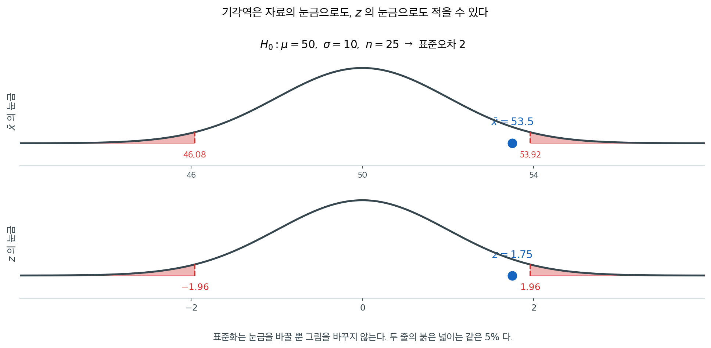
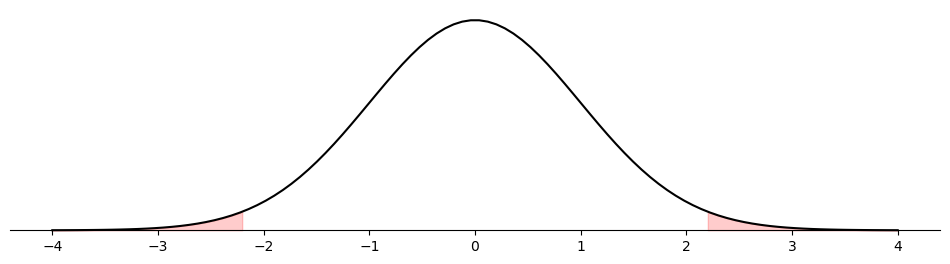
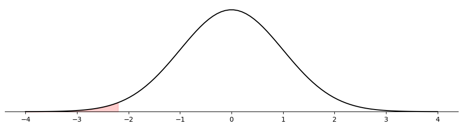
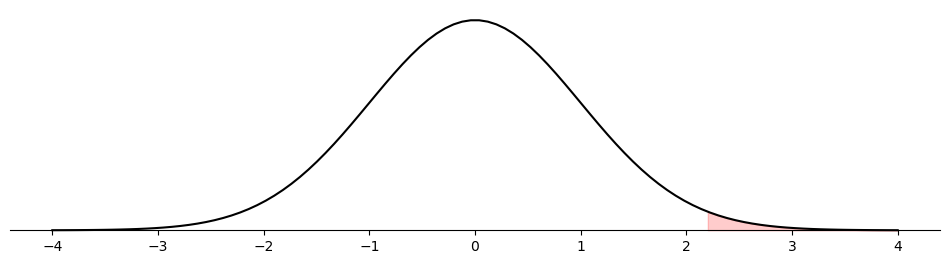
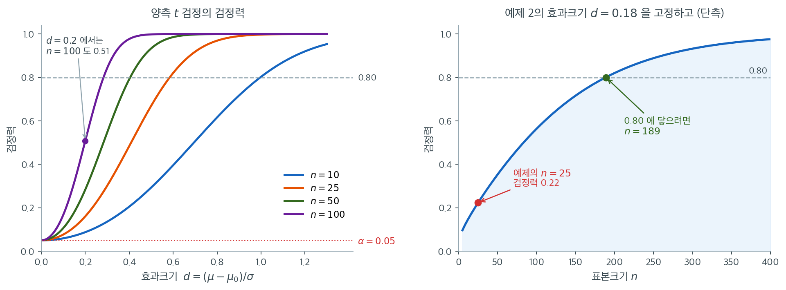

# 평균에 대한 일표본 Z-검정

## 개요

일표본 $z$-검정은 모평균에 대한 가장 단순한 가설검정이다. 모표준편차 $\sigma$를 알 때 쓸 수 있는데, 오랜 공정 자료가 믿을 만한 추정값을 주는 품질관리나 이전 시행에서 표준편차가 확립된 표준화 시험 같은 상황이 그렇다. $\sigma$를 아는 상황이 실무에서 흔하지는 않지만, $z$-검정은 $\sigma$를 모르는 더 일반적인 경우를 다루는 $t$-검정의 개념적 토대가 된다. $z$-검정을 먼저 이해하면 $t$-검정으로의 이행이 쉬워진다: 바뀌는 것은 $\sigma$를 $S$로, 정규분포를 $t$-분포로 바꾸는 것뿐이다.

---

## 1. 가설

$X_1, X_2, \ldots, X_n$을 평균이 $\mu$이고 분산 $\sigma^2$이 알려진 모집단에서 뽑은 확률표본이라 하자. 귀무가설은 평균의 특정 값을 지정한다:

$$
H_0\colon \mu = \mu_0
$$

대립가설은 다음 세 형태 중 하나이다:

| 대립가설 | 해석 |
|---|---|
| $H_1\colon \mu \neq \mu_0$ | 양측: 평균이 $\mu_0$과 다르다 |
| $H_1\colon \mu > \mu_0$ | 우측: 평균이 $\mu_0$보다 크다 |
| $H_1\colon \mu < \mu_0$ | 좌측: 평균이 $\mu_0$보다 작다 |

---

## 2. 검정통계량

검정통계량은 표본평균 $\bar{X}$가 가설의 값 $\mu_0$에서 표준오차 몇 개만큼 떨어져 있는지를 잰다. 절댓값이 크면 관측된 표본평균이 $H_0$ 아래에서 기대되는 것과 멀다는 뜻이므로 귀무가설에 반하는 증거가 된다.

$$
Z = \frac{\bar{X} - \mu_0}{\sigma / \sqrt{n}}
$$

분모 $\sigma / \sqrt{n}$은 $\bar{X}$의 표준오차이므로, $Z$는 $\bar{X}$와 $\mu_0$의 차이를 표본변동의 단위로 나타낸다.

$H_0$ 아래에서 다음 조건 중 하나가 성립하면 $Z$는 표준정규분포를 따른다:

- **정확히**: 모집단이 정규분포를 따르거나,
- **근사적으로**: 표본크기 $n$이 중심극한정리가 적용될 만큼 크다.

$$
Z \sim N(0, 1) \quad \text{under } H_0
$$

---

## 3. 기각역

유의수준 $\alpha$에서 기각역은 대립가설에 따라 달라진다.

**양측** ($H_1\colon \mu \neq \mu_0$): 다음이면 $H_0$을 기각한다.

$$
|Z| > z_{\alpha/2}
$$

**우측** ($H_1\colon \mu > \mu_0$): 다음이면 $H_0$을 기각한다.

$$
Z > z_\alpha
$$

**좌측** ($H_1\colon \mu < \mu_0$): 다음이면 $H_0$을 기각한다.

$$
Z < -z_\alpha
$$

여기서 $z_\alpha$는 $P(Z > z_\alpha) = \alpha$를 만족하는 표준정규의 상위 $\alpha$ 임계값이다.



같은 검정을 두 가지 눈금으로 적을 수 있다. 위는 자료의 단위 그대로인 $\bar x$의 눈금이고, 아래는 표준화한 $z$의 눈금이다. **두 그림은 같은 그림이다.** 가로축의 이름만 바뀌었을 뿐 붉은 넓이도, 판정도 같다.

$\mu_0 = 50$, $\sigma = 10$, $n = 25$이면 표준오차가 $2$이므로 $z = \pm 1.96$이 $\bar x = 50 \pm 3.92$에 대응한다. 관측값 $\bar x = 53.5$는 $53.92$에 못 미치고, 같은 말로 $z = 1.75$는 $1.96$에 못 미친다.

**어느 눈금으로 적을지는 취향이 아니라 쓸모의 문제다.** $\bar x$의 눈금은 "체중이 몇 킬로그램 이상이면"처럼 결과를 현장의 단위로 말해 주고, $z$의 눈금은 표 하나로 모든 문제를 처리할 수 있게 해 준다.

---

## 4. p-값

$p$-값은 $H_0$이 참이라는 가정 아래 관측값 $z_{\text{obs}}$만큼 또는 그보다 극단적인 검정통계량을 볼 확률을 계산하여 $H_0$에 반하는 증거의 강도를 잰다.

| 대립가설 | p-값 공식 |
|---|---|
| $H_1\colon \mu \neq \mu_0$ | $p = 2\,P(Z > \lvert z_{\text{obs}}\rvert) = 2\bigl[1 - \mathcal{N}(\lvert z_{\text{obs}}\rvert)\bigr]$ |
| $H_1\colon \mu > \mu_0$ | $p = P(Z > z_{\text{obs}}) = 1 - \mathcal{N}(z_{\text{obs}})$ |
| $H_1\colon \mu < \mu_0$ | $p = P(Z < z_{\text{obs}}) = \mathcal{N}(z_{\text{obs}})$ |

$p < \alpha$이면 $H_0$을 기각한다.

<div class="exbox" markdown>

**보기 1.** <span class="diff easy" title="쉬움"></span> 일표본 평균 검정 계산기. 요약통계량 $(\bar x, s, n)$만 받아 $z$-검정과 $t$-검정을 모두 처리하는 함수를 만들려 한다. 양측 p-값은 $P(\lvert T \rvert \ge \lvert t_{\text{obs}} \rvert)$로 정의한다.

**(1)** 귀무분포가 $0$에 대해 대칭인 연속분포이고 그 분포함수를 $F$라 할 때,

$$
P(\lvert T \rvert \ge \lvert t_{\text{obs}} \rvert) = 2\min\{F(t_{\text{obs}}),\ 1 - F(t_{\text{obs}})\}
$$

임을 보이시오. 또 이 식이 성립하지 않는 검정의 예를 드시오.

**(2)** (1)의 식을 써서 두 검정을 함께 처리하는 함수를 작성하고, 원자료가 있는 경우 `scipy.stats.ttest_1samp`와 같은 값을 주는지 확인하시오.

</div>

??? success "풀이"

    **(1) 해석적으로.** $F$가 $0$에 대해 대칭이면 $F(-u) = 1 - F(u)$이다. $t = t_{\text{obs}}$로 줄여 쓰면

    $$
    P(\lvert T \rvert \ge \lvert t \rvert)
    = P(T \le -\lvert t \rvert) + P(T \ge \lvert t \rvert)
    = F(-\lvert t \rvert) + \bigl(1 - F(\lvert t \rvert)\bigr)
    = 2\bigl(1 - F(\lvert t \rvert)\bigr)
    $$

    이다. 남은 것은 $1 - F(\lvert t \rvert) = \min\{F(t),\ 1-F(t)\}$를 보이는 일이고, 부호로 나누면 끝난다.

    - $t \ge 0$이면 $\lvert t \rvert = t$이므로 $1 - F(\lvert t \rvert) = 1 - F(t)$이다. 대칭성에서 $F(0) = 1/2$이고 $F$가 비감소이므로 $F(t) \ge 1/2 \ge 1 - F(t)$, 따라서 최솟값은 $1 - F(t)$다.
    - $t < 0$이면 $\lvert t \rvert = -t$이므로 $1 - F(\lvert t \rvert) = 1 - F(-t) = F(t)$이고, 이번에는 $F(t) < 1/2 < 1 - F(t)$이므로 최솟값이 $F(t)$다.

    두 경우가 모두 $2\min\{F(t), 1-F(t)\}$를 준다. $\square$

    **두 검정이 한 함수에 들어가는 까닭이 이 식에 있다.** $z$-검정과 $t$-검정은 분자·분모가 같은 꼴이고 $F$만 $\Phi$에서 $t_{n-1}$의 분포함수로 바뀐다. 둘 다 $0$에 대해 대칭이므로 위 식이 그대로 쓰인다.

    **성립하지 않는 예.** 귀무분포가 대칭이 아니면 쓸 수 없다. 모분산 검정의 $\chi^2_{n-1}$, 분산비 검정의 $F_{n_1-1,\,n_2-1}$이 그렇다. 그때는 두 꼬리 확률을 따로 계산해 더하거나, 관례대로 작은 쪽 꼬리를 두 배 하는 **다른** 규칙을 쓴다고 명시해야 한다.

    **(2) 수치적으로.** 먼저 함수를 만든다.

    ```python
    import math
    from scipy.stats import t as tdist, norm

    def test_mean_one_sample(xbar, n, mu0=0.0, sd=None, known_sigma=None,
                             alternative="two-sided", alpha=0.05):
        """known_sigma를 주면 z-검정, 아니면 표본 sd로 t-검정.

        원자료가 아니라 요약통계량(xbar, n, sd)만 받는다.
        검정에 필요한 것이 그것뿐이기 때문이다.
        alternative는 scipy의 관례를 그대로 따른다.
        돌려주는 값은 (통계량, p-값, 기각 여부, 이름)이다.
        """
        if known_sigma is not None:
            se = known_sigma / math.sqrt(n)
            z = (xbar - mu0) / se
            if alternative == "two-sided":
                # 작은 쪽 꼬리를 골라 두 배 한다. z의 부호를 따지지 않아도 되고
                # 어느 쪽으로 치우쳐도 같은 식이 쓰인다.
                p = 2 * min(norm.cdf(z), norm.sf(z))
            elif alternative == "less":
                p = norm.cdf(z)
            else:
                # 오른쪽 꼬리는 sf로 계산한다. 1 - cdf는 꼬리에서 정밀도를 잃는다.
                p = norm.sf(z)
            return z, p, (p < alpha), "z-test"

        if sd is None:
            raise ValueError("Provide sd for t-test or known_sigma for z-test.")
        se = sd / math.sqrt(n)
        df = n - 1               # sd를 자료에서 추정했으므로 자유도 하나를 잃는다
        t = (xbar - mu0) / se
        if alternative == "two-sided":
            p = 2 * min(tdist.cdf(t, df), tdist.sf(t, df))
        elif alternative == "less":
            p = tdist.cdf(t, df)
        else:
            p = tdist.sf(t, df)
        return t, p, (p < alpha), f"t-test (df={df})"
    ```

    원자료를 하나 만들어 `scipy.stats.ttest_1samp`와 맞추어 본다. 함수는 요약통계량만 받으므로 원자료에서 $\bar x$와 $s$를 뽑아 넘긴다. 대칭 항등식도 몇 점에서 직접 확인한다.

    ```python
    import numpy as np
    from scipy import stats

    rng = np.random.default_rng(9)
    x = rng.normal(3.4, 1.2, 25)
    n, xbar, sd = len(x), x.mean(), x.std(ddof=1)
    mu0 = 3.0

    print(f"n = {n},  xbar = {xbar:.4f},  s = {sd:.4f}")
    for alt in ("two-sided", "greater", "less"):
        t_my, p_my, _, _ = test_mean_one_sample(xbar, n, mu0, sd=sd, alternative=alt)
        r = stats.ttest_1samp(x, mu0, alternative=alt)
        print(f"  {alt:>9s}:  요약통계량 p = {p_my:.8f}   scipy p = {r.pvalue:.8f}")

    # 대칭 항등식 2 min(F(t), 1-F(t)) = P(|T| >= |t|) 를 여러 t 에서 확인한다.
    grid = np.array([-3.1, -0.4, 0.0, 0.9, 2.7])
    tail = 2 * stats.t.sf(np.abs(grid), n - 1)                                 # P(|T| >= |t|)
    mins = 2 * np.minimum(stats.t.cdf(grid, n - 1), stats.t.sf(grid, n - 1))   # 함수가 쓰는 식
    print(f"두 식의 최대 차이 = {np.max(np.abs(tail - mins)):.2e}")
    ```

    출력:

    ```
    n = 25,  xbar = 3.5836,  s = 1.3921
      two-sided:  요약통계량 p = 0.04680592   scipy p = 0.04680592
        greater:  요약통계량 p = 0.02340296   scipy p = 0.02340296
           less:  요약통계량 p = 0.97659704   scipy p = 0.97659704
    두 식의 최대 차이 = 0.00e+00
    ```

    세 대립가설 모두에서 소수 여덟째 자리까지 일치하고, 항등식의 두 식은 **부동소수점 수준에서 정확히** 같다. 단측 두 p-값이 $0.02340296 + 0.97659704 = 1$로 합이 1인 것도 확인할 수 있다. 연속분포이므로 $P(T \le t) + P(T \ge t) = 1$이기 때문이며, 이 합이 1이 아니라면 어느 한쪽 꼬리를 잘못 잡은 것이다.

---

## 5. 풀이 보기

한 배터리 제조사의 생산라인은 (수년간의 품질관리 자료에서 확립된) 충전 중량의 표준편차가 $\sigma = 3$ 그램으로 알려져 있다. 목표 평균 중량은 $\mu_0 = 50$ 그램이다. 검사자가 배터리 $n = 36$개를 무작위로 뽑아 $\bar{x} = 49.1$ 그램을 얻었다. $\alpha = 0.05$에서 평균 중량이 50 그램과 다른지 검정하라.

**1단계.** 가설을 세운다:

$$
H_0\colon \mu = 50 \qquad H_1\colon \mu \neq 50
$$

**2단계.** 검정통계량을 계산한다:

$$
Z = \frac{49.1 - 50}{3 / \sqrt{36}} = \frac{-0.9}{0.5} = -1.80
$$

**3단계.** 임계값을 구한다. $\alpha = 0.05$의 양측검정에서:

$$
z_{\alpha/2} = z_{0.025} = 1.96
$$

**4단계.** 판정한다. $|Z| = 1.80 < 1.96$이므로 $H_0$을 기각하지 못한다. 자료는 5% 수준에서 평균 중량이 50 그램과 다르다고 결론지을 충분한 증거를 주지 않는다.

**5단계.** $p$-값을 계산한다:

$$
p = 2[1 - \mathcal{N}(1.80)] = 2(0.0359) = 0.0718
$$

$p = 0.072 > 0.05$이므로 기각하지 못한다는 판정이 확인된다.

!!! tip "경계에 있는 결과의 해석"
    $p = 0.072$는 $\alpha = 0.05$에서는 통계적으로 유의하지 않지만 $\alpha = 0.10$에서는 유의할 것이다. 실무에서는 관측된 이탈($\bar{x} = 49.1$ 대 $\mu_0 = 50$)이 실재하지만 작은 변화를 나타낼 수도 있으므로, 검사자가 더 확실한 결론을 위해 표본크기를 늘리자고 권할 만하다.

<div class="exbox" markdown>

**보기 2.** <span class="diff easy" title="쉬움"></span> 일표본 z 검정 — 양측. 관측값 $n = 500$개에서 $\bar x = 48$, $s = 20.3$을 얻었다.

$$H_0: \mu = 50 \quad \text{vs} \quad H_1: \mu \neq 50$$

**(1)** 검정통계량과 양측 p-값을 손으로 구하고, $\alpha = 0.05$의 기각역을 $\bar x$의 값으로 환산하시오.

**(2)** 코드로 확인하고, p-값이 그림의 어느 넓이인지 밝히시오.

</div>

??? success "풀이"

    **(1) 해석적으로.** 표준오차부터 구한다.

    $$
    \frac{s}{\sqrt{n}} = \frac{20.3}{\sqrt{500}} = \frac{20.3}{22.3607} = 0.90784
    $$

    이므로 검정통계량은

    $$
    z = \frac{\bar x - \mu_0}{s/\sqrt{n}} = \frac{48 - 50}{0.90784} = -2.20302
    $$

    이고, 양측 p-값은 한쪽 꼬리를 두 배 한 값이다.

    $$
    p = 2\,P(Z \ge 2.20302) = 2 \times 0.013797 = 0.027593
    $$

    기각역을 $\bar x$의 값으로 되돌려 보면 더 잘 보인다. $\lvert \bar x - 50 \rvert > 1.95996 \times 0.90784 = 1.77934$이므로

    $$
    \bar x < 48.2207 \quad \text{또는} \quad \bar x > 51.7793
    $$

    이다. 관측된 $48$은 아래쪽 경계보다 $0.22$만 더 낮다. **아슬아슬하게 들어간 것**이고, p-값 $0.0276$이 $0.05$에 가까운 것이 같은 사실의 다른 표현이다.

    **(2) 수치적으로.**

    ```python
    import matplotlib.pyplot as plt
    import numpy as np
    import scipy.stats as stats

    def plot_z_statistic(statistic, ax, alternative='two-sided'):
        """검정통계량 위치에서 잘린 꼬리를 칠해 p-값을 눈으로 보여준다.

        칠해진 넓이가 곧 p-값이다. 양측이면 좌우 두 조각의 합이다.
        """
        x = np.linspace(-4, 4, 100)
        y = stats.norm().pdf(x)
        ax.plot(x, y, '-k')

        if alternative == 'less':
            x_fill = np.linspace(-4, statistic, 100)
            y_fill = stats.norm().pdf(x_fill)
            ax.fill_between(x_fill, y_fill, color='r', alpha=0.2)
        elif alternative == 'greater':
            x_fill = np.linspace(statistic, 4, 100)
            y_fill = stats.norm().pdf(x_fill)
            ax.fill_between(x_fill, y_fill, color='r', alpha=0.2)
        elif alternative == 'two-sided':
            x_fill_left = np.linspace(-4, -abs(statistic), 100)
            y_fill_left = stats.norm().pdf(x_fill_left)
            ax.fill_between(x_fill_left, y_fill_left, color='r', alpha=0.2)
            x_fill_right = np.linspace(abs(statistic), 4, 100)
            y_fill_right = stats.norm().pdf(x_fill_right)
            ax.fill_between(x_fill_right, y_fill_right, color='r', alpha=0.2)

        ax.spines['left'].set_visible(False)
        ax.spines['right'].set_visible(False)
        ax.spines['top'].set_visible(False)
        ax.spines['bottom'].set_position("zero")
        ax.set_yticks([])

    mu = 50
    n = 500
    x_bar = 48
    s = 20.3

    # n = 500 >= 30 이므로 sigma를 몰라도 s를 넣고 z를 쓴다.
    statistic = (x_bar - mu) / (s / np.sqrt(n))
    # sf(x) = 1 - cdf(x) 이고 꼬리확률에서는 sf가 수치적으로 더 정확하다.
    # abs를 씌우고 2를 곱해 양측으로 만든다.
    p_value = stats.norm().sf(abs(statistic)) * 2

    print(f"Statistic: {statistic:.4f}")
    print(f"P-value  : {p_value:.4f}")

    alpha = 0.05
    if p_value <= alpha:
        print("Reject H0 (Choose H1)")
    else:
        print("Fail to reject H0")

    fig, ax = plt.subplots(figsize=(12, 3))
    plot_z_statistic(statistic, ax=ax, alternative='two-sided')
    plt.show()
    ```

    출력:

    ```
    Statistic: -2.2030
    P-value  : 0.0276
    Reject H0 (Choose H1)
    ```

    

    $\bar x = 48$은 가설값 50에서 2만큼 떨어져 있을 뿐이지만 $n = 500$이라 표준오차가 0.91로 작아 $z = -2.20$이 된다. 표본이 크면 작은 차이도 유의해진다.

    그림에서 칠해진 두 꼬리의 넓이 합이 0.0276이다.

    유도한 $z = -2.20302$와 $p = 0.027593$이 출력의 $-2.2030$, $0.0276$과 맞는다. 칠해진 두 꼬리는 $z \le -2.2030$과 $z \ge 2.2030$이고 정규분포가 대칭이므로 두 조각의 넓이가 같다. 한 조각이 $0.013797$이다.

    **표본이 크면 작은 차이도 유의해진다.** 거꾸로 같은 $\bar x$와 $s$로 $n = 100$이었다면 표준오차가 $2.03$이 되어 $z = -0.9852$, $p = 0.3245$로 기각하지 못한다.

    한 가지 덧붙일 것이 있다. 여기서는 $\sigma$를 모르고 $s$를 넣었으니 통계량은 엄밀히 말해 $z$가 아니라 $t_{499}$다. 자유도 $499$에서 양측 p-값은 $0.02805$, 임계값은 $1.9647$이어서 정규의 $1.9600$과 거의 같다. **$n$이 이만큼 크면 둘을 구별할 필요가 없다**는 것이 "$n \ge 30$" 관례가 가리키는 바다.

<div class="exbox" markdown>

**보기 3.** <span class="diff easy" title="쉬움"></span> 일표본 z 검정 — 작음. 자료는 보기 2와 같고($n = 500$, $\bar x = 48$, $s = 20.3$) 대립가설만 바꾼다.

$$H_0: \mu = 50 \quad \text{vs} \quad H_1: \mu < 50$$

**(1)** 이 좌측 p-값이 보기 2의 양측 p-값의 **정확히** 절반임을 보이시오.

**(2)** 자료를 본 뒤에 유리한 방향을 골라 단측검정을 하면 실제 제1종 오류율이 얼마가 되는지 구하시오.

</div>

??? success "풀이"

    **(1) 절반인 것은 우연이 아니다.** 통계량은 자료만으로 정해지므로 보기 2와 같은 $z = -2.20302$다. 좌측 p-값은

    $$
    p_{<} = P(Z \le z) = P(Z \le -2.20302) = 0.013797
    $$

    이고 양측 p-값은 정의상

    $$
    p_{\ne} = 2\,P(Z \ge \lvert z \rvert) = 2\,P(Z \le -\lvert z \rvert)
    $$

    이다. 지금은 $z < 0$이므로 $-\lvert z \rvert = z$이고, 따라서 $p_{\ne} = 2 p_{<}$가 **등식으로** 성립한다. $0.027593 = 2 \times 0.013797$이다.

    여기에는 조건이 하나 붙어 있다. **통계량의 부호가 대립가설이 가리키는 방향과 같아야 한다.** 만약 $\bar x = 52$였다면 $z = +2.20302$이고 좌측 p-값은 $0.98620$이 되어 양측값 $0.027593$의 절반과는 아무 관계가 없다.

    **(2) 수치적으로.**

    ```python
    mu = 50
    n = 500
    x_bar = 48
    s = 20.3

    statistic = (x_bar - mu) / (s / np.sqrt(n))
    # H1이 "작다" 쪽이므로 왼쪽 꼬리만 센다. abs도, 2를 곱하는 것도 없다.
    p_value = stats.norm().cdf(statistic)

    print(f"Statistic : {statistic:.4f}")
    print(f"P-value   : {p_value:.4f}")

    alpha = 0.05
    if p_value <= alpha:
        print("We choose H1, or using statistician's jargon, reject H0")
    else:
        print("We choose H0, or using statistician's jargon, fail to reject H0")

    fig, ax = plt.subplots(figsize=(12, 3))
    plot_z_statistic(statistic, ax=ax, alternative='less')
    plt.show()
    ```

    출력:

    ```
    Statistic : -2.2030
    P-value   : 0.0138
    We choose H1, or using statistician's jargon, reject H0
    ```

    

    같은 자료, 같은 통계량인데 p-값이 양측의 0.0276에서 정확히 절반인 0.0138이 되었다. 그림에서도 오른쪽 꼬리의 칠이 사라졌다.

    단측검정을 쓰려면 자료를 보기 **전에** 방향을 정해 두어야 한다. 결과를 보고 유리한 방향을 고르면 실제 제1종 오류율이 5%가 아니라 10%가 된다.

    그 $10\%$는 어림이 아니라 정확한 값이다. 자료를 보고 유리한 쪽을 고른다는 것은 두 단측 p-값 중 **작은 쪽**을 쓴다는 뜻인데, 두 값의 합이 항상 $1$이므로 작은 쪽은 언제나 $P(Z \le -\lvert z \rvert)$다. 그러니 기각하는 사건은

    $$
    \min(p_{<},\, p_{>}) \le 0.05 \iff \lvert z \rvert \ge z_{0.05} = 1.64485
    $$

    이고, $H_0$ 아래에서 그 확률은

    $$
    P(\lvert Z \rvert \ge 1.64485) = 2 \times 0.05 = 0.10
    $$

    이다. **명목 $5\%$ 검정이 실제로는 $10\%$ 검정이 된다.** 모의실험이 필요 없는 닫힌 꼴이다.

<div class="exbox" markdown>

**보기 4.** <span class="diff easy" title="쉬움"></span> 일표본 z 검정 — 큼. 이번에는 $n = 500$, $\bar x = 52$, $s = 20.3$이다.

$$H_0: \mu = 50 \quad \text{vs} \quad H_1: \mu > 50$$

**(1)** p-값이 보기 3과 같은 값이 되는 까닭을 밝히시오.

**(2)** 참 평균이 정말 $52$라면, 같은 $\alpha = 0.05$에서 단측검정과 양측검정의 검정력은 각각 얼마인가. 닫힌 꼴로 구하시오.

</div>

??? success "풀이"

    **(1) 두 번 뒤집히면 제자리다.** $\bar x$가 $48$에서 $52$로 옮겨 가 $\bar x - \mu_0$의 부호만 바뀌었으므로 $z = +2.20302$다. 대립가설이 오른쪽이라 p-값은 오른쪽 꼬리이고

    $$
    p_{>} = P(Z \ge 2.20302) = 0.013797
    $$

    이다. 보기 3의 $P(Z \le -2.20302)$와 같은 수인데, 표준정규밀도가 $\varphi(-x) = \varphi(x)$로 대칭이기 때문이다. **통계량의 부호와 꼬리의 방향이 함께 뒤집혀 상쇄되었다.**

    **(2) 수치적으로.**

    ```python
    mu = 50
    n = 500
    x_bar = 52
    s = 20.3

    statistic = (x_bar - mu) / (s / np.sqrt(n))
    # 이번에는 H1이 "크다" 쪽이므로 오른쪽 꼬리만 센다.
    p_value = stats.norm().sf(statistic)

    print(f"Statistic : {statistic:.4f}")
    print(f"P-value   : {p_value:.4f}")

    alpha = 0.05
    if p_value <= alpha:
        print("We choose H1, or using statistician's jargon, reject H0")
    else:
        print("We choose H0, or using statistician's jargon, fail to reject H0")

    fig, ax = plt.subplots(figsize=(12, 3))
    plot_z_statistic(statistic, ax=ax, alternative='greater')
    plt.show()
    ```

    출력:

    ```
    Statistic : 2.2030
    P-value   : 0.0138
    We choose H1, or using statistician's jargon, reject H0
    ```

    

    $\bar x$가 48에서 52로 바뀌어 통계량의 부호만 뒤집혔고, 대립가설의 방향도 함께 뒤집혀 p-값은 앞의 보기와 같은 0.0138이다. 정규분포의 대칭성 덕분이다.

    **검정력은 방향을 맞게 세운 쪽이 높다.** 참 평균이 $\mu = 52$이고 표준오차가 $\sigma/\sqrt{n} = 0.90784$라면 비중심성은

    $$
    \frac{\mu - \mu_0}{\sigma/\sqrt{n}} = \frac{2}{0.90784} = 2.20302
    $$

    이다. $Z = (\bar X - 50)/0.90784$는 평균 $2.20302$, 분산 $1$인 정규분포를 따르므로

    $$
    \text{단측 검정력} = P(Z > 1.64485) = 1 - \Phi(1.64485 - 2.20302) = 1 - \Phi(-0.55817) = 0.7116
    $$

    $$
    \text{양측 검정력} = 1 - \Phi(1.95996 - 2.20302) + \Phi(-1.95996 - 2.20302) = 0.5960 + 0.0000 = 0.5960
    $$

    이다. 양측의 왼쪽 꼬리 기여 $\Phi(-4.163) = 0.0000157$은 소수 넷째 자리에 거의 보이지 않는다. **방향을 미리 알고 있으면 같은 자료로 검정력이 $0.596$에서 $0.712$로 올라간다.** 이것이 단측검정을 쓰는 유일한 정당한 이유이며, 보기 2에서 본 대로 **자료를 본 뒤에 방향을 고르는 순간 그 이득은 오류율로 되돌려 갚아야 한다.**

---

## 6. 가정

일표본 $z$-검정에는 다음이 필요하다:

- **$\sigma$를 안다**: 모표준편차가 현재 표본에서 추정한 값이 아니라 알려진 상수이다.
- **독립성**: 관측값 $X_1, \ldots, X_n$이 독립이다.
- **정규성 또는 큰 $n$**: 모집단이 정규분포를 따르거나(정확한 추론), $n$이 중심극한정리가 좋은 근사를 주기에 충분히 크다(보통 $n \geq 30$).

!!! warning "$\sigma$를 아는 경우는 드물다"
    $\sigma$를 안다는 가정은 강하며, 방대한 과거 자료를 갖춘 통제된 산업 환경 밖에서는 좀처럼 충족되지 않는다. $\sigma$를 표본에서 추정해야 한다면 $\sigma$ 추정의 추가 불확실성을 반영하는 일표본 $t$-검정을 쓰라.

<div class="exbox" markdown>

**보기 5.** <span class="diff easy" title="쉬움"></span> $\sigma$를 안다는 가정의 값. $\bar x = 3.2$, $s = 1.1$, $n = 25$로 $H_0\colon \mu = 3.0$ 대 $H_1\colon \mu > 3.0$을 검정한다. **같은 숫자 1.1**을 한 번은 표본표준편차 $s$로, 한 번은 알려진 $\sigma$로 넣어 두 검정을 나란히 돌린다.

**(1)** 관측된 통계량이 같을 때 $t$ 검정의 p-값이 $z$ 검정의 p-값보다 **언제나** 크다는 것을 보이시오.

**(2)** $\sigma$를 모르는데 안다고 가정하면, 곧 귀무분포가 $t_{n-1}$인데 정규 임계값 $1.96$으로 기각하면 실제 유의수준이 얼마가 되는지 $n$별로 구하시오.

</div>

??? success "풀이"

    **(1) 해석적으로.** 두 통계량은 분자·분모가 같은 수이므로 $t_{\text{obs}} = z_{\text{obs}}$다. 달라지는 것은 그 수를 견주는 분포뿐이고, $t$ 분포를 **정규분포의 척도혼합**으로 적으면 부등식이 바로 나온다. $Z \sim N(0,1)$, $W \sim \chi^2_\nu$가 독립일 때

    $$
    T_\nu = \frac{Z}{\sqrt{W/\nu}}
    $$

    이므로, $W$로 조건을 걸면 $T_\nu$는 표준편차 $\sqrt{\nu/W}$인 정규분포다. $t > 0$에 대해 꼬리확률을 조건부 기댓값으로 풀면

    $$
    P(T_\nu \ge t) = E\!\left[\bar\Phi\!\left(t\sqrt{W/\nu}\right)\right],
    \qquad \bar\Phi(u) = 1 - \Phi(u)
    $$

    이다. 여기서 $\bar\Phi$는 $u > 0$에서 **볼록**하다. $\bar\Phi''(u) = u\varphi(u) > 0$이기 때문이다. $t > 0$이고 $W > 0$이니 안쪽 값이 늘 양수이므로 옌센 부등식을 그대로 쓸 수 있다.

    $$
    P(T_\nu \ge t) \;\ge\; \bar\Phi\!\left(t \cdot c_\nu\right),
    \qquad
    c_\nu = E\!\left[\sqrt{W/\nu}\right]
    = \sqrt{\frac{2}{\nu}}\,\frac{\Gamma\!\left(\frac{\nu+1}{2}\right)}{\Gamma\!\left(\frac{\nu}{2}\right)}
    $$

    남은 것은 $c_\nu < 1$이다. 제곱근은 **엄격히 오목**하고 $W$는 상수가 아니므로 옌센 부등식이 반대 방향으로 엄격하게 성립한다.

    $$
    c_\nu = E\!\left[\sqrt{W/\nu}\right] < \sqrt{E[W]/\nu} = 1
    $$

    $\bar\Phi$가 감소함수이므로 $\bar\Phi(t c_\nu) > \bar\Phi(t)$이고, 두 부등식을 이으면

    $$
    P(T_\nu \ge t) \;>\; \bar\Phi(t) = P(Z \ge t)
    \qquad (t > 0)
    $$

    이다. **$t$ 검정의 단측 p-값은 어떤 $t > 0$에서도 $z$ 검정의 것보다 크다.** 양측은 두 배이므로 그대로 따라온다. $\square$

    옌센을 두 번 쓴 것이 각각 다른 일을 한다. 앞의 것은 **분모가 흔들린다**는 사실의 값이고, 뒤의 것은 그 흔들림의 중심이 1보다 **아래로** 내려앉는다는 사실의 값이다.

    **(2) 임계값을 잘못 쓰면.** $\sigma$를 안다고 가정하면 $\pm 1.96$으로 기각하지만 참 귀무분포는 $t_{n-1}$이다. 그러므로 실제 유의수준은

    $$
    \alpha_{\text{실제}} = 2\left[1 - F_{t_{n-1}}(1.96)\right]
    $$

    이고 (1)에 의해 이 값은 명목 $0.05$보다 **언제나 크다.** 작은 자유도에서는 닫힌 꼴로 적을 수 있다. $\nu = 1$(코시)에서 $F(t) = \tfrac12 + \tfrac{1}{\pi}\arctan t$이므로

    $$
    \alpha_{\text{실제}} = 1 - \frac{2}{\pi}\arctan(1.96) = 0.3003
    $$

    이고, $\nu = 2$에서는 $F(t) = \tfrac12\left(1 + t/\sqrt{2+t^2}\right)$이므로

    $$
    \alpha_{\text{실제}} = 1 - \frac{1.96}{\sqrt{2 + 1.96^2}} = 0.1891
    $$

    이다. $n = 3$짜리 표본에서 $\sigma$를 안다고 둘러대면 5% 검정이 실제로는 19% 검정이 된다.

    **수치로 확인한다.** 먼저 보기의 두 검정을 돌린다.

    ```python
    stat, p, reject, label = test_mean_one_sample(
        xbar=3.2, n=25, mu0=3.0, sd=1.1, alternative="greater"
    )
    print(label, "stat:", stat, "p:", p, "reject:", reject)

    # 같은 자료를 sigma=1.1을 안다고 가정하고 z-검정으로도 해 본다.
    stat_z, p_z, reject_z, label_z = test_mean_one_sample(
        xbar=3.2, n=25, mu0=3.0, known_sigma=1.1, alternative="greater"
    )
    print(label_z, "stat:", stat_z, "p:", p_z, "reject:", reject_z)
    ```

    출력:

    ```
    t-test (df=24) stat: 0.9090909090909097 p: 0.18617076763866552 reject: False
    z-test stat: 0.9090909090909097 p: 0.1816510704434488 reject: False
    ```

    통계량은 같고 p-값만 다르다. 산포로 넣은 숫자가 1.1로 같으니 분자와 분모가 같을 수밖에 없고, 달라지는 것은 그 통계량을 어느 분포에 견주느냐뿐이다. **$\sigma$를 모른다는 사실의 값이 여기서는 0.0045만큼이다.**

    이제 (1)의 부등식과 (2)의 표를 확인한다.

    ```python
    import math

    import numpy as np
    from scipy import stats
    from scipy.special import gammaln

    nu = 24
    t_obs = 0.2 / (1.1 / math.sqrt(25))

    # c_nu = E[sqrt(W/nu)],  W ~ chi2_nu.  1 보다 작다는 것이 요점이다.
    c_nu = math.exp(0.5 * math.log(2 / nu) + gammaln((nu + 1) / 2) - gammaln(nu / 2))

    print(f"t_obs = {t_obs:.6f},  c_24 = {c_nu:.6f}")
    print(f"정규 꼬리   Phibar(t)      = {stats.norm.sf(t_obs):.6f}")
    print(f"옌센 하한   Phibar(c t)    = {stats.norm.sf(c_nu * t_obs):.6f}")
    print(f"t 꼬리      P(T_24 >= t)   = {stats.t.sf(t_obs, nu):.6f}")

    # 부등식이 t 전체에서 성립하는지 격자로 훑는다.
    tg = np.linspace(0.01, 8.0, 200_001)
    gap = stats.t.sf(tg, nu) - stats.norm.sf(tg)
    print(f"(t 꼬리 - 정규 꼬리) 의 최솟값 = {gap.min():.3e}")

    # sigma 를 안다고 잘못 가정하면 실제 유의수준이 얼마가 되는가.
    z975 = stats.norm.ppf(0.975)
    print("\n    n      nu   실제 크기   올바른 임계값")
    for n in (2, 3, 5, 11, 25, 61, 101, 1001):
        print(f"{n:5d}  {n - 1:6d}      {2 * stats.t.sf(z975, n - 1):.4f}"
              f"          {stats.t.ppf(0.975, n - 1):.3f}")
    ```

    출력:

    ```
    t_obs = 0.909091,  c_24 = 0.989640
    정규 꼬리   Phibar(t)      = 0.181651
    옌센 하한   Phibar(c t)    = 0.184147
    t 꼬리      P(T_24 >= t)   = 0.186171
    (t 꼬리 - 정규 꼬리) 의 최솟값 = 1.578e-08

        n      nu   실제 크기   올바른 임계값
        2       1      0.3003          12.706
        3       2      0.1891          4.303
        5       4      0.1216          2.776
       11      10      0.0784          2.228
       25      24      0.0617          2.064
       61      60      0.0546          2.000
      101     100      0.0528          1.984
     1001    1000      0.0503          1.962
    ```

    세 수가 유도한 순서대로 놓인다. $0.181651 < 0.184147 \le 0.186171$, 곧 **정규 꼬리 < 옌센 하한 $\le$ $t$ 꼬리**다. 격자를 $(0,\,8]$로 훑어도 차이의 최솟값이 양수이고, 양 끝에서 0으로 수렴하므로 최솟값이 $10^{-8}$ 수준까지 내려가는 것은 수렴의 흔적일 뿐 부등호가 뒤집힌 것이 아니다.

    표의 두 닫힌 꼴 $0.3003$과 $0.1891$이 (2)에서 손으로 구한 값과 자리까지 같다. **$n = 25$에서 실제 크기는 $0.0617$**로 명목의 1.23배이고, 명목을 맞추려면 임계값을 $1.96$이 아니라 $2.064$로 잡아야 한다. $n = 1001$에서야 $0.0503$으로 명목에 붙는다.

    여기서 쓴 수 $1.1$을 "모표준편차"라고 부를 수 있었다면 p-값이 $0.1817$이었다. 실제로는 그 수를 자료에서 얻었으므로 $0.1862$가 옳다. 차이가 $0.0045$로 작아 보이지만, (2)의 표가 보이는 대로 **$n$이 작아질수록 그 대가가 급격히 커진다.**

---

### 기각하지 못한 것과 차이가 없는 것



기각하지 못했다는 것과 차이가 없다는 것은 다른 말이다. 둘을 구별하려면 이 검정이 애초에 차이를 잡아낼 힘을 얼마나 가지고 있었는지를 함께 보아야 한다. **검정력은 대립가설이 참일 때 $H_0$을 기각할 확률이며, 효과크기 $d = (\mu - \mu_0)/\sigma$와 표본크기 $n$ 두 가지가 그 값을 거의 결정한다.** 왼쪽은 양측 $t$ 검정($\alpha = 0.05$)의 검정력을 비중심 $t$ 분포로 정확히 계산한 것이다.

곡선 하나를 고르고 가로로 읽으면 표본크기가 하는 일이 보인다. 중간 크기의 차이 $d = 0.5$를 잡아낼 확률이 $n = 10$에서 0.29, $n = 25$에서 0.67, $n = 50$에서 0.93으로 올라간다. 반면 작은 차이 $d = 0.2$는 $n = 100$에서도 0.51에 그친다. **작은 효과를 다루면서 표본을 백 개쯤 모으는 연구는 참인 차이를 절반 가까이 놓친다.**

오른쪽은 위 보기 5 의 자료를 그대로 옮긴 것이다. 관측된 차이 $0.2$를 산포 $1.1$로 나누면 $d \approx 0.18$이고($\sigma$가 $s$와 같다고 본 것이다), 이 크기의 차이에 대해 $n = 25$ 단측 검정의 검정력은 0.22다. 참으로 $\mu = 3.2$였다 해도 이 설계는 열 번 중 여덟 번 가까이 기각에 실패한다는 뜻이다. 검정력을 0.80까지 올리려면 $n = 189$가 필요하다.

그러므로 $p = 0.186$에서 끌어낼 수 있는 결론은 "$\mu = 3.0$이다"가 아니라 "이 자료로는 판단할 수 없다"이다. 판단하려면 표본을 늘리거나, 적어도 신뢰구간을 함께 보고하여 어느 크기의 차이들이 여전히 자료와 양립하는지 밝혀야 한다.

---

## 연습문제

<div class="drillbox" markdown>

**연습문제 1.** <span class="diff easy" title="쉬움"></span>
제조사가 평균 수명이 1200시간이라고 주장한다. 표본: $n = 36$, $\bar X = 1150$, $s = 200$. $\alpha = 0.05$에서 검정하라.

</div>

??? success "풀이"
    $H_0: \mu = 1200$ 대 $H_1: \mu \ne 1200$.

    $z = (1150 - 1200)/(200/\sqrt{36}) = -50/33.3 \approx -1.5$.

    임계값: $\pm 1.96$. $|z| = 1.5 < 1.96$. **기각하지 못한다.**

    주장을 반박할 증거가 부족하다. p-값: $2 \cdot \Phi(-1.5) = 2 \cdot 0.067 = 0.134$.

---

<div class="drillbox" markdown>

**연습문제 2.** <span class="diff easy" title="쉬움"></span>
**단측 대립가설.** 연습문제 1을 $H_1: \mu < 1200$(평균이 더 낮다고 의심)으로 바꾸어 판정을 다시 하라.

</div>

??? success "풀이"
    $H_0: \mu \ge 1200$ 대 $H_1: \mu < 1200$.

    기각역: $z < -z_{0.05} = -1.645$.

    $z = -1.5 > -1.645$. 아슬아슬하게 **기각하지 못한다.**

    p-값: $\Phi(-1.5) = 0.067$ — 0.05에 가깝다.

    경계에서는 단측검정이 다른 판정을 줄 수 있다. 방향을 미리 지정한 가설이 정당화된다면 단측검정이 더 강력하다.

---

<div class="drillbox" markdown>

**연습문제 3.** <span class="diff easy" title="쉬움"></span>
**다중비교.** 어떤 품질 엔지니어가 생산라인 20곳에 대해 $\mu = $ 목표값을 검정한다. $\alpha = 0.05$에서 잘못 기각할 라인 수의 기댓값은?

</div>

??? success "풀이"
    모든 $H_0$이 참일 때 잘못된 기각의 기댓값 = $20 \cdot 0.05 = 1$. 적어도 한 번 잘못 기각할 가족단위 확률: $1 - (0.95)^{20} \approx 0.642$.

    모든 라인이 실제로 목표에 맞더라도 어딘가에서 문제의 "증거"를 발견할 확률이 약 64%이다. 이것이 다중검정 문제이다.

    보정:

    - **Bonferroni:** $\alpha/20 = 0.0025$에서 검정한다. 가족단위 오류가 $\le 0.05$.
    - **FDR 통제:** Benjamini-Hochberg. 양성으로 선언한 것 중 잘못된 기각의 기대 비율을 통제한다.

    보정하지 않은 $\alpha = 0.05$의 검정 20개는 거짓 발견 위험이 상당하다. 수행한 검정의 수를 문서로 남기고 가설을 사전등록하라.

---

<div class="drillbox" markdown>

**연습문제 4.** <span class="diff med" title="중간"></span>
**검정력 계산.** 연습문제 1에서 참 평균이 1100이라면 검정력은 얼마인가?

</div>

??? success "풀이"
    $H_0$ 아래 기각역: $\bar X < 1200 - 1.96 \cdot 33.3 = 1134.7$ 또는 $\bar X > 1265.3$.

    $H_1: \mu = 1100$ 아래에서 $\bar X \sim N(1100, 33.3^2)$.

    검정력 = $P(\bar X < 1134.7 \mid \mu = 1100) + P(\bar X > 1265.3 \mid \mu = 1100)$.

    첫째 항: $P(Z < (1134.7 - 1100)/33.3) = P(Z < 1.04) \approx 0.85$.

    둘째 항: 무시할 만하다($Z$가 아주 크다).

    검정력 $\approx 85\%$. 참 평균이 주장보다 100시간 낮다면 이를 탐지할 확률이 85%로 괜찮다.

---

<div class="drillbox" markdown>

**연습문제 5.** <span class="diff med" title="중간"></span>
**필요한 표본크기.** $\alpha = 0.05$(양측)에서 $\mu = 1100$을 탐지할 검정력 80%를 얻으려면 $n$이 얼마여야 하는가?

</div>

??? success "풀이"
    $\Delta = |\mu_1 - \mu_0|$일 때 $n = ((z_{\alpha/2} + z_\beta) \sigma / \Delta)^2$이다.

    $\sigma = 200$, $\Delta = 100$. $z_{0.025} = 1.96$, $z_{0.20} = 0.84$.

    $n = ((1.96 + 0.84) \cdot 200/100)^2 = (5.60)^2 \approx 31.4$. 올림하면 $n = 32$.

    연습문제 1의 $n = 36$은 이보다 크다 — 그래서 검정력이 80%가 아니라 85%였다.

---

<div class="drillbox" markdown>

**연습문제 6.** <span class="diff med" title="중간"></span>
**z-검정과 t-검정.** 각각 언제 적절한가?

</div>

??? success "풀이"
    **z-검정:** $\sigma$를 알거나, 표본이 충분히 커서 $s$가 사실상 정확할 때. 실무에서는 드물다.

    **t-검정:** $\sigma$를 모르고 $s$로 추정할 때. 연속형 자료의 일표본 검정에서 기본이다.

    실용적인 지침:

    - $n \ge 30$이면 $t$-검정 임계값이 $z$ 값과 거의 같다. 차이가 무시할 만하다.
    - $n < 30$이면 $t$ 값이 $z$보다 크다 — 같은 자료로도 기각할 가능성이 낮아진다. $\sigma$ 추정에서 오는 추가 불확실성을 반영한 것이다.

    직관적으로 "z-검정"을 요청해도 대부분의 소프트웨어는 자동으로 $t$를 쓴다. SciPy의 `ttest_1samp`가 표준이다.

---

<div class="drillbox" markdown>

**연습문제 7.** <span class="diff med" title="중간"></span>
$\sigma$를 **안다는 가정**이 실제로 성립하는 경우가 있는지 검토하고, 그 가정이 틀렸을 때 $z$ 검정이 어떻게 되는지 계산하라.

</div>

??? success "풀이"
    **$\sigma$를 아는 경우가 실제로 있는가.**

    | 상황 | 평가 |
    |---|---|
    | 측정기기의 공인 정밀도 | **가장 그럴듯하다.** 교정 인증서에 명시 |
    | 오랜 기간 안정된 공정 | 그럴듯하다. 다만 공정이 변하면 무효 |
    | 이론적으로 정해지는 경우 | 이항·포아송처럼 $\sigma$가 $\mu$의 함수 |
    | 대규모 선행연구 | $\hat\sigma$이지 $\sigma$가 아니다 |
    | 교과서 문제 | 편의상의 가정 |

    **가장 흔한 실무 사례는 이항·포아송**이다. $H_0$ 아래에서 분산이 모수로 정해지므로 $z$ 검정이 자연스럽다.

    **$\sigma$가 틀렸을 때.** 참 표준편차가 $\sigma_{\text{참}}=c\,\sigma_0$라면, 통계량이

    $$
    Z=\frac{\bar X-\mu_0}{\sigma_0/\sqrt n}=c\cdot\frac{\bar X-\mu_0}{\sigma_{\text{참}}/\sqrt n}
    $$

    로, **표준정규가 아니라 $N(0,c^2)$** 을 따른다.

    ```python
    import numpy as np
    from scipy import stats

    za = stats.norm.ppf(0.975)
    # 한글은 고정폭에서 두 칸을 차지하므로 f-string 자리맞춤이 보이는 열과 어긋난다
    print(" σ_참/σ_0    실제 수준                   평가")
    for c in [0.7, 0.8, 0.9, 1.0, 1.1, 1.2, 1.5, 2.0]:
        lvl = 2 * stats.norm.sf(za / c)
        # c = 1 에서 lvl 은 0.049999999999999996 이다. 「보수적」(lvl < 0.05) 을
        # 먼저 묻으면 부동소수점 때문에 정확한 자리가 보수적으로 찍힌다.
        tag = ("정확" if abs(lvl - 0.05) < 1e-9
               else "보수적" if lvl < 0.05 else "과대기각")
        print(f"{c:9.1f} {lvl:10.4f} {tag:>20s}")
    ```

    ```text
     σ_참/σ_0    실제 수준                   평가
          0.7     0.0051                  보수적
          0.8     0.0143                  보수적
          0.9     0.0294                  보수적
          1.0     0.0500                   정확
          1.1     0.0748                 과대기각
          1.2     0.1024                 과대기각
          1.5     0.1913                 과대기각
          2.0     0.3271                 과대기각
    ```

    **$\sigma$를 20%만 과소평가해도 수준이 0.102로 두 배**가 된다. 50% 과소평가하면 0.191이다.

    **비대칭이 중요하다.** $\sigma$를 **과소평가하는 것이 위험**하고, 과대평가는 보수적이라 안전하다. 그런데 실무에서는 과소평가가 더 흔하다(안정된 조건에서 잰 $\sigma$를 변동이 큰 상황에 적용).

    **$t$ 검정은 이 문제가 없다.** $S$가 자료에서 나오므로 $\sigma$의 오설정이 애초에 없다. 대가는 앞서 본 대로 **$n=30$에서 3% 넓은 구간**뿐이다.

    **결론.** **$\sigma$를 안다고 확신할 수 없으면 $t$ 검정을 쓴다.** 이득이 미미하고 위험이 크다. $z$ 검정의 실질적 용도는

    1. **교육적**: $t$ 검정을 이해하기 위한 발판.
    2. **이론적으로 $\sigma$가 정해지는 경우**: 비율, 계수 자료.
    3. **$n$이 매우 커서 차이가 없을 때**: 이때는 어느 쪽을 써도 같다.

---

<div class="drillbox" markdown>

**연습문제 8.** <span class="diff med" title="중간"></span>
$z$ 검정의 **검정력함수**를 유도하고, 단측과 양측의 검정력 차이를 정량화하라.

</div>

??? success "풀이"
    **유도.** $\bar X\sim N(\mu,\sigma^2/n)$이고 $\mu=\mu_0+\delta$라 하자. 검정통계량

    $$
    Z=\frac{\bar X-\mu_0}{\sigma/\sqrt n}\sim N\!\left(\frac{\delta\sqrt n}{\sigma},\ 1\right)
    $$

    비중심 모수를 $\lambda=\delta\sqrt n/\sigma$라 하면

    $$
    \text{양측 검정력}=\Phi(\lambda-z_{1-\alpha/2})+\Phi(-\lambda-z_{1-\alpha/2})
    $$

    $$
    \text{단측 검정력}=\Phi(\lambda-z_{1-\alpha})
    $$

    ```python
    import numpy as np
    from scipy import stats

    za2, za1 = stats.norm.ppf(0.975), stats.norm.ppf(0.95)
    print(f"{'λ':>5s} {'양측':>9s} {'단측(맞는 방향)':>16s} "
          f"{'단측(틀린 방향)':>16s}")
    for lam in [0, 0.5, 1.0, 1.5, 2.0, 2.8, 3.5]:
        two = stats.norm.cdf(lam - za2) + stats.norm.cdf(-lam - za2)
        one = stats.norm.cdf(lam - za1)
        wrong = stats.norm.cdf(-lam - za1)
        print(f"{lam:5.1f} {two:9.4f} {one:16.4f} {wrong:16.4f}")
    ```

    ```text
        λ        양측        단측(맞는 방향)        단측(틀린 방향)
      0.0    0.0500           0.0500           0.0500
      0.5    0.0791           0.1261           0.0160
      1.0    0.1701           0.2595           0.0041
      1.5    0.3230           0.4424           0.0008
      2.0    0.5160           0.6388           0.0001
      2.8    0.7996           0.8760           0.0000
      3.5    0.9382           0.9682           0.0000
    ```

    **단측이 더 강력하다.** $\lambda=2.0$에서 0.639 대 0.516으로 12%포인트 앞선다.

    **표본크기로 환산하면.** 같은 검정력 80%를 얻는 데 필요한 $\lambda$가

    ```python
    from scipy.optimize import brentq
    lam2 = brentq(lambda l: stats.norm.cdf(l - za2)
                  + stats.norm.cdf(-l - za2) - 0.80, 0.1, 10)
    lam1 = za1 + stats.norm.ppf(0.80)
    print(f"양측: λ = {lam2:.4f},  단측: λ = {lam1:.4f}")
    print(f"필요한 n 의 비: {(lam1 / lam2)**2:.4f}  "
          f"→ 단측이 {1 - (lam1 / lam2)**2:.1%} 적게 필요")
    ```

    ```text
    양측: λ = 2.8016,  단측: λ = 2.4865
    필요한 n 의 비: 0.7877  → 단측이 21.2% 적게 필요
    ```

    **단측이 표본을 21% 절약한다.** 적지 않은 이득이다.

    **그런데 대가가 크다.**

    1. **방향이 반대면 검정력이 0에 가깝다.** $\lambda=1.5$에서 틀린 방향의 검정력이 0.0008이다. **효과가 반대로 나와도 사실상 잡아내지 못한다.**

    2. **방향을 사전에 확정해야 한다.** 자료를 보고 정하면 실제 수준이 두 배가 된다.

    3. **의외의 결과를 보고할 수 없다.** 약이 해로운 것으로 나와도 "효과 없음"으로 결론 내야 한다.

    **언제 단측이 정당한가.**

    - 반대 방향이 **물리적·논리적으로 불가능**할 때.
    - 반대 방향이 **같은 결정(사용 안 함)** 으로 이어질 때. 비열등성 시험이 그렇다.
    - **사전등록**으로 방향을 고정했을 때.

    **관례.** 많은 학술지와 규제기관이 **양측을 기본**으로 요구한다. 단측을 쓰려면 정당화가 필요하다.

---

<div class="drillbox" markdown>

**연습문제 9.** <span class="diff med" title="중간"></span>
$z$ 검정의 **유한모집단 수정**과 **군집 설계** 보정을 반영하는 법을 보여라.

</div>

??? success "풀이"
    **두 보정 모두 표준오차를 바꾼다.**

    $$
    \operatorname{SE}(\bar X)=\frac{\sigma}{\sqrt n}\times
    \underbrace{\sqrt{\frac{N-n}{N-1}}}_{\text{FPC}}\times
    \underbrace{\sqrt{1+(m-1)\rho}}_{\sqrt{\text{DEFF}}}
    $$

    ```python
    import numpy as np
    from scipy import stats

    # 학교 25곳에서 각 20명, 총 500명. 모집단 학생 5000명. ICC = 0.05
    N, n, m, rho = 5_000, 500, 20, 0.05
    sigma, xbar, mu0 = 12.0, 71.5, 70.0

    se0 = sigma / np.sqrt(n)
    fpc = np.sqrt((N - n) / (N - 1))
    deff = 1 + (m - 1) * rho

    for name, se in [("보정 없음", se0),
                     ("FPC 만", se0 * fpc),
                     ("DEFF 만", se0 * np.sqrt(deff)),
                     ("둘 다", se0 * fpc * np.sqrt(deff))]:
        z = (xbar - mu0) / se
        print(f"{name:10s} SE {se:.4f}  z {z:6.3f}  "
              f"p {2 * stats.norm.sf(abs(z)):.4f}")
    print(f"\nFPC = {fpc:.4f},  DEFF = {deff:.2f},  "
          f"유효표본 {n / deff:.0f}명")
    ```

    ```text
    보정 없음      SE 0.5367  z  2.795  p 0.0052
    FPC 만      SE 0.5092  z  2.946  p 0.0032
    DEFF 만     SE 0.7494  z  2.002  p 0.0453
    둘 다        SE 0.7110  z  2.110  p 0.0349

    FPC = 0.9488,  DEFF = 1.95,  유효표본 256명
    ```

    **$p$-값이 일곱 배로 벌어진다.** 보정 없이는 $p=0.005$로 강하게 유의하지만, 설계를 반영하면 $p=0.035$로 겨우 유의하다. ICC가 조금만 더 컸다면 결론이 뒤집혔을 것이다.

    **두 보정의 방향이 반대다.**

    - **FPC는 표준오차를 줄인다**(0.949배). 유한모집단에서 표본을 많이 뽑았기 때문이다.
    - **DEFF는 키운다**($\sqrt{1.95}=1.396$배). 군집 내 유사성 때문이다.

    **DEFF의 효과가 훨씬 크다.** 표집비율 10%의 FPC는 5%만 줄이는데, ICC 0.05에 군집 크기 20이면 40% 늘린다.

    **실무에서 가장 흔한 잘못 — DEFF 무시.** 조사 자료를 단순임의추출처럼 분석하면 **$p$-값이 체계적으로 작게** 나온다. 교육, 보건, 여론조사 자료에서 특히 심각하다.

    **어떻게 반영하는가.**

    1. **설계 기반 방법.** 조사 설계 정보를 넣어 분산을 추정한다(층, 군집, 가중치). 전용 소프트웨어가 처리한다.
    2. **혼합모형.** 군집을 임의효과로 넣으면 자동으로 반영된다.
    3. **군집 강건 표준오차.** 회귀에서 군집 단위로 묶은 샌드위치 추정량.
    4. **집계 분석.** 군집 평균을 관측값으로 보고 군집 수를 $n$으로 쓴다. 가장 보수적이고 단순하다.

    **군집 수가 적으면 주의.** 25개 군집이면 $t$ 분포와 자유도 보정이 필요하다. 군집 강건 표준오차는 **군집 수가 40개 이상**이어야 안정적이라는 것이 경험칙이다.

---

<div class="drillbox" markdown>

**연습문제 10.** <span class="diff med" title="중간"></span>
$z$ 검정이 **$t$ 검정으로 대체되는 지점**을 정량화하라. $n$이 얼마나 커야 두 검정이 실질적으로 같아지는가?

</div>

??? success "풀이"
    ```python
    import numpy as np
    from scipy import stats

    print(f"{'n':>6s} {'t 임계값':>10s} {'z 임계값':>10s} {'비':>7s} "
          f"{'z 를 썼을 때 실제 수준':>22s}")
    for n in [5, 10, 20, 30, 50, 100, 200, 1000]:
        tc = stats.t.ppf(0.975, n - 1)
        zc = stats.norm.ppf(0.975)
        lvl = 2 * stats.t.sf(zc, n - 1)          # t 분포인데 z 임계값을 쓰면
        print(f"{n:6d} {tc:10.4f} {zc:10.4f} {tc / zc:7.4f} {lvl:22.4f}")
    ```

    ```text
         n      t 임계값      z 임계값       비         z 를 썼을 때 실제 수준
         5     2.7764     1.9600  1.4166                 0.1216
        10     2.2622     1.9600  1.1542                 0.0816
        20     2.0930     1.9600  1.0679                 0.0648
        30     2.0452     1.9600  1.0435                 0.0597
        50     2.0096     1.9600  1.0253                 0.0557
       100     1.9842     1.9600  1.0124                 0.0528
       200     1.9720     1.9600  1.0061                 0.0514
      1000     1.9623     1.9600  1.0012                 0.0503
    ```

    **$\sigma$를 모르는데 $z$ 임계값을 쓰면** 실제 수준이

    | $n$ | 실제 수준 | 명목 대비 |
    |---|---|---|
    | 10 | 0.082 | 1.63배 |
    | 30 | 0.060 | 1.19배 |
    | 100 | 0.053 | 1.06배 |
    | 1000 | 0.050 | 1.01배 |

    **$n=30$에서도 20% 초과**다. "$n\ge30$이면 $z$를 써도 된다"는 흔한 조언이 부정확함을 보여 준다.

    **실질적으로 같아지는 지점.**

    - **오차 1% 이내**: $n\ge100$.
    - **오차 0.5% 이내**: $n\ge200$.
    - **소수 넷째 자리까지 일치**: $n\ge1000$.

    **그런데 이 논의가 대체로 무의미하다.** $\sigma$를 모르면 **처음부터 $t$를 쓰면 된다.** 계산 비용이 같고, 어떤 $n$에서도 정확하다.

    **역사적 배경.** $z$ 검정이 널리 쓰인 것은 **$t$ 분포표를 찾는 것이 번거로웠기** 때문이다. 계산기와 소프트웨어가 보편화된 지금은 그 이유가 사라졌다.

    **$z$ 검정이 여전히 쓰이는 자리.**

    1. **비율과 계수 자료.** $H_0$ 아래 분산이 모수로 정해진다. 이때는 $t$가 아니라 $z$가 맞다.
    2. **대표본 점근이론.** 최대가능도추정량의 왈드 검정 등. 자유도 개념이 없다.
    3. **교육.** $t$ 분포를 도입하기 전의 발판.
    4. **메타분석.** 효과크기와 표준오차가 주어졌을 때 $z$로 결합한다.

    **한 문장.** **$\sigma$를 모르면 $n$이 얼마든 $t$를 쓴다.** $n$이 크면 결과가 같으므로 잃을 것이 없고, $n$이 작으면 반드시 필요하다.

<div class="drillbox" markdown>

**연습문제 11.** <span class="diff easy" title="쉬움"></span> 관측값 $n = 36$개의 표본에서 $\bar{x} = 52$이고 모표준편차가 $\sigma = 6$으로 알려져 있다. $\alpha = 0.05$에서 $H_0\colon \mu = 50$ 대 $H_1\colon \mu \neq 50$을 검정하라.

</div>

??? success "풀이"

    z-검정통계량은

    $$
    Z = \frac{52 - 50}{6/\sqrt{36}} = \frac{2}{1} = 2.0.
    $$

    양측 p-값은 $2\,P(Z \geq 2.0) = 2(0.0228) = 0.0456$이다. $0.0456 < 0.05$이므로 $H_0$을 기각한다. $\mu \neq 50$이라는 유의한 증거가 있다. $\square$

---


<div class="drillbox" markdown>

**연습문제 12.** <span class="diff easy" title="쉬움"></span> $n = 10$, $\bar{x} = 15.3$, $s = 2.5$일 때 $\alpha = 0.01$에서 $H_0\colon \mu = 14$ 대 $H_1\colon \mu > 14$를 검정하라.

</div>

??? success "풀이"

    t-검정통계량은

    $$
    T = \frac{15.3 - 14}{2.5/\sqrt{10}} = \frac{1.3}{0.7906} \approx 1.644.
    $$

    $\text{df} = 9$에서 단측 p-값은 $P(T_9 \geq 1.644) \approx 0.068$이다. $0.068 > 0.01$이므로 1% 수준에서 $H_0$을 기각하지 못한다. $\square$

---


<div class="drillbox" markdown>

**연습문제 13.** <span class="diff easy" title="쉬움"></span> 어떤 제조사가 강봉의 평균 인장강도가 적어도 5000 psi라고 주장한다. 강봉 $n = 20$개의 표본에서 $\bar{x} = 4917$, $s = 200$을 얻었다. $\alpha = 0.05$에서 이 주장이 뒷받침되는지 검정하라.

</div>

??? success "풀이"

    $H_0\colon \mu \geq 5000$ 대 $H_1\colon \mu < 5000$을 검정한다. 검정통계량은

    $$
    T = \frac{4917 - 5000}{200/\sqrt{20}} = \frac{-83}{44.72} \approx -1.856.
    $$

    $\text{df} = 19$에서 단측 p-값은 $P(T_{19} \leq -1.856) \approx 0.039$이다. $0.039 < 0.05$이므로 $H_0$을 기각한다. 평균 인장강도가 5000 psi보다 작다는 유의한 증거가 있어 제조사의 주장과 어긋난다. $\square$

---


<div class="drillbox" markdown>

**연습문제 14.** <span class="diff med" title="중간"></span> $\sigma$를 모를 때 z-검정 대신 t-검정을 쓰는 이유를 설명하라. $n \to \infty$이면 t-분포는 어떻게 되는가?

</div>

??? success "풀이"

    $\sigma$를 모르면 $S$로 추정한다. $S$ 자체가 확률변수이므로 비 $(\bar{X}-\mu_0)/(S/\sqrt{n})$은 표준정규보다 꼬리가 두껍다. $t_{n-1}$ 분포가 이 추가 불확실성을 반영한다. $n \to \infty$이면 대수의법칙에 의해 $S \to \sigma$가 거의 확실하게 성립하므로 $S/\sqrt{n}$이 $\sigma/\sqrt{n}$처럼 행동하고 $t_{n-1} \to N(0,1)$이 된다. 형식적으로 $\nu \to \infty$일 때 $t_\nu \xrightarrow{d} N(0,1)$이다. $\square$

---


<div class="drillbox" markdown>

**연습문제 15.** <span class="diff med" title="중간"></span> 유의수준 $\alpha$에서 단측 t-검정 $H_0\colon \mu = \mu_0$ 대 $H_1\colon \mu > \mu_0$의 기각역을 유도하라.

</div>

??? success "풀이"

    $H_0$ 아래에서 $T = (\bar{X} - \mu_0)/(S/\sqrt{n}) \sim t_{n-1}$이다. $T$가 클 때 $H_0$을 기각하고 $H_1\colon \mu > \mu_0$을 택한다. 기각역은

    $$
    T > t_{\alpha,\,n-1},
    $$

    여기서 $t_{\alpha,\,n-1}$은 $t_{n-1}$ 분포의 $(1-\alpha)$ 분위수, 즉 $P(T_{n-1} > t_{\alpha,\,n-1}) = \alpha$인 값이다. 동등하게 p-값 $P(T_{n-1} \geq t_{\text{obs}}) < \alpha$일 때 기각한다. $\square$

---


<div class="drillbox" markdown>

**연습문제 16.** <span class="diff med" title="중간"></span>
일표본 평균 검정을 **부트스트랩**과 **순열**로 수행하는 법을 각각 설명하고, 두 방법의 차이를 밝혀라.

</div>

??? success "풀이"
    **핵심 차이.** 일표본 문제에서

    - **부트스트랩**은 재표본으로 **$\bar X$의 표집분포**를 근사한다. 가정: 관측값이 독립·동일분포.
    - **순열(부호 뒤집기)** 은 **대칭성**을 이용한다. $H_0$ 아래 $X_i-\mu_0$의 부호를 뒤집어도 분포가 같다는 가정이 필요하다.

    ```python
    import numpy as np
    from scipy import stats

    rng = np.random.default_rng(19)
    x = np.array([12.4, 9.8, 14.1, 11.2, 13.7, 10.5, 15.3,
                  12.9, 11.8, 13.1, 10.2, 14.6])
    mu0 = 11.0
    n, B = len(x), 99_999

    # ① t 검정
    t_obs = (x.mean() - mu0) / (x.std(ddof=1) / np.sqrt(n))
    print(f"t({n-1}) = {t_obs:.4f},  p = {2 * stats.t.sf(abs(t_obs), n-1):.4f}")

    # ② 부트스트랩-t (자료를 mu0 로 중심 이동한 뒤 재표본)
    xc = x - x.mean() + mu0
    idx = rng.integers(0, n, (B, n))
    xs = xc[idx]
    tb = (xs.mean(1) - mu0) / (xs.std(1, ddof=1) / np.sqrt(n))
    print(f"부트스트랩 p = {(np.sum(np.abs(tb) >= abs(t_obs)) + 1) / (B + 1):.4f}")

    # ③ 부호 뒤집기 순열
    d = x - mu0
    s = rng.choice([-1.0, 1.0], (B, n))
    ts = (d * s).mean(1) / ((d * s).std(1, ddof=1) / np.sqrt(n))
    print(f"부호 순열 p  = {(np.sum(np.abs(ts) >= abs(t_obs)) + 1) / (B + 1):.4f}")

    # ④ 윌콕슨
    print(f"윌콕슨 p     = {stats.wilcoxon(d).pvalue:.4f}")
    ```

    ```text
    t(11) = 2.8271,  p = 0.0165
    부트스트랩 p = 0.0202
    부호 순열 p  = 0.0192
    윌콕슨 p     = 0.0269
    ```

    **네 방법이 모두 같은 결론을 준다**(0.017~0.027). 자료가 대칭에 가깝기 때문이다. 윌콕슨이 조금 큰 것은 순위만 쓰면서 정보를 일부 버리기 때문이다.

    **가정의 비교.**

    | 방법 | 가정 | 성질 |
    |---|---|---|
    | $t$ | 정규(또는 큰 $n$) | 정규에서 정확 |
    | 부트스트랩-$t$ | 독립·동일분포 | **이차정확**, 대칭 불필요 |
    | 부호 순열 | **$H_0$ 아래 대칭** | 정확(유한표본에서도) |
    | 윌콕슨 | **대칭** | 정확, 순위만 씀 |

    **결정적인 차이 — 대칭성.** 부호 뒤집기 순열은 "$X_i-\mu_0$의 분포가 0에 대해 대칭"을 가정한다. **치우친 자료에서는 평균 검정으로 부적절**하다.

    ```python
    rng = np.random.default_rng(21)
    M, n = 4_000, 20
    cnt_t = cnt_perm = 0
    for _ in range(M):
        y = rng.exponential(1.0, n)          # 평균 1, 오른쪽으로 치우침
        t = (y.mean() - 1.0) / (y.std(ddof=1) / np.sqrt(n))
        cnt_t += abs(t) > stats.t.ppf(0.975, n - 1)
        d = y - 1.0
        s = rng.choice([-1.0, 1.0], (999, n))
        ts = (d * s).mean(1) / ((d * s).std(1, ddof=1) / np.sqrt(n))
        cnt_perm += (np.sum(np.abs(ts) >= abs(t)) + 1) / 1000 < 0.05
    print(f"지수분포(n=20): t 검정 {cnt_t / M:.4f},  "
          f"부호 순열 {cnt_perm / M:.4f}")
    ```

    ```text
    지수분포(n=20): t 검정 0.0862,  부호 순열 0.0860
    ```

    **둘 다 0.086으로 어긋난다.** 부호 순열이 $t$보다 나을 것이 없다. **대칭성이 깨지면 순열의 "정확성"도 사라진다.**

    **권고.**

    - **대칭이 그럴듯하면** 부호 순열이나 윌콕슨이 좋다. 유한표본에서 정확하다.
    - **치우쳐 있고 평균이 관심사이면** 부트스트랩-$t$. 유일하게 이 상황을 제대로 다룬다.
    - **$n$이 크면** 모두 비슷해진다.

---


<div class="drillbox" markdown>

**연습문제 17.** <span class="diff med" title="중간"></span>
평균 검정에서 **이상치 하나**가 결론을 뒤집는 경우를 만들고, 강건한 대안과 비교하라.

</div>

??? success "풀이"
    ```python
    import numpy as np
    from scipy import stats

    x = np.array([52.1, 48.7, 51.3, 49.8, 53.2, 50.4, 52.8,
                  49.1, 51.7, 50.9, 48.3, 52.5])
    mu0 = 50.0

    def report(v, tag):
        n = len(v)
        t = stats.ttest_1samp(v, mu0)
        w = stats.wilcoxon(v - mu0)
        k = (v > mu0).sum()
        sg = stats.binomtest(k, n, 0.5).pvalue
        tm = stats.trim_mean(v, 0.1)
        print(f"{tag:14s} 평균 {v.mean():7.3f}  t p={t.pvalue:.4f}  "
              f"윌콕슨 p={w.pvalue:.4f}  부호 p={sg:.4f}  "
              f"10% 절사평균 {tm:.3f}")

    report(x, "원자료")
    y = x.copy()
    y[0] = 20.0                       # 기록 오류 하나
    report(y, "이상치 1개")
    ```

    ```text
    원자료            평균  50.900  t p=0.0857  윌콕슨 p=0.1099  부호 p=0.3877  10% 절사평균 50.930
    이상치 1개         평균  48.225  t p=0.5101  윌콕슨 p=0.5186  부호 p=0.7744  10% 절사평균 50.550
    ```

    **$p$-값이 6배로 벌어진다.** $p=0.086$에서 $p=0.510$이 된다.

    **왜 그런가.** 이상치 하나가

    - **평균을 2.675 끌어내리고**($52.1\to20.0$이므로 $32.1/12=2.675$),
    - **동시에 $S$를 크게 키운다.**

    두 효과가 모두 $|t|$를 줄이는 방향이라 **결론이 극적으로 바뀐다.**

    **강건한 요약통계는 훨씬 덜 흔들린다.**

    | 지표 | 원자료 | 이상치 후 | 변화 |
    |---|---|---|---|
    | 평균 | 50.900 | 48.225 | $-2.675$ |
    | **10% 절사평균** | 50.930 | 50.550 | $-0.380$ |
    | $t$ 검정 $p$ | 0.086 | 0.510 | 6배 |
    | 윌콕슨 $p$ | 0.110 | 0.519 | 4.7배 |
    | 부호 $p$ | 0.388 | 0.774 | 2배 |

    **절사평균의 이동이 평균의 7분의 1이다**(0.38 대 2.68). 순위 기반 검정들도 $t$보다 덜 흔들리지만, $n=12$에서는 관측값 하나의 비중이 커서 완전히 면역은 아니다.

    **실무 절차.**

    1. **그림을 먼저 본다.** 점도표나 상자그림에서 20.0이 명백히 튄다.
    2. **원인을 확인한다.** 52.1을 20.0으로 잘못 입력했을 가능성이 높다(자릿수 실수).
    3. **민감도 분석을 보고한다.** "이상치를 포함하면 $p=0.51$, 제외하면 $p=0.09$"라고 명시한다.
    4. **결론이 관측값 하나에 좌우된다면** 그 사실 자체가 가장 중요한 발견이다.

    **하지 말 것.** 유의해지는 쪽을 골라 보고하기. 앞서 본 연구자 자유도의 전형이다.

---


<div class="drillbox" markdown>

**연습문제 18.** <span class="diff med" title="중간"></span>
일표본 검정에서 **$H_0$의 값 $\mu_0$를 어떻게 정하는지** 논하고, 잘못 정한 경우의 예를 들어라.

</div>

??? success "풀이"
    **$\mu_0$의 출처 — 다섯.**

    | 출처 | 예 | 신뢰도 |
    |---|---|---|
    | **명세·규격** | 병의 표시 용량 500 mL | 높음. 다툼의 여지가 적다 |
    | **이론값** | 물리 상수, 공정한 동전의 0.5 | 높음 |
    | **역사적 기준** | 작년 평균 고객 만족도 | 중간. 조건이 바뀌었을 수 있다 |
    | **외부 기준** | 전국 평균, 업계 표준 | 중간. 비교 가능성 확인 필요 |
    | **임의의 기준** | "0" | **낮다.** 대개 의미 없다 |

    **잘못 정한 경우 셋.**

    **1 — 의미 없는 $\mu_0=0$.** "학생들의 시험 점수 평균이 0인가"를 검정하는 것은 무의미하다. 점수가 0일 수 없기 때문이다. **기각은 당연하고 정보가 없다.**

    올바른 질문은 "기준 점수 70점을 넘는가" 같은 것이다.

    **2 — 자료에서 나온 $\mu_0$.** 같은 자료로 $\mu_0$를 정하고 검정하면 순환이다.

    ```python
    import numpy as np
    from scipy import stats

    rng = np.random.default_rng(77)
    M, n = 20_000, 30

    cnt_ok = 0       # μ0 를 사전에 고정한 경우
    cnt_bad = 0      # μ0 를 같은 자료에서 고른 경우
    for _ in range(M):
        x = rng.normal(0, 1, n)
        cnt_ok += stats.ttest_1samp(x, 0.0).pvalue < 0.05
        mu0_bad = np.percentile(x, 25)          # 자료에서 고른 μ0
        cnt_bad += stats.ttest_1samp(x, mu0_bad).pvalue < 0.05
    print(f"사전 고정 μ0: 제1종 오류율 {cnt_ok / M:.4f}")
    print(f"자료에서 고른 μ0: 기각률 {cnt_bad / M:.4f}")
    ```

    ```text
    사전 고정 μ0: 제1종 오류율 0.0511
    자료에서 고른 μ0: 기각률 0.9769
    ```

    **자료에서 $\mu_0$를 고르면 거의 언제나 기각된다.** 극단적인 예지만, 원리는 흔한 실수와 같다.

    **3 — 대리 기준.** "이 약이 효과가 있는가"를 "$\mu=0$인가"로 바꾸는 것. 진짜 질문은 "임상적으로 의미 있는 효과가 있는가"이므로 $\mu_0$를 **최소 중요 차이**로 두는 것이 낫다.

    **더 나은 틀 — 구간 귀무가설.**

    $$
    H_0:\ |\mu-\mu_{\text{기준}}|\le\Delta
    $$

    앞서 본 대로 $n$이 커도 참인 $H_0$가 기각되지 않는다는 장점이 있다.

    **실무 권고.**

    1. **$\mu_0$를 자료를 보기 전에 정한다.** 사전등록에 적는다.
    2. **$\mu_0$의 근거를 밝힌다.** "규격서 3.2절" 같은 출처.
    3. **$\mu_0$가 임의적이면 검정 대신 추정**을 한다. 구간을 보고하고 독자가 판단하게 한다.
    4. **실무적 문턱이 있으면 그것을 $\mu_0$나 $\Delta$로** 쓴다.

---


<div class="drillbox" markdown>

**연습문제 19.** <span class="diff med" title="중간"></span>
일표본 평균 검정의 **점근적 근거**를 정리하라. 중심극한정리와 슬러츠키 정리가 어떻게 쓰이는가?

</div>

??? success "풀이"
    **목표.** $X_1,\dots,X_n$이 평균 $\mu$, 분산 $\sigma^2<\infty$인 임의 분포에서 나올 때

    $$
    T_n=\frac{\bar X_n-\mu}{S_n/\sqrt n}\ \xrightarrow{d}\ N(0,1)
    $$

    임을 보인다. **정규성 가정이 전혀 필요 없다.**

    **1단계 — 중심극한정리.**

    $$
    Z_n=\frac{\sqrt n(\bar X_n-\mu)}{\sigma}\ \xrightarrow{d}\ N(0,1)
    $$

    **2단계 — 대수의 법칙으로 $S_n$의 일치성.** $S_n^2\xrightarrow{p}\sigma^2$이고, 연속사상정리로 $S_n\xrightarrow{p}\sigma$, 따라서

    $$
    \frac{\sigma}{S_n}\ \xrightarrow{p}\ 1
    $$

    **3단계 — 슬러츠키 정리.** $Z_n\xrightarrow{d}Z$이고 $W_n\xrightarrow{p}c$이면 $Z_nW_n\xrightarrow{d}cZ$다. 여기서

    $$
    T_n=\frac{\sqrt n(\bar X_n-\mu)}{S_n}
    =\underbrace{\frac{\sqrt n(\bar X_n-\mu)}{\sigma}}_{\xrightarrow{d}N(0,1)}
    \times\underbrace{\frac{\sigma}{S_n}}_{\xrightarrow{p}1}
    \ \xrightarrow{d}\ N(0,1)\ \square
    $$

    **무엇이 필요하고 무엇이 필요 없는가.**

    | 필요 | 불필요 |
    |---|---|
    | **독립** | 정규성 |
    | 동일분포(또는 린데베르그 조건) | 대칭성 |
    | **유한한 분산** | 유한한 고차 적률 |

    **유한 분산이 결정적이다.** 코시분포처럼 분산이 없으면 중심극한정리가 성립하지 않고, $T_n$이 정규로 수렴하지 않는다.

    ```python
    import numpy as np
    from scipy import stats

    rng = np.random.default_rng(31)
    M = 40_000
    print(f"{'분포':>8s} " + " ".join(f"{'n='+str(n):>8s}"
                                      for n in [10, 100, 1000]))
    for name, gen, ok in [("정규", lambda s: rng.normal(0, 1, s), True),
                          ("t(2.5)", lambda s: rng.standard_t(2.5, s), True),
                          ("코시", lambda s: rng.standard_cauchy(s), False)]:
        row = []
        for n in [10, 100, 1000]:
            x = gen((M, n))
            t = x.mean(1) / (x.std(1, ddof=1) / np.sqrt(n))
            row.append(np.mean(np.abs(t) > 1.96))
        print(f"{name:>8s} " + " ".join(f"{v:8.4f}" for v in row))
    ```

    ```text
          분포     n=10    n=100   n=1000
          정규   0.0838   0.0512   0.0512
      t(2.5)   0.0695   0.0477   0.0490
          코시   0.0407   0.0217   0.0209
    ```

    **$t_{2.5}$는 분산이 유한하므로 수렴한다.** $n=1000$에서 0.049다. 정규도 $n=100$부터 0.051로 자리 잡는다($n=10$에서 0.084인 것은 $z$ 임계값 1.96을 $t$ 임계값 대신 썼기 때문이다).

    **코시는 수렴하지 않는다.** $n$을 100배 늘려도 0.021~0.022에 머문다. 분산이 없어 정리가 적용되지 않는다.

    **수렴 속도 — 베리-에센.**

    $$
    \sup_z\left|P(Z_n\le z)-\Phi(z)\right|\le\frac{C\rho}{\sigma^3\sqrt n},
    \qquad \rho=E|X-\mu|^3
    $$

    **$n^{-1/2}$ 속도**이며, **3차 적률(왜도)** 이 상수에 들어간다. 앞서 왜도가 관건이라고 본 것의 이론적 근거다.

---


<div class="drillbox" markdown>

**연습문제 20.** <span class="diff med" title="중간"></span>
일표본 평균 검정을 수행하는 **완전한 절차**를 순서대로 정리하고, 각 단계에서 무엇을 확인하는지 적어라.

</div>

??? success "풀이"

    **0단계 — 자료를 보기 전.**

    - [ ] 연구 질문을 한 문장으로 적는다.
    - [ ] $\mu_0$와 그 근거를 정한다.
    - [ ] 단측/양측, $\alpha$를 정한다.
    - [ ] 표본크기와 검정력을 계산한다.
    - [ ] 이상치·결측 처리 규칙을 정한다.
    - [ ] 사전등록한다.

    **1단계 — 자료 확인.**

    - [ ] 관측값 수가 계획과 맞는가. 결측은 얼마인가.
    - [ ] **히스토그램과 점도표**를 그린다.
    - [ ] **Q-Q 그림**을 그린다.
    - [ ] 요약통계: $n$, $\bar x$, $s$, 중앙값, 사분위, 왜도.
    - [ ] 시간 순서나 수집 순서에 추세가 있는가(독립성).

    **2단계 — 가정 점검.**

    | 가정 | 확인 방법 | 위배 시 |
    |---|---|---|
    | 독립 | **설계**를 확인. 순서 그림 | 혼합모형, 군집 보정 |
    | 정규/왜도 | Q-Q 그림, $\hat\gamma_1$ | 변환, 부트스트랩, 비모수 |
    | 이상치 | 점도표, 영향도 | 강건 방법, 민감도 분석 |

    **3단계 — 검정 수행.**

    - [ ] 계획한 검정을 그대로 수행한다.
    - [ ] 검정통계량, 자유도, $p$-값을 기록한다.

    **4단계 — 효과크기와 구간.**

    - [ ] 원 척도의 차이와 95% 구간.
    - [ ] 표준화 효과크기와 구간.

    **5단계 — 민감도.**

    - [ ] 이상치 포함/제외.
    - [ ] 대안 검정($t$/윌콕슨/부트스트랩)의 결과.
    - [ ] 결측 처리 방식을 바꿔 본 결과.

    **6단계 — 보고.**

    > $n=25$개 표본의 평균 중량은 490 g(SD 18)으로, 표시 용량 500 g과 비교하는 양측 일표본 $t$ 검정에서 $t(24)=-2.78$, $p=0.010$이었다. 평균 차이는 $-10.0$ g(95% 신뢰구간 $-17.4$ ~ $-2.6$ g), 코헨의 $d$는 $-0.56$(95% CI $-0.97$ ~ $-0.13$)이다. Q-Q 그림에서 정규성 위배의 뚜렷한 증거는 없었고(왜도 0.21), 윌콕슨 부호순위 검정도 같은 결론을 주었다($p=0.013$). 규격상 허용 오차 $\pm5$ g을 구간의 상한이 넘으므로 공정 점검이 필요하다.

    **가장 자주 빠지는 세 가지.**

    1. **그림을 안 그린다.** 1단계를 건너뛰고 바로 검정한다.
    2. **구간을 보고하지 않는다.** $p$-값만 적는다.
    3. **실무적 문턱과 비교하지 않는다.** 통계적 유의성으로 끝낸다.

    **한 문장.** **검정은 여섯 단계 중 하나일 뿐이며, 앞뒤의 다섯 단계가 결론의 신뢰도를 결정한다.**


---

## 정리하며

$\sigma$ 를 알 때 평균 검정은 $z$ 통계량을 쓴다.

$$
z=\frac{\bar X-\mu_0}{\sigma/\sqrt n}
$$

- **$H_0$ 아래에서 정확히 $N(0,1)$ 이다.** 모집단이 정규면 모든 $n$ 에서, 아니면 중심극한정리에 의한 근사다.
- **대립가설이 기각역의 모양을 정한다.** 양측이면 $|z|>z_{\alpha/2}$, 단측이면 한쪽 꼬리에 $\alpha$ 를 전부 준다.
- **$\sigma$ 를 아는 경우는 드물다.** 오랜 공정 자료가 쌓인 품질관리나 표준화 시험처럼 한정된 상황뿐이며, 이 검정의 주된 가치는 **다음 절 $t$ 검정의 발판**이라는 데 있다.
- **바뀌는 것은 두 가지뿐이다.** $\sigma\to S$, 그리고 $N(0,1)\to t_{n-1}$. 구조는 그대로다.
- **8장의 구간과 쌍대다.** $\mu_0$ 이 $z$ 신뢰구간 밖에 있는 것과 기각하는 것이 같다.

다음 절 **$\mu$ 에 대한 $t$ 검정**으로 넘어간다.
