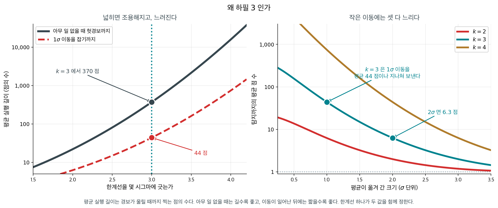
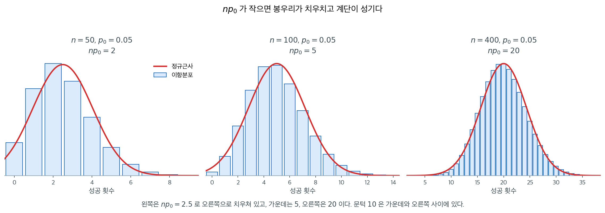
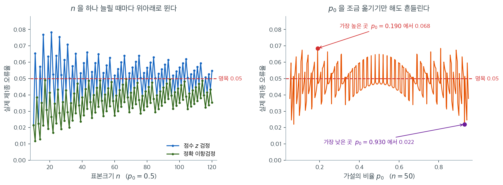

# 비율에 대한 Z-검정

## 개요

실무의 많은 질문이 모비율에 관한 것이다: 제조 불량률이 달라졌는가? 유권자 지지율이 50%를 넘는가? 새 약의 반응률이 알려진 비율과 다른가? 비율에 대한 일표본 Z-검정은 이런 질문에 답하는 형식적인 틀을 제공한다. 이항분포에 대한 정규근사를 써서 모비율 $p$가 가설의 특정 값 $p_0$과 같은지 검정한다.

<div class="storybox" markdown>

**그림으로 보는 통계학 1.** 왜 하필 $3$ 인가

위 첫 물음 — **제조 불량률이 달라졌는가** — 은 한 번 묻고 끝나는 물음이 아니다. 공장에서는
그것을 매 시간, 매 교대마다 다시 묻는다. 그 되풀이를 그림 하나로 만든 사람이 있다.

1924 년 5 월 16 일, 벨 전화연구소의 **월터 슈하트**가 상사에게 한 장짜리 메모를 보냈다.
그 한 장의 삼분의 일이 그림이었다 — 공정에서 잰 값을 시간 순서로 찍고 위아래에 선을 두 줄
그어 놓은 것. **관리도**의 첫 모습이다.

슈하트가 한 일은 「틀렸다」를 둘로 가른 것이다. 어느 공정에나 있는 **우연원인**의 흔들림과,
찾아내서 고칠 수 있는 **이상원인**. 앞의 것에 손을 대면 오히려 나빠진다 — 흔들림을 따라
기계를 조정하면 흔들림이 커진다. 그러니 둘을 가르는 선을 어디에 그을지가 전부가 된다.

그는 $3$ 시그마를 골랐다. 그리고 **그것이 확률에서 유도한 수가 아니라고 분명히 적었다.**
헛경보를 쫓아다니는 비용과 진짜 이동을 놓치는 비용 사이의 경제적 타협이고, 몇 해 동안
공장에서 써 보고 정한 값이라는 것이다.

왜 $3$ 이 그 자리인지는 **평균 실행 길이**로 보인다. 경보가 울릴 때까지 찍는 점의 수다.

<figure markdown>
{ width="900" }
  <figcaption markdown>아무 일 없을 때는 길수록 좋고, 이동이 일어난 뒤에는 짧을수록 좋다. 한계선 하나가 두 값을 함께 정한다.</figcaption>
</figure>

| 한계선 | 아무 일 없을 때 헛경보까지 | $1\sigma$ 이동을 잡기까지 |
|---|---|---|
| $2\sigma$ | $22.0$ 점 | $6.3$ 점 |
| $3\sigma$ | $370.4$ 점 | $43.9$ 점 |
| $4\sigma$ | $15{,}787$ 점 | $740.6$ 점 |

$k = 2$ 면 아무 일이 없어도 **스물두 점마다** 공정을 멈추고 원인을 찾으러 다니게 된다.
$k = 4$ 면 $1\sigma$ 이동을 평균 **$740$ 점**이나 지나쳐 보낸다. $3$ 은 그 사이의 자리이고,
슈하트가 말한 「경제적 타협」이 이 표를 가리킨다.

오른쪽 그림이 그 대가도 보여 준다. $k = 3$ 은 $3\sigma$ 이동이면 두 점 만에 잡지만
$1\sigma$ 이동은 평균 $44$ 점을 지나쳐 보낸다. 작은 이동에 느린 것은 어느 $k$ 를 골라도
마찬가지이며, 그래서 뒤에 누적합을 쓰는 차트가 나왔다. 아래 연습문제 $9$ 의 네 번째
고려사항이 그 이야기다.

뒷이야기 하나. 2 차 대전이 끝난 뒤 **에드워즈 데밍**이 이 방법을 일본에 가져갔다. 1950 년
여름 도쿄에서 한 강의가 시작이었고, 그 뒤로 일본 제조업이 걸어간 길은 따로 설명할 필요가
없을 것이다. 통계학 교과서의 한 쪽짜리 도구가 한 나라의 산업을 바꾼 흔치 않은 사례다.

_확인한 곳 — $1924$ 년 $5$ 월 슈하트가 벨 전화연구소의 상사 조지 에드워즈에게 보낸 짧은 메모와, 에드워즈가 「한 쪽 남짓이었고 그 **삼분의 일쯤이 오늘날 누구나 관리도로 알아볼 도식**이었다」고 회고한 것. 슈하트가 $3$ 을 고른 근거가 확률 계산이 아니라 「받아들일 만한 경제적 값으로 보이고 쓰다 보니 통한다」는 것이었다는 점. 데밍이 $1950$ 년 $7$ 월 $15$ 일 일본과학기술연맹의 초청으로 도쿄 간다스루가다이에서 팔일짜리 품질관리 강습을 연 것. 표와 그림의 평균 실행 길이는 모두 직접 계산한 값이다_

</div>

---

## 1. 가설

$$
H_0: p = p_0 \quad \text{vs} \quad H_1: p \neq p_0
$$

단측검정에서는 연구 질문에 따라 대립가설이 $H_1: p > p_0$ 또는 $H_1: p < p_0$이 된다.

---

## 2. 검정통계량

검정통계량은 표본비율 $\hat{p}$가 가설의 값 $p_0$에서 표준오차 몇 개만큼 떨어져 있는지를 잰다. $H_0$ 아래에서 $\hat{p}$의 표준오차는 $\sqrt{p_0(1-p_0)/n}$이므로 이를 써서 표준화한다.

$$
Z = \frac{\hat{p} - p_0}{\sqrt{p_0(1-p_0)/n}}
$$

여기서 $\hat{p} = X/n$은 표본비율이고 $X$는 독립인 $n$번의 시행에서의 성공 횟수이다. 아래의 표본크기 조건이 충족되면 $H_0$ 아래에서 $Z$는 근사적으로 표준정규를 따른다.

<div class="exbox" markdown>

**보기 1.** <span class="diff easy" title="쉬움"></span> 실업률 — 검정통계량. 시장이 주민 $200$명의 표본에서 $22$명이 실업 상태인 것을 보고 $H_0\colon p = 0.08$ 대 $H_1\colon p \ne 0.08$을 검정한다. 코드는 표준오차의 분모에 $\hat p$가 아니라 **가설값 $p_0$**을 넣는다.

**(1)** $p_0$을 쓰는 표준오차(점수검정)와 $\hat p$를 쓰는 표준오차(왈드검정)를 모두 구하고, 어느 쪽이 큰 $\lvert z \rvert$를 주는지 **일반 조건**으로 말하시오.

**(2)** 두 p-값을 정확 이항검정과 견주어 어느 쪽이 옳은 선택인지 판정하시오. 연속성 보정을 넣으면 나아지는가.

</div>

??? success "풀이"

    **(1) 어느 분모가 큰가.** $\hat p = 22/200 = 0.11$이므로

    $$
    \text{SE}_{\text{score}} = \sqrt{\frac{p_0(1-p_0)}{n}} = \sqrt{\frac{0.08 \times 0.92}{200}} = 0.0191833,
    \qquad
    \text{SE}_{\text{wald}} = \sqrt{\frac{\hat p(1-\hat p)}{n}} = 0.0221246
    $$

    다. 분모의 크기 순서는 $p(1-p)$의 모양으로 정해진다. 이 함수는 $p = 1/2$에서 최대이고 그 양쪽으로 내려가는 포물선이므로,

    $$
    \lvert \hat p - 0.5 \rvert < \lvert p_0 - 0.5 \rvert
    \implies \hat p(1-\hat p) > p_0(1-p_0)
    \implies \text{SE}_{\text{wald}} > \text{SE}_{\text{score}}
    $$

    이다. **곧 관측된 비율이 $0.5$에 더 가까우면 왈드 표준오차가 크고, 따라서 왈드 $\lvert z \rvert$가 작다.** 여기서는 $\hat p = 0.11$이 $p_0 = 0.08$보다 $0.5$에 가까우므로 점수검정이 더 큰 통계량을 준다. $z = 1.5639$ 대 $1.3560$이다.

    **(2) 정확검정이 심판이다.** 셋을 나란히 놓으면 점수검정 $p = 0.117851$, 왈드 $0.175114$, 정확 이항 $0.117778$이다. **점수검정이 정확값과 소수 넷째 자리까지 같고 왈드는 $50\%$나 벗어난다.** 비율 검정에서 $H_0$의 $p_0$을 분모에 쓰는 관례가 단순한 형식이 아니라 **실제로 더 정확하다**는 것이 이 수에 들어 있다. 이유는 검정이 재는 것이 "$H_0$가 참일 때의 확률"이고, 그 확률의 분모는 $p_0$으로 정해지기 때문이다.

    연속성 보정을 넣으면 $z = 1.4335$, $p = 0.151705$가 되어 **오히려 나빠진다.** 보정은 이산성 때문에 근사가 p-값을 **작게** 잡을 때 쓰는 것인데, 여기서는 점수검정이 이미 정확값과 맞아 있어 보정이 그만큼 과하게 밀어 올린다. **양측검정에서는 두 꼬리의 보정이 같은 방향으로 더해져 쉽게 과보정이 된다.**

    **수치적으로.**

    ```python
    import numpy as np
    from scipy import stats

    p_hat = 22 / 200
    p = 0.08
    n = 200

    # 표준오차의 분모에 p_hat이 아니라 가설값 p를 넣는다.
    # H0가 참이라는 가정 아래의 확률을 재는 것이 검정이기 때문이다.
    statistic = (p_hat - p) / np.sqrt(p * (1 - p) / n)
    p_value = stats.norm().sf(abs(statistic)) * 2

    print(f"Statistic: {statistic:.4f}")
    print(f"P-value : {p_value:.4f}")
    ```

    출력:

    ```
    Statistic: 1.5639
    P-value : 0.1179
    ```

    ```python
    import numpy as np
    from scipy.stats import binomtest

    ph, p0, n = 22 / 200, 0.08, 200
    se_score = np.sqrt(p0 * (1 - p0) / n)          # H0 의 p0 를 쓴다 (점수검정)
    se_wald = np.sqrt(ph * (1 - ph) / n)           # 관측된 p-hat 을 쓴다 (왈드)
    print(f"p-hat = {ph},  p0 = {p0}")
    print(f"SE(점수) = {se_score:.7f}   SE(왈드) = {se_wald:.7f}"
          f"   비 = {se_wald / se_score:.4f}")
    for lab, s in (("점수 (p0)", se_score), ("왈드 (p-hat)", se_wald)):
        z = (ph - p0) / s
        print(f"  {lab:>12}: z = {z:.6f},  양측 p = {2 * stats.norm.sf(abs(z)):.6f}")

    z_cc = (abs(ph - p0) - 0.5 / n) / se_score
    print(f"  {'연속성 보정':>12}: z = {z_cc:.6f},  양측 p = "
          f"{2 * stats.norm.sf(z_cc):.6f}")
    print(f"  {'정확 이항':>12}: p = {binomtest(22, 200, p0).pvalue:.6f}")
    ```

    출력:

    ```
    p-hat = 0.11,  p0 = 0.08
    SE(점수) = 0.0191833   SE(왈드) = 0.0221246   비 = 1.1533
           점수 (p0): z = 1.563858,  양측 p = 0.117851
        왈드 (p-hat): z = 1.355954,  양측 p = 0.175114
            연속성 보정: z = 1.433537,  양측 p = 0.151705
             정확 이항: p = 0.117778
    ```

    **점수검정 $0.117851$과 정확 이항 $0.117778$의 차이가 $0.00007$이다.** 표본이 $200$이고 $np_0 = 16$이어서 근사가 잘 듣는 자리이며, 분모를 $p_0$으로 둔 것이 그 정확성에 기여한다. 왈드의 $0.175114$는 같은 자료에서 $50\%$ 큰 p-값이다. **분모를 어디서 가져오는지가 p-값을 절반쯤 바꾼다.**

    관측된 실업률 $11\%$가 가설값 $8\%$보다 눈에 띄게 높지만 $n = 200$으로는 기각하지 못한다. 세 방법이 모두 $0.12$에서 $0.18$ 사이를 주므로 그 결론은 흔들리지 않는다.

<div class="exbox" markdown>

**보기 2.** <span class="diff easy" title="쉬움"></span> 일표본 비율 검정 계산기. 점수 $z$ 검정과 정확 이항검정을 한 함수에 담는다. 성공 횟수 $k$가 정수이므로 두 검정의 기각역은 모두 $\{0, 1, \dots, n\}$의 **부분집합**이고, 따라서 실제 유의수준을 전수 열거로 정확히 계산할 수 있다.

**(1)** 명목 유의수준 $\alpha$의 점수 검정이 기각하는 $k$를 닫힌 꼴로 적고, $n = 5$, $p_0 = 0.5$, $\alpha = 0.05$에서 두 검정의 기각역을 각각 구하시오.

**(2)** 그 기각역의 확률을 유리수로 정확히 더해 두 검정의 실제 크기를 구하고, 함수를 작성해 확인하시오.

</div>

??? success "풀이"

    **(1) 해석적으로.** 양측 p-값이 $2\min\{\Phi(z),\,1-\Phi(z)\}$이므로

    $$
    p < \alpha
    \iff \lvert z \rvert > z_{1-\alpha/2}
    \iff \left\lvert \frac{k/n - p_0}{\sqrt{p_0(1-p_0)/n}} \right\rvert > z_{1-\alpha/2}
    $$

    이고, 양변에 $n$을 곱해 정리하면 **성공 횟수 자체에 대한 조건**이 된다.

    $$
    \lvert k - n p_0 \rvert > c,
    \qquad c = z_{1-\alpha/2}\sqrt{n p_0 (1-p_0)}
    $$

    그러므로 점수 검정의 채택역은 구간 $[np_0 - c,\ np_0 + c]$에 들어가는 **정수**들이고, 기각역은 그 나머지다. $k$가 정수라는 사실이 여기서 처음 들어온다.

    $n = 5$, $p_0 = 0.5$, $\alpha = 0.05$를 넣으면 $np_0 = 2.5$이고

    $$
    c = 1.96\sqrt{5 \times 0.25} = 1.96 \times 1.11803 = 2.19131
    $$

    이므로 채택 구간은 $[0.30869,\ 4.69131]$이다. 이 구간에 들어가는 정수는 $1, 2, 3, 4$이므로

    $$
    \text{점수 검정 기각역} = \{0,\ 5\}
    $$

    이다. 정확검정은 다르다. $p_0 = 0.5$에서 양측 정확 p-값을 $k$마다 적으면

    $$
    \frac{2}{32},\quad \frac{12}{32},\quad 1,\quad 1,\quad \frac{12}{32},\quad \frac{2}{32}
    $$

    곧 $0.0625,\ 0.375,\ 1,\ 1,\ 0.375,\ 0.0625$다. **가장 작은 값이 $0.0625$로 이미 $0.05$보다 크다.** 따라서

    $$
    \text{정확검정 기각역} = \varnothing
    $$

    이다. 무엇을 관측해도 기각할 수 없다.

    **(2) 크기를 정확히 더한다.** 기각역의 확률을 그대로 더하면 된다. 점수 검정은

    $$
    \alpha_{\text{실제}} = P(K = 0) + P(K = 5) = \frac{1}{32} + \frac{1}{32} = \frac{1}{16} = 0.0625
    $$

    로 **명목 $0.05$를 넘고**, 정확검정은 기각역이 비었으므로

    $$
    \alpha_{\text{실제}} = 0
    $$

    이다. 정확히 0이다. 근사가 아니라 등식이다.

    이 0이 언제 풀리는지도 바로 나온다. $p_0 = 0.5$에서 양측 정확 p-값의 최솟값은 양 끝 $k = 0$과 $k = n$에서 나오는 $2 \cdot 2^{-n} = 2^{1-n}$이므로, 기각역이 비지 않을 조건은

    $$
    2^{1-n} \le \alpha
    \iff n \ge 1 + \log_2 \frac{1}{\alpha}
    $$

    이다. $\alpha = 0.05$이면 $1 + \log_2 20 = 5.32$이므로 **$n \ge 6$**이어야 한다. 동전을 다섯 번 던져서는 $p = 0.5$를 정확검정으로 반박할 길이 애초에 없다.

    함수를 작성해 확인한다.

    ```python
    from scipy.stats import norm, binomtest
    import math

    def test_prop_one_sample(k, n, p0=0.5, method="score",
                             alt="two-sided", alpha=0.05):
        """method='score'(정규근사) 또는 'exact'(이항).

        정확검정에는 검정통계량이 따로 없다. 이항분포에서 꼬리확률을
        바로 더하므로 표준화할 대상이 없기 때문이다. 그래서 None을 돌려준다.
        """
        phat = k / n
        if method == "exact":
            p = binomtest(k, n, p0, alternative=alt).pvalue
            return None, p, (p < alpha), "exact binomial"

        # 표준오차에 phat이 아니라 **p0**을 넣는다.
        # H0가 참이라는 가정 아래의 확률을 재는 것이 검정이기 때문이다.
        # 신뢰구간에서는 phat을 넣었다. 목적이 다르면 대입하는 값도 다르다.
        se0 = math.sqrt(p0 * (1 - p0) / n)
        z = (phat - p0) / se0
        if alt == "two-sided":
            p = 2 * min(norm.cdf(z), 1 - norm.cdf(z))
        elif alt == "less":
            p = norm.cdf(z)
        else:
            p = 1 - norm.cdf(z)
        return z, p, (p < alpha), "score z-test"
    ```

    기각역과 그 확률을 전수 열거로 구한다. 확률은 유리수로 더해 부동소수점
    오차를 아예 없앤다.

    ```python
    from fractions import Fraction

    z975 = norm.ppf(0.975)


    def accept_interval(n, p0, z=z975):
        """점수 검정이 채택하는 k 의 구간 [np0 - c, np0 + c]."""
        c = z * math.sqrt(n * p0 * (1 - p0))
        return n * p0 - c, n * p0 + c


    def exact_size(reject, n, p0):
        """기각역의 확률을 유리수로 정확히 더한다. 부동소수점 오차가 없다."""
        q = Fraction(p0).limit_denominator()
        return sum(Fraction(math.comb(n, k)) * q**k * (1 - q)**(n - k)
                   for k in reject)


    n, p0 = 5, 0.5
    lo, hi = accept_interval(n, p0)
    rej_score = [k for k in range(n + 1) if not (lo <= k <= hi)]
    rej_exact = [k for k in range(n + 1) if binomtest(k, n, p0).pvalue <= 0.05]

    print(f"n = {n}, p0 = {p0}:  채택 구간 = [{lo:.6f}, {hi:.6f}]")
    print(f"  점수 검정 기각역 = {rej_score},  정확 크기 = "
          f"{exact_size(rej_score, n, p0)} = {float(exact_size(rej_score, n, p0)):.4f}")
    print(f"  정확검정 기각역 = {rej_exact},  정확 크기 = "
          f"{exact_size(rej_exact, n, p0)}")
    print("  k 마다의 정확 양측 p-값:",
          [float(binomtest(k, n, p0).pvalue) for k in range(n + 1)])

    print("\np0 = 0.5, 명목 0.05 에서 두 검정의 정확한 크기")
    print("   n  점수 기각역                   크기     정확검정 기각역        크기")
    for n in range(5, 15):
        lo, hi = accept_interval(n, p0)
        rs = [k for k in range(n + 1) if not (lo <= k <= hi)]
        re_ = [k for k in range(n + 1) if binomtest(k, n, p0).pvalue <= 0.05]
        print(f"{n:4d}  {str(rs):28s} {float(exact_size(rs, n, p0)):.4f}   "
              f"{str(re_):20s} {float(exact_size(re_, n, p0)):.4f}")
    ```

    출력:

    ```
    n = 5, p0 = 0.5:  채택 구간 = [0.308694, 4.691306]
      점수 검정 기각역 = [0, 5],  정확 크기 = 1/16 = 0.0625
      정확검정 기각역 = [],  정확 크기 = 0
      k 마다의 정확 양측 p-값: [0.0625, 0.375, 1.0, 1.0, 0.375, 0.0625]

    p0 = 0.5, 명목 0.05 에서 두 검정의 정확한 크기
       n  점수 기각역                   크기     정확검정 기각역        크기
       5  [0, 5]                       0.0625   []                   0.0000
       6  [0, 6]                       0.0312   [0, 6]               0.0312
       7  [0, 7]                       0.0156   [0, 7]               0.0156
       8  [0, 1, 7, 8]                 0.0703   [0, 8]               0.0078
       9  [0, 1, 8, 9]                 0.0391   [0, 1, 8, 9]         0.0391
      10  [0, 1, 9, 10]                0.0215   [0, 1, 9, 10]        0.0215
      11  [0, 1, 2, 9, 10, 11]         0.0654   [0, 1, 10, 11]       0.0117
      12  [0, 1, 2, 10, 11, 12]        0.0386   [0, 1, 2, 10, 11, 12] 0.0386
      13  [0, 1, 2, 11, 12, 13]        0.0225   [0, 1, 2, 11, 12, 13] 0.0225
      14  [0, 1, 2, 3, 11, 12, 13, 14] 0.0574   [0, 1, 2, 12, 13, 14] 0.0129
    ```

    채택 구간과 두 기각역, 그리고 $1/16$과 $0$이라는 두 크기가 (1)·(2)에서 손으로 구한 것과 모두 같다. $n = 6$에서 정확검정의 크기가 $0.0312$로 비로소 0을 벗어나는 것도 $n \ge 6$이라는 조건과 맞는다.

    표를 아래로 읽으면 두 검정의 성격이 갈린다. **점수 검정은 $n = 5,\ 8,\ 11,\ 14$에서 명목을 넘는다**($0.0625$, $0.0703$, $0.0654$, $0.0574$). 기각역을 정수 격자 위에서 자르는데 그 경계가 $0.05$에 맞아떨어질 이유가 없기 때문이며, 넘을 때는 한 칸을 통째로 들이므로 꽤 크게 넘는다. **정확검정은 한 번도 넘지 않는다.** 최댓값이 $n = 9$의 $0.0391$이고, $n = 8$에서는 $0.0078$까지 내려간다. 같은 자료에 같은 명목 수준인데 실제 크기가 다섯 배 차이다.

    같은 톱니를 $n = 10$부터 $120$까지 이어 그린 것이 아래 [이산성이 만드는 톱니 모양의 실제 수준](#이산성이-만드는-톱니-모양의-실제-수준)의 그림이다. 여기서 본 것은 그 톱니가 가장 거친 왼쪽 끝이다.

---

## 3. 판정 규칙

- **양측** ($H_1: p \neq p_0$): $|Z| > z_{\alpha/2}$이면 $H_0$을 기각한다
- **우측** ($H_1: p > p_0$): $Z > z_{\alpha}$이면 $H_0$을 기각한다
- **좌측** ($H_1: p < p_0$): $Z < -z_{\alpha}$이면 $H_0$을 기각한다

동등하게, p-값을 계산하여 $p\text{-값} \leq \alpha$이면 $H_0$을 기각한다.

<div class="exbox" markdown>

**보기 3.** <span class="diff easy" title="쉬움"></span> 인터넷을 쓰는 California 가구의 비율. California 가구의 약 90%가 인터넷을 이용한다. 시장조사자들이 가구 1,000곳의 표본에서 920곳(92%)이 이용하는 것을 보고 그 비율이 더 높아졌는지 검정한다.

$$H_0: p = 0.90 \quad \text{vs} \quad H_1: p > 0.90$$

**(1)** 점수 $z$ 통계량과 단측 p-값을 손으로 구하시오.

**(2)** 정확 이항 p-값을 구하고, 보정하지 않은 정규근사와 **연속성 보정**을 한 정규근사 중 어느 쪽이 더 가까운지 확인하시오.

</div>

??? success "풀이"

    **(1) 해석적으로.** $\hat p = 920/1000 = 0.92$이고 $H_0$ 아래의 표준오차는

    $$
    \sqrt{\frac{p_0(1-p_0)}{n}} = \sqrt{\frac{0.90 \times 0.10}{1000}} = \sqrt{0.00009} = 0.00948683
    $$

    이다. 따라서

    $$
    z = \frac{0.92 - 0.90}{0.00948683} = \frac{0.02}{0.00948683} = 2.108185
    $$

    이고 단측 p-값은

    $$
    p = P(Z \ge 2.108185) = 0.017507
    $$

    이다. $\alpha = 0.05$에서 기각한다. 조건도 넉넉히 만족한다 — $np_0 = 900$, $n(1-p_0) = 100$으로 보수적 기준 $10$을 한참 넘는다.

    **(2) 수치적으로.**

    ```python
    import numpy as np
    from scipy import stats

    n, k, p_0 = 1000, 920, 0.90
    sd = np.sqrt(n * p_0 * (1 - p_0))          # X 의 표준편차
    se_0 = np.sqrt(p_0 * (1 - p_0) / n)        # p_hat 의 표준오차

    z = (k / n - p_0) / se_0
    exact = stats.binomtest(k, n, p_0, alternative="greater").pvalue
    z_cc = (k - 0.5 - n * p_0) / sd            # 연속성 보정
    g1 = (1 - 2 * p_0) / sd                    # 이항분포의 왜도
    # 연속성 보정 위에 왜도 항을 하나 더 얹은 에지워스 근사
    edge = stats.norm.sf(z_cc) + (g1 / 6) * (z_cc**2 - 1) * stats.norm.pdf(z_cc)

    print(f"z (점수)  = {z:.6f}")
    print(f"z (연속성 보정) = {z_cc:.6f}")
    print(f"이항분포의 왜도 = {g1:.6f}\n")
    for label, value in [("정확 이항", exact),
                         ("정규근사", stats.norm.sf(z)),
                         ("정규근사 + 연속성 보정", stats.norm.sf(z_cc)),
                         ("정규근사 + 연속성 + 왜도", edge)]:
        print(f"{label:24s} p = {value:.6f}   오차 {abs(value - exact):.6f}")
    ```

    출력:

    ```
    z (점수)  = 2.108185
    z (연속성 보정) = 2.055480
    이항분포의 왜도 = -0.084327

    정확 이항                    p = 0.017612   오차 0.000000
    정규근사                     p = 0.017507   오차 0.000104
    정규근사 + 연속성 보정            p = 0.019916   오차 0.002305
    정규근사 + 연속성 + 왜도          p = 0.017730   오차 0.000118
    ```

    유도한 $z = 2.108185$와 $p = 0.017507$이 출력과 맞는다.

    **그런데 (2)의 답이 뜻밖이다. 연속성 보정이 상황을 나쁘게 만들었다.** 보정하지 않은 $0.017507$의 오차가 $0.000104$인데 보정한 $0.019916$의 오차는 $0.002305$로 **스물두 배**다. 보기 5에서는 같은 보정이 거의 정확히 들어맞을 것이므로, 이것은 "보정이 늘 좋다"는 생각이 틀렸다는 뜻이다.

    까닭은 표의 마지막 줄이 보여 준다. 이항분포는 $p_0 = 0.90$에서 **왼쪽으로 치우쳐** 있고 왜도가 $-0.0843$이다. 오른쪽 꼬리확률을 정규로 바꿀 때 생기는 오차에는 **이산성에서 오는 항과 왜도에서 오는 항이 둘 다** 있으며, 여기서는 둘이 서로 **반대 방향**이라 상쇄되고 있었다. 연속성 보정만 넣으면 그 균형이 깨진다. 왜도 항

    $$
    \frac{\gamma_1}{6}\,(z^2 - 1)\,\varphi(z), \qquad \gamma_1 = \frac{1 - 2p_0}{\sqrt{np_0(1-p_0)}}
    $$

    까지 함께 얹으면 오차가 $0.002305$에서 $0.000118$로 되돌아온다. 상쇄가 일어나고 있었다는 설명이 수로 확인된 것이다.

    **실무적 결론은 간단하다. 근사를 고쳐 쓸 것이 아니라 정확 이항검정을 쓰면 된다.** $n = 1000$에서도 `binomtest` 는 즉시 끝난다. 근사는 손으로 계산할 때나 필요했던 것이고, $p_0$이 $0.5$에서 멀면 보정의 효과를 미리 가늠하기 어렵다.

<div class="exbox" markdown>

**보기 4.** <span class="diff easy" title="쉬움"></span> 여러 언어를 쓰는 사람. Fay 는 $H_0\colon p = 0.26$ 대 $H_1\colon p > 0.26$을 검정한다. $120$명 중 $40$명이 두 가지 이상의 언어를 쓸 수 있었고, $z = 1.8314$, 단측 $p = 0.0335$로 기각된다.

**(1)** 기각에 필요한 **최소 성공 수** $k$를 구하시오. 관측값 $40$은 그 문턱에서 얼마나 떨어져 있는가.

**(2)** 그 둘레의 $k$에서 근사와 정확 이항의 p-값을 나란히 놓고, 이 결론이 얼마나 튼튼한지 판정하시오.

</div>

??? success "풀이"

    **(1) 문턱은 사람 한 명 거리다.** 표준오차가

    $$
    \text{SE} = \sqrt{\frac{0.26 \times 0.74}{120}} = 0.0400416
    $$

    이므로 단측 $5\%$ 기각 조건은

    $$
    \hat p > p_0 + z_{0.95}\,\text{SE} = 0.26 + 1.644854 \times 0.0400416 = 0.325863
    $$

    이고, 이것을 성공 수로 바꾸면

    $$
    k > 120 \times 0.325863 = 39.1035
    $$

    이다. 따라서 **기각에 필요한 최소 $k$는 $40$**이고, 관측값이 바로 그 $40$이다. **한 사람만 적었다면 기각하지 못한다.**

    **(2) 한 명의 무게.** $k = 39$이면 $z = 1.6233$, 근사 $p = 0.05226$으로 $0.05$를 넘는다. 정확 이항으로 보면 $k = 39$에서 $0.06674$, $k = 40$에서 $0.04464$다. **근사와 정확이 모두 "40 부터 기각"으로 같은 답을 주지만, 두 경우 모두 결론이 사람 한 명에 걸려 있다.**

    같은 통계량을 양측으로 계산했다면 $p = 0.06704$가 되어 기각하지 못했을 것이다. **그러므로 이 결론은 두 가지 선택에 동시에 의지하고 있다.** 단측을 쓴다는 선택과, $k = 40$이라는 한 명의 관측값이다. 둘 중 하나만 달라져도 "유의하지 않다"가 된다. 보고할 때는 $p = 0.0335$ 한 줄이 아니라 그 취약함을 함께 적어야 한다.

    **수치적으로.**

    ```python
    # 비율의 검정에서 표준오차는 관측된 p_hat 이 아니라 귀무가설의 p 로 만든다.
    # 귀무가설이 참이라는 전제 아래에서의 흩어짐을 재야 하기 때문이다.
    p_hat = 40 / 120
    p = 0.26
    n = 120

    statistic = (p_hat - p) / np.sqrt(p * (1 - p) / n)
    p_value = stats.norm().sf(statistic)      # 단측이므로 오른쪽 꼬리만

    print(f"Statistic: {statistic:.4f}")
    print(f"P-value: {p_value:.4f}")
    ```

    출력:

    ```
    Statistic: 1.8314
    P-value: 0.0335
    ```

    ```python
    p0, n = 0.26, 120
    se = np.sqrt(p0 * (1 - p0) / n)
    k_thresh = (p0 + stats.norm.ppf(0.95) * se) * n
    print(f"SE = {se:.7f}")
    print(f"기각에 필요한 p-hat > {p0 + stats.norm.ppf(0.95) * se:.6f}"
          f"  →  k > {k_thresh:.4f}")
    print(f"\n{'k':>4}{'p-hat':>9}{'z':>9}{'근사 단측 p':>13}{'정확 단측 p':>13}")
    for k in (38, 39, 40, 41):
        z = (k / n - p0) / se
        print(f"{k:>4}{k / n:>9.4f}{z:>9.4f}{stats.norm.sf(z):>13.5f}"
              f"{binomtest(k, n, p0, alternative='greater').pvalue:>13.5f}")
    print(f"\n관측값 40 에서 양측으로 하면 p = "
          f"{2 * stats.norm.sf((40 / n - p0) / se):.5f}")
    ```

    출력:

    ```
    SE = 0.0400416
    기각에 필요한 p-hat > 0.325863  →  k > 39.1035

       k    p-hat        z      근사 단측 p      정확 단측 p
      38   0.3167   1.4152      0.07851      0.09665
      39   0.3250   1.6233      0.05226      0.06674
      40   0.3333   1.8314      0.03352      0.04464
      41   0.3417   2.0395      0.02070      0.02892

    관측값 40 에서 양측으로 하면 p = 0.06704
    ```

    **문턱이 $39.1035$다.** 관측값 $40$은 그것을 겨우 넘는다. 표에서 $k$가 하나 바뀔 때 근사 p-값이 $0.0523 \to 0.0335 \to 0.0207$로 움직이는데, **한 명이 $0.05$의 양쪽을 왕복한다.**

    정확 이항 쪽은 같은 $k$에서 언제나 더 크다($0.06674$ 대 $0.05226$, $0.04464$ 대 $0.03352$). 연속성 때문이며 보기 5와 15에서 다룬 그 어긋남이다. **여기서는 정확값도 $k = 40$에서 $0.0446 < 0.05$이므로 결론이 같지만, 정확검정 쪽이 더 보수적이라는 사실은 기억해 두어야 한다.**

<div class="exbox" markdown>

**보기 5.** <span class="diff easy" title="쉬움"></span> 공립학교 재정을 위한 증세. 연구자들이 $200$명 중 $113$명이 지지하는 자료로 $H_0\colon p = 0.50$ 대 $H_1\colon p > 0.50$을 검정한다. 정확 이항검정이 $0.0384$, 정규근사가 $0.0330$을 준다.

**(1)** 두 값이 벌어진 양을 **연속성 보정**으로 설명하시오. 보정량이 $z$ 척도에서 얼마인지 계산하고, 보정 후의 p-값을 미리 구하시오.

**(2)** 그것을 확인하고, 이 자료에서 보정이 특히 잘 듣는 까닭을 적으시오.

</div>

??? success "풀이"

    **(1) 이산을 연속으로 바꿀 때 생기는 반 칸.** 정확검정이 재는 것은 $P(X \ge 113)$이고 $X$는 정수에만 질량을 갖는다. 정규분포로 바꾸면 $113$이라는 점이 폭 1의 막대 $[112.5,\ 113.5]$로 퍼지므로, 막대 전체를 포함하려면 **$112.5$에서부터** 세어야 한다. 그래서

    $$
    z_{\text{보정}} = \frac{(112.5/200) - 0.5}{\sqrt{0.25/200}}
    = \frac{0.0625}{0.0353553} = 1.767767
    $$

    이다. 보정하지 않은 $z = 1.838478$보다 $0.070711$ 작은데, 이 값은

    $$
    \frac{0.5/n}{\sqrt{p_0q_0/n}} = \frac{0.5}{\sqrt{n p_0 q_0}} = \frac{0.5}{\sqrt{50}} = 0.070711
    $$

    로 **표본크기만으로 정해진다.** $n$이 커지면 $1/\sqrt n$으로 줄어든다.

    보정한 p-값은 $1 - \Phi(1.767767) = 0.038550$이고, 정확값 $0.038419$와 $0.00013$밖에 차이 나지 않는다. **근사의 오차 $0.0054$ 가운데 $0.0053$이 연속성 하나였던 셈이다.**

    **(2) $p_0 = 0.5$이기 때문이다.** 이항분포의 왜도는 $(1-2p_0)/\sqrt{np_0q_0}$인데 $p_0 = 0.5$에서 정확히 $0$이다. **분포가 완벽히 대칭이므로 정규근사의 오차원이 이산성 하나로 줄어들고, 그것을 연속성 보정이 거의 그대로 걷어낸다.** 보기 6에서 $p_0 = 0.2$인 경우를 보면 같은 보정이 $85\%$만 메운다.

    **수치적으로.**

    ```python
    k = 113
    n = 200
    p_0 = 0.5

    # 정확검정: 이항분포에서 P(X >= 113)을 그대로 더한다. 근사가 없다.
    result = stats.binomtest(k, n, p=p_0, alternative="greater")
    print(f"Exact P-value: {result.pvalue:.4f}")

    # 근사검정: 이항분포를 정규분포로 바꿔 계산한다.
    p_hat = k / n
    approx_statistic = (p_hat - p_0) / np.sqrt(p_0 * (1 - p_0) / n)
    approx_p_value = stats.norm().sf(approx_statistic)
    print(f"Approximate Statistic: {approx_statistic:.4f}")
    print(f"Approximate P-value: {approx_p_value:.4f}")
    ```

    출력:

    ```
    Exact P-value: 0.0384
    Approximate Statistic: 1.8385
    Approximate P-value: 0.0330
    ```

    ```python
    k, n, p_0 = 113, 200, 0.5
    p_hat = k / n
    se = np.sqrt(p_0 * (1 - p_0) / n)
    z_plain = (p_hat - p_0) / se
    z_cc = ((k - 0.5) / n - p_0) / se          # 막대의 절반을 되돌려 준다
    print(f"{'방법':>14}{'z':>11}{'단측 p':>12}{'정확값과의 차':>14}")
    exact = stats.binomtest(k, n, p=p_0, alternative="greater").pvalue
    print(f"{'정확 이항':>14}{'':>11}{exact:>12.6f}{0.0:>14.6f}")
    for lab, z in (("정규근사", z_plain), ("연속성 보정", z_cc)):
        p = stats.norm.sf(z)
        print(f"{lab:>14}{z:>11.6f}{p:>12.6f}{p - exact:>+14.6f}")
    print(f"\n보정의 크기: 0.5/n = {0.5 / n} (비율 척도),  "
          f"z 로는 {z_plain - z_cc:.6f}")
    print(f"이항분포의 왜도 (1-2p0)/sqrt(n p0 q0) = "
          f"{(1 - 2 * p_0) / np.sqrt(n * p_0 * (1 - p_0)):.6f}  (p0 = 0.5 이므로 0)")
    ```

    출력:

    ```
                방법          z        단측 p       정확값과의 차
             정확 이항               0.038419      0.000000
              정규근사   1.838478    0.032996     -0.005423
            연속성 보정   1.767767    0.038550     +0.000131

    보정의 크기: 0.5/n = 0.0025 (비율 척도),  z 로는 0.070711
    이항분포의 왜도 (1-2p0)/sqrt(n p0 q0) = 0.000000  (p0 = 0.5 이므로 0)
    ```

    **보정 후 어긋남이 $+0.000131$이다.** 보정 없을 때 $-0.005423$이었으므로 $97.6\%$를 걷어냈다. $z$ 척도의 보정량 $0.070711 = 0.5/\sqrt{50}$도 예측과 같다.

    두 값이 $0.0384$와 $0.0330$으로 다르다. 근사 쪽이 작게 나오는 것은 우연이 아니다. **이산인 이항분포를 연속인 정규분포로 바꾸면서 막대의 절반이 기각역 쪽으로 넘어가기 때문**이며, 연속성 보정($k$ 대신 $k - 0.5$를 쓰는 것)으로 거의 다 메울 수 있다.

    여기서는 둘 다 $0.05$를 밑돌아 결론이 같다. 그러나 p-값이 $0.04$ 언저리일 때 근사와 정확 사이의 이 정도 차이는 결론을 가를 수 있다. $k = 112$였다면 정확 $p = 0.0518$, 근사 $p = 0.0448$로 **판정이 갈린다.**

<div class="exbox" markdown>

**보기 6.** <span class="diff easy" title="쉬움"></span> 무료 비디오 대여권. 학생들이 $H_0\colon p = 0.20$ 대 $H_1\colon p < 0.20$을 검정한다. 상자 $65$개에서 대여권 $11$장을 찾았다. 정확 이항검정이 $0.3301$, 정규근사가 $0.2676$으로 **$20\%$ 넘게 벌어진다.**

**(1)** 연속성 보정으로 그 간격을 얼마나 메울 수 있는지 예측하시오. 보기 5에서는 보정이 거의 완벽했는데 여기서는 어떤가.

**(2)** 메우고도 남는 어긋남의 정체를 이항분포의 **왜도**로 설명하시오.

</div>

??? success "풀이"

    **(1) 보정의 방향이 반대다.** 왼쪽 꼬리를 재므로 $P(X \le 11)$을 구해야 하고, 이산 막대의 오른쪽 절반까지 세어 주어야 하므로 $k$ 대신 $k + 0.5$를 쓴다($H_1$이 "큼"이던 보기 5에서는 $k - 0.5$였다).

    $$
    z_{\text{보정}} = \frac{(11.5/65) - 0.20}{\sqrt{0.2 \times 0.8/65}}
    = \frac{-0.023077}{0.049614} = -0.465130
    \implies p = 0.320919
    $$

    보정 없는 $0.267572$에서 $0.320919$로 올라가 정확값 $0.330066$에 훨씬 가까워진다. **어긋남이 $-0.0625$에서 $-0.0091$로 줄어 $85\%$가 메워진다.** 그러나 보기 5처럼 소수 넷째 자리까지 맞지는 않는다.

    **(2) 남는 것은 왜도다.** 이항분포의 왜도는

    $$
    \gamma_1 = \frac{1 - 2p_0}{\sqrt{n p_0 (1-p_0)}}
    $$

    이고, 보기 5는 $p_0 = 0.5$여서 $\gamma_1 = 0$이었다. **대칭인 분포를 대칭인 정규로 바꾸었으니 남을 오차가 연속성뿐이었고, 그래서 보정이 거의 완벽했다.** 여기서는

    $$
    \gamma_1 = \frac{1 - 0.4}{\sqrt{65 \times 0.2 \times 0.8}} = \frac{0.6}{\sqrt{10.4}} = 0.186052
    $$

    로 오른쪽으로 치우쳐 있다. 연속성 보정은 **이산성만** 고치고 **비대칭은 고치지 못한다.** 왼쪽 꼬리가 짧은 분포를 대칭 정규로 재면 왼쪽 꼬리확률을 작게 잡게 되고, 그 몫이 $0.009$로 남는다.

    조건 $np_0 = 13 \ge 10$과 $n(1-p_0) = 52 \ge 10$을 만족하는데도 이만큼 어긋난다는 점이 중요하다. **그 경험칙은 "쓸 수 있다"가 아니라 "완전히 못 쓸 정도는 아니다"를 뜻한다.** 결론을 가르는 자리에서는 정확 이항검정을 쓰는 것이 맞다.

    **수치적으로.**

    ```python
    # n*p_0 = 13 으로 작은 편이라 정규근사가 미덥지 않다.
    # 그래서 이항분포로 정확히 구한 값과 근사값을 나란히 놓고 견준다.
    k = 11
    n = 65
    p_0 = 0.2

    result = stats.binomtest(k, n, p=p_0, alternative="less")
    print(f"Exact P-value: {result.pvalue:.4f}")

    p_hat = k / n
    approx_statistic = (p_hat - p_0) / np.sqrt(p_0 * (1 - p_0) / n)
    approx_p_value = stats.norm().cdf(approx_statistic)
    print(f"Approximate Statistic: {approx_statistic:.4f}")
    print(f"Approximate P-value: {approx_p_value:.4f}")
    ```

    출력:

    ```
    Exact P-value: 0.3301
    Approximate Statistic: -0.6202
    Approximate P-value: 0.2676
    ```

    ```python
    k, n, p_0 = 11, 65, 0.2
    p_hat = k / n
    se = np.sqrt(p_0 * (1 - p_0) / n)
    exact = stats.binomtest(k, n, p=p_0, alternative="less").pvalue
    z_plain = (p_hat - p_0) / se
    z_cc = ((k + 0.5) / n - p_0) / se          # 왼쪽 꼬리이므로 +0.5
    print(f"{'방법':>14}{'z':>11}{'단측 p':>12}{'정확값과의 차':>14}")
    print(f"{'정확 이항':>14}{'':>11}{exact:>12.6f}{0.0:>14.6f}")
    for lab, z in (("정규근사", z_plain), ("연속성 보정", z_cc)):
        p = stats.norm.cdf(z)
        print(f"{lab:>14}{z:>11.6f}{p:>12.6f}{p - exact:>+14.6f}")
    print(f"\nn p0 = {n * p_0}, n(1-p0) = {n * (1 - p_0)}")
    print(f"이항분포의 왜도 (1-2p0)/sqrt(n p0 q0) = "
          f"{(1 - 2 * p_0) / np.sqrt(n * p_0 * (1 - p_0)):.6f}")
    print("보기 5 (p0 = 0.5) 의 왜도는 0 이었다. 그 차이가 남은 어긋남의 정체다.")
    ```

    출력:

    ```
                방법          z        단측 p       정확값과의 차
             정확 이항               0.330066      0.000000
              정규근사  -0.620174    0.267572     -0.062494
            연속성 보정  -0.465130    0.320919     -0.009146

    n p0 = 13.0, n(1-p0) = 52.0
    이항분포의 왜도 (1-2p0)/sqrt(n p0 q0) = 0.186052
    보기 5 (p0 = 0.5) 의 왜도는 0 이었다. 그 차이가 남은 어긋남의 정체다.
    ```

    **예측한 대로다.** 보정이 어긋남을 $-0.062494$에서 $-0.009146$으로 줄이지만 $0$으로 만들지는 못하고, 그 남은 몫의 원인인 왜도가 $0.186$으로 계산된다. 보기 5에서 왜도가 정확히 0이었고 보정 후 어긋남이 $+0.000131$이었던 것과 나란히 놓으면 **연속성과 비대칭이 서로 다른 두 오차원이라는 것**이 분명해진다.

    이번에는 차이가 더 크다. $0.3301$과 $0.2676$으로 $20\%$ 넘게 벌어진다. $n p_0 = 13$과 $n(1-p_0) = 52$로 보수적 기준($\ge 10$)을 만족하지만 $k = 11$이 작아 이산성의 영향이 크게 남는다. 어느 쪽이든 기각하지 못하므로 결론은 같다.

---

## 4. 조건

이항분포에 대한 정규근사는 경험칙으로 다음 둘이 모두 성립할 때 적절하다.

$$
np_0 \geq 10 \quad \text{and} \quad n(1-p_0) \geq 10
$$

이 조건은 $H_0$ 아래에서 $\hat{p}$의 표집분포가 근사적으로 정규가 되도록 보장하며, 그 결과 Z-통계량이 근사적으로 $N(0,1)$ 분포를 갖는다.

10 대신 5를 문턱으로 쓰는 문헌도 많은데, 둘은 서로 다른 것을 보장한다. 문턱값 $5$는 분포가 종 모양에 가까워져 **확률을 계산해도 될** 수준을 보는 **느슨한 기준**이고, 문턱값 $10$은 검정의 실제 제1종 오류율이 명목 $\alpha$에 가깝기를 요구하는 **보수적 기준**이다. 여기서 하려는 일이 확률 하나를 어림하는 것이 아니라 오류율을 약속한 검정이므로 $10$ 쪽을 쓴다. 두 기준을 가르는 근거는 [이항분포의 정규근사](../../ch04/discrete_distributions/binomial.md#언제-쓸-수-있는가-5와-10)에 정리해 두었다.



세 그림 모두 $p_0 = 0.05$이고 $n$만 다르다. 왼쪽은 $np_0 = 2.5$인데, 막대가 오른쪽으로 치우쳐 있고 왼쪽은 0에서 잘려 있다. 대칭인 정규곡선을 여기에 얹으면 꼬리확률이 어긋날 수밖에 없다. 가운데의 $np_0 = 5$에서 모양이 꽤 맞아 들고, 오른쪽의 $20$에서는 거의 구별되지 않는다.

**막대가 성기다는 점도 함께 보아야 한다.** 왼쪽에서는 성공 횟수가 하나 달라질 때마다 $\hat p$가 $1/50 = 0.02$씩 뛴다. 검정통계량이 이 계단 위에서만 값을 가지므로, 매끄러운 곡선으로 계산한 꼬리확률이 실제 확률과 정확히 맞기를 기대할 수 없다. 오류율이 명목 $\alpha$ 근처에서 오르내리는 것이 이 때문이다.

다만 문턱값은 어느 쪽이든 안전한 쪽으로 잡아 둔 경험칙이다. 분모에 $\hat p$가 아니라 $p_0$을 넣는 위 통계량이 실제로 얼마나 너그러운지는 연습문제 8에서 오류율을 직접 계산해 확인한다.

??? example "풀이 보기: 불량률 검정"

    어떤 공장은 과거에 4%의 불량률($p_0 = 0.04$)로 제품을 생산했다. 공정을 바꾼 뒤 $n = 500$개의 확률표본에서 불량품이 28개 나와 $\hat{p} = 28/500 = 0.056$이다. $\alpha = 0.05$ 수준에서 불량률이 달라졌는지 검정하라.

    **조건 확인.** $np_0 = 500 \times 0.04 = 20 \geq 10$이고 $n(1 - p_0) = 500 \times 0.96 = 480 \geq 10$. 둘 다 만족한다.

    **검정통계량 계산.**

    $$
    Z = \frac{0.056 - 0.04}{\sqrt{0.04 \times 0.96 / 500}} = \frac{0.016}{\sqrt{0.0000768}} = \frac{0.016}{0.00877} \approx 1.83
    $$

    **판정.** 양측검정의 임계값은 $z_{0.025} = 1.96$이다. $|1.83| < 1.96$이므로 $H_0$을 기각하지 못한다. 양측 p-값은 $2P(Z > 1.83) \approx 0.067 > 0.05$로 판정을 확인해 준다. 5% 수준에서 불량률이 달라졌다고 결론지을 충분한 증거가 없다.

<div class="exbox" markdown>

**보기 7.** <span class="diff easy" title="쉬움"></span> 근사와 정확이 갈리는 자리. $n = 50$ 가운데 성공이 $k = 12$인 자료로 $H_0\colon p = 0.2$를 양측 검정하면 점수 검정과 정확검정의 p-값이 $0.4795$와 $0.4797$로 거의 같다.

**(1)** 같은 두 검정을 $k = 2$, $n = 10$, $p_0 = 0.5$에서 손으로 계산하고, 그 차이를 **연속성 보정**이 얼마나 메우는지 보이시오.

**(2)** 두 자료에서 양측 p-값을 네 가지 방식으로 계산해, 가장 큰 차이를 만드는 것이 근사인지 관례인지 밝히시오.

</div>

??? success "풀이"

    **(1) 해석적으로.** $k = 2$, $n = 10$, $p_0 = 0.5$이면 $np_0 = 5$, $\sqrt{np_0(1-p_0)} = \sqrt{2.5} = 1.58114$다.

    점수 검정은

    $$
    z = \frac{k - np_0}{\sqrt{np_0(1-p_0)}} = \frac{2 - 5}{1.58114} = -1.89737,
    \qquad p = 2\bar\Phi(1.89737) = 0.05778
    $$

    이다. 정확검정은 $p_0 = 0.5$라 분포가 대칭이므로 양 꼬리를 그대로 더하면 된다.

    $$
    P(K \le 2) + P(K \ge 8)
    = \frac{2\left[\binom{10}{0} + \binom{10}{1} + \binom{10}{2}\right]}{2^{10}}
    = \frac{2(1 + 10 + 45)}{1024} = \frac{112}{1024} = \frac{7}{64} = 0.109375
    $$

    **두 값이 거의 두 배 차이다.** 명목 $0.05$를 놓고 결론이 갈리는 자리이기도 하다.

    차이의 출처는 $K$가 정수라는 데 있다. 정규근사는 $K$를 연속량으로 보아 꼬리를 $k = 2$에서 자르는데, 정확확률 $P(K \le 2)$는 $2$라는 칸을 **통째로** 포함한다. 그러니 경계를 반 칸 밖으로 밀어 $2.5$에서 자르는 것이 옳다. 이것이 **연속성 보정**이다.

    $$
    z_{\text{cc}} = \frac{\lvert k - np_0 \rvert - 0.5}{\sqrt{np_0(1-p_0)}}
    = \frac{3 - 0.5}{1.58114} = 1.58114,
    \qquad p = 2\bar\Phi(1.58114) = 0.113846
    $$

    보정 전에는 정확값과 $0.0516$ 어긋났는데 보정 후에는 $0.0045$다. **열한 분의 일로 줄었다.** 반 칸이라는 작은 교정이 작은 표본에서는 거의 전부를 설명한다.

    **(2) 수치적으로.** 먼저 보기의 두 검정을 돌린다.

    ```python
    stat, p, reject, label = test_prop_one_sample(
        k=12, n=50, p0=0.2, method="score", alt="two-sided"
    )
    print(label, "stat:", stat, "p:", p, "reject:", reject)

    # 같은 자료의 정확한 이항검정
    stat_e, p_e, reject_e, label_e = test_prop_one_sample(
        k=12, n=50, p0=0.2, method="exact", alt="two-sided"
    )
    print(label_e, "stat:", stat_e, "p:", p_e, "reject:", reject_e)
    ```

    출력:

    ```
    score z-test stat: 0.7071067811865471 p: 0.4795001221869537 reject: False
    exact binomial stat: None p: 0.47974220659401984 reject: False
    ```

    두 p-값이 $0.4795$와 $0.4797$로 거의 같다. $np_0 = 10$과 $n(1-p_0) = 40$으로 검정에 요구되는 [보수적 기준](../../ch04/discrete_distributions/binomial.md#언제-쓸-수-있는가-5와-10) $\ge 10$을 턱걸이로 만족하기 때문이다.

    이제 네 가지 방식을 한자리에 놓는다. 비대칭인 이항분포에서는 **"양측"을 정의하는 관례가 하나가 아니다.**

    ```python
    import math
    from fractions import Fraction

    from scipy.stats import norm, binomtest


    def four_pvalues(k, n, p0):
        """같은 자료에 대한 네 가지 양측 p-값."""
        q = Fraction(p0).limit_denominator()
        w = [Fraction(math.comb(n, j)) * q**j * (1 - q)**(n - j) for j in range(n + 1)]

        sd = math.sqrt(n * p0 * (1 - p0))
        z = (k - n * p0) / sd                      # 점수 z (k 단위로 적은 것)
        p_score = 2 * norm.sf(abs(z))
        z_cc = (abs(k - n * p0) - 0.5) / sd        # 경계를 반 칸 밖으로 민다
        p_cc = 2 * norm.sf(z_cc)

        # 정확 ①: 관측된 칸보다 확률이 작거나 같은 칸을 모두 더한다(scipy 의 기본).
        p_small = sum(w[j] for j in range(n + 1) if w[j] <= w[k])
        # 정확 ②: 작은 쪽 꼬리를 두 배 한다.
        p_twice = 2 * min(sum(w[: k + 1]), sum(w[k:]))
        return z, p_score, z_cc, p_cc, p_small, p_twice


    for k, n, p0 in [(2, 10, 0.5), (12, 50, 0.2)]:
        z, p_score, z_cc, p_cc, p_small, p_twice = four_pvalues(k, n, p0)
        print(f"k = {k}, n = {n}, p0 = {p0}")
        print(f"  점수            z = {z:+.6f}  p = {p_score:.6f}")
        print(f"  연속성 보정    z = {z_cc:+.6f}  p = {p_cc:.6f}")
        frac = f"  = {p_small}" if p_small.denominator < 10**6 else ""
        print(f"  정확 (작은 확률 합)       p = {float(p_small):.6f}{frac}")
        print(f"  정확 (작은 꼬리 두 배)    p = {float(p_twice):.6f}")
        print(f"  scipy binomtest           p = {binomtest(k, n, p0).pvalue:.6f}")
        print(f"  두 정확 관례의 차이 = {float(p_twice - p_small):.6f}")
    ```

    출력:

    ```
    k = 2, n = 10, p0 = 0.5
      점수            z = -1.897367  p = 0.057780
      연속성 보정    z = +1.581139  p = 0.113846
      정확 (작은 확률 합)       p = 0.109375  = 7/64
      정확 (작은 꼬리 두 배)    p = 0.109375
      scipy binomtest           p = 0.109375
      두 정확 관례의 차이 = 0.000000
    k = 12, n = 50, p0 = 0.2
      점수            z = +0.707107  p = 0.479500
      연속성 보정    z = +0.530330  p = 0.595883
      정확 (작은 확률 합)       p = 0.479742
      정확 (작은 꼬리 두 배)    p = 0.578665
      scipy binomtest           p = 0.479742
      두 정확 관례의 차이 = 0.098923
    ```

    위쪽 자료에서 $z$, $z_{\text{cc}}$, $7/64$가 (1)에서 손으로 구한 값과 모두 같다. 두 정확 관례가 소수점까지 **똑같이** $0.109375$인 것은 $p_0 = 0.5$에서 분포가 대칭이라 "확률이 작은 칸"과 "꼬리"가 같은 집합이기 때문이다.

    아래쪽 자료에서 이야기가 달라진다. 두 **정확** 관례가 $0.4797$과 $0.5787$로 $0.0989$ 어긋난다. **근사를 쓰느냐 마느냐($0.4795$ 대 $0.4797$, 차이 $0.00024$)보다 "양측"을 어떻게 정의하느냐가 400배 넘게 큰 차이를 만든다.** 연속성 보정이 $0.5959$를 주어 오히려 멀어지는 것도 같은 이유다. 보정은 중심에서 같은 거리만큼 떨어진 두 꼬리를 재므로 꼬리 두 배 쪽($0.5787$)의 근사이고, `binomtest`의 기본값은 확률이 작은 칸을 모으는 다른 관례($0.4797$)다. **$0.4795$와 $0.4797$의 일치는 서로 다른 두 가지가 우연히 만난 것이다.**

    그러므로 보고할 때는 수만 적지 말고 어느 관례인지 함께 적어야 한다. 대칭인 $p_0 = 0.5$에서는 걱정할 일이 없지만, $p_0$이 치우치면 같은 자료가 $0.48$이 되기도 하고 $0.58$이 되기도 한다.

---

### 이산성이 만드는 톱니 모양의 실제 수준



비율 검정에는 평균 검정에 없는 성질이 하나 있다. 성공 횟수 $k$가 정수이므로 검정통계량이 $n+1$개의 값만 가지고, 기각역도 그 격자 위에서만 만들어진다. **그래서 실제 제1종 오류율은 명목 $0.05$에 정확히 맞출 수가 없고, $n$이나 $p_0$이 조금만 달라져도 그 위아래로 튄다.** 그림의 값은 모의실험이 아니라 기각역에 속하는 $k$들의 이항확률을 그대로 더한 정확한 값이다.

왼쪽은 $p_0 = 0.5$를 고정하고 $n$을 하나씩 늘린 것이다. 점수 검정의 실제 수준이 $n = 20$에서 0.0414, $n = 21$에서 0.0784, $n = 22$에서 0.0525, $n = 23$에서 0.0347이다. 표본 하나 차이로 두 배 넘게 오르내린다. $n = 10$부터 $120$까지 평균을 내면 0.0499로 명목과 거의 같지만, 그 평균은 어떤 개별 $n$에서도 성립하지 않는다. 표본이 커져도 톱니는 사라지지 않고 진폭만 서서히 줄어든다.

같은 그림의 초록 곡선이 정확 이항검정이다. 이쪽도 톱니 모양이지만 **한 번도 0.05를 넘지 않는다**(최댓값 0.0498, 평균 0.0359). "정확"은 실제 수준이 명목과 같다는 뜻이 아니라 명목을 넘지 않음이 보장된다는 뜻이며, 허용된 0.05 중 평균 0.036만 쓰는 보수성의 대가로 검정력을 내준다.

오른쪽은 $n = 50$을 고정하고 $p_0$만 훑은 것이다. $p_0 = 0.18$에서 0.0403, $0.19$에서 0.0685, $0.20$에서 0.0493, $0.21$에서 0.0352다. 자료도 검정 방법도 그대로이고 $H_0$에 적어 넣는 숫자만 0.01씩 옮겼는데 실제 수준이 두 배로 널을 뛴다. **$\alpha = 0.05$는 이산자료에서 지킬 수 있는 약속이 아니라 목표값일 뿐이며, 0.05 언저리의 p-값 하나로 결론을 가르는 습관이 특히 위험한 이유가 여기에 있다.**

<div class="exbox" markdown>

**보기 8.** <span class="diff easy" title="쉬움"></span> 노동조합 가입 비율 — 표본을 몇 명 모아야 하는가. Ariel은 자기 주의 교사 중 49%가 조합원인지 검정하려 한다. **자료는 아직 모으지 않았다.**

$$H_0: p = 0.49 \quad \text{vs} \quad H_1: p \neq 0.49$$

**(1)** 참 비율이 $p = 0.55$라면 $\alpha = 0.05$ 양측 점수검정이 검정력 $0.80$을 가지려면 표본이 몇 명이어야 하는가. 정규근사로 공식을 유도해 답하시오.

**(2)** 그 표본크기에서 **정확한** 검정력을 전수 열거로 재어, 공식의 답이 목표를 채우는지 확인하시오.

</div>

??? success "풀이"

    **(1) 해석적으로.** 기각 조건은 $\lvert \hat p - p_0 \rvert > z_{\alpha/2}\sqrt{p_0 q_0 / n}$이다. 참 비율이 $p_1 > p_0$이면 왼쪽으로 기각할 확률은 무시할 만큼 작으므로 오른쪽만 센다. $\hat p$가 근사적으로 $N(p_1,\ p_1 q_1/n)$이라 보면

    $$
    1 - \beta \approx P\!\left(\hat p > p_0 + z_{\alpha/2}\sqrt{\frac{p_0 q_0}{n}}\right)
    = 1 - \Phi\!\left(\frac{p_0 - p_1 + z_{\alpha/2}\sqrt{p_0 q_0/n}}{\sqrt{p_1 q_1/n}}\right)
    $$

    이다. 이것이 $1 - \beta$가 되려면 괄호 안이 $-z_\beta$여야 한다. 양변에 $\sqrt{n}$을 곱해 정리하면

    $$
    z_{\alpha/2}\sqrt{p_0 q_0} - \sqrt n\,(p_1 - p_0) = -z_\beta \sqrt{p_1 q_1}
    $$

    이고 따라서

    $$
    n \ge \left(\frac{z_{\alpha/2}\sqrt{p_0 q_0} + z_\beta\sqrt{p_1 q_1}}{p_1 - p_0}\right)^{\!2}
    $$

    를 얻는다. **분자에 두 표준편차가 따로 들어간다**는 점이 요점이다. 크기는 $p_0$ 아래에서 재고 검정력은 $p_1$ 아래에서 재기 때문이다.

    수를 넣으면 $z_{0.025} = 1.959964$, $z_{0.20} = 0.841621$, $\sqrt{0.49 \times 0.51} = 0.499900$, $\sqrt{0.55 \times 0.45} = 0.497494$이므로

    $$
    n \ge \left(\frac{1.959964 \times 0.499900 + 0.841621 \times 0.497494}{0.06}\right)^{\!2}
    = \left(\frac{1.398487}{0.06}\right)^{\!2} = 23.30812^2 = 543.27
    $$

    이고 올림하여 **$n = 544$** 명이다.

    **(2) 수치적으로.** $\hat p$의 분포는 사실 연속이 아니라 이항이다. 표본이 $n$명이면 가능한 결과가 $n + 1$가지뿐이므로 **검정력을 어림하지 않고 전수 열거로 정확히 계산할 수 있다.**

    ```python
    import numpy as np
    from scipy import stats

    p_0, p_1, alpha, beta = 0.49, 0.55, 0.05, 0.20
    z_a = stats.norm.ppf(1 - alpha / 2)
    z_b = stats.norm.ppf(1 - beta)

    n_formula = ((z_a * np.sqrt(p_0 * (1 - p_0))
                  + z_b * np.sqrt(p_1 * (1 - p_1))) / (p_1 - p_0)) ** 2
    print(f"정규근사 공식이 주는 n = {n_formula:.2f}  ->  {int(np.ceil(n_formula))}")


    def exact_power(n, p_true, p_0=0.49, alpha=0.05):
        """전수 열거로 구한 양측 점수검정의 정확한 기각확률."""
        k = np.arange(n + 1)
        z = (k / n - p_0) / np.sqrt(p_0 * (1 - p_0) / n)
        reject = np.abs(z) > stats.norm.ppf(1 - alpha / 2)
        return stats.binom.pmf(k, n, p_true)[reject].sum()


    print(f"그 n 에서의 정확 검정력 = {exact_power(544, p_1):.4f}  (목표 0.80)")
    print(f"그 n 에서의 정확 크기   = {exact_power(544, p_0):.4f}  (명목 0.05)")

    # 격자에서 "처음 0.80 을 넘는 n" 을 집으면 안 된다. 검정력이 n 의
    # 증가함수가 아니기 때문이다. 격자 전체를 보고 되돌아오는 칸을 센다.
    ns = np.arange(300, 901)
    pw = np.array([exact_power(n, p_1) for n in ns])
    first = ns[pw >= 0.80].min()
    dips = ns[(ns > first) & (pw < 0.80)]
    print(f"\n처음 0.80 에 닿는 n = {first}  (검정력 {exact_power(first, p_1):.4f})")
    print(f"그보다 큰데도 0.80 에 못 미치는 n = {list(dips)}")
    print(f"0.80 이 무너지지 않는 가장 작은 n = {dips.max() + 1}")
    ```

    출력:

    ```
    정규근사 공식이 주는 n = 543.27  ->  544
    그 n 에서의 정확 검정력 = 0.7985  (목표 0.80)
    그 n 에서의 정확 크기   = 0.0484  (명목 0.05)

    처음 0.80 에 닿는 n = 535  (검정력 0.8017)
    그보다 큰데도 0.80 에 못 미치는 n = [536, 538, 540, 542, 544, 553, 555, 557]
    0.80 이 무너지지 않는 가장 작은 n = 558
    ```

    **공식이 준 $544$에서 정확 검정력은 $0.7985$다. 목표 $0.80$에 $0.0015$ 모자란다.** 유도가 틀린 것이 아니라 유도가 **연속근사**였기 때문이다. 실무에서는 이 정도 차이를 무시해도 좋지만, "$544$명이면 검정력 $0.80$이 보장된다"고 적으면 그것은 사실이 아니다.

    더 조심할 것이 하나 있다. **정확 검정력은 $n$의 증가함수가 아니다.** 출력의 둘째 덩어리가 그것을 보여 준다. $n = 535$에서 처음 $0.80$을 넘지만 $536, 538, 540, 542, 544$에서 다시 아래로 내려가고 $553, 555, 557$에서 또 내려간다. $0.80$이 더는 무너지지 않는 가장 작은 $n$은 **$558$**이다.

    까닭은 기각역이 이산이라는 데 있다. $n$이 하나 늘면 기각 경계가 되는 성공 개수 $k$가 한 칸씩 움직이는데, 그 움직임이 $n$의 증가가 주는 이득보다 클 때 검정력이 되돌아간다. **격자에서 조건을 처음 만족하는 칸을 답으로 삼으면 안 된다는 것**이 여기서 구체적으로 드러난다. 격자 전체를 보고 **마지막으로 조건을 깨뜨리는 칸 다음**을 골라야 한다.

    같은 출력의 정확 크기 $0.0484$도 명목 $0.05$가 아니다. 비율 검정의 실제 크기가 명목값과 어긋나는 문제는 보기 2가 수로 다룬다.

---

## 연습문제

<div class="drillbox" markdown>

**연습문제 1.** <span class="diff easy" title="쉬움"></span>
동전 돌리기: 100번 돌려 앞면 59번. $\alpha = 0.05$에서 $H_0: p = 0.5$ 대 $H_1: p > 0.5$를 검정하라.

</div>

??? success "풀이"
    $\hat p = 0.59$. $z = (0.59 - 0.5)/\sqrt{0.25/100} = 0.09/0.05 = 1.8$.

    단측 p-값: $P(Z > 1.8) \approx 0.036$. $0.036 < 0.05$이므로 **$H_0$을 기각한다**.

    동전이 앞면을 50% 넘게 보인다는 증거이며, 치우친 동전과 부합한다.

<div class="drillbox" markdown>

**연습문제 2.** <span class="diff easy" title="쉬움"></span>
차량 검사: 100대 중 74대 통과. $\alpha = 0.05$에서 80%라는 주장을 검정하라.

</div>

??? success "풀이"
    $H_0: p = 0.80$ 대 $H_1: p \ne 0.80$.

    $z = (0.74 - 0.80)/\sqrt{0.80 \cdot 0.20/100} = -0.06/0.04 = -1.5$. $|z| < 1.96$. **기각하지 못한다.**

    80%를 반박할 증거가 부족하다.

<div class="drillbox" markdown>

**연습문제 3.** <span class="diff easy" title="쉬움"></span>
**불량률의 변화.** 500개 중 28개 불량, 과거 불량률 4%. 변화가 있는지 검정하라.

</div>

??? success "풀이"
    $\hat p = 28/500 = 0.056$. $z = (0.056 - 0.04)/\sqrt{0.04 \cdot 0.96/500} = 0.016/0.00877 \approx 1.83$.

    양측 p-값 $= 2 \cdot P(Z > 1.83) \approx 0.067$. $\alpha = 0.05$에서 기각하지 못한다.

    조건 확인: $np_0 = 20 \ge 10$, $n(1-p_0) = 480 \ge 10$. 타당하다.

<div class="drillbox" markdown>

**연습문제 4.** <span class="diff easy" title="쉬움"></span>
**단측 대 양측.** 연습문제 3을 $H_1: p > 0.04$(불량률이 올랐다고 의심)로 다시 계산하라.

</div>

??? success "풀이"
    $z = 1.83$, 단측 p-값 $= P(Z > 1.83) \approx 0.034$. **$\alpha = 0.05$에서 기각한다.**

    판정이 달라진다: 양측은 아니라고 하고 단측은 그렇다고 한다. *증가만* 의심할 사전 근거가 있었다면 단측이 적절하다.

    주의: 자료를 본 뒤에 단측을 고르면 제1종 오류가 부풀려진다. 방향은 미리 지정하라.

<div class="drillbox" markdown>

**연습문제 5.** <span class="diff med" title="중간"></span>
**비율에 대한 $z$-검정의 조건.** 진술하고 연습문제 1에서 확인하라.

</div>

??? success "풀이"
    조건: $np_0 \ge 10$이고 $n(1 - p_0) \ge 10$. 분포의 모양만 보는 느슨한 기준은 문턱값이 5지만, 검정의 오류율을 명목 수준에 맞추려는 자리이므로 보수적 기준 쪽을 진술한다.

    연습문제 1: $np_0 = 100 \cdot 0.5 = 50 \ge 10$, $n(1-p_0) = 50 \ge 10$. 타당하다.

    조건이 깨지면($n$이 작거나 $p_0$이 극단적이면) 정확한 이항검정을 쓴다. scipy의 `binomtest`를 쓸 수 있다.

<div class="drillbox" markdown>

**연습문제 6.** <span class="diff med" title="중간"></span>
**표본크기 계획.** $\alpha = 0.05$(양측)에서 2퍼센트포인트 차이($p = 0.42$ 대 주장된 0.40)를 검정력 80%로 탐지하려면 $n$이 얼마여야 하는가?

</div>

??? success "풀이"
    공식: $n = (z_{\alpha/2}\sqrt{p_0(1-p_0)} + z_\beta\sqrt{p_1(1-p_1)})^2/(p_1 - p_0)^2$.

    $= (1.96 \sqrt{0.24} + 0.84 \sqrt{0.2436})^2/(0.02)^2$

    $= (1.96 \cdot 0.490 + 0.84 \cdot 0.494)^2/0.0004$

    $= (0.960 + 0.415)^2/0.0004 = 1.89/0.0004 \approx 4730$.

    2퍼센트포인트 차이를 검정력 80%로 탐지하려면 관측값이 약 4700개 필요하다. 작은 차이에는 큰 표본이 든다.

<div class="drillbox" markdown>

**연습문제 7.** <span class="diff med" title="중간"></span>
$z$ 검정에서 **연속성 수정**을 넣으면 어떻게 되는지 정확히 계산하고, 쓸 가치가 있는지 판단하라.

</div>

??? success "풀이"
    **수정된 통계량.**

    $$
    z_{\text{cc}}=\frac{|\hat p-p_0|-\dfrac1{2n}}{\sqrt{p_0(1-p_0)/n}}
    $$

    ```python
    import numpy as np
    from scipy import stats

    def level(n, p0, cc=False, alpha=0.05):
        k = np.arange(n + 1)
        ph = k / n
        num = np.abs(ph - p0) - (1 / (2 * n) if cc else 0)
        num = np.maximum(num, 0)
        z = num / np.sqrt(p0 * (1 - p0) / n)
        rej = z > stats.norm.ppf(1 - alpha / 2)
        return stats.binom.pmf(k, n, p0)[rej].sum()

    print(f"{'n':>5s} {'p0':>6s} {'점수':>9s} {'점수+수정':>11s} {'정확':>9s}")
    for n, p0 in [(20, 0.5), (30, 0.5), (50, 0.3), (100, 0.1),
                  (200, 0.05)]:
        k = np.arange(n + 1)
        ex = np.array([stats.binomtest(int(j), n, p0).pvalue
                       for j in k]) <= 0.05
        exact = stats.binom.pmf(k, n, p0)[ex].sum()
        print(f"{n:5d} {p0:6.2f} {level(n, p0):9.4f} "
              f"{level(n, p0, True):11.4f} {exact:9.4f}")
    ```

    ```text
        n     p0        점수       점수+수정        정확
       20   0.50    0.0414      0.0414    0.0414
       30   0.50    0.0428      0.0428    0.0428
       50   0.30    0.0433      0.0433    0.0433
      100   0.10    0.0636      0.0284    0.0443
      200   0.05    0.0328      0.0328    0.0328
    ```

    **대부분의 경우 수정이 아무 차이를 만들지 않는다.** 다섯 줄 중 네 줄에서 수정 전후가 같다. 이산성 때문에 $\frac1{2n}$을 빼도 기각역이 바뀌지 않기 때문이다.

    **차이가 나는 경우에는 과잉보정이다.** $n=100$, $p_0=0.1$에서 수정 후 0.0284로, 정확검정(0.0443)보다도 훨씬 보수적이 된다. **정확검정을 흉내 내려다 지나쳐 버린다.**

    **왜 그런가.** 연속성 수정은 이항의 계단함수를 정규곡선의 중간점에서 맞추는 장치인데, 그 보정량이 꼬리 확률의 실제 오차와 정확히 맞지 않는다. 방향은 맞지만 크기가 과하다.

    **판단 — 목적에 달렸다.**

    | 목적 | 권장 |
    |---|---|
    | 수준을 **엄격히 지켜야** 함 | **정확검정** |
    | **검정력**이 중요 | 수정 없는 점수 검정 |
    | 구간과의 일관성 | 수정 없음(윌슨과 쌍대) |
    | 손 계산이 아니라 컴퓨터를 씀 | **정확검정을 그냥 쓴다** |

    **현대적 관점.** 연속성 수정은 **정확검정을 손으로 계산할 수 없던 시절의 근사**다. 지금은 정확검정이 즉시 계산되므로, 수정의 유일한 용도는 "왜 정확검정이 보수적인가"를 설명하는 것이다.

    **두 표본의 경우는 다르다.** $2\times2$ 표에서 예이츠의 연속성 수정은 오랜 논쟁의 대상이며, **지나치게 보수적**이라는 비판이 강하다. 표본이 작지 않으면 쓰지 않는 것이 권장된다.

<div class="drillbox" markdown>

**연습문제 8.** <span class="diff med" title="중간"></span>
비율에 대한 $z$ 검정의 **타당성 조건**을 여러 판으로 비교하고, 실제로 필요한 조건이 무엇인지 확인하라.

</div>

??? success "풀이"
    **교과서마다 다른 조건.**

    | 조건 | 무엇을 보장하는가 |
    |---|---|
    | $np_0\ge5$ 그리고 $n(1-p_0)\ge5$ | 느슨한 기준 — 분포의 모양. 확률을 계산해도 될 수준 |
    | $np_0\ge10$ 그리고 $n(1-p_0)\ge10$ | 보수적 기준 — 검정의 실제 오류율이 명목값 근처 |
    | $np_0(1-p_0)\ge9$ | 분산이 충분히 커서 이산성의 톱니가 묻힌다 |
    | $n\ge9\max\{p_0/(1-p_0),\ (1-p_0)/p_0\}$ | 왜도를 직접 묶는다 |

    **어느 것이 맞는가 — 실제 수준으로 확인한다.**

    ```python
    import numpy as np
    from scipy import stats

    def level_score(n, p0, alpha=0.05):
        k = np.arange(n + 1)
        z = np.abs(k / n - p0) / np.sqrt(p0 * (1 - p0) / n)
        rej = z > stats.norm.ppf(1 - alpha / 2)
        return stats.binom.pmf(k, n, p0)[rej].sum()

    print(f"{'p0':>6s} {'n':>6s} {'np0':>6s} {'실제 수준':>10s} {'평가':>8s}")
    for p0 in [0.5, 0.2, 0.1, 0.05]:
        for n in [20, 50, 100, 200, 500]:
            lvl = level_score(n, p0)
            tag = "양호" if 0.025 <= lvl <= 0.07 else "주의"
            print(f"{p0:6.2f} {n:6d} {n * p0:6.1f} {lvl:10.4f} {tag:>8s}")
        print()
    ```

    ```text
        p0      n    np0      실제 수준       평가
      0.50     20   10.0     0.0414       양호
      0.50     50   25.0     0.0649       양호
      0.50    100   50.0     0.0569       양호
      0.50    200  100.0     0.0560       양호
      0.50    500  250.0     0.0544       양호

      0.20     20    4.0     0.0437       양호
      0.20     50   10.0     0.0493       양호
      0.20    100   20.0     0.0595       양호
      0.20    200   40.0     0.0415       양호
      0.20    500  100.0     0.0502       양호

      0.10     20    2.0     0.0432       양호
      0.10     50    5.0     0.0297       양호
      0.10    100   10.0     0.0636       양호
      0.10    200   20.0     0.0439       양호
      0.10    500   50.0     0.0437       양호

      0.05     20    1.0     0.0755       주의
      0.05     50    2.5     0.0378       양호
      0.05    100    5.0     0.0341       양호
      0.05    200   10.0     0.0328       양호
      0.05    500   25.0     0.0501       양호
    ```

    **관찰 셋.**

    1. **$np_0$ 하나로 예측되지 않는다.** $np_0=2$인데도($p_0=0.1$, $n=20$) 0.043으로 양호하고, $np_0=10$에서($p_0=0.1$, $n=100$) 0.064로 더 어긋난다.

    2. **톱니 때문이다.** 앞서 여러 번 본 이산성의 진동이며, $n$과 $p_0$의 조합마다 다르게 나온다.

    3. **정말 위험한 것은 $np_0<2$쯤**이다. 표에서 유일하게 "주의"인 행이 $p_0=0.05$, $n=20$($np_0=1$)로 0.076이다. **검정의 종류에 따라 요구 수준이 다르다**는 것이 여기서 드러난다. 표준오차에 $\hat p$를 넣는 왈드는 보수적 기준 $np_0\ge10$을 채워야 오류율이 명목값 근처에 오지만, $H_0$ 아래의 분산 $p_0(1-p_0)/n$을 쓰는 점수 검정은 그보다 훨씬 덜 요구한다. 위 표대로라면 느슨한 기준 $np_0\ge5$조차 점수 검정에는 과한 셈이다. **점수 검정이 왈드보다 훨씬 강건**하기 때문이다.

    **실무 권고.**

    - **규칙을 외우기보다 실제 수준을 계산**한다. 위 코드는 몇 줄이면 되고 정확하다.
    - **$\min(np_0,n(1-p_0))$이 5 아래면 정확검정**을 쓴다. 계산 비용이 없으니 의심스러우면 그냥 정확검정으로 가도 좋다. 위 표에서 점수 검정이 정말 흔들리는 것은 $np_0$이 2 아래로 내려갈 때였다.
    - 교과서 규칙은 **대략적 지침**으로만 받아들인다.

    **왜 조건이 필요한가 — 왜도 때문이다.** 이항의 왜도가

    $$
    \gamma_1=\frac{1-2p_0}{\sqrt{np_0(1-p_0)}}
    $$

    이고, 정규근사의 오차가 $\gamma_1$에 비례한다. $p_0=0.5$면 왜도가 0이라 근사가 좋고, $p_0$가 극단이면 나쁘다. **$n\gamma_1^2$가 작아야 한다**는 것이 네 번째 조건의 근거다.

<div class="drillbox" markdown>

**연습문제 9.** <span class="diff med" title="중간"></span>
비율 검정을 **여러 시점에 반복**하는 품질관리 상황을 설계하라. $p$ 관리도의 한계선은 어떻게 정하는가?

</div>

??? success "풀이"
    **$p$ 관리도.** 각 시점 $i$에서 $n_i$개를 검사해 불량률 $\hat p_i$를 그린다.

    $$
    \text{중심선}=\bar p,\qquad
    \text{관리한계}=\bar p\pm3\sqrt{\frac{\bar p(1-\bar p)}{n_i}}
    $$

    ```python
    import numpy as np
    from scipy import stats

    pbar, n = 0.04, 200
    se = np.sqrt(pbar * (1 - pbar) / n)
    lcl, ucl = max(pbar - 3 * se, 0), pbar + 3 * se
    print(f"중심선 {pbar:.4f},  관리한계 ({lcl:.4f}, {ucl:.4f})")
    print(f"불량 개수로는 ({lcl * n:.1f}, {ucl * n:.1f})개")

    # 실제 오경보율(이산성 반영)
    k = np.arange(n + 1)
    alarm = (k / n < lcl) | (k / n > ucl)
    a1 = stats.binom.pmf(k, n, pbar)[alarm].sum()
    print(f"\n정상 공정의 오경보율 {a1:.5f}  "
          f"→ 평균 실행 길이 {1 / a1:.0f}점")

    # 공정이 나빠졌을 때 탐지 확률
    print(f"\n{'참 p':>7s} {'점당 탐지확률':>12s} {'평균 탐지까지':>12s}")
    for p1 in [0.04, 0.05, 0.06, 0.08, 0.10]:
        d = stats.binom.pmf(k, n, p1)[alarm].sum()
        print(f"{p1:7.3f} {d:12.4f} {1 / d:12.1f}점")
    ```

    ```text
    중심선 0.0400,  관리한계 (0.0000, 0.0816)
    불량 개수로는 (0.0, 16.3)개

    정상 공정의 오경보율 0.00303  → 평균 실행 길이 330점

        참 p      점당 탐지확률      평균 탐지까지
      0.040       0.0030        330.1점
      0.050       0.0238         42.0점
      0.060       0.0946         10.6점
      0.080       0.4340          2.3점
      0.100       0.7925          1.3점
    ```

    **하한이 음수가 되어 0으로 잘렸다.** $\bar p=0.04$, $n=200$이면 $3$ 표준오차가 0.0416이라 아래쪽 한계가 존재하지 않는다. **불량률이 낮아지는 것은 이 차트로 탐지할 수 없다.**

    **오경보율이 0.00303이다.** 정규 $3\sigma$의 0.0027보다 크며, 한쪽 꼬리만 작동하는데도 그렇다. **이산성과 왜도** 때문이다.

    **평균 실행 길이(ARL)가 330점.** 정규 양측 $3\sigma$의 370점과 비슷하다.

    **불량률이 4%에서 6%로 오르면 평균 11점 만에 탐지**한다. 8%면 2.3점이다.

    **설계 시 고려 넷.**

    1. **한계선을 정확 이항으로 정한다.** 정규근사 대신 $\text{Bin}(n,\bar p)$의 분위수를 쓰면 원하는 ARL을 정확히 맞출 수 있다.

    2. **$np$가 작으면 $p$ 관리도가 부적절**하다. 위 예에서 $n\bar p=8$인데도 하한이 사라졌다. $np<5$면 불량 **개수**를 세는 $c$ 관리도(포아송)나 **불량 사이의 간격**을 보는 방법이 낫다.

    3. **$\bar p$를 추정한다는 사실.** 초기 단계에서 $\bar p$가 부정확하면 한계선이 틀린다. **위상 I**(한계선 설정)과 **위상 II**(감시)를 구분한다.

    4. **작은 이동에는 CUSUM이나 EWMA.** 슈하트 관리도는 큰 이동에 강하고 작은 이동에 약하다. 1$\sigma$ 수준의 이동을 잡으려면 누적합 기반 차트가 훨씬 빠르다.

    **검정과의 연결.** 관리도의 각 점은 $H_0:p=\bar p$의 검정이다. 앞서 본 대로 **반복 검정이므로 $3\sigma$라는 보수적 한계**를 쓰며, 그것이 ARL 설계의 다른 표현이다.

<div class="drillbox" markdown>

**연습문제 10.** <span class="diff med" title="중간"></span>
비율 검정의 결과를 **보고하는 양식**을 만들고, 흔한 잘못을 지적하라.

</div>

??? success "풀이"
    **보고할 것 일곱.**

    1. **분자와 분모.** "200명 중 18명(9.0%)". 비율만 적으면 안 된다.
    2. **비교 기준 $p_0$와 그 근거.**
    3. **검정 방법.** 정확/점수/왈드, 단측/양측.
    4. **검정통계량과 $p$-값.**
    5. **신뢰구간.** 방법을 명시한다(윌슨/클로퍼–피어슨).
    6. **절대 차이와 상대 차이.**
    7. **표본설계.** 단순임의추출인가, 군집·가중이 있는가.

    **좋은 보고의 예.**

    > 검사한 제품 200개 중 18개(9.0%)가 불량이었다. 목표 불량률 5%와 비교하는 양측 정확 이항검정에서 $p=0.032$였다. 불량률의 95% 신뢰구간은 5.4%~13.8%(윌슨 방법)로 목표값 5%를 간신히 벗어난다. 절대 차이는 4.0%포인트, 상대적으로는 1.8배다. 표본은 하루 생산분에서 단순임의추출했다.

    **흔한 잘못 여섯.**

    | 잘못 | 왜 문제인가 |
    |---|---|
    | "9%가 불량이었다"만 적기 | $n$이 없으면 정밀도를 알 수 없다 |
    | 백분율을 소수 둘째 자리까지 | $n=200$이면 0.5%포인트 단위로 충분 |
    | %와 %포인트 혼동 | 5%에서 9%는 4%포인트, 80% 증가 |
    | 왈드 구간 사용 | 앞서 본 대로 경계에서 무너진다 |
    | 군집·가중 무시 | $p$-값이 체계적으로 작아진다 |
    | $p$-값만 보고 | 실무적 크기를 알 수 없다 |

    **유효숫자의 기준.** 표준오차가 $\sqrt{0.09\times0.91/200}=0.020$이므로, **소수 첫째 자리(%)까지**가 적당하다. "9.0%"는 좋고 "9.00%"는 과잉이다.

    **희귀사건의 특별한 경우.** $k=0$이면

    > 300명 중 이상반응이 0건이었다. 이상반응률의 95% 단측 상한은 1.0%다(클로퍼–피어슨, "3의 법칙" $3/n=1.0\%$와 일치).

    처럼 **상한을 보고**한다. "이상반응이 없었다"만 적으면 "발생률이 0"이라는 오해를 준다.

    **여러 비율을 보고할 때.** 표로 정리하고 각 행에 $k/n$, 백분율, 구간을 함께 싣는다. 비교가 목적이면 **차이와 그 구간**을 별도 열로 둔다.

    **한 문장.** **분자, 분모, 구간 — 이 셋이 있으면 독자가 무엇이든 다시 계산할 수 있다.**

<div class="drillbox" markdown>

**연습문제 11.** <span class="diff easy" title="쉬움"></span>
일표본 비율 검정에서 유권자 100명 중 45명이 어떤 안건을 지지한다. $\alpha = 0.05$에서 $H_0: p = 0.50$ 대 $H_1: p < 0.50$을 검정하라.

</div>

??? success "풀이"
    $\hat{p} = 45/100 = 0.45$. $H_0$ 아래에서 표준오차는:

    $$
    \text{SE}_0 = \sqrt{\frac{p_0(1-p_0)}{n}} = \sqrt{\frac{0.50 \times 0.50}{100}} = 0.05
    $$

    검정통계량은:

    $$
    z = \frac{\hat{p} - p_0}{\text{SE}_0} = \frac{0.45 - 0.50}{0.05} = -1.0
    $$

    좌측검정의 임계값은 $z_{0.05} = -1.645$이다. $z = -1.0 > -1.645$이므로 $H_0$을 **기각하지 못한다**. p-값은 $P(Z < -1.0) = 0.159$이다. 유권자의 50% 미만이 이 안건을 지지한다고 결론지을 증거가 부족하다.


<div class="drillbox" markdown>

**연습문제 12.** <span class="diff med" title="중간"></span>
**분위수에 대한 검정**을 구성하라. 중앙값이 아닌 90 백분위를 검정하려면?

</div>

??? success "풀이"
    **착안.** $H_0:\xi_q=c$($q$ 분위수가 $c$)라면, $H_0$ 아래에서

    $$
    K=\#\{i:X_i\le c\}\ \sim\ \text{Bin}(n,\ q)
    $$

    다. **이항검정으로 환원**된다.

    ```python
    import numpy as np
    from scipy import stats

    rng = np.random.default_rng(42)
    x = rng.lognormal(0, 1, 80)
    c, q = 3.0, 0.90                      # H0: 90 백분위 = 3.0

    n = len(x)
    k = int((x <= c).sum())
    res = stats.binomtest(k, n, q)
    print(f"n = {n},  x ≤ {c} 인 개수 = {k}  (H0 기댓값 {n * q:.1f})")
    print(f"정확 이항검정 p = {res.pvalue:.4f}")
    print(f"표본 90 백분위 = {np.percentile(x, 90):.4f}")

    # 분위수의 신뢰구간(순서통계량)
    xs = np.sort(x)
    lo_i = stats.binom.ppf(0.025, n, q)
    hi_i = stats.binom.ppf(0.975, n, q)
    print(f"90 백분위의 95% 구간 "
          f"({xs[int(lo_i) - 1]:.4f}, {xs[min(int(hi_i), n - 1)]:.4f})")
    ```

    ```text
    n = 80,  x ≤ 3.0 인 개수 = 75  (H0 기댓값 72.0)
    정확 이항검정 p = 0.3503
    표본 90 백분위 = 2.4074
    90 백분위의 95% 구간 (2.1028, 3.3958)
    ```

    **$H_0$를 기각하지 못한다**($p=0.350$). 참 90 백분위는 $e^{1.282}=3.60$이고 $H_0$의 3.0도 구간 $(2.10,\ 3.40)$ 안에 있다. $n=80$의 90 백분위 추정은 이 정도로 부정확하다.

    **일반 원리 — 분포무관.** 이 검정은 **어떤 연속분포에서도 타당**하다. 분위수의 정의만 쓰기 때문이다. 이것이 큰 장점이다.

    **꼬리 분위수의 어려움.**

    ```python
    for q in [0.50, 0.75, 0.90, 0.95, 0.99]:
        xs = np.sort(rng.lognormal(0, 1, 200))
        n = 200
        lo = int(stats.binom.ppf(0.025, n, q))
        hi = min(int(stats.binom.ppf(0.975, n, q)), n - 1)
        true = np.exp(stats.norm.ppf(q))
        print(f"q={q:.2f}: 참값 {true:6.3f}  "
              f"구간 ({xs[lo - 1]:6.3f}, {xs[hi]:6.3f})  "
              f"폭/참값 {(xs[hi] - xs[lo - 1]) / true:5.2f}")
    ```

    ```text
    q=0.50: 참값  1.000  구간 ( 0.750,  1.055)  폭/참값  0.30
    q=0.75: 참값  1.963  구간 ( 1.608,  2.356)  폭/참값  0.38
    q=0.90: 참값  3.602  구간 ( 2.448,  5.008)  폭/참값  0.71
    q=0.95: 참값  5.180  구간 ( 3.860,  6.280)  폭/참값  0.47
    q=0.99: 참값 10.240  구간 ( 6.016, 16.597)  폭/참값  1.03
    ```

    **극단 분위수일수록 구간이 넓어진다.** $q=0.99$에서 폭이 참값과 맞먹는다(1.03배). $n=200$에서 99 백분위 위에는 관측값이 두 개뿐이기 때문이다. 표에서 $q=0.95$의 값이 0.47로 $q=0.90$의 0.71보다 작은데, 이는 표본마다 다시 뽑았기 때문에 생긴 변동이다 — **비율 자체가 표본에 따라 크게 흔들린다**는 점이 오히려 요지를 강화한다.

    **실무 함의.** 극단 분위수(VaR, 환경기준, 안전여유)를 추정하려면 **아주 큰 표본**이 필요하거나, **극단값 이론**으로 꼬리를 모형화해야 한다.

    **분위수 검정이 유용한 상황.**

    - **환경·안전 기준**: "오염물질 농도의 95 백분위가 기준치를 넘는가."
    - **서비스 수준**: "응답시간의 99 백분위가 200 ms 이하인가."
    - **분포가 심하게 치우침**: 평균이 무의미한 경우.


<div class="drillbox" markdown>

**연습문제 13.** <span class="diff med" title="중간"></span>
일표본 **계수 자료**(포아송)의 검정을 구성하고, 과대산포를 어떻게 다루는지 설명하라.

</div>

??? success "풀이"
    **포아송 검정.** $H_0:\lambda=\lambda_0$일 때 관측된 총 계수 $S=\sum X_i\sim\text{Poisson}(n\lambda_0)$이므로 정확검정이 가능하다.

    ```python
    import numpy as np
    from scipy import stats

    counts = np.array([3, 5, 2, 7, 4, 6, 3, 8, 5, 4,
                       6, 2, 9, 5, 3, 7, 4, 6, 5, 4])
    lam0 = 4.0
    n, S = len(counts), counts.sum()

    # ① 정확 포아송 검정
    mu0 = n * lam0
    p_exact = 2 * min(stats.poisson.cdf(S, mu0), stats.poisson.sf(S - 1, mu0))
    print(f"총 계수 {S} (H0 기댓값 {mu0:.0f})")
    print(f"정확 포아송 p = {min(p_exact, 1):.4f}")

    # ② 분산 대 평균 (과대산포 진단)
    print(f"\n표본평균 {counts.mean():.4f},  표본분산 {counts.var(ddof=1):.4f}")
    print(f"분산/평균 = {counts.var(ddof=1) / counts.mean():.4f}  (포아송이면 1)")

    # ③ 과대산포 검정 (분산 검정)
    D = ((counts - counts.mean())**2).sum() / counts.mean()
    print(f"산포 통계량 D = {D:.4f}  (χ²_{n-1} 근사)  "
          f"p = {stats.chi2.sf(D, n - 1):.4f}")
    ```

    ```text
    총 계수 98 (H0 기댓값 80)
    정확 포아송 p = 0.0563

    표본평균 4.9000,  표본분산 3.6737
    분산/평균 = 0.7497  (포아송이면 1)
    산포 통계량 D = 14.2449  (χ²_19 근사)  p = 0.7692
    ```

    **과대산포는 없다.** 분산/평균이 0.75로 오히려 1보다 작다(과소산포 방향이지만 $p=0.77$로 유의하지 않다).

    **과대산포가 있으면 어떻게 되는가.** 실제 분산이 $\phi\lambda$($\phi>1$)라면, 포아송 검정의 표준오차가 $\sqrt\phi$배 과소평가된다.

    ```python
    rng = np.random.default_rng(9)
    M, n, lam = 20_000, 20, 4.0
    for label, gen in [("포아송(φ=1)", lambda: rng.poisson(lam, n)),
                       ("음이항(φ=2)",
                        lambda: rng.negative_binomial(lam, 0.5, n)),
                       ("음이항(φ=3)",
                        lambda: rng.negative_binomial(lam / 2, 1 / 3, n))]:
        rej = 0
        for _ in range(M):
            S = gen().sum()
            pv = 2 * min(stats.poisson.cdf(S, n * lam),
                         stats.poisson.sf(S - 1, n * lam))
            rej += min(pv, 1) < 0.05
        print(f"{label:14s} 제1종 오류율 {rej / M:.4f}")
    ```

    ```text
    포아송(φ=1)       제1종 오류율 0.0440
    음이항(φ=2)       제1종 오류율 0.1502
    음이항(φ=3)       제1종 오류율 0.2442
    ```

    **과대산포가 두 배면 오류율이 0.15로 세 배**가 된다. 세 배면 0.24로 다섯 배다.

    (세 생성분포 모두 평균이 4.0으로 같도록 맞췄고, 음이항의 분산/평균 비가 각각 2와 3이다.)

    **대처 넷.**

    | 방법 | 내용 |
    |---|---|
    | **준포아송** | 분산을 $\hat\phi\lambda$로 두고 표준오차를 $\sqrt{\hat\phi}$배 |
    | **음이항** | 감마–포아송 혼합을 명시적으로 모형화 |
    | **강건 표준오차** | 샌드위치 추정량 |
    | 부트스트랩 | 분포가정 없이 |

    **과대산포의 원인.**

    1. **관측되지 않은 이질성.** 개체마다 $\lambda$가 다르다.
    2. **군집.** 사건이 무리 지어 발생한다(전염, 사고의 연쇄).
    3. **영 과잉.** 0이 예상보다 많다. 영과잉 포아송(ZIP)으로 다룬다.

    **진단이 먼저다.** 분산/평균 비를 계산하고, 1에서 크게 벗어나면 포아송 가정을 버린다. **계수 자료에서 이 확인은 필수**다.


<div class="drillbox" markdown>

**연습문제 14.** <span class="diff easy" title="쉬움"></span> 제조품 $n = 200$개의 표본에서 18개가 불량이다. $\alpha = 0.01$에서 $H_0\colon p = 0.05$ 대 $H_1\colon p > 0.05$를 검정하라.

</div>

??? success "풀이"

    $\hat{p} = 18/200 = 0.09$이다. 검정통계량은

    $$
    Z = \frac{0.09 - 0.05}{\sqrt{0.05 \times 0.95 / 200}} = \frac{0.04}{\sqrt{0.0002375}} = \frac{0.04}{0.01541} \approx 2.596.
    $$

    단측 p-값은 $P(Z \geq 2.596) \approx 0.0047$이다. $0.0047 < 0.01$이므로 $H_0$을 기각한다. 불량률이 5%를 넘는다는 유의한 증거가 있다. $\square$

---


<div class="drillbox" markdown>

**연습문제 15.** <span class="diff easy" title="쉬움"></span> 동전을 100번 던져 앞면이 60번 나왔다. $\alpha = 0.05$에서 점수 검정과 정확한 이항검정으로 이 동전이 공정한지 검정하라. p-값을 비교하라.

</div>

??? success "풀이"

    **점수 검정:** $\hat{p} = 0.60$, $p_0 = 0.50$.

    $$
    Z = \frac{0.60 - 0.50}{\sqrt{0.50 \times 0.50/100}} = \frac{0.10}{0.05} = 2.0.
    $$

    양측 p-값: $2 \times P(Z \geq 2.0) = 2(0.0228) = 0.0456$. $H_0$을 기각한다.

    **정확한 이항검정:** $p = 2 \times P(X \geq 60 \mid X \sim \text{Bin}(100, 0.5)) \approx 0.0569$. $H_0$을 기각하지 못한다.

    점수 검정은 기각하고 정확검정은 기각하지 않는데, 이는 정규근사가 약간 관대해질 수 있음을 보여준다. 경계에 있는 경우에는 정확검정이 더 믿을 만하다. $\square$

---


<div class="drillbox" markdown>

**연습문제 16.** <span class="diff easy" title="쉬움"></span> 어떤 여론조사가 유권자 $n = 1000$명을 조사하여 540명이 한 후보를 지지함을 발견했다. $p$의 95% 신뢰구간을 구성하고 신뢰구간–검정 쌍대성으로 $H_0\colon p = 0.50$을 검정하라.

</div>

??? success "풀이"

    $p$의 Wald 95% 신뢰구간은

    $$
    \hat{p} \pm z_{0.025}\sqrt{\frac{\hat{p}(1-\hat{p})}{n}} = 0.54 \pm 1.96\sqrt{\frac{0.54 \times 0.46}{1000}} = 0.54 \pm 1.96(0.01577) = 0.54 \pm 0.0309.
    $$

    구간은 $(0.509, 0.571)$이다. $p_0 = 0.50$이 이 구간에 없으므로 $\alpha = 0.05$에서 $H_0\colon p = 0.50$을 기각한다.

    쌍대성을 엄밀히 따지면 한 가지 단서가 붙는다. **구간을 뒤집으면 나오는 검정은 그 구간과 짝이 맞는 검정이다.** 방금 쓴 왈드 구간은 분모에 $\hat p$를 넣었으므로 뒤집으면 왈드 검정이 나오고, 이 쪽에서 다루는 점수 검정과 짝이 맞는 것은 왈드 구간이 아니라 **윌슨 구간**이다. 점수 검정의 기각역을 $p_0$에 대해 풀면 그대로 윌슨 구간이 된다.

    이 자료에서는 두 구간이 $(0.5091, 0.5709)$와 $(0.5090, 0.5707)$로 거의 겹친다. $n = 1000$으로 크고 $\hat p$가 $0.5$ 근처여서 $\hat p(1-\hat p)$와 $p_0(1-p_0)$의 차이가 거의 없기 때문이다. 검정 쪽도 점수 $z = 2.530$, 왈드 $z = 2.538$로 사실상 같다. 둘이 갈라지는 것은 $n$이 작거나 $\hat p$가 0 또는 1에 가까울 때이며, 그 경우의 차이는 연습문제 10에서 잰다. $\square$

---


<div class="drillbox" markdown>

**연습문제 17.** <span class="diff med" title="중간"></span> 이항분포에 중심극한정리를 적용하여 점수 검정통계량을 유도하라.

</div>

??? success "풀이"

    $X_1, \dots, X_n \overset{\text{iid}}{\sim} \text{Bernoulli}(p)$라 하자. 표본비율은 $\hat{p} = \bar{X} = \sum X_i / n$이다. $H_0\colon p = p_0$ 아래에서 $E[\hat{p}] = p_0$이고 $\text{Var}(\hat{p}) = p_0(1-p_0)/n$이다. 중심극한정리에 의해 $n \to \infty$일 때

    $$
    \frac{\hat{p} - p_0}{\sqrt{p_0(1-p_0)/n}} \xrightarrow{d} N(0,1)
    $$

    이다. 귀무가설 아래에서는 $p = p_0$이므로 분모가 $\sqrt{p_0(1-p_0)/n}$이 되고, 이 표준화된 양이 바로 점수 검정통계량 $Z$이다. 유한한 $n$에서 이 극한을 얼마나 믿을 수 있는지가 남는 문제인데, 분포의 모양만 보면 $np_0 \geq 5$에서 이미 종에 가까워지고, 검정의 제1종 오류율까지 명목 수준에 가깝기를 요구하면 보수적 기준 $np_0 \geq 10$이고 $n(1-p_0) \geq 10$으로 올려 잡는다. $\square$

---


<div class="drillbox" markdown>

**연습문제 18.** <span class="diff med" title="중간"></span>
비율 검정의 **정확한 검정력**을 계산하고, 필요한 표본크기를 근사식과 비교하라.

</div>

??? success "풀이"
    ```python
    import numpy as np
    from scipy import stats

    def exact_power(n, p0, p1, alpha=0.05):
        k = np.arange(n + 1)
        pv = np.array([stats.binomtest(int(j), n, p0).pvalue for j in k])
        rej = pv <= alpha
        return (stats.binom.pmf(k, n, p1)[rej].sum(),
                stats.binom.pmf(k, n, p0)[rej].sum())

    za, zb = stats.norm.ppf(0.975), stats.norm.ppf(0.80)
    print(f"{'p0':>6s} {'p1':>6s} {'정확 n':>8s} {'근사 n':>8s} "
          f"{'근사 n 의 실제 검정력':>22s}")
    for p0, p1 in [(0.5, 0.7), (0.5, 0.6), (0.1, 0.25), (0.05, 0.15),
                   (0.02, 0.05)]:
        n_app = int(np.ceil((za * np.sqrt(p0 * (1 - p0))
                             + zb * np.sqrt(p1 * (1 - p1)))**2
                            / (p1 - p0)**2))
        n_ex = next(m for m in range(5, 3000)
                    if exact_power(m, p0, p1)[0] >= 0.80)
        print(f"{p0:6.2f} {p1:6.2f} {n_ex:8d} {n_app:8d} "
              f"{exact_power(n_app, p0, p1)[0]:22.4f}")
    ```

    ```text
        p0     p1     정확 n     근사 n          근사 n 의 실제 검정력
      0.50   0.70       49       47                 0.7801
      0.50   0.60      199      194                 0.7643
      0.10   0.25       44       41                 0.7296
      0.05   0.15       52       53                 0.8262
      0.02   0.05      226      233                 0.7322
    ```

    **근사식의 $n$에서 실제 검정력이 대체로 80%에 못 미친다.** $p_0=0.5,p_1=0.6$에서 근사 194명의 실제 검정력이 0.764이고, $p_0=0.02$에서는 233명인데도 0.732다.

    **왜 그런가.**

    1. **이산성의 보수성.** 정확검정의 실제 수준이 명목보다 낮으므로 검정력도 낮다.
    2. **연속성 수정 부재.** 근사식은 정규 근사를 쓴다.

    **다만 방향이 일정하지 않다.** $p_0=0.05$, $p_1=0.15$에서는 근사 53명의 실제 검정력이 0.826으로 오히려 넉넉하다. **이산성 때문에 $n$에 따라 오르내리기** 때문이며, 다음 표가 그 모습을 보여 준다.

    **검정력 곡선이 단조가 아니다.**

    ```python
    for n in range(45, 56):
        print(f"n={n}: 수준 {exact_power(n, 0.5, 0.7)[1]:.4f}  "
              f"검정력 {exact_power(n, 0.5, 0.7)[0]:.4f}")
    ```

    ```text
    n=45: 수준 0.0357  검정력 0.7462
    n=46: 수준 0.0259  검정력 0.7128
    n=47: 수준 0.0400  검정력 0.7801
    n=48: 수준 0.0293  검정력 0.7495
    n=49: 수준 0.0444  검정력 0.8100
    n=50: 수준 0.0328  검정력 0.7822
    n=51: 수준 0.0489  검정력 0.8363
    n=52: 수준 0.0365  검정력 0.8112
    n=53: 수준 0.0270  검정력 0.7844
    n=54: 수준 0.0402  검정력 0.8368
    n=55: 수준 0.0300  검정력 0.8125
    ```

    **$n$을 늘렸는데 검정력이 떨어지는 구간이 여럿 있다.** $n=45$(0.746) → $n=46$(0.713), $n=49$(0.810) → $n=50$(0.782), $n=52$(0.811) → $n=53$(0.784). 기각역이 이산적으로 바뀌면서 실제 수준이 함께 오르내리기 때문이다.

    **실무 함의.** 표본크기를 정할 때 **정확 계산으로 확인**하고, 검정력이 목표를 넘는 가장 작은 $n$이 아니라 **그 이상에서 계속 넘는 $n$**을 고르는 것이 안전하다.

---


<div class="drillbox" markdown>

**연습문제 19.** <span class="diff med" title="중간"></span>
비율 검정에서 **군집·가중 자료**를 어떻게 다루는지 설명하고, 무시했을 때의 결과를 계산하라.

</div>

??? success "풀이"
    **문제.** 조사 자료에서 관측값이 독립이 아니거나 가중치가 다르면, 이항 가정이 깨진다.

    **군집 — 과대산포.** 같은 군집 안의 응답이 비슷하면 분산이 $\text{DEFF}$배 커진다.

    ```python
    import numpy as np
    from scipy import stats

    n, m, rho = 1_000, 20, 0.05          # 군집 50개 × 20명
    k, p0 = 560, 0.5
    ph = k / n
    deff = 1 + (m - 1) * rho

    for name, d in [("독립 가정", 1.0), ("DEFF 반영", deff)]:
        se = np.sqrt(p0 * (1 - p0) * d / n)
        z = (ph - p0) / se
        print(f"{name:10s} SE {se:.5f}  z {z:6.3f}  "
              f"p {2 * stats.norm.sf(abs(z)):.5f}")
    print(f"\nDEFF = {deff:.2f},  유효표본 {n / deff:.0f}명")
    ```

    ```text
    독립 가정      SE 0.01581  z  3.795  p 0.00015
    DEFF 반영    SE 0.02208  z  2.717  p 0.00658

    DEFF = 1.95,  유효표본 513명
    ```

    **$p$-값이 44배 차이 난다.** $0.00015$ 대 $0.0066$이다. 결론이 "매우 강한 증거"에서 "보통 증거"로 바뀐다.

    **가중 — 유효표본크기가 준다.** 가중치 $w_i$가 다르면

    $$
    n_{\text{eff}}=\frac{\left(\sum_iw_i\right)^2}{\sum_iw_i^2}
    $$

    ```python
    rng = np.random.default_rng(7)
    for cv in [0.0, 0.3, 0.6, 1.0]:
        w = 1 + cv * rng.standard_normal(1_000)
        w = np.clip(w, 0.1, None)
        neff = w.sum()**2 / (w**2).sum()
        print(f"가중치 변동계수 {cv:.1f}: 유효표본 {neff:.0f}명 "
              f"(설계효과 {1000 / neff:.2f})")
    ```

    ```text
    가중치 변동계수 0.0: 유효표본 1000명 (설계효과 1.00)
    가중치 변동계수 0.3: 유효표본 913명 (설계효과 1.10)
    가중치 변동계수 0.6: 유효표본 757명 (설계효과 1.32)
    가중치 변동계수 1.0: 유효표본 636명 (설계효과 1.57)
    ```

    **가중치의 변동이 클수록 정보가 준다.** 변동계수 1.0이면 유효표본이 64%로 줄어든다(하한을 0.1로 잘라 낸 탓에 이론값 500명보다 크게 나왔다). 이것이 **키시의 설계효과 공식**이다.

    **두 효과가 곱해진다.** 군집과 가중이 함께 있으면 총 설계효과가 두 값의 곱에 가깝다. 실제 조사에서 **총 DEFF가 2~4인 경우가 흔하다.**

    **올바른 분석 방법.**

    | 방법 | 내용 |
    |---|---|
    | **설계 기반** | 층·군집·가중을 명시해 분산 추정 |
    | **혼합모형** | 군집을 임의효과로(로지스틱 GLMM) |
    | **GEE** | 군집 강건 표준오차 |
    | 과대산포 모형 | 베타–이항, 준가능도 |
    | 집계 | 군집별 비율을 관측값으로 |

    **실무에서 가장 흔한 잘못.** 조사 자료를 `binomtest`나 단순 $z$ 검정에 그대로 넣는 것이다. **$p$-값이 체계적으로 작게 나온다.**

---


<div class="drillbox" markdown>

**연습문제 20.** <span class="diff med" title="중간"></span>
비율 검정의 **베이즈 대응물**을 구성하고, 빈도주의 결과와 비교하라.

</div>

??? success "풀이"
    ```python
    import numpy as np
    from scipy import stats
    from scipy.special import betaln

    n, k, p0 = 100, 61, 0.5

    # ① 빈도주의
    print(f"정확 이항 p = {stats.binomtest(k, n, p0).pvalue:.4f}")
    ph = k / n
    z = (ph - p0) / np.sqrt(p0 * (1 - p0) / n)
    print(f"점수 z = {z:.4f},  p = {2 * stats.norm.sf(abs(z)):.4f}")

    # ② 사후확률 (제프리스 사전분포)
    a, b = k + 0.5, n - k + 0.5
    print(f"\n사후분포 Beta({a}, {b})")
    print(f"P(p > 0.5 | 자료) = {stats.beta.sf(0.5, a, b):.4f}")
    lo, hi = stats.beta.ppf([0.025, 0.975], a, b)
    print(f"95% 신용구간 ({lo:.4f}, {hi:.4f})")

    # ③ 베이즈 인자 (H0: p=0.5 대 H1: p ~ Beta(1,1))
    bf = np.exp(betaln(k + 1, n - k + 1) - betaln(1, 1) - n * np.log(0.5))
    print(f"\nBF10 = {bf:.4f}  →  사전 1:1 이면 H1 의 사후확률 "
          f"{bf / (1 + bf):.4f}")

    # ④ ROPE 접근: |p - 0.5| < 0.05 를 '실질적으로 같음'으로
    rope = stats.beta.cdf(0.55, a, b) - stats.beta.cdf(0.45, a, b)
    print(f"P(|p - 0.5| < 0.05 | 자료) = {rope:.4f}")
    ```

    ```text
    정확 이항 p = 0.0352
    점수 z = 2.2000,  p = 0.0278

    사후분포 Beta(61.5, 39.5)
    P(p > 0.5 | 자료) = 0.9863
    95% 신용구간 (0.5124, 0.7014)

    BF10 = 1.3924  →  사전 1:1 이면 H1 의 사후확률 0.5820
    P(|p - 0.5| < 0.05 | 자료) = 0.1128
    ```

    **네 답이 서로 다른 것을 말한다.**

    | 지표 | 값 | 뜻 |
    |---|---|---|
    | $p$-값 | 0.035 | $H_0$ 아래 이 자료가 드물다 |
    | 단측 사후확률 | 0.986 | $p>0.5$일 확률 |
    | 베이즈 인자 | 1.39 | $H_1$이 1.4배 더 그럴듯 |
    | ROPE 확률 | 0.113 | $p$가 0.5 근처(±0.05)일 확률 |

    **$p$-값과 단측 사후확률이 대응한다.** $0.986\approx1-0.035/2$다. 균등 사전분포에서 이 근사가 성립하는 것은 우연이 아니라, 이항 사후분포와 신뢰분포가 가깝기 때문이다.

    **베이즈 인자는 전혀 다른 이야기를 한다.** 1.39는 "거의 증거 없음"이다. 앞서 본 대로 **점 귀무가설에 사전확률 1/2을 몰아준 대가**이며, 린들리의 역설과 같은 구조다.

    **ROPE가 실용적이다.** "$p$가 0.45~0.55 사이일 확률이 11%"라는 진술은 실무적으로 해석하기 쉽다. 문턱을 0.05로 정한 것이 이 분석의 핵심 가정이다.

    **어느 것을 보고할 것인가.**

    - **"차이가 있는가"** → $p$-값이나 신용구간.
    - **"얼마나 다른가"** → **신용구간이 가장 유익**하다. $(0.512,\ 0.701)$.
    - **"$H_0$ 모형이 그럴듯한가"** → 베이즈 인자.
    - **"실질적으로 같은가"** → ROPE.

    **권고.** 대부분의 실무에서 **신용구간(또는 신뢰구간)과 실무적 문턱**의 조합이 가장 유용하다. 여기서는 구간의 하한이 0.512로 0.5를 간신히 넘으므로, "차이가 있지만 작다"가 정직한 요약이다.

---


<div class="drillbox" markdown>

**연습문제 21.** <span class="diff med" title="중간"></span>
비율 검정을 **여러 개** 수행하는 상황(A/B 시험, 품질관리)에서 주의할 점을 정리하라.

</div>

??? success "풀이"
    **상황 1 — A/B 시험의 순차 모니터링.**

    전환율을 매일 확인하며 "유의해지면 중단"하면, 앞서 본 선택적 중지 문제가 그대로 발생한다.

    ```python
    import numpy as np
    from scipy import stats

    rng = np.random.default_rng(88)
    M, p, days, per_day = 3_000, 0.10, 30, 200

    cnt = 0
    for _ in range(M):
        ka = kb = na = nb = 0
        for d in range(days):
            ka += rng.binomial(per_day, p)
            kb += rng.binomial(per_day, p)     # 참 차이 없음
            na += per_day
            nb += per_day
            pa, pb = ka / na, kb / nb
            pbar = (ka + kb) / (na + nb)
            se = np.sqrt(pbar * (1 - pbar) * (1 / na + 1 / nb))
            if se > 0 and abs(pa - pb) / se > 1.96:
                cnt += 1
                break
    print(f"매일 확인하며 유의하면 중단: 거짓양성률 {cnt / M:.4f}")
    ```

    ```text
    매일 확인하며 유의하면 중단: 거짓양성률 0.2730
    ```

    **명목 5%가 27%다.**

    **대처**: 표본크기를 미리 고정하거나, 군순차 경계, 또는 **언제나 타당한 방법**(e-값, 신뢰순차)을 쓴다. 상업용 A/B 시험 플랫폼들이 후자를 채택하는 추세다.

    **상황 2 — 여러 지표를 동시에.**

    전환율, 클릭률, 체류시간, 이탈률을 모두 보면 다중검정이다. 앞서 본 대로 **주 지표를 하나로 정하는 것**이 최선이다.

    **상황 3 — 여러 세그먼트.**

    "신규 사용자에서만 효과가 있다"는 하위집단 분석의 함정이다. 상호작용을 검정하고, 세그먼트 수를 사전에 고정한다.

    **상황 4 — 품질관리 차트.**

    관리도는 **매 시점 검정**을 수행하는 구조다. $3\sigma$ 한계를 쓰는 이유가 여기 있다.

    ```python
    alpha1 = 2 * stats.norm.sf(3)
    print(f"3σ 한계의 개별 오류율 {alpha1:.6f}")
    for n_pts in [20, 50, 100, 500]:
        print(f"  {n_pts:4d}점 관측 시 한 번이라도 경보: "
              f"{1 - (1 - alpha1)**n_pts:.4f}")
    ```

    ```text
    3σ 한계의 개별 오류율 0.002700
        20점 관측 시 한 번이라도 경보: 0.0526
        50점 관측 시 한 번이라도 경보: 0.1264
       100점 관측 시 한 번이라도 경보: 0.2369
       500점 관측 시 한 번이라도 경보: 0.7412
    ```

    **500점을 보면 74%의 확률로 거짓 경보가 한 번은 뜬다.** $3\sigma$라는 보수적 한계를 쓰는데도 그렇다.

    **대처**: 평균 실행 길이(ARL)로 설계한다. "공정이 정상일 때 평균 370점마다 한 번 경보"가 $3\sigma$의 의미다.

    **공통 원칙 넷.**

    1. **결정 규칙을 사전에 정한다.** 무엇을 보고 언제 멈출지.
    2. **주 지표를 하나로.**
    3. **반복 확인에는 보정이나 순차 방법을 쓴다.**
    4. **효과크기를 함께 본다.** 전환율 0.1%포인트 개선이 유의해도 사업적으로 무의미할 수 있다.

---


<div class="drillbox" markdown>

**연습문제 22.** <span class="diff hard" title="어려움"></span> $H_0\colon p = p_0$ 대 $H_1\colon p > p_0$에 대한 수준 $\alpha$의 정확한 이항검정이 $k \geq c$일 때 기각함을 보여라. 여기서 $c$는 $P(X \geq c \mid X \sim \text{Bin}(n, p_0)) \leq \alpha$를 만족하는 가장 작은 정수이다.

</div>

??? success "풀이"

    단측검정의 p-값은

    $$
    p\text{-value} = P(X \geq k \mid p = p_0) = \sum_{j=k}^{n} \binom{n}{j} p_0^j (1-p_0)^{n-j}.
    $$

    이 p-값이 $\alpha$ 이하일 때 $H_0$을 기각한다. 임계값 $c$는 다음을 만족하는 가장 작은 정수이다:

    $$
    P(X \geq c \mid p = p_0) = \sum_{j=c}^{n} \binom{n}{j} p_0^j (1-p_0)^{n-j} \leq \alpha.
    $$

    $P(X \geq k)$가 $k$의 감소하는 계단함수이므로, 관측값 $k \geq c$이면 p-값이 $\alpha$ 이하이고 $k < c$이면 $\alpha$를 넘는다. 이 검정은 이산적이므로 달성되는 유의수준이 $\alpha$보다 엄격히 작을 수 있다. $\square$

---


<div class="drillbox" markdown>

**연습문제 23.** <span class="diff hard" title="어려움"></span>
비율 검정 네 가지(왈드·점수·우도비·정확)의 **실제 수준**을 정확히 계산해 비교하라.

</div>

??? success "풀이"
    이항은 표본공간이 유한하므로 몬테카를로 없이 정확히 계산된다.

    ```python
    import numpy as np
    from scipy import stats

    def levels(n, p0, alpha=0.05):
        k = np.arange(n + 1)
        ph = k / n
        z = stats.norm.ppf(1 - alpha / 2)
        se_w = np.sqrt(np.where((ph > 0) & (ph < 1), ph * (1 - ph) / n, np.inf))
        wald = np.abs(ph - p0) / se_w > z
        score = np.abs(ph - p0) / np.sqrt(p0 * (1 - p0) / n) > z
        a = np.where(k > 0, k * np.log(np.where(k > 0, ph / p0, 1)), 0)
        b = np.where(k < n, (n - k) * np.log(np.where(k < n,
                                                      (1 - ph) / (1 - p0), 1)), 0)
        lr = 2 * (a + b) > stats.chi2.ppf(1 - alpha, 1)
        ex = np.array([stats.binomtest(int(j), n, p0).pvalue
                       for j in k]) <= alpha
        pmf = stats.binom.pmf(k, n, p0)
        return [pmf[m].sum() for m in (wald, score, lr, ex)]

    print(f"{'n':>5s} {'p0':>6s} {'왈드':>8s} {'점수':>8s} "
          f"{'우도비':>8s} {'정확':>8s}")
    for n, p0 in [(20, 0.5), (20, 0.1), (50, 0.5), (50, 0.1),
                  (100, 0.05), (200, 0.02)]:
        print(f"{n:5d} {p0:6.2f} " + " ".join(f"{v:8.4f}"
                                              for v in levels(n, p0)))
    ```

    ```text
        n     p0       왈드       점수      우도비       정확
       20   0.50   0.0414   0.0414   0.0414   0.0414
       20   0.10   0.0024   0.0432   0.1328   0.0432
       50   0.50   0.0649   0.0649   0.0649   0.0328
       50   0.10   0.1159   0.0297   0.0583   0.0297
      100   0.05   0.1166   0.0341   0.0653   0.0341
      200   0.02   0.0743   0.0669   0.0378   0.0378
    ```

    **네 가지 관찰.**

    1. **$p_0=0.5$에서는 세 근사가 모두 같다.** 대칭이라 세 통계량이 같은 기각역을 준다. 이산성 때문에 0.041이나 0.065로 명목에서 벗어난다.

    2. **왈드가 $p_0$가 작을 때 극단적으로 나쁘다.** $n=20$, $p_0=0.1$에서 0.0024(명목의 5%)로 지나치게 보수적이고, $n=50$, $p_0=0.1$에서는 0.116(명목의 2.3배)으로 과대기각이다. **방향이 뒤집힌다**는 점이 특히 나쁘다.

    3. **점수 검정이 가장 안정적이다.** 0.030~0.067 범위로 명목 근처를 유지한다.

    4. **우도비가 중간이다.** $n=20$, $p_0=0.1$에서 0.133으로 크게 어긋나지만, $n$이 커지면 개선된다.

    **왈드가 왜 이렇게 나쁜가.** 분산을 $\hat p$로 추정하는데, $\hat p$가 0이면 표준오차가 0이라 검정이 정의되지 않고, $\hat p$가 작으면 표준오차를 과소평가한다. **$H_0$ 아래의 분산 $p_0(1-p_0)/n$을 쓰는 점수 검정에는 이 문제가 없다.**

    **권고 — 명확하다.**

    | 상황 | 권장 |
    |---|---|
    | $\min(np_0, n(1-p_0))\gtrsim 5$ | **점수 검정** |
    | 그보다 작음 | **정확 이항검정** |
    | 여러 검정의 결합 | 중간-$p$ |
    | 어떤 경우에도 | **왈드는 쓰지 않는다** |

    표의 첫 행이 관례적인 $\ge 10$이 아니라는 점에 주목하라. 위 결과가 근거다. 점수 검정은 $np_0 = 2$인 줄($n=20$, $p_0=0.1$)에서도 실제 수준이 0.0432로 명목 근처에 있고, $np_0 = 4$와 $5$인 줄에서도 마찬가지다. **관례의 10은 왈드를 염두에 둔 안전 여유**이며, 분모가 $H_0$ 아래의 상수인 점수 검정에는 그만큼이 필요하지 않다. 같은 표에서 왈드는 $np_0 = 5$인 두 줄에서 이미 0.116과 0.117로 명목의 두 배를 넘는다.

    **구간과의 대응.** 점수 검정을 역전하면 **윌슨 구간**, 정확검정을 역전하면 **클로퍼–피어슨 구간**이 나온다. 검정과 구간을 같은 원리로 맞추면 결론이 일관된다.


---

## 정리하며

비율 검정은 이항분포의 정규근사를 쓴다.

$$
z=\frac{\hat p-p_0}{\sqrt{p_0(1-p_0)/n}}
$$

- **분모에 $\hat p$ 가 아니라 $p_0$ 이 들어간다.** $H_0$ 이 참이라고 가정한 상태의 표준오차이기 때문이며, **8장의 신뢰구간에서 $\hat p$ 를 쓴 것과 다르다.** 그래서 검정과 구간이 경계에서 어긋날 수 있다.
- **타당성 조건을 확인한다.** 검정의 오류율을 따지는 자리이므로 보수적 기준 $np_0\ge10$ 이고 $n(1-p_0)\ge10$ 을 쓰고, 그렇지 않으면 정확 이항검정을 쓴다. 문턱값 $5$ 인 느슨한 기준은 분포의 모양을 보는 것이어서 확률 계산까지만 보장한다.
- **연속성 보정이 도움이 된다.** 이산 분포를 연속으로 근사하므로, $|\hat p-p_0|$ 에서 $1/(2n)$ 을 빼면 근사가 개선된다. 다만 3장에서 보았듯 **치우친 경우에는 보정만으로 부족하다.**
- **$p_0$ 이 $0$ 이나 $1$ 에 가까우면 근사가 나쁘다.** 그때는 정확 이항검정이 안전하다.

다음 절 **[$\sigma^2$ 에 대한 카이제곱 검정](chi2_test_variance.md)**으로 넘어간다. 평균이 아니라 변동성 자체를 검정한다.
