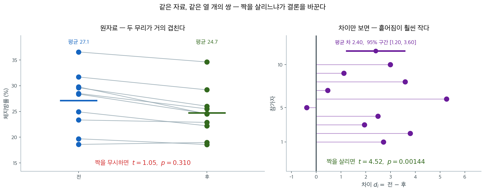
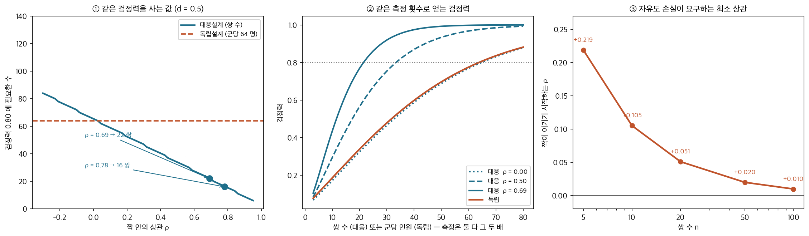

# 대응표본과 이표본, 언제 무엇을 쓰는가

## 개요

대응표본 검정과 이표본 검정 중 무엇을 고를지는 가설검정의 근본적인 결정이다. 이 선택은 자료의 값이 아니라 연구 설계와 자료를 어떻게 모았는지에 달려 있다.

---

## 1. 설계가 검정을 정한다

가르는 물음은 하나다. **쌍마다 차이 $d_i = X_i - Y_i$ 를 의미 있게 계산할 수 있는가.** 계산할 수 있으면 대응이고, 없으면 이표본이다. 이 물음의 답은 자료의 값이 아니라 **자료가 어떻게 생겼는지**에 들어 있다.

### 대응이 되는 설계

- **전후 측정**: 같은 피험자를 두 시점에 측정한다(치료 전후의 혈압).
- **짝지은 피험자**: 핵심 특성(나이, 성별)으로 참가자를 짝짓고 한 명은 처리를, 다른 한 명은 위약을 받는다.
- **반복측정**: 같은 피험자를 서로 다른 두 조건에서 검사한다(두 브랜드의 신발을 신고 달린 속도).
- **자기 짝짓기**: 각 피험자가 자기 자신의 대조가 된다(왼쪽 눈과 오른쪽 눈).

넷 모두 **같은 개체가 두 번 등장한다.** 그래서 차이를 취하면 그 개체의 특성이 상쇄되고, 그것이 대응 설계가 주는 이득의 전부다 — 개인차가 지워지므로 검정력이 오르고 표본이 덜 든다.

### 이표본이 되는 설계

- **독립인 두 집단**: 남성과 여성, 처리군과 대조군(서로 다른 개인).
- **서로 다른 모집단**: 별개의 확률표본으로 두 나라의 평균 소득을 비교.
- **무작위 실험**: 피험자를 두 집단 중 하나에 무작위로 배정한다.

셋 모두 **집단 1 의 어느 관측값을 집단 2 의 어느 관측값과 맞댈지 정할 길이 없다.** 억지로 맞대면 그 짝은 자료가 아니라 적어 놓은 순서에서 온 것이다.

### 헷갈리기 쉬운 자리

| 물음 | 대응 | 이표본 |
|---|---|---|
| 같은 피험자를 두 번 측정했는가? | ✓ | |
| 피험자를 특성으로 짝지었는가? | ✓ | |
| 짝짓기가 없는 독립인 집단인가? | | ✓ |
| 표본크기가 달라도 되는가? | 드물다 | 흔하다 |

마지막 줄이 함정이다. **두 표본의 크기가 같다는 것은 대응의 증거가 아니다.** 체지방률을 열 명에게서 두 번 재면 대응이지만, A 부서 $12$ 명과 B 부서 $12$ 명의 급여는 수가 같아도 이표본이다.

---

## 2. 짝을 무시하면 무엇을 잃는가

말로만 하면 감이 잘 오지 않으니 같은 자료를 두 방식으로 분석해 보자. 참가자 10명의 체지방률을 프로그램 전후로 잰 자료다.



왼쪽이 원자료다. 참가자마다 체지방률이 19%에서 36%까지 넓게 퍼져 있어 **두 무리가 거의 완전히 겹친다.** 이 상태에서 이표본 t 검정을 하면 $t = 1.05$, $p = 0.31$로 "차이가 없다"는 결론이 나온다.

그런데 선을 따라가 보면 열 명 중 아홉 명이 내려갔다. 오른쪽이 그 차이만 뽑아 그린 것인데, 흩어짐이 원자료보다 훨씬 작고 대부분 0의 오른쪽에 있다. 대응 t 검정은 $t = 4.52$, $p = 0.0014$를 준다.

**숫자 하나 바뀌지 않았는데 결론이 정반대다.** 이유는 분모에 있다. 이표본 검정의 표준오차는 참가자 사이의 개인차까지 잡음으로 세지만, 대응 검정은 차이를 취하는 순간 그 개인차가 상쇄되어 사라진다. 원래 물으려던 것이 "이 사람이 얼마나 줄었는가"였으므로, 개인차는 답해야 할 것이 아니라 걷어내야 할 것이었다.

<div class="storybox" markdown>

**그림으로 보는 통계학 1.** 짝이 지워 주는 것

$2$ 절이 보인 이득은 **짝 안의 상관 $\rho$** 가 정한다. 그러면 가장 센 짝은 무엇인가.
한 연구가 그 극단을 모으는 데 십수 년을 썼다.

$1979$ 년부터 미네소타대학의 토머스 부샤르와 동료들은 **태어나 얼마 안 되어 떨어져
자란 쌍둥이**를 찾아다녔다. $1990$ 년 『사이언스』에 실린 보고에는 일란성 $56$ 쌍과
이란성 $30$ 쌍이 모여 있다. 자란 집이 다르니 환경은 공유하지 않고, 일란성이라면 유전자는
공유한다 — **짝짓기가 무엇을 지우는지 가장 또렷하게 보이는 설계**다.

그 자료에서 보고된 일란성 쌍둥이의 지능검사 급내상관이 $0.69$(WAIS)와
$0.78$(레이븐–밀힐)이다. 이 수를 **해석**하는 문제 — 그 상관의 얼마가 유전이고 얼마가
표집과 「떨어져 자람」의 정도 때문인지 — 는 그 뒤로도 재평가가 이어진 논쟁거리다. 여기서
빌려 오는 것은 해석이 아니라 **수 하나**다. $\rho$ 가 그만큼이면 검정이 어떻게 달라지는가.



- **①** 효과크기 $d = 0.5$ 를 $80\%$ 검정력으로 잡는 데 독립설계는 **군당 $64$ 명**
  (측정 $128$ 번)이 든다. 대응설계는 $\rho = 0.69$ 이면 **$22$ 쌍**(측정 $44$ 번),
  $\rho = 0.78$ 이면 **$16$ 쌍**(측정 $32$ 번)이면 된다. 측정 횟수로 $1/3$ 에서 $1/4$ 다.
- **②** 같은 측정 횟수를 놓고 그린 검정력 곡선이다. $\rho = 0.69$ 짜리 짝은 독립설계가
  $60$ 쌍어치를 써야 닿는 곳에 $20$ 쌍으로 닿는다. **$\rho = 0$ 인 짝은 독립보다 조금
  나쁘다** — 점선이 주황 선 아래 붙어 있는 것이 그것이다.
- **③** 왜 조금 나쁜가. 자유도가 $2n-2$ 에서 $n-1$ 로 줄기 때문이다. 그 손실을 메우려면
  $\rho$ 가 최소 얼마여야 하는지를 계산하면 $n = 5$ 에서 $0.219$, $n = 10$ 에서 $0.105$,
  $n = 20$ 에서 $0.051$, $n = 100$ 에서 $0.010$ 이다. **작은 연구일수록 짝에 거는 요구가
  크다.**

③ 이 $3$ 절의 둘째 실수를 재는 수다. 짝이 지어진 자료를 풀어 분석하는 것이
첫째 실수라면, **짝이 아닌 것을 짝으로 묶는 것**이 둘째다. 상관이 없는 짝짓기는 자유도만
깎는다. 그리고 쌍둥이 설계가 분명히 하는 것이 하나 더 있다 — **짝이 지워 주는 것은 짝
안에서 공유된 것뿐이다.** 따로 자란 쌍둥이에게서 유전은 지워지지만 자란 환경은 지워지지
않는다. 무엇을 지우고 싶은지가 곧 무엇을 짝지을지를 정한다.

_확인한 곳 — T. J. Bouchard Jr. 외, "Sources of Human Psychological Differences: The
Minnesota Study of Twins Reared Apart", 『Science』 $250$ 권 $4978$ 호 $223$–$228$ 쪽
($1990$ 년 $10$ 월 $12$ 일). 표본이 떨어져 자란 일란성 $56$ 쌍과 이란성 $30$ 쌍이라는 것,
일란성 쌍둥이의 지능 급내상관이 WAIS $0.69$ · 레이븐–밀힐 $0.78$ 이라는 것을 확인했다.
그 수의 해석을 두고 뒤에 재평가 논문이 나왔다는 것도 확인했다(J. Joseph, "A Reevaluation
of the 1990 'Minnesota Study of Twins Reared Apart' IQ Study", 『Human Development』
$66$ 권 $1$ 호). 그림의 수는 모두 직접 계산한 값이며, 쌍둥이 자료로 계산한 것이 아니라
그 상관값을 $\rho$ 자리에 넣어 본 것이다_

</div>

---

## 3. 실수는 양쪽으로 난다

**짝이 있는데 풀어서 분석한다.** 앞 절이 보인 것이 그것이다. 짝 안의 상관을 잡음으로 세는 바람에 표준오차가 부풀고 검정력을 잃는다. $t = 4.52$ 가 $t = 1.05$ 로 내려앉은 자리다.

**짝이 아닌 것을 짝으로 묶는다.** 덜 알려졌지만 이쪽도 대가가 있다. 상관이 없는 짝짓기는 **자유도만 깎는다** — $2n-2$ 에서 $n-1$ 로 줄고 얻는 것이 없다. 위 상자의 ③ 이 그 손실을 메우려면 $\rho$ 가 최소 얼마여야 하는지를 센다($n = 10$ 이면 $0.105$).

두 실수가 거울상이고, 막는 길도 하나다 — **검정을 고르기 전에 자료가 아니라 설계를 본다.**

---

## 연습문제

<div class="drillbox" markdown>

**연습문제 1.** <span class="diff easy" title="쉬움"></span>
다음 각 상황에서 대응 검정과 이표본 검정 중 무엇이 적절한지 판단하라: (a) 교차 설계에서 카페인과 위약에 따른 참가자의 반응시간 비교, (b) 서로 다른 두 학교 학생들의 시험 점수 비교.

</div>

??? success "풀이"
    **(a) 대응 검정.** 교차 설계에서는 각 참가자가 두 조건(카페인과 위약)에서 모두 검사를 받는다. 같은 사람이 두 측정값을 제공하므로 자연스러운 쌍이 만들어진다. 피험자 내 차이에 대한 대응 $t$-검정이 적절하다.

    **(b) 이표본 검정.** A 학교와 B 학교의 학생은 서로 다른 개인이며 자연스러운 짝짓기가 없다. 이표본 $t$-검정(분산이 다르면 Welch $t$-검정)이 적절하다.

<div class="drillbox" markdown>

**연습문제 2.** <span class="diff easy" title="쉬움"></span>
어떤 연구가 환자 20명의 불안 점수를 치료 전후로 측정했다. 평균 차이는 $\bar{d} = -5.2$이고 $s_d = 8.1$이다. $\alpha = 0.05$에서 $H_0: \mu_d = 0$의 대응 $t$-검정을 하라.

</div>

??? success "풀이"
    검정통계량은:

    $$
    t = \frac{\bar{d} - 0}{s_d / \sqrt{n}} = \frac{-5.2}{8.1/\sqrt{20}} = \frac{-5.2}{1.812} \approx -2.87
    $$

    $df = 19$에서 양측검정의 임계값은 $\pm t_{19, 0.025} = \pm 2.093$이다. $|t| = 2.87 > 2.093$이므로 $H_0$을 **기각한다**. 이 치료가 불안 점수를 통계적으로 유의하게 낮추었다.

<div class="drillbox" markdown>

**연습문제 3.** <span class="diff med" title="중간"></span>
짝 내 상관이 양수일 때 대응 검정이 일반적으로 이표본 검정보다 검정력이 큰 이유를 설명하라.

</div>

??? success "풀이"
    대응 검정은 차이 $d_i = x_{1i} - x_{2i}$로 작업하며, 그 분산은:

    $$
    \text{Var}(D) = \sigma_1^2 + \sigma_2^2 - 2\rho\sigma_1\sigma_2
    $$

    $\rho > 0$이면 항 $-2\rho\sigma_1\sigma_2$가 $\text{Var}(D)$를 독립표본 분산 $\sigma_1^2 + \sigma_2^2$보다 작게 만든다. 차이의 분산이 작으면 표준오차가 작아지고, 같은 참 효과에 대해 검정통계량이 커지므로 검정력이 높아진다. 짝 내 상관이 클수록 대응 검정의 검정력 이점이 커진다.

<div class="drillbox" markdown>

**연습문제 4.** <span class="diff med" title="중간"></span>
어떤 연구자가 쌍둥이 쌍을 짝지어 서로 다른 두 처리에 배정했다. 그런데 15쌍 중 3쌍에서 한쪽 쌍둥이가 중도 탈락하여 짝이 맞지 않는 자료가 생겼다. 이 자료를 분석하는 선택지를 논하라.

</div>

??? success "풀이"
    연구자에게는 세 가지 선택지가 있다:

    1. **완전한 쌍만 분석한다**($n = 12$): 완전한 12쌍에 대해 대응 $t$-검정을 한다. 단순하지만 불완전한 3쌍의 자료를 버려 검정력이 떨어진다.

    2. **혼합 접근을 쓴다**: 완전한 12쌍은 대응 검정으로, 남은 개인 6명(두 집단에서 각각 쌍둥이 한 명씩 잃었다면 집단당 3명)은 이표본 검정으로 분석한 뒤 결과를 결합한다. 복잡해서 실무에서는 거의 쓰지 않는다.

    3. **선형혼합모형을 쓴다**: 쌍둥이 쌍 구조를 확률효과로 반영한 모형을 적합한다. 완전한 쌍과 불완전한 쌍을 모두 다룰 수 있어 가용한 자료를 전부 쓴다. 대응 구조를 올바르게 반영하면서 검정력을 최대화하므로 현대적으로 권장되는 접근이다.

<div class="drillbox" markdown>

**연습문제 5.** <span class="diff med" title="중간"></span>
대응 설계를 **독립으로 분석**했을 때와 그 반대의 경우를 모의실험으로 비교하라. 어느 실수가 더 위험한가?

</div>

??? success "풀이"
    ```python
    import numpy as np
    from scipy import stats

    rng = np.random.default_rng(88)
    M, n = 20_000, 20

    print(f"{'ρ':>6s} {'올바른 분석':>11s} {'잘못된 분석':>12s} {'상황':>22s}")
    # ① 실제로는 대응인데 독립으로 분석
    for rho in [-0.3, 0.0, 0.3, 0.7]:
        L = np.linalg.cholesky(np.array([[1, rho], [rho, 1]]))
        z = rng.standard_normal((M, n, 2)) @ L.T
        x, y = z[:, :, 0], z[:, :, 1]            # H0 참
        d = y - x
        t1 = d.mean(1) / (d.std(1, ddof=1) / np.sqrt(n))
        c_pair = np.mean(np.abs(t1) > stats.t.ppf(0.975, n - 1))
        sp = np.sqrt((x.var(1, ddof=1) + y.var(1, ddof=1)) / 2)
        t2 = (y.mean(1) - x.mean(1)) / (sp * np.sqrt(2 / n))
        c_ind = np.mean(np.abs(t2) > stats.t.ppf(0.975, 2 * n - 2))
        print(f"{rho:6.1f} {c_pair:11.4f} {c_ind:12.4f} "
              f"{'대응 자료를 독립으로':>22s}")

    # ② 실제로는 독립인데 대응으로 분석 (짝이 임의)
    x = rng.standard_normal((M, n))
    y = rng.standard_normal((M, n))
    d = y - x
    t1 = d.mean(1) / (d.std(1, ddof=1) / np.sqrt(n))
    print(f"\n독립 자료를 대응으로 분석: 제1종 오류율 "
          f"{np.mean(np.abs(t1) > stats.t.ppf(0.975, n - 1)):.4f}")
    ```

    ```text
         ρ      올바른 분석       잘못된 분석                     상황
      -0.3      0.0488       0.0846            대응 자료를 독립으로
       0.0      0.0482       0.0472            대응 자료를 독립으로
       0.3      0.0512       0.0222            대응 자료를 독립으로
       0.7      0.0497       0.0008            대응 자료를 독립으로

    독립 자료를 대응으로 분석: 제1종 오류율 0.0514
    ```

    **두 실수의 성격이 완전히 다르다.**

    **① 대응 자료를 독립으로 분석.**

    - **$\rho>0$**: 지나치게 보수적($\rho=0.7$에서 0.0008). **수준은 안전하지만 검정력을 크게 잃는다.**
    - **$\rho<0$**: 과대기각(0.085). **위험하다.**

    **② 독립 자료를 대응으로 분석.** 수준이 0.0514로 **정확하다.**

    **왜 ②는 문제가 없는가.** 짝이 임의여도 $D_i=Y_i-X_i$는 여전히 독립이고 평균이 $\mu_Y-\mu_X$인 확률변수다. 따라서 대응 $t$ 검정이 **타당하다**. 다만 자유도가 $2n-2$에서 $n-1$로 줄어 **검정력을 조금 잃는다.**

    ```python
    # 검정력 비교 (참 차이 0.6, ρ=0)
    x = rng.standard_normal((M, n))
    y = rng.standard_normal((M, n)) + 0.6
    d = y - x
    t1 = d.mean(1) / (d.std(1, ddof=1) / np.sqrt(n))
    sp = np.sqrt((x.var(1, ddof=1) + y.var(1, ddof=1)) / 2)
    t2 = (y.mean(1) - x.mean(1)) / (sp * np.sqrt(2 / n))
    print(f"독립 자료(ρ=0), 참 차이 0.6:")
    print(f"  올바른 독립 분석 검정력 "
          f"{np.mean(np.abs(t2) > stats.t.ppf(0.975, 2 * n - 2)):.4f}")
    print(f"  대응으로 분석한 검정력   "
          f"{np.mean(np.abs(t1) > stats.t.ppf(0.975, n - 1)):.4f}")
    ```

    ```text
    독립 자료(ρ=0), 참 차이 0.6:
      올바른 독립 분석 검정력 0.4555
      대응으로 분석한 검정력   0.4395
    ```

    **검정력이 0.456에서 0.440으로 조금 떨어진다.** 손해가 생각보다 작은 이유가 있다. $\rho=0$이면

    $$
    \operatorname{Var}(\bar D)=\frac{2\sigma^2}{n},\qquad
    \operatorname{Var}(\bar Y-\bar X)=\frac{2\sigma^2}{n}
    $$

    로 **표준오차가 똑같다.** 차이는 오직 자유도($19$ 대 $38$)뿐이고, $n$이 어느 정도 크면 임계값 차이가 작다. $n$이 아주 작을 때만 손해가 두드러진다.

    **정리 — 어느 실수가 더 위험한가.**

    | 실수 | 수준 | 검정력 | 위험도 |
    |---|---|---|---|
    | 대응 → 독립($\rho>0$) | 안전 | **크게 손해** | 중간(자원 낭비) |
    | 대응 → 독립($\rho<0$) | **무너짐** | — | **높음** |
    | 독립 → 대응 | 안전 | 손해 | 낮음 |

    **가장 위험한 것은 음의 상관을 가진 대응 자료를 독립으로 분석하는 것**이다. 다만 실무에서 $\rho<0$은 드물다.

    **핵심 원칙.** **자료의 구조가 분석 방법을 결정한다.** 짝이 있으면 대응으로, 없으면 독립으로. 임의로 짝지어 "대응인 척"하는 것은 타당하지만 손해다.

<div class="drillbox" markdown>

**연습문제 6.** <span class="diff med" title="중간"></span>
**부분적으로 짝지어진 자료**(일부는 쌍, 일부는 한쪽만)를 어떻게 분석하는지 설명하라.

</div>

??? success "풀이"
    **상황.** $n_1$개의 완전한 쌍, $n_2$개의 $X$만, $n_3$개의 $Y$만 관측되었다. 흔한 경우다.

    **세 가지 접근.**

    **1 — 완전사례만.** 쌍 $n_1$개로 대응 검정. 단순하지만 $n_2+n_3$개를 버린다.

    **2 — 두 결과를 결합.** 쌍에서 대응 추정값, 나머지에서 독립 추정값을 구해 가중 결합한다(부분 중복 자료의 결합 검정).

    **3 — 최대가능도/혼합모형.** 이변량 정규를 가정하고 모든 자료로 적합한다. 점근적으로 가장 효율적이지만, 소표본에서는 이득이 보장되지 않는다(다음 문제 참조).

    ```python
    import numpy as np
    from scipy import stats

    def simulate(delta, seed=64, M=5_000, n1=15, n2=10, n3=10, rho=0.7):
        rng = np.random.default_rng(seed)
        L = np.linalg.cholesky(np.array([[1, rho], [rho, 1]]))
        hit_cc = hit_ind = hit_comb = 0
        for _ in range(M):
            z = rng.standard_normal((n1, 2)) @ L.T
            xp, yp = z[:, 0], z[:, 1] + delta      # 완전한 쌍
            xo = rng.standard_normal(n2)           # X 만
            yo = rng.standard_normal(n3) + delta   # Y 만

            # ① 완전사례 대응
            hit_cc += stats.ttest_1samp(yp - xp, 0).pvalue < 0.05
            # ② 짝을 무시하고 전부 독립으로
            hit_ind += stats.ttest_ind(np.r_[yp, yo], np.r_[xp, xo],
                                       equal_var=False).pvalue < 0.05
            # ③ 역분산 가중 결합 + 새터스웨이트 자유도
            d = yp - xp
            est_p, v_p, df_p = d.mean(), d.var(ddof=1) / n1, n1 - 1
            a, b = yo.var(ddof=1) / n3, xo.var(ddof=1) / n2
            est_i, v_i = yo.mean() - xo.mean(), a + b
            df_i = v_i**2 / (a**2 / (n3 - 1) + b**2 / (n2 - 1))
            w1, w2 = 1 / v_p, 1 / v_i
            V = 1 / (w1 + w2)
            est = (w1 * est_p + w2 * est_i) * V
            c1, c2 = w1 * V, w2 * V
            df = V**2 / ((c1**2 * v_p)**2 / df_p + (c2**2 * v_i)**2 / df_i)
            hit_comb += 2 * stats.t.sf(abs(est / np.sqrt(V)), df) < 0.05
        return hit_cc / M, hit_ind / M, hit_comb / M

    print(f"{'참 차이':>7s} {'완전사례 대응':>13s} {'전부 독립':>11s} {'결합 추정':>11s}")
    for delta in [0.0, 0.4, 0.7]:
        cc, ind, comb = simulate(delta)
        print(f"{delta:7.1f} {cc:13.4f} {ind:11.4f} {comb:11.4f}")
    ```

    ```text
       참 차이       완전사례 대응       전부 독립       결합 추정
        0.0        0.0456      0.0086      0.0552
        0.4        0.4714      0.2260      0.5626
        0.7        0.9040      0.7226      0.9522
    ```

    **첫 줄은 수준, 나머지는 검정력이다.**

    **결합 추정이 가장 낫다.** 참 차이 0.4에서 0.563으로, 완전사례(0.471)보다 9%포인트 높다. 버리던 20개 관측값이 실제로 기여한다.

    **짝을 무시하는 것이 최악이다**(0.226). 관측값을 다 쓰는데도 상관의 이득을 버린 탓이다. 수준이 0.0086으로 극단적으로 보수적인 것이 그 증거다 — $\rho=0.7$인 쌍을 독립으로 취급하면 분산을 크게 과대추정한다.

    **결합의 원리.** 두 **독립적인** 추정값

    - 쌍에서 나온 $\hat\delta_p$(분산 $\widehat{\operatorname{Var}}=v_p$, 작음),
    - 짝 없는 자료에서 나온 $\hat\delta_i$(분산 $v_i$, 큼)

    을 **역분산 가중**으로 합친다.

    $$
    \hat\delta=\frac{v_p^{-1}\hat\delta_p+v_i^{-1}\hat\delta_i}{v_p^{-1}+v_i^{-1}},
    \qquad \operatorname{Var}(\hat\delta)=\frac{1}{v_p^{-1}+v_i^{-1}}
    $$

    두 부분이 서로 다른 개체에서 나왔으므로 독립이고, 따라서 이 결합이 타당하다.

    **자유도가 중요하다.** 위 코드에서 새터스웨이트 자유도 대신 정규근사($z$)를 쓰면 수준이 **0.0712**로 부풀어 오른다. 소표본에서 분산을 추정해 가중치로 쓰기 때문이다. $t$ 근사로도 0.0552로 여전히 약간 높으니, 엄밀함이 필요하면 붓스트랩을 쓴다.

    **주의 셋.**

    1. **결측 기전이 MCAR이어야** 단순 결합이 타당하다. 그렇지 않으면 혼합모형이나 다중대체가 필요하다.
    2. **$n_2$, $n_3$이 작으면** 두 번째 추정값의 분산 추정이 불안정해 가중치가 흔들린다.
    3. **혼합모형이 더 일반적**이다. 결측 패턴이 복잡하거나 공변량이 있으면 그쪽이 낫다.

<div class="drillbox" markdown>

**연습문제 7.** <span class="diff med" title="중간"></span>
**교차설계**의 분석을 대응 검정과 비교하고, 기간효과를 어떻게 다루는지 보여라.

</div>

??? success "풀이"
    **차이.** 단순 전후 설계는 순서가 하나지만, 교차설계는 **두 순서군**이 있다.

    | 설계 | 구조 | 기간효과 |
    |---|---|---|
    | 전후 | 모두 $A\to B$ | **처리효과와 교락** |
    | 교차 | 절반 $A\to B$, 절반 $B\to A$ | **분리 가능** |

    ```python
    import numpy as np
    from scipy import stats

    rng = np.random.default_rng(77)
    n_per, M = 15, 5_000
    tau, period = 1.0, 0.8          # 처리효과 1.0, 기간효과 0.8

    bias_naive, bias_cross = [], []
    for _ in range(M):
        # AB 군: 기간1=A, 기간2=B / BA 군: 기간1=B, 기간2=A
        sub_ab = rng.normal(0, 1, n_per)
        sub_ba = rng.normal(0, 1, n_per)
        e = lambda: rng.normal(0, 0.5, n_per)
        ab_p1 = sub_ab + 0 + e()
        ab_p2 = sub_ab + tau + period + e()
        ba_p1 = sub_ba + tau + e()
        ba_p2 = sub_ba + 0 + period + e()

        # ① 순진한 분석: AB 군만 보고 "기간2 - 기간1"
        bias_naive.append((ab_p2 - ab_p1).mean() - tau)
        # ② 교차 분석: 두 군의 개체 내 차이를 결합
        d_ab = ab_p2 - ab_p1          # = τ + 기간
        d_ba = ba_p2 - ba_p1          # = -τ + 기간
        bias_cross.append((d_ab.mean() - d_ba.mean()) / 2 - tau)

    print(f"참 처리효과 {tau},  기간효과 {period}")
    print(f"순진한 분석(AB 군만)  편향 {np.mean(bias_naive):+.4f}")
    print(f"교차 분석            편향 {np.mean(bias_cross):+.4f}")
    ```

    ```text
    참 처리효과 1.0,  기간효과 0.8
    순진한 분석(AB 군만)  편향 +0.7957
    교차 분석            편향 -0.0032
    ```

    **순진한 분석의 편향이 정확히 기간효과와 같다**(+0.80). 처리효과 1.0이 1.80으로 부풀려진다.

    **교차 분석은 편향이 없다.** 두 군의 개체 내 차이를 빼면 기간효과가 상쇄된다.

    $$
    \frac{E[d_{AB}]-E[d_{BA}]}{2}=\frac{(\tau+\pi)-(-\tau+\pi)}{2}=\tau
    $$

    **기간효과도 추정할 수 있다.**

    $$
    \frac{E[d_{AB}]+E[d_{BA}]}{2}=\pi
    $$

    **그런데 이월효과가 있으면 무너진다.** 세척기간이 부족해 첫 처리의 효과가 두 번째 기간까지 남으면, 두 군의 차이에 이월이 섞여 들어간다. 교차설계의 유효성은

    1. **기간효과는 분리 가능**(설계의 이득),
    2. **이월효과는 대칭일 때만 상쇄**(가정),

    이라는 비대칭 위에 서 있다. 충분한 세척기간이 핵심이다.

    **검정력 비교.** 같은 총 관측수에서 교차설계가 평행군 설계보다 훨씬 강력하다. 대응 설계의 이득($\rho$가 클수록 큼)이 그대로 적용되며, 게다가 **각 참가자가 두 처리를 모두 받으므로** 표본이 절반이면 된다.

    **적용할 수 없는 경우.**

    - **완치되는 질환**: 두 번째 기간에 처리할 대상이 없다.
    - **학습효과가 있는 과제**: 이월이 필연적이다.
    - **생존이나 비가역적 결과**: 애초에 불가능하다.
    - **긴 세척기간이 윤리적으로 문제**: 치료 중단이 해로운 경우.

<div class="drillbox" markdown>

**연습문제 8.** <span class="diff med" title="중간"></span>
짝지은 자료에서 **한 쌍이 결측되면 그 쌍 전체를 버리는 것**이 옳은지 검토하라.

</div>

??? success "풀이"
    **상황.** 쌍둥이 15쌍 중 3쌍에서 한쪽이 빠졌다. 선택지는

    | 방법 | 내용 |
    |---|---|
    | ① 쌍 전체 삭제 | 12쌍으로 대응 검정 |
    | ② 짝 없는 값을 따로 추정해 결합 | 앞 문제의 역분산 가중 |
    | ③ 최대가능도(회귀 보정) | 이변량 정규 가정 아래 전부 사용 |
    | ④ 짝 무시 | 전부 독립으로(권장 안 함) |

    **①이 타당하다.** MCAR이면 편향이 없다. 다만 **남은 한쪽을 버린다.** 그 정보를 되찾을 수 있을까?

    **②는 여기서 쓸 수 없다.** 앞 문제와 결정적인 차이가 있다. 앞 문제에서는 짝 없는 $X$와 짝 없는 $Y$가 **따로** 있어 두 번째 추정값이 첫 번째와 독립이었다. 여기서는 짝 없는 값이 $A$쪽뿐이라, 이를 $B$와 비교하려면 **이미 쓴 완전사례의 $B$를 다시 써야** 한다. 두 조각이 자료를 공유하므로 역분산 가중의 전제가 깨진다.

    ```python
    import numpy as np
    from scipy import stats

    def naive_combine_level(delta, seed=101, M=5_000,
                            n_pairs=15, rho=0.7, n_broken=3):
        """②를 그대로 적용했을 때의 기각률."""
        rng = np.random.default_rng(seed)
        L = np.linalg.cholesky(np.array([[1, rho], [rho, 1]]))
        hit_drop = hit_comb = 0
        for _ in range(M):
            z = rng.standard_normal((n_pairs, 2)) @ L.T
            a, b = z[:, 0], z[:, 1] + delta
            broken = rng.permutation(n_pairs)[:n_broken]   # b 가 결측
            keep = np.setdiff1d(np.arange(n_pairs), broken)

            d = (b - a)[keep]                              # ① 쌍 삭제
            hit_drop += stats.ttest_1samp(d, 0).pvalue < 0.05

            # ② 짝 없는 a 를 완전사례의 b 와 대비해 결합 (자료 공유!)
            est_p, v_p, df_p = d.mean(), d.var(ddof=1) / len(d), len(d) - 1
            a_only = a[broken]
            u, v = (b[keep].var(ddof=1) / len(keep),
                    a_only.var(ddof=1) / len(a_only))
            est_i, v_i = b[keep].mean() - a_only.mean(), u + v
            df_i = v_i**2 / (u**2 / (len(keep) - 1) + v**2 / (len(a_only) - 1))
            w1, w2 = 1 / v_p, 1 / v_i
            V = 1 / (w1 + w2)
            est = (w1 * est_p + w2 * est_i) * V
            c1, c2 = w1 * V, w2 * V
            df = V**2 / ((c1**2 * v_p)**2 / df_p + (c2**2 * v_i)**2 / df_i)
            hit_comb += 2 * stats.t.sf(abs(est / np.sqrt(V)), df) < 0.05
        return hit_drop / M, hit_comb / M

    for delta, name in [(0.0, "수준 (H0 참)"), (0.5, "검정력")]:
        drop, comb = naive_combine_level(delta)
        print(f"{name:14s}  쌍 삭제 {drop:.4f}   결합 {comb:.4f}")
    ```

    ```text
    수준 (H0 참)       쌍 삭제 0.0450   결합 0.0810
    검정력             쌍 삭제 0.5324   결합 0.6136
    ```

    **결합이 더 강력해 보이지만 수준이 0.081로 무너졌다.** 명목의 1.6배다. 검정력이 높아 보이는 것은 **기각을 남발한 결과**일 뿐 진짜 이득이 아니다.

    **③ 최대가능도는 타당하다.** 이변량 정규를 가정하면, 짝 없는 $A$는 회귀를 통해 $B$를 예측한다.

    $$
    \hat\delta_{\text{ML}}=\hat\alpha+(\hat\beta-1)\,\bar a_{\text{전체}},
    \qquad \hat b=\hat\alpha+\hat\beta a
    $$

    ```python
    def compare_estimators(n_broken, rho, n_pairs=15, delta=0.8,
                           M=20_000, seed=101):
        rng = np.random.default_rng(seed)
        L = np.linalg.cholesky(np.array([[1, rho], [rho, 1]]))
        cc, ml = [], []
        for _ in range(M):
            z = rng.standard_normal((n_pairs, 2)) @ L.T
            a, b = z[:, 0], z[:, 1] + delta
            broken = rng.permutation(n_pairs)[:n_broken]
            keep = np.setdiff1d(np.arange(n_pairs), broken)
            ak, bk = a[keep], b[keep]
            cc.append((bk - ak).mean())                    # 완전사례
            beta = np.cov(ak, bk, ddof=1)[0, 1] / ak.var(ddof=1)
            alpha = bk.mean() - beta * ak.mean()
            ml.append(alpha + (beta - 1) * a.mean())       # 회귀 보정
        cc, ml = np.array(cc), np.array(ml)
        return cc.std(ddof=1), ml.std(ddof=1), ml.var(ddof=1) / cc.var(ddof=1)

    print(f"{'결측 쌍':>7s} {'ρ':>5s} {'완전사례 SD':>12s} "
          f"{'ML SD':>9s} {'분산비':>8s}")
    for nb in [3, 6, 9]:
        for rho in [0.3, 0.7, 0.9]:
            s_cc, s_ml, ratio = compare_estimators(nb, rho)
            print(f"{nb:7d} {rho:5.1f} {s_cc:12.4f} {s_ml:9.4f} {ratio:8.4f}")
    ```

    ```text
       결측 쌍     ρ      완전사례 SD     ML SD      분산비
          3   0.3       0.3401    0.3305   0.9441
          3   0.7       0.2230    0.2216   0.9876
          3   0.9       0.1289    0.1295   1.0093
          6   0.3       0.3921    0.3745   0.9121
          6   0.7       0.2573    0.2578   1.0034
          6   0.9       0.1489    0.1524   1.0470
          9   0.3       0.4839    0.4667   0.9299
          9   0.7       0.3170    0.3315   1.0938
          9   0.9       0.1831    0.1985   1.1753
    ```

    **예상 밖의 결과다.** 분산비가 1보다 작아야 ML이 이득인데, **상관이 높을수록 ML이 오히려 나쁘다**(9쌍 결측·$\rho=0.9$에서 1.175).

    **왜 그런가.** ML의 효율성은 **점근적**이다. 소표본에서는

    - $\hat\beta$의 추정오차가 $(\hat\beta-1)\bar a_{\text{전체}}$ 항을 통해 잡음으로 들어오고,
    - $\rho$가 높으면 완전사례 $\bar D$ 자체의 분산이 이미 작아($\propto 1-\rho$) 회복할 여지가 거의 없는데, 잡음만 더해진다.

    $\rho$가 **낮을 때만** 이득이 있다(0.912~0.944). 그런데 $\rho$가 낮으면 애초에 대응 설계의 이득이 작다.

    **판단 기준.**

    | 상황 | 권장 |
    |---|---|
    | 쌍이 적고(<30) 결측이 소수 | **쌍 삭제로 충분** |
    | 결측이 많고 $\rho$가 낮음 | ML·혼합모형이 도움 |
    | 쌍이 많음(수십~수백) | 혼합모형의 점근적 이득이 실현됨 |
    | 공변량이 있음 | **혼합모형** |
    | 결측이 결과와 관련(MNAR) | 민감도 분석 필수 |
    | 짝 없는 값이 한쪽에만 | 역분산 가중 **금지**(자료 공유) |

    **가장 중요한 것 — 왜 결측인가.** 쌍둥이 연구에서 한쪽이 빠지는 이유가

    - 단순한 연락 두절(MCAR) → 삭제해도 무방.
    - **결과가 나빠서 참여를 그만둠**(MNAR) → 삭제하면 **편향**된다.

    **결측 자체가 정보**일 수 있다는 점을 놓치지 않는다.

    **실무 절차.** ① 결측 패턴을 표로 정리하고, ② 결측 여부와 관측 변수의 관계를 검토하며, ③ 주 분석은 사전에 정한 방법으로 하되 ④ 다른 방법으로 민감도를 확인한다.

<div class="drillbox" markdown>

**연습문제 9.** <span class="diff med" title="중간"></span>
**짝짓기 여부를 자료를 보고 결정**하면 어떤 문제가 생기는지 보이고, 올바른 절차를 정리하라.

</div>

??? success "풀이"
    **문제.** "상관이 높으면 대응, 낮으면 독립"으로 정하면 **자료를 두 번 쓰는** 것이다.

    ```python
    import numpy as np
    from scipy import stats

    rng = np.random.default_rng(55)
    M, n = 20_000, 20

    c_fixed = c_adaptive = 0
    for _ in range(M):
        x = rng.standard_normal(n)
        y = rng.standard_normal(n)             # H0 참, 짝 없음(ρ=0)
        # ① 사전에 대응으로 고정
        d = y - x
        c_fixed += stats.ttest_1samp(d, 0).pvalue < 0.05
        # ② 관측된 상관을 보고 고르기
        r = np.corrcoef(x, y)[0, 1]
        if r > 0.2:
            p = stats.ttest_1samp(d, 0).pvalue
        else:
            p = stats.ttest_ind(y, x).pvalue
        c_adaptive += p < 0.05
    print(f"사전 고정(대응)    제1종 오류율 {c_fixed / M:.4f}")
    print(f"상관 보고 선택     제1종 오류율 {c_adaptive / M:.4f}")
    ```

    ```text
    사전 고정(대응)    제1종 오류율 0.0513
    상관 보고 선택     제1종 오류율 0.0607
    ```

    **적응적 선택이 수준을 0.0608로 부풀린다.** 22% 초과다. 극적이지는 않지만 명목을 벗어난다.

    **왜 그런가.** 관측된 $r$과 검정통계량이 상관되어 있다. $r$이 우연히 크게 나온 표본에서는 대응 검정의 $t$도 커지는 경향이 있어, "유리한 쪽을 고르는" 효과가 생긴다.

    **더 심각한 경우.** 두 검정의 $p$-값 중 **작은 것을 고르면**

    ```python
    c_min = 0
    for _ in range(M // 2):
        x = rng.standard_normal(n)
        y = rng.standard_normal(n)
        p1 = stats.ttest_1samp(y - x, 0).pvalue
        p2 = stats.ttest_ind(y, x).pvalue
        c_min += min(p1, p2) < 0.05
    print(f"두 p-값 중 작은 것 선택: 제1종 오류율 "
          f"{c_min / (M // 2):.4f}")
    ```

    ```text
    두 p-값 중 작은 것 선택: 제1종 오류율 0.0585
    ```

    **0.059로 17% 초과**다. 두 검정이 강하게 상관되어 있어 두 배까지는 가지 않지만, 분명히 어긋난다. 흥미롭게도 상관을 보고 고르는 쪽(0.061)이 더 나쁜데, 이는 선택 규칙이 검정통계량과 같은 방향으로 움직여 사실상 유리한 쪽을 집어내기 때문이다.

    **올바른 절차.**

    **1 — 설계가 결정한다.** 자료의 구조를 보면 답이 나온다.

    | 자료 구조 | 분석 |
    |---|---|
    | 같은 개체를 두 번 측정 | **대응** |
    | 짝지어 배정한 쌍 | **대응** |
    | 자연적 쌍(쌍둥이, 좌우, 형제) | **대응** |
    | 서로 무관한 두 집단 | **독립** |

    **자료를 보기 전에 이미 정해져 있다.** 상관이 얼마든 상관없다.

    **2 — 짝짓기를 했으면 분석에서도 유지한다.** "상관이 낮으니 독립으로 분석하자"는 잘못이다. 설계의 제약을 분석이 반영해야 한다.

    **3 — 설계 단계에서 $\rho$를 추정한다.** 예비연구나 문헌에서. 자료 수집 후가 아니라.

    **4 — 예외.** 관측연구에서 "짝지을지"를 결정하는 것은 설계의 일부이므로, **자료 수집 전에** 결정하고 사전등록한다.

    **한 문장.** **짝짓기는 분석 선택지가 아니라 설계의 사실이다.**

<div class="drillbox" markdown>

**연습문제 10.** <span class="diff med" title="중간"></span>
대응 설계와 독립 설계의 **선택 기준**을 종합 정리하라.

</div>

??? success "풀이"

    **결정 흐름.**

    ```text
    같은 개체를 두 조건에서 측정할 수 있는가
        │
        ├─ 아니오 ─────────────────────────→ 독립 설계
        │      (완치되는 질환, 비가역적 결과, 파괴검사)
        │
        └─ 예
             │
             ├─ 이월효과를 세척기간으로 제거할 수 있는가
             │      │
             │      ├─ 아니오 ──────────────→ 독립 설계
             │      │      (학습효과, 긴 반감기, 비가역적 변화)
             │      │
             │      └─ 예 ────────────────→ 교차 설계
             │
             └─ 시간이 문제라면
                    └─ 짝지을 변수가 있는가 ──→ 짝지은 독립 설계
                                              (쌍둥이, 매칭, 블록)
    ```

    **정량적 비교(총 관측수 $2n$ 고정).**

    | | 대응 | 독립 |
    |---|---|---|
    | 추정량 분산 | $2\sigma^2(1-\rho)/n$ | $2\sigma^2/n$ |
    | 자유도 | $n-1$ | $2n-2$ |
    | 손익분기 $\rho$ | $1-(t_{2n-2}/t_{n-1})^2$ | — |

    손익분기 상관을 $n$별로 계산하면

    | $n$ | 5 | 10 | 20 | 50 |
    |---|---|---|---|---|
    | 손익분기 $\rho$ | 0.310 | 0.138 | 0.065 | 0.025 |

    $n=20$에서 $\rho>0.065$이면 대응이 유리하다. **상관이 조금만 있어도 대응이 이긴다.** 다만 $n$이 아주 작으면($n=5$) 자유도 손실이 커서 $\rho$가 0.3을 넘어야 한다.

    **대응의 장점.**

    1. **개체 간 변동을 제거**한다. $\rho$가 클수록 이득이 크다.
    2. **표본이 적게 든다.** 모집이 어려운 대상에 유리하다.
    3. **차이의 정규성만 필요**하다. 개체 수준이 치우쳐 있어도 된다.
    4. **개체 내 비교라 교란이 적다.** 나이, 성별, 유전 등 개체 특성이 자동으로 통제된다.

    **대응의 단점.**

    1. **이월효과** 위험.
    2. **탈락에 취약**하다. 쌍이 깨진다.
    3. **자유도가 절반**이다. $n$이 작으면 손해.
    4. **시간이 오래** 걸린다.
    5. **기간효과**가 처리효과와 교락될 수 있다(교차설계로 해결).
    6. **적용 범위가 좁다.** 많은 상황에서 불가능하다.

    **짝지은 독립 설계(매칭)가 절충안이다.** 같은 개체가 아니라 **비슷한 개체**를 짝짓는다. 이월효과가 없고 시간도 짧지만, $\rho$가 대체로 낮다.

    **최종 권고 다섯.**

    1. **가능하면 대응(또는 교차)을 우선 고려**한다. 효율의 이득이 크다.
    2. **이월효과를 먼저 점검**한다. 이것이 유일한 치명적 위험이다.
    3. **$\rho$를 사전에 추정**해 표본크기를 계산한다.
    4. **탈락을 반영해 모집 규모를 $1/(1-q)^2$배**로 잡는다.
    5. **설계를 정했으면 분석에서 유지**한다. 자료를 보고 바꾸지 않는다.

---

<div class="drillbox" markdown>

**연습문제 11.** <span class="diff med" title="중간"></span>
반복측정이 가능한데도 이월 효과 때문에 대응(교차) 설계가 부적절해지는 상황을 기술하라.

</div>

??? success "풀이"
    새 진통제를 위약과 비교하는 약물시험에서 각 환자가 두 처리를 차례로 받는다고 하자. 새 약이 오래가는 생물학적 효과를 낸다면(예: 통증 수용체 민감도를 영구적으로 바꾼다면) 두 번째 기간의 위약 반응이 첫 기간 약물의 잔여 효과에 오염된다. 이런 **이월 효과**는 두 번째 측정이 참된 위약 반응을 반영하지 못한다는 뜻이다.

    이 경우 반복측정이 가능하더라도 차이 $D_i = X_{i,\text{drug}} - X_{i,\text{placebo}}$가 편향되므로 대응 분석이 타당하지 않다. 집단을 나누는 독립표본 설계(한 집단은 약, 다른 집단은 위약)라면 이 문제를 완전히 피할 수 있다.

---

<div class="drillbox" markdown>

**연습문제 12.** <span class="diff med" title="중간"></span>
**실험에서의 짝짓기**와 **관측연구에서의 짝짓기**(성향점수 등)가 무엇이 근본적으로 다른지 논하라.

</div>

??? success "풀이"
    **목적이 다르다.**

    | | 실험 | 관측연구 |
    |---|---|---|
    | 짝짓기의 목적 | **정밀도 향상** | **교란 제거** |
    | 편향 | 무작위 배정이 이미 없앰 | 짝짓기가 없애야 함 |
    | 실패하면 | 효율을 잃을 뿐 | **결론이 틀린다** |
    | 시점 | 배정 **전** | 노출이 이미 일어난 **후** |

    **실험에서.** 무작위 배정이 편향을 처리한다. 짝짓기(블록화)는 **분산을 줄이는 장치**일 뿐이다. 잘못 짝지어도 무작위성이 유지되는 한 추정값은 여전히 불편이며, 폭이 넓어질 뿐이다. **위험이 낮다.**

    **관측연구에서.** 짝짓기가 **식별 전략의 일부**다. "짝지은 변수를 고정하면 처리가 무작위나 마찬가지"라는 가정(조건부 교환가능성) 위에 결론이 선다. 이 가정은 **검증할 수 없다.**

    **핵심 차이 — 측정되지 않은 교란.** 성향점수 짝짓기는 **관측된 공변량**만 균형 맞춘다. 관측되지 않은 교란요인은 그대로 남는다. 무작위 배정은 관측 여부와 무관하게 **모든** 변수를 기댓값 수준에서 균형 맞춘다. **이 차이는 표본을 아무리 늘려도 사라지지 않는다.**

    **실무적 차이들.**

    1. **짝 내 비교의 의미.** 실험의 짝은 설계로 만든 것이라 짝 내 비교가 곧 처리효과다. 관측연구의 짝은 **성향점수가 비슷한 두 사람**일 뿐, 다른 점이 남아 있을 수 있다.

    2. **분산 추정.** 성향점수를 **추정**했다는 사실이 표준오차에 들어가야 하는데, 이를 무시하는 분석이 흔하다. 부트스트랩도 짝짓기 단계를 포함해 다시 해야 한다.

    3. **추정 대상이 바뀐다.** 짝을 찾지 못한 개체를 버리면 **처리군 중 짝이 있는 부분집단**에 대한 효과가 된다. 모집단이 달라진 것이다.

    4. **진단.** 관측연구에서는 짝짓기 후 **공변량 균형을 반드시 확인**해야 한다(표준화 평균차이 등). 실험에서는 확인이 예의일 뿐 필수가 아니다.

    **민감도 분석의 역할.** 관측연구에서는 "측정되지 않은 교란요인이 얼마나 강해야 결론이 뒤집히는가"를 정량화하는 로젠바움식 민감도 분석이 **거의 필수**다. 실험에서는 필요 없다.

    **요약 한 문장.** 실험의 짝짓기는 **효율의 문제**이고, 관측연구의 짝짓기는 **타당성의 문제**다. 같은 계산을 하지만 무엇이 걸려 있는지가 전혀 다르다.

---

<div class="drillbox" markdown>

**연습문제 13.** <span class="diff hard" title="어려움"></span>
**과잉짝짓기**란 무엇이며 어떤 해를 끼치는가? 세 가지 유형으로 나누어 설명하라.

</div>

??? success "풀이"
    **정의.** 짝짓기가 이득을 주기는커녕 **효율을 떨어뜨리거나 편향을 만드는** 경우다. 환자–대조군 연구에서 특히 문제가 된다.

    **유형 1 — 효율 손실형.** 짝짓기 변수가 **노출과 관련**되어 있으면, 짝 내에서 노출이 비슷해져 불일치 짝이 줄어든다.

    앞서 보았듯 맥니마 검정의 정보는 **불일치 짝에서만** 나온다. 노출이 비슷한 짝이 많아지면 $b+c$가 작아져 **검정력이 떨어진다.**

    - 예: 흡연과 폐암 연구에서 **거주지역**으로 짝지음. 지역이 흡연율과 관련되면 짝 내 흡연 차이가 줄어든다.
    - **편향은 없지만 표본을 낭비**한다.

    **유형 2 — 편향 유발형(중간변수).** 짝짓기 변수가 노출과 결과 사이의 **인과 경로 위**에 있으면, 그것을 고정해 효과의 일부를 지운다.

    - 예: 흡연 → 만성기관지염 → 폐암 경로에서 **기관지염 유무**로 짝지음. 흡연의 총효과가 과소추정된다.
    - **이것이 가장 심각**하다. 결과가 틀린다.

    **유형 3 — 편향 유발형(충돌자).** 짝짓기 변수가 노출과 결과의 **공통 결과**이면, 그것을 고정할 때 없던 연관이 생긴다.

    - 예: 노출과 질병이 모두 **입원 확률**에 영향을 주는데, 입원 여부로 짝지음. 선택 편향의 한 형태다.

    **판별법 — 인과그래프를 그린다.**

    | 변수의 위치 | 짝지어야 하나 |
    |---|---|
    | 노출과 결과의 **공통 원인**(교란요인) | **예** |
    | 결과의 원인이지만 노출과 무관 | 예(효율 이득) |
    | 노출의 결과이자 결과의 원인(중간변수) | **아니오** |
    | 노출과 결과의 공통 결과(충돌자) | **아니오** |
    | 노출의 원인이지만 결과와 무관 | 아니오(유형 1) |

    **핵심 규칙.** **결과의 원인이면서 노출의 결과가 아닌** 변수로 짝짓는다.

    **되돌릴 수 있는가.** 유형 1(효율 손실)은 분석에서 회복할 방법이 없다. 정보가 이미 사라졌다. 유형 2·3은 짝짓기를 무시하고 분석하면 되는 것 같지만, **짝짓기 자체가 표본을 선택**했으므로 완전히 되돌릴 수 없다. **설계 단계의 결정이 분석으로 고쳐지지 않는다.**

---

## 정리하며

**자료의 값이 아니라 설계가 검정을 정한다.**

- **짝이 있으면 대응, 없으면 이표본이다.** 전후 측정, 짝지은 쌍, 같은 대상의 반복측정이 대응 설계이며, 서로 다른 대상을 두 집단에 배정했다면 독립이다.
- **자료를 보고 고르는 것이 아니다.** 두 표본의 크기가 우연히 같다고 대응인 것도 아니고, 상관이 높아 보인다고 짝을 지을 수 있는 것도 아니다.
- **잘못 고르면 양쪽 다 대가가 있다.** 대응 자료에 이표본 검정을 쓰면 표준오차를 과대평가해 검정력을 잃고, 독립 자료에 대응 검정을 쓰면 존재하지 않는 짝을 가정하는 셈이다.
- **대응의 이득은 상관에 달려 있다.** $\rho$ 가 높으면 크고, $\rho=0$ 이면 자유도만 잃어 오히려 손해다 — 8.4절 [μ_D (차이의 평균)의 신뢰구간](../../ch08/paired_sample_intervals/ci_mu_paired.md)이 같은 맞바꿈을 구간의 폭으로 잰다.
- **관측 순서가 곧 짝은 아니다.** 두 집단의 자료를 나란히 적었다고 $i$ 번째끼리 짝인 것은 아니며, **실제로 같은 대상에서 나왔어야** 한다.

다음 절부터 **[오류와 검정력](../errors_and_power/errors.md)**으로 넘어간다.
