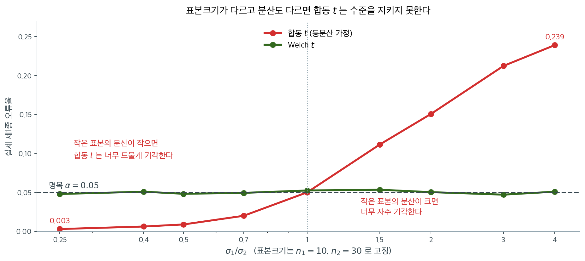
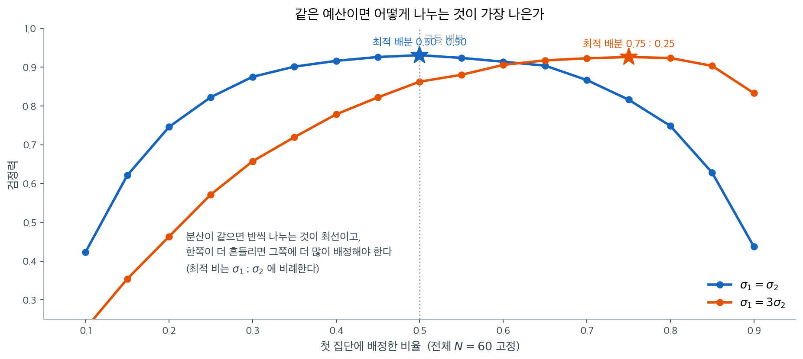
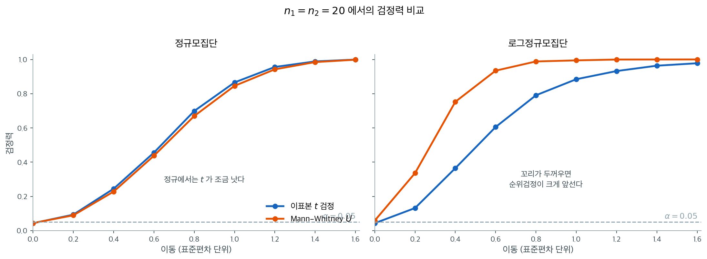

# 이표본 t-검정 (합동과 Welch)

!!! note "Welch 자유도 공식에 관한 정정"
    원 강의노트의 여러 코드 조각이 Welch-Satterthwaite 자유도를 다음처럼 계산했다.

    ```
    bottom = (s_1**2/n_1)**2 / n_1 + (s_2**2/n_2)**2 / n_2      # 잘못됨
    ```

    분모는 $n_i$가 아니라 $n_i - 1$이어야 한다.

    $$
    \nu = \frac{\left(\frac{s_1^2}{n_1}+\frac{s_2^2}{n_2}\right)^2}
              {\frac{(s_1^2/n_1)^2}{n_1-1}+\frac{(s_2^2/n_2)^2}{n_2-1}}
    $$

    차이가 얼마나 되는지 두 경우로 확인해 보자.

    ```python
    def welch_df(s1, n1, s2, n2, wrong=False):
        a, b = s1**2 / n1, s2**2 / n2
        d1, d2 = (n1, n2) if wrong else (n1 - 1, n2 - 1)
        return (a + b) ** 2 / (a**2 / d1 + b**2 / d2)

    for label, (s1, n1, s2, n2) in [
        ("큰 표본  (n=65, 75)", (18.2, 65, 23.9, 75)),
        ("작은 표본 (n=5, 5)",  (5.4, 5, 7.5, 5)),
    ]:
        wrong = welch_df(s1, n1, s2, n2, wrong=True)
        right = welch_df(s1, n1, s2, n2)
        print(f"{label}: 잘못된 식 {wrong:7.2f}  올바른 식 {right:7.2f}  "
              f"({100*(wrong/right - 1):+.1f}%)")
    ```

    출력:

    ```
    큰 표본  (n=65, 75): 잘못된 식  137.77  올바른 식  135.84  (+1.4%)
    작은 표본 (n=5, 5): 잘못된 식    9.09  올바른 식    7.27  (+25.0%)
    ```

    표본이 크면 1.4% 차이에 그치지만, 아래 연습문제 4(전기차, $n_1 = n_2 = 5$)에서는 **자유도가 25% 부풀려진다.** 자유도가 부풀면 임계값이 작아져 기각하기 쉬워지므로, 작은 표본에서는 제1종 오류율이 명목값을 넘게 된다. 이 책의 풀이는 모두 올바른 공식을 쓴다.

---

## 개요

이표본 t-검정은 독립인 두 표본의 평균을 비교하여 유의하게 다른지 판단한다. A/B 검정, 임상시험, 실험 설계에서 널리 쓰인다.

---

## 1. 가설

- **귀무가설** ($H_0$): $\mu_1 = \mu_2$ (평균이 같다)
- **대립가설** ($H_a$): $\mu_1 \neq \mu_2$ (평균이 다르다)

<div class="exbox" markdown>

**보기 1.** <span class="diff easy" title="쉬움"></span> 급여의 성별 격차 — 단측 검정. 시장조사자들이 남성 관리자와 여성 관리자의 평균 급여를 비교한다. 조사 전부터 관심은 한 방향이었으므로 가설을 단측으로 세운다.

$$H_0 : \mu_{\text{men}} = \mu_{\text{women}} \quad\text{vs}\quad H_1: \mu_{\text{men}} > \mu_{\text{women}}$$

표본에서 얻은 요약값은 다음과 같다(단위: 천 달러).

| | 남성 | 여성 |
|:---:|:---:|:---:|
| 평균 | 62.5 | 58.9 |
| 표준편차 | 7.2 | 6.4 |
| n | 30 | 25 |

**(1)** 합동 $t$로 단측 검정을 하고, 같은 자료에 양측 검정을 걸면 결론이 어떻게 바뀌는지 적으시오.

**(2)** 그렇다면 단측을 쓰는 것이 늘 유리한가. $H_0$가 참인 자료를 20만 번 만들어, 방향을 **미리 고정한** 단측 검정과 **자료를 보고 고른** 단측 검정의 실제 기각률을 각각 재시오.

</div>

??? success "풀이"

    **(1) 해석적으로.** 합동분산을 자유도로 가중한다.

    $$
    s_p^2 = \frac{29 \times 7.2^2 + 24 \times 6.4^2}{53}
    = \frac{1503.36 + 983.04}{53} = \frac{2486.40}{53} = 46.9132
    $$

    이므로 $s_p = 6.8493$이고

    $$
    \mathrm{SE} = s_p\sqrt{\frac{1}{30}+\frac{1}{25}} = 6.8493 \times \sqrt{0.073333} = 1.8548
    $$

    이다. 따라서

    $$
    t = \frac{62.5-58.9}{1.8548} = \frac{3.6}{1.8548} = 1.9409, \qquad df = 53
    $$

    이다. 임계값이 $t_{0.95,\,53} = 1.6741$이므로 **단측 검정은 $H_0$를 기각한다**($p = 0.0288$).

    같은 통계량을 양측으로 읽으면 $p = 2 \times 0.0288 = 0.0576$이고 임계값은 $t_{0.975,\,53} = 2.0057$이다. **$1.9409 < 2.0057$이므로 양측 검정은 기각하지 못한다.** 같은 자료, 같은 통계량인데 결론이 갈린다.

    **(2) 단측이 공짜가 아니다.** 단측 검정이 기각하기 쉬운 것은 **대립가설이 미리 반쪽으로 줄어 있을 때**의 이야기다. 자료를 보고 큰 쪽을 $H_1$으로 삼으면 $\lvert t \rvert > t_{1-\alpha,\,df}$일 때 기각하는 절차가 되고, 그 확률은 $H_0$ 아래에서

    $$
    P\!\left(\lvert t_{53} \rvert > t_{0.95,\,53}\right) = 2\alpha = 0.10
    $$

    이다. 명목 5%라고 적어 놓고 실제로는 10%를 쓰는 것이다.

    ```python
    import numpy as np
    from scipy import stats

    n_1, n_2 = 30, 25
    X_1_bar, X_2_bar = 62.5, 58.9
    s_1, s_2 = 7.2, 6.4
    df = n_1 + n_2 - 2

    s_p_square = ((n_1 - 1) * s_1**2 + (n_2 - 1) * s_2**2) / df
    statistic = (X_1_bar - X_2_bar) / np.sqrt(s_p_square * (1 / n_1 + 1 / n_2))

    print(f"s_p       = {np.sqrt(s_p_square):.4f}")
    print(f"statistic = {statistic:.4f}   (df = {df})")
    print(f"단측 p    = {stats.t(df).sf(statistic):.4f}   임계값 {stats.t(df).ppf(0.95):.4f}")
    print(f"양측 p    = {2 * stats.t(df).sf(statistic):.4f}   임계값 {stats.t(df).ppf(0.975):.4f}")

    # 방향을 자료를 보고 고르면 실제 수준은 2alpha 가 된다.
    rng = np.random.default_rng(7)
    B = 200_000
    x = rng.normal(0, 1, (B, n_1))
    y = rng.normal(0, 1, (B, n_2))
    v = ((n_1 - 1) * x.var(1, ddof=1) + (n_2 - 1) * y.var(1, ddof=1)) / df
    t = (x.mean(1) - y.mean(1)) / np.sqrt(v * (1 / n_1 + 1 / n_2))
    c95 = stats.t(df).ppf(0.95)
    print(f"\nH0 가 참일 때 {B}번 중 기각 비율")
    print(f"  방향을 미리 고정한 단측 : {np.mean(t > c95):.4f}")
    print(f"  자료를 보고 방향을 고름 : {np.mean(np.abs(t) > c95):.4f}")
    print(f"  양측                    : {np.mean(np.abs(t) > stats.t(df).ppf(0.975)):.4f}")
    ```

    출력:

    ```
    s_p       = 6.8493
    statistic = 1.9409   (df = 53)
    단측 p    = 0.0288   임계값 1.6741
    양측 p    = 0.0576   임계값 2.0057

    H0 가 참일 때 200000번 중 기각 비율
      방향을 미리 고정한 단측 : 0.0500
      자료를 보고 방향을 고름 : 0.1008
      양측                    : 0.0503
    ```

    **네 수가 모두 손으로 낸 값과 맞는다.** $s_p = 6.8493$, $t = 1.9409$, 단측 $0.0288$, 양측 $0.0576$이다. 모의실험의 세 기각률도 예측대로 $0.05$, $0.10$, $0.05$에 떨어진다. 반복 20만 회에서 $p = 0.05$ 둘레의 몬테카를로 오차가 $\sqrt{0.05\times0.95/200000} = 0.0005$이므로 $0.0500$과 $0.0503$은 모두 오차 안이고, $0.1008$은 $0.10$에서 $0.0008$ 떨어져 있어 역시 오차의 두 배 안이다.

    **결론은 단측 검정을 쓰지 말라는 것이 아니다.** 방향을 **자료를 보기 전에** 정했다면 $p = 0.0288$은 정당하다. 이 보기의 요점은 **그 조건이 검증 불가능**하다는 데 있다. 독자는 연구자가 언제 방향을 정했는지 알 수 없고, 보고된 숫자만으로는 수준 5%짜리 절차와 수준 10%짜리 절차를 구별할 방법이 없다.

    그래서 실무의 관례는 **양측을 기본으로 두고, 단측을 쓸 때는 사전등록 같은 외부 증거로 방향을 못 박는 것**이다. 이 보기처럼 $0.0288$과 $0.0576$이 $0.05$를 가운데 두고 갈리는 자리에서는 더욱 그렇다.

---

## 2. 검정통계량

### 합동 t-검정 (등분산 가정)

두 집단의 모분산이 같다고 가정할 때 이렇게 된다.

$$
t = \frac{\bar{X}_1 - \bar{X}_2}{S_p\sqrt{1/n_1 + 1/n_2}}
$$

여기서 합동 표준편차를 이렇게 둔다.

$$S_p^2 = \frac{(n_1-1)S_1^2 + (n_2-1)S_2^2}{n_1+n_2-2}$$

**자유도**: $df = n_1 + n_2 - 2$

### Welch t-검정 (분산이 다를 수 있는 경우)

분산이 다를 수 있으면 Welch 검정이 더 로버스트하다.

$$
t = \frac{\bar{X}_1 - \bar{X}_2}{\sqrt{S_1^2/n_1 + S_2^2/n_2}}
$$

**자유도** (Satterthwaite 근사):

$$df = \frac{\left(\frac{S_1^2}{n_1} + \frac{S_2^2}{n_2}\right)^2}{\frac{(S_1^2/n_1)^2}{n_1-1} + \frac{(S_2^2/n_2)^2}{n_2-1}}$$

**참고**: Welch 검정은 등분산을 가정하지 않으면서 제1종 오류를 잘 통제하므로 일반적으로 선호된다.

<div class="exbox" markdown>

**보기 2.** <span class="diff easy" title="쉬움"></span> 서로 다른 두 밭의 토마토 — 웰치 자유도의 범위 검사. 두 밭에서 토마토 포기의 키를 재어 다음을 얻었다.

| | 밭 A | 밭 B |
|:---:|:---:|:---:|
| 평균 | 1.3 m | 1.6 m |
| 표준편차 | 0.5 m | 0.3 m |
| n | 22 | 24 |

$$H_0 : \mu_A = \mu_B \quad\text{vs}\quad H_1: \mu_A \neq \mu_B$$

**(1)** 웰치 통계량과 자유도 $\nu$를 손으로 계산하시오. 계산을 믿을 수 있는지 $\nu$가 갇혀야 하는 구간을 적고 **범위 검사**를 하시오.

**(2)** 코드로 (1)을 확인하고, 같은 자료에 합동 $t$를 걸면 $p$-값이 어느 쪽으로 움직이는지 미리 예측한 뒤 확인하시오.

</div>

??? success "풀이"

    **(1) 해석적으로.** 두 집단의 몫을 $a$와 $b$로 적는다.

    $$
    a = \frac{s_1^2}{n_1} = \frac{0.25}{22} = 0.0113636, \qquad
    b = \frac{s_2^2}{n_2} = \frac{0.09}{24} = 0.00375
    $$

    이므로 $a+b = 0.0151136$이고 $\sqrt{a+b} = 0.122938$이다. 따라서

    $$
    t = \frac{1.3-1.6}{0.122938} = -2.4403
    $$

    이다. 자유도는 새터스웨이트 식에서

    $$
    \nu = \frac{(a+b)^2}{\dfrac{a^2}{n_1-1}+\dfrac{b^2}{n_2-1}}
    = \frac{2.28421\times 10^{-4}}{\dfrac{1.29132\times 10^{-4}}{21}+\dfrac{1.40625\times 10^{-5}}{23}}
    = \frac{2.28421\times 10^{-4}}{6.76056\times 10^{-6}} = 33.787
    $$

    이다.

    **범위 검사.** 웰치 자유도는 반드시

    $$
    \min(n_1,n_2)-1 \;\le\; \nu \;\le\; n_1+n_2-2
    $$

    를 만족한다. 여기서는 $21 \le 33.787 \le 44$이므로 통과한다. **이 검사를 통과하지 못하면 계산이 틀린 것이다.** 가장 흔한 실수는 분모에 $n_i-1$ 대신 $n_i$를 넣는 것이고, 그러면 $\nu$가 $44$를 넘어 상한을 깨뜨린다. 실제로 그렇게 계산하면 $\nu = 35.38$이 나와 이 자료에서는 상한을 깨지 않지만, 자유도를 부풀려 기각을 쉽게 만든다.

    **(2) 합동 $t$는 어느 쪽으로 움직이는가.** 5.3절에서 본 배율

    $$
    R = \frac{s_p^2\left(\frac{1}{n_1}+\frac{1}{n_2}\right)}{\dfrac{s_1^2}{n_1}+\dfrac{s_2^2}{n_2}}
    $$

    을 쓰면 된다. 여기서는 **분산이 큰 밭 A에 표본이 적다**($n_1 = 22 < 24 = n_2$). 합동분산은 자유도로 가중하므로 표본이 많은 밭 B의 작은 분산을 더 반영하고, 그 결과 참 분산을 **과소평가**한다. 곧 $R < 1$이어서 합동 $t$가 웰치보다 **크게** 나오고 $p$-값은 **작아진다.**

    ```python
    import numpy as np
    from scipy import stats

    X_1_bar, X_2_bar = 1.3, 1.6
    s_1, s_2 = 0.5, 0.3
    n_1, n_2 = 22, 24

    # 표준편차가 0.5와 0.3으로 다르므로 합동하지 않고 Welch를 쓴다.
    statistic = (X_1_bar - X_2_bar) / np.sqrt(s_1**2 / n_1 + s_2**2 / n_2)

    # Welch-Satterthwaite 자유도.
    # 분모에 n_i가 아니라 **n_i - 1**이 들어간다는 점에 주의하라.
    # n으로 잘못 쓰면 자유도가 부풀어 기각하기 쉬워진다.
    top = (s_1**2 / n_1 + s_2**2 / n_2)**2
    bottom = (s_1**2 / n_1)**2 / (n_1 - 1) + (s_2**2 / n_2)**2 / (n_2 - 1)
    df = top / bottom

    p_value = 2 * stats.t(df).cdf(-abs(statistic))
    print(f"{df = :.4f}")
    print(f"{statistic = :.4f}")
    print(f"{p_value   = :.4f}")

    alpha = 0.05
    if p_value <= alpha:
        print("Reject H_0")
    else:
        print("Fail to reject H_0")
    ```

    출력:

    ```
    df = 33.7874
    statistic = -2.4403
    p_value   = 0.0201
    Reject H_0
    ```

    자유도가 33.79로 정수가 아니다. 웰치 자유도는 근사값이라 정수일 이유가 없다. 합동 검정이었다면 $n_1 + n_2 - 2 = 44$였을 것이고, 분산이 달라 정보량을 보수적으로 잡은 결과가 이 차이다.

    ```python
    import numpy as np
    from scipy import stats

    s_1, s_2 = 0.5, 0.3
    n_1, n_2 = 22, 24

    # 같은 자료에 합동 t 를 걸어 본다.
    s_p_square = ((n_1 - 1) * s_1**2 + (n_2 - 1) * s_2**2) / (n_1 + n_2 - 2)
    se_pool = np.sqrt(s_p_square * (1 / n_1 + 1 / n_2))
    se_welch = np.sqrt(s_1**2 / n_1 + s_2**2 / n_2)
    t_pool = (1.3 - 1.6) / se_pool

    print(f"웰치 SE   = {se_welch:.6f}")
    print(f"합동 SE   = {se_pool:.6f}   비 = {se_pool / se_welch:.6f}")
    R = s_p_square * (1 / n_1 + 1 / n_2) / (s_1**2 / n_1 + s_2**2 / n_2)
    print(f"R = {R:.6f}   sqrt(R) = {np.sqrt(R):.6f}")
    print(f"합동 t    = {t_pool:.4f}  (df = {n_1 + n_2 - 2})"
          f"  p = {2 * stats.t(n_1 + n_2 - 2).cdf(-abs(t_pool)):.4f}")
    ```

    출력:

    ```
    웰치 SE   = 0.122938
    합동 SE   = 0.120390   비 = 0.979280
    R = 0.958988   sqrt(R) = 0.979280
    합동 t    = -2.4919  (df = 44)  p = 0.0165
    ```

    **예측한 방향이 맞는다.** $R = 0.9590 < 1$이고 합동 $t$의 $p$-값이 $0.0201$에서 $0.0165$로 내려갔다. 두 표준오차의 비 $0.979280$이 $\sqrt R = 0.979280$과 소수 여섯째 자리까지 같은 것은 우연이 아니다. $\mathrm{SE}_{\text{pool}}/\mathrm{SE}_{\text{Welch}} = \sqrt{R}$이 $R$의 정의 그대로이기 때문이다.

    **그러면서 어긋남은 작다.** $R$이 $1$에서 $4\%$밖에 떨어져 있지 않고, $p$-값도 $0.0201$과 $0.0165$로 결론이 같다. 5.3절에서 같은 배율이 $0.29$까지 무너져 오류율이 $0.291$이 되었던 것과 견주면 아무 일도 일어나지 않은 셈이다. **까닭은 설계가 거의 균형이라는 데 있다**($22$ 대 $24$). 분산비는 $(0.5/0.3)^2 = 2.78$로 작지 않지만, 5.3절의 결론이 이분산 **하나만으로는** 큰일이 나지 않는다는 것이었다. 참사는 이분산과 **불균형**이 겹쳐야 일어난다.

    그러니 이 자료에서는 두 검정 중 무엇을 쓰든 같은 결론에 닿는다. 그래도 웰치를 쓸 이유는 있다. **어느 쪽이 안전한지 미리 알 수 없다는 것**이 바로 웰치를 기본값으로 두는 이유다.

---

## 3. 실무적 고려사항

### 등분산 가정



권고의 근거가 이 그림에 있다. $H_0$이 참인 자료에서 두 검정의 실제 기각률을 잰 것인데, **Welch는 분산비가 어떻든 $0.05$에 머물고 합동 $t$는 크게 벗어난다.**

벗어나는 방향이 표본크기와 얽혀 있다는 점이 중요하다. 여기서는 $n_1 = 10 < n_2 = 30$인데,

- **작은 집단의 분산이 크면** 합동분산이 그 큰 분산을 과소평가해 분모가 작아지고, 너무 자주 기각한다. $\sigma_1 = 4\sigma_2$에서 실제 오류율이 $0.239$로 명목의 다섯 배에 가깝다.
- **작은 집단의 분산이 작으면** 반대로 지나치게 보수적이 되어 $0.003$까지 내려간다. 이때는 오류율이 아니라 검정력을 잃는다.

표본크기가 같으면 합동 $t$도 꽤 견딘다. **문제는 표본크기와 분산이 함께 다를 때 생기며**, 실제 자료에서는 그런 경우가 드물지 않다.

합동 검정과 Welch 검정 중 하나를 고르기 전에 (Levene 검정 같은) 등분산 사전검정을 하고 싶을 수 있다. 그러나 현대의 통계 실무는 다음 이유로 Welch 검정을 기본으로 쓰기를 권한다.

1. 등분산 가정이 깨져도 로버스트하다
2. 실제로 분산이 같을 때도 합동 검정과 검정력이 거의 같다
3. 분산이 다를 때 더 나은 보호를 제공한다

### 효과크기

이표본 비교에서 **Cohen의 d**가 실질적 유의성을 잰다.

$$d = \frac{\bar{X}_1 - \bar{X}_2}{S_p}$$

**이 눈금이 얼마나 너그러운지는 겹침으로 재어 보면 안다.** 성인 남녀의 키처럼
$d = 0.75$(흔히 「중간에서 큰」으로 분류된다)인 자리에서도, 한 사람씩 임의로 뽑아
견주면 **열 번에 세 번은 순서가 뒤집힌다**($P(\text{작은 쪽 집단의 사람이 더 크다}) = 0.30$).
**「A 가 B 보다 크다」는 평균에 대한 진술이지 개인에 대한 진술이 아니다.**

해석:

- $|d| < 0.2$: 무시할 만한 효과
- $0.2 \leq |d| < 0.5$: 작은 효과
- $0.5 \leq |d| < 0.8$: 중간 효과
- $|d| \geq 0.8$: 큰 효과

<div class="exbox" markdown>

**보기 3.** <span class="diff easy" title="쉬움"></span> 웹페이지 A/B 검정. 새로 디자인한 웹페이지(페이지 B)에서 사용자가 기존 버전(페이지 A)보다 더 오래 머무는지 검정한다. 체류시간(초)을 각 10명에게서 재어 아래를 얻었다.

$$
\begin{aligned}
\text{A} &: 185,\ 188,\ 142,\ 160,\ 161,\ 157,\ 182,\ 181,\ 159,\ 167\\
\text{B} &: 173,\ 181,\ 182,\ 170,\ 169,\ 177,\ 168,\ 183,\ 169,\ 164
\end{aligned}
$$

**(1)** 두 평균과 표준편차, 합동표준편차, 코헨의 $d$를 구하시오. 양측 p-값에서 단측 p-값을 얻는 규칙은 무엇인가.

**(2)** 이 $d$를 검정력 $80\%$로 탐지하려면 집단당 몇 명이 필요한가. 정규근사와 정확한 비중심 $t$ 계산을 모두 하고, 현재 설계(집단당 10명)의 검정력도 구하시오.

</div>

??? success "풀이"

    **(1) 해석적으로.** 평균은 $\bar x_A = 168.20$, $\bar x_B = 173.60$으로 차이가 $5.40$초다. 표본분산은 $s_A^2 = 227.2889$, $s_B^2 = 44.9333$이고 표본표준편차로는 $15.0761$과 $6.7032$다. 집단크기가 같으므로 합동분산은 단순평균이다.

    $$
    s_p^2 = \frac{9 \times 227.2889 + 9 \times 44.9333}{18}
    = \frac{227.2889 + 44.9333}{2} = 136.1111,
    \qquad s_p = 11.6667
    $$

    따라서

    $$
    d = \frac{\bar x_B - \bar x_A}{s_p} = \frac{5.40}{11.6667} = 0.462857.
    $$

    **단측 p-값의 규칙.** 양측 p-값은 $2\min\{F(t), 1-F(t)\}$이므로, 관측된 차이가 대립가설이 말하는 방향이면 단측 p-값이 양측의 절반이고 반대 방향이면 $1 - (\text{양측})/2$이다. 여기서는 $H_1\colon \mu_B > \mu_A$이고 실제로 $\bar x_B > \bar x_A$이므로 절반을 쓴다. $0.3204/2 = 0.1602$다.

    **(2) 필요한 표본크기.** 균형 이표본 검정의 비중심모수는 $\lambda = d\sqrt{n/2}$($n$은 집단당 크기)이고, 임계값을 정규로 바꾸는 거친 근사에서는

    $$
    d\sqrt{\frac n2} \ge z_{1-\alpha/2} + z_{0.80}
    \iff n \ge \frac{2(z_{1-\alpha/2} + z_{0.80})^2}{d^2}
    = \frac{2(1.959964 + 0.841621)^2}{0.462857^2} = 73.273
    $$

    이므로 $n = 74$다. 그러나 이 근사는 **자유도를 무한으로 보고** 비중심 $t$를 정규로 바꾼 것이라 필요한 표본을 과소평가한다. 정확한 계산은

    $$
    \text{검정력}(n) = P\bigl(T'_{2n-2,\,\lambda} > t_{1-\alpha/2,\,2n-2}\bigr)
    + P\bigl(T'_{2n-2,\,\lambda} < -t_{1-\alpha/2,\,2n-2}\bigr)
    $$

    을 쓰며, 아래에서 보듯 $n = 74$에서 $0.79868$로 모자라고 $n = 75$에서 $0.80400$이 된다. **정확한 답은 집단당 75명이다.** 본문이 "75명 남짓"이라 한 것이 이 값이다.

    **수치적으로.**

    ```python
    import numpy as np
    from scipy import stats

    # 체류시간(초)
    page_a = np.array([185, 188, 142, 160, 161, 157, 182, 181, 159, 167])
    page_b = np.array([173, 181, 182, 170, 169, 177, 168, 183, 169, 164])

    # scipy의 기본값은 equal_var=True(합동)이다. Welch를 쓰려면 반드시 명시해야 한다.
    t_stat, p_value = stats.ttest_ind(page_a, page_b, equal_var=False)

    print(f"Page A: mean = {page_a.mean():.2f}, std = {page_a.std(ddof=1):.2f}")
    print(f"Page B: mean = {page_b.mean():.2f}, std = {page_b.std(ddof=1):.2f}")
    print(f"t-statistic: {t_stat:.4f}")
    print(f"p-value (two-sided): {p_value:.4f}")

    # 단측검정. 대립가설은 B 쪽 평균이 더 크다는 것이다.
    p_one_sided = p_value / 2 if page_b.mean() > page_a.mean() else 1 - p_value / 2
    print(f"p-value (one-sided): {p_one_sided:.4f}")

    # 효과크기 Cohen 의 d — 평균 차이를 표준편차 단위로 잰 값
    pooled_std = np.sqrt(((len(page_a) - 1) * page_a.std(ddof=1)**2 +
                           (len(page_b) - 1) * page_b.std(ddof=1)**2) /
                          (len(page_a) + len(page_b) - 2))
    # 효과크기는 표본크기와 무관하다. t는 n이 커지면 함께 커지지만 d는 그렇지 않다.
    # 그래서 "유의한가"와 "쓸모 있을 만큼 큰가"를 따로 말할 수 있다.
    cohens_d = (page_b.mean() - page_a.mean()) / pooled_std
    print(f"Cohen's d: {cohens_d:.3f}")
    ```

    출력:

    ```
    Page A: mean = 168.20, std = 15.08
    Page B: mean = 173.60, std = 6.70
    t-statistic: -1.0350
    p-value (two-sided): 0.3204
    p-value (one-sided): 0.1602
    Cohen's d: 0.463
    ```

    ```python
    d = cohens_d
    print(f"정확한 d = {d:.9f}   (s_p = {pooled_std:.9f})")

    za, zb = stats.norm.ppf(0.975), stats.norm.ppf(0.80)
    n_norm = 2 * (za + zb) ** 2 / d**2
    print(f"정규근사가 주는 집단당 n = {n_norm:.4f}  →  {int(np.ceil(n_norm))}")


    def power_two_sample(n, d, alpha=0.05):
        """집단당 n 명, 참 효과크기 d 인 균형 이표본 t 검정의 검정력."""
        df = 2 * n - 2
        nc = d * np.sqrt(n / 2)            # 비중심모수
        tc = stats.t.ppf(1 - alpha / 2, df)
        return stats.nct.sf(tc, df, nc) + stats.nct.cdf(-tc, df, nc)


    print("\n   n(집단당)   검정력")
    for n in (10, 70, 73, 74, 75, 76, 80):
        print(f"{n:9d}   {power_two_sample(n, d):.5f}")

    # 격자의 "첫 칸" 만 보지 않는다. 3 부터 400 까지 모두 훑는다.
    # (n >= 757 부터는 검정력이 배정밀도로 정확히 1 이 되어 차가 0 이 된다.)
    ns = np.arange(3, 401)
    pw = np.array([power_two_sample(int(k), d) for k in ns])
    ok = ns[pw >= 0.80]
    print(f"\n검정력 >= 0.80 인 n 의 개수 = {len(ok)},  가장 작은 n = {ok.min()},"
          f"  연속인가 = {bool(np.all(np.diff(ok) == 1))}")
    print(f"검정력이 n 에 대해 단조증가인가 = {bool(np.all(np.diff(pw) > 0))}")
    print(f"현재 설계(n = 10)의 검정력 = {power_two_sample(10, d):.4f}")
    ```

    출력:

    ```
    정확한 d = 0.462857143   (s_p = 11.666666667)
    정규근사가 주는 집단당 n = 73.2730  →  74

       n(집단당)   검정력
           10   0.16531
           70   0.77614
           73   0.79324
           74   0.79868
           75   0.80400
           76   0.80920
           80   0.82883

    검정력 >= 0.80 인 n 의 개수 = 326,  가장 작은 n = 75,  연속인가 = True
    검정력이 n 에 대해 단조증가인가 = True
    현재 설계(n = 10)의 검정력 = 0.1653
    ```

    **(1)의 수가 모두 맞는다.** 평균 $168.20$과 $173.60$, 표준편차 $15.08$과 $6.70$, $d = 0.463$이다. 양측 $p = 0.3204$, 단측 $p = 0.1602$로 정확히 절반이다.

    **(2)에서 근사와 정확값이 하나 차이로 갈린다.** 정규근사는 $73.27$을 주어 $74$라 하지만, $n = 74$의 실제 검정력은 $0.79868$로 목표에 $0.0013$ 모자란다. 정확한 답은 $75$($0.80400$)다. 검정력이 $n$에 대해 단조증가이고 $n \ge 75$가 끊김 없이 이어지는 것까지 확인했다.

    **그리고 현재 설계의 검정력은 $0.1653$이다.** $d = 0.463$이 참값이라 해도 여섯 번에 한 번만 잡아낸다. $p = 0.32$로 기각하지 못한 것은 효과가 없다는 뜻이 아니라 **집단당 10명으로는 이만한 효과를 가려낼 수 없다**는 뜻이다. 필요한 75명의 7분의 1밖에 모으지 않았다.

    두 집단의 표준편차가 $15.08$과 $6.70$으로 두 배 넘게(분산으로는 다섯 배) 차이 난다는 점도 눈여겨보라. 합동 $t$-검정이 가정하는 등분산과는 거리가 멀어서, 여기서 Welch를 쓴 것은 형식이 아니라 필요다.

### 집단크기가 같으면 두 검정이 같은 수를 낸다

<div class="exbox" markdown>

**보기 4.** <span class="diff easy" title="쉬움"></span> scipy 로 이표본 t-검정. 같은 자료에 `equal_var=False`(Welch)와 `equal_var=True`(합동)를 모두 적용하면 **통계량은 똑같고 p-값만 다르다**($-1.0350$에 대해 $0.3204$와 $0.3144$).

**(1)** 집단크기가 같으면 두 검정의 통계량이 **정확히 같은 수**가 되는 까닭을 보이시오. 그렇다면 어느 쪽 p-값이 반드시 큰가.

**(2)** 균형 설계에서 Welch 자유도를 분산비 $\rho = s_2^2/s_1^2$만의 식으로 쓰고, 그 값이 들어갈 수 있는 범위를 구하시오.

</div>

??? success "풀이"

    **(1) 같은 통계량.** [이표본 평균 검정](t_test_two_means.md)의 보기 3에서 두 표준오차의 차를 닫힌 꼴로 구했다.

    $$
    \text{SE}_{\text{pool}}^2 - \text{SE}_{\text{welch}}^2
    = \frac{(N-1)(n_1-n_2)(s_1^2-s_2^2)}{(N-2)\,n_1n_2}
    $$

    $n_1 = n_2$이면 $(n_1 - n_2) = 0$이므로 **차가 분산비와 무관하게 정확히 0이다.** 분자도 같으니 두 통계량은 같은 수다. 직접 확인해도 된다. $n_1 = n_2 = n$에서

    $$
    \text{SE}_{\text{pool}}^2 = \frac{(n-1)s_1^2 + (n-1)s_2^2}{2n-2}\cdot\frac{2}{n}
    = \frac{s_1^2 + s_2^2}{n}
    = \frac{s_1^2}{n} + \frac{s_2^2}{n} = \text{SE}_{\text{welch}}^2
    $$

    이다.

    **그러므로 남는 차이는 자유도뿐이다.** 같은 $\lvert t \rvert$를 자유도가 작은 분포로 읽으면 꼬리확률이 더 크고, Welch 자유도는 언제나 $\nu \le n_1 + n_2 - 2$이므로

    $$
    p_{\text{welch}} \ \ge\ p_{\text{pool}}
    $$

    이다. 등호는 $\nu = n_1+n_2-2$, 곧 균형 설계에서는 $s_1 = s_2$일 때뿐이다. **균형 설계에서 Welch는 합동과 같은 통계량을 더 조심스럽게 읽는 검정이다.**

    **(2) 균형 설계의 자유도.** $a = s_1^2/n$, $b = s_2^2/n$이고 두 자유도가 모두 $n-1$이므로

    $$
    \nu = \frac{(a+b)^2}{\dfrac{a^2 + b^2}{n-1}}
    = (n-1)\,\frac{(s_1^2+s_2^2)^2}{s_1^4+s_2^4}
    = (n-1)\,\frac{(1+\rho)^2}{1+\rho^2},
    \qquad \rho = \frac{s_2^2}{s_1^2}
    $$

    이다. $g(\rho) = (1+\rho)^2/(1+\rho^2)$는 $\rho = 1$에서 최대 2, $\rho \to 0$ 또는 $\rho \to \infty$에서 1로 간다. 그러므로

    $$
    n - 1 \;<\; \nu \;\le\; 2(n-1) = n_1 + n_2 - 2
    $$

    이다. **균형 설계에서 Welch가 잃을 수 있는 자유도는 최대 절반이다.** $n = 10$이면 $\nu$가 9와 18 사이에 있다.

    **수치적으로.**

    ```python
    from scipy import stats

    group1, group2 = page_a, page_b          # 위 보기의 자료를 그대로 쓴다

    # Welch t-검정 (권장). 등분산을 가정하지 않는다.
    t_welch, p_welch = stats.ttest_ind(group1, group2, equal_var=False)

    # 합동 t-검정. 등분산을 가정한다.
    t_pooled, p_pooled = stats.ttest_ind(group1, group2, equal_var=True)

    print(f"Welch : t = {t_welch:.4f}, p = {p_welch:.4f}")
    print(f"Pooled: t = {t_pooled:.4f}, p = {p_pooled:.4f}")

    # 단측 p-값. 통계량의 부호에 따라 처리가 달라진다.
    if t_welch > 0:
        p_one_sided = p_welch / 2
    else:
        p_one_sided = 1 - p_welch / 2
    print(f"one-sided (H1: mu1 > mu2): p = {p_one_sided:.4f}")
    ```

    출력:

    ```
    Welch : t = -1.0350, p = 0.3204
    Pooled: t = -1.0350, p = 0.3144
    one-sided (H1: mu1 > mu2): p = 0.8398
    ```

    ```python
    n = len(group1)
    v1, v2 = group1.var(ddof=1), group2.var(ddof=1)
    a, b = v1 / n, v2 / n

    se_welch = np.sqrt(a + b)
    sp2 = ((n - 1) * v1 + (n - 1) * v2) / (2 * n - 2)
    se_pool = np.sqrt(sp2 * (1 / n + 1 / n))
    print(f"n1 = n2 = {n}")
    print(f"  SE_welch = {se_welch:.12f}")
    print(f"  SE_pool  = {se_pool:.12f}")
    print(f"  차 = {se_pool - se_welch:.3e}   (0 이어야 한다)")
    print(f"  t_welch = {t_welch:.15f}")
    print(f"  t_pool  = {t_pooled:.15f}")
    print(f"  두 통계량이 같은가: {t_welch == t_pooled}")

    nu = (a + b) ** 2 / (a**2 / (n - 1) + b**2 / (n - 1))
    rho = v2 / v1
    print(f"\n자유도: 합동 {2 * n - 2},  Welch {nu:.9f}")
    print(f"  균형 공식 (n-1)(1+rho)^2/(1+rho^2) = "
          f"{(n - 1) * (1 + rho) ** 2 / (1 + rho**2):.9f}   (rho = s2^2/s1^2 = {rho:.6f})")
    print(f"  공식이 주는 범위: [{n - 1}, {2 * (n - 1)}]")
    print(f"\n같은 |t| = {abs(t_welch):.6f} 를 두 자유도로 읽으면")
    print(f"  df = {2 * n - 2}      : p = {2 * stats.t.sf(abs(t_welch), 2 * n - 2):.9f}")
    print(f"  df = {nu:.4f} : p = {2 * stats.t.sf(abs(t_welch), nu):.9f}")
    ```

    출력:

    ```
    n1 = n2 = 10
      SE_welch = 5.217491947500
      SE_pool  = 5.217491947500
      차 = 8.882e-16   (0 이어야 한다)
      t_welch = -1.034980035299904
      t_pool  = -1.034980035299904
      두 통계량이 같은가: True

    자유도: 합동 18,  Welch 12.424624520
      균형 공식 (n-1)(1+rho)^2/(1+rho^2) = 12.424624520   (rho = s2^2/s1^2 = 0.197693)
      공식이 주는 범위: [9, 18]

    같은 |t| = 1.034980 를 두 자유도로 읽으면
      df = 18      : p = 0.314383791
      df = 12.4246 : p = 0.320403323
    ```

    **두 통계량이 비트 단위로 같다.** `t_welch == t_pooled`가 `True`이고, 두 표준오차의 차가 $9 \times 10^{-16}$으로 부동소수점 반올림뿐이다. 분산이 다섯 배 차이 나는데도 그렇다. **균형이 합동 $t$를 구해 준다**는 말의 가장 깨끗한 형태다.

    **자유도 공식도 맞는다.** $\rho = 0.197693$에서 $(n-1)(1+\rho)^2/(1+\rho^2) = 12.424624520$이 `scipy`의 Welch 자유도와 소수 아홉째 자리까지 같다. 범위 $[9, 18]$ 안에 있다.

    **p-값의 차는 자유도에서만 온다.** 같은 $\lvert t \rvert = 1.034980$을 자유도 18로 읽으면 $0.314384$, $12.4246$으로 읽으면 $0.320403$이다. 예상대로 Welch 쪽이 크다. 이 자료에서는 둘 다 $0.05$와 멀어 판정이 같지만, 경계 근처라면 자유도 하나 때문에 결론이 갈릴 수 있다.

    단측 p-값이 $0.8398$로 나온 것도 읽어 둘 만하다. $t$가 음수인데 $H_1$을 $\mu_1 > \mu_2$로 잡았으니 자료가 대립가설과 반대 방향이고, 그럴 때 단측 p-값은 $0.5$보다 커진다. 보기 1에서 쓴 단측 p-값 $0.1602$는 집단의 순서를 반대로 잡은 것, 곧 $H_1\colon \mu_B > \mu_A$에 대한 값이다. **같은 자료에서 두 수가 더해 1이 된다**($0.1602 + 0.8398$).

### 분산이 다르면 자유도를 얼마나 잃는가

<div class="exbox" markdown>

**보기 5.** <span class="diff easy" title="쉬움"></span> statsmodels 로 이표본 t-검정. `scipy.stats.ttest_ind`는 $t$와 p-값만 돌려주지만 `statsmodels`는 자유도까지 함께 준다. 보고할 때 자유도를 적어야 하므로 이 점이 편하다.

**(1)** `statsmodels`가 주는 Welch 자유도를 보기 4의 공식으로 손으로 재현하시오. 본문은 "한쪽 분산이 다른 쪽의 다섯 배"라 했는데 실제 비는 얼마이고, 자유도를 얼마나 잃었는가.

**(2)** 분산비를 극단까지 밀면 자유도가 어디까지 내려가는지 표로 보이시오.

</div>

??? success "풀이"

    **(1) 해석적으로.** 보기 4의 공식에 $\rho = s_2^2/s_1^2 = 44.9333/227.2889 = 0.197693$과 $n = 10$을 넣으면

    $$
    \nu = 9 \times \frac{(1 + 0.197693)^2}{1 + 0.197693^2}
    = 9 \times \frac{1.434469}{1.039083} = 12.424625
    $$

    다. 분산비는 $s_1^2/s_2^2 = 5.0584$로 본문의 "다섯 배"가 맞다. 합동 자유도 $18$ 가운데 $5.5754$를 잃어 $69.0\%$만 남았다.

    **(2) 극단으로 밀면.** 보기 4에서 보았듯 $g(\rho) = (1+\rho)^2/(1+\rho^2)$는 $\rho \to 0$에서 1로 가므로 $\nu \to n-1 = 9$다. **분산비가 아무리 커도 자유도가 절반 아래로는 내려가지 않는다.** 다가가는 속도는 느리다. 분산비 10에서 $10.78$, 100에서 $9.18$, 10,000에서 $9.0018$이다.

    **수치적으로.**

    ```python
    import statsmodels.api as sm

    # statsmodels는 자유도까지 함께 돌려준다. scipy는 그렇지 않다.
    # 결과를 보고할 때 자유도를 함께 적어야 하므로 이 점이 편하다.
    t_stat, p_value, df = sm.stats.ttest_ind(group1, group2,
                                             usevar='unequal',
                                             alternative='two-sided')
    print(f"t = {t_stat:.4f}, p = {p_value:.4f}, df = {df:.4f}")
    ```

    출력:

    ```
    t = -1.0350, p = 0.3204, df = 12.4246
    ```

    ```python
    # 손으로 구한 값과 맞추어 본다.
    nu_hand = (n - 1) * (1 + rho) ** 2 / (1 + rho**2)
    print(f"statsmodels df = {df:.12f}")
    print(f"손으로 구한 df = {nu_hand:.12f}   차 = {abs(df - nu_hand):.2e}")
    print(f"분산비 s1^2/s2^2 = {v1 / v2:.6f}  (본문의 '다섯 배')")
    print(f"잃은 자유도 = {2 * (n - 1) - nu_hand:.6f}  "
          f"(합동 {2 * (n - 1)} 의 {100 * nu_hand / (2 * (n - 1)):.1f}% 만 남는다)")

    print("\n분산비를 바꾸면 자유도가 어떻게 되는가 (n = 10 균형)")
    print("   s1^2/s2^2     nu      합동과의 비")
    for ratio in (1, 2, 5.058358, 10, 100, 10_000):
        rr = 1 / ratio
        nn = (n - 1) * (1 + rr) ** 2 / (1 + rr**2)
        print(f"{ratio:11.4f}  {nn:8.4f}     {nn / (2 * (n - 1)):.4f}")

    print(f"\nscipy 와 statsmodels 의 t, p 가 같은가: "
          f"{np.allclose([t_stat, p_value], [t_welch, p_welch])}")
    ```

    출력:

    ```
    statsmodels df = 12.424624519556
    손으로 구한 df = 12.424624519556   차 = 0.00e+00
    분산비 s1^2/s2^2 = 5.058358  (본문의 '다섯 배')
    잃은 자유도 = 5.575375  (합동 18 의 69.0% 만 남는다)

    분산비를 바꾸면 자유도가 어떻게 되는가 (n = 10 균형)
       s1^2/s2^2     nu      합동과의 비
         1.0000   18.0000     1.0000
         2.0000   16.2000     0.9000
         5.0584   12.4246     0.6903
        10.0000   10.7822     0.5990
       100.0000    9.1800     0.5100
     10000.0000    9.0018     0.5001

    scipy 와 statsmodels 의 t, p 가 같은가: True
    ```

    **손계산과 `statsmodels`가 완전히 같다.** 차가 $0$이다(배정밀도로 같은 비트). 두 라이브러리의 $t$와 p-값도 일치한다.

    **표가 (2)를 확인한다.** 분산비 1에서 $\nu = 18$로 합동과 같고, 거기서 내려가지만 10,000배에서도 $9.0018$로 하한 9에 닿기만 할 뿐 밑돌지 않는다. **균형 설계에서 Welch가 치르는 자유도의 대가는 최악의 경우에도 절반이다.** 이 자료의 $12.42$는 그 중간쯤이고, 실제로 잃은 것은 p-값에서 $0.3144 \to 0.3204$, 곧 $0.006$이다. 등분산이 의심스러울 때 Welch를 기본으로 쓰는 것이 왜 손해가 아닌지가 이 수에 들어 있다.

<div class="exbox" markdown>

**보기 6.** <span class="diff easy" title="쉬움"></span> 출생아 수 — 보기 3의 자료에 합동 $t$를 걸면. 같은 자료를 다시 쓴다.

| | France | Switzerland |
|:---:|:---:|:---:|
| 평균 | 1.85 | 1.65 |
| 표준편차 | 1.3 | 1.2 |
| n | 100 | 100 |

**(1)** $n_1 = n_2 = n$이면 합동 표준오차가 9.3절 [이표본 $Z$ 검정](z_test_two_means.md) 보기 3의 $z$ 검정 분모와 **정확히 같아진다**는 것을 보이시오. 그러면 두 검정은 무엇으로 갈리는가.

**(2)** 코드로 확인하고, 두 $p$-값의 차이 $0.2596 - 0.2583 = 0.0013$이 어디서 오는지 적으시오.

</div>

??? success "풀이"

    **(1) 해석적으로.** $n_1 = n_2 = n$을 합동분산에 넣으면 가중값이 같아져 단순 평균이 된다.

    $$
    s_p^2 = \frac{(n-1)s_1^2 + (n-1)s_2^2}{2n-2} = \frac{s_1^2+s_2^2}{2}
    $$

    이것을 합동 표준오차에 넣는다.

    $$
    s_p^2\left(\frac1n+\frac1n\right) = \frac{s_1^2+s_2^2}{2}\cdot\frac{2}{n}
    = \frac{s_1^2}{n} + \frac{s_2^2}{n}
    $$

    **오른쪽이 [이표본 $Z$ 검정](z_test_two_means.md) 보기 3의 $z$ 분모 안에 있던 바로 그 식이다.** 두 검정의 분자도 $\bar x_1 - \bar x_2$로 같으므로 **통계량이 글자 그대로 같다.** 수로 적으면 둘 다 $0.176918$과 $1.1305$다.

    남는 차이는 단 하나, **그 통계량을 어느 분포에 대고 읽느냐**다. $z$ 검정은 $N(0,1)$에, 합동 $t$ 검정은 $t_{198}$에 댄다. 임계값으로 보면 $1.95996$ 대 $1.97202$다.

    여기서 5.3절의 결과도 다시 확인된다. 균형 설계에서는 $R = 1$, 곧 합동분산이 겨누는 값이 참 분산과 **정확히** 같다. 표준편차가 $1.3$과 $1.2$로 달라도 그렇다. 이 보기는 그 등식의 표본 버전이다.

    **(2) 수치적으로.**

    ```python
    X_1_bar, X_2_bar = 1.85, 1.65
    s_1, s_2 = 1.3, 1.2
    n_1, n_2 = 100, 100

    # 합동분산은 두 표본분산을 자유도로 가중평균한 것이다.
    # 여기서는 n이 같아 단순 평균과 같아진다.
    s_p_square = ((n_1 - 1) * s_1**2 + (n_2 - 1) * s_2**2) / (n_1 + n_2 - 2)
    statistic = (X_1_bar - X_2_bar) / np.sqrt(s_p_square / n_1 + s_p_square / n_2)
    df = n_1 + n_2 - 2
    p_value = 2 * stats.t(df).cdf(-abs(statistic))

    print(f"{df = :.4f}")
    print(f"{statistic = :.4f}")
    print(f"{p_value   = :.4f}")
    ```

    출력:

    ```
    df = 198.0000
    statistic = 1.1305
    p_value   = 0.2596
    ```

    같은 자료의 앞선 $z$-검정과 통계량이 1.1305로 정확히 같고 $p$-값만 0.2583에서 0.2596으로 바뀌었다. 자유도 198이면 $t$가 정규분포와 거의 구별되지 않기 때문이다.

    등식을 자리까지 맞춰 확인한다.

    ```python
    import numpy as np
    from scipy import stats

    s_1, s_2, n = 1.3, 1.2, 100
    s_p_square = ((n - 1) * s_1**2 + (n - 1) * s_2**2) / (2 * n - 2)

    print(f"s_p^2            = {s_p_square:.6f}")
    print(f"(s_1^2+s_2^2)/2  = {(s_1**2 + s_2**2) / 2:.6f}")
    print(f"합동 SE          = {np.sqrt(s_p_square * 2 / n):.10f}")
    print(f"z 검정의 분모    = {np.sqrt(s_1**2 / n + s_2**2 / n):.10f}")
    print(f"t_.975,198 = {stats.t(2 * n - 2).ppf(0.975):.6f}"
          f"    z_.975 = {stats.norm.ppf(0.975):.6f}")
    ```

    출력:

    ```
    s_p^2            = 1.565000
    (s_1^2+s_2^2)/2  = 1.565000
    합동 SE          = 0.1769180601
    z 검정의 분모    = 0.1769180601
    t_.975,198 = 1.972017    z_.975 = 1.959964
    ```

    **두 표준오차가 소수 열째 자리까지 같다.** 유도한 등식이 근사가 아니라 항등식임을 보여 준다.

    **$p$-값의 차이 0.0013은 전부 꼬리의 무게에서 온다.** $t_{198}$은 $N(0,1)$보다 꼬리가 조금 두꺼우므로 같은 통계량 $1.1305$ 밖에 놓인 확률이 더 크다. 임계값으로 보면 $1.97202$ 대 $1.95996$, 곧 $0.6\%$ 차이다. 자유도가 $198$이나 되므로 이 정도가 남는 전부다.

    **그래서 이 쪽에서 $z$와 합동 $t$를 가르는 것은 공식이 아니라 자유도다.** $n$이 크면 두 검정이 사실상 같은 검정이 되고, $n$이 작으면 $t$를 써야 한다. 반대로 $z$를 쓸 **명분**은 $\sigma$를 실제로 아는 경우뿐인데, 여기서는 $\sigma$ 자리에 $s$를 넣었으므로 그 명분이 없다. **엄밀하게는 처음부터 $t$를 쓰는 것이 맞고, $z$는 큰 표본에서 그것과 거의 같아지는 어림일 뿐이다.**

<div class="exbox" markdown>

**보기 7.** <span class="diff easy" title="쉬움"></span> 두 품종의 배 — 신뢰구간으로 검정하기. Bosc와 Anjou 두 품종의 무게를 재어 다음을 얻었다.

| | Bosc | Anjou |
|:---:|:---:|:---:|
| 평균 | 120 | 116 |
| 표준편차 | 15 | 13 |
| n | 65 | 65 |

$\mu_{\text{Bosc}} - \mu_{\text{Anjou}}$의 99% 신뢰구간이 $4 \pm 6.44$, 즉 $(-2.44, 10.44)$라고 한다.

**(1)** 여유폭 $6.44$를 직접 만들어 보이시오. 합동과 웰치가 사실상 같은 구간을 주는 까닭도 적으시오. 그리고 **이 여유폭이 $t$로 만든 것인지 $z$로 만든 것인지** 수로 판정하시오.

**(2)** 같은 자료의 양측 $p$-값을 구해 구간이 내린 결론과 맞는지 확인하고, 99% 대신 95% 구간이었다면 결론이 바뀌는지 보시오.

</div>

??? success "풀이"

    **(1) 해석적으로.** $n_1 = n_2 = 65$이므로 보기 6에서 본 등식이 그대로 쓰인다. 합동 표준오차와 웰치 표준오차가 **같은 수**다.

    $$
    \mathrm{SE} = \sqrt{\frac{15^2}{65}+\frac{13^2}{65}} = \sqrt{\frac{394}{65}} = \sqrt{6.06154} = 2.46202
    $$

    합동 자유도는 $n_1+n_2-2 = 128$이고 $t_{0.995,\,128} = 2.61479$이므로

    $$
    2.61479 \times 2.46202 = 6.4377 \approx 6.44
    $$

    이다. 웰치 자유도는

    $$
    \nu = \frac{(3.46154+2.6)^2}{\dfrac{3.46154^2}{64}+\dfrac{2.6^2}{64}} = 125.47
    $$

    로 범위 검사 $64 \le 125.47 \le 128$을 통과하며, $t_{0.995,\,125.47} = 2.61558$에서 여유폭 $6.4396$을 준다. **두 여유폭이 $6.44$로 같다.** 표준오차가 정확히 같고 자유도만 $128$ 대 $125.47$로 다르니, 남는 차이는 임계값의 $0.03\%$뿐이다.

    **$t$인가 $z$인가.** $z_{0.995} = 2.57583$을 썼다면 여유폭이

    $$
    2.57583 \times 2.46202 = 6.3417 \approx 6.34
    $$

    였을 것이다. **$6.44$는 $6.34$가 아니므로 이 구간은 $t$로 만든 것이다.** 자유도 128이라도 99% 구간에서는 꼬리가 $0.5\%$씩만 남아 $t$와 $z$의 차이가 여유폭의 $1.5\%$로 드러난다. 보기 6의 95% 수준에서 $0.6\%$였던 것과 견주면 **구간을 좁게 잡을수록 $t$와 $z$의 차이가 커진다.**

    **(2) 수치적으로.**

    ```python
    import numpy as np
    from scipy import stats

    X_1_bar, X_2_bar = 120, 116
    s_1, s_2 = 15, 13
    n_1 = n_2 = 65
    diff = X_1_bar - X_2_bar

    # n_1 = n_2 이므로 합동 SE 와 웰치 SE 가 정확히 같다.
    se = np.sqrt(s_1**2 / n_1 + s_2**2 / n_2)
    df_pool = n_1 + n_2 - 2
    a, b = s_1**2 / n_1, s_2**2 / n_2
    df_welch = (a + b) ** 2 / (a**2 / (n_1 - 1) + b**2 / (n_2 - 1))

    print(f"SE = {se:.6f}")
    for name, df in (("합동", df_pool), ("웰치", df_welch)):
        m = stats.t(df).ppf(0.995) * se
        print(f"{name}  df = {df:7.2f}  t_.995 = {stats.t(df).ppf(0.995):.4f}"
              f"  여유폭 = {m:.4f}  99% CI = ({diff - m:.4f}, {diff + m:.4f})")

    t = diff / se
    print(f"\nt = {t:.4f}   양측 p = {2 * stats.t(df_pool).sf(t):.4f}")
    m95 = stats.t(df_pool).ppf(0.975) * se
    print(f"95% CI = ({diff - m95:.4f}, {diff + m95:.4f})")
    ```

    출력:

    ```
    SE = 2.462019
    합동  df =  128.00  t_.995 = 2.6148  여유폭 = 6.4377  99% CI = (-2.4377, 10.4377)
    웰치  df =  125.47  t_.995 = 2.6156  여유폭 = 6.4396  99% CI = (-2.4396, 10.4396)

    t = 1.6247   양측 p = 0.1067
    95% CI = (-0.8715, 8.8715)
    ```

    **$(-2.4377,\ 10.4377)$이 본문의 $(-2.44,\ 10.44)$와 맞는다.** 웰치가 준 $(-2.4396,\ 10.4396)$도 소수 둘째 자리에서 같은 구간이다.

    **구간과 검정이 같은 말을 한다.** $t = 1.6247$이고 양측 $p = 0.1067$이므로 $\alpha = 0.01$에서는 당연히 기각하지 못한다. 이것은 우연이 아니라 **구간과 검정이 같은 부등식을 양쪽에서 읽은 것**이기 때문이다.

    $$
    0 \in \left(\bar x_1 - \bar x_2 \pm t_{1-\alpha/2}\,\mathrm{SE}\right)
    \iff \left\lvert \frac{\bar x_1-\bar x_2}{\mathrm{SE}} \right\rvert < t_{1-\alpha/2}
    \iff p > \alpha
    $$

    같은 분모를 쓰는 한 이 동치는 깨지지 않는다. 9.3절 [이표본 비율 $Z$ 검정](z_test_two_proportions.md) 보기 10에서 **분모가 달라지면 깨질 수 있다**는 것을 볼 것이다.

    **95% 구간이어도 결론은 같다.** $(-0.8715,\ 8.8715)$가 여전히 0을 포함하고, $p = 0.1067 > 0.05$다. $p = 0.1067$이므로 구간이 0에 닿는 신뢰수준은 $1-p = 89.3\%$이고, 90% 구간조차 $(-0.0792,\ 8.0792)$로 아직 0을 품는다.

    **구간이 검정보다 더 말해 준다.** 기각 여부는 "0이 들어 있다" 한 줄이지만, 구간은 참 차이가 $-2.4$에서 $10.4$ 사이의 어디쯤이라고 말한다. **위쪽 끝 10.4는 Bosc가 Anjou보다 9%쯤 무거울 가능성도 아직 배제되지 않았다는 뜻**이고, 이것은 "유의하지 않다"는 말에 들어 있지 않은 정보다. 구간의 폭 $12.9$가 추정값 $4$의 세 배라는 사실이 이 자료의 실제 상태다.

---

## 4. 가정

1. **독립성**: 각 집단 안의 관측값이 독립이다
2. **정규성**: 각 집단의 자료가 근사적으로 정규분포를 따른다(n > 30이면 덜 중요하다)
3. **확률표본추출**: 표본이 각 모집단에서 무작위로 뽑혔다

---

<div class="aibox" markdown>

**AI로 보는 통계학 1.** $n$ 은 줄의 수가 아니라 사람의 수다

위 목록의 첫 줄 — **독립성** — 이 오늘의 실험 자료에서 가장 자주 깨진다. 깨지는 방식도
한결같다. 표가 **세션이나 요청이나 클릭 단위**로 쌓이는데, 그 줄들을 만든 사람은 훨씬
적기 때문이다. 한 사람이 열 번 들어오면 그 열 줄은 서로 닮는다.

그런데 검정은 줄을 센다. 보기 3 처럼 $t$ 통계량의 분모에 $\sqrt{1/n_1 + 1/n_2}$ 가 들어가는데,
$n$ 에 세션 수를 넣으면 **실제로 가진 것보다 훨씬 많은 정보를 가진 척**하게 된다. 얼마나
그런지는 사용자 안의 상관으로 정해진다.

```python
import numpy as np
from scipy import stats

rng = np.random.default_rng(41)
U, SESS, REP = 400, 10, 2000          # 집단마다 사용자 400 명, 1 인당 평균 10 세션

def one(icc):
    """참 효과가 0 인 A/B 실험 한 판. 세션 단위와 사용자 단위로 각각 검정한다."""
    sd_u = np.sqrt(icc); sd_e = np.sqrt(1 - icc)
    out = []
    for _ in range(2):                                     # 두 집단
        n_s = rng.poisson(SESS, U) + 1                     # 사용자마다 세션 수가 다르다
        u = rng.normal(0, sd_u, U)
        idx = np.repeat(np.arange(U), n_s)
        y = u[idx] + rng.normal(0, sd_e, n_s.sum())
        out.append((y, idx, n_s))
    (yA, iA, nA), (yB, iB, nB) = out
    p_sess = stats.ttest_ind(yA, yB, equal_var=False).pvalue          # 세션을 n 으로
    mA = np.bincount(iA, yA) / nA                                     # 사용자별 평균
    mB = np.bincount(iB, yB) / nB
    p_user = stats.ttest_ind(mA, mB, equal_var=False).pvalue          # 사용자를 n 으로
    return p_sess, p_user, len(yA)

print("   사용자 내 상관   세션 수(한쪽)   세션 단위 거짓양성   사용자 단위 거짓양성   설계효과")
for icc in (0.0, 0.1, 0.3, 0.6):
    ps = np.array([one(icc) for _ in range(REP)])
    deff = 1 + (SESS - 1) * icc
    print(f"{icc:>14.1f}{int(ps[:,2].mean()):>15,}{(ps[:,0] < 0.05).mean():>20.3f}"
          f"{(ps[:,1] < 0.05).mean():>22.3f}{deff:>11.1f}")
```

출력:

```
   사용자 내 상관   세션 수(한쪽)   세션 단위 거짓양성   사용자 단위 거짓양성   설계효과
           0.0          4,399               0.045                 0.043        1.0
           0.1          4,398               0.176                 0.054        1.9
           0.3          4,399               0.337                 0.049        3.7
           0.6          4,401               0.501                 0.053        6.4
```

**참 효과가 $0$ 인데 세션 단위 검정이 절반을 유의하다고 말한다.** 사용자 내 상관이
$0.6$ 일 때 거짓 양성률이 $0.501$ 이다. 명목 $5\%$ 짜리 검정을 돌리고 있다고 믿는 동안
동전을 던지고 있었던 셈이다. 상관이 $0.1$ — 거의 없어 보이는 값 — 에서도 $0.176$ 으로
세 배가 넘는다.

**사용자별로 먼저 평균을 내면 바로잡힌다.** 넷째 열이 $0.043$–$0.054$ 로 명목값에 붙어
있다. 줄 수는 $4{,}400$ 에서 $400$ 으로 줄지만, **그 $400$ 이 애초에 독립인 관측의 수였다.**

마지막 열이 그 손실을 미리 알려 주는 수다. 한 사람이 평균 $m$ 줄을 만들고 사용자 내
상관이 $\rho$ 이면 **설계효과** $1 + (m-1)\rho$ 만큼 분산이 부풀고, 유효 표본크기는
$n/[1+(m-1)\rho]$ 로 줄어든다. $m = 10$, $\rho = 0.3$ 이면 $3.7$ 배이므로 $4{,}400$ 줄이
사실상 $1{,}200$ 줄 값어치다. **첫 줄의 거짓 양성률 $0.045$ 가 보이듯 $\rho = 0$ 이면
문제가 없다** — 무엇이 반복되는지가 전부다.

**사용자 단위로 접는 것이 언제나 답은 아니다.** 접으면 사용자 안의 변동을 버리므로
검정력이 떨어지고, 세션 길이가 처치에 따라 달라지면 평균 자체가 비교 불가능해진다.
무엇을 $n$ 으로 셀지는 **무작위 배정을 무엇에 걸었는지**가 정한다 — 사용자에게 배정했다면
$n$ 은 사용자 수다.

</div>

## 5. 어느 검정을 언제 쓸 것인가

| 상황 | 쓸 검정 |
|----------|------------|
| 작은 표본이고 분산이 같아 보임 | 합동 t-검정 |
| 표본크기와 무관, 또는 분산이 불확실 | **Welch t-검정** |
| 정규가 아닌 자료, 작은 표본 | 순열검정 또는 Mann-Whitney U 검정 |
| 큰 표본 (n > 30) | 어느 쪽이든 (둘 다 잘 통한다) |

<div class="exbox" markdown>

**보기 8.** <span class="diff easy" title="쉬움"></span> 합동 t-검정 구현. 두 팀의 기록을 각 $15$개와 $20$개 모았다. `equal_var=False`를 주어 Welch 검정을 걸면 $t = -9.4407$이 나온다.

**(1)** 두 집단의 평균·표준편차·분산비를 구하고, 이 자료가 **불균형이면서 이분산**임을 확인하시오. [이표본 평균 검정](t_test_two_means.md) 보기 3의 식으로 합동 $t$와 Welch $t$ 가운데 어느 쪽 $\lvert t \rvert$가 큰지 **미리** 판정하시오.

**(2)** 두 통계량과 자유도를 모두 계산해 (1)의 판정을 확인하고, Welch 자유도의 범위 검사를 하시오.

</div>

??? success "풀이"

    **(1) 부호만 보면 된다.** 두 표준오차의 차는

    $$
    \text{SE}_{\text{pool}}^2 - \text{SE}_{\text{welch}}^2
    = \frac{(N-1)(n_1-n_2)(s_1^2-s_2^2)}{(N-2)\,n_1n_2}
    $$

    이므로 부호가 $(n_1-n_2)(s_1^2-s_2^2)$로 정해진다. 이 자료는 $n_1 = 15 < n_2 = 20$이고 $s_1^2 = 19.2571 > s_2^2 = 15.5237$이므로

    $$
    (n_1-n_2)(s_1^2-s_2^2) = (-5)\times(+3.7335) = -18.67 < 0
    $$

    이다. **큰 분산이 작은 표본에 붙어 있는 배치**이고, 따라서 합동 표준오차가 더 작고 합동 $\lvert t \rvert$가 더 크다. 곧 **합동 검정이 더 쉽게 기각하는 방향**이며, 이것이 5.3절에서 본 위험한 조합이다. 다만 분산비가 $1.24$에 그치므로 어긋남의 크기는 작을 것이다.

    **(2) 범위 검사.** Welch 자유도는 언제나 $\min(n_1,n_2)-1 = 14$와 $n_1+n_2-2 = 33$ 사이에 있어야 한다.

    **수치적으로.**

    ```python
    import numpy as np
    from scipy.stats import ttest_ind

    team_a = [120, 118, 125, 130, 115, 122, 121, 119, 117, 123, 124, 126, 127, 118, 116]
    team_b = [135, 132, 137, 140, 136, 130, 134, 138, 139, 133, 131, 142, 141,
               129, 128, 135, 137, 136, 134, 132]

    # 표본크기가 15와 20으로 다르다. 이런 상황이 Welch를 쓸 이유다.
    stat, p_value = ttest_ind(team_a, team_b, equal_var=False)
    print(f"Test Statistic: {stat:.4f}")
    print(f"P-value: {p_value:.4f}")

    alpha = 0.05
    if p_value < alpha:
        print("Reject H0: The means are significantly different.")
    else:
        print("Fail to reject H0.")
    ```

    출력:

    ```
    Test Statistic: -9.4407
    P-value: 0.0000
    Reject H0: The means are significantly different.
    ```

    ```python
    from scipy import stats

    a = np.array(team_a, dtype=float)
    b = np.array(team_b, dtype=float)
    n1, n2 = len(a), len(b)
    N = n1 + n2
    v1, v2 = a.var(ddof=1), b.var(ddof=1)
    print(f"n = {n1}, {n2}   평균 {a.mean():.4f}, {b.mean():.4f}   "
          f"표준편차 {np.sqrt(v1):.4f}, {np.sqrt(v2):.4f}")
    print(f"분산비 s1^2/s2^2 = {v1 / v2:.6f}")

    se_w = np.sqrt(v1 / n1 + v2 / n2)
    sp2 = ((n1 - 1) * v1 + (n2 - 1) * v2) / (N - 2)
    se_p = np.sqrt(sp2 * (1 / n1 + 1 / n2))
    ident = (N - 1) * (n1 - n2) * (v1 - v2) / ((N - 2) * n1 * n2)
    print(f"\nSE_welch = {se_w:.9f}   SE_pool = {se_p:.9f}")
    print(f"SE_p^2 - SE_w^2 = {se_p**2 - se_w**2:.9f}   닫힌 꼴 = {ident:.9f}")
    print(f"(n1-n2)(s1^2-s2^2) = ({n1 - n2}) x ({v1 - v2:+.4f}) = "
          f"{(n1 - n2) * (v1 - v2):+.4f}  →  합동 SE 가 더 작다")

    d = a.mean() - b.mean()
    nu = (v1 / n1 + v2 / n2) ** 2 / ((v1 / n1) ** 2 / (n1 - 1) + (v2 / n2) ** 2 / (n2 - 1))
    print(f"\n{'검정':>8}{'t':>12}{'자유도':>10}{'p':>14}")
    print(f"{'Welch':>8}{d / se_w:12.6f}{nu:10.4f}"
          f"{2 * stats.t.sf(abs(d / se_w), nu):14.3e}")
    print(f"{'합동':>8}{d / se_p:12.6f}{N - 2:10d}"
          f"{2 * stats.t.sf(abs(d / se_p), N - 2):14.3e}")
    print(f"자유도 범위 검사: {min(n1, n2) - 1} <= {nu:.4f} <= {N - 2}  "
          f"→ {min(n1, n2) - 1 <= nu <= N - 2}")
    print(f"코헨의 d = {d / np.sqrt(sp2):.6f}")
    ```

    출력:

    ```
    n = 15, 20   평균 121.4000, 134.9500   표준편차 4.3883, 3.9400
    분산비 s1^2/s2^2 = 1.240501

    SE_welch = 1.435267827   SE_pool = 1.412757530
    SE_p^2 - SE_w^2 = -0.064109896   닫힌 꼴 = -0.064109896
    (n1-n2)(s1^2-s2^2) = (-5) x (+3.7335) = -18.6673  →  합동 SE 가 더 작다

          검정           t       자유도             p
       Welch   -9.440747   28.3975     2.942e-10
          합동   -9.591172        33     4.556e-11
    자유도 범위 검사: 14 <= 28.3975 <= 33  → True
    코헨의 d = -3.276009
    ```

    **(1)의 판정이 맞는다.** 닫힌 꼴이 준 $-0.064110$이 두 표준오차 제곱의 차와 소수 아홉째 자리까지 같고, 합동 $\lvert t \rvert = 9.5912$가 Welch의 $9.4407$보다 크다. 자유도는 반대로 $33$ 대 $28.3975$이고, 범위 $[14,\ 33]$ 안에 있다.

    **그런데 이 자료에서는 어느 쪽을 써도 결론이 같다.** p-값이 $2.9\times10^{-10}$과 $4.6\times10^{-11}$로 둘 다 압도적이다. 분산비가 $1.24$뿐이어서 합동 가정이 깨진 정도가 작기 때문이다. 5.3절의 격자에서 합동 $t$가 무너진 자리는 분산비가 4이고 표본크기 비가 1:4인 칸이었다.

    두 팀의 평균이 $121.4$와 $134.95$로 $13.55$ 차이인데 팀 안의 산포는 표준편차 $4$ 남짓이다. 코헨의 $d$가 $-3.28$로, 흔히 "큰 효과"라 부르는 $0.8$의 네 배다. **집단 간 차이가 집단 안 산포보다 훨씬 크면 표본이 작아도 분명하게 갈린다.** 이런 자료에서는 합동이냐 Welch냐가 아무 차이를 만들지 않으며, 둘의 선택이 문제가 되는 것은 $t$가 임계값 둘레에 있을 때다.

<div class="exbox" markdown>

**보기 9.** <span class="diff easy" title="쉬움"></span> 두 평균 차이 검정 계산기. 아래 함수는 같은 자료를 `method="welch"`와 `method="pooled"` 두 길로 처리한다. 두 길은 표준오차와 자유도가 모두 다르다.

**(1)** 두 표준오차의 차 $\text{SE}_{\text{pool}}^2 - \text{SE}_{\text{welch}}^2$을 닫힌 꼴로 구하고, 합동 쪽이 더 작아지는(곧 더 쉽게 기각하는) 조건을 말하시오. 균형 설계 $n_1 = n_2$에서는 어떻게 되는가.

**(2)** 그 식을 검사하고, 웰치 자유도가 $\min(n_1,n_2)-1 \le \nu \le n_1+n_2-2$를 지키는지 무작위 입력으로 확인하시오. 두 한계에 등호가 오는 입력을 각각 만드시오.

</div>

??? success "풀이"

    **(1) 해석적으로.** $A = s_1^2$, $B = s_2^2$, $N = n_1 + n_2$로 줄여 쓴다. 두 표준오차의 제곱은

    $$
    \text{SE}_{\text{welch}}^2 = \frac{A}{n_1} + \frac{B}{n_2} = \frac{An_2 + Bn_1}{n_1n_2},
    \qquad
    \text{SE}_{\text{pool}}^2 = \frac{(n_1-1)A + (n_2-1)B}{N-2}\cdot\frac{N}{n_1n_2}
    $$

    이다. 차를 구해 $n_1n_2$를 곱하고 $N-2$로 통분하면 분자가

    $$
    A\bigl[(n_1-1)N - (N-2)n_2\bigr] + B\bigl[(n_2-1)N - (N-2)n_1\bigr]
    $$

    이다. 첫 괄호를 $N = n_1+n_2$로 풀어 쓰면

    $$
    (n_1+n_2)(n_1-n_2-1) + 2n_2 = n_1^2 - n_2^2 - (n_1 - n_2) = (n_1-n_2)(N-1)
    $$

    이고, 둘째 괄호는 아래위를 맞바꾼 꼴이므로 $(n_2-n_1)(N-1)$이다. 따라서

    $$
    \boxed{\;
    \text{SE}_{\text{pool}}^2 - \text{SE}_{\text{welch}}^2
    = \frac{(N-1)\,(n_1-n_2)\,(s_1^2 - s_2^2)}{(N-2)\,n_1 n_2}
    \;}
    $$

    부호가 $(n_1-n_2)(s_1^2-s_2^2)$ 하나에 달려 있다. 그러므로

    - $(n_1 - n_2)(s_1^2 - s_2^2) < 0$, 곧 **큰 표본분산이 작은 표본에 붙어 있으면** 합동 표준오차가 더 작고 $\lvert t_{\text{pool}}\rvert > \lvert t_{\text{welch}}\rvert$다. 합동 쪽이 더 쉽게 기각한다.
    - 부호가 반대면, 곧 큰 분산이 큰 표본에 붙어 있으면 합동 쪽이 더 보수적이다.

    **균형 설계에서는 차가 정확히 0이다.** $n_1 = n_2$이면 두 검정의 표준오차가 **같은 수**이고 따라서 $t$ 통계량도 같은 수다. 달라지는 것은 자유도뿐이며 $\nu \le N-2$이므로, **균형 설계에서 Welch는 합동과 같은 통계량을 더 작은 자유도로 읽는 검정, 곧 언제나 조금 더 보수적인 검정이다.** 합동 $t$가 무너지려면 이분산만으로는 안 되고 불균형이 함께 들어와야 한다는 사실이 이 식에 그대로 들어 있다. 자세한 격자는 [5.7절 $\bar X_1 - \bar X_2$의 표집분포](../../ch05/applications/diff_means_welch.md)에서 다루었다.

    자유도의 범위 $\min(n_1,n_2)-1 \le \nu \le n_1+n_2-2$는 그 절의 연습문제 2에서 코시–슈바르츠로 증명했다. 여기서는 **구현이 그 범위를 지키는지** 검사한다. 등호 조건은 상한에서 $a/(n_1-1) = b/(n_2-1)$($a = s_1^2/n_1$, $b = s_2^2/n_2$), 하한에서 한쪽이 전부를 지배하는 극한이다.

    **(2) 수치적으로.** 먼저 함수다.

    ```python
    import math
    from scipy.stats import t as tdist

    def test_diff_two_means(n1, m1, s1, n2, m2, s2, method="welch",
                            delta0=0.0, alt="two-sided", alpha=0.05):
        """귀무가설 H0: mu1 - mu2 = delta0.

        delta0을 0이 아닌 값으로 둘 수 있게 해 두었다.
        "차이가 있는가"가 아니라 "차이가 5 이상인가"를 묻는 동등성·비열등성
        검정에서 이 자리가 쓰인다.
        method='welch'(기본) 또는 'pooled'. 돌려주는 값은 (t, df, p, 기각 여부).
        """
        diff_hat = m1 - m2
        if method == "welch":
            # 두 분산을 따로 둔 채 더한다. 합동하지 않는다.
            se = math.sqrt(s1**2 / n1 + s2**2 / n2)
            num = (s1**2 / n1 + s2**2 / n2) ** 2
            den = (s1**2 / n1)**2 / (n1 - 1) + (s2**2 / n2)**2 / (n2 - 1)
            df = num / den
        else:
            # 합동: 두 분산이 같다고 보고 자유도로 가중평균한다.
            # 이 가정이 틀리면 표준오차가 편향되고 t가 t분포를 따르지 않는다.
            df = n1 + n2 - 2
            sp2 = ((n1 - 1) * s1**2 + (n2 - 1) * s2**2) / df
            se = math.sqrt(sp2 * (1 / n1 + 1 / n2))

        t = (diff_hat - delta0) / se
        if alt == "two-sided":
            p = 2 * min(tdist.cdf(t, df), 1 - tdist.cdf(t, df))
        elif alt == "less":
            p = tdist.cdf(t, df)
        else:
            p = 1 - tdist.cdf(t, df)
        return t, df, p, (p < alpha)
    ```

    이제 범위와 항등식을 검사한다.

    ```python
    import numpy as np

    rng = np.random.default_rng(0)
    K = 200_000
    n1 = rng.integers(2, 201, K)
    n2 = rng.integers(2, 201, K)
    s1 = 10.0 ** rng.uniform(-3, 3, K)      # 분산비를 10^12 까지 벌린다
    s2 = 10.0 ** rng.uniform(-3, 3, K)

    a, b = s1**2 / n1, s2**2 / n2
    nu = (a + b) ** 2 / (a**2 / (n1 - 1) + b**2 / (n2 - 1))
    lo = np.minimum(n1, n2) - 1
    hi = n1 + n2 - 2
    print(f"범위 검사 {K:,} 개")
    print(f"  nu < min(n1,n2)-1 인 경우 = {int(np.sum(nu < lo - 1e-9))}")
    print(f"  nu > n1+n2-2    인 경우 = {int(np.sum(nu > hi + 1e-9))}")
    print(f"  하한에 가장 가까운 비 nu/lo 의 최소 = {np.min(nu / lo):.12f}")
    print(f"  상한에 가장 가까운 비 nu/hi 의 최대 = {np.max(nu / hi):.12f}")

    # 두 끝을 직접 만들어 본다. n1 = 12, n2 = 10 고정.
    print("\n  s1      s2        welch nu      합동 df")
    for ss1, ss2 in ((1.0, 1.0), (1.0, 1e3), (1e3, 1.0),
                     (math.sqrt(12 * 11), math.sqrt(10 * 9))):
        _, nu_w, _, _ = test_diff_two_means(12, 0, ss1, 10, 0, ss2, method="welch")
        _, nu_p, _, _ = test_diff_two_means(12, 0, ss1, 10, 0, ss2, method="pooled")
        print(f"{ss1:8.4f} {ss2:8.4f}  {nu_w:12.6f}  {nu_p:8.0f}")

    # 표준오차 항등식
    print("\n표준오차 항등식 검사")
    worst = 0.0
    for _ in range(200_000):
        m, k = int(rng.integers(2, 201)), int(rng.integers(2, 201))
        u, v = 10.0 ** rng.uniform(-3, 3), 10.0 ** rng.uniform(-3, 3)
        N = m + k
        se_w2 = u**2 / m + v**2 / k
        sp2 = ((m - 1) * u**2 + (k - 1) * v**2) / (N - 2)
        se_p2 = sp2 * (1 / m + 1 / k)
        pred = (N - 1) * (m - k) * (u**2 - v**2) / ((N - 2) * m * k)
        worst = max(worst, abs(se_p2 - se_w2 - pred) / max(se_w2, 1e-300))
    print(f"  상대오차의 최대값 = {worst:.3e}")
    ```

    출력:

    ```
    범위 검사 200,000 개
      nu < min(n1,n2)-1 인 경우 = 0
      nu > n1+n2-2    인 경우 = 0
      하한에 가장 가까운 비 nu/lo 의 최소 = 1.000000000000
      상한에 가장 가까운 비 nu/hi 의 최대 = 0.999999999798

      s1      s2        welch nu      합동 df
      1.0000   1.0000     19.289855        20
      1.0000 1000.0000      9.000015        20
    1000.0000   1.0000     11.000026        20
     11.4891   9.4868     20.000000        20

    표준오차 항등식 검사
      상대오차의 최대값 = 3.773e-14
    ```

    **범위가 지켜진다.** 표본크기를 2에서 200까지, 표준편차를 $10^{-3}$에서 $10^{3}$까지(분산비로는 $10^{12}$까지) 벌린 입력 20만 개에서 위아래 어느 쪽도 한 번 벗어나지 않는다. 그리고 두 비가 모두 $1$에 닿는다. **상한과 하한이 둘 다 도달 가능한 한계, 곧 더 좁힐 수 없는 한계라는 뜻이다.**

    아래 표가 그 두 끝을 직접 보여 준다. $s_2$만 1000배로 키우면 $\nu \to 9.000015$로 **하한 $\min(12,10)-1 = 9$**에 붙는다. 작은 쪽 표본이 분산을 지배하는 경우다. 반대로 $s_1$을 키우면 $11.000026$으로 가는데, 이것은 $n_1 - 1 = 11$로 하한이 아니다. **하한이 실제로 달성되는 것은 지배하는 쪽이 표본이 작은 집단일 때뿐이다.** 상한은 $a/(n_1-1) = b/(n_2-1)$을 풀어 $s_1 = \sqrt{n_1(n_1-1)} = 11.4891$, $s_2 = \sqrt{n_2(n_2-1)} = 9.4868$로 두면 $\nu = 20.000000$으로 정확히 합동 자유도와 같아진다.

    등분산 $s_1 = s_2 = 1$인 줄도 눈여겨볼 만하다. $\nu = 19.29$로 합동의 20보다 작다. **표본크기가 다르면 등분산이어도 Welch는 자유도를 조금 잃는다.** 이것이 Welch를 기본으로 쓰는 값이고, 그 대가가 이만큼(20에서 19.29로)밖에 안 된다는 것이 쓰는 이유다.

    항등식은 같은 폭의 입력 20만 개에서 상대오차 $4 \times 10^{-14}$, 곧 부동소수점 한계 안에서 성립한다.

<div class="exbox" markdown>

**보기 10.** <span class="diff easy" title="쉬움"></span> 이표본 평균 검정 — 큰 분산이 작은 표본에 붙은 경우. $n_1 = 12$, $\bar x_1 = 0.0$, $s_1 = 1.0$과 $n_2 = 10$, $\bar x_2 = 0.5$, $s_2 = 1.5$로 $H_0\colon \mu_1 - \mu_2 = 0$ 대 $H_1\colon \mu_1 - \mu_2 > 0$을 검정한다.

**(1)** 보기 3의 식으로 두 표준오차와 두 $t$ 통계량을 구하시오. 어느 쪽 $\lvert t \rvert$가 크고 그 까닭은 무엇인가. 단측 p-값이 $0.81$인 것은 무슨 뜻인가.

**(2)** 이 배치를 그대로 두고 $H_0$이 참인 정규모집단($\sigma_1 = 1.0$, $\sigma_2 = 1.5$)을 가정할 때, 명목 5% 양측검정의 **실제 오류율**을 예측하고 모의실험으로 확인하시오.

</div>

??? success "풀이"

    **(1) 해석적으로.** $n_1 = 12 > n_2 = 10$이고 $s_1^2 = 1 < s_2^2 = 2.25$이므로 $(n_1-n_2)(s_1^2-s_2^2) = 2 \times (-1.25) < 0$이다. 보기 1의 식이 바로

    $$
    \text{SE}_{\text{pool}}^2 - \text{SE}_{\text{welch}}^2
    = \frac{21 \times 2 \times (-1.25)}{20 \times 120} = -0.021875
    $$

    을 준다. **큰 분산이 작은 표본에 붙은 배치라 합동 표준오차가 더 작다.** 실제로

    $$
    \text{SE}_{\text{welch}} = \sqrt{\frac{1}{12} + \frac{2.25}{10}} = \sqrt{0.308333} = 0.555278,
    \qquad
    \text{SE}_{\text{pool}} = \sqrt{1.5625 \times \frac{11}{60}} = 0.535218
    $$

    이고($s_p^2 = (11 \times 1 + 9 \times 2.25)/20 = 1.5625$), 분자가 $\bar x_1 - \bar x_2 = -0.5$로 같으므로

    $$
    t_{\text{welch}} = \frac{-0.5}{0.555278} = -0.900450,
    \qquad
    t_{\text{pool}} = \frac{-0.5}{0.535218} = -0.934199
    $$

    로 합동 쪽이 크다. 자유도는 반대로 합동이 20, Welch가 15.1958이다. **합동 $t$는 표준오차를 작게 잡으면서 자유도는 크게 주장한다.** 두 어긋남이 같은 방향으로 작용해 기각을 쉽게 만든다.

    p-값이 $0.81$인 것은 **자료가 대립가설과 반대 방향**이라는 뜻이다. $H_1\colon \mu_1 - \mu_2 > 0$인데 $\bar x_1 - \bar x_2 = -0.5 < 0$이니 $t < 0$이고, 우측 꼬리확률은 $0.5$를 넘을 수밖에 없다. 단측검정에서 p-값이 $0.5$를 넘으면 언제나 이 상황이며, "증거가 약하다"가 아니라 "방향이 반대다"로 읽어야 한다.

    **(2) 오류율의 예측.** [5.7절](../../ch05/applications/diff_means_welch.md)에서 합동 $t$의 실제 오류율을 두 손잡이로 설명했다. $c = 1/n_1 + 1/n_2$, $d_i = n_i - 1$로 두면

    $$
    R = \frac{E\bigl[S_p^2 c\bigr]}{\sigma_1^2/n_1 + \sigma_2^2/n_2},
    \qquad
    m = \frac{(d_1\sigma_1^2 + d_2\sigma_2^2)^2}{d_1\sigma_1^4 + d_2\sigma_2^4},
    \qquad
    T_{\text{pool}} \approx \frac{t_m}{\sqrt R}
    $$

    이다. 여기에 $\sigma_1 = 1$, $\sigma_2 = 1.5$, $n_1 = 12$, $n_2 = 10$을 넣으면 $R = 0.929054$, $m = 17.2652$이고

    $$
    P\bigl(\lvert T_{\text{pool}} \rvert > t_{0.975,\,20}\bigr)
    \approx P\bigl(\lvert t_{17.2652} \rvert > 2.085963\sqrt{0.929054}\bigr) = 0.0603
    $$

    을 예측한다. 두 손잡이가 모두 조금씩 어긋나 있다. $R < 1$이라 통계량의 척도가 $1/\sqrt R = 1.0375$배 부풀고, $m = 17.27 < 20$이라 분모가 합동 자유도가 주장하는 것보다 더 흔들린다. 둘이 더해져 명목 $0.05$가 $0.060$으로 간다.

    **$0.060$은 작은 어긋남이다.** 불균형이 $12{:}10$뿐이고 분산비도 $1.5$라서 그렇다. 5.3절의 격자는 같은 구조를 극단으로 밀면 $(n_1,n_2) = (10,40)$, $\sigma_1/\sigma_2 = 4$에서 오류율이 $0.291$까지 간다는 것을 보였다. 여기서는 같은 병의 가벼운 증상만 보고 있는 것이다.

    **수치적으로.**

    ```python
    t, df, p, reject = test_diff_two_means(
        n1=12, m1=0.0, s1=1.0, n2=10, m2=0.5, s2=1.5,
        method="welch", alt="greater"
    )
    print("t:", t, "df:", df, "p:", p, "reject:", reject)

    # 같은 자료를 합동 t로도 해 본다. 자유도가 어떻게 달라지는지 보라.
    t_p, df_p, p_p, reject_p = test_diff_two_means(
        n1=12, m1=0.0, s1=1.0, n2=10, m2=0.5, s2=1.5,
        method="pooled", alt="greater"
    )
    print("t:", t_p, "df:", df_p, "p:", p_p, "reject:", reject_p)
    ```

    출력:

    ```
    t: -0.9004503377814964 df: 15.195761856710394 p: 0.8090351110315042 reject: False
    t: -0.9341987329938274 df: 20 p: 0.8193278973550725 reject: False
    ```

    ```python
    import numpy as np
    from scipy import stats

    n1, n2, sg1, sg2 = 12, 10, 1.0, 1.5
    d1, d2, N = n1 - 1, n2 - 1, n1 + n2
    c = 1 / n1 + 1 / n2

    # 두 표준오차와 항등식
    se_w = math.sqrt(sg1**2 / n1 + sg2**2 / n2)
    sp2 = (d1 * sg1**2 + d2 * sg2**2) / (N - 2)
    se_p = math.sqrt(sp2 * c)
    ident = (N - 1) * (n1 - n2) * (sg1**2 - sg2**2) / ((N - 2) * n1 * n2)
    print(f"SE_welch = {se_w:.9f}   SE_pool = {se_p:.9f}")
    print(f"SE_p^2 - SE_w^2 = {se_p**2 - se_w**2:.12f}   항등식 = {ident:.12f}")
    print(f"t_welch = {-0.5 / se_w:.9f}   t_pool = {-0.5 / se_p:.9f}")

    # 5.3 절의 두 손잡이 R 과 m
    tau2 = sg1**2 / n1 + sg2**2 / n2
    EVp = c * (d1 * sg1**2 + d2 * sg2**2) / (d1 + d2)
    R = EVp / tau2
    m = (d1 * sg1**2 + d2 * sg2**2) ** 2 / (d1 * sg1**4 + d2 * sg2**4)
    crit = stats.t.ppf(0.975, N - 2)
    print(f"\nR = {R:.6f},  m = {m:.6f},  t_(0.975, 20) = {crit:.6f}")
    print(f"다듬은 어림 P(|t_m| > crit*sqrt(R)) = "
          f"{2 * stats.t.sf(crit * math.sqrt(R), m):.6f}")
    print(f"거친 어림   P(|Z|   > crit*sqrt(R)) = "
          f"{2 * stats.norm.sf(crit * math.sqrt(R)):.6f}")

    # 모의실험
    rng = np.random.default_rng(7)
    B = 200_000
    x1 = rng.normal(0, sg1, (B, n1))
    x2 = rng.normal(0, sg2, (B, n2))
    dd = x1.mean(1) - x2.mean(1)
    v1, v2 = x1.var(1, ddof=1), x2.var(1, ddof=1)

    t_pool = dd / np.sqrt(((d1 * v1 + d2 * v2) / (N - 2)) * c)
    a, b = v1 / n1, v2 / n2
    t_welch = dd / np.sqrt(a + b)
    nu = (a + b) ** 2 / (a**2 / d1 + b**2 / d2)
    print(f"\n반복 {B:,} 회   (오류율 0.05 둘레의 몬테카를로 오차 ±0.0005)")
    print(f"  합동 t 의 실제 오류율  = {np.mean(np.abs(t_pool) > crit):.5f}")
    print(f"  Welch 의 실제 오류율   = "
          f"{np.mean(np.abs(t_welch) > stats.t(nu).ppf(0.975)):.5f}")
    print(f"  실현된 nu: 평균 {nu.mean():.4f}, 최소 {nu.min():.4f}, 최대 {nu.max():.4f}"
          f"   (한계 {min(n1, n2) - 1} 과 {N - 2})")
    ```

    출력:

    ```
    SE_welch = 0.555277708   SE_pool = 0.535218024
    SE_p^2 - SE_w^2 = -0.021875000000   항등식 = -0.021875000000
    t_welch = -0.900450338   t_pool = -0.934198733

    R = 0.929054,  m = 17.265193,  t_(0.975, 20) = 2.085963
    다듬은 어림 P(|t_m| > crit*sqrt(R)) = 0.060252
    거친 어림   P(|Z|   > crit*sqrt(R)) = 0.044367

    반복 200,000 회   (오류율 0.05 둘레의 몬테카를로 오차 ±0.0005)
      합동 t 의 실제 오류율  = 0.05967
      Welch 의 실제 오류율   = 0.04979
      실현된 nu: 평균 15.4196, 최소 9.2603, 최대 20.0000   (한계 9 과 20)
    ```

    **(1)의 수가 모두 맞는다.** 두 표준오차가 $0.555278$과 $0.535218$, 그 제곱의 차가 항등식이 준 $-0.021875$와 소수 열두째 자리까지 같다. 두 $t$도 $-0.900450$과 $-0.934199$로 함수의 출력과 일치한다. 이 자료에서는 $s_i$가 마침 $\sigma_i$와 같은 수여서 (1)의 표본 계산과 (2)의 모집단 계산이 같은 수를 쓰게 되었지만, 앞의 것은 관측된 표준오차이고 뒤의 것은 그 기댓값이라는 점을 구별해 두어야 한다.

    **(2)의 예측도 맞는다.** 다듬은 어림 $0.060252$에 대해 모의실험이 $0.05967$을 주었다. 반복 20만 회에서 몬테카를로 오차가 $\pm 0.00053$이므로 어긋남 $0.00058$은 그 범위에 있다. Welch는 $0.04979$로 명목을 지킨다.

    거친 어림 $P(\lvert Z \rvert > \cdot) = 0.044367$은 **명목보다도 낮은 값**을 주어 방향조차 틀린다. 분모의 흔들림($m = 17.27$)을 빠뜨리면 이렇게 된다는 5.3절의 경고가 여기서도 그대로 나타난다.

    실현된 $\nu$의 범위도 함께 확인해 두었다. 20만 개 표본에서 최소 $9.2603$, 최대 $20.0000$으로 보기 2의 한계 $[9,\ 20]$ 안에 있다. **실제 자료에서도 자유도가 작은 쪽 표본의 크기 가까이까지 내려간다.**

### 표본을 어떻게 나눌 것인가



분산이 같으면 반씩 나누는 것이 최선이다. 합 $\sigma^2(1/n_1 + 1/n_2)$은 $n_1 + n_2$가 고정일 때 $n_1 = n_2$에서 최소가 되기 때문이며, 한쪽으로 치우칠수록 작은 쪽의 $1/n$이 전체를 지배한다.

분산이 다르면 이야기가 달라진다. $\sigma_1 = 3\sigma_2$인 경우 최적 배분이 $0.75 : 0.25$로 옮겨 가는데, 이는 **$\sigma_1 : \sigma_2 = 3 : 1$과 정확히 같은 비**다. 더 많이 흔들리는 쪽에 더 많은 관측을 배정해야 두 항의 기여가 균형을 이룬다.

실무에서 이것이 문제가 되는 경우는 한쪽 집단의 자료를 얻기가 훨씬 비쌀 때다. 그럴 때는 비용까지 함께 셈에 넣어야 하지만, **출발점은 "분산에 비례해 나눈다"**이다.

---

## 6. 관련 검정

- **대응 t-검정**: 종속인 표본(짝지은 쌍)에 대해
- **Mann-Whitney U 검정**: 정규가 아닌 자료를 위한 비모수적 대안
- **순열검정**: 가정이 없는 재표본추출 접근
- **붓스트랩 신뢰구간**: 분포 가정 없이 신뢰구간을 구할 때

---

## 7. 순위로 바꿔 타면 — Mann-Whitney

두 집단의 **분포가 같은지**를 평균 대신 순위로 묻는 길이 있다. 정규성을 요구하지
않고 이상값에 끌려가지 않는 대신, 검정하는 것이 「평균 차이」에서
**「한쪽이 더 큰 값을 낼 확률이 $1/2$ 인가」**로 바뀐다.

| 검정 | 검정하는 것 | 가정 | 쪽 |
|---|---|---|---|
| 합동 $t$ · Welch $t$ | 평균 차이 | 정규성(또는 큰 $n$) | 이 쪽 |
| Wilcoxon 순위합 | 분포가 같은지 | 연속성·독립성 | 16.4 [Wilcoxon 순위합검정](../../ch16/two_sample_nonparametric/rank_sum.md) |
| Mann-Whitney $U$ | $P(X > Y) = 1/2$ | 같음 (순위합과 동치) | 16.4 [Mann-Whitney U 검정](../../ch16/two_sample_nonparametric/mann_whitney.md) |
| Kolmogorov-Smirnov | 분포함수가 같은지 | 연속성 | 16.4 [KS 이표본 검정](../../ch16/two_sample_nonparametric/ks_two_sample.md) |


### 갈아타면 검정력은 어떻게 되는가



언제 이 검정으로 갈아타야 하는지는 검정력을 재 보면 분명해진다. 왼쪽 정규모집단에서는 $t$ 검정이 조금 앞선다. 정규 자료에서 $t$ 검정이 최적이므로 당연한 결과이고, **잃는 것도 얼마 되지 않는다.** 순위로 바꾸면서 버리는 정보가 크지 않기 때문이다.

오른쪽 로그정규모집단에서는 순서가 뒤집히고 격차도 크다. 같은 이동을 두고 $t$ 검정이 못 잡아내는 차이를 순위검정은 잡아낸다. 꼬리가 두꺼우면 표본평균이 몇 개의 큰 값에 휘둘려 표준오차가 부풀고, 그만큼 검정력이 깎이기 때문이다. 순위는 그 큰 값들을 "가장 큰 값" 하나로만 세므로 영향을 덜 받는다.

**그래서 선택 기준은 간단하다.** 자료가 정규에 가깝다고 믿을 근거가 있으면 $t$를 쓰고, 그렇지 않거나 판단이 서지 않으면 순위검정을 함께 보고하는 편이 안전하다. 잃을 것은 정규일 때의 작은 검정력이고, 얻을 것은 꼬리가 두꺼울 때의 큰 검정력이다.


**순위합과 Mann-Whitney 는 같은 검정이다** — 통계량이 선형변환으로 서로 옮겨
가고 $p$ 값이 같다. 16.4 절이 그 동치를 수로 확인한다. 치우친 분포에서 평균과
중앙값이 갈리므로, 「$t$ 가 안 되니 순위로」는 같은 질문의 다른 답이 아니라
**다른 질문**이라는 점은 9.2 절 [평균에 대한 $t$ 검정](../one_sample_tests/t_test_mean.md)
7절에 적은 것과 같다.


---

## 연습문제

<div class="drillbox" markdown>

**연습문제 1.** <span class="diff easy" title="쉬움"></span>
프로그램 A: $\bar X_1 = 55\,000, s_1 = 7\,500, n_1 = 14$. 프로그램 B: $\bar X_2 = 60\,000, s_2 = 8\,000, n_2 = 16$. $\alpha = 0.05$에서 합동 $t$-검정을 하라.

</div>

??? success "풀이"
    $S_p^2 = (13 \cdot 56\,250\,000 + 15 \cdot 64\,000\,000)/28 \approx 60\,401\,786$.

    $t = -5000/\sqrt{60\,401\,786 \cdot (1/14 + 1/16)} = -5000/\sqrt{8\,089\,524} \approx -1.76$.

    임계값: $t_{0.025, 28} = \pm 2.048$. $|t| = 1.76 < 2.048$. **기각하지 못한다.**

---

<div class="drillbox" markdown>

**연습문제 2.** <span class="diff easy" title="쉬움"></span>
Norway ($\bar X = 64.3, s = 18.2, n = 65$) 대 US ($\bar X = 53.4, s = 23.9, n = 75$)의 소득. Welch 검정을 하라.

</div>

??? success "풀이"
    $\mathrm{SE} = \sqrt{18.2^2/65 + 23.9^2/75} = \sqrt{5.10 + 7.62} = \sqrt{12.72} \approx 3.57$.

    $t = (64.3 - 53.4)/3.57 \approx 3.06$. 강하게 유의하다.

    Welch 자유도: $\nu \approx (12.72)^2/[(5.10)^2/64 + (7.62)^2/74] \approx 136$. 자유도가 이만큼 크면 사실상 $z$-검정이다.

    p-값 $\approx 0.003$. $H_0$을 기각한다. Norway의 소득이 유의하게 높다.

---

<div class="drillbox" markdown>

**연습문제 3.** <span class="diff easy" title="쉬움"></span>
US ($\bar X = 25.5, s = 3.8, n = 108$) 대 Canada ($\bar X = 26.3, s = 3.2, n = 102$)의 초혼 연령. 합동 $t$-검정을 하라.

</div>

??? success "풀이"
    $S_p^2 = (107 \cdot 14.44 + 101 \cdot 10.24)/208 \approx 12.40$.

    $t = -0.8/\sqrt{12.40 \cdot (1/108 + 1/102)} = -0.8/\sqrt{0.2362} \approx -1.65$.

    임계값: $t_{0.025, 208} \approx \pm 1.97$. $|t| < 1.97$. 기각하지 못한다.

    p-값 $\approx 0.10$. 경계에 있어 5%에서는 유의하지 않지만 가깝다. 표본이 더 크면 실제 차이를 탐지할 수도 있다.

---

<div class="drillbox" markdown>

**연습문제 4.** <span class="diff easy" title="쉬움"></span>
전기차 모델 A ($\bar X = 168, s = 5.4, n = 5$) 대 B ($\bar X = 172, s = 7.5, n = 5$). Welch 검정을 하라.

</div>

??? success "풀이"
    $\mathrm{SE} = \sqrt{29.16/5 + 56.25/5} = \sqrt{17.08} \approx 4.13$.

    $t = -4/4.13 \approx -0.97$. Welch 자유도: $\nu \approx (17.08)^2/[5.83^2/4 + 11.25^2/4] \approx 7.3$.

    임계값: $t_{0.025, 7} \approx 2.36$. $|t| < 2.36$. 기각하지 못한다.

    표본이 아주 작아 검정력이 낮다. 차이가 실재하더라도 결론지을 수 없다.

---

<div class="drillbox" markdown>

**연습문제 5.** <span class="diff easy" title="쉬움"></span>
**평균 교육연수: 이탈리아 대 프랑스.**
|  | 이탈리아 | 프랑스 |
|:---:|:---:|:---:|
| 평균 | 10.7 | 10.4 |
| 표준편차 | 2.3 | 2.5 |
| $n$ | 46 | 58 |

합동분산을 써서 $\alpha = 0.05$에서 검정하라.

</div>

??? success "풀이"
    $t = 0.6295$, $df = 102$, $p = 0.5304$. **기각하지 못한다.**

---

<div class="drillbox" markdown>

**연습문제 6.** <span class="diff easy" title="쉬움"></span>
**두 부서의 평균 연봉 (Welch $t$ 검정).**
부서 A: $\bar{X}_1 = 60{,}000$, $s_1 = 8{,}000$, $n_1 = 12$. 부서 B: $\bar{X}_2 = 65{,}000$, $s_2 = 10{,}000$, $n_2 = 15$. 이분산. $\alpha = 0.05$에서 검정하라.

</div>

??? success "풀이"
    $$t = \frac{60{,}000 - 65{,}000}{\sqrt{\frac{8000^2}{12} + \frac{10000^2}{15}}} = \frac{-5{,}000}{3{,}464.1} = -1.4434$$

    $\nu = 25.0$, $t_{0.025,\,25} = \pm 2.060$, $p = 0.1613$. **기각하지 못한다.**

---

<div class="drillbox" markdown>

**연습문제 7.** <span class="diff med" title="중간"></span>
**Welch 대 합동.** 분산이 다를 때 합동 $t$-검정은 언제 실패하는가(잘못된 $\alpha$를 주는가)?

</div>

??? success "풀이"
    합동 $t$는 $\sigma_1 = \sigma_2$를 가정한다. 분산이 다르면 합동 표준오차 추정량이 편향되고 검정통계량이 정확한 $t$ 분포를 따르지 않는다.

    **실패 양상:**

    - **$n$도 다르고 $\sigma$도 다를 때:** 제1종 오류가 크게 부풀 수 있다. 작은 표본 쪽의 분산이 크면 $\alpha$가 명목 수준의 2~3배까지 커질 수 있다.
    - **$n$이 같을 때:** 합동 검정은 분산이 달라도 로버스트하다. $\alpha$가 명목값 근처에 머문다.

    **Welch 검정:** 등분산을 가정하지 않는다. 실제로 분산이 같을 때 검정력이 약간 낮을 뿐이다(효율 손실이 작다).

    **현대의 권고:** Welch. $\alpha$가 부풀 위험을 피한다. R의 `t.test`는 이것이 기본값이지만 scipy의 `ttest_ind`는 합동 $t$가 기본이므로 `equal_var=False`를 명시해야 한다.

---

<div class="drillbox" markdown>

**연습문제 8.** <span class="diff med" title="중간"></span>
이표본 $t$-검정의 **효과크기와 표본크기 계획.**

</div>

??? success "풀이"
    Cohen의 $d = (\mu_1 - \mu_2)/\sigma_{\text{pooled}}$. 연습문제 1에서: $d = -5000/7772 \approx -0.64$.

    이표본 $t$-검정의 (집단당) 표본크기:

    $$
    n = \frac{2(z_{1-\alpha/2} + z_{1-\beta})^2}{d^2}
    $$

    $\alpha = 0.05$에서 검정력 80%이면 $n \approx 16/d^2$이다. $d = 0.5$(중간)이면 $n \approx 64$, $d = 0.8$(큼)이면 $n \approx 25$이다.

    작은 효과에는 큰 표본이 든다 — 사회과학과 의학 연구에서 흔한 축척이다. 연구를 시작하기 *전에* 검정력 분석을 하라.

---

<div class="drillbox" markdown>

**연습문제 9.** <span class="diff med" title="중간"></span>
연습문제 1의 결과를 **효과크기·신뢰구간·검정력**까지 포함해 완결된 형태로 보고하라.

</div>

??? success "풀이"
    ```python
    import numpy as np
    from scipy import stats

    x1, s1, n1 = 55_000.0, 7_500.0, 14      # 프로그램 A
    x2, s2, n2 = 60_000.0, 8_000.0, 16      # 프로그램 B
    diff = x1 - x2

    # ── 합동 t
    sp = np.sqrt(((n1 - 1) * s1**2 + (n2 - 1) * s2**2) / (n1 + n2 - 2))
    se_p, df_p = sp * np.sqrt(1 / n1 + 1 / n2), n1 + n2 - 2
    t_p = diff / se_p
    tc = stats.t.ppf(0.975, df_p)
    print(f"합동  sp={sp:.2f}  t={t_p:.4f}  df={df_p}  "
          f"p={2 * stats.t.sf(abs(t_p), df_p):.4f}")
    print(f"      95% CI ({diff - tc * se_p:.1f}, {diff + tc * se_p:.1f})")

    # ── Welch
    se_w = np.sqrt(s1**2 / n1 + s2**2 / n2)
    df_w = se_w**4 / ((s1**2 / n1)**2 / (n1 - 1) + (s2**2 / n2)**2 / (n2 - 1))
    t_w = diff / se_w
    tcw = stats.t.ppf(0.975, df_w)
    print(f"Welch t={t_w:.4f}  df={df_w:.2f}  "
          f"p={2 * stats.t.sf(abs(t_w), df_w):.4f}")
    print(f"      95% CI ({diff - tcw * se_w:.1f}, {diff + tcw * se_w:.1f})")

    # ── 효과크기
    d = diff / sp
    g = d * (1 - 3 / (4 * (n1 + n2) - 9))            # 헤지스의 소표본 보정
    se_d = np.sqrt((n1 + n2) / (n1 * n2) + d**2 / (2 * (n1 + n2 - 2)))
    print(f"\nCohen d = {d:.4f},  Hedges g = {g:.4f}")
    print(f"  d의 95% CI ({d - 1.96 * se_d:.4f}, {d + 1.96 * se_d:.4f})")

    # ── 검정력
    def power_ind(n, d, alpha=0.05):
        nc = abs(d) * np.sqrt(n / 2)
        df = 2 * n - 2
        c = stats.t.ppf(1 - alpha / 2, df)
        return stats.nct.sf(c, df, nc) + stats.nct.cdf(-c, df, nc)

    print(f"\n군당 15명일 때 참 d={d:.3f}에 대한 검정력 {power_ind(15, d):.4f}")
    for n in range(5, 2_000):
        if power_ind(n, d) >= 0.80:
            print(f"80% 검정력에 필요한 군당 표본 {n}명")
            break
    ```

    ```text
    합동  sp=7771.86  t=-1.7580  df=28  p=0.0897
          95% CI (-10826.1, 826.1)
    Welch t=-1.7658  df=27.85  p=0.0884
          95% CI (-10801.7, 801.7)

    Cohen d = -0.6433,  Hedges g = -0.6260
      d의 95% CI (-1.3802, 0.0935)

    군당 15명일 때 참 d=-0.643에 대한 검정력 0.3981
    80% 검정력에 필요한 군당 표본 39명
    ```

    **보고문.**

    > 프로그램 A 수료자 14명의 평균 연봉은 55,000달러($s=7{,}500$), 프로그램 B 수료자 16명은 60,000달러($s=8{,}000$)였다. 합동 이표본 $t$ 검정 결과 $t(28)=-1.76$, $p=0.090$으로 5% 수준에서 유의하지 않았다. 평균 차이는 $-5{,}000$달러(95% CI $-10{,}826$~$+826$)였고, 표준화 효과크기는 Hedges $g=-0.63$(95% CI $-1.38$~$+0.09$)이었다. 웰치 검정도 거의 같은 결과였다($t(27.9)=-1.77$, $p=0.088$).

    **핵심 다섯.**

    **1 — "유의하지 않다"가 "차이가 없다"는 아니다.** 구간이 $-10{,}826$에서 $+826$까지다. **1만 달러 차이가 자료와 완전히 양립한다.** 이 연구는 "차이가 없다"고 말할 자격이 없다.

    **2 — 효과크기가 결코 작지 않다.** $g=-0.63$은 관례상 "중간~큰" 효과다. 유의하지 않은 이유는 **효과가 작아서가 아니라 표본이 작아서**다.

    **3 — 검정력이 0.40이다.** 관측된 크기의 효과가 실제로 있더라도 **60%의 확률로 놓친다.** 80%를 원했다면 군당 39명이 필요했다.

    **4 — 관측된 검정력을 사후에 계산하는 것은 무의미하다.** 위의 0.398은 "설계가 왜 부족했는가"를 설명하는 용도이지, "$p>0.05$이니 효과가 없다"를 뒷받침하는 근거가 아니다. 관측된 검정력은 $p$-값의 단조함수라 새 정보가 없다.

    **5 — 합동과 웰치가 거의 같다.** $s_1=7{,}500$, $s_2=8{,}000$으로 분산이 비슷하고 $n$도 비슷해서다. **이런 상황에서 웰치를 쓰는 비용은 사실상 0**(자유도 28 → 27.85)이므로, 굳이 등분산을 가정할 이유가 없다.

    **보고에서 빠뜨리기 쉬운 것.**

    | 항목 | 왜 필요한가 |
    |---|---|
    | 두 집단의 $n$, 평균, SD | 재분석·메타분석의 재료 |
    | 차이의 **신뢰구간** | "얼마나 다른가"의 답 |
    | 효과크기와 그 구간 | 다른 연구와의 비교 |
    | 어느 검정을 왜 썼는지 | 재현 가능성 |
    | 표본이 어떻게 정해졌는지 | 선택적 중단 배제 |
    | 정규성·이상점 점검 | 가정의 타당성 |

    **마지막으로 — 이 자료는 관측자료다.** 프로그램을 무작위 배정한 것이 아니라면, 차이가 프로그램 때문인지 **지원자의 특성** 때문인지 구분할 수 없다. 유의했더라도 같은 한계가 남는다.

---

<div class="drillbox" markdown>

**연습문제 10.** <span class="diff hard" title="어려움"></span>
정규성이 무너질 때 $t$ 검정, 만·휘트니 검정, 순열검정을 비교하라. 만·휘트니가 항상 더 나은가?

</div>

??? success "풀이"
    ```python
    import numpy as np
    from scipy import stats

    rng = np.random.default_rng(717)
    M, n = 5_000, 20

    def perm_p(x, y, B, rng):
        """평균 차이를 통계량으로 하는 양측 순열검정."""
        obs = abs(x.mean() - y.mean())
        z = np.r_[x, y]
        cnt = 1
        for _ in range(B):
            rng.shuffle(z)
            cnt += abs(z[:len(x)].mean() - z[len(x):].mean()) >= obs
        return cnt / (B + 1)

    print(f"{'분포':>10s} {'상황':>6s} {'Welch':>8s} {'MWU':>8s} {'순열':>8s}")
    for name in ["정규", "로그정규", "t(3)", "지수"]:
        for shift, lab in [(0.0, "수준"), (0.8, "검정력")]:
            a = b = c = 0
            for _ in range(M):
                if name == "정규":
                    x, y = rng.standard_normal(n), rng.standard_normal(n) + shift
                elif name == "로그정규":
                    x, y = rng.lognormal(0, 1, n), rng.lognormal(0, 1, n) + shift
                elif name == "t(3)":
                    x, y = rng.standard_t(3, n), rng.standard_t(3, n) + shift
                else:
                    x, y = rng.exponential(1, n), rng.exponential(1, n) + shift
                a += stats.ttest_ind(x, y, equal_var=False).pvalue < 0.05
                b += stats.mannwhitneyu(x, y).pvalue < 0.05
                c += perm_p(x, y, 299, rng) < 0.05
            print(f"{name:>10s} {lab:>6s} {a / M:8.4f} {b / M:8.4f} {c / M:8.4f}")
    ```

    ```text
            분포     상황    Welch      MWU       순열
            정규     수준   0.0448   0.0436   0.0404
            정규    검정력   0.6868   0.6618   0.6756
          로그정규     수준   0.0368   0.0480   0.0462
          로그정규    검정력   0.3226   0.7184   0.3424
          t(3)     수준   0.0412   0.0474   0.0450
          t(3)    검정력   0.3630   0.4812   0.3674
            지수     수준   0.0490   0.0524   0.0516
            지수    검정력   0.7036   0.8772   0.7000
    ```

    **세 검정 모두 수준은 안전하다**(0.037~0.052). 웰치 $t$는 $n=20$·평균 차이를 볼 때 비정규성에 상당히 로버스트하다.

    **차이는 검정력에서 난다.**

    | 분포 | Welch | MWU | 이득 |
    |---|---|---|---|
    | 정규 | 0.687 | 0.662 | Welch가 미세하게 우위 |
    | $t_3$ | 0.363 | **0.481** | MWU +0.12 |
    | 지수 | 0.704 | **0.877** | MWU +0.17 |
    | 로그정규 | 0.323 | **0.718** | **MWU +0.40** |

    **꼬리가 두꺼우면 만·휘트니가 크게 앞선다.** 순위로 바꾸면 극단값의 영향이 사라지기 때문이다. 정규에서 잃는 것은 3%포인트에 불과하다(점근 상대효율 $3/\pi\approx0.955$).

    **순열검정은 웰치와 거의 같다.** 둘 다 **평균 차이**를 통계량으로 쓰기 때문이다. 순열은 분포 가정을 없애 주지만, **평균이 두꺼운 꼬리에 휘둘리는 문제 자체는 해결하지 않는다.**

    **그렇다면 만·휘트니가 항상 나은가 — 아니다.** 두 검정이 **다른 것을 검정하기 때문**이다.

    ```python
    rng = np.random.default_rng(818)
    M, n = 5_000, 30
    mu2 = 0.5 - 1.4**2 / 2                   # 두 평균이 같아지도록 맞춘다
    print(f"X: 로그정규(0, 1)     평균 {np.exp(0.5):.4f}  중앙값 {1.0:.4f}")
    print(f"Y: 로그정규({mu2:.2f}, 1.4)  평균 {np.exp(mu2 + 1.4**2 / 2):.4f}  "
          f"중앙값 {np.exp(mu2):.4f}")

    a = b = 0
    for _ in range(M):
        x, y = rng.lognormal(0, 1, n), rng.lognormal(mu2, 1.4, n)
        a += stats.ttest_ind(x, y, equal_var=False).pvalue < 0.05
        b += stats.mannwhitneyu(x, y).pvalue < 0.05
    print(f"\n평균은 같고 중앙값이 다른 상황")
    print(f"  Welch 기각률 {a / M:.4f}   MWU 기각률 {b / M:.4f}")

    xs, ys = rng.lognormal(0, 1, 200_000), rng.lognormal(mu2, 1.4, 200_000)
    print(f"  P(Y > X) ≈ {np.mean(ys > xs):.4f}")
    ```

    ```text
    X: 로그정규(0, 1)     평균 1.6487  중앙값 1.0000
    Y: 로그정규(-0.48, 1.4)  평균 1.6487  중앙값 0.6188

    평균은 같고 중앙값이 다른 상황
      Welch 기각률 0.0720   MWU 기각률 0.3160
      P(Y > X) ≈ 0.3886
    ```

    **여기서 "옳은" 답이 무엇인지가 질문에 달려 있다.**

    - **평균을 묻는다면** 두 평균이 정확히 같으므로 기각하면 안 된다. 웰치의 0.072는 약간 부풀었지만 방향은 맞다.
    - **"어느 쪽이 더 큰 값을 내는가"를 묻는다면** $P(Y>X)=0.389\ne0.5$이므로 **기각하는 것이 옳다.** 만·휘트니의 0.316은 옳은 탐지다.

    **만·휘트니는 $H_0\colon P(Y>X)=1/2$를 검정한다.** "중앙값이 같다"가 아니다. 두 분포의 모양이 같을 때만(위치이동 모형) 중앙값·평균 검정과 일치한다.

    **선택 기준.**

    | 연구 질문 | 검정 |
    |---|---|
    | **평균**이 관심(총액, 예산, 합계) | 웰치 $t$ 또는 순열 |
    | **전형적인 값**·순위가 관심 | 만·휘트니 |
    | 꼬리가 두껍고 평균이 관심 | 로그변환 후 $t$, 또는 절사평균 검정 |
    | 분포 모양이 다름 | **둘 다 보고**하고 차이를 설명 |

    **실무 권고.** 자료를 그려 보고 질문을 먼저 정한 뒤 검정을 고른다. **"정규성 검정이 유의하니 비모수로 바꾼다"는 기계적 절차는 피한다** — 앞 절의 2단계 절차와 같은 문제를 일으키고, 무엇보다 **검정하는 대상이 바뀐다**는 사실을 감춘다.

<div class="drillbox" markdown>

**연습문제 11.** <span class="diff easy" title="쉬움"></span>
독립인 두 표본: 집단 1 ($n_1 = 25$, $\bar{x}_1 = 78$, $s_1 = 10$), 집단 2 ($n_2 = 30$, $\bar{x}_2 = 72$, $s_2 = 12$). 합동 표준오차(등분산 가정)를 써서 $\alpha = 0.05$에서 $H_0: \mu_1 = \mu_2$의 이표본 $t$-검정을 하라.

</div>

??? success "풀이"
    합동분산은:

    $$
    s_p^2 = \frac{(n_1 - 1)s_1^2 + (n_2 - 1)s_2^2}{n_1 + n_2 - 2} = \frac{24 \times 100 + 29 \times 144}{53} = \frac{2400 + 4176}{53} = \frac{6576}{53} \approx 124.08
    $$

    합동 표준오차는:

    $$
    \text{SE} = \sqrt{s_p^2\left(\frac{1}{n_1} + \frac{1}{n_2}\right)} = \sqrt{124.08 \times (0.04 + 0.0333)} = \sqrt{124.08 \times 0.0733} = \sqrt{9.095} \approx 3.016
    $$

    검정통계량은:

    $$
    t = \frac{78 - 72}{3.016} = \frac{6}{3.016} \approx 1.989
    $$

    $df = 53$에서 $t_{53, 0.025} \approx 2.006$이다. $|t| = 1.989 < 2.006$이므로 $\alpha = 0.05$에서 아슬아슬하게 $H_0$을 **기각하지 못한다**.

**「정규성 검정이 유의하니 비모수로 바꾼다」는 분기가 왜 위험한가.** 검정의 기각 여부로 분석을 고르면 뒤따르는 검정의 $1$ 종 오류율이 명목값을 지키지 못한다. 그것을 수로 따지는 것이 14.5절 [정규성 검정의 한계와 함정](../../ch14/limitations/limitations.md)과 14.5절 [올바른 검정 고르기](../../ch14/limitations/choosing_test.md)다.

---


<div class="drillbox" markdown>

**연습문제 12.** <span class="diff easy" title="쉬움"></span>
9.3 절의 다섯 검정을 **언제 쓸지** 한 장으로 정리하라.

</div>

??? success "풀이"

    **결정 흐름.**

    ```text
    독립인 두 집단을 비교한다
        │
        ├─ 결과가 이진(성공/실패)인가
        │      └─ 예 ──→ 두 비율 z 검정
        │                 (기대도수가 작으면 피셔 정확검정)
        │
        └─ 연속형·순서형
             │
             ├─ σ 를 정말 아는가 (오랜 이력·기기 명세)
             │      └─ 예 ──→ 이표본 z 검정   ※ 드물다
             │
             ├─ 그림을 그린다 (상자그림·정규분위수그림)
             │
             ├─ 이상점이나 두꺼운 꼬리가 있는가
             │      ├─ 예 ──→ 만·휘트니, 절사평균 검정, 순열검정
             │      └─ 아니오
             │             └─→ Welch t 검정  ← 기본 선택
             │
             └─ 표본이 아주 작은가(<10)
                    └─→ 순열검정(정확한 수준)
    ```

    **다섯 검정 비교표.**

    | 검정 | 가정 | 검정 대상 | 언제 |
    |---|---|---|---|
    | **$z$ 검정** | $\sigma$ 기지, 정규 또는 대표본 | $\mu_1-\mu_2$ | $\sigma$를 실제로 알 때 |
    | **합동 $t$** | 정규, **등분산** | $\mu_1-\mu_2$ | 등분산이 설계로 보장될 때 |
    | **Welch $t$** | 정규(로버스트) | $\mu_1-\mu_2$ | **기본** |
    | **만·휘트니** | 독립, 연속(동점 적음) | $P(Y>X)$ | 순위가 관심, 이상점 |
    | **순열검정** | **교환가능성** | 통계량에 따라 | 소표본, 특이 통계량 |

    **세 가지 핵심 권고.**

    **1 — 기본값은 Welch $t$다.** 등분산일 때 잃는 것이 거의 없고, 아닐 때 얻는 것이 크다. `scipy`의 `equal_var=False`가 기본값인 이유다.

    **2 — 사전검정으로 검정을 고르지 않는다.** 등분산 검정도, 정규성 검정도 문지기로 쓰지 않는다. **자료의 성격과 연구 질문**으로 미리 정한다.

    **3 — 검정 대상이 다르다는 점을 잊지 않는다.** 만·휘트니로 바꾸는 것은 "더 안전한 검정"으로 바꾸는 것이 아니라 **다른 질문으로 바꾸는 것**이다.

    **어떤 검정을 쓰든 함께 보고할 것.**

    - [ ] 각 집단의 $n$, 중심, 산포
    - [ ] **차이의 추정값과 신뢰구간**
    - [ ] 효과크기(원 척도와 표준화 척도 모두)
    - [ ] 검정통계량, 자유도, $p$-값
    - [ ] 검정을 고른 **이유**
    - [ ] 이상점·결측의 처리 방식
    - [ ] 표본크기를 어떻게 정했는지

    **마지막으로 — 가장 중요한 가정은 독립성이다.** 정규성과 등분산은 방법으로 피해 갈 수 있지만, 관측이 독립이 아니면 **어떤 이표본 검정도 유효하지 않다.** 자료가 어떻게 수집됐는지를 먼저 보라.

---


<div class="drillbox" markdown>

**연습문제 13.** <span class="diff med" title="중간"></span>
합동 $t$-검정보다 Welch의 $t$-검정을 언제 선호해야 하는지, 그리고 분산이 다른데 합동 검정을 쓰면 무슨 일이 생기는지 설명하라.

</div>

??? success "풀이"
    두 집단의 **분산이 다를 때**($\sigma_1^2 \neq \sigma_2^2$) Welch의 $t$-검정을 선호해야 한다. 등분산을 가정하지 않고 자유도에 Welch-Satterthwaite 근사를 쓴다.

    분산이 다른데 합동 $t$-검정을 쓰면 합동 분산추정값이 부정확해진다: 서로 다른 두 분산을 평균하므로, 특히 표본크기까지 다르면 오해를 부를 수 있다. 분산이 큰 집단의 표본이 더 작으면 제1종 오류율이 $\alpha$ 위로 부푼다. 분산이 큰 집단의 표본이 더 크면 검정이 보수적이 된다(제1종 오류가 $\alpha$ 아래). Welch 검정은 두 문제를 모두 피하므로 기본으로 널리 권장된다.

---


<div class="drillbox" markdown>

**연습문제 14.** <span class="diff med" title="중간"></span>
어떤 연구에서 두 집단 사이에 $p = 0.001$로 통계적으로 유의한 차이를 찾았고 평균 차이는 0.5 단위였다. 두 집단의 표준편차는 모두 50이다. 이 결과의 실질적 유의성을 논하라.

</div>

??? success "풀이"
    표준화 효과크기는 $d = 0.5/50 = 0.01$로 극도로 작다. $p$-값이 아주 작지만(통계적 유의성이 높지만) 표준편차 50에 비해 0.5 단위의 차이는 실질적으로 무시할 만하다.

    이는 **통계적 유의성**과 **실질적 유의성**의 구분을 보여준다. 표본이 충분히 크면 사소한 차이도 통계적 유의성을 얻을 수 있다. $p$-값은 차이가 정확히 0일 가능성이 낮다고 말할 뿐, 그 차이가 의미 있다고 말하지 않는다. 연구자는 항상 효과크기를 보고하고 그 크기가 응용 맥락에서 중요할 만한지 따져야 한다.

---


<div class="drillbox" markdown>

**연습문제 15.** <span class="diff med" title="중간"></span>
이표본 $t$-검정보다 Mann-Whitney U 검정을 선호해야 하는 때는 언제인가?

</div>

??? success "풀이"
    다음의 경우 Mann-Whitney U 검정(Wilcoxon 순위합 검정)을 선호해야 한다:

    1. **자료가 정규분포를 따르지 않을 때.** 특히 중심극한정리가 $t$-검정을 충분히 보호하지 못하는 작은 표본에서 그렇다.
    2. **자료가 구간/비율 척도가 아니라 순서형일 때**(예: Likert 척도 평가). 평균은 의미가 없지만 순위는 의미가 있다.
    3. **이상점이 있어** $t$-검정에 과도한 영향을 줄 때. Mann-Whitney 검정은 순위에 기반하므로 이상점에 로버스트하다.
    4. **분포가 치우쳐 있고** 관심이 평균 자체보다 중심경향이나 확률적 순서의 비교에 있을 때.

    정규성 가정이 성립할 때는 Mann-Whitney 검정이 $t$-검정보다 검정력이 낮으므로(점근 상대효율이 $3/\pi \approx 0.955$), 자료가 분명히 정규이면 $t$-검정을 택한다.

---


<div class="drillbox" markdown>

**연습문제 16.** <span class="diff med" title="중간"></span>
9.3 절이 소개한 다섯 검정($z$, 합동 $t$, Welch $t$, 만·휘트니, 그리고 순열검정)을 **하나의 자료에 모두** 적용하고, 왜 결론이 갈리는지 설명하라.

</div>

??? success "풀이"
    ```python
    import numpy as np
    from scipy import stats

    A = np.array([4.2, 5.1, 3.8, 6.0, 4.7, 5.5, 3.9, 4.4, 5.8,
                  4.1, 6.3, 4.9, 5.2, 3.6, 4.6, 12.4, 5.0, 4.3])
    B = np.array([5.6, 6.2, 5.9, 7.1, 6.5, 5.4, 6.8, 5.1, 6.0,
                  7.4, 5.7, 6.1, 6.6, 5.3, 6.9, 5.8, 6.4, 7.0])
    n1, n2 = len(A), len(B)

    print(f"A: n={n1}  평균 {A.mean():.4f}  SD {A.std(ddof=1):.4f}  "
          f"중앙값 {np.median(A):.4f}")
    print(f"B: n={n2}  평균 {B.mean():.4f}  SD {B.std(ddof=1):.4f}  "
          f"중앙값 {np.median(B):.4f}\n")

    z = (A.mean() - B.mean()) / np.sqrt(A.var(ddof=1) / n1 + B.var(ddof=1) / n2)
    print(f"z 검정       z={z:8.4f}                 p={2 * stats.norm.sf(abs(z)):.4f}")

    r = stats.ttest_ind(A, B, equal_var=True)
    print(f"합동 t       t={r.statistic:8.4f}  df={n1 + n2 - 2:6d}   p={r.pvalue:.4f}")

    r = stats.ttest_ind(A, B, equal_var=False)
    print(f"Welch t      t={r.statistic:8.4f}  df={r.df:6.2f}   p={r.pvalue:.4f}")

    u = stats.mannwhitneyu(A, B)
    print(f"만·휘트니    U={u.statistic:8.1f}                 p={u.pvalue:.4f}")

    res = stats.permutation_test(
        (A, B), lambda x, y, axis=0: x.mean(axis) - y.mean(axis),
        permutation_type='independent', n_resamples=99_999,
        random_state=1, alternative='two-sided')
    print(f"순열검정                                p={res.pvalue:.4f}")
    ```

    ```text
    A: n=18  평균 5.2111  SD 1.9517  중앙값 4.8000
    B: n=18  평균 6.2111  SD 0.6685  중앙값 6.1500

    z 검정       z= -2.0565                 p=0.0397
    합동 t       t= -2.0565  df=    34   p=0.0475
    Welch t      t= -2.0565  df= 20.93   p=0.0524
    만·휘트니    U=    45.5                 p=0.0002
    순열검정                                p=0.0337
    ```

    **$p$가 0.0002에서 0.0524까지 흩어진다.** 0.05를 기준으로 결론이 갈린다.

    **관찰 1 — 세 검정통계량이 완전히 같다**($-2.0565$). $n_1=n_2$이면 합동 표준오차와 비합동 표준오차가 **정확히 같기** 때문이다.

    $$
    s_p^2\Bigl(\frac1n+\frac1n\Bigr)=\frac{s_1^2+s_2^2}{2}\cdot\frac2n=\frac{s_1^2}{n}+\frac{s_2^2}{n}
    $$

    **달라지는 것은 참조분포뿐**이다. $z$(무한 자유도) → $t_{34}$ → $t_{20.93}$ 순으로 꼬리가 두꺼워져 $p$가 커진다.

    **관찰 2 — 만·휘트니만 자릿수가 다르다**($p=0.0002$). 자료를 보면 이유가 보인다. **A에 12.4라는 이상점이 하나** 있다. 이 값이

    - **평균을 끌어올려** 두 집단의 평균 차이를 줄이고,
    - **표준편차를 1.95로 부풀려** 표준오차를 크게 만든다.

    순위로 바꾸면 12.4는 그저 "가장 큰 값"일 뿐이라 영향이 사라진다.

    ```python
    A2 = A[A < 10]                                   # 12.4 를 빼면
    print(f"A(이상점 제외): n={len(A2)}  평균 {A2.mean():.4f}  "
          f"SD {A2.std(ddof=1):.4f}")
    print(f"  Welch p = {stats.ttest_ind(A2, B, equal_var=False).pvalue:.6f}")
    ```

    ```text
    A(이상점 제외): n=17  평균 4.7882  SD 0.7921
      Welch p = 0.000003
    ```

    **관측값 하나가 $p$를 0.052에서 0.000003로 바꾼다.**

    **관찰 3 — 순열검정도 이상점에 취약하다**($p=0.0337$). 평균 차이를 통계량으로 쓰기 때문이다. **순열은 분포 가정을 없앨 뿐 통계량의 성질을 바꾸지 않는다.**

    **무엇이 옳은가.** 답은 "12.4가 무엇인가"에 달려 있다.

    | 12.4의 정체 | 올바른 처리 |
    |---|---|
    | 기록 오류 | 원자료를 확인해 고치거나 제외 |
    | 실제로 일어난 극단값 | **남겨 두고** 로버스트 검정 |
    | 다른 모집단에서 온 값 | 모집단 정의를 다시 검토 |

    **보고 원칙.** 이상점이 결론을 뒤집을 때는 **양쪽 결과를 모두 보고**한다. "이상점을 포함하면 $p=0.052$, 제외하면 $p<0.001$"이라고 쓰는 것이 정직하다. 유리한 쪽만 고르는 것이 $p$-해킹이다.

---


<div class="drillbox" markdown>

**연습문제 17.** <span class="diff med" title="중간"></span>
만·휘트니 검정의 **정확분포와 정규근사**가 언제 갈리는지, 그리고 **동점**이 있으면 어떻게 되는지 확인하라. 아주 작은 표본에서 이 검정의 한계는 무엇인가?

</div>

??? success "풀이"
    ```python
    import numpy as np
    from scipy import stats

    x = np.array([3.1, 4.5, 2.8, 5.0, 3.9, 4.2])
    y = np.array([5.5, 6.1, 4.8, 7.0, 5.9, 6.3])
    for method in ["exact", "asymptotic"]:
        r = stats.mannwhitneyu(x, y, method=method)
        print(f"{method:12s} U={r.statistic:5.1f}  p={r.pvalue:.6f}")

    print("\n동점이 있는 자료 (정수로 반올림)")
    xt = np.array([3, 4, 3, 5, 4, 4])
    yt = np.array([5, 6, 5, 7, 6, 6])
    r = stats.mannwhitneyu(xt, yt, method="asymptotic")
    print(f"  정규근사(동점 보정)  U={r.statistic:5.1f}  p={r.pvalue:.6f}")
    r = stats.mannwhitneyu(xt, yt, method="exact")
    print(f"  정확법(동점 무시)    U={r.statistic:5.1f}  p={r.pvalue:.6f}")

    print("\n두 집단이 완전히 분리됐을 때 도달 가능한 최소 양측 p")
    for k in [3, 4, 5, 6, 8]:
        a, b = np.arange(k), np.arange(k) + 100
        print(f"  n1=n2={k}: p = {stats.mannwhitneyu(a, b, method='exact').pvalue:.6f}")
    ```

    ```text
    exact        U=  1.0  p=0.004329
    asymptotic   U=  1.0  p=0.008239

    동점이 있는 자료 (정수로 반올림)
      정규근사(동점 보정)  U=  1.0  p=0.006845
      정확법(동점 무시)    U=  1.0  p=0.004329

    두 집단이 완전히 분리됐을 때 도달 가능한 최소 양측 p
      n1=n2=3: p = 0.100000
      n1=n2=4: p = 0.028571
      n1=n2=5: p = 0.007937
      n1=n2=6: p = 0.002165
      n1=n2=8: p = 0.000155
    ```

    **1 — 소표본에서 정규근사가 두 배 보수적이다.** $n_1=n_2=6$에서 정확법 0.0043, 정규근사 0.0082다. **작은 표본에서는 반드시 `method="exact"`를 쓴다.**

    **2 — 동점이 있으면 정확법을 쓸 수 없다.** `scipy`는 오류를 내지 않고 **동점을 무시한 값**(0.004329)을 돌려준다. 동점 보정을 한 정규근사(0.006845)와 다르다. **조용히 틀린 값을 주므로 주의해야 한다.**

    동점이 있으면

    - **정규근사 + 동점 보정**을 쓰거나,
    - **순열검정**(동점을 그대로 다룸)을 쓴다.

    **3 — 아주 작은 표본에서는 기각 자체가 불가능하다.** $n_1=n_2=3$이면 두 집단이 **완전히 분리돼도** 양측 $p$의 최솟값이 0.10이다. 순위의 배열이 $\binom{6}{3}=20$가지뿐이라 가장 극단적인 경우의 확률이 $2/20=0.1$이다.

    | $n_1=n_2$ | 도달 가능한 최소 $p$ | $\alpha=0.05$에서 |
    |---|---|---|
    | 3 | 0.100 | **기각 불가능** |
    | 4 | 0.029 | 완전 분리에서만 가능 |
    | 5 | 0.008 | 가능 |
    | 8 | 0.00016 | 여유 있음 |

    **이것이 비모수 검정의 근본적 한계**다. 순위만 쓰므로 가능한 결과의 가짓수가 유한하고, 표본이 작으면 그 가짓수가 너무 적다.

    **실무 지침.**

    | 조건 | 권장 |
    |---|---|
    | $n_1,n_2\ge4$이고 동점 없음 | `method="exact"` |
    | 동점 있음 | `method="asymptotic"`(동점 보정 포함) |
    | $n_1,n_2<4$ | **비모수로는 불가능** — 다른 설계를 찾는다 |
    | $n$이 크고 동점 많음 | 순열검정 또는 정규근사 |

    **연속형 자료를 반올림해 기록하면 인위적 동점이 생긴다.** 가능하면 원래 정밀도로 기록하는 것이 낫다.

---


<div class="drillbox" markdown>

**연습문제 18.** <span class="diff med" title="중간"></span>
연습문제 16의 자료에 쓸 수 있는 **효과크기**를 모두 계산하고, 서로 왜 다른지 설명하라.

</div>

??? success "풀이"
    ```python
    import numpy as np
    from scipy import stats

    A = np.array([4.2, 5.1, 3.8, 6.0, 4.7, 5.5, 3.9, 4.4, 5.8,
                  4.1, 6.3, 4.9, 5.2, 3.6, 4.6, 12.4, 5.0, 4.3])
    B = np.array([5.6, 6.2, 5.9, 7.1, 6.5, 5.4, 6.8, 5.1, 6.0,
                  7.4, 5.7, 6.1, 6.6, 5.3, 6.9, 5.8, 6.4, 7.0])
    n1, n2 = len(A), len(B)

    sp = np.sqrt(((n1 - 1) * A.var(ddof=1) + (n2 - 1) * B.var(ddof=1))
                 / (n1 + n2 - 2))
    d = (B.mean() - A.mean()) / sp
    g = d * (1 - 3 / (4 * (n1 + n2) - 9))
    glass = (B.mean() - A.mean()) / A.std(ddof=1)      # 대조군 SD 기준
    t = stats.ttest_ind(A, B, equal_var=True).statistic
    r_pb = abs(t) / np.sqrt(t**2 + n1 + n2 - 2)
    u = stats.mannwhitneyu(A, B).statistic
    r_rb = 1 - 2 * u / (n1 * n2)
    cles = 1 - u / (n1 * n2)

    print(f"{'원 척도 평균 차이':<22s} {B.mean() - A.mean():8.4f}")
    print(f"{'원 척도 중앙값 차이':<22s} {np.median(B) - np.median(A):8.4f}")
    print(f"{'20% 절사평균 차이':<22s} "
          f"{stats.trim_mean(B, 0.2) - stats.trim_mean(A, 0.2):8.4f}")
    print(f"{'Cohen d':<22s} {d:8.4f}")
    print(f"{'Hedges g':<22s} {g:8.4f}")
    print(f"{'Glass Δ':<22s} {glass:8.4f}")
    print(f"{'점이연 상관 r':<22s} {r_pb:8.4f}")
    print(f"{'순위이연 상관':<22s} {r_rb:8.4f}")
    print(f"{'CLES  P(B > A)':<22s} {cles:8.4f}")
    ```

    ```text
    원 척도 평균 차이               1.0000
    원 척도 중앙값 차이              1.3500
    20% 절사평균 차이              1.3917
    Cohen d                  0.6855
    Hedges g                 0.6703
    Glass Δ                  0.5124
    점이연 상관 r                 0.3326
    순위이연 상관                  0.7191
    CLES  P(B > A)           0.8596
    ```

    **"효과의 크기"가 0.33부터 0.86까지 나온다.** 모두 같은 자료다.

    **왜 이렇게 다른가.**

    | 지표 | 무엇으로 나누는가 | 이상점의 영향 |
    |---|---|---|
    | Cohen $d$ | 합동 SD(1.46) | **큼** — 12.4가 SD를 부풀림 |
    | Glass $\Delta$ | A의 SD(1.95) | **더 큼** |
    | 점이연 $r$ | $t$의 단조변환 | 큼 |
    | 순위이연 $r$ | 순위만 사용 | **없음** |
    | CLES | 순위만 사용 | **없음** |

    **순위 기반 지표(0.72, 0.86)가 훨씬 크다.** 순위로 보면 두 집단이 거의 겹치지 않기 때문이다. **CLES 0.86**은 "임의로 고른 B의 값이 임의의 A보다 클 확률이 86%"라는 뜻으로, 가장 직관적인 표현이다.

    **원 척도가 여전히 가장 중요하다.** 평균 차이 1.0과 중앙값 차이 1.35 중 어느 쪽이 의미 있는지는 **측정 단위가 무엇인가**에 달려 있다. 표준화 지표는 원 척도를 대체하는 것이 아니라 보완한다.

    **평균 차이(1.00)와 중앙값 차이(1.35)가 35% 다르다.** 이 자체가 **분포가 대칭이 아님을 알리는 신호**다.

    **선택 기준.**

    | 목적 | 지표 |
    |---|---|
    | **해석과 의사결정** | 원 척도 차이 + 신뢰구간 |
    | 다른 연구와 비교 | Hedges $g$ |
    | 메타분석 입력 | Hedges $g$ + 그 분산 |
    | 비전문가에게 설명 | **CLES** |
    | 이상점·치우침이 있음 | 순위이연, 절사평균 차이 |
    | 소표본($n<20$) | Hedges $g$(Cohen $d$는 위로 편향) |

    **주의 둘.**

    1. **관례적 구간(0.2/0.5/0.8)을 기계적으로 적용하지 않는다.** 분야에 따라 $d=0.2$가 대단히 큰 효과일 수 있다.
    2. **효과크기에도 신뢰구간을 붙인다.** $n=18$씩이면 $d$의 구간이 대략 $\pm0.67$로 매우 넓다.

---


<div class="drillbox" markdown>

**연습문제 19.** <span class="diff hard" title="어려움"></span>
**순열검정이 이 페이지의 여러 검정을 하나의 틀로 묶는다**는 것을 보여라. 같은 순열 절차에 통계량만 바꿔 넣어 $t$ 검정과 만·휘트니를 재현하라.

</div>

??? success "풀이"
    **순열검정의 논리.** $H_0$가 "두 집단의 분포가 같다"이면, **집단 이름표는 자료와 무관**하다. 따라서 이름표를 임의로 섞어 만든 통계량들의 분포가 곧 귀무분포다.

    $$
    p=\frac{1+\#\{\text{섞은 자료의 통계량}\ \ge\ \text{관측 통계량}\}}{1+B}
    $$

    **어떤 통계량이든 쓸 수 있다**는 것이 핵심이다.

    ```python
    import numpy as np
    from scipy import stats

    A = np.array([4.2, 5.1, 3.8, 6.0, 4.7, 5.5, 3.9, 4.4, 5.8,
                  4.1, 6.3, 4.9, 5.2, 3.6, 4.6, 12.4, 5.0, 4.3])
    B = np.array([5.6, 6.2, 5.9, 7.1, 6.5, 5.4, 6.8, 5.1, 6.0,
                  7.4, 5.7, 6.1, 6.6, 5.3, 6.9, 5.8, 6.4, 7.0])

    def perm_p(x, y, stat, B_=19_999, seed=0):
        """같은 순열 틀에 통계량만 갈아 끼운다."""
        rng = np.random.default_rng(seed)
        pooled = np.r_[x, y]
        n1 = len(x)
        obs = abs(stat(pooled[:n1], pooled[n1:]))
        cnt = 1
        for _ in range(B_):
            z = rng.permutation(pooled)
            cnt += abs(stat(z[:n1], z[n1:])) >= obs
        return cnt / (B_ + 1)

    stats_to_try = {
        "평균 차이":      lambda a, b: a.mean() - b.mean(),
        "합동 t 통계량":  lambda a, b: stats.ttest_ind(a, b, equal_var=True).statistic,
        "Welch t 통계량": lambda a, b: stats.ttest_ind(a, b, equal_var=False).statistic,
        # 순위합은 양수이므로 abs() 가 통하도록 기댓값을 빼서 중심화한다
        "순위합(만·휘트니)": lambda a, b: (stats.rankdata(np.r_[a, b])[:len(a)].sum()
                                        - len(a) * (len(a) + len(b) + 1) / 2),
        "중앙값 차이":    lambda a, b: np.median(a) - np.median(b),
        "20% 절사평균 차이": lambda a, b: (stats.trim_mean(a, 0.2)
                                          - stats.trim_mean(b, 0.2)),
    }
    for name, f in stats_to_try.items():
        print(f"{name:20s} 순열 p = {perm_p(A, B, f):.4f}")

    print(f"\n참고: 합동 t 검정      p = "
          f"{stats.ttest_ind(A, B, equal_var=True).pvalue:.4f}")
    print(f"      만·휘트니 검정   p = {stats.mannwhitneyu(A, B).pvalue:.4f}")
    ```

    ```text
    평균 차이                순열 p = 0.0318
    합동 t 통계량             순열 p = 0.0318
    Welch t 통계량          순열 p = 0.0317
    순위합(만·휘트니)           순열 p = 0.0002
    중앙값 차이               순열 p = 0.0001
    20% 절사평균 차이          순열 p = 0.0001

    참고: 합동 t 검정      p = 0.0475
          만·휘트니 검정   p = 0.0002
    ```

    **세 가지가 드러난다.**

    **1 — 평균 차이·합동 $t$·Welch $t$가 거의 같은 $p$를 준다**(0.0318, 0.0318, 0.0317). $n_1=n_2$이면 세 통계량이 순열 안에서 **같은 순서**를 매기기 때문이다. 남는 차이는 몬테카를로 오차뿐이다.

    **그리고 이 값(0.032)이 합동 $t$ 검정의 $p$(0.0475)와 다르다.** 순열은 $t$ 분포를 쓰지 않고 **이 자료에서 직접 만든 귀무분포**를 쓰기 때문이다. 이상점 때문에 $t$ 분포 근사가 잘 맞지 않는 상황이라 차이가 제법 크다.

    **2 — 순위합 통계량을 쓰면 만·휘트니가 그대로 재현된다**(0.0002 대 0.0002). **만·휘트니 검정은 "순위합을 통계량으로 쓰는 순열검정"이다.**

    다만 순위합은 항상 양수이므로 `abs()`로 양측을 만들려면 **기댓값 $n_1(n_1+n_2+1)/2$를 먼저 빼야** 한다. 이 중심화를 빠뜨리면 $p$가 1에 가깝게 나온다.

    **3 — 로버스트 통계량들이 훨씬 작은 $p$를 준다**(중앙값 0.0001, 절사평균 0.0001). 이상점의 영향을 받지 않기 때문이다. **같은 순열 틀에서 통계량만 바꿨는데 $p$가 300배 차이난다** — 검정의 힘이 어디서 오는지 보여 준다.

    **순열검정이 주는 자유.**

    | 얻는 것 | 설명 |
    |---|---|
    | **분포 가정 불필요** | 정규성을 요구하지 않는다 |
    | **통계량 자유** | 중앙값, 절사평균, 지니계수, 무엇이든 |
    | **정확한 수준** | 유한표본에서 정확하다(모든 순열을 쓰면) |
    | **해석 가능** | "우연히 이런 차이가 날 확률" 그대로 |

    **치르는 대가.**

    1. **교환가능성이 필요하다.** $H_0$가 "분포가 완전히 같다"여야 한다. 분산이 다르면 엄밀한 수준이 보장되지 않는다(그래서 Welch 통계량을 넣어도 완전하지는 않다).
    2. **신뢰구간을 직접 주지 않는다.** 구간이 필요하면 붓스트랩이나 검정을 반전시키는 방법을 쓴다.
    3. **계산량이 있다.** 다만 요즘 하드웨어에서는 거의 문제가 되지 않는다.

    **가장 중요한 교훈.** 검정을 고르는 일은 **통계량을 고르는 일**이다. 분포 가정은 그 통계량의 귀무분포를 얻기 위한 수단일 뿐이고, 순열은 그 수단을 자료 자체에서 만들어 낸다. **"어떤 요약값으로 두 집단을 비교할 것인가"가 본질적 질문**이다.

---


<div class="drillbox" markdown>

**연습문제 20.** <span class="diff hard" title="어려움"></span>
이표본 $t$ 검정이 **더미변수를 쓴 단순회귀와 같다**는 것을 보여라. 이 관점에서 Welch 검정은 무엇에 대응하는가?

</div>

??? success "풀이"
    **모형.** 집단 표시 $G_i\in\{0,1\}$에 대해

    $$
    Y_i=\beta_0+\beta_1G_i+\varepsilon_i,\qquad \varepsilon_i\sim N(0,\sigma^2)
    $$

    를 적합하면

    - $\hat\beta_0=\bar Y_{G=0}$ (0집단의 평균),
    - $\hat\beta_1=\bar Y_{G=1}-\bar Y_{G=0}$ (두 평균의 차이),
    - $\hat\beta_1$의 $t$ 통계량 $=$ **합동 이표본 $t$ 통계량**.

    ```python
    import numpy as np
    from scipy import stats

    A = np.array([4.2, 5.1, 3.8, 6.0, 4.7, 5.5, 3.9, 4.4, 5.8,
                  4.1, 6.3, 4.9, 5.2, 3.6, 4.6, 12.4, 5.0, 4.3])
    B = np.array([5.6, 6.2, 5.9, 7.1, 6.5, 5.4, 6.8, 5.1, 6.0,
                  7.4, 5.7, 6.1, 6.6, 5.3, 6.9, 5.8, 6.4, 7.0])

    y = np.r_[A, B]
    g = np.r_[np.zeros(len(A)), np.ones(len(B))]
    X = np.column_stack([np.ones(len(y)), g])
    beta, *_ = np.linalg.lstsq(X, y, rcond=None)
    resid = y - X @ beta
    n, p = X.shape
    XtXinv = np.linalg.inv(X.T @ X)
    s2 = resid @ resid / (n - p)
    se = np.sqrt(np.diag(s2 * XtXinv))
    t = beta[1] / se[1]

    print(f"절편 β0  = {beta[0]:.4f}   (A의 평균 {A.mean():.4f})")
    print(f"기울기 β1 = {beta[1]:.4f}   (B - A = {B.mean() - A.mean():.4f})")
    print(f"β1 의 SE  = {se[1]:.4f},  t = {t:.4f},  df = {n - p}, "
          f"p = {2 * stats.t.sf(abs(t), n - p):.4f}")
    r = stats.ttest_ind(B, A, equal_var=True)
    print(f"합동 t 검정:        t = {r.statistic:.4f},  p = {r.pvalue:.4f}")

    sst, sse = ((y - y.mean())**2).sum(), resid @ resid
    F = ((sst - sse) / 1) / (sse / (n - p))
    print(f"\nANOVA  F = {F:.4f} = t² = {t**2:.4f},  R² = {1 - sse / sst:.4f}")
    print(f"점이연 상관 r = {np.corrcoef(g, y)[0, 1]:.4f}, "
          f"r² = {np.corrcoef(g, y)[0, 1]**2:.4f}")

    # HC3 이분산 로버스트 표준오차
    h = np.einsum('ij,jk,ik->i', X, XtXinv, X)
    u = resid / (1 - h)
    V = XtXinv @ (X.T @ np.diag(u**2) @ X) @ XtXinv
    se_r = np.sqrt(np.diag(V))
    print(f"\nHC3 로버스트 SE = {se_r[1]:.4f},  t = {beta[1] / se_r[1]:.4f}")
    rw = stats.ttest_ind(B, A, equal_var=False)
    print(f"Welch: t = {rw.statistic:.4f}, df = {rw.df:.2f}, "
          f"SE = {(B.mean() - A.mean()) / rw.statistic:.4f}")
    ```

    ```text
    절편 β0  = 5.2111   (A의 평균 5.2111)
    기울기 β1 = 1.0000   (B - A = 1.0000)
    β1 의 SE  = 0.4863,  t = 2.0565,  df = 34, p = 0.0475
    합동 t 검정:        t = 2.0565,  p = 0.0475

    ANOVA  F = 4.2291 = t² = 4.2291,  R² = 0.1106
    점이연 상관 r = 0.3326, r² = 0.1106

    HC3 로버스트 SE = 0.5004,  t = 1.9985
    Welch: t = 2.0565, df = 20.93, SE = 0.4863
    ```

    **완전히 일치한다.** 그리고 덤으로

    - $F=t^2$ — **일원배치 ANOVA도 같은 것**이다(집단이 2개일 때).
    - $R^2=r_{pb}^2=0.1106$ — **점이연 상관의 제곱**이 결정계수다.

    **Welch는 무엇에 대응하는가.** 회귀에서 등분산 가정을 버리면 **이분산 로버스트 표준오차**(화이트/HC 계열)를 쓴다. 위에서 HC3 SE가 0.5004로, 합동 SE 0.4863보다 크다.

    **다만 완전히 같지는 않다.**

    | | Welch | HC3 회귀 |
    |---|---|---|
    | 표준오차 | 0.4863 | 0.5004 |
    | 자유도 | 20.93(새터스웨이트) | 34 또는 정규근사 |

    $n_1=n_2$이면 Welch의 SE가 합동 SE와 **정확히 같아지고**, 차이는 자유도뿐이다. HC3는 반대로 SE를 조정하고 자유도는 그대로 둔다. **두 방법은 이분산을 다른 방식으로 다룬다** — 소표본에서는 Welch가, 대표본에서는 둘이 같아진다.

    **이 관점이 주는 이득.**

    1. **공변량을 넣을 수 있다.** $Y=\beta_0+\beta_1G+\beta_2X+\varepsilon$은 공분산분석(ANCOVA)이고, 교란을 보정하면서 집단 차이를 본다.
    2. **집단이 셋 이상이어도 된다.** 더미를 늘리면 ANOVA다.
    3. **군집·시계열 구조를 다룰 수 있다.** 군집 로버스트 표준오차, 혼합모형으로 확장된다.
    4. **결과가 이진·계수여도 된다.** 로지스틱·포아송 회귀로 자연스럽게 넘어간다.

    **"$t$ 검정, ANOVA, 상관, 회귀는 모두 같은 선형모형"**이라는 관점은 통계학을 배우는 데 가장 유용한 통합 시각 중 하나다.


<div class="drillbox" markdown>

**연습문제 21.** <span class="diff easy" title="쉬움"></span> 집단 A ($n_1=15$, $\bar{x}_1=82$, $s_1=6$)와 집단 B ($n_2=12$, $\bar{x}_2=76$, $s_2=8$). $\alpha=0.05$에서 $H_0\colon \mu_1 = \mu_2$의 Welch t-검정을 수행하라.

</div>

??? success "풀이"

    표준오차는

    $$
    SE = \sqrt{\frac{6^2}{15} + \frac{8^2}{12}} = \sqrt{2.4 + 5.333} = \sqrt{7.733} \approx 2.781.
    $$

    검정통계량은

    $$
    T = \frac{82 - 76}{2.781} = \frac{6}{2.781} \approx 2.157.
    $$

    Welch–Satterthwaite 자유도:

    $$
    \nu = \frac{7.733^2}{\frac{2.4^2}{14} + \frac{5.333^2}{11}} = \frac{59.80}{0.411 + 2.587} = \frac{59.80}{2.998} \approx 19.95.
    $$

    $\nu \approx 20$에서 양측 p-값은 약 0.044이다. $0.044 < 0.05$이므로 $H_0$을 기각한다. 두 평균이 유의하게 다르다. $\square$

---


<div class="drillbox" markdown>

**연습문제 22.** <span class="diff easy" title="쉬움"></span> 두 기계가 볼트를 생산한다. 기계 1: $n_1=20$, $\bar{x}_1=10.02$ mm, $s_1=0.05$. 기계 2: $n_2=25$, $\bar{x}_2=10.00$ mm, $s_2=0.04$. $\alpha = 0.01$에서 합동 t-검정으로 $H_0\colon \mu_1 - \mu_2 = 0$ 대 $H_1\colon \mu_1 - \mu_2 \neq 0$을 검정하라.

</div>

??? success "풀이"

    합동분산은

    $$
    S_p^2 = \frac{19(0.05)^2 + 24(0.04)^2}{43} = \frac{19(0.0025) + 24(0.0016)}{43} = \frac{0.0475 + 0.0384}{43} = \frac{0.0859}{43} \approx 0.001998.
    $$

    표준오차는

    $$
    SE = \sqrt{0.001998 \times (1/20 + 1/25)} = \sqrt{0.001998 \times 0.09} = \sqrt{0.0001798} \approx 0.01341.
    $$

    검정통계량은

    $$
    T = \frac{10.02 - 10.00}{0.01341} = \frac{0.02}{0.01341} \approx 1.491.
    $$

    $\text{df} = 43$에서 양측 p-값은 약 0.143이다. $0.143 > 0.01$이므로 $H_0$을 기각하지 못한다. $\square$

---


<div class="drillbox" markdown>

**연습문제 23.** <span class="diff med" title="중간"></span> $n_1 = n_2 = n$이고 $s_1 = s_2 = s$이면 합동 t-검정과 Welch t-검정의 검정통계량과 자유도가 같음을 보여라.

</div>

??? success "풀이"

    **합동:** $S_p^2 = \frac{(n-1)s^2 + (n-1)s^2}{2n-2} = s^2$. 표준오차는 $s\sqrt{2/n}$이고 $\text{df} = 2n-2$이다.

    **Welch:** $SE = \sqrt{s^2/n + s^2/n} = s\sqrt{2/n}$. 검정통계량이 같다. 자유도는:

    $$
    \nu = \frac{(s^2/n + s^2/n)^2}{\frac{(s^2/n)^2}{n-1} + \frac{(s^2/n)^2}{n-1}} = \frac{(2s^2/n)^2}{2(s^2/n)^2/(n-1)} = \frac{4s^4/n^2}{2s^4/(n^2(n-1))} = 2(n-1).
    $$

    이는 합동 자유도 $2n-2$와 같다. $\square$

---


<div class="drillbox" markdown>

**연습문제 24.** <span class="diff med" title="중간"></span> 어떤 조건에서 Welch 검정보다 합동 t-검정을 선호하는가? 언제 잘못된 결론으로 이어질 수 있는가?

</div>

??? success "풀이"

    (F-검정이나 분야 지식 등으로) $\sigma_1^2 = \sigma_2^2$이라는 강한 사전 근거가 있을 때 합동 t-검정을 선호한다. 등분산 아래에서 합동 검정은 자유도가 조금 더 많아($n_1+n_2-2$ 대 $\nu_{\text{Welch}}$) 검정력이 미세하게 높다.

    그러나 분산이 다르면 표본크기와 분산의 관계에 따라 합동 검정의 제1종 오류율이 부풀거나(관대해지거나) 줄어들 수 있다(보수적이 될 수 있다). 구체적으로 표본이 작은 집단의 분산이 크면 합동 검정이 너무 자주 기각한다. Welch 검정은 분산이 달라도 로버스트하고 등분산일 때 검정력 손실도 미미하므로 더 안전한 기본값이다. $\square$

---


<div class="drillbox" markdown>

**연습문제 25.** <span class="diff med" title="중간"></span> $\sigma_1^2 = \sigma_2^2 = \sigma^2$이라는 가정 아래에서 합동 분산추정량 $S_p^2$을 (편향 보정을 제외하면) $\sigma^2$의 최대가능도추정량으로 유도하라.

</div>

??? success "풀이"

    등분산 모형에서 $j=1,\dots,n_1$에 대해 $X_{1j} \overset{\text{iid}}{\sim} N(\mu_1, \sigma^2)$, $j=1,\dots,n_2$에 대해 $X_{2j} \overset{\text{iid}}{\sim} N(\mu_2, \sigma^2)$이고 두 집단은 독립이다. 로그가능도는

    $$
    \ell(\mu_1, \mu_2, \sigma^2) = -\frac{n_1+n_2}{2}\ln(2\pi\sigma^2) - \frac{1}{2\sigma^2}\left[\sum_{j=1}^{n_1}(X_{1j}-\mu_1)^2 + \sum_{j=1}^{n_2}(X_{2j}-\mu_2)^2\right].
    $$

    $\mu_1, \mu_2$에 대해 최대화하면 $\hat{\mu}_i = \bar{X}_i$이다. 이를 대입하고 $\sigma^2$에 대해 최대화하면:

    $$
    \hat{\sigma}^2_{\text{MLE}} = \frac{\sum(X_{1j}-\bar{X}_1)^2 + \sum(X_{2j}-\bar{X}_2)^2}{n_1+n_2}.
    $$

    편향 보정을 적용하면($n_1+n_2$를 $n_1+n_2-2$로 바꾸면) 불편추정량을 얻는다:

    $$
    S_p^2 = \frac{(n_1-1)S_1^2 + (n_2-1)S_2^2}{n_1+n_2-2}. \quad \square
    $$

---


<div class="drillbox" markdown>

**연습문제 26.** <span class="diff med" title="중간"></span>
연습문제 1의 자료에 대해 Welch 신뢰구간과 합동 신뢰구간을 모두 구하고, **Welch 자유도가 어떤 범위에서 움직이는지** 확인하라.

</div>

??? success "풀이"
    ```python
    import numpy as np
    from scipy import stats

    def welch_df(s1, n1, s2, n2):
        a, b = s1**2 / n1, s2**2 / n2
        return (a + b)**2 / (a**2 / (n1 - 1) + b**2 / (n2 - 1))

    x1, s1, n1 = 82.0, 6.0, 15
    x2, s2, n2 = 76.0, 8.0, 12
    diff = x1 - x2

    se_w = np.sqrt(s1**2 / n1 + s2**2 / n2)
    df_w = welch_df(s1, n1, s2, n2)
    t_w = diff / se_w
    tc_w = stats.t.ppf(0.975, df_w)
    print(f"Welch  t={t_w:.4f}  df={df_w:.3f}  "
          f"p={2 * stats.t.sf(abs(t_w), df_w):.4f}")
    print(f"       95% CI ({diff - tc_w * se_w:.3f}, {diff + tc_w * se_w:.3f})")

    sp = np.sqrt(((n1 - 1) * s1**2 + (n2 - 1) * s2**2) / (n1 + n2 - 2))
    se_p, df_p = sp * np.sqrt(1 / n1 + 1 / n2), n1 + n2 - 2
    t_p = diff / se_p
    tc_p = stats.t.ppf(0.975, df_p)
    print(f"합동   t={t_p:.4f}  df={df_p}  "
          f"p={2 * stats.t.sf(abs(t_p), df_p):.4f}")
    print(f"       95% CI ({diff - tc_p * se_p:.3f}, {diff + tc_p * se_p:.3f})")

    print(f"\n자유도가 움직이는 범위: [{min(n1, n2) - 1}, {n1 + n2 - 2}]")
    print(f"{'s1':>5s} {'s2':>5s} {'Welch df':>10s}")
    for a, b in [(1, 1), (1, 2), (1, 5), (1, 20)]:
        print(f"{a:5d} {b:5d} {welch_df(a, n1, b, n2):10.3f}")
    ```

    ```text
    Welch  t=2.1576  df=19.953  p=0.0433
           95% CI (0.198, 11.802)
    합동   t=2.2287  df=25  p=0.0351
           95% CI (0.455, 11.545)

    자유도가 움직이는 범위: [11, 25]
       s1    s2   Welch df
        1     1     23.715
        1     2     15.357
        1     5     11.706
        1    20     11.044
    ```

    **두 결론이 같다**(둘 다 유의). 다만 Welch 쪽 $p$가 조금 크고 구간이 조금 넓다.

    **Welch 자유도의 범위.** 언제나

    $$
    \min(n_1,n_2)-1\ \le\ \nu_{\text{Welch}}\ \le\ n_1+n_2-2
    $$

    이 성립한다. 위 표에서 $[11,25]$ 구간 안에서만 움직인다.

    | 상황 | Welch df |
    |---|---|
    | 분산이 같음 | **상한 근처**(23.7) — 합동과 거의 같음 |
    | 한쪽 분산이 압도적 | **하한 근처**(11.0) — 그 집단의 $n-1$로 수렴 |

    **직관.** 한 집단의 분산이 다른 쪽을 압도하면 표준오차가 사실상 그 집단 하나로 결정된다. 그러면 **정보를 그 집단에서만 얻는 셈**이라 자유도도 $n-1$로 떨어진다.

    **$s_1=6$, $s_2=8$일 때 왜 19.95인가.** 두 분산의 비가 $64/36\approx1.78$로 크지 않아 상한 25에 가까운 쪽이지만, $n_2$가 작아(12) 그쪽의 자유도 부족이 반영됐다.

    **왜 굳이 Welch인가.** 이 자료에서 Welch를 써서 잃은 것은 자유도 5(25→19.95)와 $p$ 0.004(0.035→0.043)뿐이다. **분산이 정말 달랐다면** 앞 절에서 본 대로 합동 $t$의 수준이 크게 어긋났을 것이다. **잃는 것이 이렇게 작으니 항상 Welch를 쓰는 편이 낫다.**

    **한 가지 주의.** Welch 자유도는 정수가 아니다. 표를 쓰던 시절에는 보수적으로 내림했지만, 소프트웨어를 쓰면 그럴 필요가 없다.

---


<div class="drillbox" markdown>

**연습문제 27.** <span class="diff med" title="중간"></span>
총 표본 $N$이 고정돼 있고 두 집단의 분산이 다를 때, **어떻게 나눠야** 가장 정밀한가? 균등 배분과 비교하라.

</div>

??? success "풀이"
    **최적화 문제.** $n_1+n_2=N$ 아래에서

    $$
    \operatorname{Var}(\bar X_1-\bar X_2)=\frac{\sigma_1^2}{n_1}+\frac{\sigma_2^2}{N-n_1}
    $$

    을 최소화한다. $n_1$로 미분해 0으로 두면

    $$
    -\frac{\sigma_1^2}{n_1^2}+\frac{\sigma_2^2}{(N-n_1)^2}=0
    \quad\Longrightarrow\quad
    \frac{n_1}{n_2}=\frac{\sigma_1}{\sigma_2}
    $$

    **표준편차에 비례해 배분한다**(네이만 배분). 분산이 아니라 **표준편차**에 비례한다는 점이 핵심이다.

    ```python
    import numpy as np
    from scipy import stats

    N = 100
    print(f"{'σ1:σ2':>8s} {'균등 SE':>10s} {'최적 배분':>14s} "
          f"{'최적 SE':>10s} {'분산 효율':>10s}")
    for s1, s2 in [(1, 1), (1, 2), (1, 3), (1, 5)]:
        se_eq = np.sqrt(s1**2 / (N / 2) + s2**2 / (N / 2))
        n1 = N * s1 / (s1 + s2)
        se_op = np.sqrt(s1**2 / n1 + s2**2 / (N - n1))
        print(f"{s1}:{s2:<6d} {se_eq:10.4f} {n1:6.1f}:{N - n1:<7.1f} "
              f"{se_op:10.4f} {(se_eq / se_op)**2:10.4f}")

    def power(n1, n2, delta, s1, s2, alpha=0.05):
        a, b = s1**2 / n1, s2**2 / n2
        se, df = np.sqrt(a + b), (a + b)**2 / (a**2 / (n1 - 1) + b**2 / (n2 - 1))
        c = stats.t.ppf(1 - alpha / 2, df)
        return stats.nct.sf(c, df, delta / se) + stats.nct.cdf(-c, df, delta / se)

    print(f"\nσ1=1, σ2=3, 참 차이 1, 총 {N}명일 때")
    for n1 in [25, 33, 50, 60, 75]:
        print(f"  n1={n1:3d}, n2={N - n1:3d}  →  검정력 "
              f"{power(n1, N - n1, 1.0, 1.0, 3.0):.4f}")
    ```

    ```text
       σ1:σ2      균등 SE          최적 배분      최적 SE      분산 효율
    1:1          0.2000   50.0:50.0        0.2000     1.0000
    1:2          0.3162   33.3:66.7        0.3000     1.1111
    1:3          0.4472   25.0:75.0        0.4000     1.2500
    1:5          0.7211   16.7:83.3        0.6000     1.4444

    σ1=1, σ2=3, 참 차이 1, 총 100명일 때
      n1= 25, n2= 75  →  검정력 0.6969
      n1= 33, n2= 67  →  검정력 0.6837
      n1= 50, n2= 50  →  검정력 0.5949
      n1= 60, n2= 40  →  검정력 0.5122
      n1= 75, n2= 25  →  검정력 0.3506
    ```

    **분산이 큰 집단에 사람을 더 보낸다.** $\sigma_2=3\sigma_1$이면 25:75가 최적이고, 균등 배분보다 검정력이 0.595에서 0.697로 **10%포인트** 오른다.

    **이득이 생각보다 작다.** $\sigma_1{:}\sigma_2=1{:}5$에서도 분산 효율이 1.44배다. **최적에서 조금 벗어나도 손해가 크지 않다**는 뜻이기도 하다(25:75 대신 33:67로 해도 검정력이 0.697 → 0.684).

    **반대로 잘못된 방향은 치명적이다.** 75:25(분산 작은 쪽에 몰아주기)로 하면 검정력이 0.351로 반토막 난다.

    **실무에서는 다른 제약이 더 크다.**

    | 제약 | 결과 |
    |---|---|
    | 한쪽 집단이 희소(희귀질환 환자) | 그쪽을 다 쓰고 대조군을 늘림 |
    | 비용이 다름 | $n_1/n_2=(\sigma_1/\sigma_2)\sqrt{c_2/c_1}$ |
    | 윤리(위약군 최소화) | 2:1, 3:1 배정 |
    | $\sigma$를 모름 | **균등 배분이 안전하다** |

    **마지막 줄이 중요하다.** $\sigma_1/\sigma_2$를 잘못 추정하면 손해를 보고, 균등 배분은 최악의 경우에도 적당히 좋다. **확실한 근거가 없으면 1:1로 한다.**

    **비용까지 넣은 일반해.** 단위 관측 비용이 $c_1,c_2$이면 총비용 $c_1n_1+c_2n_2$ 제약 아래

    $$
    \frac{n_1}{n_2}=\frac{\sigma_1}{\sigma_2}\sqrt{\frac{c_2}{c_1}}
    $$

    **싸고 변동이 큰 쪽에 더 많이** 배정한다.

---


<div class="drillbox" markdown>

**연습문제 28.** <span class="diff med" title="중간"></span>
연습문제 1의 자료로 **두 집단이 동등하다**는 주장을 검정하라. 동등성 한계를 바꿔 가며 결론이 어떻게 달라지는지 보여라.

</div>

??? success "풀이"
    ```python
    import numpy as np
    from scipy import stats

    x1, s1, n1 = 82.0, 6.0, 15
    x2, s2, n2 = 76.0, 8.0, 12
    diff = x1 - x2
    a, b = s1**2 / n1, s2**2 / n2
    se = np.sqrt(a + b)
    df = (a + b)**2 / (a**2 / (n1 - 1) + b**2 / (n2 - 1))

    print(f"평균 차이 {diff:.1f},  SE {se:.4f},  df {df:.2f}\n")
    for D in [5.0, 10.0, 15.0]:
        p_lo = stats.t.sf((diff + D) / se, df)      # H01: μ1-μ2 ≤ -Δ
        p_hi = stats.t.cdf((diff - D) / se, df)     # H02: μ1-μ2 ≥ +Δ
        tost = max(p_lo, p_hi)
        print(f"Δ={D:5.1f}  TOST p={tost:.4f}  → "
              f"{'동등 인정' if tost < 0.05 else '동등 미인정'}")

    tc90 = stats.t.ppf(0.95, df)
    print(f"\n90% CI ({diff - tc90 * se:.3f}, {diff + tc90 * se:.3f})")

    D = 5.0
    t_ni = (diff + D) / se
    print(f"비열등성(Δ=5, '집단 1이 5점 이상 나쁘지는 않다')  "
          f"t={t_ni:.4f}, 단측 p={stats.t.sf(t_ni, df):.6f}")
    ```

    ```text
    평균 차이 6.0,  SE 2.7809,  df 19.95

    Δ=  5.0  TOST p=0.6385  → 동등 미인정
    Δ= 10.0  TOST p=0.0829  → 동등 미인정
    Δ= 15.0  TOST p=0.0021  → 동등 인정

    90% CI (1.203, 10.797)
    비열등성(Δ=5, '집단 1이 5점 이상 나쁘지는 않다')  t=3.9556, 단측 p=0.000392
    ```

    **결론이 $\Delta$에 전적으로 달려 있다.**

    | $\Delta$ | 결론 | 이유 |
    |---|---|---|
    | 5 | 미인정 | 관측된 차이 6이 이미 $\Delta$를 넘음 |
    | 10 | 미인정 | 90% 구간 상한 10.8이 $\Delta$를 살짝 넘음 |
    | 15 | **인정** | 90% 구간 $(1.2,\ 10.8)\subset(-15,15)$ |

    **90% 구간이 판정을 대신한다.** $\alpha=0.05$의 TOST는 **90% 구간이 $(-\Delta,\Delta)$에 완전히 들어가는 것**과 동치다. 여기서는 $\Delta>10.797$이어야 동등성이 인정된다.

    **동시에 두 가지가 참일 수 있다.**

    - 연습문제 1: $p=0.043$으로 **"차이가 0이 아니다"**
    - 여기 $\Delta=15$: TOST $p=0.002$로 **"차이가 15보다 작다"**

    모순이 아니다. 앞은 "0인가"를, 뒤는 "실질적으로 중요한가"를 묻는다. **둘을 함께 보고하는 것이 가장 유익하다.**

    **네 가지 결과의 조합.**

    | 보통 검정 | TOST | 해석 |
    |---|---|---|
    | 유의 | 미인정 | **차이가 있고 중요할 수 있다** |
    | 유의 | 인정 | 차이는 있지만 **실질적으로 사소하다** |
    | 유의하지 않음 | 인정 | **실질적으로 같다고 말할 수 있다** |
    | 유의하지 않음 | 미인정 | **결정 불가** — 표본이 부족하다 |

    **마지막 행이 가장 흔하고 가장 많이 오해된다.** "$p>0.05$이니 차이가 없다"는 주장은 대개 이 칸에 속한다.

    **비열등성은 한쪽만 본다.** "집단 1이 집단 2보다 5점 이상 나쁘지는 않다"는 단측 검정으로 $p=0.0004$다. 여기서는 실제로 집단 1이 더 높으니 당연한 결과지만, **주장하려는 방향을 사전에 정해야** 한다.

    **$\Delta$는 통계가 아니라 분야가 정한다.** 시험 점수 15점이 의미 있는 차이인지 아닌지는 그 시험의 척도와 용도가 결정한다.

---


<div class="drillbox" markdown>

**연습문제 29.** <span class="diff med" title="중간"></span>
두 평균 비교의 전체 절차를 **결정 흐름**으로 정리하라.

</div>

??? success "풀이"

    ```text
    두 집단의 중심을 비교하고 싶다
        │
        ├─ 자료가 짝지어져 있는가 ──── 예 ──→ 대응 검정 (앞 절)
        │
        └─ 아니오 (독립 두 집단)
             │
             ├─ 1단계: 그림을 그린다
             │     상자그림 · 정규분위수그림 · 산점도
             │     → 이상점, 치우침, 분산 차이, 다봉성을 눈으로 확인
             │
             ├─ 2단계: 무엇을 비교할 것인지 정한다
             │     ├─ 평균 (총액·합계가 관심) ──→ Welch t
             │     ├─ 절사평균 (이상점 있음) ──→ 유엔의 검정
             │     ├─ 순위 (전형적 값) ────────→ 만·휘트니
             │     └─ 분포 전체 ──────────────→ 콜모고로프·스미르노프
             │
             ├─ 3단계: 검정 + 신뢰구간 + 효과크기
             │
             └─ 4단계: 동등성이 관심이면 TOST 추가
    ```

    **핵심 권고 여섯.**

    **1 — 등분산을 사전검정하지 않는다.** 그냥 Welch를 쓴다. 앞 절에서 본 대로 2단계 절차는 수준을 어긋나게 한다.

    **2 — 정규성 검정으로 검정을 고르지 않는다.** 같은 이유다. **그림을 보고 연구 질문에 맞춰** 미리 정한다.

    **3 — 표본크기는 자료 수집 전에 정한다.** 배분 비율도 함께(연습문제 7).

    **4 — $p$-값만 보고하지 않는다.** 차이의 추정값, 신뢰구간, 효과크기가 함께 있어야 한다.

    **5 — "유의하지 않음"을 "같음"으로 바꿔 쓰지 않는다.** 동등성을 주장하려면 TOST를 한다(연습문제 8).

    **6 — 무작위 배정이 아니면 인과를 말하지 않는다.**

    **검정 선택 요약표.**

    | 상황 | 검정 | 이유 |
    |---|---|---|
    | 기본 | **Welch $t$** | 거의 항상 안전 |
    | 이상점·두꺼운 꼬리 | 유엔(20% 절사) | 검정력 회복 |
    | 순위·서열 자료 | 만·휘트니 | 척도 가정 없음 |
    | $n$이 아주 작음($<10$) | 순열검정 | 정확한 수준 |
    | 치우쳤고 평균이 관심 | 로그변환 후 $t$, 또는 붓스트랩 | 대칭화 |
    | 분산 자체가 관심 | 브라운·포사이드 | 앞 절 참조 |

    **자주 하는 실수 넷.**

    1. **이상점을 눈으로 골라 제거한 뒤 검정** — 수준이 무너진다. 로버스트 검정을 쓰거나, 제거 기준을 사전에 정한다.
    2. **여러 검정을 돌려 유의한 것 보고** — 다중검정 문제.
    3. **표본을 모으면서 계속 검정** — 선택적 중단. 계획된 중간분석이 아니면 하지 않는다.
    4. **집단 평균의 차이를 개인에게 적용** — $d=0.75$여도 겹침이 상당하다.

    **마지막으로.** 이 모든 절차보다 **자료를 그려 보는 것**이 먼저다. 이봉분포, 기록 오류, 잘린 관측 같은 문제는 어떤 검정으로도 드러나지 않지만 그림에서는 한눈에 보인다.

---


<div class="drillbox" markdown>

**연습문제 30.** <span class="diff hard" title="어려움"></span>
이상점이 섞였을 때 Welch 검정과 **절사평균 검정**(유엔의 검정)을 비교하라.

</div>

??? success "풀이"
    **유엔(Yuen)의 검정.** 양쪽 $\gamma$ 비율을 잘라낸 **절사평균**을 비교하고, 표준오차를 **윈저화 분산**으로 추정한다.

    $$
    T_y=\frac{\bar X_{t1}-\bar X_{t2}}{\sqrt{d_1+d_2}},
    \qquad d_j=\frac{(n_j-1)s_{wj}^2}{h_j(h_j-1)}
    $$

    여기서 $h_j$는 잘라낸 뒤 남은 개수, $s_{wj}^2$은 윈저화 분산이다. 자유도는 새터스웨이트 식으로 근사한다.

    ```python
    import numpy as np
    from scipy import stats

    def yuen(x, y, tr=0.2):
        """절사비율 tr 의 유엔 검정. (t, p, df) 를 돌려준다."""
        def wins_var(a, g):
            s = np.sort(a)
            n = len(a)
            s[:g] = s[g]                 # 아래 g 개를 g번째 값으로 대치
            s[n - g:] = s[n - g - 1]     # 위 g 개도 마찬가지
            return s.var(ddof=1)

        g1, g2 = int(np.floor(tr * len(x))), int(np.floor(tr * len(y)))
        h1, h2 = len(x) - 2 * g1, len(y) - 2 * g2
        d1 = (len(x) - 1) * wins_var(x, g1) / (h1 * (h1 - 1))
        d2 = (len(y) - 1) * wins_var(y, g2) / (h2 * (h2 - 1))
        t = (stats.trim_mean(x, tr) - stats.trim_mean(y, tr)) / np.sqrt(d1 + d2)
        df = (d1 + d2)**2 / (d1**2 / (h1 - 1) + d2**2 / (h2 - 1))
        return t, 2 * stats.t.sf(abs(t), df), df

    rng = np.random.default_rng(626)
    M, n = 5_000, 25
    print(f"{'상황':>10s} {'Welch 수준':>11s} {'Yuen 수준':>11s} "
          f"{'Welch 검정력':>13s} {'Yuen 검정력':>13s}")
    for name in ["정규", "t(3)", "오염 10%", "로그정규"]:
        res = []
        for shift in [0.0, 0.8]:
            a = b = 0
            for _ in range(M):
                if name == "정규":
                    x, y = rng.standard_normal(n), rng.standard_normal(n) + shift
                elif name == "t(3)":
                    x, y = rng.standard_t(3, n), rng.standard_t(3, n) + shift
                elif name == "오염 10%":
                    # 10% 의 관측값이 표준편차 5배로 흩어진다
                    x = rng.standard_normal(n) * np.where(rng.random(n) < 0.1, 5, 1)
                    y = rng.standard_normal(n) * np.where(rng.random(n) < 0.1, 5, 1) + shift
                else:
                    x, y = rng.lognormal(0, 1, n), rng.lognormal(0, 1, n) + shift
                a += stats.ttest_ind(x, y, equal_var=False).pvalue < 0.05
                b += yuen(x, y)[1] < 0.05
            res += [a / M, b / M]
        print(f"{name:>10s} {res[0]:11.4f} {res[1]:11.4f} "
              f"{res[2]:13.4f} {res[3]:13.4f}")
    ```

    ```text
            상황    Welch 수준     Yuen 수준     Welch 검정력      Yuen 검정력
            정규      0.0528      0.0466        0.7882        0.7148
          t(3)      0.0432      0.0474        0.4344        0.5790
        오염 10%      0.0432      0.0482        0.3790        0.6166
          로그정규      0.0378      0.0388        0.3668        0.6068
    ```

    **둘 다 수준은 안전하다**(0.038~0.053).

    **검정력의 대비가 극적이다.**

    | 상황 | Welch | Yuen | 차이 |
    |---|---|---|---|
    | 정규 | **0.788** | 0.715 | Welch $+0.073$ |
    | $t_3$ | 0.434 | **0.579** | Yuen $+0.145$ |
    | 오염 10% | 0.379 | **0.617** | **Yuen $+0.238$** |
    | 로그정규 | 0.367 | **0.607** | Yuen $+0.240$ |

    **오염이 10%만 있어도 Welch의 검정력이 0.79에서 0.38로 반토막**난다. 이상점이 $s$를 부풀려 표준오차를 키우기 때문이다. 유엔은 0.62를 지킨다.

    **정규에서 치르는 대가는 7%포인트**다. **보험료로는 싸다.**

    **무엇을 검정하는가.** 유엔은 **절사평균**을 비교한다. 대칭분포에서는 절사평균 $=$ 평균이라 문제가 없지만, 치우친 분포에서는 다르다. 로그정규에서 유엔이 이긴 것은 부분적으로 "더 잘 정의된 모수를 봐서"이기도 하다.

    **절사비율의 선택.**

    | $\gamma$ | 성격 |
    |---|---|
    | 0 | 보통의 평균 (Welch) |
    | 0.1 | 가벼운 보호 |
    | **0.2** | **표준 권장값** — 효율과 로버스트성의 균형 |
    | 0.5 | 중앙값 비교 |

    **권고.** 이상점이 예상되는 자료(반응시간, 소득, 생물학적 측정)에서는 **유엔의 20% 절사 검정을 기본으로 삼을 만하다.** 이상점을 손으로 제거한 뒤 $t$ 검정하는 것보다 훨씬 원칙적이다 — 제거 기준을 자료를 보고 정하면 수준이 무너지기 때문이다.


---

## 정리하며

이표본 $t$ 검정에서 갈리는 것은 **표준오차를 어떻게 만드느냐**다.

| | 가정 | 자유도 |
|---|---|---|
| 합동 | $\sigma_1^2=\sigma_2^2$ | $n_1+n_2-2$ |
| 웰치 | 없음 | 새터스웨이트 근사 |

- **웰치가 기본값이다.** 등분산 가정을 하지 않으며, 분산이 실제로 같아도 손해가 미미하다. 8장의 구간에서 본 것과 같은 결론이다.
- **합동 방법은 분산이 다르고 표본크기도 다를 때 무너진다.** 특히 작은 표본에 큰 분산이 붙으면 제1종 오류율이 명목값을 크게 넘는다.
- **"먼저 등분산 검정을 하고 고르는" 2단계 절차는 권하지 않는다.** 전체 오류율이 왜곡되며, 그냥 웰치를 쓰면 된다.
- **독립성이 전제다.** 같은 대상에서 두 번 측정했다면 이 검정이 아니라 대응 검정을 써야 한다.
- **A/B 검정과 임상시험의 주력 도구**이며, 결과는 $p$ 값만이 아니라 **차이의 신뢰구간과 함께** 보고해야 한다.

다음 절 **[$p_1-p_2$ 에 대한 이표본 $Z$ 검정](z_test_two_proportions.md)**으로 넘어간다.
