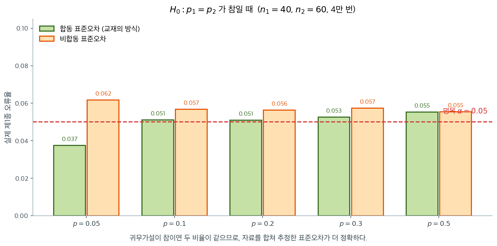
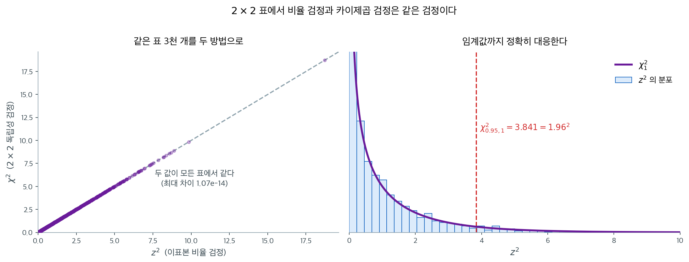
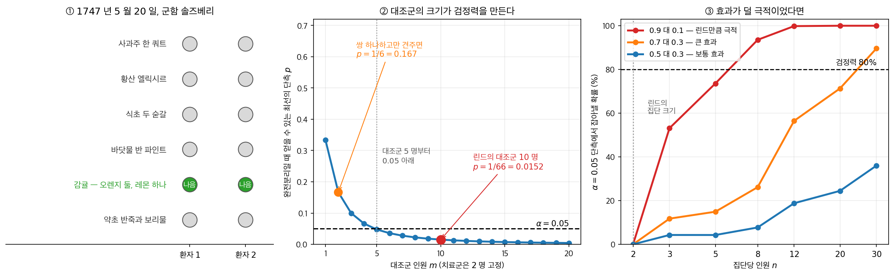

# 비율 차이에 대한 이표본 Z-검정

## 1. 집단 간 성공률의 비교

실무의 많은 질문이 두 모집단의 "성공" 비율을 비교하는 것이다. 새 웹사이트 디자인이 기존보다 높은 전환율로 이어지는가? 백신 접종군의 감염률이 위약군보다 낮은가? 두 인구집단의 지지율이 다른가? 비율에 대한 이표본 z-검정은 두 모비율 $p_1$과 $p_2$가 같은지 검정하여 이런 질문에 답하는 형식적 틀을 제공한다.

---

## 2. 설정과 기호

이진(성공/실패) 결과의 독립인 두 확률표본을 관측한다:

- 표본 1: 독립 시행 $n_1$번에서 성공 $X_1$번, 표본비율 $\hat{p}_1 = X_1 / n_1$
- 표본 2: 독립 시행 $n_2$번에서 성공 $X_2$번, 표본비율 $\hat{p}_2 = X_2 / n_2$

여기서 $X_1 \sim \text{Binomial}(n_1, p_1)$, $X_2 \sim \text{Binomial}(n_2, p_2)$이고 두 표본은 서로 독립이다.

---

## 3. 가설

귀무가설은 두 모비율이 같다는 것이다:

$$
H_0 : p_1 = p_2
$$

대립가설은 다음 세 형태 중 하나이다:

| 이름 | 대립가설 $H_a$ | 기각하는 경우 |
|---|---|---|
| 양측 | $p_1 \neq p_2$ | $\lvert Z \rvert$가 클 때 |
| 좌측 | $p_1 < p_2$ | $Z$가 매우 작을 때(음수) |
| 우측 | $p_1 > p_2$ | $Z$가 매우 클 때 |

??? note "0이 아닌 차이를 검정할 때"
    여기서 제시한 검정은 $H_0: p_1 - p_2 = 0$에만 적용된다. $\delta_0 \neq 0$인 $H_0: p_1 - p_2 = \delta_0$을 검정하려면 (합동하지 않는) 다른 표준오차 공식이 필요하다. 합동 비율은 귀무가설 아래에서 $p_1 = p_2$를 가정할 때에만 의미가 있기 때문이다.

---

## 4. 합동 비율

$H_0: p_1 = p_2$ 아래에서 두 표본은 성공확률이 같은 모집단에서 나온다. 이 공통 비율의 최선의 추정값은 두 표본의 자료를 합친 것이다:

$$
\hat{p} = \frac{X_1 + X_2}{n_1 + n_2}
$$

이 합동 비율 $\hat{p}$는 성공 횟수와 시행 횟수를 모두 합쳐 하나의 추정값을 만든다. 귀무가설 아래에서 공통 표준오차를 추정하기 위해 검정통계량의 분모에 쓰인다.

---

## 5. 검정통계량의 유도

$H_0$ 아래에서 차이 $\hat{p}_1 - \hat{p}_2$의 기댓값은 0이다. 두 표본이 독립이므로 차이의 분산은:

$$
\text{Var}(\hat{p}_1 - \hat{p}_2) = p(1 - p)\left(\frac{1}{n_1} + \frac{1}{n_2}\right)
$$

여기서 $p = p_1 = p_2$는 $H_0$ 아래의 공통 모비율이다. 미지의 $p$를 합동 추정값 $\hat{p}$로 바꾸고 표준화하면 검정통계량을 얻는다:

$$
Z = \frac{\hat{p}_1 - \hat{p}_2}{\sqrt{\hat{p}(1 - \hat{p})\left(\dfrac{1}{n_1} + \dfrac{1}{n_2}\right)}}
$$

$H_0$ 아래에서 표본이 충분히 크면 $Z$는 근사적으로 표준정규이다: $Z \dot{\sim} N(0, 1)$.



합동이 그저 취향의 문제가 아니라는 것은 오류율을 재 보면 안다. $H_0$이 참인 자료에서 두 방식의 실제 기각률을 잰 것인데, **합동 쪽이 명목 $0.05$에 더 가깝다.** 특히 $p$가 작을 때 비합동 방식은 $0.05$를 웃돈다.

이유는 분모에 있다. 귀무가설이 참이면 두 모비율이 같은 값이므로, 그 하나를 추정하는 데 두 표본을 모두 쓰는 편이 정확하다. 비합동 방식은 $\hat p_1$과 $\hat p_2$를 따로 쓰는데, 작은 표본에서 이 둘이 우연히 극단으로 치우치면 분모가 지나치게 작아져 $Z$가 부풀려진다.

**신뢰구간에서는 반대로 합동하면 안 된다**는 점을 함께 기억해 두자. 구간은 어떤 가설도 전제하지 않으므로 두 비율이 같다고 볼 근거가 없기 때문이다. 같은 자료에 같은 통계량인데 무엇을 묻느냐에 따라 분모가 달라지는 것이며, 5.8절에서 두 표집분포를 나란히 놓고 그 차이를 보았다.

<div class="exbox" markdown>

**보기 1.** <span class="diff easy" title="쉬움"></span> 두 비율 차이 검정 계산기. 아래 함수는 $\delta_0 = 0$일 때는 **합동** 표준오차를, 그 밖의 경우에는 **Wald** 표준오차를 쓴다. 두 표준오차는 같은 자료에서 다른 수다.

**(1)** $\text{SE}_{\text{pool}}^2 - \text{SE}_{\text{wald}}^2$을 닫힌 꼴로 구하고 $n_1 = n_2$일 때로 특수화하시오. 어느 쪽이 큰지는 무엇이 정하는가.

**(2)** 그 식을 무작위 입력으로 검사하고, $n_1 = 80$, $n_2 = 60$에서 두 표준오차의 크기 순서가 **뒤집히는 경계**를 찾으시오.

</div>

??? success "풀이"

    **(1) 해석적으로.** $A = \hat p_1$, $B = \hat p_2$, $N = n_1 + n_2$로 줄여 쓰면 합동 비율이 $\bar p = (n_1A + n_2B)/N$이므로

    $$
    \text{SE}_{\text{pool}}^2 = \bar p(1-\bar p)\,\frac{N}{n_1n_2},
    \qquad
    \text{SE}_{\text{wald}}^2 = \frac{n_2 A(1-A) + n_1 B(1-B)}{n_1 n_2}
    $$

    이다. 차에 $n_1n_2$를 곱하면 일차항에서

    $$
    N\bar p - n_2 A - n_1 B = n_1A + n_2B - n_2A - n_1B = (n_1-n_2)(A-B)
    $$

    가 남고, 이차항에서는

    $$
    n_2A^2 + n_1B^2 - N\bar p^{\,2}
    = \frac{n_1n_2(A-B)^2 - (n_1-n_2)N(A-B)(A+B)}{N}
    $$

    이 남는다. 둘을 더해 $(A-B)$로 묶으면

    $$
    \boxed{\;
    \text{SE}_{\text{pool}}^2 - \text{SE}_{\text{wald}}^2
    = \frac{\hat p_1 - \hat p_2}{n_1 n_2}
    \left[(n_1-n_2)\bigl(1 - \hat p_1 - \hat p_2\bigr)
    + \frac{n_1n_2\,(\hat p_1 - \hat p_2)}{N}\right]
    \;}
    $$

    이다. $n_1 = n_2 = n$을 넣으면 첫 항이 사라지고

    $$
    \text{SE}_{\text{pool}}^2 - \text{SE}_{\text{wald}}^2 = \frac{(\hat p_1 - \hat p_2)^2}{2n} \;\ge\; 0
    $$

    이 되어, **균형 설계에서는 합동 쪽이 언제나 크다.** 이 특수한 꼴은 [비율에 대한 이표본 Z-검정](z_test_two_proportions.md)의 보기 4에서 $p(1-p)$의 오목성으로 얻었던 식과 같다. 위 식은 거기에 불균형 항을 더한 일반형이다.

    **순서를 뒤집는 것은 괄호 안의 첫 항이다.** 둘째 항은 $(A-B)$와 같은 부호여서 곱하면 언제나 $\ge 0$이지만, 첫 항은 $(n_1-n_2)$와 $(1-A-B)$의 부호에 따라 어느 쪽으로도 갈 수 있다. 특히 **두 비율이 모두 높아 $A + B > 1$이 되면 $(1-A-B)$가 음수**가 되어, 표본이 큰 쪽의 비율이 높을 때 합동 표준오차가 Wald보다 작아질 수 있다. $A - B$를 고정했을 때의 경계는 괄호를 0으로 두어

    $$
    A + B = 1 + \frac{n_1n_2}{N(n_1-n_2)}\,(A - B)
    $$

    로 구해진다.

    **(2) 수치적으로.** 먼저 함수다.

    ```python
    import math
    from scipy.stats import norm

    def test_diff_two_props(k1, n1, k2, n2, delta0=0.0,
                            method="pooled", alt="two-sided", alpha=0.05):
        """귀무가설 H0: p1 - p2 = delta0.

        delta0=0이고 method='pooled'이면 합동 표준오차를 쓴다.
        돌려주는 값은 (z, p, 기각 여부, 이름).
        """
        p1, p2 = k1 / n1, k2 / n2
        d_hat = p1 - p2
        if delta0 == 0.0 and method == "pooled":
            # H0가 "두 비율이 같다"이면 그 공통값의 최선의 추정은 전체를 합친 비율이다.
            # 검정은 H0 아래의 분포를 쓰므로 여기서 합동하는 것이 옳다.
            p_pool = (k1 + k2) / (n1 + n2)
            se = math.sqrt(p_pool * (1 - p_pool) * (1 / n1 + 1 / n2))
            label = "pooled z-test"
        else:
            # delta0이 0이 아니면 "두 비율이 같다"는 가정이 없으므로 합동할 수 없다.
            # 신뢰구간에서 쓰는 것과 같은 표준오차다.
            se = math.sqrt(p1 * (1 - p1) / n1 + p2 * (1 - p2) / n2)
            label = "wald z-test"

        z = (d_hat - delta0) / se
        if alt == "two-sided":
            p = 2 * min(norm.cdf(z), 1 - norm.cdf(z))
        elif alt == "less":
            p = norm.cdf(z)
        else:
            p = 1 - norm.cdf(z)
        return z, p, (p < alpha), label
    ```

    이제 (1)의 식을 검사한다.

    ```python
    import numpy as np


    def se_pair(k1, n1, k2, n2):
        """합동 SE^2, Wald SE^2, 그리고 닫힌 꼴이 예측하는 차."""
        p1, p2 = k1 / n1, k2 / n2
        N = n1 + n2
        p_pool = (k1 + k2) / N
        se_p2 = p_pool * (1 - p_pool) * (1 / n1 + 1 / n2)
        se_w2 = p1 * (1 - p1) / n1 + p2 * (1 - p2) / n2
        pred = (p1 - p2) * ((n1 - n2) * (1 - p1 - p2)
                            + n1 * n2 * (p1 - p2) / N) / (n1 * n2)
        return se_p2, se_w2, pred


    rng = np.random.default_rng(3)
    worst = 0.0
    for _ in range(200_000):
        a, b = int(rng.integers(2, 301)), int(rng.integers(2, 301))
        u, v = int(rng.integers(0, a + 1)), int(rng.integers(0, b + 1))
        if u + v in (0, a + b):
            continue                      # 합동 비율이 0 또는 1 이면 SE = 0
        sp2, sw2, pred = se_pair(u, a, v, b)
        worst = max(worst, abs(sp2 - sw2 - pred))
    print(f"항등식 검사 20만 개: 절대오차의 최대값 = {worst:.3e}")

    print("\nn1 = 80, n2 = 60 에서 같은 차이를 위로 옮기면 부호가 뒤집힌다")
    print("  k1  k2   p1-p2   p1+p2    SE_p^2 - SE_w^2   큰 쪽")
    for k1, k2 in ((30, 18), (44, 29), (48, 32), (50, 33), (52, 34)):
        sp2, sw2, pred = se_pair(k1, 80, k2, 60)
        print(f" {k1:3d} {k2:3d}  {k1/80 - k2/60:6.4f}  {k1/80 + k2/60:6.4f}"
              f"   {sp2 - sw2:+.3e}      {'합동' if sp2 > sw2 else 'Wald'}")
    print(f"  부호가 바뀌는 경계: p1+p2 = "
          f"{1 + 80 * 60 / (140 * 20) * 0.075:.6f}  (p1-p2 = 0.075 고정)")
    ```

    출력:

    ```
    항등식 검사 20만 개: 절대오차의 최대값 = 6.245e-17

    n1 = 80, n2 = 60 에서 같은 차이를 위로 옮기면 부호가 뒤집힌다
      k1  k2   p1-p2   p1+p2    SE_p^2 - SE_w^2   큰 쪽
      30  18  0.0750  0.6750   +1.417e-04      합동
      44  29  0.0667  1.0333   +2.249e-05      합동
      48  32  0.0667  1.1333   -5.291e-06      Wald
      50  33  0.0750  1.1750   -1.451e-05      Wald
      52  34  0.0833  1.2167   -2.563e-05      Wald
      부호가 바뀌는 경계: p1+p2 = 1.128571  (p1-p2 = 0.075 고정)
    ```

    **항등식이 성립한다.** 표본크기를 2에서 300까지, 성공 수를 0에서 $n$까지 무작위로 뽑은 20만 개에서 절대오차의 최대값이 $6 \times 10^{-17}$로 부동소수점 한계다.

    **부호도 예측대로 뒤집힌다.** $p_1 - p_2 = 0.075$를 유지한 채 두 비율을 함께 올리면 $(30, 18)$에서 합동이 크고 $(50, 33)$에서 Wald가 크다. 경계 $p_1 + p_2 = 1.128571$을 사이에 두고 $(44,29)$의 $1.0333$은 아래, $(48,32)$의 $1.1333$은 위다. **같은 차이, 같은 표본크기인데 비율의 수준만 달라져 두 표준오차의 순서가 바뀐다.** 그러므로 "검정은 합동이라 더 보수적이다" 같은 어림짐작은 균형 설계에서만 옳다.

<div class="exbox" markdown>

**보기 2.** <span class="diff easy" title="쉬움"></span> 이표본 비율 검정. 집단 1에서 $n_1 = 80$ 중 $k_1 = 30$, 집단 2에서 $n_2 = 60$ 중 $k_2 = 18$이 성공했다($\hat p_1 = 0.375$, $\hat p_2 = 0.300$).

**(1)** 합동과 Wald 두 가지로 $z$를 구하고, 어느 쪽 $\lvert z \rvert$가 큰지를 보기 3의 식으로 설명하시오. 합동 $z$의 제곱이 이 표의 피어슨 카이제곱통계량과 같은지 확인하시오.

**(2)** 이 표본크기에서 합동 $z$ 검정의 **정확한** 제1종 오류율을 구하시오. 명목 5%를 얼마나 지키는가, 그리고 어디서 무너지는가.

</div>

??? success "풀이"

    **(1) 해석적으로.** $\hat p_1 + \hat p_2 = 0.675 < 1$이고 $n_1 > n_2$, $\hat p_1 > \hat p_2$이므로 보기 3의 괄호 안 두 항이 모두 양수다.

    $$
    (n_1 - n_2)(1 - \hat p_1 - \hat p_2) = 20 \times 0.325 = 6.5,
    \qquad
    \frac{n_1n_2(\hat p_1 - \hat p_2)}{N} = \frac{4800 \times 0.075}{140} = 2.5714
    $$

    이고 괄호는 $9.0714$다. 따라서

    $$
    \text{SE}_{\text{pool}}^2 - \text{SE}_{\text{wald}}^2
    = \frac{0.075 \times 9.0714}{4800} = 1.417 \times 10^{-4} > 0
    $$

    으로 **합동 표준오차가 더 크다.** 분자가 같으므로 $\lvert z_{\text{pool}} \rvert < \lvert z_{\text{wald}} \rvert$, 곧 합동 쪽이 더 보수적이다. 실제로

    $$
    \text{SE}_{\text{pool}} = \sqrt{0.342857 \times 0.657143 \times \left(\tfrac1{80}+\tfrac1{60}\right)} = 0.081064,
    \qquad
    z_{\text{pool}} = \frac{0.075}{0.081064} = 0.925191
    $$

    이고 Wald 쪽은 $\text{SE} = 0.080185$, $z = 0.935333$이다. 두 값이 가까운 것은 $0.375$와 $0.300$이 멀지 않아 합동비율 $0.342857$이 양쪽을 그런대로 대신하기 때문이다.

    **$z_{\text{pool}}^2 = \chi^2$**은 본문에서 본 항등식이다. $0.925191^2 = 0.855978$이 $2\times2$ 표의 피어슨 카이제곱(연속성 보정 없이)과 같아야 한다.

    **(2) 정확한 수준.** $p_1 = p_2 = p$일 때 $(k_1, k_2)$는 독립인 두 이항변수이므로, $(n_1+1)(n_2+1) = 81 \times 61 = 4941$칸을 **모두 훑어** 기각되는 칸의 확률을 더하면 실제 오류율이 정확히 나온다. 근사도 모의실험도 필요 없다.

    $$
    \alpha_{\text{실제}}(p) = \sum_{k_1=0}^{n_1}\sum_{k_2=0}^{n_2}
    \binom{n_1}{k_1}p^{k_1}q^{n_1-k_1}\binom{n_2}{k_2}p^{k_2}q^{n_2-k_2}
    \mathbf{1}\bigl\{\lvert z(k_1,k_2)\rvert > 1.96\bigr\}
    $$

    $k_1 + k_2 = 0$ 또는 $N$인 두 칸은 합동 비율이 $0$ 또는 $1$이어서 표준오차가 0이 되는데, 그때는 $\hat p_1 - \hat p_2 = 0$이므로 기각하지 않는 것으로 둔다.

    **수치적으로.**

    ```python
    z, p, reject, label = test_diff_two_props(
        k1=30, n1=80, k2=18, n2=60, delta0=0.0, method="pooled"
    )
    print(label, "z:", z, "p:", p, "reject:", reject)

    # 같은 자료를 합동하지 않은 Wald 표준오차로 계산하면 어떻게 다른가?
    z2, p2, reject2, label2 = test_diff_two_props(
        k1=30, n1=80, k2=18, n2=60, delta0=0.0, method="wald"
    )
    print(label2, "z:", z2, "p:", p2, "reject:", reject2)
    ```

    출력:

    ```
    pooled z-test z: 0.9251909321159419 p: 0.3548665994806586 reject: False
    wald z-test z: 0.9353331581027243 p: 0.3496166322568355 reject: False
    ```

    ```python
    import numpy as np
    from scipy import stats

    k1, n1, k2, n2 = 30, 80, 18, 60
    p1, p2 = k1 / n1, k2 / n2
    N = n1 + n2
    p_pool = (k1 + k2) / N
    se_p2 = p_pool * (1 - p_pool) * (1 / n1 + 1 / n2)
    se_w2 = p1 * (1 - p1) / n1 + p2 * (1 - p2) / n2
    pred = (p1 - p2) * ((n1 - n2) * (1 - p1 - p2)
                        + n1 * n2 * (p1 - p2) / N) / (n1 * n2)
    print(f"p1 = {p1}, p2 = {p2}, p_pool = {p_pool:.9f}")
    print(f"SE_pool = {math.sqrt(se_p2):.9f}   SE_wald = {math.sqrt(se_w2):.9f}")
    print(f"SE_p^2 - SE_w^2 = {se_p2 - se_w2:.3e}   닫힌 꼴 = {pred:.3e}")
    z_pool = (p1 - p2) / math.sqrt(se_p2)
    chi = stats.chi2_contingency([[k1, n1 - k1], [k2, n2 - k2]],
                                 correction=False).statistic
    print(f"z_pool^2 = {z_pool**2:.12f}   피어슨 카이제곱 = {chi:.12f}")


    def exact_level(n1, n2, p, alpha=0.05):
        """p1 = p2 = p 일 때 합동 z 검정의 **정확한** 제1종 오류율.

        (k1, k2) 의 (n1+1)(n2+1) 칸을 모두 훑어 기각 칸의 이항확률을 더한다.
        근사도 모의실험도 아니다.
        """
        zc = stats.norm.ppf(1 - alpha / 2)
        K1, K2 = np.arange(n1 + 1), np.arange(n2 + 1)
        pr = stats.binom.pmf(K1, n1, p)[:, None] * stats.binom.pmf(K2, n2, p)[None, :]
        P1, P2 = K1[:, None] / n1, K2[None, :] / n2
        PP = (K1[:, None] + K2[None, :]) / (n1 + n2)
        with np.errstate(divide="ignore", invalid="ignore"):
            z = (P1 - P2) / np.sqrt(PP * (1 - PP) * (1 / n1 + 1 / n2))
        rej = np.abs(z) > zc
        rej[~np.isfinite(z)] = False        # k1+k2 가 0 또는 n1+n2 인 두 칸
        return float((pr * rej).sum())


    print(f"\n정확한 수준 (n1 = {n1}, n2 = {n2}, 명목 0.05)")
    print("     p    실제 수준     n2*min(p,1-p)")
    for p in (0.01, 0.02, 0.03, 0.05, 0.0833, 0.1, 0.2, 0.343, 0.5):
        print(f"  {p:.4f}   {exact_level(n1, n2, p):.6f}      {n2 * min(p, 1 - p):6.2f}")

    ps = np.linspace(0.002, 0.998, 499)
    lv = np.array([exact_level(n1, n2, p) for p in ps])
    i = int(lv.argmax())
    mid = (ps >= 0.03) & (ps <= 0.97)
    print(f"\n격자 499 점의 최대 = {lv[i]:.6f} (p = {ps[i]:.3f})")
    print(f"0.03 <= p <= 0.97 구간의 범위 = [{lv[mid].min():.6f}, {lv[mid].max():.6f}]")
    print(f"0.05 를 넘는 점의 비율 = {float((lv > 0.05).mean()):.3f}")
    ```

    출력:

    ```
    p1 = 0.375, p2 = 0.3, p_pool = 0.342857143
    SE_pool = 0.081064348   SE_wald = 0.080185332
    SE_p^2 - SE_w^2 = 1.417e-04   닫힌 꼴 = 1.417e-04
    z_pool^2 = 0.855978260870   피어슨 카이제곱 = 0.855978260870

    정확한 수준 (n1 = 80, n2 = 60, 명목 0.05)
         p    실제 수준     n2*min(p,1-p)
      0.0100   0.010866        0.60
      0.0200   0.032648        1.20
      0.0300   0.047253        1.80
      0.0500   0.053474        3.00
      0.0833   0.050844        5.00
      0.1000   0.049784        6.00
      0.2000   0.047094       12.00
      0.3430   0.049443       20.58
      0.5000   0.049180       30.00

    격자 499 점의 최대 = 0.053604 (p = 0.046)
    0.03 <= p <= 0.97 구간의 범위 = [0.045280, 0.053604]
    0.05 를 넘는 점의 비율 = 0.365
    ```

    **(1)이 맞는다.** 두 표준오차가 $0.081064$와 $0.080185$, 제곱의 차가 닫힌 꼴이 준 $1.417\times10^{-4}$와 같다. 두 $z$는 $0.925191$과 $0.935333$이고 양쪽 모두 $p \approx 0.35$로 기각하지 못한다. $\hat p_1 - \hat p_2 = 7.5$%p는 작지 않은 차이인데 80명과 60명으로는 가려낼 수 없다. $z_{\text{pool}}^2 = 0.855978260870$이 피어슨 카이제곱과 소수 열두째 자리까지 같아 항등식도 확인된다.

    **(2) 명목 5%는 생각보다 잘 지켜진다.** $0.03 \le p \le 0.97$에서 실제 수준이 $[0.0453,\ 0.0536]$ 안에 있다. 참값 $0.05$를 넘는 경우가 격자의 37%이고 최대가 $p = 0.046$에서 $0.0536$이다. **$\pm 0.005$ 안쪽의 진동이며, 그 진동의 원인은 근사의 치우침이 아니라 $(k_1, k_2)$가 이산이라는 사실이다.** 기각역의 경계가 격자점 사이를 지나므로 $p$가 조금 움직일 때마다 어떤 칸이 들어오고 나간다.

    **무너지는 곳은 꼬리다.** $p = 0.02$에서 $0.0326$, $p = 0.01$에서 $0.0109$로 명목의 다섯 분의 일까지 내려간다. 이때 작은 집단의 기대 성공 수가 $n_2 p = 1.2$와 $0.6$으로, 흔히 쓰는 조건 $n\hat p \ge 5$를 크게 밑돈다. **그 조건의 경계 $p = 5/60 = 0.0833$에서는 실제 수준이 이미 $0.0508$로 제자리를 찾았다.** 경험칙이 어디서 와서 어디까지 필요한지가 이 표에 그대로 나타나 있다.

    보수적인 쪽으로 어긋난다는 점도 읽어 두어야 한다. 꼬리에서 실제 수준이 명목보다 **낮으므로** 거짓 양성은 걱정할 필요가 없지만, 그만큼 검정력도 함께 잃는다. 비율이 매우 작은 사건을 비교할 때 정규근사 대신 피셔의 정확검정이나 조건부 정확검정을 권하는 까닭이다.

### z² 과 카이제곱이 같은 검정인 까닭



왼쪽에서 점들이 대각선 위에 정확히 놓인다. $\delta_0 = 0$이고 합동 표준오차를 쓰면

$$
Z^2 = \chi^2
$$

이 항등식으로 성립하며, 그림의 최대 차이 $10^{-14}$는 부동소수점 반올림일 뿐이다. 오른쪽에서 보듯 귀무분포도 대응한다. $Z \sim N(0,1)$이면 $Z^2 \sim \chi^2_1$이고, 임계값도 $1.96^2 = 3.841$로 맞아떨어진다.

**그렇다면 왜 둘 다 배우는가.** 두 가지가 다르다. 첫째, **$Z$는 단측검정을 할 수 있지만 $\chi^2$은 할 수 없다.** 제곱하는 순간 방향 정보가 사라지기 때문이다. 둘째, **$\chi^2$은 $2 \times 2$를 넘어 확장된다.** 범주가 셋 이상이거나 행이 여럿인 표에는 $Z$를 쓸 수 없다. 방향을 묻고 싶으면 $Z$, 표가 커지면 $\chi^2$이다.

---

## 6. 기각역과 p-값

$z_{\alpha}$를 표준정규분포의 상위 $\alpha$ 분위수, $z_{\text{obs}}$를 검정통계량의 관측값이라 하자.

### 양측검정 (Hₐ: p₁ ≠ p₂)

**기각역**: $|z_{\text{obs}}| > z_{\alpha/2}$이면 $H_0$을 기각한다.

**p-값**:

$$
p\text{-value} = 2\bigl[1 - \mathcal{N}(|z_{\text{obs}}|)\bigr]
$$

### 좌측검정 (Hₐ: p₁ < p₂)

**기각역**: $z_{\text{obs}} < -z_{\alpha}$이면 $H_0$을 기각한다.

**p-값**:

$$
p\text{-value} = \mathcal{N}(z_{\text{obs}})
$$

### 우측검정 (Hₐ: p₁ > p₂)

**기각역**: $z_{\text{obs}} > z_{\alpha}$이면 $H_0$을 기각한다.

**p-값**:

$$
p\text{-value} = 1 - \mathcal{N}(z_{\text{obs}})
$$

<div class="exbox" markdown>

**보기 3.** <span class="diff easy" title="쉬움"></span> 전환율에 대한 A/B 검정. 어떤 전자상거래 회사가 기존 결제 페이지(A)와 새로 디자인한 버전(B)의 전환율을 비교하는 A/B 검정을 한 주 동안 진행했다:

- 페이지 A: 방문자 $n_1 = 500$명, 전환 $X_1 = 45$건, $\hat{p}_1 = 45/500 = 0.090$
- 페이지 B: 방문자 $n_2 = 480$명, 전환 $X_2 = 58$건, $\hat{p}_2 = 58/480 = 0.121$

$\alpha = 0.05$에서 전환율이 다른지 검정하라.

</div>

??? success "풀이"
    **1단계: 가설을 세운다.**

    $$
    H_0: p_1 = p_2 \quad \text{vs} \quad H_a: p_1 \neq p_2
    $$

    **2단계: 합동 비율을 계산한다.**

    $$
    \hat{p} = \frac{45 + 58}{500 + 480} = \frac{103}{980} \approx 0.1051
    $$

    **3단계: 표본크기 조건을 확인한다.** 가장 작은 기대도수는 $n_2(1 - \hat{p}) = 480 \times 0.8949 \approx 430 \geq 5$이다. 네 조건이 모두 만족된다.

    **4단계: 표준오차와 검정통계량을 계산한다.**

    $$
    \text{SE} = \sqrt{0.1051 \times 0.8949 \times \left(\frac{1}{500} + \frac{1}{480}\right)} = \sqrt{0.09406 \times 0.004083} \approx \sqrt{0.000384} \approx 0.01960
    $$

    $$
    z_{\text{obs}} = \frac{0.090 - 0.121}{0.01960} = \frac{-0.031}{0.01960} \approx -1.582
    $$

    **5단계: p-값을 계산한다.**

    $$
    p\text{-value} = 2\bigl[1 - \mathcal{N}(1.582)\bigr] = 2(1 - 0.9431) = 2(0.0569) \approx 0.114
    $$

    **6단계: 판정한다.** $p \approx 0.114 > 0.05 = \alpha$이므로 $H_0$을 기각하지 못한다. 5% 유의수준에서 두 페이지 디자인의 전환율이 다르다고 결론지을 증거가 부족하다.

<div class="exbox" markdown>

**보기 4.** <span class="diff easy" title="쉬움"></span> 두 비율의 z 검정 구현 — 손계산과 어긋나는 자리. 보기 3을 손으로 풀 때 $z_{\text{obs}} \approx -1.582$를 얻었는데, 아래 구현은 $-1.573$을 준다.

**(1)** 두 값이 어디서 갈라졌는지 짚고 정확한 $z$와 $p$를 구하시오. 또 성공 수와 표본크기를 함께 $k$배로 늘리면 $z$가 어떻게 변하는지 식으로 쓰시오.

**(2)** 검정은 **합동**한 표준오차를 쓰고 신뢰구간은 **합동하지 않은** 표준오차를 쓴다. $n_1 = n_2 = n$일 때 두 표준오차의 정확한 관계를 유도하고, 그 결론이 이 자료($500$ 대 $480$)에도 그대로 적용되는지 확인하시오.

</div>

??? success "풀이"

    **(1) 어긋남의 출처는 분자다.** 정확한 값은 $\hat p_2 = 58/480 = 0.12083333\ldots$인데 보기 3의 손계산은 이것을 $0.121$로 올림하고 차이도 $-0.031$로 적었다. 참 차이는

    $$
    \hat p_1 - \hat p_2 = 0.09 - 0.12083333 = -0.03083333
    $$

    이므로 손계산은 분자의 크기를 $0.54\%$ 부풀렸다. 분모는 거의 그대로다. 합동 비율 $\hat p = 103/980 = 0.10510204$에서

    $$
    \text{SE} = \sqrt{0.10510204 \times 0.89489796 \times \left(\frac{1}{500} + \frac{1}{480}\right)}
    = 0.01959746
    $$

    이고, 보기 3이 쓴 반올림값 $0.1051$로 계산해도 $0.01959729$로 소수 일곱째 자리에서야 갈라진다. 그러므로

    $$
    \frac{-0.031}{0.0195975} = -1.581838,
    \qquad
    \frac{-0.03083333}{0.0195975} = -1.573333
    $$

    로 **차이 전부가 분자의 반올림에서 왔다.** 정확한 값은 $z = -1.573333$, $p = 0.115642$이고 판정은 바뀌지 않는다.

    **$k$배 확장.** $x_i \to kx_i$, $n_i \to kn_i$로 늘리면 $\hat p_1, \hat p_2, \hat p$가 모두 그대로이고 $1/n_1 + 1/n_2$만 $1/k$배가 되므로

    $$
    \text{SE}(k) = \frac{\text{SE}(1)}{\sqrt k},
    \qquad z(k) = \sqrt k \; z(1).
    $$

    $k = 10$이면 $z = -1.573333\sqrt{10} = -4.975317$, $k = 100$이면 $-15.733333$이다.

    **(2) 균형 설계에서는 합동 쪽이 반드시 크다.** $f(p) = p(1-p)$로 쓰고 $n_1 = n_2 = n$, $d = \hat p_1 - \hat p_2$라 하자. 이때 합동 비율은 단순평균 $\bar p = (\hat p_1 + \hat p_2)/2$이고

    $$
    \text{SE}_{\text{pool}}^2 = \frac{2}{n} f(\bar p),
    \qquad
    \text{SE}_{\text{CI}}^2 = \frac{f(\hat p_1) + f(\hat p_2)}{n}.
    $$

    $f$의 일차항은 평균을 지나므로 차이는 이차항만 남는다.

    $$
    f(\bar p) - \frac{f(\hat p_1) + f(\hat p_2)}{2}
    = \left[\bar p - \bar p^{\,2}\right] - \left[\bar p - \frac{\hat p_1^2 + \hat p_2^2}{2}\right]
    = \frac{\hat p_1^2 + \hat p_2^2}{2} - \bar p^{\,2}
    = \frac{d^2}{4}
    $$

    이므로

    $$
    \text{SE}_{\text{pool}}^2 = \text{SE}_{\text{CI}}^2 + \frac{d^2}{2n}.
    $$

    양변을 $d^2$으로 나누면 두 통계량의 관계가 깔끔하게 나온다.

    $$
    \frac{1}{z_{\text{pool}}^2} = \frac{1}{z_{\text{CI}}^2} + \frac{1}{2n}
    \iff
    z_{\text{pool}}^2 = \frac{z_{\text{CI}}^2}{1 + z_{\text{CI}}^2/(2n)}
    $$

    **그러므로 균형 설계에서는 언제나 $\lvert z_{\text{pool}} \rvert \le \lvert z_{\text{CI}} \rvert$다.** 곧 검정이 신뢰구간보다 조금 보수적이다. 그리고 $z_{\text{CI}}$를 아무리 키워도 $z_{\text{pool}}^2 < 2n = N$이다. **합동 $z$ 통계량은 총 관측값 수의 제곱근을 넘지 못한다.** 이 한계는 균형에만 있는 것이 아니다. $z_{\text{pool}}^2$은 $2 \times 2$ 표의 피어슨 카이제곱통계량과 정확히 같고, 그것은 $N\phi^2$($\phi$는 파이계수)이며 $\lvert \phi \rvert \le 1$이기 때문이다.

    **그러나 이 자료는 균형이 아니다.** 아래에서 확인하듯 $500$ 대 $480$에서는 부등호가 뒤집힌다. 균형점에서의 간격이 $d^2/(2n) = 0.03083333^2/980 = 9.70 \times 10^{-7}$(분산 척도), 표준오차로는 $0.0000247$밖에 안 되어, 열 명의 불균형이 그것을 지워 버린다.

    **수치적으로.** 먼저 검정 함수를 만든다.

    ```python
    import numpy as np
    from scipy import stats

    def two_proportion_z_test(x1, n1, x2, n2, alternative="two-sided"):
        """두 비율의 차이에 대한 이표본 z 검정.

        Parameters
        ----------
        x1, x2 : int
            Number of successes in each sample.
        n1, n2 : int
            Sample sizes.
        alternative : str
            'two-sided', 'less', or 'greater'.

        Returns
        -------
        z_stat : float
            Test statistic.
        p_value : float
            P-value.
        """
        p1_hat = x1 / n1
        p2_hat = x2 / n2
        # H0가 "두 비율이 같다"이므로 그 공통값을 전체를 합쳐 추정한다.
        # 신뢰구간을 만들 때는 합동하지 않는다. 목적이 다르기 때문이다.
        p_hat = (x1 + x2) / (n1 + n2)

        se = np.sqrt(p_hat * (1 - p_hat) * (1 / n1 + 1 / n2))
        z_stat = (p1_hat - p2_hat) / se

        if alternative == "two-sided":
            p_value = 2 * (1 - stats.norm.cdf(abs(z_stat)))
        elif alternative == "less":
            p_value = stats.norm.cdf(z_stat)
        elif alternative == "greater":
            p_value = 1 - stats.norm.cdf(z_stat)
        else:
            raise ValueError("alternative must be 'two-sided', 'less', or 'greater'")

        return z_stat, p_value


    # 보기 3 의 A/B 검정
    z, p = two_proportion_z_test(45, 500, 58, 480, alternative="two-sided")
    print(f"z = {z:.3f}, p-value = {p:.3f}")
    ```

    출력:

    ```
    z = -1.573, p-value = 0.116
    ```

    이제 (1)과 (2)를 확인한다.

    ```python
    x1, n1, x2, n2 = 45, 500, 58, 480
    p1, p2 = x1 / n1, x2 / n2
    pb = (x1 + x2) / (n1 + n2)
    d = p1 - p2
    se_p = np.sqrt(pb * (1 - pb) * (1 / n1 + 1 / n2))
    se_u = np.sqrt(p1 * (1 - p1) / n1 + p2 * (1 - p2) / n2)
    print(f"p1 = {p1:.7f}   p2 = {p2:.7f}   차이 = {d:.7f}")
    print(f"합동 p = {pb:.7f}   합동 SE = {se_p:.7f}")
    print(f"손계산의 차이 -0.031 →  z = {-0.031 / se_p:.6f}")
    print(f"정확한 차이          →  z = {d / se_p:.6f}"
          f"   p = {2 * stats.norm.sf(abs(d / se_p)):.6f}")

    print("\n자료를 k 배로 늘릴 때")
    print("   k      z          p            sqrt(k)*z_1")
    z1 = d / se_p
    for k in (1, 10, 100):
        z, _ = two_proportion_z_test(k * x1, k * n1, k * x2, k * n2)
        p = 2 * stats.norm.sf(abs(z))
        print(f"{k:4d}  {z:9.6f}  {p:.3e}   {np.sqrt(k) * z1:9.6f}")

    print(f"\n비합동 SE = {se_u:.7f}   |z| = {abs(d / se_u):.6f}")
    print(f"합동   SE = {se_p:.7f}   |z| = {abs(d / se_p):.6f}")
    print(f"→ 이 불균형 자료에서는 {'합동' if se_p > se_u else '비합동'} 쪽 SE 가 크다")

    # 균형 설계에서의 항등식: SE_p^2 - SE_u^2 = d^2/(2n)
    rng = np.random.default_rng(0)
    worst = 0.0
    for _ in range(20_000):
        n = int(rng.integers(20, 2000))
        a, b = int(rng.integers(1, n)), int(rng.integers(1, n))
        q1, q2, qb = a / n, b / n, (a + b) / (2 * n)
        sp2 = qb * (1 - qb) * (2 / n)
        su2 = q1 * (1 - q1) / n + q2 * (1 - q2) / n
        worst = max(worst, abs(sp2 - su2 - (q1 - q2) ** 2 / (2 * n)))
    print(f"\n균형 항등식 SE_p^2 - SE_u^2 = d^2/(2n) 의 최대 오차 = {worst:.2e}"
          f"  (무작위 표 20000 개)")

    # 총 980 명을 어떻게 나누면 부호가 뒤집히는가
    print("\n  n1   n2    합동 SE   비합동 SE   큰 쪽")
    for m in (400, 450, 490, 495, 500, 560):
        k = 980 - m
        PB = (m * p1 + k * p2) / 980
        sp = np.sqrt(PB * (1 - PB) * (1 / m + 1 / k))
        su = np.sqrt(p1 * (1 - p1) / m + p2 * (1 - p2) / k)
        print(f"{m:4d} {k:4d}   {sp:.7f}  {su:.7f}   {'합동' if sp > su else '비합동'}")

    # z_p^2 은 2x2 피어슨 카이제곱과 같고 N 을 넘지 못한다
    chi = stats.chi2_contingency([[x1, n1 - x1], [x2, n2 - x2]], correction=False)
    print(f"\nz_p^2 = {z1**2:.9f}   피어슨 카이제곱 = {chi.statistic:.9f}")
    worst = 0.0
    for _ in range(20_000):
        a, b = int(rng.integers(5, 500)), int(rng.integers(5, 500))
        u, v = int(rng.integers(0, a + 1)), int(rng.integers(0, b + 1))
        if u + v in (0, a + b):
            continue
        P1, P2, PB = u / a, v / b, (u + v) / (a + b)
        z = (P1 - P2) / np.sqrt(PB * (1 - PB) * (1 / a + 1 / b))
        worst = max(worst, z**2 / (a + b))
    print(f"z_p^2 / N 의 최대값 = {worst:.9f}  (1 을 넘지 못한다)")
    ```

    출력:

    ```
    p1 = 0.0900000   p2 = 0.1208333   차이 = -0.0308333
    합동 p = 0.1051020   합동 SE = 0.0195975
    손계산의 차이 -0.031 →  z = -1.581838
    정확한 차이          →  z = -1.573333   p = 0.115642

    자료를 k 배로 늘릴 때
       k      z          p            sqrt(k)*z_1
       1  -1.573333  1.156e-01   -1.573333
      10  -4.975317  6.514e-07   -4.975317
     100  -15.733333  8.938e-56   -15.733333

    비합동 SE = 0.0196244   |z| = 1.571171
    합동   SE = 0.0195975   |z| = 1.573333
    → 이 불균형 자료에서는 비합동 쪽 SE 가 크다

    균형 항등식 SE_p^2 - SE_u^2 = d^2/(2n) 의 최대 오차 = 6.94e-18  (무작위 표 20000 개)

      n1   n2    합동 SE   비합동 SE   큰 쪽
     400  580   0.0201930  0.0196954   합동
     450  530   0.0197882  0.0195560   합동
     490  490   0.0196192  0.0195945   합동
     495  485   0.0196073  0.0196084   비합동
     500  480   0.0195975  0.0196244   비합동
     560  420   0.0196385  0.0199796   비합동

    z_p^2 = 2.475377593   피어슨 카이제곱 = 2.475377593
    z_p^2 / N 의 최대값 = 1.000000000  (1 을 넘지 못한다)
    ```

    **(1)이 맞는다.** 반올림한 분자는 $-1.581838$, 정확한 분자는 $-1.573333$으로 손계산의 $-1.582$가 그대로 재현된다. $k$배 확장에서도 $\sqrt k\,z(1)$이 직접 계산한 $z$와 소수 여섯째 자리까지 같다. 같은 $3.08\%$p 차이가 $k = 1$에서 $p = 0.116$, $k = 10$에서 $6.5 \times 10^{-7}$, $k = 100$에서 $9 \times 10^{-56}$이다. **A/B 검정에서 표본크기 계획이 왜 중요한지가 이 한 줄에 다 있다.** 실험을 너무 일찍 멈추면 실재하는 3%p 개선을 "차이 없음"으로 결론짓는다.

    **(2)의 항등식도 맞는다.** 무작위로 만든 균형 표 20,000개에서 $\text{SE}_{\text{pool}}^2 - \text{SE}_{\text{CI}}^2 = d^2/(2n)$의 최대 오차가 $7 \times 10^{-18}$로 부동소수점 한계다. $z_{\text{pool}}^2 = 2.475377593$이 피어슨 카이제곱과 소수 아홉째 자리까지 같고, $z_{\text{pool}}^2/N$의 최대값은 정확히 $1$에서 멈춘다($\hat p_1 = 0$, $\hat p_2 = 1$인 극단에서 등호가 성립한다).

    **그런데 부등호는 균형에서만 보장된다.** 표를 보면 $n_1 \le 490$에서는 합동 SE가 크고 $n_1 \ge 495$에서는 비합동 SE가 크다. 균형점 $490{:}490$에서의 간격이 $0.0196192 - 0.0195945 = 0.0000247$에 지나지 않으므로, 열 명만 옮겨도 뒤집히는 것이다. 이 자료에서는 $p = 0.115642$(합동) 대 $0.116143$(비합동)으로 **두 값 모두 $0.05$에서 멀어 판정이 갈릴 일이 없지만**, 경계 근처라면 "검정은 기각했는데 신뢰구간은 0을 담는다"는 모순이 생길 수 있다. 바로 아래 「신뢰구간과의 관계」에서 짚는 쌍대성이 **정확한** 동치가 아닌 이유가 이 분모의 차이다.

<div class="exbox" markdown>

**보기 5.** <span class="diff easy" title="쉬움"></span> 새 법률에 대한 지지. A 지구 $100$명 중 $58$명, B 지구 $100$명 중 $52$명이 찬성했다. $H_0\colon p_A = p_B$ 대 $H_1\colon p_A \ne p_B$를 검정한다.

**(1)** 합동 $z$ 통계량과 양측 p-값을 손으로 구하시오.

**(2)** $6$%포인트의 차이를 양측 $5\%$에서 검정력 $80\%$로 잡으려면 지구당 몇 명을 조사해야 하는가. 지구당 $100$명 설계의 검정력은 얼마인가.

</div>

??? success "풀이"

    **(1) 해석적으로.** $\hat p_A = 0.58$, $\hat p_B = 0.52$이고 합동 비율은

    $$
    \hat p = \frac{58 + 52}{200} = 0.55
    $$

    다. $H_0$ 아래의 표준오차는

    $$
    \text{SE} = \sqrt{0.55 \times 0.45 \left(\frac{1}{100}+\frac{1}{100}\right)}
    = \sqrt{0.2475 \times 0.02} = \sqrt{0.00495} = 0.070356
    $$

    이고

    $$
    z = \frac{0.58 - 0.52}{0.070356} = 0.852803,
    \qquad p = 2\bigl[1 - \Phi(0.852803)\bigr] = 0.393794
    $$

    다. 기각하지 못한다.

    **(2) 필요한 표본크기.** 두 비율 비교에서는 $H_0$ 아래와 $H_1$ 아래의 표준오차가 다르므로 공식에 두 항이 들어온다.

    $$
    n \ge \frac{\Bigl(z_{1-\alpha/2}\sqrt{2\bar p\bar q} + z_{1-\beta}\sqrt{p_1q_1+p_2q_2}\Bigr)^2}{(p_1-p_2)^2}
    $$

    $p_1 = 0.58$, $p_2 = 0.52$, $\bar p = 0.55$를 넣으면

    $$
    n \ge \frac{\bigl(1.959964\sqrt{0.495} + 0.841621\sqrt{0.4932}\bigr)^2}{0.06^2}
    = \frac{(1.378963 + 0.590944)^2}{0.0036} = 1078.04
    $$

    이므로 **지구당 $1{,}079$명**이다. 실제로 조사한 $100$명의 **열한 배**다.

    분모가 $(p_1-p_2)^2$이라는 점이 모든 것을 설명한다. **비율의 차이를 재는 일은 평균의 차이를 재는 일보다 비싸다.** 비율의 분산 $p(1-p)$는 $p = 0.5$ 둘레에서 $0.25$로 고정이고 줄일 방법이 없으므로, 작은 차이를 보려면 표본밖에 늘릴 것이 없다.

    **수치적으로.**

    ```python
    import numpy as np
    from scipy import stats

    positive_A, positive_B = 58, 52
    n_A, n_B = 100, 100
    p_hat_A, p_hat_B = positive_A / n_A, positive_B / n_B

    # H0가 "두 비율이 같다"이므로 그 공통값을 전체를 합쳐 추정한다.
    # 신뢰구간을 만들 때는 이렇게 합동하지 않는다. 목적이 다르기 때문이다.
    p_pooled = (positive_A + positive_B) / (n_A + n_B)
    statistic = (p_hat_A - p_hat_B) / (np.sqrt(p_pooled * (1 - p_pooled)) * np.sqrt(1/n_A + 1/n_B))
    p_value = stats.norm().sf(abs(statistic)) * 2

    print(f"{statistic = :.4f}")
    print(f"{p_value = :.4f}")

    alpha = 0.05
    if p_value <= alpha:
        print("Reject H_0")
    else:
        print("Fail to reject H_0")
    ```

    출력:

    ```
    statistic = 0.8528
    p_value = 0.3938
    Fail to reject H_0
    ```

    ```python
    p1, p2 = 0.58, 0.52
    pbar = (p1 + p2) / 2
    za, zb = stats.norm.ppf(0.975), stats.norm.ppf(0.80)
    n_formula = ((za * np.sqrt(2 * pbar * (1 - pbar))
                  + zb * np.sqrt(p1 * (1 - p1) + p2 * (1 - p2))) / (p1 - p2)) ** 2
    print(f"공식이 주는 지구당 n = {n_formula:.4f}  →  {int(np.ceil(n_formula))}")


    def power_two_prop(m, p1, p2, alpha=0.05, one_sided=False):
        """각 집단 m 명인 합동 z 검정의 검정력 (정규근사)."""
        pbar = (p1 + p2) / 2
        se0 = np.sqrt(2 * pbar * (1 - pbar) / m)      # H0 아래의 표준오차
        se1 = np.sqrt(p1 * (1 - p1) / m + p2 * (1 - p2) / m)
        zc = stats.norm.ppf(1 - alpha) if one_sided else stats.norm.ppf(1 - alpha / 2)
        return stats.norm.sf((zc * se0 - abs(p1 - p2)) / se1)


    print("\n   n(지구당)   검정력")
    for m in (100, 500, 1000, 1078, 1079, 1200):
        print(f"{m:9d}   {power_two_prop(m, p1, p2):.5f}")
    ms = np.arange(10, 5001)
    pw = np.array([power_two_prop(int(m), p1, p2) for m in ms])
    ok = ms[pw >= 0.80]
    print(f"\n검정력 >= 0.80 인 가장 작은 n = {ok.min()},  연속인가 = "
          f"{bool(np.all(np.diff(ok) == 1))}")
    print(f"지구당 100명 설계의 검정력 = {power_two_prop(100, p1, p2):.4f}")
    ```

    출력:

    ```
    공식이 주는 지구당 n = 1078.0413  →  1079

       n(지구당)   검정력
          100   0.13368
          500   0.47881
         1000   0.76980
         1078   0.79998
         1079   0.80035
         1200   0.84039

    검정력 >= 0.80 인 가장 작은 n = 1079,  연속인가 = True
    지구당 100명 설계의 검정력 = 0.1337
    ```

    **공식과 전수 탐색이 모두 $1{,}079$를 준다.** 그리고 **지구당 $100$명 설계의 검정력은 $0.1337$이다.** 참 차이가 정말 6%포인트라 해도 일곱 번에 한 번만 잡아낸다.

    지지율이 $58\%$와 $52\%$로 $6$%p 차이인데도 기각하지 못한다. 지구당 $100$명으로는 이 정도 차이를 가려낼 수 없다. **비율의 차이를 검정하려면 평균의 차이보다 훨씬 큰 표본이 필요하다.** $p = 0.39$를 "차이가 없다"로 읽으면 안 되는 까닭도 이 $0.13$에 있다.

<div class="exbox" markdown>

**보기 6.** <span class="diff easy" title="쉬움"></span> Derrick의 지지율. Derrick은 총리 지지율이 11월보다 12월에 낮은지 검정한다.

$$H_0 : p_{\text{Nov}} = p_{\text{Dec}} \quad\text{vs}\quad H_1: p_{\text{Nov}} > p_{\text{Dec}}$$

**(1)** 단측으로 세운 이 가설이 정당한 경우와 부당한 경우를 적으시오. 또 11월 표본과 12월 표본이 **같은 사람들**이라면 무엇이 달라지는가.

**(2)** 지지율이 $50\%$에서 $45\%$로 떨어진 것을 단측 $5\%$에서 검정력 $80\%$로 잡으려면 매달 몇 명을 조사해야 하는가.

</div>

??? success "풀이"

    **(1) 단측의 정당성.** 단측검정은 기각역을 한쪽에 몰아 주므로 같은 자료에서 p-값이 절반이 된다. 그 이득을 쓸 자격은 **자료를 보기 전에 방향을 정했을 때만** 생긴다.

    - **정당한 경우**: 11월 조사 전에 "지지율이 내려갔는지만 본다"고 기록해 두었거나, 반대 방향의 결과가 나와도 **같은 결정**을 내리게 되는 경우(예: 올라갔으면 아무 조치도 하지 않는다).
    - **부당한 경우**: 12월 수치가 낮게 나온 것을 **보고 나서** 단측으로 바꾼 경우. 이때 실제 수준은 명목의 두 배가 된다. 양측 $p = 0.08$이 단측 $p = 0.04$로 바뀌는 장면이 가장 흔한 p-해킹이다.

    **같은 사람들이면 이표본 검정을 쓸 수 없다.** 두 측정이 독립이 아니므로 차의 분산이

    $$
    \operatorname{Var}(\hat p_1 - \hat p_2)
    = \frac{p_1q_1}{n} + \frac{p_2q_2}{n} - \frac{2\rho\sqrt{p_1q_1p_2q_2}}{n}
    $$

    로 줄어든다($\rho$는 두 응답의 상관). 지지율 조사에서 같은 사람의 두 응답은 강하게 상관되어 있으므로($\rho = 0.6$만 되어도 표준오차가 $0.63$배로 준다) 독립 가정을 쓰면 **필요 이상으로 보수적**이다.

    다만 이항 자료에서 대응 설계의 올바른 검정은 위 식을 쓰는 것이 아니라 **맥니마 검정**이다. 네 칸짜리 표에서 의견이 바뀐 두 칸($b$: 지지$\to$반대, $c$: 반대$\to$지지)만 쓰고

    $$
    \chi^2 = \frac{(b-c)^2}{b+c}
    $$

    를 $\chi^2_1$과 견준다. **의견을 바꾸지 않은 사람은 정보를 주지 않는다**는 것이 요점이고, 위 상관 공식은 그 이득의 크기를 눈대중하는 데만 쓴다.

    **(2) 필요한 표본크기.** 단측 $\alpha$, 검정력 $1-\beta$인 두 비율 비교의 표준 공식은

    $$
    n \ge \frac{\Bigl(z_{1-\alpha}\sqrt{2\bar p\bar q} + z_{1-\beta}\sqrt{p_1q_1 + p_2q_2}\Bigr)^2}{(p_1-p_2)^2},
    \qquad \bar p = \frac{p_1+p_2}{2}
    $$

    이다. 앞의 항은 $H_0$ 아래의 표준오차(합동), 뒤의 항은 $H_1$ 아래의 표준오차(비합동)를 쓴다는 점이 중요하다. $p_1 = 0.50$, $p_2 = 0.45$, $\bar p = 0.475$를 넣으면

    $$
    n \ge \frac{\bigl(1.644854\sqrt{0.49875} + 0.841621\sqrt{0.4975}\bigr)^2}{0.05^2}
    = 1232.37
    $$

    이므로 **매달 $1{,}233$명**이다. 지지율 조사의 통상적인 표본 $1{,}000$명으로는 검정력이 $0.72$에 그친다.

    **수치적으로.**

    ```python
    # 11월과 12월에 각 m 명을 새로 조사하는 설계. 지지율이 0.50 에서 0.45 로
    # 떨어진 것을 단측 5% 에서 80% 검정력으로 잡으려면 m 이 얼마여야 하는가.
    p_nov, p_dec = 0.50, 0.45
    pbar = (p_nov + p_dec) / 2
    z_a, z_b = stats.norm.ppf(0.95), stats.norm.ppf(0.80)
    m_formula = ((z_a * np.sqrt(2 * pbar * (1 - pbar))
                  + z_b * np.sqrt(p_nov * (1 - p_nov) + p_dec * (1 - p_dec)))
                 / (p_nov - p_dec)) ** 2
    print(f"단측 공식이 주는 매달 n = {m_formula:.4f}  →  {int(np.ceil(m_formula))}")
    ms = np.arange(10, 5001)
    pw = np.array([power_two_prop(int(m), p_nov, p_dec, one_sided=True) for m in ms])
    ok = ms[pw >= 0.80]
    print(f"전수 탐색: 가장 작은 n = {ok.min()},  연속인가 = "
          f"{bool(np.all(np.diff(ok) == 1))}")
    print(f"\n{'n(매달)':>8}{'단측 검정력':>12}{'양측 검정력':>12}")
    for m in (500, 1000, 1233, 1500):
        print(f"{m:>8}{power_two_prop(m, p_nov, p_dec, one_sided=True):>12.4f}"
              f"{power_two_prop(m, p_nov, p_dec):>12.4f}")

    # 같은 사람을 두 번 조사했다면: 대응 설계의 표준오차
    print("\n같은 1000명을 두 번 조사했다면 (대응 설계)")
    print(f"{'rho':>6}{'독립 SE':>10}{'대응 SE':>10}{'비':>8}")
    se_ind = np.sqrt(p_nov * (1 - p_nov) / 1000 + p_dec * (1 - p_dec) / 1000)
    for rho in (0.0, 0.3, 0.6, 0.9):
        se_pair = np.sqrt(p_nov * (1 - p_nov) / 1000 + p_dec * (1 - p_dec) / 1000
                          - 2 * rho * np.sqrt(p_nov * (1 - p_nov) * p_dec * (1 - p_dec)) / 1000)
        print(f"{rho:>6.1f}{se_ind:>10.6f}{se_pair:>10.6f}{se_pair / se_ind:>8.4f}")
    ```

    출력:

    ```
    단측 공식이 주는 매달 n = 1232.3734  →  1233
    전수 탐색: 가장 작은 n = 1233,  연속인가 = True

       n(매달)      단측 검정력      양측 검정력
         500      0.4754      0.3530
        1000      0.7240      0.6100
        1233      0.8002      0.7008
        1500      0.8640      0.7832

    같은 1000명을 두 번 조사했다면 (대응 설계)
       rho     독립 SE     대응 SE       비
       0.0  0.022305  0.022305  1.0000
       0.3  0.022305  0.018662  0.8367
       0.6  0.022305  0.014107  0.6325
       0.9  0.022305  0.007054  0.3162
    ```

    **공식과 전수 탐색이 모두 $1{,}233$을 준다.** 양측으로 하면 같은 $n$에서 검정력이 $0.80$에서 $0.70$으로 떨어진다. 단측이 주는 이득이 이만큼이고, 그 이득을 쓰려면 방향을 미리 못박아야 한다.

    **대응 설계의 이득은 상관이 결정한다.** $\rho = 0.6$에서 표준오차가 $0.63$배, $\rho = 0.9$에서 $0.32$배다. 표준오차가 $0.63$배면 같은 검정력에 필요한 표본이 $0.4$배로 줄어든다. **같은 사람에게 두 번 묻는 것만으로 표본의 60%를 절약할 수 있다**는 뜻이고, 여론조사에서 패널을 유지하는 이유가 이것이다. 대신 패널이 닳는 문제(반복 응답에 따른 태도 변화, 이탈)가 새로 생긴다.

<div class="exbox" markdown>

**보기 7.** <span class="diff easy" title="쉬움"></span> 10센트와 5센트 동전. Kiley는 10센트 동전과 5센트 동전이 앞면을 보일 가능성이 같은지 검정한다.

$$H_0 : p_{\text{Dime}} = p_{\text{Nickel}} \quad\text{vs}\quad H_1: p_{\text{Dime}} \neq p_{\text{Nickel}}$$

**(1)** 이 가설은 "두 동전이 **서로** 같은가"를 묻는다. "두 동전이 **모두 공정한가**"($p = 1/2$)와 어떻게 다른지, 이표본 검정이 놓치는데 두 번의 일표본 검정은 잡는 상황을 수로 만들어 보이시오.

**(2)** 각 동전을 $n$번씩 던지는 설계에서 $H_0$ 아래의 표준오차를 닫힌 꼴로 쓰고, 차이의 95% 구간의 반너비를 $0.05$ 이내로 하려면 $n$이 얼마여야 하는지 구하시오.

</div>

??? success "풀이"

    **(1) 두 물음은 다르다.** 이표본 검정의 귀무가설은 $p_1 = p_2$이고 **그 공통값이 무엇인지는 묻지 않는다.** 그러므로 두 동전이 똑같이 치우쳐 있으면($p_1 = p_2 = 0.6$) 이표본 검정은 아무것도 잡지 못한다. 반면 일표본 검정의 귀무가설은 $p_i = 1/2$로 **값을 못박는다.**

    각 동전을 $400$번 던져 둘 다 앞면 $240$번($60\%$)이 나왔다고 하자. 이표본 검정은 $\hat p_1 - \hat p_2 = 0$이므로 $z = 0$, $p = 1$이다. 일표본 검정은

    $$
    z = \frac{0.6 - 0.5}{\sqrt{0.25/400}} = \frac{0.1}{0.025} = 4.0,
    \qquad p = 6.3\times10^{-5}
    $$

    으로 강하게 기각한다. **같은 자료에서 한 검정은 $p = 1$을, 다른 검정은 $p = 6\times10^{-5}$을 준다.** 묻는 것이 다르기 때문이며 둘 다 옳다. "동전이 공정한가"가 궁금했다면 이표본 검정은 처음부터 잘못 고른 도구다.

    **(2) 표준오차와 표본크기.** $H_0$ 아래에서 두 비율이 공통값 $p$이므로

    $$
    \text{SE} = \sqrt{p(1-p)\left(\frac1n + \frac1n\right)} = \sqrt{\frac{2p(1-p)}{n}}
    $$

    이고, $p(1-p)$는 $p = 1/2$에서 최대 $1/4$이므로 **동전 문제에서는 그 최악의 경우가 곧 귀무가설이다.**

    $$
    \text{SE} = \sqrt{\frac{1}{2n}}, \qquad
    1.959964\sqrt{\frac{1}{2n}} \le 0.05
    \iff n \ge \frac{1.959964^2}{2 \times 0.05^2} = 768.29
    $$

    이므로 **동전마다 $769$번**씩 던져야 한다. $100$번씩으로는 반너비가 $0.139$로, "두 동전의 앞면 확률이 14%포인트까지 다를 수 있다"는 말밖에 하지 못한다.

    **수치적으로.**

    ```python
    # 동전 두 개를 각 n 번 던져 비율 차이를 재는 설계.
    # H0 아래에서 p1 = p2 = 1/2 이므로 차이의 표준오차가 닫힌 꼴로 나온다.
    print(f"{'n(동전마다)':>12}{'SE(차이)':>12}{'95% 구간의 반너비':>18}")
    for n in (25, 100, 200, 768, 769, 1000):
        se = np.sqrt(0.25 / n + 0.25 / n)
        print(f"{n:>12}{se:>12.6f}{1.959964 * se:>18.6f}")
    need = 1.959964 ** 2 * 0.5 / 0.05 ** 2
    print(f"\n반너비 <= 0.05 에 필요한 n = 1.96^2 * 0.5 / 0.05^2 = {need:.4f}"
          f"  →  {int(np.ceil(need))}")

    # "두 비율이 같은가" 와 "둘 다 1/2 인가" 는 다른 물음이다.
    print("\n두 동전이 모두 0.6 으로 치우쳐 있다면 (n = 400)")
    k1, k2 = 240, 240                      # 둘 다 60%
    p1, p2 = k1 / 400, k2 / 400
    P = (k1 + k2) / 800
    z_two = (p1 - p2) / np.sqrt(P * (1 - P) * (1 / 400 + 1 / 400))
    print(f"  이표본 검정 (H0: p1 = p2):  z = {z_two:.4f}, "
          f"p = {2 * stats.norm.sf(abs(z_two)):.4f}  → 기각 못 함")
    z_one = (p1 - 0.5) / np.sqrt(0.25 / 400)
    print(f"  일표본 검정 (H0: p1 = 1/2): z = {z_one:.4f}, "
          f"p = {2 * stats.norm.sf(abs(z_one)):.3e}  → 강하게 기각")
    ```

    출력:

    ```
         n(동전마다)      SE(차이)       95% 구간의 반너비
              25    0.141421          0.277181
             100    0.070711          0.138590
             200    0.050000          0.097998
             768    0.025516          0.050009
             769    0.025499          0.049977
            1000    0.022361          0.043826

    반너비 <= 0.05 에 필요한 n = 1.96^2 * 0.5 / 0.05^2 = 768.2918  →  769

    두 동전이 모두 0.6 으로 치우쳐 있다면 (n = 400)
      이표본 검정 (H0: p1 = p2):  z = 0.0000, p = 1.0000  → 기각 못 함
      일표본 검정 (H0: p1 = 1/2): z = 4.0000, p = 6.334e-05  → 강하게 기각
    ```

    **두 답이 확인된다.** $n = 768$에서 반너비가 $0.050009$로 아직 넘고 $n = 769$에서 $0.049977$로 들어온다. 그리고 같은 자료에서 이표본 $p = 1.0000$과 일표본 $p = 6.3\times10^{-5}$이 나란히 나온다.

    **그래서 가설을 세울 때 "무엇을 묻는지"가 검정의 선택보다 먼저다.** Kiley의 물음이 "두 동전이 서로 다른가"라면 이표본 검정이 맞다. "동전이 공정한가"라면 동전마다 일표본 검정을 해야 하고, 그때는 검정이 둘이므로 다중검정 보정이 따라온다([본페로니와 홀름](../multiple_testing/bonferroni_holm.md)).

<div class="exbox" markdown>

**보기 8.** <span class="diff easy" title="쉬움"></span> 근시 비율의 변화. 연구자들이 2000년에서 2015년 사이에 근시 유병률이 높아졌는지 검정한다. 2000년은 $400$명 중 $132$명($33.0\%$), 2015년은 $600$명 중 $228$명($38.0\%$)이다.

$$H_0 : p_{2000} = p_{2015} \quad\text{vs}\quad H_1: p_{2000} < p_{2015}$$

단측 $p = 0.0533$으로 $0.05$를 아슬아슬하게 넘긴다.

**(1)** 이 경계 사례를 세 방향에서 흔들어 보시오. 양측으로 바꾸면 얼마인가. 연속성 보정을 넣으면 어느 쪽으로 움직이는가. 비율을 그대로 두고 표본만 늘린다면 **몇 배**를 늘려야 $0.05$를 넘는가.

**(2)** 그 배율을 확인하고 $p_{2015} - p_{2000}$의 95% 신뢰구간을 구하시오.

</div>

??? success "풀이"

    **(1) 세 방향.** 합동 비율은 $\hat p = 360/1000 = 0.36$이고

    $$
    \text{SE} = \sqrt{0.36 \times 0.64 \left(\frac{1}{400}+\frac{1}{600}\right)}
    = \sqrt{0.2304 \times 0.0041667} = 0.0309839,
    \qquad z = \frac{-0.05}{0.0309839} = -1.613743
    $$

    이다.

    - **양측으로 바꾸면** 단측의 두 배인 $p = 0.106583$이다. 유병률이 "달라졌는가"를 물었다면 더 멀어진다.
    - **연속성 보정**은 분자에서 $\tfrac12(1/n_1 + 1/n_2) = 0.002083$을 깎는다. $\lvert d \rvert$가 $0.05$에서 $0.047917$로 줄어 $z = 1.546504$, 단측 $p = 0.060991$이다. **보정은 언제나 보수적인 쪽, 곧 p-값을 키우는 쪽으로 움직인다.**
    - **표본을 $k$배로** 늘리면 두 비율이 그대로이므로 $\text{SE}$가 $1/\sqrt k$배, $\lvert z \rvert$가 $\sqrt k$배가 된다. $\sqrt k \times 1.613743 > 1.644854$에서

    $$
    k > \left(\frac{1.644854}{1.613743}\right)^2 = 1.0389
    $$

    이므로 **표본을 $3.9\%$만 늘리면 된다.** $(400,\,600)$을 $(416,\,624)$로, 곧 $40$명을 더 모으면 $p = 0.0499$가 되어 경계를 넘는다.

    **이것이 경계 사례를 "효과가 없다"로 읽으면 안 되는 까닭이다.** $40$명이 결론을 뒤집는다면 그 결론은 자료의 성질이 아니라 표본크기의 성질이다.

    **(2) 신뢰구간.** 구간에는 합동하지 않은 표준오차를 쓴다.

    $$
    \text{SE}_{\text{wald}} = \sqrt{\frac{0.33 \times 0.67}{400} + \frac{0.38 \times 0.62}{600}} = 0.0307476
    $$

    이므로 $p_{2000} - p_{2015}$의 95% 구간은 $-0.05 \pm 1.959964 \times 0.0307476 = (-0.1103,\ 0.0103)$이고, 방향을 돌리면 $p_{2015} - p_{2000}$이 $(-0.0103,\ 0.1103)$이다. **2015년 유병률이 1%포인트 낮을 수도, 11%포인트 높을 수도 있다.**

    **수치적으로.**

    ```python
    n_2000, n_2015 = 400, 600
    positive_2000, positive_2015 = 132, 228
    p_hat_2000, p_hat_2015 = positive_2000 / n_2000, positive_2015 / n_2015

    p_pooled = (positive_2000 + positive_2015) / (n_2000 + n_2015)
    statistic = (p_hat_2000 - p_hat_2015) / (np.sqrt(p_pooled * (1 - p_pooled)) * np.sqrt(1/n_2000 + 1/n_2015))
    # H1이 p_2000 < p_2015 이므로 왼쪽 꼬리를 센다.
    p_value = stats.norm().cdf(statistic)

    print(f"{statistic = :.4f}")
    print(f"{p_value = :.4f}")

    alpha = 0.05
    if p_value <= alpha:
        print("Reject H_0: significant increase in myopia")
    else:
        print("Fail to reject H_0")
    ```

    출력:

    ```
    statistic = -1.6137
    p_value = 0.0533
    Fail to reject H_0
    ```

    ```python
    d = p_hat_2000 - p_hat_2015
    se = np.sqrt(p_pooled * (1 - p_pooled) * (1 / n_2000 + 1 / n_2015))
    print(f"p-hat: {p_hat_2000:.4f}, {p_hat_2015:.4f}   차이 {d:+.4f}")
    print(f"합동 p = {p_pooled:.4f},  SE = {se:.7f},  z = {d / se:.6f}")
    print(f"단측 p = {stats.norm.cdf(d / se):.6f},  양측 p = "
          f"{2 * stats.norm.cdf(d / se):.6f}")

    # 연속성 보정을 넣으면
    num = abs(d) - 0.5 * (1 / n_2000 + 1 / n_2015)
    print(f"연속성 보정: |d| - (1/n1+1/n2)/2 = {num:.6f},  z = {num / se:.6f},  "
          f"단측 p = {stats.norm.sf(num / se):.6f}")

    # 비율을 고정한 채 표본만 k 배로 늘리면
    k_need = (stats.norm.ppf(0.95) / abs(d / se)) ** 2
    print(f"\n단측 0.05 를 넘으려면 표본을 k = {k_need:.4f} 배로 늘려야 한다")
    print(f"{'배율':>6}{'n2000':>7}{'n2015':>7}{'z':>11}{'단측 p':>11}")
    for f in (1.00, 1.04, 1.50, 2.00):
        m1, m2 = round(n_2000 * f), round(n_2015 * f)
        P = (p_hat_2000 * m1 + p_hat_2015 * m2) / (m1 + m2)
        s = np.sqrt(P * (1 - P) * (1 / m1 + 1 / m2))
        print(f"{f:>6.2f}{m1:>7}{m2:>7}{d / s:>11.6f}{stats.norm.cdf(d / s):>11.6f}")

    # 신뢰구간 (합동하지 않은 표준오차)
    se_u = np.sqrt(p_hat_2000 * (1 - p_hat_2000) / n_2000
                   + p_hat_2015 * (1 - p_hat_2015) / n_2015)
    print(f"\n비합동 SE = {se_u:.7f},  95% CI = "
          f"({d - 1.959964 * se_u:+.6f}, {d + 1.959964 * se_u:+.6f})")
    ```

    출력:

    ```
    p-hat: 0.3300, 0.3800   차이 -0.0500
    합동 p = 0.3600,  SE = 0.0309839,  z = -1.613743
    단측 p = 0.053292,  양측 p = 0.106583
    연속성 보정: |d| - (1/n1+1/n2)/2 = 0.047917,  z = 1.546504,  단측 p = 0.060991

    단측 0.05 를 넘으려면 표본을 k = 1.0389 배로 늘려야 한다
        배율  n2000  n2015          z       단측 p
      1.00    400    600  -1.613743   0.053292
      1.04    416    624  -1.645701   0.049913
      1.50    600    900  -1.976424   0.024053
      2.00    800   1200  -2.282177   0.011239

    비합동 SE = 0.0307476,  95% CI = (-0.110264, +0.010264)
    ```

    **세 수가 모두 맞는다.** 양측 $0.106583$, 연속성 보정 $0.060991$, 그리고 배율 $1.0389$에 해당하는 $(416, 624)$에서 단측 $p = 0.049913$이다. 표본을 두 배로 늘리면 $0.011239$까지 내려간다.

    $p = 0.0533$으로 $0.05$를 아슬아슬하게 넘겨 기각하지 못한다. 유병률이 $33\%$에서 $38\%$로 $5$%p 늘었지만 표본 $1{,}000$명으로는 부족하다.

    **이런 경계 사례를 "효과가 없다"로 읽으면 안 된다.** $0.0533$과 $0.0467$ 사이에 실질적인 차이는 없고, 사람 $40$명이 그 사이를 가른다. 기각 여부라는 이분법 대신 신뢰구간 $(-0.0103,\ 0.1103)$과 효과크기를 함께 보고하는 편이 낫다.

<div class="exbox" markdown>

**보기 9.** <span class="diff easy" title="쉬움"></span> 고양이 질병 — 암수 비교. 수의사들이 수컷 고양이 $259$마리 중 $24$마리, 암컷 $241$마리 중 $14$마리가 이환된 자료로 $H_0\colon p_{\text{male}} = p_{\text{female}}$ 대 $H_1\colon p_{\text{male}} > p_{\text{female}}$을 검정한다. 결과는 $z = 1.4577$, 단측 $p = 0.0725$다.

**(1)** $500$마리를 조사했는데도 가려내지 못한다. 정밀도를 정하는 것이 **개체 수가 아니라 사건 수**임을 보이시오. 위험비의 로그를 써서 사건 수만으로 $z$를 근사하고 위의 $1.4577$과 견주시오.

**(2)** 단측 $0.05$를 넘기려면 사건이 몇 건씩 필요한가.

</div>

??? success "풀이"

    **(1) 희귀사건에서는 사건 수가 전부다.** 이환율이 작으면 $\hat p(1-\hat p) \approx \hat p$이므로

    $$
    \operatorname{Var}(\hat p_1 - \hat p_2) \approx \frac{p_1}{n_1} + \frac{p_2}{n_2}
    = \frac{E_1}{n_1^2} + \frac{E_2}{n_2^2},
    \qquad E_i = n_i p_i = \text{기대 사건 수}
    $$

    다. 차이가 아니라 **비**를 보면 $n_i$가 깨끗하게 사라진다. $\log \hat p_i$의 분산은 델타법으로

    $$
    \operatorname{Var}(\log \hat p_i)
    \approx \frac{1}{p_i^2}\cdot\frac{p_i(1-p_i)}{n_i}
    = \frac{1-p_i}{n_i p_i}
    = \frac{1}{a_i} - \frac{1}{n_i}
    $$

    이고($a_i$는 관측된 사건 수), 두 집단이 독립이므로

    $$
    \operatorname{Var}\bigl(\log \widehat{RR}\bigr)
    = \frac{1}{a_1} - \frac{1}{n_1} + \frac{1}{a_2} - \frac{1}{n_2}
    \;\approx\; \frac{1}{a_1} + \frac{1}{a_2}
    $$

    이다. **희귀사건 근사에서는 표본크기가 전혀 들어오지 않고 사건 수 둘만 남는다.** 여기서는

    $$
    \frac{1}{24} + \frac{1}{14} = 0.041667 + 0.071429 = 0.113095,
    \qquad \text{SE} = 0.336296
    $$

    이고 $\log \widehat{RR} = \log(0.092664/0.058091) = \log 1.595146 = 0.466965$이므로 $z = 1.3886$, 단측 $p = 0.0825$다. 보기의 $1.4577$과 $5\%$ 차이인데, 희귀근사에서 떼어낸 $-1/n_i$ 항을 되돌리면 분산이 $0.105085$로 줄어 $z = 1.4405$가 되어 훨씬 가까워진다. 남는 차이는 **검정통계량이 다르기 때문**이다. 보기가 쓴 것은 $H_0$ 아래의 합동 표준오차를 쓰는 점수검정이고, 여기 것은 로그 위험비의 발트검정이다.

    요점은 수에 있다. $1/24 + 1/14$에서 **작은 쪽인 암컷 14건이 분산의 63%를 만든다.** 암컷을 2,000마리 더 조사해도 이환이 14건에 머문다면 분산은 그대로다. 반대로 개체 수는 그대로여도 사건이 두 배로 나오면 분산은 절반이 된다.

    **(2) 필요한 사건 수.** 단측 $0.05$는 $z > 1.644854$를 뜻하므로

    $$
    \text{SE} \le \frac{0.466965}{1.644854} = 0.283895
    \iff \frac{1}{a_1} + \frac{1}{a_2} \le 0.080596
    $$

    이고, 두 사건 수의 비 $24{:}14$를 유지한 채 $c$배로 늘린다면 $0.113095/c \le 0.080596$에서 $c \ge 1.4032$다. 곧 **$34$건 대 $20$건**이 필요하다. 이환율이 그대로라면 개체도 $1.4$배, 곧 수컷 $364$마리와 암컷 $338$마리를 조사해야 한다.

    **수치적으로.**

    ```python
    # 두 비율이 같다는 귀무가설 아래에서는 둘을 합쳐 하나의 비율로 보는 것이
    # 맞다. 아래 p_pooled 가 그것이며, 표준오차를 이 값으로 만든다.
    positive_male, positive_female = 24, 14
    n_male, n_female = 259, 241
    p_hat_male, p_hat_female = positive_male / n_male, positive_female / n_female

    p_pooled = (positive_male + positive_female) / (n_male + n_female)
    statistic = (p_hat_male - p_hat_female) / (np.sqrt(p_pooled * (1 - p_pooled)) * np.sqrt(1/n_male + 1/n_female))
    p_value = stats.norm().sf(statistic)      # H1: p_male > p_female 이므로 오른쪽 꼬리

    print(f"{statistic = :.4f}")
    print(f"{p_value = :.4f}")
    ```

    출력:

    ```
    statistic = 1.4577
    p_value = 0.0725
    ```

    ```python
    a, c = positive_male, positive_female
    RR = p_hat_male / p_hat_female
    log_rr = np.log(RR)
    var_rare = 1 / a + 1 / c                      # 희귀사건 근사
    var_exact = 1 / a - 1 / n_male + 1 / c - 1 / n_female
    print(f"이환율 {p_hat_male:.6f} 대 {p_hat_female:.6f},  위험비 RR = {RR:.6f}")
    print(f"log RR = {log_rr:.6f}")
    print(f"{'분산식':>22}{'분산':>12}{'SE':>10}{'z':>10}{'단측 p':>10}")
    for lab, v in (("1/a + 1/c (희귀근사)", var_rare),
                   ("1/a-1/n1+1/c-1/n2", var_exact)):
        print(f"{lab:>22}{v:>12.6f}{np.sqrt(v):>10.6f}"
              f"{log_rr / np.sqrt(v):>10.6f}{stats.norm.sf(log_rr / np.sqrt(v)):>10.6f}")
    print(f"{'비율 차 검정 (보기)':>22}{'':>12}{'':>10}{statistic:>10.6f}"
          f"{p_value:>10.6f}")

    print(f"\n전체 개체 수는 {n_male + n_female}마리인데 사건은 {a + c}건뿐이다.")
    print(f"  1/a + 1/c = 1/{a} + 1/{c} = {var_rare:.6f}")
    print(f"  개체 수를 두 배로 늘려도 사건 수가 그대로면 분산은 그대로다.")

    need_se = log_rr / stats.norm.ppf(0.95)
    scale = var_rare / need_se ** 2
    print(f"\n단측 0.05 를 넘기려면 SE <= {need_se:.6f},  곧 1/a+1/c <= "
          f"{need_se**2:.6f}")
    print(f"  사건 수를 {scale:.4f} 배로 늘려야 한다  →  "
          f"{a * scale:.1f}건 대 {c * scale:.1f}건")
    ```

    출력:

    ```
    이환율 0.092664 대 0.058091,  위험비 RR = 1.595146
    log RR = 0.466965
                       분산식          분산        SE         z      단측 p
          1/a + 1/c (희귀근사)    0.113095  0.336296  1.388553  0.082484
         1/a-1/n1+1/c-1/n2    0.105085  0.324168  1.440504  0.074862
              비율 차 검정 (보기)                        1.457690  0.072463

    전체 개체 수는 500마리인데 사건은 38건뿐이다.
      1/a + 1/c = 1/24 + 1/14 = 0.113095
      개체 수를 두 배로 늘려도 사건 수가 그대로면 분산은 그대로다.

    단측 0.05 를 넘기려면 SE <= 0.283895,  곧 1/a+1/c <= 0.080596
      사건 수를 1.4032 배로 늘려야 한다  →  33.7건 대 19.6건
    ```

    **세 통계량이 $1.39$에서 $1.46$ 사이에 모여 있다.** 희귀근사가 가장 보수적이고($z = 1.3886$), $-1/n_i$ 항을 되돌리면 $1.4405$, 합동 점수검정이 $1.4577$이다. 어느 것으로 읽어도 단측 $p$가 $0.07$에서 $0.08$ 사이이므로 결론은 같다. **세 방법이 이만큼 가까운 것은 이환율이 작아 세 근사가 모두 같은 영역에 있기 때문이다.**

    이환율이 $9.3\%$와 $5.8\%$로 수컷 쪽이 $1.60$배 높지만 $p = 0.0725$로 기각하지 못한다. 이환된 개체가 $24$마리와 $14$마리뿐이라, **$500$마리를 조사했어도 비교의 정밀도를 좌우하는 것은 전체 개체 수가 아니라 이 사건 수다.** 필요한 것은 $34$건과 $20$건, 곧 $1.4$배의 자료다.

---

## 7. 가정

비율에 대한 이표본 z-검정에는 다음 조건이 필요하다:

1. **독립인 표본**: 두 표본이 각 모집단에서 독립적으로 뽑혔다.
2. **독립인 관측값**: 각 표본 안에서 이진 결과가 독립이다.
3. **충분히 큰 표본크기**: 이항분포에 대한 정규근사가 적절해야 한다. 표준적인 경험칙은 다음 네 가지를 모두 요구한다:

$$
n_1 \hat{p} \geq 5, \quad n_1(1 - \hat{p}) \geq 5, \quad n_2 \hat{p} \geq 5, \quad n_2(1 - \hat{p}) \geq 5
$$

어떤 교재는 이 조건을 각 표본비율($n_1\hat{p}_1 \geq 5$ 등)로 진술하지만, $\hat{p}$가 $H_0$ 아래에서 쓰는 추정값이므로 합동 비율 $\hat{p}$로 확인하는 것이 더 적절하다.

!!! warning "작은 표본이나 극단적인 비율"
    표본이 작거나 비율이 0 또는 1에 가까우면 정규근사가 나쁘다. 이런 경우에는 Fisher의 정확검정이나 순열검정이 더 믿을 만한 대안이다.

---

## 8. 신뢰구간과의 관계

[가설검정과 신뢰구간의 쌍대성](../foundations/duality.md)에 의해, 수준 $\alpha$에서 $H_0: p_1 = p_2$를 기각하지 못하는 것은 $p_1 - p_2$의 $(1 - \alpha)$ 신뢰구간이 0을 포함하는 것과 동등하다. 다만 신뢰구간은 보통 **합동하지 않은** 표준오차를 쓴다:

$$
\text{SE}_{\text{CI}} = \sqrt{\frac{\hat{p}_1(1 - \hat{p}_1)}{n_1} + \frac{\hat{p}_2(1 - \hat{p}_2)}{n_2}}
$$

신뢰구간은 $p_1 = p_2$를 가정하지 않기 때문이다. 합동 표준오차는 $H_0$ 아래의 가설검정에만 해당한다.

<div class="exbox" markdown>

**보기 10.** <span class="diff easy" title="쉬움"></span> 대면 수업과 온라인 수업. $p_{\text{대면}} - p_{\text{온라인}}$의 95% 신뢰구간이 $(-0.04,\ 0.14)$로 보고되었다. 구간이 0을 포함하므로 $H_0\colon p_{\text{대면}} = p_{\text{온라인}}$을 기각하지 못한다고 읽는다.

**(1)** 이 구간만으로 추정값과 표준오차, 그리고 양측 p-값을 역산하시오.

**(2)** 9.3절 [이표본 $t$ 검정](t_test_two_means.md) 보기 7에서 "분모가 달라지면 구간과 검정의 동치가 깨질 수 있다"고 했다. 비율 검정에서 그 일이 실제로 일어나는 보기를 하나 만들고, 어느 쪽을 믿어야 하는지 판정하시오.

</div>

??? success "풀이"

    **(1) 구간 역산.** 대칭인 발트 구간이므로 중심이 추정값이고 반너비가 $z_{0.975}\,\text{SE}$다.

    $$
    \hat d = \frac{-0.04 + 0.14}{2} = 0.05,
    \qquad
    \text{SE} = \frac{0.14 - (-0.04)}{2 \times 1.959964} = \frac{0.09}{1.959964} = 0.045919
    $$

    그러므로 $z = 0.05/0.045919 = 1.0889$, 양측 $p = 0.2762$다. **"0을 포함한다"보다 많은 것을 읽을 수 있다.** 참 차이가 $-4$%포인트에서 $+14$%포인트 사이이고, 구간의 폭 $18$%포인트가 추정값 $5$%포인트의 3.6배다. 이 자료는 "차이가 없다"를 보인 것이 아니라 **아무것도 가려내지 못했다.**

    **(2) 동치가 깨지는 자리.** 비율 검정은 $H_0$ 아래의 **합동** 표준오차를 쓰고 신뢰구간은 **합동하지 않은** 발트 표준오차를 쓴다. 평균 검정에서는 분모가 같아 동치가 깨지지 않지만, 비율에서는 두 분모가 다른 수이므로

    $$
    \text{검정: } \frac{\lvert \hat d \rvert}{\text{SE}_{\text{pool}}} > z_{1-\alpha/2},
    \qquad
    \text{구간: } \frac{\lvert \hat d \rvert}{\text{SE}_{\text{wald}}} > z_{1-\alpha/2}
    $$

    의 두 판정이 갈릴 수 있다. [이표본 비율 검정](z_test_two_proportions.md)의 보기 3에서 두 표준오차의 차를 닫힌 꼴로 구했는데, 비율이 1에 가까우면서 표본이 불균형할 때 그 차가 커진다.

    아래에서 쓰는 보기는 $499/500$ 대 $47/50$이다. 합동 비율이 $0.9927$이라 $\text{SE}_{\text{pool}}$이 아주 작은데, 발트 쪽은 $\hat p_1 = 0.998$이 경계에 붙어 있어 $\hat p_1(1-\hat p_1)$이 거의 0이 되는 대신 $\hat p_2 = 0.94$ 쪽 항이 전체를 지배한다. 두 표준오차가 2.7배 차이 나고, **검정은 $p = 4 \times 10^{-6}$으로 기각하는데 95% 구간은 0을 담는다.**

    **수치적으로.**

    ```python
    import numpy as np
    from scipy import stats

    lo, hi = -0.04, 0.14
    center, half = (lo + hi) / 2, (hi - lo) / 2
    se_ci = half / stats.norm.ppf(0.975)
    print(f"구간 ({lo}, {hi})  →  추정값 {center:.4f},  반너비 {half:.4f}")
    print(f"비합동 SE = {half:.4f}/1.959964 = {se_ci:.6f}")
    print(f"그 SE 로 읽은 z = {center / se_ci:.6f},  양측 p = "
          f"{2 * stats.norm.sf(abs(center / se_ci)):.6f}")

    # 분모가 다르면 쌍대성이 깨질 수 있다
    k1, n1, k2, n2 = 499, 500, 47, 50
    p1, p2 = k1 / n1, k2 / n2
    d = p1 - p2
    P = (k1 + k2) / (n1 + n2)
    se_pool = np.sqrt(P * (1 - P) * (1 / n1 + 1 / n2))
    se_wald = np.sqrt(p1 * (1 - p1) / n1 + p2 * (1 - p2) / n2)
    z95 = stats.norm.ppf(0.975)
    print(f"\n쌍대성이 깨지는 보기: {k1}/{n1} 대 {k2}/{n2}")
    print(f"  p-hat {p1:.4f} 대 {p2:.4f},  차이 {d:+.4f}")
    print(f"  합동 SE  {se_pool:.6f}  →  z = {d / se_pool:.4f},  "
          f"양측 p = {2 * stats.norm.sf(d / se_pool):.3e}  → 기각")
    print(f"  Wald SE  {se_wald:.6f}  →  95% CI = "
          f"({d - z95 * se_wald:+.6f}, {d + z95 * se_wald:+.6f})  → 0 을 담는다")
    print(f"  두 SE 의 비 = {se_wald / se_pool:.4f}")


    def wilson(k, n, z=z95):
        p = k / n
        den = 1 + z * z / n
        c = (p + z * z / (2 * n)) / den
        h = z * np.sqrt(p * (1 - p) / n + z * z / (4 * n * n)) / den
        return c - h, c + h


    l1, u1 = wilson(k1, n1)
    l2, u2 = wilson(k2, n2)
    nc_lo = d - np.sqrt((p1 - l1) ** 2 + (u2 - p2) ** 2)
    nc_hi = d + np.sqrt((u1 - p1) ** 2 + (p2 - l2) ** 2)
    print(f"\n  윌슨 구간: p1 ({l1:.4f}, {u1:.4f}),  p2 ({l2:.4f}, {u2:.4f})")
    print(f"  뉴컴 구간: ({nc_lo:+.6f}, {nc_hi:+.6f})  → 0 을 담지 않는다")
    print(f"  피셔 정확검정 양측 p = "
          f"{stats.fisher_exact([[k1, n1 - k1], [k2, n2 - k2]]).pvalue:.6f}")
    ```

    출력:

    ```
    구간 (-0.04, 0.14)  →  추정값 0.0500,  반너비 0.0900
    비합동 SE = 0.0900/1.959964 = 0.045919
    그 SE 로 읽은 z = 1.088869,  양측 p = 0.276212

    쌍대성이 깨지는 보기: 499/500 대 47/50
      p-hat 0.9980 대 0.9400,  차이 +0.0580
      합동 SE  0.012603  →  z = 4.6021,  양측 p = 4.183e-06  → 기각
      Wald SE  0.033645  →  95% CI = (-0.007943, +0.123943)  → 0 을 담는다
      두 SE 의 비 = 2.6696

      윌슨 구간: p1 (0.9888, 0.9996),  p2 (0.8378, 0.9794)
      뉴컴 구간: (+0.017545, +0.160184)  → 0 을 담지 않는다
      피셔 정확검정 양측 p = 0.002660
    ```

    **$p = 4.18\times10^{-6}$과 "0을 담는 95% 구간"이 같은 자료에서 나온다.** 평균 검정에서는 결코 일어나지 않는 일이다.

    **그런데 어느 쪽이 옳은가.** 셋째 후보를 보면 답이 보인다. 피셔의 정확검정은 양측 $p = 0.00266$으로 **기각하는 쪽**이고, 윌슨 구간을 조합한 뉴컴 구간은 $(0.0175,\ 0.1602)$로 **0을 담지 않는다.** 곧 네 방법 가운데 발트 구간 하나만 다른 말을 한다.

    까닭은 분모의 차이만이 아니다. **$\hat p_1 = 499/500$은 비율의 경계에 붙어 있고, 거기서 발트 구간은 신뢰구간으로서 제구실을 하지 못한다.** $\hat p_1(1-\hat p_1)/n_1 = 4\times10^{-6}$으로 1집단의 불확실성을 거의 0으로 보는데, 실제로는 500번에 한 번 실패한 사건이므로 그만큼 확실할 수 없다. 윌슨 구간은 그 자리를 $(0.9888,\ 0.9996)$으로 정직하게 잡는다.

    **정리하면 두 가지 교훈이다.** 첫째, 비율에서 검정과 구간은 **분모가 달라 정확한 동치가 아니다.** 보통은 둘이 같은 결론을 주지만 경계 근처에서는 갈릴 수 있다. 둘째, 비율이 0이나 1에 가까우면 **발트 구간을 쓰지 말고** 윌슨·뉴컴 구간이나 정확검정을 써야 한다. 이 보기의 $(-0.04,\ 0.14)$ 같은 중간 비율에서는 발트로도 충분하다.

<div class="storybox" markdown>

**그림으로 보는 통계학 1.** 열두 명으로 끝낸 비교

이 절의 검정들은 전부 **두 집단을 견주는** 장치다. 그 일을 기록에 남은 한에서 처음
제대로 해 본 사람은 통계학자가 아니라 배 위의 외과의였다.

$1747$ 년 $5$ 월 $20$ 일, 영국 해군 군함 **솔즈베리**. 스코틀랜드 사람 **제임스 린드**는
괴혈병에 걸린 선원 $12$ 명을 골랐다 — 되도록 비슷한 상태인 사람들로. 그들을 여섯 쌍으로
가르고, 같은 선실에 두고 같은 기본 식단을 먹인 뒤, 쌍마다 **다른 처방 하나씩**을 주었다.



**①** 사과주, 황산 엘릭시르, 식초, 바닷물, 감귤, 약초 반죽. 나은 것은 **감귤을 받은
한 쌍**뿐이었다. 한 사람은 엿새 만에 근무에 복귀했고 다른 한 사람은 크게 좋아져 나머지
환자들을 돌보는 일을 맡았다. 나머지 다섯 쌍에서는 눈에 띄는 차도가 없었다.

여기서 가장 중요한 것은 린드가 **아무 계산도 하지 않았다**는 점이다. 그는 $p$ 값도
검정통계량도 몰랐다. $2$ 명 가운데 $2$ 명이 낫고 $10$ 명 가운데 $0$ 명이 낫지 않았을 뿐이다.
그런데 그 표를 지금 눈금에 올려 보면 수가 맞는다.

**②** 치료군이 전원 낫고 대조군이 전원 낫지 않는 **완전분리**일 때, 초기하분포가 주는
단측 $p$ 는 $\binom{2}{2} \big/ \binom{2+m}{2}$ 다. 린드의 $m = 10$ 이면
$p = 1/66 = 0.0152$ — 요즘 기준으로도 유의하다. 그런데 여기에 눈여겨볼 것이 있다.
**대조로 쌍 하나(2 명)만 두었다면 최선의 $p$ 가 $1/6 = 0.167$ 이다.** 아무리 완벽하게
갈려도 유의해질 수 없다. $\alpha = 0.05$ 를 넘으려면 대조군이 최소 **$5$ 명**이어야 한다.
린드를 구한 것은 감귤의 효과만이 아니라, 처방을 **여섯 가지나** 시험해 대조군이 $10$ 명이
되었다는 사실이다.

**③** 그리고 운이 좋았다. 집단당 $2$ 명으로는 **어떤 효과도** $\alpha = 0.05$ 에서 잡을 수
없다 — 검정력이 정확히 $0$ 이다. 회복률이 $0.9$ 대 $0.1$ 로 린드만큼 극적이어도 $n = 3$ 이
되어야 $53\%$, $n = 5$ 라야 $74\%$ 다. 효과가 $0.7$ 대 $0.3$ 으로 조금만 작아지면 $n = 30$
에서도 $90\%$ 이고, $0.5$ 대 $0.3$ 이면 $n = 30$ 에 $36\%$ 다. **이 절의 검정들이 필요한
까닭이 거기 있다.** 린드의 자료처럼 갈림이 완벽하면 검정이 없어도 보이지만, 효과가
조금만 흐려지면 눈으로는 아무것도 말할 수 없다.

뒷이야기가 쓰다. 린드의 『괴혈병에 관한 논문』은 $1753$ 년에 나왔는데, 해군이 레몬즙을
정식으로 배급하기 시작한 것은 **$1795$ 년**이다. $48$ 년이 걸렸다. 까닭은 여럿이다 —
해군 입장에서는 그 글도 쏟아지던 수많은 논문 가운데 하나였고, 린드 자신이 감귤을
확실하게 밀지 않고 맥아즙을 나란히 권했으며, 보관하려고 레몬즙을 끓여 졸인 그의 농축액은
(지금 우리가 아는 대로) 비타민 C 가 파괴되어 실제로 듣지 않았다. **옳은 비교 하나가
사람을 설득하지 못한 채 반세기를 흘러간 것이다.**

_확인한 곳 — 제임스 린드 도서관의 「James Lind and scurvy: 1747 to 1795」 — $1747$ 년
$5$ 월 $20$ 일 군함 솔즈베리에서 환자 $12$ 명에게 당시 쓰이던 여섯 가지 처방을 견준 전향적
대조실험이었다는 것, 『괴혈병에 관한 논문』이 $1753$ 년에 나왔다는 것, 그리고 $1795$ 년까지
채택이 늦어진 까닭으로 「수많은 논문 가운데 하나」라는 해군의 판단·린드 자신이 맥아즙을
나란히 권한 점·열처리한 농축액이 화학적으로 망가져 효과가 없어 보인 점을 든 대목. 그림의
수는 모두 직접 계산한 값이다_

</div>

---

## 9. 관련 주제

- [평균에 대한 이표본 Z-검정](z_test_two_means.md): 분산을 알 때의 평균 비교
- [이표본 t-검정](t_test_two_means.md): 분산을 모를 때의 평균 비교
- [두 분산에 대한 F-검정](f_test_two_variances.md): 모분산의 동일성 검정

---

<div class="aibox" markdown>

**AI로 보는 통계학 1.** 문턱은 눈금을 정하고 검정은 잡음을 정한다

두 집단의 거절률을 견주는 일은 오늘 자동으로, 그리고 **분류마다 따로**
돌아간다. 모형이 내리는 결정을 지역·연령대·유입경로로 쪼개어 집단 간 비율을 감시하는
일이 그렇다. 그러면 규칙을 하나 정해야 한다. **무엇을 보고 깃발을 들 것인가.**

은행 대출 자료 하나를 놓고 보자 — 여성 $649$ 명 중 $59$ 명($9.09\%$)이, 남성 $2{,}490$ 명
중 $128$ 명($5.14\%$)이 거절되었다. 후보가 셋이다. 검정의 $p$ 값, 비율의
**차이**($9.09 - 5.14 = 3.95$ %p), 비율의
**비**($9.09/5.14 = 1.77$ 배). 자료는 하나인데 눈금이 셋이다. 어느 것을 고르느냐가
**어느 분류를 잡을지**를 정한다.

참 효과를 어디서나 똑같이 두고 — 거절률이 $1.3$ 배 — 기저율과 집단 크기만 바꾸어 보았다.

```python
import numpy as np
from scipy import stats

rng = np.random.default_rng(59)
REP = 4000

def rates(p0, n, ratio):
    """세 규칙이 깃발을 드는 비율. ratio = 1 이면 참 효과가 없는 경우다."""
    k1 = rng.binomial(n, p0, REP)
    k2 = rng.binomial(n, min(p0 * ratio, 0.99), REP)
    p1, p2 = k1 / n, k2 / n
    pool = (k1 + k2) / (2 * n)
    se = np.sqrt(np.maximum(pool * (1 - pool), 1e-12) * 2 / n)
    pv = 2 * stats.norm.sf(np.abs((p2 - p1) / se))
    rr = np.divide(p2, p1, out=np.full(REP, np.inf), where=p1 > 0)
    return (pv < 0.05).mean(), (100 * (p2 - p1) > 2).mean(), (rr > 1.25).mean()

for ratio, title in ((1.30, "참 효과가 있을 때 (어디서나 거절률이 1.3 배)"),
                     (1.00, "참 효과가 없을 때 (두 집단이 같다)")):
    print(title)
    print("  기저율   집단 크기   p < 0.05   차이 > 2%p   비 > 1.25")
    for p0 in (0.01, 0.05, 0.20):
        for n in (200, 1000, 5000):
            a, b, c = rates(p0, n, ratio)
            print(f"{p0:>8.2f}{n:>11,}{a:>12.3f}{b:>13.3f}{c:>12.3f}")
    print()
```

출력:

```
참 효과가 있을 때 (어디서나 거절률이 1.3 배)
  기저율   집단 크기   p < 0.05   차이 > 2%p   비 > 1.25
    0.01        200       0.057        0.041       0.520
    0.01      1,000       0.109        0.000       0.532
    0.01      5,000       0.288        0.000       0.590
    0.05        200       0.090        0.410       0.526
    0.05      1,000       0.299        0.319       0.584
    0.05      5,000       0.897        0.139       0.681
    0.20        200       0.315        0.836       0.604
    0.20      1,000       0.895        0.984       0.689
    0.20      5,000       1.000        1.000       0.854

참 효과가 없을 때 (두 집단이 같다)
  기저율   집단 크기   p < 0.05   차이 > 2%p   비 > 1.25
    0.01        200       0.042        0.013       0.402
    0.01      1,000       0.050        0.000       0.305
    0.01      5,000       0.050        0.000       0.124
    0.05        200       0.045        0.175       0.288
    0.05      1,000       0.051        0.020       0.136
    0.05      5,000       0.044        0.000       0.003
    0.20        200       0.051        0.307       0.139
    0.20      1,000       0.049        0.132       0.005
    0.20      5,000       0.054        0.006       0.000
```

**$p$ 값은 잡음을 지킨다.** 아래 표의 첫 열이 $0.042$–$0.054$ 로 아홉 칸 모두 $0.05$ 다.
참 효과가 없을 때 잘못 울리는 비율을 **크기와 기저율에 관계없이** 묶어 두는 것이 이 쪽
검정의 약속이고, 그 약속은 지켜진다. 대신 **찾아내는 능력은 전적으로 $n$ 에 달렸다** —
위 표 첫 열이 $0.057$ 에서 $1.000$ 까지 간다. 같은 $1.3$ 배인데 작은 분류에서는 보이지
않는다.

**차이 문턱은 기저율을 따른다.** 기저율이 $0.01$ 이면 참 차이가 $0.3$ %p 라 $2$ %p 문턱을
**영원히 넘지 못한다**(위 표 $0.000$). 반대로 기저율 $0.20$, 크기 $200$ 에서는 **효과가
없는데도 $30.7\%$ 가 깃발을 든다**(아래 표). 작은 분류에서 비율이 출렁이는 것을 문턱이
걸러 내지 못하기 때문이다.

**비 문턱은 거꾸로다.** 참 효과가 곱셈이므로 어느 기저율에서나 비슷하게 잡아내지만
($0.52$–$0.85$), 효과가 없을 때도 기저율 $0.01$·크기 $200$ 에서 $40.2\%$ 가 울린다.
거절이 두세 건뿐인 분류에서 비는 한 건만 오가도 크게 흔들린다.

**그러니 셋은 경쟁자가 아니다.** 차이와 비는 **무엇을 문제라 부를지**를 정하는 눈금이고,
검정은 **그 판단을 잡음과 가르는** 장치다. 감시 규칙에는 둘이 함께 적혀야 한다 — 「비가
$1.25$ 를 넘고 **그 차이가 우연으로 설명되지 않을 때**」처럼. 하나만 쓰면 위 두 표의 어느
한쪽 모서리에서 반드시 어긋난다.

</div>

---

## 연습문제

<div class="drillbox" markdown>

**연습문제 1.** <span class="diff easy" title="쉬움"></span>
치료 A: 200명 중 60명 금연. B: 180명 중 54명 금연. $\alpha = 0.05$에서 검정하라.

</div>

??? success "풀이"
    $\hat p_1 = 0.30$, $\hat p_2 = 0.30$. 합동: $\hat p = (60+54)/(200+180) = 114/380 = 0.30$.

    $z = (0.30 - 0.30)/\mathrm{SE} = 0$. 기각하지 못한다. 차이가 탐지되지 않았다.

---

<div class="drillbox" markdown>

**연습문제 2.** <span class="diff easy" title="쉬움"></span>
A/B 검정: A는 2000명 중 240명, B는 2000명 중 270명이 전환했다. $\alpha = 0.05$에서 $H_0: p_A = p_B$를 검정하라.

</div>

??? success "풀이"
    $\hat p_A = 0.120$, $\hat p_B = 0.135$. 합동: $\hat p = 510/4000 = 0.1275$.

    $\mathrm{SE} = \sqrt{0.1275 \cdot 0.8725 \cdot (1/2000 + 1/2000)} = \sqrt{0.0001113} \approx 0.01055$.

    $z = (0.135 - 0.120)/0.01055 \approx 1.42$. 양측 p-값 $\approx 0.156$. 기각하지 못한다.

    상대적으로 12.5%의 상승인데도 이 표본크기에서는 통계적으로 유의하지 않다. 표본이 더 커야 한다.

---

<div class="drillbox" markdown>

**연습문제 3.** <span class="diff easy" title="쉬움"></span>
두 비율 $z$ 검정의 **점검 목록**과 보고 양식을 정리하라.

</div>

??? success "풀이"

    **사용 전 점검.**

    - [ ] 두 표본이 **독립**인가 (같은 사람이 양쪽에 들어가지 않았는가)
    - [ ] 각 관측이 **이진**이고 시행 간 독립인가 (군집 표본이면 설계효과를 반영)
    - [ ] **기대도수**가 $n_i\hat p$, $n_i(1-\hat p)$ 모두 5 이상인가
    - [ ] 표본크기를 **사전에** 정했는가 (중간 확인 없이)
    - [ ] 단측/양측을 **사전에** 정했는가
    - [ ] 결과의 정의가 두 집단에서 **동일**한가

    **검정 선택.**

    | 조건 | 검정 |
    |---|---|
    | 기대도수 충분 | **합동 $z$**(= 보정 없는 카이제곱) |
    | 기대도수 작음 | 피셔 정확검정 또는 바너드 검정 |
    | 보수적이어야 함 | 연속성 보정 또는 피셔 |
    | 층이 있음 | 맨텔·헨첼, 로지스틱 회귀 |
    | 사건이 드묾 | 조건부 이항, 포아송 근사 |

    **구간 선택.**

    | 대상 | 권장 구간 |
    |---|---|
    | 각 비율 $p_i$ | **윌슨** (Wald 금지) |
    | 차이 $p_1-p_2$ | **뉴컴** |
    | 비 $RR$, $OR$ | **로그 척도**에서 구성 후 지수 |
    | $VE=1-RR$ | 조건부 이항 + 윌슨 |

    **보고 양식.**

    > 치료 A군 200명 중 60명(30.0%), B군 180명 중 54명(30.0%)이 금연에 성공했다. 두 비율의 차이는 0.0%p(95% CI $-9.2$~$+9.2$%p), 상대위험도는 1.00(95% CI 0.74~1.36)이었다($z=0.00$, $p=1.00$). 이 표본크기로는 15%p 미만의 차이를 안정적으로 탐지할 수 없으므로, 이 결과를 두 치료가 동등하다는 근거로 삼을 수 없다.

    **이 문장이 담은 것.**

    1. **원 도수와 비율을 모두** — 재분석에 필요하다
    2. **차이와 그 구간** — $p$보다 먼저
    3. **상대 지표도 함께**
    4. **검정 결과**
    5. **한계** — 특히 "유의하지 않음"을 오독하지 않도록

    **자주 하는 실수 다섯.**

    1. **Wald 구간 사용.** 포함률이 0.92까지 떨어진다. 뉴컴을 쓴다.
    2. **상대 지표만 보고.** "위험 2배"는 기저 위험 없이 무의미하다.
    3. **오즈비를 위험비로 읽기.** $p$가 크면 크게 다르다.
    4. **중간에 계속 확인하며 유의해지면 중단.** 수준이 5배까지 부풀 수 있다.
    5. **"$p>0.05$이므로 같다".** 연습문제 1처럼 $p=1$이어도 구간은 넓다.

    **한 문장.** **비율 비교는 쉬워 보이지만 근사와 구간에서 함정이 많다.** 도수를 직접 보여주고, 뉴컴 구간을 쓰고, 절대·상대 지표를 함께 보고하면 대부분의 함정을 피할 수 있다.

---

<div class="drillbox" markdown>

**연습문제 4.** <span class="diff med" title="중간"></span>
**A/B 검정을 위한 표본크기.** $\alpha = 0.05$에서 12%에서 13.5%로의 상승을 검정력 80%로 탐지하려면 집단당 $n$이 얼마여야 하는가?

</div>

??? success "풀이"
    효과크기: $|p_1 - p_2| = 0.015$. 평균 분산: $\approx 0.1275 \cdot 0.8725 \approx 0.1112$.

    공식: $n \approx 2 \cdot ((z_{\alpha/2} + z_\beta)^2 \cdot p(1-p))/(\Delta)^2 = 2 \cdot ((1.96 + 0.84)^2 \cdot 0.1112)/0.000225 \approx 7750$.

    집단당 대략 8000명이다. 작은 효과에 대한 A/B 검정에는 큰 표본이 필요하며, 기술 업계에서 흔한 일이다.

---

<div class="drillbox" markdown>

**연습문제 5.** <span class="diff med" title="중간"></span>
**합동 표준오차와 비합동 표준오차.** 가설검정에는 합동, 신뢰구간에는 비합동 표준오차를 쓰는 이유는?

</div>

??? success "풀이"
    $H_0: p_1 = p_2 = p$ 아래에서는 합동 추정량 $\hat p_{\text{pool}}$이 공통 $p$의 최선의 추정값이다. 검정의 표준오차에는 이것을 쓴다.

    (동일성을 가정하지 않는) $p_1 - p_2$의 신뢰구간에는 $\hat p_1$과 $\hat p_2$를 따로 쓴다.

    현대의 A/B 검정 플랫폼은 검정에도 비합동 표준오차를 쓰기도 한다 — 보수적인 선택으로, 검정력이 약간 낮지만 비율이 다를 때에도 타당하다.

---

<div class="drillbox" markdown>

**연습문제 6.** <span class="diff med" title="중간"></span>
두 비율 $z$-검정의 **조건.**

</div>

??? success "풀이"
    - 각 모집단에서 독립적으로 뽑은 확률표본.
    - 충분히 큰 표본크기: $n_1 \hat p_1 \ge 10$, $n_1(1 - \hat p_1) \ge 10$, 표본 2도 마찬가지.
    - 합동 버전에서는 $n \hat p_{\text{pool}}$과 $n (1 - \hat p_{\text{pool}})$이 모두 $\ge 10$.

    조건이 깨지면 Fisher의 정확검정을 쓴다.

---

<div class="drillbox" markdown>

**연습문제 7.** <span class="diff med" title="중간"></span>
**두 비율의 효과크기.** 상대위험도와 오즈비를 정의하라.

</div>

??? success "풀이"
    **위험 차이:** $p_1 - p_2$. 절대적인 값이다.

    **상대위험도(RR):** $p_1/p_2$. 비율이다.

    **오즈비(OR):** $[p_1/(1-p_1)]/[p_2/(1-p_2)]$. 환자–대조군 연구와 로지스틱 회귀에서 쓴다.

    드문 사건($p$가 작을 때)에서는 $\mathrm{OR} \approx \mathrm{RR}$이다. 흔한 사건에서는 다르다.

    보고 방식: 위험 차이(임상적으로 해석 가능), 상대위험도(효과의 크기), 오즈비(통계적 관례)를 함께 제시하라. 각각 쓰임새가 있다.

---

<div class="drillbox" markdown>

**연습문제 8.** <span class="diff med" title="중간"></span>
연습문제 7에서 정의한 상대위험도와 오즈비의 **신뢰구간**을 구하고, 연습문제 1·2의 자료에 적용하라.

</div>

??? success "풀이"
    **핵심은 로그 척도다.** $\widehat{RR}$과 $\widehat{OR}$은 오른쪽으로 치우친 분포를 갖지만, **로그를 취하면 근사적으로 정규**가 된다.

    $$
    \operatorname{Var}(\log\widehat{RR})\approx\frac{1}{X_1}-\frac{1}{n_1}+\frac{1}{X_2}-\frac{1}{n_2}
    $$

    $$
    \operatorname{Var}(\log\widehat{OR})\approx\frac{1}{X_1}+\frac{1}{n_1-X_1}+\frac{1}{X_2}+\frac{1}{n_2-X_2}
    $$

    구간은 **로그 척도에서 대칭으로 만든 뒤 지수를 취한다.**

    ```python
    import numpy as np
    from scipy import stats

    z95 = stats.norm.ppf(0.975)

    def compare(k1, n1, k2, n2, label):
        p1, p2 = k1 / n1, k2 / n2
        pp = (k1 + k2) / (n1 + n2)
        z_pooled = (p1 - p2) / np.sqrt(pp * (1 - pp) * (1 / n1 + 1 / n2))
        se_u = np.sqrt(p1 * (1 - p1) / n1 + p2 * (1 - p2) / n2)

        rr = p1 / p2
        se_lrr = np.sqrt(1 / k1 - 1 / n1 + 1 / k2 - 1 / n2)
        or_ = (k1 / (n1 - k1)) / (k2 / (n2 - k2))
        se_lor = np.sqrt(1 / k1 + 1 / (n1 - k1) + 1 / k2 + 1 / (n2 - k2))

        print(f"{label}:  p̂1={p1:.4f}  p̂2={p2:.4f}")
        print(f"  합동 z = {z_pooled:.4f},  "
              f"p = {2 * stats.norm.sf(abs(z_pooled)):.4f}")
        print(f"  위험차 {p1 - p2:+.5f}  95% CI "
              f"({p1 - p2 - z95 * se_u:+.5f}, {p1 - p2 + z95 * se_u:+.5f})")
        print(f"  RR     {rr:.4f}     95% CI "
              f"({np.exp(np.log(rr) - z95 * se_lrr):.4f}, "
              f"{np.exp(np.log(rr) + z95 * se_lrr):.4f})")
        print(f"  OR     {or_:.4f}     95% CI "
              f"({np.exp(np.log(or_) - z95 * se_lor):.4f}, "
              f"{np.exp(np.log(or_) + z95 * se_lor):.4f})")

    compare(60, 200, 54, 180, "연습문제 1 (금연)")
    print()
    compare(240, 2000, 270, 2000, "연습문제 2 (A/B 전환)")
    ```

    ```text
    연습문제 1 (금연):  p̂1=0.3000  p̂2=0.3000
      합동 z = 0.0000,  p = 1.0000
      위험차 +0.00000  95% CI (-0.09228, +0.09228)
      RR     1.0000     95% CI (0.7352, 1.3601)
      OR     1.0000     95% CI (0.6444, 1.5518)

    연습문제 2 (A/B 전환):  p̂1=0.1200  p̂2=0.1350
      합동 z = -1.4222,  p = 0.1550
      위험차 -0.01500  95% CI (-0.03567, +0.00567)
      RR     0.8889     95% CI (0.7556, 1.0457)
      OR     0.8737     95% CI (0.7254, 1.0525)
    ```

    **연습문제 1은 두 비율이 정확히 같아 $p=1$이다.** 그런데도 구간은 **결코 좁지 않다.**

    - 위험차 $\pm9.2$%p
    - $RR$이 **0.74배에서 1.36배** 사이

    **"$p=1$이니 효과가 없다"고 말할 수 없다.** 치료 A가 B보다 36% 나을 가능성이 자료와 완전히 양립한다. **$p$-값의 최댓값조차 "차이 없음"의 증거가 아니다.**

    **연습문제 2는 세 지표가 모두 1(또는 0)을 아슬아슬하게 포함**한다. 구간의 상한 $RR=1.046$은 "B가 A보다 나쁠 수도 있지만 많아야 5%"라는 뜻으로, 실무적으로는 유용한 정보다.

    **세 가지 주의.**

    **1 — 구간이 로그 척도에서 대칭이므로 원 척도에서는 비대칭**이다. $RR=0.889$의 구간 $(0.756,\ 1.046)$은 중심에서 아래로 0.133, 위로 0.157이다. **$\widehat{RR}\pm z\cdot\text{SE}$처럼 원 척도에서 대칭 구간을 만들면 안 된다.**

    **2 — 셀이 0이면 계산이 불가능**하다. $1/X_1$이 발산한다. 관례적으로 모든 셀에 0.5를 더하는 보정(할데인·앙스콤 보정)을 쓰지만, 이는 근사이고 결과가 보정값에 민감하다. 정확법이 낫다.

    **3 — 검정과 구간이 다른 근사를 쓴다.** 위에서 연습문제 2의 합동 $z$ 검정 $p=0.155$이고 위험차 구간은 0을 포함하는데, 이는 우연히 일치한 것이다. 앞 문제에서 본 대로 표본이 작으면 어긋날 수 있다.

    **어느 지표를 주 결과로 삼을까.**

    | 상황 | 주 지표 |
    |---|---|
    | 의사결정·자원 배분 | **위험차**(와 NNT) |
    | 인과의 강도 | 위험비 |
    | 환자대조군 연구 | **오즈비**(다른 선택지가 없다) |
    | 로지스틱 회귀 | 오즈비 |

    **셋을 모두 보고하는 것이 가장 안전하다.** 지면이 부족하면 **위험차와 그 구간**을 우선한다.

---

<div class="drillbox" markdown>

**연습문제 9.** <span class="diff hard" title="어려움"></span>
연습문제 5의 "검정에는 합동, 구간에는 비합동" 규칙 때문에 **검정과 신뢰구간이 서로 다른 결론**을 줄 수 있다. 그런 사례를 찾아 설명하라.

</div>

??? success "풀이"
    **문제의 구조.** 검정은 합동 표준오차 $\text{SE}_0$을, 구간은 비합동 $\text{SE}_1$을 쓴다. 두 값이 다르면

    - 합동 $z>1.96$ (기각) 인데
    - 95% Wald 구간이 0을 포함

    하는 일이 생길 수 있다.

    ```python
    import numpy as np
    from scipy import stats

    z95 = stats.norm.ppf(0.975)
    n1, k1 = 30, 3         # 10%
    n2, k2 = 100, 1        # 1%
    p1, p2 = k1 / n1, k2 / n2
    pp = (k1 + k2) / (n1 + n2)
    se_pooled = np.sqrt(pp * (1 - pp) * (1 / n1 + 1 / n2))
    se_unpool = np.sqrt(p1 * (1 - p1) / n1 + p2 * (1 - p2) / n2)

    print(f"p̂1 = {p1:.4f} ({k1}/{n1}),  p̂2 = {p2:.4f} ({k2}/{n2}),  "
          f"합동 p̂ = {pp:.4f}\n")
    print(f"합동   SE={se_pooled:.5f}  z={(p1 - p2) / se_pooled:.4f}  "
          f"p={2 * stats.norm.sf(abs((p1 - p2) / se_pooled)):.4f}  ← 기각")
    print(f"비합동 SE={se_unpool:.5f}  z={(p1 - p2) / se_unpool:.4f}  "
          f"p={2 * stats.norm.sf(abs((p1 - p2) / se_unpool)):.4f}")
    print(f"Wald 95% CI ({p1 - p2 - z95 * se_unpool:.5f}, "
          f"{p1 - p2 + z95 * se_unpool:.5f})  ← 0 을 포함")

    def wilson(k, n, z=z95):
        p = k / n
        d = 1 + z * z / n
        c = (p + z * z / (2 * n)) / d
        h = z * np.sqrt(p * (1 - p) / n + z * z / (4 * n * n)) / d
        return c - h, c + h

    l1, u1 = wilson(k1, n1)
    l2, u2 = wilson(k2, n2)
    lo = p1 - p2 - z95 * np.sqrt(l1 * (1 - l1) / n1 + u2 * (1 - u2) / n2)
    hi = p1 - p2 + z95 * np.sqrt(u1 * (1 - u1) / n1 + l2 * (1 - l2) / n2)
    print(f"뉴컴 95% CI ({lo:.5f}, {hi:.5f})  ← 0 을 포함하지 않음")

    print(f"\n피셔 정확검정 p = "
          f"{stats.fisher_exact([[k1, n1 - k1], [k2, n2 - k2]]).pvalue:.4f}")
    print(f"기대도수의 최솟값 = "
          f"{min(n1 * pp, n1 * (1 - pp), n2 * pp, n2 * (1 - pp)):.2f}")
    ```

    ```text
    p̂1 = 0.1000 (3/30),  p̂2 = 0.0100 (1/100),  합동 p̂ = 0.0308

    합동   SE=0.03595  z=2.5036  p=0.0123  ← 기각
    비합동 SE=0.05567  z=1.6167  p=0.1059
    Wald 95% CI (-0.01911, 0.19911)  ← 0 을 포함
    뉴컴 95% CI (0.01090, 0.24643)  ← 0 을 포함하지 않음

    피셔 정확검정 p = 0.0382
    기대도수의 최솟값 = 0.92
    ```

    **검정은 기각($p=0.012$), Wald 구간은 0을 포함**한다. 정면으로 충돌한다.

    **왜 이런 일이.** 합동 표준오차는 $\hat p=0.031$로 계산되는데, 비합동 쪽은 $\hat p_1=0.10$을 쓴다. $p(1-p)$가 $p$에 대해 증가하는 구간이라 $\hat p_1$이 큰 쪽의 분산 기여가 훨씬 크다.

    $$
    \text{SE}_0=0.0360 \quad\text{대}\quad \text{SE}_1=0.0557
    $$

    **1.5배 넘게 차이난다.**

    **어느 쪽이 옳은가 — 둘 다 신뢰하기 어렵다.** 기대도수의 최솟값이 0.92로, 정규근사의 조건($\ge5$)을 크게 벗어났다. **정규근사를 쓰면 안 되는 자료**다.

    - **피셔 정확검정** $p=0.038$ — 기각 쪽에 가깝다.
    - **뉴컴 구간** $(0.011,\ 0.246)$ — 0을 포함하지 않아 검정과 일치한다.

    **정리하면.**

    | 방법 | 결론 | 신뢰도 |
    |---|---|---|
    | 합동 $z$ 검정 | 기각($p=0.012$) | 근사 조건 위반 |
    | Wald 구간 | 0 포함 | **가장 나쁨**(작은 $p$에서 붕괴) |
    | 뉴컴 구간 | 0 미포함 | **양호** |
    | 피셔 정확검정 | 기각($p=0.038$) | 양호(다소 보수적) |

    **실무 지침 넷.**

    1. **검정과 구간이 충돌하면 근사가 깨졌다는 신호**다. 기대도수를 먼저 확인한다.
    2. **Wald 구간을 쓰지 않는다.** 뉴컴(윌슨 기반)을 기본으로 삼으면 이런 충돌이 거의 사라진다.
    3. **기대도수가 작으면 정확검정**을 쓴다.
    4. **하나의 결론만 보고할 때는 구간을 고른다.** "차이가 0이 아니다"보다 "차이가 1%p에서 25%p 사이다"가 훨씬 유용하다.

    **큰 표본에서는 이 문제가 사라진다.** $n$이 커지면 $\hat p_1,\hat p_2,\hat p$가 모두 참값에 가까워져 두 표준오차가 같아진다. 연습문제 2(각 2000명)에서는 합동 $z=-1.4222$, 비합동 $z=-1.4225$로 소수점 셋째 자리까지 같다.

---

<div class="drillbox" markdown>

**연습문제 10.** <span class="diff hard" title="어려움"></span>
백신 임상시험에서 쓰는 **백신 효능** $VE=1-RR$의 추론을 두 가지 방법으로 수행하고 비교하라.

</div>

??? success "풀이"
    **설정.** 백신군과 위약군을 비슷한 규모로 배정하고, 일정 기간 발생한 확진자 수를 센다.

    $$
    VE=1-RR=1-\frac{p_{\text{백신}}}{p_{\text{위약}}}
    $$

    $VE=0.95$는 "백신군의 발생률이 위약군의 5%"라는 뜻이다.

    ```python
    import numpy as np
    from scipy import stats

    z95 = stats.norm.ppf(0.975)
    k_v, n_v = 8, 21_720        # 백신군: 21,720명 중 8명 발병
    k_p, n_p = 162, 21_728      # 위약군: 21,728명 중 162명 발병
    p_v, p_p = k_v / n_v, k_p / n_p
    print(f"백신군 {k_v}/{n_v:,} = {p_v * 100:.4f}%")
    print(f"위약군 {k_p}/{n_p:,} = {p_p * 100:.4f}%")

    # ── 방법 ①: log RR 의 델타법 구간
    rr = p_v / p_p
    se = np.sqrt(1 / k_v - 1 / n_v + 1 / k_p - 1 / n_p)
    lo, hi = np.exp(np.log(rr) - z95 * se), np.exp(np.log(rr) + z95 * se)
    print(f"\n① 로그 RR 델타법")
    print(f"   RR = {rr:.5f}  95% CI ({lo:.5f}, {hi:.5f})")
    print(f"   VE = {(1 - rr) * 100:.2f}%  95% CI "
          f"({(1 - hi) * 100:.2f}%, {(1 - lo) * 100:.2f}%)")

    # ── 방법 ②: 전체 사례 수를 고정한 조건부 이항
    n_case = k_v + k_p
    theta = k_v / n_case                   # 사례 중 백신군의 비율
    ratio = n_v / n_p                      # 배정 비율

    def wilson(k, n, z=z95):
        p = k / n
        d = 1 + z * z / n
        c = (p + z * z / (2 * n)) / d
        h = z * np.sqrt(p * (1 - p) / n + z * z / (4 * n * n)) / d
        return c - h, c + h

    def ve(th):
        return 1 - (th / (1 - th)) / ratio

    t_lo, t_hi = wilson(k_v, n_case)
    print(f"\n② 조건부 이항 (사례 {n_case}건 중 백신군 {k_v}건)")
    print(f"   θ̂ = {theta:.5f}  윌슨 95% CI ({t_lo:.5f}, {t_hi:.5f})")
    print(f"   VE = {ve(theta) * 100:.2f}%  95% CI "
          f"({ve(t_hi) * 100:.2f}%, {ve(t_lo) * 100:.2f}%)")

    rd = p_p - p_v
    print(f"\n위험차 {rd * 1e5:.2f}건 / 10만명")
    print(f"1명의 발병을 막는 데 필요한 접종 수 = {1 / rd:.0f}명")
    pool = (k_v + k_p) / (n_v + n_p)
    zs = (p_v - p_p) / np.sqrt(pool * (1 - pool) * (1 / n_v + 1 / n_p))
    print(f"합동 z = {zs:.4f},  p = {2 * stats.norm.sf(abs(zs)):.3g}")
    ```

    ```text
    백신군 8/21,720 = 0.0368%
    위약군 162/21,728 = 0.7456%

    ① 로그 RR 델타법
       RR = 0.04940  95% CI (0.02430, 0.10044)
       VE = 95.06%  95% CI (89.96%, 97.57%)

    ② 조건부 이항 (사례 170건 중 백신군 8건)
       θ̂ = 0.04706  윌슨 95% CI (0.02404, 0.09010)
       VE = 95.06%  95% CI (90.09%, 97.54%)

    위험차 708.75건 / 10만명
    1명의 발병을 막는 데 필요한 접종 수 = 141명
    합동 z = -11.8320,  p = 2.67e-32
    ```

    **두 방법이 거의 같은 답을 준다**(90.0~97.6% 대 90.1~97.5%).

    **조건부 방법의 발상.** 발병이 드물면 총 사례 수 $X_v+X_p$를 고정하고 **"그중 몇 건이 백신군에서 나왔는가"**만 본다. 이는 이항분포이므로 윌슨 구간을 그대로 쓸 수 있고, 다시 $VE$로 변환한다.

    $$
    \theta=\frac{p_v r}{p_v r+p_p},\qquad r=\frac{n_v}{n_p}
    \quad\Longrightarrow\quad
    VE=1-\frac{1}{r}\cdot\frac{\theta}{1-\theta}
    $$

    **왜 조건부 방법을 선호하는가.**

    1. **드문 사건에서 안정적**이다. 델타법은 $1/X$에 의존해 $X$가 작으면 불안정하다.
    2. **$X_v=0$이어도 계산된다.** 윌슨 구간은 0에서도 붕괴하지 않는다.
    3. **정확한 이항 방법**(클로퍼·피어슨)으로 바꾸기 쉽다.
    4. **베이즈 버전**이 자연스럽다. 실제 백신 3상 시험들이 $\theta$에 베타 사전분포를 놓는 베이즈 방식을 사전등록에 썼다.

    **해석에서 놓치기 쉬운 것.**

    **1 — $VE$는 상대 지표다.** 95%라는 숫자는 인상적이지만, 절대 감소는 **10만 명당 709건**이다. 유행이 잠잠한 시기라면 같은 백신의 절대 효과가 훨씬 작다.

    **2 — 1명을 막으려면 141명을 접종**해야 한다(이 유행 강도에서). 이 값은 **기저 발생률에 반비례**하므로 시기와 지역에 따라 크게 달라진다.

    **3 — 구간의 하한이 정책을 정한다.** 규제기관이 "$VE$의 95% 구간 하한이 30%를 넘을 것"처럼 요구하는 이유다. 점추정 95%보다 **하한 90%**가 실질적 보증이다.

    **4 — 이 예는 규모만 빌린 가상의 수치**다. 실제 시험 결과를 인용한 것이 아니므로 특정 백신의 효능으로 읽어서는 안 된다.

<div class="drillbox" markdown>

**연습문제 11.** <span class="diff easy" title="쉬움"></span> 어떤 임상시험에서 약을 받은 환자 200명 중 45명이, 위약을 받은 200명 중 30명이 회복했다. $\alpha = 0.05$에서 $H_0\colon p_1 = p_2$ 대 $H_1\colon p_1 > p_2$를 검정하라.

</div>

??? success "풀이"

    $\hat{p}_1 = 0.225$, $\hat{p}_2 = 0.150$, $\hat{p}_{\text{pool}} = 75/400 = 0.1875$.

    $$
    SE = \sqrt{0.1875 \times 0.8125 \times (1/200 + 1/200)} = \sqrt{0.1875 \times 0.8125 \times 0.01} = \sqrt{0.001523} \approx 0.03903.
    $$

    $$
    Z = \frac{0.225 - 0.150}{0.03903} = \frac{0.075}{0.03903} \approx 1.921.
    $$

    단측 p-값은 $P(Z \geq 1.921) \approx 0.0274$이다. $0.0274 < 0.05$이므로 $H_0$을 기각한다. 이 약의 회복률이 유의하게 높다. $\square$

---


<div class="drillbox" markdown>

**연습문제 12.** <span class="diff easy" title="쉬움"></span> 어떤 웹사이트 A/B 검정에서 변형 A는 방문자 5000명 중 120명이, 변형 B는 5000명 중 95명이 전환했다. $\alpha = 0.05$에서 차이를 검정하고 $p_A - p_B$의 95% 신뢰구간을 계산하라.

</div>

??? success "풀이"

    $\hat{p}_A = 0.024$, $\hat{p}_B = 0.019$, $\hat{p}_{\text{pool}} = 215/10000 = 0.0215$.

    **검정:**

    $$
    SE = \sqrt{0.0215 \times 0.9785 \times 2/5000} = \sqrt{0.0215 \times 0.9785 \times 0.0004} \approx 0.002898.
    $$

    $$
    Z = \frac{0.024 - 0.019}{0.002898} \approx 1.725.
    $$

    양측 p-값: $2 \times P(Z \geq 1.725) \approx 0.0845$. $\alpha = 0.05$에서 기각하지 못한다.

    **95% 신뢰구간** (Wald 표준오차 사용):

    $$
    SE_{\text{Wald}} = \sqrt{\frac{0.024 \times 0.976}{5000} + \frac{0.019 \times 0.981}{5000}} \approx \sqrt{0.000004685 + 0.000003728} \approx 0.002901.
    $$

    $$
    0.005 \pm 1.96 \times 0.002901 = 0.005 \pm 0.00569 = (-0.00069,\; 0.01069).
    $$

    신뢰구간이 0을 포함하여 검정 결과와 일관된다. $\square$

---


<div class="drillbox" markdown>

**연습문제 13.** <span class="diff med" title="중간"></span> 합동 표준오차와 Wald 표준오차를 각각 언제 쓰는지 설명하라.

</div>

??? success "풀이"

    **합동 표준오차**는 $H_0$이 $p_1 = p_2$를 지정할 때(즉 $\delta_0 = 0$일 때) 쓴다. 이 귀무가설 아래에서 공통 비율의 최선의 추정값은 합동 비율 $\hat{p}_{\text{pool}}$이며, 이를 표준오차에 쓰면 더 정확한 검정이 된다.

    **Wald 표준오차**는 $\delta_0 \neq 0$일 때(차이가 0이 아닌 어떤 값인지 검정할 때) 쓴다. 이 경우 추정할 공통 비율이 없으므로 각 집단의 비율을 따로 쓴다. 귀무가설의 값과 무관하게 $p_1 - p_2$의 신뢰구간을 만들 때에도 Wald 표준오차를 쓴다. $\square$

---


<div class="drillbox" markdown>

**연습문제 14.** <span class="diff med" title="중간"></span> 합동 $z$ 검정이 $n_1\hat{p}_{\text{pool}} \geq 10$이고 $n_1(1-\hat{p}_{\text{pool}}) \geq 10$($n_2$에 대해서도 마찬가지)을 요구하는 까닭을 설명하라. 이 조건이 깨지면 어떤 대안을 쓸 수 있는가?

</div>

??? success "풀이"

    z-검정은 중심극한정리 근사 $\hat{p}_i \approx N(p_i, p_i(1-p_i)/n_i)$에 기댄다. $p$가 0이나 1에 가깝거나(이항분포가 심하게 치우친다) $n$이 작으면 이 근사가 나쁘다. 문턱값을 $5$로 잡은 느슨한 기준은 이항분포가 정규근사를 쓸 만큼 충분히 대칭이 되도록, 곧 분포의 **모양**만 보장한다. 그런데 검정에서 지켜야 할 것은 모양이 아니라 제1종 오류율이다. 그래서 [보수적 기준](../../ch04/discrete_distributions/binomial.md#언제-쓸-수-있는가-5와-10) $\ge 10$까지 올려 잡는다. 두 집단의 근사 오차가 더해진다는 점도 문턱을 높일 이유가 된다. 합동 검정에서는 $\hat{p}_{\text{pool}}$로 확인한다.

    이 조건이 깨지면 다음 대안이 있다:

    - **Fisher의 정확검정**: $H_0$ 아래 초기하분포로 정확한 p-값을 계산한다. 점근근사가 필요 없다.
    - **Barnard의 정확검정**: 조건을 두지 않는 정확검정으로 Fisher 검정보다 검정력이 클 수 있다.
    - **베이즈 방법**: 베타–이항 모형과 사후추론을 쓴다. $\square$

---


<div class="drillbox" markdown>

**연습문제 15.** <span class="diff med" title="중간"></span>
연습문제 2에서 쓴 Wald 신뢰구간 대신 **뉴컴의 방법**(윌슨 구간에 기반)을 적용하라. 두 방법의 포함률을 비교하라.

</div>

??? success "풀이"
    **Wald 구간의 약점.** $\hat p$가 0이나 1에 가까우면 표준오차 $\sqrt{\hat p(1-\hat p)/n}$이 0으로 붕괴한다. 극단적으로 $\hat p=0$이면 폭이 0인 구간이 나온다.

    **뉴컴의 방법.** 각 집단에 윌슨 구간 $(l_j,u_j)$를 구하고, 차이의 구간을

    $$
    \Bigl(\hat p_1-\hat p_2-z\sqrt{\tfrac{l_1(1-l_1)}{n_1}+\tfrac{u_2(1-u_2)}{n_2}},\
    \hat p_1-\hat p_2+z\sqrt{\tfrac{u_1(1-u_1)}{n_1}+\tfrac{l_2(1-l_2)}{n_2}}\Bigr)
    $$

    로 잡는다. **각 끝점에서 가장 불리한 쪽의 분산을 쓴다**는 발상이다.

    ```python
    import numpy as np
    from scipy import stats

    Z = stats.norm.ppf(0.975)

    def wilson(k, n, z=Z):
        p = k / n
        d = 1 + z * z / n
        centre = (p + z * z / (2 * n)) / d
        half = z * np.sqrt(p * (1 - p) / n + z * z / (4 * n * n)) / d
        return centre - half, centre + half

    def wald(k1, n1, k2, n2, z=Z):
        p1, p2 = k1 / n1, k2 / n2
        se = np.sqrt(p1 * (1 - p1) / n1 + p2 * (1 - p2) / n2)
        return p1 - p2 - z * se, p1 - p2 + z * se

    def newcombe(k1, n1, k2, n2, z=Z):
        l1, u1 = wilson(k1, n1, z)
        l2, u2 = wilson(k2, n2, z)
        p1, p2 = k1 / n1, k2 / n2
        lo = p1 - p2 - z * np.sqrt(l1 * (1 - l1) / n1 + u2 * (1 - u2) / n2)
        hi = p1 - p2 + z * np.sqrt(u1 * (1 - u1) / n1 + l2 * (1 - l2) / n2)
        return lo, hi

    for label, args in [("연습문제 1 (45/200 대 30/200)", (45, 200, 30, 200)),
                        ("연습문제 2 (120/5000 대 95/5000)", (120, 5000, 95, 5000))]:
        lo_w, hi_w = wald(*args)
        lo_n, hi_n = newcombe(*args)
        print(f"{label}")
        print(f"  Wald     ({lo_w:8.5f}, {hi_w:8.5f})")
        print(f"  뉴컴     ({lo_n:8.5f}, {hi_n:8.5f})")
    ```

    ```text
    연습문제 1 (45/200 대 30/200)
      Wald     (-0.00115,  0.15115)
      뉴컴     (-0.00172,  0.15099)
    연습문제 2 (120/5000 대 95/5000)
      Wald     (-0.00068,  0.01068)
      뉴컴     (-0.00070,  0.01076)
    ```

    **표본이 크면 둘이 거의 같다.** 연습문제 2에서는 소수점 넷째 자리에서만 다르다.

    **차이는 작은 표본과 극단적 비율에서 드러난다.**

    ```python
    rng = np.random.default_rng(313)
    print(f"{'p1':>5s} {'p2':>5s} {'n':>5s} {'Wald':>8s} {'뉴컴':>8s}")
    for p1, p2, n in [(0.50, 0.50, 20), (0.10, 0.10, 20), (0.02, 0.02, 50),
                      (0.30, 0.10, 30), (0.05, 0.02, 100)]:
        M = 20_000
        k1, k2 = rng.binomial(n, p1, M), rng.binomial(n, p2, M)
        a = b = 0
        for i in range(M):
            lo, hi = wald(k1[i], n, k2[i], n)
            a += lo <= p1 - p2 <= hi
            lo, hi = newcombe(k1[i], n, k2[i], n)
            b += lo <= p1 - p2 <= hi
        print(f"{p1:5.2f} {p2:5.2f} {n:5d} {a / M:8.4f} {b / M:8.4f}")
    ```

    ```text
       p1    p2     n     Wald       뉴컴
     0.50  0.50    20   0.9210   0.9593
     0.10  0.10    20   0.9591   0.9820
     0.02  0.02    50   0.9850   0.9976
     0.30  0.10    30   0.9352   0.9534
     0.05  0.02   100   0.9345   0.9679
    ```

    **Wald가 목표 0.95에 미달한다.** $p_1=p_2=0.5$, $n=20$에서 0.921이고, $p_1=0.05$·$p_2=0.02$·$n=100$에서도 0.935다. **표본이 꽤 커도 미달한다**는 점이 중요하다.

    **뉴컴은 언제나 0.95 이상**이다(0.953~0.998). 대신 **보수적**이다 — 드문 사건($p=0.02$)에서 0.998까지 올라간다.

    **어느 쪽이 나은가.** 신뢰구간에서는 **과소 포함이 과대 포함보다 훨씬 나쁘다.** 과소 포함은 "실제보다 확신한다"는 뜻이라 잘못된 결론으로 이어진다. 과대 포함은 단지 보수적일 뿐이다.

    **권고.**

    | 상황 | 구간 |
    |---|---|
    | 양쪽 $n\hat p$, $n(1-\hat p)$가 모두 넉넉함(>15) | Wald로 충분 |
    | 비율이 0이나 1에 가까움 | **뉴컴** |
    | $n$이 작음 | **뉴컴** |
    | 셀이 0 | **뉴컴**(Wald는 붕괴) |

    **기본값을 뉴컴으로 삼아도 손해가 거의 없다.**

---


<div class="drillbox" markdown>

**연습문제 16.** <span class="diff med" title="중간"></span>
연습문제 4가 말한 "정규근사 조건이 깨질 때"를 정량화하라. 소표본에서 합동 $z$, 피셔 정확검정, 연속성 보정 카이제곱의 제1종 오류율을 비교하라.

</div>

??? success "풀이"
    ```python
    import numpy as np
    from scipy import stats

    rng = np.random.default_rng(77)
    print(f"{'군당 n':>7s} {'p':>5s} {'합동 z':>8s} {'Fisher':>8s} {'χ²(보정)':>10s}")
    for n, p in [(10, 0.30), (20, 0.30), (20, 0.10), (50, 0.05), (100, 0.02)]:
        M = 10_000
        k1, k2 = rng.binomial(n, p, M), rng.binomial(n, p, M)
        a = b = c = 0
        for i in range(M):
            x, y = k1[i], k2[i]
            pp = (x + y) / (2 * n)
            if 0 < pp < 1:                       # 둘 다 0이거나 둘 다 n이면 정의 불가
                se = np.sqrt(pp * (1 - pp) * 2 / n)
                a += 2 * stats.norm.sf(abs((x / n - y / n) / se)) < 0.05
            b += stats.fisher_exact([[x, n - x], [y, n - y]]).pvalue < 0.05
            tbl = np.array([[x, n - x], [y, n - y]])
            if tbl.sum(0).min() > 0 and tbl.sum(1).min() > 0:
                c += stats.chi2_contingency(tbl, correction=True)[1] < 0.05
        print(f"{n:7d} {p:5.2f} {a / M:8.4f} {b / M:8.4f} {c / M:10.4f}")
    ```

    ```text
       군당 n     p     합동 z   Fisher     χ²(보정)
         10  0.30   0.0368   0.0119     0.0119
         20  0.30   0.0551   0.0262     0.0229
         20  0.10   0.0392   0.0098     0.0033
         50  0.05   0.0409   0.0064     0.0064
        100  0.02   0.0419   0.0049     0.0049
    ```

    **결과가 통념과 다르다.**

    **1 — 합동 $z$가 생각만큼 나쁘지 않다.** 최악이 $n=20$·$p=0.3$에서 0.0551로, 명목을 10% 넘는 수준이다. 나머지는 0.037~0.042로 오히려 **보수적**이다.

    **2 — 피셔 정확검정이 매우 보수적이다.** $n=50$·$p=0.05$에서 0.0064로 명목의 **1/8**이다. "정확검정"이라는 이름과 달리, 실제 수준이 명목과 같지 않다.

    **3 — 연속성 보정 카이제곱은 더 보수적이다.** $n=20$·$p=0.1$에서 0.0033이다.

    **왜 정확검정이 보수적인가.** 이항분포가 **이산**이기 때문이다. 도달 가능한 $p$-값이 띄엄띄엄하므로, "$p\le0.05$"를 만족하는 결과들의 확률 합이 0.05에 정확히 맞을 수 없고 대개 그보다 한참 작다. 피셔 검정은 주변합까지 고정해 **조건부** 분포를 쓰므로 이 이산성이 더 심해진다.

    **보수적이라는 것은 곧 검정력 손실**이다. 수준이 0.0064라는 것은 0.05를 쓸 수 있었을 기회를 버렸다는 뜻이다.

    **그래서 실무의 선택은 이렇다.**

    | 목적 | 검정 |
    |---|---|
    | 수준을 **절대 넘지 않아야** 함(규제 제출) | 피셔 정확검정 |
    | **검정력**이 중요함(탐색 연구) | 합동 $z$ 또는 보정 없는 카이제곱 |
    | 절충 | **바너드 검정**(무조건부 정확검정) |
    | 중간 $p$-값을 쓸 수 있음 | 피셔 + 중간 $p$-값 보정 |

    **바너드 검정**은 주변합을 고정하지 않아 피셔보다 검정력이 높으면서 수준을 지킨다. 계산이 무겁지만 $2\times2$ 표에서는 실용적이다.

    **연습문제 5의 조건($n\hat p\ge10$)을 다시 보면.** $n=20$·$p=0.1$이면 $n\hat p=2$로 조건에 한참 미달인데, 정작 합동 $z$의 수준은 0.0392로 문제없다. **보수적 기준이 이 검정에는 지나치게 엄격한 셈**이다. 합동 $z$는 $H_0$ 아래의 합동비율로 표준오차를 만드는 점수 검정이어서, 표준오차에 각자의 $\hat p_i$를 넣는 왈드형 통계량보다 훨씬 강건하다. 그러니 문턱값은 검정의 종류마다 달리 읽어야 한다. 다만 같은 조건이 수준뿐 아니라 **신뢰구간의 포함률**까지 겨냥한 것이므로, 구간을 쓸 때는 $10$을 지키는 것이 여전히 유용한 지침이다.

---


<div class="drillbox" markdown>

**연습문제 17.** <span class="diff med" title="중간"></span>
두 비율의 차이를 **차이·위험비·오즈비·NNT**로 각각 표현하고, 언제 무엇을 쓸지 정리하라.

</div>

??? success "풀이"
    ```python
    import numpy as np

    def summarise(k1, n1, k2, n2, label):
        p1, p2 = k1 / n1, k2 / n2
        rd = p1 - p2
        rr = p1 / p2
        or_ = (p1 / (1 - p1)) / (p2 / (1 - p2))
        print(f"{label}")
        print(f"  p1={p1:.4f}  p2={p2:.4f}")
        print(f"  위험차 RD = {rd:+.4f}   위험비 RR = {rr:.3f}   "
              f"오즈비 OR = {or_:.3f}   NNT = {1 / abs(rd):.1f}")

    summarise(45, 200, 30, 200, "① 임상시험 (연습문제 1)")
    summarise(120, 5000, 95, 5000, "② A/B 검정 (연습문제 2)")
    summarise(2, 1000, 1, 1000, "③ 드문 부작용")
    summarise(900, 1000, 800, 1000, "④ 흔한 결과")
    ```

    ```text
    ① 임상시험 (연습문제 1)
      p1=0.2250  p2=0.1500
      위험차 RD = +0.0750   위험비 RR = 1.500   오즈비 OR = 1.645   NNT = 13.3
    ② A/B 검정 (연습문제 2)
      p1=0.0240  p2=0.0190
      위험차 RD = +0.0050   위험비 RR = 1.263   오즈비 OR = 1.270   NNT = 200.0
    ③ 드문 부작용
      p1=0.0020  p2=0.0010
      위험차 RD = +0.0010   위험비 RR = 2.000   오즈비 OR = 2.002   NNT = 1000.0
    ④ 흔한 결과
      p1=0.9000  p2=0.8000
      위험차 RD = +0.1000   위험비 RR = 1.125   오즈비 OR = 2.250   NNT = 10.0
    ```

    **③과 ④를 나란히 보면 문제가 드러난다.**

    | | RD | RR | OR | NNT |
    |---|---|---|---|---|
    | ③ 드문 부작용 | 0.001 | **2.00** | 2.00 | 1000 |
    | ④ 흔한 결과 | 0.100 | 1.13 | **2.25** | 10 |

    - **"위험이 2배"**(③)는 극적으로 들리지만, 실제로는 1000명 중 1명이 더 겪는다.
    - **"오즈비 2.25"**(④)도 크게 들리지만, 위험비로는 1.13에 불과하다.

    **각 지표의 성격.**

    | 지표 | 정의 | 언제 쓰나 | 함정 |
    |---|---|---|---|
    | **위험차 RD** | $p_1-p_2$ | **의사결정**, 공중보건 영향 | 기저 위험에 따라 달라짐 |
    | **위험비 RR** | $p_1/p_2$ | 원인의 강도, 코호트 연구 | 기저가 낮으면 과장돼 보임 |
    | **오즈비 OR** | $\frac{p_1/(1-p_1)}{p_2/(1-p_2)}$ | 환자대조군, 로지스틱 회귀 | $p$가 크면 RR을 크게 과장 |
    | **NNT** | $1/\lvert RD\rvert$ | 임상적 소통 | RD가 0에 가까우면 발산 |

    **핵심 규칙 넷.**

    **1 — 의사결정에는 위험차를 쓴다.** "이 정책으로 몇 명이 달라지는가"에 답하는 것은 RD뿐이다. ③에서 1000명을 치료해야 1명이 더 산다면, 비용과 부작용을 따져야 한다.

    **2 — 오즈비를 위험비로 읽지 않는다.** $p$가 작으면 $OR\approx RR$이지만(③: 2.002 대 2.000), $p$가 크면 크게 벌어진다(④: 2.25 대 1.13). **"오즈가 2배"를 "위험이 2배"로 옮기는 것은 흔하고 심각한 오해다.**

    **3 — 상대지표만 보고하지 않는다.** "위험 2배 증가"라는 기사 제목은 기저 위험 없이는 무의미하다. **반드시 절대 수치와 함께** 쓴다.

    **4 — NNT는 유의하지 않을 때 보고하지 않는다.** RD의 구간이 0을 포함하면 NNT의 구간이 $(\text{유한},\infty)\cup(-\infty,\text{유한})$처럼 끊어진다. 해석할 수 없다.

    **왜 오즈비가 그럼에도 널리 쓰이는가.**

    1. **환자대조군 연구에서 추정 가능한 유일한 지표**다. 표본추출이 결과에 따라 이뤄져 $p_1,p_2$를 추정할 수 없지만 OR은 불변이다.
    2. **로지스틱 회귀의 계수**가 곧 $\log OR$이다.
    3. **대칭적**이다. 결과의 정의를 뒤집으면 $OR\to1/OR$이지만 RR은 그렇지 않다.

---


<div class="drillbox" markdown>

**연습문제 18.** <span class="diff med" title="중간"></span>
두 비율을 비교하는 연구의 **표본크기**를 계산하라. 기저 비율이 낮을수록 왜 표본이 급격히 커지는가?

</div>

??? success "풀이"
    **공식.** 합동 $z$ 검정의 검정력을 $1-\beta$로 맞추려면 군당

    $$
    n=\frac{\bigl[z_{\alpha/2}\sqrt{2\bar p(1-\bar p)}+z_\beta\sqrt{p_1(1-p_1)+p_2(1-p_2)}\bigr]^2}{(p_1-p_2)^2},
    \qquad \bar p=\frac{p_1+p_2}{2}
    $$

    **분자는 $H_0$·$H_1$ 각각의 표준오차**, 분모는 탐지하려는 차이의 제곱이다.

    ```python
    import numpy as np
    from scipy import stats

    def n_two_props(p1, p2, power=0.80, alpha=0.05):
        za, zb = stats.norm.ppf(1 - alpha / 2), stats.norm.ppf(power)
        pbar = (p1 + p2) / 2
        num = (za * np.sqrt(2 * pbar * (1 - pbar))
               + zb * np.sqrt(p1 * (1 - p1) + p2 * (1 - p2)))**2
        return int(np.ceil(num / (p1 - p2)**2))

    def n_arcsine(p1, p2, power=0.80, alpha=0.05):
        """코헨의 h 를 쓰는 아크사인 변환 근사."""
        h = 2 * np.arcsin(np.sqrt(p1)) - 2 * np.arcsin(np.sqrt(p2))
        za, zb = stats.norm.ppf(1 - alpha / 2), stats.norm.ppf(power)
        return int(np.ceil(2 * ((za + zb) / h)**2))

    print(f"{'p1':>6s} {'p2':>6s} {'차이':>7s} {'위험비':>7s} "
          f"{'군당 n':>8s} {'arcsin':>8s}")
    for p1, p2 in [(0.50, 0.40), (0.55, 0.45), (0.30, 0.20),
                   (0.10, 0.05), (0.05, 0.025), (0.02, 0.01)]:
        print(f"{p1:6.3f} {p2:6.3f} {p1 - p2:7.3f} {p1 / p2:7.2f} "
              f"{n_two_props(p1, p2):8d} {n_arcsine(p1, p2):8d}")
    ```

    ```text
        p1     p2      차이     위험비     군당 n   arcsin
     0.500  0.400   0.100    1.25      388      388
     0.550  0.450   0.100    1.22      392      392
     0.300  0.200   0.100    1.50      294      292
     0.100  0.050   0.050    2.00      435      424
     0.050  0.025   0.025    2.00      906      882
     0.020  0.010   0.010    2.00     2319     2254
    ```

    **두 근사가 거의 같다**(최대 3% 차이). 어느 쪽을 써도 무방하다.

    **위험비를 2로 고정해도 표본이 폭증한다.**

    | $p_1:p_2$ | 위험비 | 군당 $n$ |
    |---|---|---|
    | 0.10 : 0.05 | 2.0 | 435 |
    | 0.05 : 0.025 | 2.0 | **906** |
    | 0.02 : 0.01 | 2.0 | **2,319** |

    **기저 비율을 절반으로 낮출 때마다 표본이 약 두 배**가 된다.

    **왜 그런가.** 분모의 $(p_1-p_2)^2$이 **비율의 제곱으로** 줄어드는데, 분자의 $p(1-p)$는 **비율에 비례해서만** 줄기 때문이다. $p$가 작을 때 $p_1=2p$, $p_2=p$로 두면

    $$
    n\approx\frac{C\cdot p}{p^2}=\frac{C}{p}
    $$

    **$n$이 $1/p$로 커진다.** 기저 비율이 1/10이 되면 표본은 10배가 된다.

    **한편 $p$가 0.5 근처면 표본이 가장 많이 필요하다** — 같은 차이 0.10에 대해 $0.50/0.40$이 388명, $0.30/0.20$이 294명이다. $p(1-p)$가 0.5에서 최대이기 때문이다. **차이를 고정하면 0.5 근처가 최악, 비율을 고정하면 작은 $p$가 최악**이다.

    **실무적 함의.**

    1. **드문 결과를 연구하려면 대규모 자료가 필요하다.** 백신 부작용, 희귀 부작용 연구가 수만~수십만 명 규모인 이유다.
    2. **결과를 더 흔하게 재정의**하는 것이 한 방법이다. "사망"보다 "사망 또는 재입원"처럼 복합결과를 쓴다. 다만 해석이 흐려지는 대가가 있다.
    3. **연속형 대리결과**를 쓰면 표본이 크게 줄지만, 대리결과가 진짜 결과를 대표하는지 확인해야 한다.
    4. **비율이 아니라 발생률(사람·시간)**로 분석하면 추적기간을 늘려 표본을 줄일 수 있다.

---


<div class="drillbox" markdown>

**연습문제 19.** <span class="diff hard" title="어려움"></span> $H_0\colon p_1 = p_2$에 대한 가능도비 검정에서 합동 z-검정통계량을 유도하라.

</div>

??? success "풀이"

    $H_0\colon p_1 = p_2 = p$ 아래에서 MLE는 $\hat{p} = (k_1+k_2)/(n_1+n_2)$이다. 제약 없는 모형에서 MLE는 $\hat{p}_1 = k_1/n_1$과 $\hat{p}_2 = k_2/n_2$이다. 로그가능도비는

    $$
    \Lambda = 2\left[\ell(\hat{p}_1, \hat{p}_2) - \ell(\hat{p}, \hat{p})\right].
    $$

    점근이론에 의해 $H_0$ 아래에서 $\Lambda \xrightarrow{d} \chi^2_1$이다. (1차까지 동등한) Rao 점수검정은 다음 검정통계량을 준다:

    $$
    Z = \frac{\hat{p}_1 - \hat{p}_2}{\sqrt{\hat{p}(1-\hat{p})(1/n_1 + 1/n_2)}},
    $$

    그리고 $Z^2 \approx \Lambda$이다. 이것이 바로 합동 z-통계량이며, 합동 검정이 점수검정/가능도비 검정의 틀에서 자연스럽게 나옴을 확인해 준다. $\square$

---


<div class="drillbox" markdown>

**연습문제 20.** <span class="diff hard" title="어려움"></span>
A/B 검정에서 **결과를 중간에 계속 확인하면서** 유의해지는 즉시 중단하면 어떻게 되는지 모의실험으로 보여라. 올바른 절차는?

</div>

??? success "풀이"
    ```python
    import numpy as np
    from scipy import stats

    rng = np.random.default_rng(505)

    def peek_experiment(peeks, N=5_000, p=0.05, M=5_000):
        """두 변형의 전환율이 실제로 같은데, peeks 번 중간 확인한다."""
        points = [int(N * (i + 1) / peeks) for i in range(peeks)]
        hit = 0
        for _ in range(M):
            a, b = rng.random(N) < p, rng.random(N) < p
            for t in points:
                k1, k2 = a[:t].sum(), b[:t].sum()
                pp = (k1 + k2) / (2 * t)
                if pp <= 0 or pp >= 1:
                    continue
                se = np.sqrt(pp * (1 - pp) * 2 / t)
                if 2 * stats.norm.sf(abs((k1 / t - k2 / t) / se)) < 0.05:
                    hit += 1
                    break                     # 유의해지자마자 중단
        return hit / M

    for k in [1, 2, 5, 10, 20]:
        print(f"중간 확인 {k:2d}회 → 제1종 오류율 {peek_experiment(k):.4f}")
    ```

    ```text
    중간 확인  1회 → 제1종 오류율 0.0516
    중간 확인  2회 → 제1종 오류율 0.0830
    중간 확인  5회 → 제1종 오류율 0.1418
    중간 확인 10회 → 제1종 오류율 0.1924
    중간 확인 20회 → 제1종 오류율 0.2382
    ```

    **20번 엿보면 두 변형이 똑같은데도 24%의 확률로 "승자"가 나온다.** 명목의 5배다.

    **왜 그런가.** 표본이 쌓이면서 $z$ 통계량은 **확률보행**처럼 움직인다. 그 경로가 임계선 $\pm1.96$을 **한 번이라도** 넘을 확률은 마지막 시점에 넘을 확률보다 훨씬 크다. 무한히 자주 보면 확률이 1로 간다.

    **더 나쁜 것은 편향이다.** 중단 시점에 관측된 효과는 **과장**돼 있다. 우연히 큰 값이 나왔을 때 멈췄기 때문이다(승자의 저주).

    **올바른 절차 다섯.**

    **1 — 표본크기를 사전에 정하고 끝까지 간다.** 가장 단순하고 확실하다. 연습문제 8의 계산을 쓴다.

    **2 — 군순차 설계를 쓴다.** 중간분석을 **미리 계획**하고, 각 시점의 임계값을 조정한다.

    | 방법 | 성격 |
    |---|---|
    | 포칵 | 모든 시점에 같은(엄격한) 임계값 |
    | 오브라이언·플레밍 | 초기는 아주 엄격, 마지막은 거의 명목 수준 |
    | 램·드미츠 소비함수 | 중간분석 횟수를 미리 못 정해도 됨 |

    **3 — 언제나 유효한 추론(always-valid inference)을 쓴다.** 혼합 순차확률비 검정이나 베팅 기반 $e$-값을 쓰면, **몇 번을 보든 수준이 지켜진다.** 대신 같은 검정력에 표본이 더 필요하다.

    **4 — 베이즈 접근.** 사후확률은 정지규칙에 의존하지 않는다는 성질이 있지만, **의사결정 규칙("사후확률 95% 넘으면 중단")의 빈도특성은 여전히 따져야** 한다. 자동으로 해결되지 않는다.

    **5 — 모니터링과 결정을 분리한다.** 시스템 장애나 명백한 해악을 감시하는 것은 필요하다. 다만 **그것이 효과 판정의 근거가 되어서는 안 된다.**

    **얼마나 손해인가.** 오브라이언·플레밍 경계로 5회 중간분석을 하면, 고정표본 대비 필요한 표본이 약 2~3% 늘어난다. **거의 공짜로 조기 중단의 기회를 얻는 셈**이다. 반면 아무 보정 없이 엿보는 것은 수준을 5배로 만든다.

    **실무 체크리스트.**

    - [ ] 표본크기를 사전에 계산했는가
    - [ ] 중간분석 계획(횟수·시점·경계)을 사전에 정했는가
    - [ ] 주 결과지표를 하나로 정했는가
    - [ ] 하위집단 분석은 탐색적이라고 명시했는가
    - [ ] 실험 기간이 주기(요일·계절)를 온전히 포함하는가
    - [ ] 중단 시점의 효과크기가 과장될 수 있음을 보고에 적었는가


---

<div class="drillbox" markdown>

**연습문제 21.** <span class="diff hard" title="어려움"></span>
어느 은행에서 여성 $649$ 명 중 $59$ 명($9.09\%$), 남성 $2{,}490$ 명 중 $128$ 명($5.14\%$)이 대출을 거절당했다. 두 비율 검정은 차이가 있다고 말하지만 **왜 다른지는 말해 주지 않는다.** **소득 계층으로 층화**하면 결론이 뒤집힐 수 있음을 구체적인 표로 보여라.

</div>

??? success "풀이"
    **합계는 그대로 두고 층별 표를 만든다.**

    ```python
    import numpy as np
    from scipy import stats

    # (층 이름, 여성 거절, 여성 지원, 남성 거절, 남성 지원)
    strata = [("저소득", 50, 400, 30, 200),
              ("고소득",  9, 249, 98, 2290)]

    print(f"{'층':>6s} {'여성 거절/지원':>17s} {'비율':>8s} "
          f"{'남성 거절/지원':>17s} {'비율':>8s}")
    tw_k = tw_n = tm_k = tm_n = 0
    for name, wk, wn, mk, mn in strata:
        print(f"{name:>6s} {wk:8d}/{wn:<8d} {wk / wn:8.4f} "
              f"{mk:8d}/{mn:<8d} {mk / mn:8.4f}")
        tw_k, tw_n, tm_k, tm_n = tw_k + wk, tw_n + wn, tm_k + mk, tm_n + mn
    print(f"{'합계':>6s} {tw_k:8d}/{tw_n:<8d} {tw_k / tw_n:8.4f} "
          f"{tm_k:8d}/{tm_n:<8d} {tm_k / tm_n:8.4f}")
    ```

    ```text
         층          여성 거절/지원       비율          남성 거절/지원       비율
       저소득       50/400        0.1250       30/200        0.1500
       고소득        9/249        0.0361       98/2290       0.0428
        합계       59/649        0.0909      128/2490       0.0514
    ```

    **합계는 문제의 수와 정확히 같다**(59/649, 128/2490). 그런데

    - **저소득층**: 여성 12.5% 대 남성 15.0% → **여성이 덜 거절된다.**
    - **고소득층**: 여성 3.6% 대 남성 4.3% → **여성이 덜 거절된다.**
    - **합계**: 여성 9.1% 대 남성 5.1% → **여성이 더 거절된다.**

    **두 층 모두에서 여성이 유리한데 합계에서는 불리하다.** 심슨의 역설이다.

    **원인.** 여성 지원자의 62%(400/649)가 저소득층인 반면 남성은 8%(200/2490)다. 저소득층은 어느 성별이든 거절률이 높으므로, **여성이 거절률 높은 층에 몰려 있다는 사실**이 합계를 지배한다.

    ```python
    # 맨텔·헨첼 층화 분석
    num = den = obs = exp = var = 0.0
    for name, wk, wn, mk, mn in strata:
        a, b, c, d = wk, wn - wk, mk, mn - mk
        N = a + b + c + d
        num += a * d / N
        den += b * c / N
        obs += a
        exp += (a + b) * (a + c) / N
        var += (a + b) * (c + d) * (a + c) * (b + d) / (N**2 * (N - 1))
        print(f"{name} 층의 오즈비 {(a / b) / (c / d):.4f}")

    k1, n1, k2, n2 = 59, 649, 128, 2490
    print(f"\n층화하지 않은 오즈비  {(k1 / (n1 - k1)) / (k2 / (n2 - k2)):.4f}")
    print(f"맨텔·헨첼 오즈비      {num / den:.4f}")
    chi = (abs(obs - exp) - 0.5)**2 / var
    print(f"맨텔·헨첼 χ² = {chi:.4f},  양측 p = {stats.chi2.sf(chi, 1):.4f}")
    ```

    ```text
    저소득 층의 오즈비 0.8095
    고소득 층의 오즈비 0.8388

    층화하지 않은 오즈비  1.8453
    맨텔·헨첼 오즈비      0.8196
    맨텔·헨첼 χ² = 0.7641,  양측 p = 0.3821
    ```

    **오즈비가 1.85에서 0.82로 뒤집힌다.** 그리고 층화 후에는 $p=0.38$로 유의하지 않다.

    **교훈 넷.**

    1. **주변표만 보고 인과를 말하면 안 된다.** 같은 자료가 층화 여부에 따라 정반대 결론을 준다.
    2. **어느 쪽이 옳은가는 통계가 정하지 않는다.** 소득이 성별보다 **먼저** 결정되는 교란변수라면 층화한 쪽이 옳다. 반대로 소득 자체가 차별의 **결과**(같은 일을 하고도 낮은 임금)라면, 소득으로 층화하는 것은 차별의 경로를 지워 버린다.
    3. **따라서 인과구조에 대한 가정이 먼저**다. 12장의 교란변수 논의가 필요한 이유다.
    4. **이 표는 만들어 낸 것**임을 기억한다. 실제 자료가 이렇다는 뜻이 아니라, **합계가 같아도 층별 구조가 정반대일 수 있다**는 가능성을 보인 것이다.

    **실무 권고.** 비율을 비교할 때는 **반드시 주요 층별로도 표를 만들어 본다.** 층별 방향이 합계와 다르면 그것이 가장 중요한 발견일 수 있다.

---

## 정리하며

두 비율 비교에서 핵심은 **합동비율**이다.

$$
z=\frac{\hat p_1-\hat p_2}{\sqrt{\hat p(1-\hat p)\left(\frac1{n_1}+\frac1{n_2}\right)}},
\qquad \hat p=\frac{X_1+X_2}{n_1+n_2}
$$

- **$H_0:p_1=p_2$ 아래에서는 공통의 $p$ 가 하나뿐이므로** 두 표본을 합쳐 추정하는 것이 옳다. 그것이 합동비율이다.
- **신뢰구간에서는 합동하지 않는다.** 거기서는 $p_1=p_2$ 를 가정하지 않으므로 각자의 $\hat p_i$ 를 쓴다. **같은 자료에서 검정과 구간이 미세하게 다른 결론을 낼 수 있는 이유다.**
- **타당성 조건을 양쪽 모두에서 확인한다.** 각 집단에서 성공과 실패가 충분히 있어야 한다.
- **A/B 검정의 표준 도구**이며, 전환율·감염률·지지율 비교가 모두 이 형태다.
- **차이만이 답은 아니다.** 비율이 아주 작으면 절대차가 작아 보여도 상대위험이나 오즈비가 더 의미 있는 요약일 수 있다.

다음 절 **$\sigma_1^2/\sigma_2^2$ 에 대한 $F$ 검정**으로 넘어간다.
