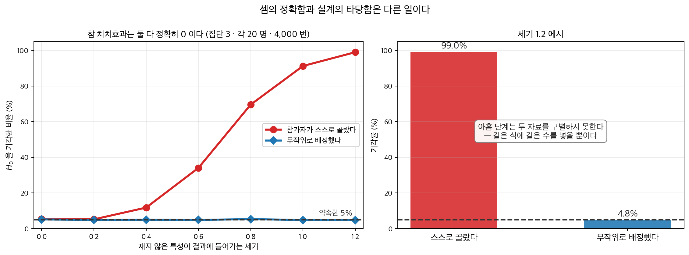
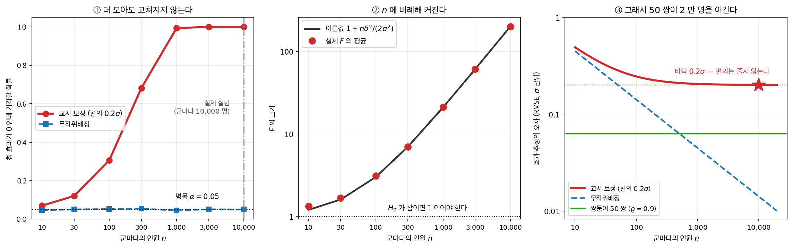
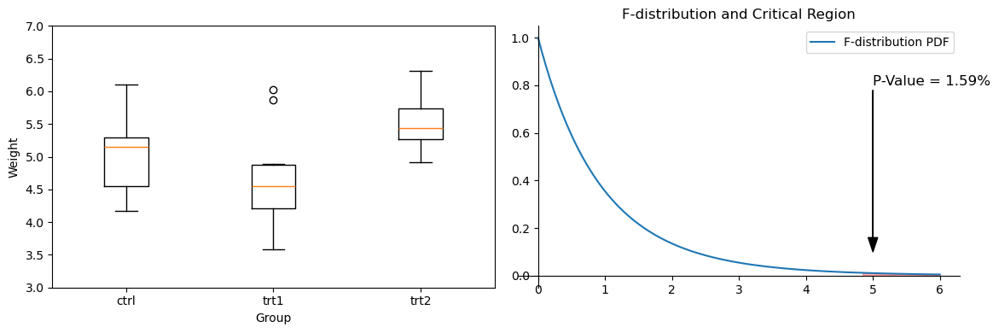
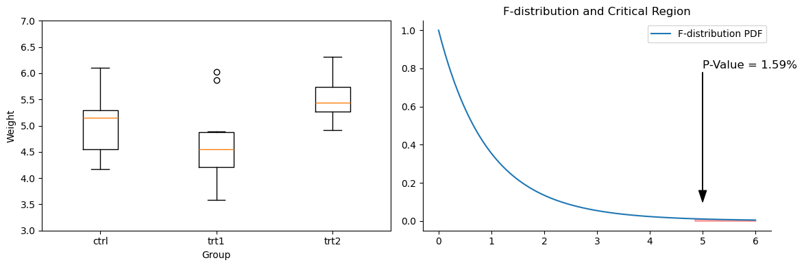
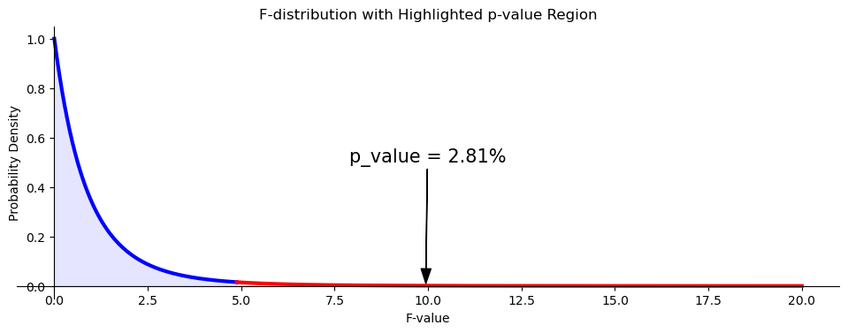
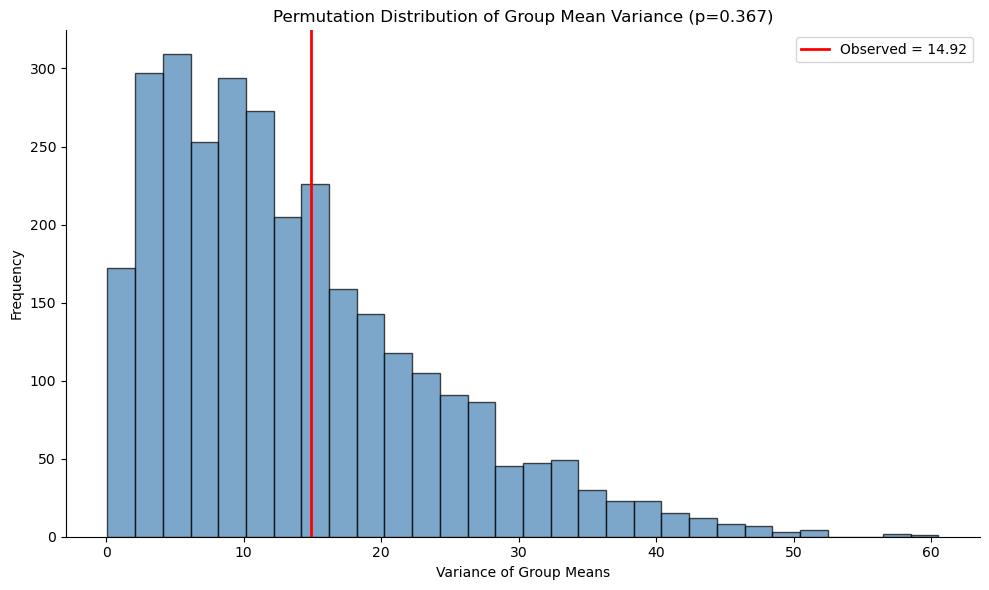

# 일원배치 분산분석: F-검정 절차

<div class="leadbox" markdown>

**들어가는 이야기** — 아홉 단계가 맞으면 손을 놓게 된다

검정을 손으로 한 번, 꾸러미로 한 번 돌려 수가 맞으면 거기서 손을 놓게 된다. 아홉 단계를 밟아 같은 수에 닿는 일이 이 쪽의 절반이다. **맞는 계산이 보장하는 것과 보장하지 않는 것**을 갈라 두는 것이 이 쪽의 일이다.

PlantGrowth 의 세 집단에 아홉 단계를 그대로 밟으면 $F = 4.846088$ 이 나온다. 자유도 $(2,\ 27)$ 인 $F$ 분포에서 위쪽 $5\%$ 를 자르는 값이 $3.3541$ 이고 그보다 크므로 $H_0$ 을 기각한다. 손계산과 꾸러미 함수와 제곱합의 세 유형을 쓴 적합이 $F = 4.846088$, $p = 0.015910$ 까지 **소수 여섯째 자리가 모두 같다.**

분포를 가정하지 않는 길로도 거의 같은 자리에 닿는다. 분포를 가정하는 대신 집단 이름을 섞어 다시 붙이며 $F$ 를 반복해 귀무분포를 만드는 순열검정(permutation test)을 어느 자료에 돌리면 $p = 0.3673$ 이 나오고 같은 자료의 모수적 $p$ 는 $0.3718$ 이다 — $0.0045$ 차이이고, 어느 쪽도 다른 쪽을 보정해 주지 않는다. 수가 어디서 오는지 두 길로 확인한 셈이다.

그런데 아홉 단계 어디에도 **이 세 집단이 애초에 어떻게 갈렸는지**를 묻는 칸은 없다. 처치를 무작위로 주었는지 사람들이 스스로 골랐는지, 여섯째 자리까지 맞는 계산은 그 차이를 알지 못한다. 무작위 배정이 아니었다면 그 $p$ 값은 집단이 갈린 까닭까지 담지 못한다. 여섯째 자리까지 맞는 계산은 무엇을 보장하고 무엇을 보장하지 않는가. 셈의 정확함과 설계의 타당함은 다른 일이다.

<figure markdown>
{ width="980" }
  <figcaption markdown>참 처치효과를 **정확히 $0$** 으로 두고 집단이 갈린 방식만 바꾸었다. **왼쪽.** 무작위로 배정하면 기각률이 세기와 상관없이 $5\%$ 에 머문다. 참가자가 스스로 고르면 — 재지 않은 특성이 큰 사람일수록 뒤쪽 집단으로 간다 — 같은 아홉 단계가 $99.0\%$ 까지 올라간다. **오른쪽.** 아홉 단계는 두 자료를 **구별하지 못한다.** 같은 식에 같은 수를 넣어 같은 $F$ 와 같은 $p$ 를 내놓을 뿐이다. 여섯째 자리까지 맞는 계산이 보장하는 것은 **셈이 맞았다**는 것뿐이고, 집단이 갈린 까닭은 설계가 보장한다.</figcaption>
</figure> 아래 상자가 고르게 나누어 주려던 일이 되레 어긋난 자리를 따라간다.

_확인한 곳 — 이 쪽 [「고르게 해 주려다」](#storybox-1) 상자와 그 출처 줄_

</div>

## 1. 일원배치 분산분석의 수행 절차

[eng|](https://www.youtube.com/watch?v=Lp2aV_4LF48&t=146s)

### 1단계: 가설 세우기

- **귀무가설**(null hypothesis) ($H_0$): 모든 집단의 평균이 같다.

$$
H_0: \mu_1 = \mu_2 = \mu_3 = \dots = \mu_k
$$

여기서 $\mu_1, \mu_2, \dots, \mu_k$는 $k$개 집단 각각의 모평균이다.

- **대립가설**(alternative hypothesis) ($H_A$): 적어도 한 집단의 평균이 다르다.

### 2단계: 전체 평균과 집단 평균 계산

종속변수(dependent variable) 전체의 평균을 계산한다.

$$
\bar{y}_{\cdot\cdot} = \frac{1}{\sum_{i=1}^kn_i}\sum_{i=1}^k \sum_{j=1}^{n_i} y_{ij}
$$

각 집단에 대해 종속변수의 평균을 계산한다.

$$
\bar{y}_{i\cdot} = \frac{1}{n_i} \sum_{j=1}^{n_i} y_{ij}
$$

### 3단계: 전체 변동(총제곱합) SST 계산

전체 변동 $SST$(총제곱합, total sum of squares)를 다음으로 계산한다.

$$
SST
=\displaystyle
\sum_{i=1}^{k}\sum_{j=1}^{n_i} \left( y_{ij} - \bar{y}_{\cdot\cdot} \right)^2
$$

### 4단계: 집단 내 변동 SSW 계산

집단 내 변동 $SSW$를 다음으로 계산한다.

$$
SSW = \sum_{i=1}^{k} \sum_{j=1}^{n_i} \left( y_{ij} - \bar{y}_{i\cdot} \right)^2
$$

### 5단계: 집단 간 변동 SSB 계산

집단 간 변동 $SSB$를 다음으로 계산한다.

$$
SSB
= \sum_{i=1}^{k} \sum_{j=1}^{n_i} \left( \bar{y}_{i\cdot} - \bar{y}_{\cdot\cdot} \right)^2
= \sum_{i=1}^{k} n_i \left( \bar{y}_{i\cdot} - \bar{y}_{\cdot\cdot} \right)^2
$$

!!! note "글자가 뜻하는 것 — T·B·W"
    세 이름 모두 앞의 $SS$ 는 **Sum of Squares**, 곧 제곱합이다. 뒤의 한 글자가
    **무엇에 대한 편차를 제곱했는지**를 가리킨다.

    | 기호 | 읽는 법 | 무엇에서 재는가 | 자유도 |
    |:---:|:---|:---|:---:|
    | $SST$ | **T**otal — 전체 | 각 관측값이 **전체평균** $\bar y_{\cdot\cdot}$ 에서 | $N-1$ |
    | $SSB$ | **B**etween — 집단 **간** | 각 **집단평균**이 전체평균에서 | $k-1$ |
    | $SSW$ | **W**ithin — 집단 **내** | 각 관측값이 **자기 집단평균** $\bar y_{i\cdot}$ 에서 | $N-k$ |

    헷갈리기 쉬운 자리는 **B 와 W 의 주어가 다르다**는 점이다. $SSB$ 가 세는 것은
    관측값이 아니라 **집단평균**이고($k$ 개를 $n_i$ 로 가중해 더한다), $SSW$ 가 세는
    것은 관측값이다. 그래서 자유도도 $k-1$ 과 $N-k$ 로 갈린다.

    **회귀에서 같은 등식이 다른 글자로 불린다.** 12.8절 [결정계수](../../ch12/performance/r_squared.md)의
    $SST = SSR + SSE$ 가 이것과 같은 분해이고, $SSR$(**R**egression, 모형이 설명한 몫)이
    $SSB$ 에, $SSE$(**E**rror, 남은 몫)가 $SSW$ 에 해당한다. 설명한 몫의 비율도
    이름만 다르다 — 회귀의 $R^2$ 가 분산분석에서는 $\eta^2$ 이다.

    **다른 책에서 만날 표기도 적어 둔다.** $TSS$·$BSS$·$WSS$ 처럼 $SS$ 를 뒤에 붙이거나
    $\text{SS}_B$·$\text{SS}_W$ 처럼 아래첨자로 쓰는 것이 모두 같은 양이다. 이 책은
    $SST$·$SSB$·$SSW$ 를 기본으로 쓴다.

    **다만 10.2 부터는 $SSW$ 가 $SSE$ 로, $MSW$ 가 $MSE$ 로 바뀐다.** 요인이 둘 이상이면
    「집단 내」라고 부를 하나의 집단이 없기 때문이다 — 이원배치의 분산분석표는 행 효과와
    열 효과와 교호작용(interaction)을 덜어 내고 **남은 것**을 적으므로 이름도 **E**rror 가 맞다.
    일원배치에서는 그 둘이 같은 수다.

### 6단계: 전체 변동의 분해 확인

관측값이 전체평균에서 벗어난 양을 **두 토막**으로 쪼갠다. 집단평균을 한 번 거쳐 가는 것이 전부다.

$$
y_{ij} - \bar{y}_{\cdot\cdot}
= \underbrace{\left( y_{ij} - \bar{y}_{i\cdot} \right)}_{\text{집단 안의 이탈}}
+ \underbrace{\left( \bar{y}_{i\cdot} - \bar{y}_{\cdot\cdot} \right)}_{\text{집단 사이의 이탈}}
$$

제곱해서 모두 더하면 세 덩어리가 된다.

$$
\begin{array}{lll}
SST
&=&\displaystyle
\sum_{i=1}^{k}\sum_{j=1}^{n_i} \left( y_{ij} - \bar{y}_{\cdot\cdot} \right)^2
\;=\;
\sum_{i=1}^{k} \sum_{j=1}^{n_i} \left[ \left( y_{ij} - \bar{y}_{i\cdot} \right) + \left( \bar{y}_{i\cdot} - \bar{y}_{\cdot\cdot} \right) \right]^2\\[2ex]
&=&\displaystyle
\underbrace{\sum_{i=1}^{k}\sum_{j=1}^{n_i} \left( y_{ij} - \bar{y}_{i\cdot} \right)^2}_{SSW}
\;+\;
\underbrace{\sum_{i=1}^{k} n_i \left( \bar{y}_{i\cdot} - \bar{y}_{\cdot\cdot} \right)^2}_{SSB}
\;+\;
2\underbrace{\sum_{i=1}^{k} \left( \bar{y}_{i\cdot} - \bar{y}_{\cdot\cdot} \right) \sum_{j=1}^{n_i} \left( y_{ij} - \bar{y}_{i\cdot} \right)}_{\text{교차항}}
\end{array}
$$

가운데 덩어리에서 $\bar{y}_{i\cdot} - \bar{y}_{\cdot\cdot}$ 가 $j$ 와 무관하므로 안쪽 합이 $n_i$ 번 더해져 $n_i(\bar{y}_{i\cdot} - \bar{y}_{\cdot\cdot})^2$ 이 되었다. 남은 것은 교차항인데, 그 안쪽 합이

$$
\sum_{j=1}^{n_i} \left( y_{ij} - \bar{y}_{i\cdot} \right)
= \sum_{j=1}^{n_i} y_{ij} - n_i\bar{y}_{i\cdot}
= n_i\bar{y}_{i\cdot} - n_i\bar{y}_{i\cdot}
= 0
$$

이다. **집단평균의 정의 하나로 교차항이 통째로 사라진다.** 그러므로

$$
SST = SSB + SSW
$$

이다. 쓴 것이 무엇인지 보라 — **가정을 하나도 쓰지 않았다.** 정규성(normality)도, 독립성(independence)도, 등분산도 아니고 $\bar{y}_{i\cdot}$ 가 집단 $i$ 관측값들의 평균이라는 사실뿐이다. **제곱합 분해는 통계적 명제가 아니라 대수적 항등식**이고, 분산분석(analysis of variance)의 가정은 그 뒤 8단계에서 $SSB$ 와 $SSW$ 의 **분포**를 말할 때 비로소 들어온다. 2절 보기 2 가 이것을 자료로 확인하고 기하로도 읽는다.

### 7단계: F-통계량 계산

$$
\begin{array}{cccccccccc}
\text{요인}&\text{df}&SS&MS&F&H_0&H_0\text{ 아래 }F\text{의 표집분포}\\
\hline
\text{처리}&k-1&SSB&\displaystyle MSB=\frac{SSB}{k-1}&\displaystyle F=\frac{MSB}{MSW}&\text{모든 }\beta_{i}=0&F\sim F_{k-1,N-k}\\
\text{오차}&N-k&SSW&\displaystyle MSW=\frac{SSW}{N-k}&\\
\hline
\text{전체}&N-1&SST&&\\
\end{array}
$$

맨 오른쪽 칸은 아직 **적어 둔 것**일 뿐이다. 그것이 왜 $F$ 분포인지는 8단계의 정리 1 에서 증명한다.

분산분석의 검정통계량(test statistic)은 F-통계량이며, 집단 간 평균제곱(MSB)과 집단 내 평균제곱(MSW)의 비로 계산한다.

$$
F = \frac{\text{MSB}}{\text{MSW}} = \frac{\text{SSB}/(k-1)}{\text{SSW}/(N-k)}
$$

여기서

- $k$는 집단의 개수
- $N$은 모든 집단을 합친 전체 관측 수
- $\text{MSB} = \frac{\text{SSB}}{k - 1}$은 **집단 간 평균제곱**
- $\text{MSW} = \frac{\text{SSW}}{N - k}$은 **집단 내 평균제곱**

이다.

### 8단계: 임계값 또는 p-값 구하기

<div class="thmbox" markdown>

### 보조정리 1. 세 제곱합은 한 직교분해의 길이제곱이다 { .thm }

관측값을 길이 $N$ 의 벡터 $\mathbf y$ 로 쌓고, 집단 $i$ 의 자리에만 $1$ 이 서는 지시벡터를 $\mathbf 1_i$, 전부 $1$ 인 벡터를 $\mathbf 1 = \sum_i \mathbf 1_i$ 라 쓴다.

$$
V_0 = \operatorname{span}\{\mathbf 1\},
\qquad
V_1 = \operatorname{span}\{\mathbf 1_1, \ldots, \mathbf 1_k\}
$$

로 두면 $V_0 \subset V_1$ 이고, $\mathbb R^N$ 이 **서로 직교하는 세 조각**으로 갈라진다.

$$
\mathbb R^N = V_0 \ \oplus\ (V_1 \ominus V_0) \ \oplus\ V_1^\perp,
\qquad
N = 1 + (k-1) + (N-k)
$$

세 제곱합은 이 분해로의 사영의 길이제곱이다.

$$
SSB = \lVert P_{V_1 \ominus V_0}\mathbf y\rVert^2,
\qquad
SSW = \lVert P_{V_1^\perp}\mathbf y\rVert^2,
\qquad
SST = \lVert P_{V_0^\perp}\mathbf y\rVert^2
$$

특히 $V_0^\perp = (V_1 \ominus V_0) \oplus V_1^\perp$ 이므로 $SST = SSB + SSW$ 는 **피타고라스 정리**다.

</div>

??? proof "증명"

    **지시벡터는 서로 직교한다.** 집단이 관측값을 나눠 가지므로 $i \neq j$ 이면 $\mathbf 1_i$ 와 $\mathbf 1_j$ 가 $1$ 을 세우는 자리가 겹치지 않는다. 곧 $\mathbf 1_i^\top\mathbf 1_j = 0$ 이고 $\lVert\mathbf 1_i\rVert^2 = n_i$ 다. 따라서 $\{\mathbf 1_i/\sqrt{n_i}\}_{i=1}^{k}$ 가 $V_1$ 의 **정규직교기저**이고 $\dim V_1 = k$ 다.

    **$V_1$ 로의 사영이 집단평균이다.** 정규직교기저로 사영을 적으면

    $$
    P_{V_1}\mathbf y
    = \sum_{i=1}^{k}\left(\frac{\mathbf 1_i}{\sqrt{n_i}}\right)^{\!\top}\!\mathbf y\ \cdot \frac{\mathbf 1_i}{\sqrt{n_i}}
    = \sum_{i=1}^{k}\frac{\mathbf 1_i^\top\mathbf y}{n_i}\,\mathbf 1_i
    = \sum_{i=1}^{k}\bar y_{i\cdot}\,\mathbf 1_i
    $$

    이다. $\mathbf 1_i^\top\mathbf y$ 가 집단 $i$ 의 관측값 합이므로 계수가 그대로 집단평균이 된다. 곧 **각 자리를 제 집단평균으로 바꾼 벡터**다. 같은 셈을 $V_0$ 에 하면 $P_{V_0}\mathbf y = \frac{\mathbf 1^\top\mathbf y}{N}\mathbf 1 = \bar y_{\cdot\cdot}\mathbf 1$ 로 **전부 전체평균**이다.

    **$V_0 \subset V_1$ 이라 차가 다시 사영이다.** $\mathbf 1 = \sum_i\mathbf 1_i \in V_1$ 이므로 $V_0 \subset V_1$ 이고, 그러면 $P_{V_1}P_{V_0} = P_{V_0}P_{V_1} = P_{V_0}$ 이다(작은 공간으로 먼저 내리든 나중에 내리든 같다). 그래서 $P_{V_1} - P_{V_0}$ 이 대칭이고

    $$
    (P_{V_1} - P_{V_0})^2 = P_{V_1} - P_{V_0} - P_{V_0} + P_{V_0} = P_{V_1} - P_{V_0}
    $$

    으로 멱등이다. 대칭이고 멱등한 행렬은 제 열공간으로의 직교사영이므로 $P_{V_1 \ominus V_0} = P_{V_1} - P_{V_0}$ 이고

    $$
    P_{V_1 \ominus V_0}\mathbf y = \sum_{i=1}^{k}(\bar y_{i\cdot} - \bar y_{\cdot\cdot})\,\mathbf 1_i
    $$

    이다. 차원은 $\dim V_1 - \dim V_0 = k-1$ 이다.

    **길이제곱이 세 제곱합이다.** $\mathbf 1_i$ 들이 직교하고 $\lVert\mathbf 1_i\rVert^2 = n_i$ 이므로

    $$
    \lVert P_{V_1 \ominus V_0}\mathbf y\rVert^2 = \sum_{i=1}^{k} n_i(\bar y_{i\cdot} - \bar y_{\cdot\cdot})^2 = SSB
    $$

    이다. 한편 $P_{V_1^\perp}\mathbf y = \mathbf y - P_{V_1}\mathbf y$ 의 $(i,j)$ 자리가 $y_{ij} - \bar y_{i\cdot}$ 이고 $P_{V_0^\perp}\mathbf y = \mathbf y - P_{V_0}\mathbf y$ 의 자리가 $y_{ij} - \bar y_{\cdot\cdot}$ 이므로, 성분을 제곱해 더하면 각각 $SSW$ 와 $SST$ 다.

    **세 조각이 직교하고 $\mathbb R^N$ 을 채운다.** $V_1 \ominus V_0$ 는 정의상 $V_0$ 에 직교하고, $V_1 \ominus V_0 \subseteq V_1$ 이므로 $V_1^\perp$ 와도 직교한다. $V_0$ 역시 $V_1$ 안에 있어 $V_1^\perp$ 와 직교한다. 셋이 서로 직교하면서 차원의 합이

    $$
    1 + (k-1) + (N-k) = N
    $$

    이므로 $\mathbb R^N$ 을 빈틈없이 채운다. 여기서 $V_0$ 만 덜어 내면 남는 둘이 $V_0^\perp$ 를 채우고, 사영도 따라서 쪼개진다.

    $$
    P_{V_0^\perp} = P_{V_1 \ominus V_0} + P_{V_1^\perp}
    $$

    두 성분이 직교하므로 길이제곱에 피타고라스 정리를 쓰면

    $$
    SST = \lVert P_{V_0^\perp}\mathbf y\rVert^2
    = \lVert P_{V_1 \ominus V_0}\mathbf y\rVert^2 + \lVert P_{V_1^\perp}\mathbf y\rVert^2
    = SSB + SSW
    $$

    이다. $\square$

!!! note "6단계의 교차항이 바로 이 직교다"
    6단계는 같은 것을 대수로 보였다. 거기서 사라진 교차항

    $$
    2\sum_{i=1}^{k}(\bar y_{i\cdot} - \bar y_{\cdot\cdot})\sum_{j=1}^{n_i}(y_{ij} - \bar y_{i\cdot})
    $$

    은 두 벡터의 **내적** $2\,(P_{V_1 \ominus V_0}\mathbf y)^\top(P_{V_1^\perp}\mathbf y)$ 를 성분으로 적은 것이다. 「안쪽 합이 $0$ 이다」와 「두 조각이 직교한다」가 같은 말이고, 「교차항이 없으니 제곱합이 더해진다」와 「피타고라스 정리」가 같은 말이다. **$SST = SSB + SSW$ 를 두 번 증명한 것이 아니라 한 사실을 두 언어로 적은 것이다** — 기하 쪽이 필요한 까닭은 그것이 **차원**을 함께 세어 주기 때문이고, 그 차원이 곧 자유도가 된다.

<div class="thmbox" markdown>

### 보조정리 2. 구면정규를 사영하면 { .thm }

$\boldsymbol\varepsilon \sim N(\mathbf 0,\ \sigma^2 I_N)$ 이고 $V \subseteq \mathbb R^N$ 이 차원 $d$ 인 부분공간, $P_V$ 가 그 위로의 직교사영이라 하자. 그러면

$$
\frac{\lVert P_V\boldsymbol\varepsilon\rVert^2}{\sigma^2} \sim \chi^2_d
$$

이다. 또 $W$ 가 $V$ 와 **직교하는** 부분공간이면 두 사영**벡터** $P_V\boldsymbol\varepsilon$ 과 $P_W\boldsymbol\varepsilon$ 이 **독립**이다. 따라서 두 벡터의 **어떤** 함수끼리도 독립이다 — 길이제곱 $\lVert P_V\boldsymbol\varepsilon\rVert^2$ 과 $\lVert P_W\boldsymbol\varepsilon\rVert^2$ 은 물론이고, 한쪽에 상수벡터를 먼저 더한 $\lVert \mathbf c + P_V\boldsymbol\varepsilon\rVert^2$ 같은 것도 그렇다.

</div>

??? proof "증명"

    **기저를 $V$ 에 맞춘다.** $V$ 의 정규직교기저 $\mathbf u_1, \ldots, \mathbf u_d$ 를 잡고, 그람–슈미트로 $\mathbb R^N$ 전체의 정규직교기저 $\mathbf u_1, \ldots, \mathbf u_N$ 까지 늘린다. 이것을 열로 쌓은

    $$
    Q = [\,\mathbf u_1\ \cdots\ \mathbf u_N\,]
    $$

    은 직교행렬이다($Q^\top Q = I_N$).

    **좌표를 갈아탄다.** $\mathbf z = Q^\top\boldsymbol\varepsilon$ 이라 두자. 정규벡터의 선형변환이라 $\mathbf z$ 도 정규이고

    $$
    E[\mathbf z] = \mathbf 0,
    \qquad
    \operatorname{Cov}(\mathbf z) = Q^\top(\sigma^2 I_N)Q = \sigma^2 Q^\top Q = \sigma^2 I_N
    $$

    이다. 곧 $z_1, \ldots, z_N$ 이 **다시 서로 독립인 $N(0, \sigma^2)$** 이다. 「구면대칭」이라는 말의 내용이 이 한 줄이다 — 공분산이 단위행렬의 배수라서 직교행렬이 그것을 그대로 통과시킨다. **어느 정규직교기저로 갈아타도 좋으므로, 보고 싶은 부분공간에 맞춘 기저를 고를 수 있다.**

    5.6절 [S²의 표집분포 (정규분포)](../../ch05/applications/s2_normal.md)가 $(n-1)S^2/\sigma^2 \sim \chi^2_{n-1}$ 을 보일 때 쓴 것이 바로 이 걸음이다. 거기서는 기저를 $\mathbf 1$ 방향에 맞췄고, 여기서는 아무 부분공간에나 맞춘다.

    **사영은 앞의 $d$ 개 좌표만 쓴다.** 정규직교기저로 적으면 $P_V = \sum_{m=1}^{d}\mathbf u_m\mathbf u_m^\top$ 이므로

    $$
    P_V\boldsymbol\varepsilon = \sum_{m=1}^{d}(\mathbf u_m^\top\boldsymbol\varepsilon)\,\mathbf u_m = \sum_{m=1}^{d} z_m\mathbf u_m
    $$

    이고, $\mathbf u_m$ 들이 정규직교이므로 길이제곱이 계수의 제곱합이 된다.

    $$
    \lVert P_V\boldsymbol\varepsilon\rVert^2 = \sum_{m=1}^{d} z_m^2
    \quad\Longrightarrow\quad
    \frac{\lVert P_V\boldsymbol\varepsilon\rVert^2}{\sigma^2} = \sum_{m=1}^{d}\left(\frac{z_m}{\sigma}\right)^2
    $$

    오른쪽은 독립인 표준정규 $d$ 개의 제곱합이고, 4.2절 [카이제곱분포](../../ch04/continuous_distributions/chi_square.md) 정의 1 이 그것을 $\chi^2_d$ 라 부른다. **자유도가 부분공간의 차원인 까닭이 이것이다** — 더해지는 항의 개수가 곧 차원이다.

    **직교하면 좌표가 겹치지 않는다.** $W$ 가 $V$ 에 직교하고 $\dim W = e$ 라 하자. $W \subseteq V^\perp$ 이므로 위에서 기저를 늘릴 때 $\mathbf u_{d+1}, \ldots, \mathbf u_{d+e}$ 를 **$W$ 의 정규직교기저로 고를 수 있다.** 그러면 같은 계산으로

    $$
    \lVert P_V\boldsymbol\varepsilon\rVert^2 = \sum_{m=1}^{d} z_m^2,
    \qquad
    \lVert P_W\boldsymbol\varepsilon\rVert^2 = \sum_{m=d+1}^{d+e} z_m^2
    $$

    이다. 더 중요한 것은 **사영벡터 자체**가 그렇다는 것이다 — $P_V\boldsymbol\varepsilon$ 은 $z_1, \ldots, z_d$ 로만, $P_W\boldsymbol\varepsilon$ 은 $z_{d+1}, \ldots, z_{d+e}$ 로만 만들어지고 그 좌표들이 서로 독립이다. 그러므로 두 벡터가 독립이고, 각각의 **어떤** 함수끼리도 독립이다. $\square$

    길이제곱만으로 끝내지 않는 까닭은 아래에서 드러난다. $H_0$ 이 거짓이면 $SSB$ 가 $\lVert \mathbf c + P\boldsymbol\varepsilon\rVert^2$ 꼴이 되어 사영벡터를 길이제곱 **밖에서** 쓰게 되고, 그때도 $SSW$ 와의 독립이 필요하다.

!!! note "같은 것을 행렬로 적으면"
    이 보조정리를 이차형식의 말로 옮기면 부록 A.4 [카이제곱분포와 이차형식](../../ch00/linalg_regression/linalg_statistics/chi_squared_quadratic.md)의 정리 1(대칭 멱등행렬의 이차형식)과 정리 3(크레이그 정리, 독립의 필요충분조건은 $AB = O$)이 된다. 사영행렬 $P_V$ 가 대칭이고 멱등하며 계수가 $\dim V$ 와 같다는 것이 그 번역의 전부다.

    같은 쪽의 **정리 4(코크런 정리)** 는 아래에서 쓸 세 조각을 한꺼번에 준다. $I_N$ 을 사영의 합으로 쪼개고 계수의 합이 $N$ 으로 딱 맞으면 조각들이 서로 독립인 $\chi^2$ 이라는 것인데, 아래 분산분석의 분해가 정확히 그 꼴이다.

<div class="thmbox" markdown>

### 정리 1. 분산분석 F 의 표집분포 { .thm }

$y_{ij} = \mu_i + \varepsilon_{ij}$ 이고 $\varepsilon_{ij}$ 가 서로 독립으로 $N(0,\ \sigma^2)$ 을 따른다고 하자. 그러면 **집단평균이 무엇이든**

$$
\frac{SSW}{\sigma^2} \sim \chi^2_{N-k}
$$

이고, 역시 집단평균이 무엇이든 $SSB$ 와 $SSW$ 는 **독립**이다. 여기에 $H_0\colon \mu_1 = \cdots = \mu_k$ 가 참이면

$$
\frac{SSB}{\sigma^2} \sim \chi^2_{k-1}
$$

이 더해진다. 따라서 $H_0$ 아래에서

$$
F = \frac{MSB}{MSW} = \frac{SSB/(k-1)}{SSW/(N-k)} \sim F_{k-1,\,N-k}
$$

</div>

??? proof "증명"

    **기하는 보조정리 1 이 준다.** $\mathbb R^N$ 이 $V_0 \oplus (V_1 \ominus V_0) \oplus V_1^\perp$ 로 직교분해되고 차원이 $1 + (k-1) + (N-k)$ 이며, $SSB$ 와 $SSW$ 가 뒤 두 조각으로의 사영의 길이제곱이다.

    **사영의 분포는 보조정리 2 가 준다.** $\boldsymbol\varepsilon \sim N(\mathbf 0,\ \sigma^2 I_N)$ 이므로 차원 $d$ 인 부분공간으로 사영한 길이제곱은 $\sigma^2\chi^2_d$ 이고, 직교하는 두 부분공간으로의 사영은 독립이다. 남은 일은 **$\mathbf y$ 의 사영을 $\boldsymbol\varepsilon$ 의 사영으로 바꾸는 것**뿐이고, 거기서 $H_0$ 이 필요한지 아닌지가 갈린다.

    **분모는 가설을 쓰지 않는다.** 평균벡터 $\boldsymbol\mu = \sum_i \mu_i \mathbf 1_i$ 는 집단평균이 무엇이든 **언제나** $V_1$ 안에 있다. 따라서 $P_{V_1^\perp}\boldsymbol\mu = \mathbf 0$ 이고

    $$
    P_{V_1^\perp}\mathbf y = P_{V_1^\perp}\boldsymbol\mu + P_{V_1^\perp}\boldsymbol\varepsilon = P_{V_1^\perp}\boldsymbol\varepsilon
    \quad\Longrightarrow\quad
    \frac{SSW}{\sigma^2} \sim \chi^2_{N-k}
    $$

    이다. 아래 2 절의 보기 1 이 $E[MSW] = \sigma^2$ 은 가설과 무관하게 성립한다고 적는데, 그 **분포판**이 이것이다.

    **독립성도 가설을 쓰지 않는다.** $P_{V_1 \ominus V_0}\mathbf y = P_{V_1 \ominus V_0}\boldsymbol\mu + P_{V_1 \ominus V_0}\boldsymbol\varepsilon$ 에서 앞 항은 **상수**다. 그러니 $SSB$ 와 $SSW$ 는 각각 $P_{V_1 \ominus V_0}\boldsymbol\varepsilon$ 과 $P_{V_1^\perp}\boldsymbol\varepsilon$ 만을 통해 확률적인데, 두 부분공간이 직교하므로 **보조정리 2 의 벡터판**이 그 둘을 독립이라 한다. 집단평균이 제각각이어도 그대로다.

    **분자만 가설을 쓴다.** $H_0$ 이 참이면 $\boldsymbol\mu = \mu\mathbf 1 \in V_0$ 이므로 상수항까지 사라져 $P_{V_1 \ominus V_0}\mathbf y = P_{V_1 \ominus V_0}\boldsymbol\varepsilon$ 이고 $SSB/\sigma^2 \sim \chi^2_{k-1}$ 이다. 독립인 두 카이제곱을 각자의 자유도로 나눈 비가 $F$ 라는 4.2절 [F 분포](../../ch04/continuous_distributions/f_distribution.md)의 정의에 그대로 들어간다. $\square$

    $H_0$ 이 거짓이면 그 상수항이 남아 $SSB/\sigma^2$ 이 **비중심** 카이제곱이 된다. 비중심모수는 $\lambda = \lVert P_{V_1 \ominus V_0}\boldsymbol\mu\rVert^2/\sigma^2 = \sum_i n_i(\mu_i - \bar\mu)^2/\sigma^2$ 이고, 검정력이 그 수에만 달려 있다는 것이 이 절의 [분산분석 F-통계량 모의실험](anova_f_simulation.md)의 출발점이다.

!!! warning "자유도가 $k$ 가 아니라 $k-1$ 인 까닭 — 중심이 표본평균이다"
    $SSB/\sigma^2$ 은

    $$
    \frac{1}{\sigma^2}\sum_{i=1}^{k} n_i(\bar y_{i\cdot} - \bar y_{\cdot\cdot})^2
    = \sum_{i=1}^{k}\frac{(\bar y_{i\cdot} - \bar y_{\cdot\cdot})^2}{\sigma^2/n_i}
    = \sum_{i=1}^{k}\left(\frac{\bar y_{i\cdot} - \bar y_{\cdot\cdot}}{\sigma/\sqrt{n_i}}\right)^2
    $$

    로 적을 수 있다. **이 식은 맞다** — 항등식이고, 분모도 제 척도다. $y_{ij}$ 의 표준편차가 $\sigma$ 이면 $\bar y_{i\cdot}$ 의 표준편차는 정확히 $\sigma/\sqrt{n_i}$ 이니 나눈 수가 옳다. 틀리는 것은 **마지막 한 걸음**, 곧 「표준정규의 제곱이 $k$ 개니까 $\chi^2_k$」 뿐이다.

    **중심이 참평균 $\mu$ 가 아니라 표본평균(sample mean) $\bar y_{\cdot\cdot}$ 이기 때문이다.** $\bar y_{\cdot\cdot}$ 는 바로 그 $k$ 개의 $\bar y_{i\cdot}$ 로 만든 수라서, 빼는 순간 항들이 $\sum_i n_i(\bar y_{i\cdot} - \bar y_{\cdot\cdot}) = 0$ 이라는 제약을 하나 지고 자유도를 하나 내놓는다.

    **일표본에서 이미 겪은 일이다.** 5.6절 [S²의 표집분포 (정규분포)](../../ch05/applications/s2_normal.md)가 적어 둔

    $$
    \sum_{i=1}^{n}\left(\frac{y_i - \bar y}{\sigma}\right)^2 = \frac{(n-1)S^2}{\sigma^2} \sim \chi^2_{n-1}
    $$

    도 꼭 같다. $y_i$ 하나하나의 표준편차가 정확히 $\sigma$ 라서 분모가 맞는데도 자유도는 $n$ 이 아니라 $n-1$ 이고, 까닭은 중심이 $\mu$ 가 아니라 $\bar y$ 라는 것 하나다. **$SSB$ 는 관측값 대신 집단평균을, $\sigma$ 대신 $\sigma/\sqrt{n_i}$ 를 넣은 같은 식이다.**

    **중심을 참평균으로 바꾸면 정말 $\chi^2_k$ 가 된다.** $\mu$ 를 안다고 치고

    $$
    \sum_{i=1}^{k}\left(\frac{\bar y_{i\cdot} - \mu}{\sigma/\sqrt{n_i}}\right)^2
    $$

    을 보면 이번에는 $k$ 개 항이 **참으로** 독립인 표준정규의 제곱이다 — 집단이 서로 독립이고 각 항의 분산이 정확히 $1$ 이므로 $\chi^2_k$ 다. 바뀐 것은 $\bar y_{\cdot\cdot}$ 를 $\mu$ 로 돌린 것뿐이고, 자유도는 그 한 글자에 달려 있다. $n = (3,3,4)$ 에서 $40$ 만 번 뽑아 보면 표본평균으로 중심화한 쪽이 평균 $2.0024$ 로 $\chi^2_2$ 에 맞고, 참평균으로 중심화한 쪽이 평균 $3.0008$ 로 $\chi^2_3$ 에 맞는다.

    **잃은 자유도가 어디로 갔는지도 셀 수 있다.** $\operatorname{Cov}(\bar y_{i\cdot},\ \bar y_{\cdot\cdot}) = \sigma^2/N$ 이므로

    $$
    \operatorname{Var}\!\left(\frac{\bar y_{i\cdot} - \bar y_{\cdot\cdot}}{\sigma/\sqrt{n_i}}\right)
    = \frac{n_i}{\sigma^2}\left(\frac{\sigma^2}{n_i} - \frac{\sigma^2}{N}\right)
    = 1 - \frac{n_i}{N}
    $$

    이고, 항마다 $n_i/N$ 씩 깎여 합이 $\sum_i n_i/N = 1$ 로 **정확히 자유도 하나**다. $\chi^2$ 의 자유도가 그 기댓값이므로 $\sum_i(1 - n_i/N) = k-1$ 이 바로 나온다. 아래 2 절 보기 1 이 $E[SSB]$ 안에 $\sum_i n_i\!\left(\frac{\sigma^2}{n_i} - \frac{\sigma^2}{N}\right)$ 를 적어 둔 것이 같은 수다. 같은 중심화가 항들을 음의 상관으로도 묶는다 — $i \neq j$ 이면 상관이 $-\sqrt{n_in_j/\{(N-n_i)(N-n_j)\}}$ 로 **언제나 음수**다. 한 집단평균이 전체평균 위로 가면 나머지는 아래로 가야 하기 때문이다.

    위 증명이 「차원 $k-1$ 인 부분공간으로의 사영」이라 적은 것이 이 말을 기하로 옮긴 것이다. $\bar y_{\cdot\cdot}$ 를 빼는 일이 곧 $V_0$ 성분을 덜어 내는 일이고, 그래서 남는 자리의 차원이 $k$ 가 아니라 $k-1$ 이다.

    **덧붙여 $SST = SSB + SSW$ 라는 항등식만으로는 세 분포를 말할 수 없다.** 6단계가 그 항등식을 증명하면서 가정을 하나도 쓰지 않았다는 것이 요점이다 — 합이 쪼개진다고 분포가 쪼개지지는 않는다 — 두 조각이 **직교**해야 각자 $\chi^2$ 이 되고 서로 독립이 된다. 자유도가 $N-1 = (k-1) + (N-k)$ 로 맞아떨어지는 것은 그 직교분해의 **결과**이지 근거가 아니다.

    $SST/\sigma^2 \sim \chi^2_{N-1}$ 도 공짜가 아니다. 그 주장은 $y_{ij}$ 가 **모두 같은** 평균을 갖는다는 것, 곧 $H_0$ 을 이미 쓰고 있다. $H_0$ 이 거짓이면 $SST$ 는 중심 카이제곱이 아니다.

분포를 손에 넣었으니 판정은 둘 가운데 하나다.

- 계산한 F-통계량을 ($k-1$과 $N-k$ 자유도의) F-분포표 임계값과 비교하거나,
- p-값 접근을 쓴다. p-값이 유의수준(예: $\alpha = 0.05$)보다 작으면 귀무가설을 기각한다.

### 9단계: 판정

$$
\text{statistic} > F_{\text{critical}} \quad\Rightarrow\quad H_1\text{을 택한다}
$$

<div class="storybox" markdown id="storybox-1">

**그림으로 보는 통계학 1.** 고르게 해 주려다

위의 아홉 단계 어디에도 **자료가 어떻게 만들어졌는지**를 묻는 칸이 없다. $F$ 는 주어진
수들만 보고 분자와 분모를 계산한다. 그래서 분자에 처리 때문이 아닌 차이가 섞여 들어오면,
$F$ 는 그것까지 「효과」로 읽는다. $1930$ 년 봄 스코틀랜드에서 그 일이 아주 큰 규모로
일어났다.

래너크셔주의 학교 $67$ 곳에서 **아동 $2$ 만 명**을 상대로 넉 달 동안 우유를 먹였다.
$1$ 만 명이 하루 반 파인트씩 받았고($5$ 천 명은 생우유, $5$ 천 명은 저온살균유),
나머지 $1$ 만 명이 대조군이었다. 시작과 끝에 전원의 키와 몸무게를 쟀다.

배정은 제대로 시작했다. 공식 보고서의 말로 「어떤 경우에는 제비뽑기로, 어떤 경우에는
가나다순으로」 나누었다. 그런데 보고서에 한 문장이 더 있었다.

> 어느 학교에서든 잘 먹은 아이나 못 먹은 아이가 한쪽 집단에 지나치게 몰린 경우에는,
> 더 고른 선정을 얻기 위해 **다른 아이들로 바꾸었다.**

[기네스의 그 고셋](../../ch05/distributions/student_t.md) — 「Student」 — 이 $1931$ 년에
이 대목을 짚었다. 「우리 대부분이 이따금 하는 바로 그런 뒷생각이고, 가장 잘 짜인 계획을
망치기 쉬운 것이다. **이 경우에는 치명적인 실수였다.**」

왜 치명적인가. 교사들이 「가난한 아이에게 우유가 더 필요하다」는 지극히 인간적인 마음에
이끌려 못 먹은 아이를 우유군으로 너무 많이 옮겼고, 그래서 **시작 시점에 이미 대조군이
우유군보다 컸다** — 보고서 자신의 수로 몸무게에서 $3$ 개월치, 키에서 $4$ 개월치 성장만큼.
**넉 달짜리 실험이 재려던 양의 거의 전부**가 출발선에서 이미 어긋나 있었던 셈이다.



출발점의 불일치를 성장 표준편차의 $0.2$ 배로 — 실제보다 훨씬 얌전하게 — 두고, 참 효과는
$0$ 으로 둔 자료를 $4{,}000$ 벌씩 만들어 보았다.

- **①** 무작위배정이면 군마다 몇 명이든 기각률이 $0.05$ 다. 교사 보정이 들어가면
  $n = 100$ 에서 $0.31$, $n = 1{,}000$ 에서 $0.99$, $n = 10{,}000$ 에서 **$1.000$** 이다.
  우유에 효과가 전혀 없어도 **반드시** 「유의하다」가 나온다.
- **②** $F$ 가 커지는 속도가 정확히 계산된다. $E[F] \approx 1 + n\delta^2/(2\sigma^2)$ 로
  **$n$ 에 비례**하며, 실제로 잰 평균이 $n = 10{,}000$ 에서 $199.6$, 이론값이 $201.0$ 이다.
  표본을 키우는 일이 편의를 지우기는커녕 **그만큼 더 확신시켜 준다.**
- **③** 추정의 오차로 보면 바닥이 보인다. 무작위배정의 오차는 $1/\sqrt{n}$ 으로 끝없이
  내려가지만, 편의가 있으면 $0.2\sigma$ 아래로 못 내려간다. 군마다 $1$ 만 명을 모아도
  오차가 $0.2005\sigma$ 다.

그래서 Student 의 제안이 나온다. $2$ 만 명 가운데 같은 성별의 쌍둥이가 $200$–$300$ 쌍은
있을 것이고 그중 $50$ 쌍쯤은 일란성일 것이니, **짝마다 동전을 던져** 한 명에게 생우유,
다른 한 명에게 저온살균유를 주라는 것이다. 돈은 「$1$–$2\%$」, 수고는 「$5\%$ 미만」이면
된다고 그는 적었다. 그리고 결론은 이렇다 — **「이 $50$ 쌍이 우리가 다루어 온 $2$ 만 명보다
더 믿을 만한 결과를 줄 것이다.」**

③ 의 초록 선이 그 말이다. 쌍둥이 $50$ 쌍($\varrho = 0.9$ 로 잡으면)의 오차가
$0.063\sigma$ 로, 편의에 걸린 $2$ 만 명의 $0.2005\sigma$ 보다 **$3.2$ 배 정확하다.**

다만 Student 가 옳았던 **이유**는 짚어 둘 만하다. 쌍둥이가 신통해서가 아니다. 같은
$2$ 만 명이 제대로 무작위배정되었다면 그쪽 오차가 $0.014\sigma$ 라서 $50$ 쌍을 가볍게
이긴다(③ 의 파란 선). $50$ 쌍이 이기려면 $\varrho > 0.995$ 는 되어야 한다. **$50$ 쌍이
$2$ 만 명을 이긴 것은 $2$ 만 명 쪽이 편의에 걸렸기 때문**이고, 편의 앞에서는 표본 수가
아무 힘이 없기 때문이다.

아홉 단계를 아무리 정확히 밟아도 이 일은 잡히지 않는다. $F$ 가 묻지 않는 것을 물어야
한다 — **이 두 집단은 어떻게 갈렸는가.**

_확인한 곳 — "Student", "The Lanarkshire Milk Experiment", 『Biometrika』 $23$ 권
$3/4$ 호 $398$ 쪽부터($1931$ 년 $12$ 월, Crossref)의 본문 — $1930$ 년 봄 넉 달, 학교 $67$ 곳(학교마다 $200$–$400$ 명), 아동 $2$ 만 명
가운데 $1$ 만 명이 하루 $\tfrac12$ 파인트($5$ 천 명 생우유·$5$ 천 명 저온살균유)를 받고
$1$ 만 명이 대조군이었다는 것, 보고서가 제비뽑기와 가나다순으로 나눈 뒤 「더 고른 선정을
얻기 위해 다른 아이들로 바꾸었다」고 적은 것, 그 결과 대조군이 몸무게 $3$ 개월치·키
$4$ 개월치만큼 앞섰다는 것, 「치명적인 실수였다」와 교사들이 「가난한 아이에게 우유가 더
필요하다는 지극히 인간적인 마음에」 못 먹은 아이를 우유군으로 너무 많이 옮겼으리라는
그의 추론, 그리고 쌍둥이 제안 — 출생 $90$ 건에 한 쌍꼴이니 $200$–$300$ 쌍은 될 것이고
$200$ 쌍 중 $50$ 쌍쯤이 일란성일 것, 비용 $1$–$2\%$ 와 수고 $5\%$ 미만, 「$50$ 쌍이
우리가 다루어 온 $2$ 만 명보다 더 믿을 만한 결과를 줄 것이다」, 짝마다 동전을 던져
정하라는 것. ①–③ 의 수는 모두 직접 계산한 값이며, 쓰인 편의 $0.2\sigma$ 와 쌍둥이의
상관 $0.9$ 는 논문의 수가 아니라 이 상자가 고른 값이다_

</div>

---

## 2. 같은 분산분석표에 이르는 두 길

### 귀무가설 아래에서 두 평균제곱이 같은 것을 겨눈다

`scipy.stats.f_oneway` 로 돌려 본다.

<div class="exbox" markdown>

**보기 1.** <span class="diff easy" title="쉬움"></span> $F$ 는 왜 1 근처인가. 집단 $i$ 의 관측값이 $y_{ij} = \mu_i + \varepsilon_{ij}$ 이고 $\varepsilon_{ij}$ 가 평균 $0$, 분산 $\sigma^2$ 으로 서로 독립이라 하자. $\bar\mu = \frac{1}{N}\sum_i n_i \mu_i$ 라 쓴다.

**(1)** 두 평균제곱의 기댓값이

$$
E[MSW] = \sigma^2,
\qquad
E[MSB] = \sigma^2 + \frac{\sum_i n_i (\mu_i - \bar\mu)^2}{k-1}
$$

임을 보이시오. 이로부터 $H_0$ 이 참일 때 $F$ 가 왜 $1$ 근처에 놓이는지, 거짓일 때 왜 커지는지 설명하시오.

**(2)** PlantGrowth 자료에 1–9단계를 그대로 밟아 $F$ 와 임계값과 판정을 내고 `f_oneway` 와 맞추시오. 그리고 **$H_0$ 아래에서 $E[MSB] = E[MSW]$ 인데도 $E[F] \ne 1$** 임을 모의실험으로 확인하시오.

</div>

??? success "풀이"

    **(1) 해석적으로.** 정규성은 쓰지 않는다. 독립성과 등분산만 있으면 된다.

    **분모부터.** $SSW = \sum_i (n_i - 1) s_i^2$ 이고 $s_i^2$ 은 분산 $\sigma^2$ 의 비편향추정량이므로 $E[s_i^2] = \sigma^2$ 이다. 따라서

    $$
    E[SSW] = \sum_i (n_i-1)\sigma^2 = (N-k)\sigma^2
    \quad\Longrightarrow\quad
    E[MSW] = \sigma^2
    $$

    이다. **집단 평균이 무엇이든 상관없다.** 집단 안에서만 재므로 $\mu_i$ 들이 제각각이어도 $MSW$ 는 늘 $\sigma^2$ 을 겨눈다. 이것이 $MSW$ 가 "잡음의 자"로 쓰이는 까닭이다.

    **분자.** $\bar y_{i\cdot}$ 는 평균 $\mu_i$, 분산 $\sigma^2/n_i$ 이고 $\bar y_{\cdot\cdot} = \frac1N\sum_i n_i \bar y_{i\cdot}$ 는 평균 $\bar\mu$, 분산 $\sigma^2/N$ 이다. 또 집단이 독립이므로

    $$
    \operatorname{Cov}(\bar y_{i\cdot}, \bar y_{\cdot\cdot}) = \frac{n_i}{N}\operatorname{Var}(\bar y_{i\cdot}) = \frac{\sigma^2}{N}
    $$

    이다. 이제 $E[X^2] = \operatorname{Var}(X) + (E[X])^2$ 을 $X = \bar y_{i\cdot} - \bar y_{\cdot\cdot}$ 에 쓰면 $E[X] = \mu_i - \bar\mu$ 이고

    $$
    \operatorname{Var}(X) = \frac{\sigma^2}{n_i} - 2\cdot\frac{\sigma^2}{N} + \frac{\sigma^2}{N} = \frac{\sigma^2}{n_i} - \frac{\sigma^2}{N}
    $$

    이다. $n_i$ 를 곱해 더하면

    $$
    E[SSB] = \sum_i n_i\left(\frac{\sigma^2}{n_i} - \frac{\sigma^2}{N}\right) + \sum_i n_i(\mu_i-\bar\mu)^2
    = (k-1)\sigma^2 + \sum_i n_i(\mu_i-\bar\mu)^2
    $$

    이고($\sum_i n_i = N$ 이므로 첫 합이 $k\sigma^2 - \sigma^2$ 이다) 자유도 $k-1$ 로 나누면 구하려던 식이 나온다.

    **그러므로.** $H_0: \mu_1 = \cdots = \mu_k$ 가 참이면 둘째 항이 $0$ 이라 $E[MSB] = E[MSW] = \sigma^2$ 이다. 분자와 분모가 **같은 것**을 재므로 비는 $1$ 근처를 맴돈다. $H_0$ 이 거짓이면 분자에만 $\sum n_i(\mu_i-\bar\mu)^2/(k-1) > 0$ 이 더해지고 분모는 꿈쩍도 하지 않으므로 $F$ 가 위로 밀린다. **$F$-검정이 한쪽 꼬리만 보는 이유가 이것이다.** 대립가설이 $F$ 를 키우는 쪽으로만 작용한다.

    **(2) 수치적으로.** 먼저 1–9단계를 밟는다.

    ```python
    import matplotlib.pyplot as plt
    import numpy as np
    import pandas as pd
    from scipy import stats
    def load_data():
        """
        Load and preprocess plant growth data from the given URL.
        Returns:
            df (pd.DataFrame): The full DataFrame of plant growth data.
            data (tuple): A tuple containing weights for each group ('ctrl', 'trt1', 'trt2').
            df1 (int): Degrees of freedom between groups.
            df2 (int): Degrees of freedom within groups.
        """
        url = 'https://raw.githubusercontent.com/vincentarelbundock/Rdatasets/1dcc2bf5f955cc1224a3e1307256e1fe86b68dae/csv/datasets/PlantGrowth.csv'
        df = pd.read_csv(url, usecols=[1, 2])
        group_data = df.groupby('group')
        data_ctrl = group_data.get_group('ctrl').weight
        data_trt1 = group_data.get_group('trt1').weight
        data_trt2 = group_data.get_group('trt2').weight
        data = (data_ctrl, data_trt1, data_trt2)
        total_samples = data_ctrl.shape[0] + data_trt1.shape[0] + data_trt2.shape[0]
        num_groups = len(data)
        df1 = num_groups - 1
        df2 = total_samples - num_groups
        return df, data, df1, df2
    def perform_anova(data_ctrl, data_trt1, data_trt2):
        """
        Perform one-way ANOVA on the given data.
        Returns:
            statistic (float): F-statistic of the ANOVA test.
            p_value (float): P-value of the ANOVA test.
        """
        statistic, p_value = stats.f_oneway(data_ctrl, data_trt1, data_trt2)
        print(f"\nANOVA Results:\nF-Statistic = {statistic:.4f}\nP-Value = {p_value:.4f}")
        return statistic, p_value
    def plot_data(data_ctrl, data_trt1, data_trt2, df1, df2, statistic, p_value):
        """
        Plot boxplot of weights for each group and F-distribution with critical region.
        """
        fig, (ax_box, ax_pdf) = plt.subplots(1, 2, figsize=(12, 4))
        ax_box.boxplot([data_ctrl, data_trt1, data_trt2], labels=['ctrl', 'trt1', 'trt2'])
        ax_box.set_ylim(3, 7)
        ax_box.set_xlabel('Group')
        ax_box.set_ylabel('Weight')
        x_vals = np.linspace(0, 6, 100)
        pdf_vals = stats.f(df1, df2).pdf(x_vals)
        ax_pdf.plot(x_vals, pdf_vals, label='F-distribution PDF')
        ax_pdf.fill_between(x_vals[x_vals >= statistic], pdf_vals[x_vals >= statistic], color='red', alpha=0.3)
        ax_pdf.spines[['top','right']].set_visible(False)
        ax_pdf.spines[['bottom','left']].set_position("zero")
        ax_pdf.set_title("F-distribution and Critical Region")
        ax_pdf.legend()
        ax_pdf.annotate(f'P-Value = {p_value:.2%}', xy=(5.0, 0.1), xytext=(5.0, 0.8),
                        arrowprops=dict(color='k', width=0.2, headwidth=8), fontsize=12)
        plt.tight_layout()
        plt.show()
    # 자료 읽기 → 분산분석 → 그림 순으로 돌린다
    _, (data_ctrl, data_trt1, data_trt2), df1, df2 = load_data()
    statistic, p_value = perform_anova(data_ctrl, data_trt1, data_trt2)
    plot_data(data_ctrl, data_trt1, data_trt2, df1, df2, statistic, p_value)
    ```

    출력:

    ```

    ANOVA Results:
    F-Statistic = 4.8461
    P-Value = 0.0159
    ```

    

    왼쪽 상자그림(box plot)에서 세 집단이 서로 겹치고, 오른쪽 F-분포에서 관측값 4.85 오른쪽의 붉은 넓이가 p-값 1.59%다.

    이제 9단계를 손으로 밟고, (1)에서 유도한 두 기댓값을 모의실험으로 확인한다.

    ```python
    groups = [data_ctrl, data_trt1, data_trt2]
    y = np.concatenate([g.values for g in groups])
    n_i = np.array([len(g) for g in groups])
    ybar_i = np.array([g.mean() for g in groups])
    ybar = y.mean()

    SST = ((y - ybar) ** 2).sum()
    SSW = sum(((g.values - g.mean()) ** 2).sum() for g in groups)
    SSB = (n_i * (ybar_i - ybar) ** 2).sum()
    MSB, MSW = SSB / df1, SSW / df2
    crit = stats.f(df1, df2).ppf(0.95)
    print(f"SST = {SST:.5f} = SSW {SSW:.5f} + SSB {SSB:.5f}   (차이 {abs(SST - SSW - SSB):.1e})")
    print(f"MSB = {MSB:.6f},  MSW = {MSW:.6f},  F = {MSB / MSW:.6f}")
    print(f"임계값 F(0.05, 2, 27) = {crit:.4f}  ->  "
          f"{'H0 기각' if MSB / MSW > crit else 'H0 기각 못 함'}")

    # E[MSW] = sigma^2, E[MSB] = sigma^2 + sum n_i (mu_i - mubar)^2 / (k-1) 을
    # 모의실험으로 확인한다. 평균이 서로 다른 세 집단(각 10개)을 쓴다.
    sigma, mu = 0.6, np.array([5.0, 4.7, 5.5])
    theory_MSW = sigma ** 2
    theory_MSB = sigma ** 2 + (10 * (mu - mu.mean()) ** 2).sum() / df1
    rng = np.random.default_rng(0)
    Y = rng.normal(mu[None, :, None], sigma, size=(200_000, 3, 10))
    gm = Y.mean(axis=2)
    msw = ((Y - gm[:, :, None]) ** 2).sum(axis=(1, 2)) / df2
    msb = (10 * (gm - gm.mean(axis=1, keepdims=True)) ** 2).sum(axis=1) / df1
    print(f"\nE[MSW]  이론 {theory_MSW:.5f}   모의 {msw.mean():.5f}")
    print(f"E[MSB]  이론 {theory_MSB:.5f}   모의 {msb.mean():.5f}")

    # 귀무가설(세 평균이 모두 같음) 아래에서는 E[MSB] = E[MSW] = sigma^2 이지만
    # E[F] 는 1 이 아니라 d2/(d2-2) 다. 비의 기댓값은 기댓값의 비가 아니다.
    Y0 = rng.normal(5.0, sigma, size=(200_000, 3, 10))
    gm0 = Y0.mean(axis=2)
    msw0 = ((Y0 - gm0[:, :, None]) ** 2).sum(axis=(1, 2)) / df2
    msb0 = (10 * (gm0 - gm0.mean(axis=1, keepdims=True)) ** 2).sum(axis=1) / df1
    print(f"\nH0 아래  E[MSB] 모의 {msb0.mean():.5f}   E[MSW] 모의 {msw0.mean():.5f}")
    print(f"         E[MSB]/E[MSW] = {msb0.mean() / msw0.mean():.4f}")
    print(f"         E[F] 모의 {np.mean(msb0 / msw0):.4f}   이론 d2/(d2-2) = {df2 / (df2 - 2):.4f}")
    ```

    출력:

    ```
    SST = 14.25843 = SSW 10.49209 + SSB 3.76634   (차이 4.0e-15)
    MSB = 1.883170,  MSW = 0.388596,  F = 4.846088
    임계값 F(0.05, 2, 27) = 3.3541  ->  H0 기각

    E[MSW]  이론 0.36000   모의 0.35980
    E[MSB]  이론 1.99333   모의 1.99497

    H0 아래  E[MSB] 모의 0.36119   E[MSW] 모의 0.35958
             E[MSB]/E[MSW] = 1.0045
             E[F] 모의 1.0847   이론 d2/(d2-2) = 1.0800
    ```

    **손계산이 `f_oneway` 와 맞는다.** $F = 4.846088$ 이고 $5\%$ 임계값 $3.3541$ 을 넘으므로 $H_0$ 을 기각한다. $p = 0.0159 < 0.05$ 라는 8단계의 판정과 같은 결론이다.

    **(1)의 두 기댓값도 맞는다.** $\sigma = 0.6$, $\mu = (5.0,\ 4.7,\ 5.5)$ 로 두면 $\bar\mu = 5.0667$ 이고

    $$
    E[MSB] = 0.36 + \frac{10\left[(5.0-5.0667)^2 + (4.7-5.0667)^2 + (5.5-5.0667)^2\right]}{2} = 1.99333
    $$

    인데 모의값이 $1.99497$, $E[MSW]$ 는 이론 $0.36000$ 에 모의 $0.35980$ 으로 넷째 자리까지 맞는다. 남은 차이는 $20$만 번 반복의 몬테카를로(Monte Carlo) 오차다.

    **마지막 줄이 중요하다.** $H_0$ 이 참일 때 $E[MSB]$ 와 $E[MSW]$ 가 둘 다 $0.36$ 근처여서 **기댓값의 비는 $1.0045$ 로 $1$ 이다.** 그런데 **비의 기댓값** $E[F]$ 는 $1.0847$ 로 분명히 $1$ 보다 크고, 이론값 $\frac{d_2}{d_2-2} = \frac{27}{25} = 1.08$ 과 맞는다. 둘이 다른 것은 $1/x$ 이 볼록이라 $E[1/MSW] > 1/E[MSW]$ 이기 때문이다(옌센 부등식). 분모의 자유도가 작을수록 이 들뜸이 커지며, $d_2 \le 2$ 이면 $E[F]$ 가 아예 존재하지 않는다. **"$H_0$ 아래에서 $F$ 의 기댓값은 1"이라고 적으면 틀린다.**

### 회귀로 적합해도 같은 분산분석표가 나온다

`statsmodels.formula.api.ols` 로 적합하고 `statsmodels.stats.anova.anova_lm` 으로 표를 뽑는다.

<div class="exbox" markdown>

**보기 2.** <span class="diff easy" title="쉬움"></span> statsmodels로 하는 일원배치 분산분석(one-way analysis of variance). 같은 PlantGrowth 자료에 `anova_lm` 을 돌린다.

**(1)** 제곱합 분해

$$
SST = SSB + SSW
$$

는 6단계에서 교차항이 사라지는 것으로 보인 **대수적 항등식**이다. 이것을 자료로 확인하되, $SST$ 와 $SSB + SSW$ 의 차이가 **정확히 $0$ 이 나오지 않는다면** 유도가 틀린 것인지 밝히시오. 아울러 `anova_lm` 의 기본값은 `typ=1`(순차적 제곱합)인데 일원배치에서는 제1·2·3 유형이 모두 같다. 왜 그런가.

**(2)** `anova_lm` 표의 `df`·`sum_sq`·`mean_sq`·`F`·`PR(>F)` 를 **집단크기와 집단평균만으로** 손계산해 맞추고, `typ=1,2,3` 과 `f_oneway` 가 모두 같은 수를 주는지 확인하시오.

</div>

??? success "풀이"

    **(1) 항등식은 6단계가 보였다.** 거기서 $y_{ij} - \bar y_{\cdot\cdot}$ 를 집단평균에서 쪼개 제곱하면 교차항의 안쪽 합이 $\sum_j (y_{ij} - \bar y_{i\cdot}) = 0$ 이라 통째로 사라졌다. 쓴 것은 집단평균의 정의 하나뿐이고 정규성도 독립성도 등분산도 쓰지 않았다.

    기하로 읽으면 더 선명하다. 안쪽 합이 $0$이라는 말은 잔차 벡터가 집단 지시벡터 $\mathbf 1_i$ 와 직교한다는 뜻, 곧 $X^\top e = 0$이다(가정 쪽 등분산성(homoscedasticity) 보기 1에서 같은 식을 썼다). 직교하는 두 벡터의 합의 길이를 재면 피타고라스 정리가 되고, 그것이 $SST = SSB + SSW$다.

    **유형 문제.** 제곱합의 "유형"은 **한 항의 제곱합을 어떤 항들을 이미 넣은 상태에서 재는가**의 규약이다.

    - **제1유형**(순차적): 수식에 적힌 순서대로, 앞의 항들을 넣은 뒤 그 항이 더 설명하는 양.
    - **제2유형**: 같은 차수 이하의 다른 모든 항을 넣은 뒤.
    - **제3유형**: 다른 모든 항(교호작용 포함)을 넣은 뒤.

    일원배치에는 **요인이 하나뿐**이다. 절편(intercept) 말고는 앞에 넣을 항도, 함께 넣을 항도, 교호작용도 없다. 그러니 세 규약이 모두 **똑같은 두 모형의 비교** — 절편만 있는 모형 대 절편 + 요인 모형 — 로 귀착한다. 비교하는 모형이 같으면 제곱합도 같다. **요인이 둘 이상이고 설계가 불균형일 때 비로소 세 유형이 갈린다.**

    **(2) 수치적으로.** 먼저 `anova_lm` 을 돌린다.

    ```python
    import matplotlib.pyplot as plt
    import numpy as np
    import pandas as pd
    from scipy import stats
    from statsmodels.formula.api import ols
    from statsmodels.stats.anova import anova_lm
    def load_data():
        """
        Load and preprocess plant growth data for ANOVA.
        """
        url = 'https://raw.githubusercontent.com/vincentarelbundock/Rdatasets/1dcc2bf5f955cc1224a3e1307256e1fe86b68dae/csv/datasets/PlantGrowth.csv'
        df = pd.read_csv(url, usecols=[1, 2])
        group_data = df.groupby('group')
        data_ctrl = group_data.get_group('ctrl').weight
        data_trt1 = group_data.get_group('trt1').weight
        data_trt2 = group_data.get_group('trt2').weight
        data = (data_ctrl, data_trt1, data_trt2)
        total_samples = data_ctrl.shape[0] + data_trt1.shape[0] + data_trt2.shape[0]
        num_groups = len(data)
        df1 = num_groups - 1
        df2 = total_samples - num_groups
        return df, data, df1, df2
    def perform_anova(df):
        """
        Perform one-way ANOVA using statsmodels.
        """
        model = ols('weight ~ C(group)', data=df).fit()
        anova_results = anova_lm(model)
        statistic = anova_results['F'].iloc[0]
        p_value = anova_results['PR(>F)'].iloc[0]
        print("\nANOVA Results:\n", anova_results)
        return statistic, p_value
    def plot_data(data_ctrl, data_trt1, data_trt2, df1, df2, statistic, p_value):
        """
        Plot boxplot of weights for each group and F-distribution with critical region.
        """
        fig, (ax_box, ax_pdf) = plt.subplots(1, 2, figsize=(12, 4))
        ax_box.boxplot([data_ctrl, data_trt1, data_trt2], labels=['ctrl', 'trt1', 'trt2'])
        ax_box.set_ylim(3, 7)
        ax_box.set_xlabel('Group')
        ax_box.set_ylabel('Weight')
        x_vals = np.linspace(0, 6, 100)
        pdf_vals = stats.f(df1, df2).pdf(x_vals)
        ax_pdf.plot(x_vals, pdf_vals, label='F-distribution PDF')
        ax_pdf.fill_between(x_vals[x_vals >= statistic], pdf_vals[x_vals >= statistic], color='red', alpha=0.3)
        ax_pdf.spines['top'].set_visible(False)
        ax_pdf.spines['right'].set_visible(False)
        ax_pdf.set_title("F-distribution and Critical Region")
        ax_pdf.legend()
        ax_pdf.annotate(f'P-Value = {p_value:.2%}', xy=(5.0, 0.1), xytext=(5.0, 0.8),
                        arrowprops=dict(color='k', width=0.2, headwidth=8), fontsize=12)
        plt.tight_layout()
        plt.show()
    # 자료 읽기 → 분산분석 → 그림 순으로 돌린다
    df, (data_ctrl, data_trt1, data_trt2), df1, df2 = load_data()
    statistic, p_value = perform_anova(df)
    plot_data(data_ctrl, data_trt1, data_trt2, df1, df2, statistic, p_value)
    ```

    출력:

    ```

    ANOVA Results:
                 df    sum_sq   mean_sq         F   PR(>F)
    C(group)   2.0   3.76634  1.883170  4.846088  0.01591
    Residual  27.0  10.49209  0.388596       NaN      NaN
    ```

    

    `f_oneway`가 F와 p 두 값만 주는 데 비해 `anova_lm`은 제곱합과 자유도까지 담은 분산분석표를 준다. F와 p는 앞과 정확히 같다.

    이제 이 표의 모든 칸을 집단크기와 집단평균만으로 다시 만들어 본다.

    ```python
    import numpy as np
    from scipy import stats
    from statsmodels.formula.api import ols
    from statsmodels.stats.anova import anova_lm

    # 분산분석표의 네 칸을 집단평균과 집단크기만으로 다시 만든다.
    model = ols('weight ~ C(group)', data=df).fit()
    table = anova_lm(model)

    grp = df.groupby('group').weight
    n_i = grp.count().values
    ybar_i = grp.mean().values
    ybar = df.weight.mean()
    k, N = len(n_i), n_i.sum()

    SSB = (n_i * (ybar_i - ybar) ** 2).sum()
    SSW = ((n_i - 1) * grp.var(ddof=1).values).sum()
    SST = ((df.weight - ybar) ** 2).sum()
    MSB, MSW = SSB / (k - 1), SSW / (N - k)
    F_hand = MSB / MSW
    p_hand = stats.f.sf(F_hand, k - 1, N - k)

    print(f"집단크기 {n_i},  집단평균 {ybar_i.round(5)},  전체평균 {ybar:.5f}")
    print(f"\nSSB  = {SSB:.6f}   (표: {table['sum_sq'].iloc[0]:.6f})")
    print(f"SSW  = {SSW:.6f}   (표: {table['sum_sq'].iloc[1]:.6f})")
    print(f"SST  = {SST:.6f} = SSB + SSW = {SSB + SSW:.6f}   (차이 {abs(SST - SSB - SSW):.1e})")
    print(f"MSB  = {MSB:.6f}   (표: {table['mean_sq'].iloc[0]:.6f})")
    print(f"MSW  = {MSW:.6f}   (표: {table['mean_sq'].iloc[1]:.6f})")
    print(f"F    = {F_hand:.6f}   (표: {table['F'].iloc[0]:.6f})")
    print(f"p    = {p_hand:.6f}   (표: {table['PR(>F)'].iloc[0]:.6f})")

    # 제1·2·3 유형이 정말 같은 수를 주는가
    print()
    for t in (1, 2, 3):
        row = anova_lm(model, typ=t).loc['C(group)']
        print(f"typ={t}:  sum_sq = {row['sum_sq']:.6f},  F = {row['F']:.6f}")

    # f_oneway 와도 맞는가
    res = stats.f_oneway(*[g.values for _, g in grp])
    print(f"\nf_oneway:  F = {res.statistic:.6f},  p = {res.pvalue:.6f}")
    print(f"anova_lm:  F = {statistic:.6f},  p = {p_value:.6f}")
    ```

    출력:

    ```
    집단크기 [10 10 10],  집단평균 [5.032 4.661 5.526],  전체평균 5.07300

    SSB  = 3.766340   (표: 3.766340)
    SSW  = 10.492090   (표: 10.492090)
    SST  = 14.258430 = SSB + SSW = 14.258430   (차이 1.8e-15)
    MSB  = 1.883170   (표: 1.883170)
    MSW  = 0.388596   (표: 0.388596)
    F    = 4.846088   (표: 4.846088)
    p    = 0.015910   (표: 0.015910)

    typ=1:  sum_sq = 3.766340,  F = 4.846088
    typ=2:  sum_sq = 3.766340,  F = 4.846088
    typ=3:  sum_sq = 3.766340,  F = 4.846088

    f_oneway:  F = 4.846088,  p = 0.015910
    anova_lm:  F = 4.846088,  p = 0.015910
    ```

    **표의 모든 칸이 손계산과 맞는다.** $SSB = 3.766340$, $SSW = 10.492090$, $MSB = 1.883170$, $MSW = 0.388596$, $F = 4.846088$, $p = 0.015910$이 소수 여섯째 자리까지 같다. 쓴 재료는 **집단크기 $(10, 10, 10)$과 집단평균 $(5.032,\ 4.661,\ 5.526)$, 그리고 집단별 표본분산**(sample variance)뿐이다. 원자료 $30$개가 필요한 곳은 $SSW$ 하나이고 그것도 집단분산으로 요약된다. **분산분석표는 집단별 요약통계량만으로 완전히 정해진다.**

    **(1)의 분해도 확인된다.** $SST = 14.258430$이고 $SSB + SSW$도 같은 수다. 차이가 $1.8 \times 10^{-15}$인데 이것은 유도가 틀려서 남은 것이 아니라 **배정밀도 덧셈의 반올림**이다. 교차항이 사라진다는 유도는 실수에서 정확한 등식이고, 컴퓨터는 $14.2$ 정도 크기의 수를 $30$번 더하면서 상대오차 $10^{-16}$씩을 쌓는다. **정확히 $0$이 아닌 것이 오히려 정상이다.**

    **세 유형이 같은 수를 준다.** `typ=1,2,3` 모두 $SSB = 3.766340$, $F = 4.846088$이다. (1)에서 말한 대로 요인이 하나뿐이라 세 규약이 같은 두 모형을 비교하기 때문이다. **이원배치로 넘어가면 사정이 달라지므로**, `anova_lm` 의 기본값이 `typ=1`이라는 것을 기억해 두어야 한다.

    **`f_oneway` 와도 같다.** $F = 4.846088$, $p = 0.015910$으로 두 함수가 여섯째 자리까지 일치한다. 같은 공식을 계산하는 서로 다른 구현이니 당연하지만, 확인해 두면 어느 쪽을 써도 된다는 것을 알 수 있다. `f_oneway` 는 가볍고 `anova_lm` 은 제곱합과 자유도까지 준다.

    **한 가지 주의.** 수식에서 범주형 변수를 감쌀 때 쓰는 `C(...)` 는 patsy 가 제공하는 함수다. 코드 어딘가에서 `C` 를 변수 이름으로 쓰면 그 함수가 가려져 수식이 깨진다. 위 코드에서 집단 수를 `k`, 전체 크기를 `N` 으로 쓴 까닭이 이것이다. **`C` 는 변수명으로 쓰지 말 것.**

---

## 3. 보기: 음료 종류에 따른 반응시간

<div class="probox" markdown>

**문제 1.** <span class="diff easy" title="쉬움"></span>

서로 다른 음료를 마신 뒤의 반응시간(밀리초)을 측정한 세 집단이 있다고 하자: **물**, **에너지 드링크**, **커피**. 이 집단들 사이에 반응시간의 통계적으로 유의한 차이가 있는지 판정하려 한다.

각 집단의 자료는 다음과 같다.

- **물 집단**: [19, 18, 17, 18, 20]
- **에너지 드링크 집단**: [20, 22, 19, 21, 20]
- **커피 집단**: [18, 17, 16, 19, 20]

집단 사이의 평균 반응시간에 차이가 있는지 판정하기 위해 일원배치 분산분석을 수행한다.

</div>

??? success "풀이"
    **1단계: 가설 세우기**

    **귀무가설 ($H_0$)**: 세 집단의 평균 반응시간이 같다.

    **대립가설 ($H_a$)**: 적어도 한 집단의 평균 반응시간이 다르다.

    **2단계: 전체 평균과 집단 평균 계산**

    1. **전체 평균 ($\bar{X}$)**:

    $$
    \bar{X} = \frac{19 + 18 + 17 + 18 + 20 + 20 + 22 + 19 + 21 + 20 + 18 + 17 + 16 + 19 + 20}{15} = 19.0
    $$

    2. **집단 평균을 구한다.**
       - **물 집단**: $(19 + 18 + 17 + 18 + 20) / 5 = 18.4$
       - **에너지 드링크 집단**: $(20 + 22 + 19 + 21 + 20) / 5 = 20.4$
       - **커피 집단**: $(18 + 17 + 16 + 19 + 20) / 5 = 18.0$

    **3단계: 전체 변동(총제곱합) SST 계산**

    총제곱합(SST)은 전체 평균에 대한 자료의 전체 변동을 잰다.

    $$
    SST = \sum_{i=1}^{k}\sum_{j=1}^{n_i} (X_{ij} - \bar{X}_{\cdot\cdot})^2
    $$

    자료의 각 값에 대해 이렇게 한다.

    **물 집단**: $(19 - 19)^2 = 0$, $(18 - 19)^2 = 1$, $(17 - 19)^2 = 4$, $(18 - 19)^2 = 1$, $(20 - 19)^2 = 1$

    **에너지 드링크 집단**: $(20 - 19)^2 = 1$, $(22 - 19)^2 = 9$, $(19 - 19)^2 = 0$, $(21 - 19)^2 = 4$, $(20 - 19)^2 = 1$

    **커피 집단**: $(18 - 19)^2 = 1$, $(17 - 19)^2 = 4$, $(16 - 19)^2 = 9$, $(19 - 19)^2 = 0$, $(20 - 19)^2 = 1$

    **모두 더하면** 이렇게 된다.

    $$
    SST = 0 + 1 + 4 + 1 + 1 + 1 + 9 + 0 + 4 + 1 + 1 + 4 + 9 + 0 + 1 = 37
    $$

    **4단계: 집단 내 변동 SSW 계산**

    집단 내 제곱합(SSW)은 각 집단 안의 변동을 잰다.

    $$
    SSW = \sum_{i=1}^{k} \sum_{j=1}^{n_i} (X_{ij} - \bar{X}_{i\cdot})^2
    $$

    **물 집단.**

    $$
    SSW_{\text{Water}} = 0.36 + 0.16 + 1.96 + 0.16 + 2.56 = 5.20
    $$

    **에너지 드링크 집단.**

    $$
    SSW_{\text{Energy Drink}} = 0.16 + 2.56 + 1.96 + 0.36 + 0.16 = 5.20
    $$

    **커피 집단.**

    $$
    SSW_{\text{Coffee}} = 0 + 1 + 4 + 1 + 4 = 10.00
    $$

    **이들을 더하면** 이렇게 된다.

    $$
    SSW = 5.20 + 5.20 + 10.00 = 20.40
    $$

    **5단계: 집단 간 변동 SSB 계산**

    집단 간 제곱합(SSB)은 집단 평균과 전체 평균 사이의 변동을 잰다.

    $$
    SSB = \sum_{i=1}^{k} n_i (\bar{X}_{i\cdot} - \bar{X}_{\cdot\cdot})^2
    $$

    **물 집단**: $SSB_{\text{Water}} = 5 \times (18.4 - 19)^2 = 5 \times 0.36 = 1.8$

    **에너지 드링크 집단**: $SSB_{\text{Energy Drink}} = 5 \times (20.4 - 19)^2 = 5 \times 1.96 = 9.8$

    **커피 집단**: $SSB_{\text{Coffee}} = 5 \times (18.0 - 19)^2 = 5 \times 1.0 = 5.0$

    **이들을 더하면** 이렇게 된다.

    $$
    SSB = 1.8 + 9.8 + 5.0 = 16.6
    $$

    **6단계: 전체 변동의 분해 확인**

    이제 다음이 성립하는지 확인하자.

    $$
    SST = SSB + SSW
    $$

    - **SST** = 37
    - **SSB + SSW** = 16.6 + 20.40 = 37

    값이 일치하므로 계산이 일관됨을 확인할 수 있다.

    **7단계: F-통계량 계산**

    **F-통계량**은 다음으로 계산한다.

    $$
    F = \frac{MSB}{MSW}
    $$

    여기서

    - **집단 간 평균제곱(MSB)**: $MSB = \frac{SSB}{k - 1} = \frac{16.6}{3 - 1} = 8.3$
    - **집단 내 평균제곱(MSW)**: $MSW = \frac{SSW}{N - k} = \frac{20.40}{15 - 3} = 1.70$

    따라서

    $$
    F = \frac{8.3}{1.70} = 4.88
    $$

    **8단계: 임계값 또는 p-값 구하기**

    p-값을 구하기 위해 F-통계량을 $df_1 = 2$(집단 간), $df_2 = 12$(집단 내)인 F-분포의 임계값과 비교한다.

    이 자유도에서 **$F = 4.88$의 p-값**은 약 **0.03**이다.

    **9단계: 판정**

    p-값이 **0.03**으로 **통상적인 유의수준 $\alpha = 0.05$보다 작으므로** **귀무가설을 기각한다**. 세 집단의 평균 사이에 유의한 차이가 있다는 뜻이다.

    **10단계: 사후검정**(post hoc test)

    결과가 유의성 경계에 가까웠다면 표본크기를 늘리거나 다른 유의수준을 써서 가설을 더 검토할 수 있다. 아니면 **사후**검정을 수행하여 집단 사이의 좀 더 미세한 차이를 이해할 수 있다.

    ```python
    import scipy.stats as stats
    # 세 집단의 자료
    water_group = [19, 18, 17, 18, 20]
    energy_drink_group = [20, 22, 19, 21, 20]
    coffee_group = [18, 17, 16, 19, 20]
    # 일원배치 분산분석
    f_statistic, p_value = stats.f_oneway(water_group, energy_drink_group, coffee_group)
    # 결과 출력
    print(f"F-statistic: {f_statistic:.2f}")
    print(f"P-value: {p_value:.4f}")
    ```

    출력:

    ```
    F-statistic: 4.86
    P-value: 0.0284
    ```

    손계산의 4.88과 미세하게 다른 것은 위에서 중간값을 반올림했기 때문이다. 정확한 값은 4.86이다.

    ```python
    import numpy as np
    import matplotlib.pyplot as plt
    import scipy.stats as stats
    # 주어진 F 값과 자유도
    df_between = 3 - 1
    df_within = 15 - 3
    f_statistic = 4.88
    # p-값은 F 분포의 오른쪽 꼬리 넓이다
    p_value = stats.f.sf(f_statistic, df_between, df_within)
    print(f"{f_statistic = :.04f}")
    print(f"{p_value = :.04f}")
    # 그림과 축을 만든다
    fig, ax = plt.subplots(figsize=(12, 4))
    # 통계량 왼쪽 구간
    x = np.linspace(0, f_statistic, 500)
    y = stats.f.pdf(x, df_between, df_within)
    ax.plot(x, y, color='blue', linewidth=3)
    # 왼쪽을 칠한다 — 기각하지 않는 쪽
    x = np.concatenate([[0], x, [f_statistic], [0]])
    y = np.concatenate([[0], y, [0], [0]])
    ax.fill(x, y, color='blue', alpha=0.1)
    # 통계량 오른쪽 꼬리
    x = np.linspace(f_statistic, 20, 500)
    y = stats.f.pdf(x, df_between, df_within)
    ax.plot(x, y, color='red', linewidth=3)
    # 오른쪽을 칠한다 — 이 넓이가 p-값이다
    x = np.concatenate([[f_statistic], x, [20], [f_statistic]])
    y = np.concatenate([[0], y, [0], [0]])
    ax.fill(x, y, color='red', alpha=0.1)
    # p-값을 화살표로 가리킨다
    xy = ((f_statistic + 15.0) / 2, 0.01)
    xytext = (f_statistic + 3, 0.5)
    arrowprops = dict(color='black', width=0.2, headwidth=8)
    ax.annotate(f'{p_value = :.02%}', xy, xytext=xytext, fontsize=15, arrowprops=arrowprops)
    # 축과 테두리를 다듬는다
    ax.spines['right'].set_visible(False)
    ax.spines['top'].set_visible(False)
    ax.spines['bottom'].set_position('zero')
    ax.spines['left'].set_position('zero')
    ax.set_xlabel('F-value')
    ax.set_ylabel('Probability Density')
    ax.set_title('F-distribution with Highlighted p-value Region')
    plt.show()
    ```

    출력:

    ```
    f_statistic = 4.8800
    p_value = 0.0281
    ```

    

    붉게 칠한 오른쪽 꼬리가 p-값 2.81%다. 반올림한 4.88을 넣었으므로 앞의 정확한 계산이 준 0.0284와 미세하게 다르다.

---

## 4. 순열 기반 일원배치 분산분석

분산분석의 순열검정은 분포 가정을 전혀 요구하지 않는 비모수적 대안이다. 흔히 쓰이는 두 접근은 집단 평균의 분산을 검정하거나 F-통계량을 직접 계산하는 것이다.

### 접근 1: 집단 평균의 분산을 이용한 순열검정

이 접근은 귀무가설 아래에서 집단 평균들의 분산이 유별나게 큰지를 검정한다.

#### 섞고, 분산을 재고, 세는 네 단계

1. **집단 평균의 관측 분산 계산**:

$$
\text{Var}(\bar{y}_{1\cdot}, \bar{y}_{2\cdot}, \ldots, \bar{y}_{k\cdot})
$$

2. **자료를 B번 순열한다.**
   - 모든 관측값을 합친다
   - (집단 크기를 유지하며) 관측값을 무작위로 집단에 다시 배정한다
   - 순열마다 집단 평균의 분산을 계산한다

3. **p-값을 계산한다.**

$$
p\text{-value} = \frac{\#\{\text{Perm Var} \geq \text{Obs Var}\}}{B}
$$

네 웹페이지의 체류시간을 검정한다고 하자.

<div class="exbox" markdown>

**보기 3.** <span class="diff easy" title="쉬움"></span> 네 웹페이지의 체류시간. 네 페이지에 각각 $n = 5$ 명씩, 모두 $N = 20$ 개의 체류시간을 관측했다. 검정통계량은 집단평균 넷의 표본분산

$$
V = \frac{1}{k-1}\sum_{i=1}^{k}(\bar y_{i\cdot} - \bar y_{\cdot\cdot})^2
$$

이고, 이름표를 뒤섞어 만든 귀무분포와 견준다.

**(1)** 순열분포의 **평균이 닫힌 꼴로 적힘**을 보이시오. 곧 묶은 $N$ 개 값의 표본분산을 $S^2 = \frac{SST}{N-1}$ 이라 할 때 균형 설계에서

$$
E_{\text{perm}}[V] = \frac{S^2}{n}
$$

이다. (힌트: 순열 아래에서 각 집단은 크기 $N$ 의 유한모집단에서 뽑은 크기 $n$ 의 비복원 단순임의표본이다.)

**(2)** 모의실험의 순열분포 평균이 이 값을 재현하는지 확인하고, $p$-값을 읽으시오.

</div>

??? success "풀이"

    **(1) 해석적으로.** 순열은 $N$ 개의 값을 **그대로 둔 채 이름표만 바꾼다.** 그러므로 전체평균 $\bar y_{\cdot\cdot}$ 와 총제곱합 $SST$ 는 순열에 **불변**이다. 이것이 모든 계산의 출발점이다.

    한 집단을 보면, 그 집단에 배정된 $n$ 개는 크기 $N$ 의 유한모집단에서 **비복원**으로 뽑은 단순임의표본이다. 유한모집단 표본평균의 분산 공식에서

    $$
    \operatorname{Var}(\bar y_{i\cdot}) = \frac{S^2}{n}\left(1 - \frac{n}{N}\right),
    \qquad
    S^2 = \frac{1}{N-1}\sum_{i,j}(y_{ij}-\bar y_{\cdot\cdot})^2 = \frac{SST}{N-1}
    $$

    이고 $E[\bar y_{i\cdot}] = \bar y_{\cdot\cdot}$ 이므로 $E[(\bar y_{i\cdot} - \bar y_{\cdot\cdot})^2] = \operatorname{Var}(\bar y_{i\cdot})$ 다. 균형 설계이면 $N = nk$ 라 $1 - \frac{n}{N} = \frac{k-1}{k}$ 이므로

    $$
    E_{\text{perm}}[V]
    = \frac{1}{k-1}\sum_{i=1}^{k}\frac{S^2}{n}\cdot\frac{k-1}{k}
    = \frac{1}{k-1}\cdot k \cdot \frac{S^2}{n}\cdot\frac{k-1}{k}
    = \frac{S^2}{n}
    $$

    이다. **깨끗이 떨어진다.** 유한모집단 보정 $\frac{k-1}{k}$ 가 자유도 $k-1$ 과 정확히 상쇄된다.

    여기 $n$ 이 분모에 있는 것이 중요하다. 집단이 커질수록 집단평균이 덜 흔들리므로 귀무분포가 왼쪽으로 쪼그라든다. 관측값 $V_{\text{obs}}$ 는 그대로인데 비교 대상이 작아지므로 **같은 차이라도 $n$ 이 크면 유의해진다.**

    **(2) 수치적으로.**

    ```python
    import numpy as np
    import pandas as pd
    import matplotlib.pyplot as plt
    # 웹페이지 네 개의 체류시간 자료
    four_sessions = pd.DataFrame({
        'Time': [164, 178, 175, 155, 172, 182, 180, 179, 165, 166,
                 172, 161, 171, 173, 158, 161, 179, 159, 167, 162],
        'Page': ['Page 1']*5 + ['Page 2']*5 + ['Page 3']*5 + ['Page 4']*5
    })
    # 관측된 집단평균들의 분산. 이 값이 클수록 집단 차이가 크다는 뜻이다.
    obs_variance = four_sessions.groupby('Page')['Time'].mean().var()
    print(f"Observed variance of means: {obs_variance:.2f}")
    # 순열검정: 집단 이름표를 뒤섞어 귀무분포를 만든다
    def perm_test_anova(df, group_col='Page', value_col='Time', n_perms=3000):
        """
        Permutation test for ANOVA using variance of group means.
        Parameters:
        -----------
        df : DataFrame
            Data with groups and values
        group_col : str
            Name of column with group labels
        value_col : str
            Name of column with values
        n_perms : int
            Number of permutations
        Returns:
        --------
        p_value : float
            Permutation test p-value
        perm_vars : array
            Permuted variances
        """
        groups = df[group_col].unique()
        group_sizes = {g: (df[group_col] == g).sum() for g in groups}
        obs_var = df.groupby(group_col)[value_col].mean().var()
        perm_vars = np.zeros(n_perms)
        for i in range(n_perms):
            # 값을 뒤섞어 같은 크기의 집단으로 다시 나눈다
            shuffled_values = np.random.permutation(df[value_col].values)
            perm_df = df.copy()
            perm_df[value_col] = shuffled_values
            # 뒤섞은 자료에서 집단평균들의 분산을 구한다
            perm_vars[i] = perm_df.groupby(group_col)[value_col].mean().var()
        p_value = np.mean(perm_vars >= obs_var)
        return p_value, perm_vars, obs_var
    # 순열검정 실행
    np.random.seed(42)
    p_val, perm_vars, obs_var = perm_test_anova(four_sessions)
    print(f"Permutation test p-value: {p_val:.4f}")
    print(f"Conclusion: {'Reject H0' if p_val < 0.05 else 'Fail to reject H0'}")
    # 귀무분포에 관측값을 얹어 본다
    fig, ax = plt.subplots(figsize=(10, 6))
    ax.hist(perm_vars, bins=30, alpha=0.7, color='steelblue', edgecolor='black')
    ax.axvline(obs_var, color='red', linewidth=2, label=f'Observed = {obs_var:.2f}')
    ax.set_xlabel('Variance of Group Means')
    ax.set_ylabel('Frequency')
    ax.set_title(f'Permutation Distribution of Group Mean Variance (p={p_val:.3f})')
    ax.legend()
    ax.spines['top'].set_visible(False)
    ax.spines['right'].set_visible(False)
    plt.tight_layout()
    plt.show()
    ```

    출력:

    ```
    Observed variance of means: 14.92
    Permutation test p-value: 0.3673
    Conclusion: Fail to reject H0
    ```

    

    빨간 선(관측 분산 14.92)이 순열분포의 한가운데쯤에 있다. 네 페이지의 체류시간 평균이 서로 다르다는 증거가 없다.

    (1)의 식이 맞는지 확인한다.

    ```python
    y = four_sessions['Time'].values
    N, k, n = len(y), four_sessions['Page'].nunique(), 5
    S2 = y.var(ddof=1)

    theory_mean = S2 / n
    mc_se = perm_vars.std(ddof=1) / np.sqrt(len(perm_vars))
    print(f"묶은 20개 값의 표본분산 S^2 = {S2:.4f}")
    print(f"순열분포 평균   이론 S^2/n = {theory_mean:.4f}")
    print(f"                모의       = {perm_vars.mean():.4f}  (MC 표준오차 {mc_se:.4f})")
    print(f"                z = {(perm_vars.mean() - theory_mean) / mc_se:+.2f}")
    print(f"관측 분산 {obs_var:.4f} 는 순열평균보다 {obs_var - theory_mean:+.4f} 크다")
    print(f"순열 p-값 = {p_val:.4f}")
    ```

    출력:

    ```
    묶은 20개 값의 표본분산 S^2 = 68.0500
    순열분포 평균   이론 S^2/n = 13.6100
                    모의       = 13.6739  (MC 표준오차 0.1802)
                    z = +0.35
    관측 분산 14.9167 는 순열평균보다 +1.3067 크다
    순열 p-값 = 0.3673
    ```

    **이론값이 재현된다.** $S^2 = 68.05$ 이므로 $S^2/n = 13.61$ 이고, $3000$ 번의 순열이 준 평균은 $13.6739$ 다. 차이 $0.064$ 는 몬테카를로 표준오차 $0.1802$ 의 $0.35$ 배에 지나지 않으므로 불일치가 아니다.

    **판정.** 관측된 $V = 14.9167$ 은 귀무분포의 평균 $13.61$ 보다 겨우 $1.31$ 큰 값이다. 순열분포의 표준편차가 $9.87$ 인 것을 생각하면 $0.13$ 표준편차만큼 오른쪽에 있는 셈이고, $p = 0.3673$ 이 그 사실을 그대로 말해 준다. 네 페이지의 체류시간 평균이 다르다는 증거가 없다.

    여기서 순열이 하는 일을 다시 새겨 두자. 페이지 표시를 무작위로 뒤섞는 것은 **"페이지가 아무 영향도 주지 않는" 세상을 만드는 일**이고, 그 세상에서 평균들이 이만큼 흩어지는 일이 얼마나 흔한지를 세는 것이 $p$-값이다. $F$-분포도 정규성도 쓰지 않는다. 그런데도 귀무분포의 **평균**만큼은 (1)처럼 손으로 적힌다는 것이 이 보기의 요점이다.

### 접근 2: F-통계량을 이용한 순열검정

분산 기반 접근이 직관적이기는 하지만, 모수적 분산분석과 더 직접 비교하려면 F-통계량을 검정통계량으로 쓸 수도 있다.

#### 섞고, F 를 재고, 세는 네 단계

1. **관측 F-통계량을 계산한다.**

$$
F_{\text{obs}} = \frac{\text{MSB}}{\text{MSW}}
$$

2. **자료를 B번 순열한다.**
   - 모든 관측값을 합친다
   - 무작위로 집단에 다시 배정한다
   - 순열마다 F-통계량을 계산한다

3. **p-값을 계산한다.**

$$
p\text{-value} = \frac{\#\{F_b \geq F_{\text{obs}}\}}{B}
$$

<div class="exbox" markdown>

**보기 4.** <span class="diff easy" title="쉬움"></span> 통계량을 $V$ 에서 $F$ 로 바꾸면 순열검정이 달라지는가. 보기 3의 $V$ 대신 $F = MSB/MSW$ 를 검정통계량으로 써 본다.

**(1)** 순열은 $\bar y_{\cdot\cdot}$ 와 $SST$ 를 바꾸지 않음을 지적하고, 이로부터

$$
F = \frac{N-k}{k-1}\cdot\frac{SSB}{SST - SSB}
$$

가 $SSB$ 의 **순증가함수**임을 보이시오. 균형 설계에서 $SSB = n(k-1)V$ 이므로 $F$ 는 $V$ 의 순증가함수이기도 하다. 따라서 **같은 순열집합을 쓰면 두 순열 $p$-값이 정확히 같다**고 결론하시오.

**(2)** 그렇다면 코드가 준 $0.3550$ 과 보기 3의 $0.3673$ 은 왜 다른가. 같은 순열을 두 통계량에 함께 먹여 (1)을 확인하고, 두 수의 차이를 몬테카를로 오차로 설명하시오.

</div>

??? success "풀이"

    **(1) 해석적으로.** 순열은 $N$ 개의 값을 섞어 다시 나눌 뿐 값 자체를 바꾸지 않는다. 그러므로

    $$
    \bar y_{\cdot\cdot} \text{ 와 } SST = \sum_{i,j}(y_{ij}-\bar y_{\cdot\cdot})^2
    $$

    은 **어떤 순열에서도 같은 수**다. 한편 보기 1에서 본 항등식 $SST = SSB + SSW$ 가 늘 성립하므로 $SSW = SST - SSB$ 이고

    $$
    F = \frac{SSB/(k-1)}{SSW/(N-k)} = \frac{N-k}{k-1}\cdot\frac{SSB}{SST-SSB}
    $$

    이다. **오른쪽에서 변하는 것은 $SSB$ 하나뿐이다.** $g(u) = \frac{u}{C-u}$ 는 $0 \le u < C$ 에서

    $$
    g'(u) = \frac{C}{(C-u)^2} > 0
    $$

    이므로 순증가한다. 따라서 $F$ 는 $SSB$ 의 순증가함수다. 균형 설계에서는 $\bar y_{\cdot\cdot}$ 가 집단평균들의 단순평균이므로

    $$
    SSB = n\sum_i (\bar y_{i\cdot} - \bar y_{\cdot\cdot})^2 = n(k-1)V
    $$

    이고, 양의 상수배이니 $F$ 는 $V$ 의 순증가함수이기도 하다.

    순증가변환은 **순서를 보존한다.** 그러므로 임의의 순열 $b$ 에 대해

    $$
    \{F_b \ge F_{\text{obs}}\} = \{V_b \ge V_{\text{obs}}\}
    $$

    가 집합으로서 같고, 같은 순열집합에서 센 비율인 두 $p$-값은 **근사적으로가 아니라 정확히** 같다. 통계량을 바꾼 것이 아무 일도 하지 않은 셈이다.

    **(2) 그렇다면 왜 수가 다른가.** 두 코드가 **서로 다른 순열을 뽑았기 때문이다.** 보기 3은 `np.random.seed(42)` 이후의 난수열에서 3000개를 뽑았고, 이 보기의 코드는 그 뒤를 이어 또 다른 3000개를 뽑았다. 통계량의 차이가 아니라 **표본의 차이**다. 아래에서 같은 순열을 함께 먹여 확인한다.

    ```python
    from scipy import stats
    def perm_test_anova_f(df, group_col='Page', value_col='Time', n_perms=3000):
        """
        Permutation test for ANOVA using F-statistic.
        """
        groups = df[group_col].unique()
        group_sizes = {g: (df[group_col] == g).sum() for g in groups}
        # 관측된 F 값
        model = smf.ols(f'{value_col} ~ C({group_col})', data=df).fit()
        anova_table = sm.stats.anova_lm(model)
        f_obs = anova_table['F'].iloc[0]
        perm_f_stats = np.zeros(n_perms)
        for i in range(n_perms):
            # 값을 뒤섞는다
            shuffled_values = np.random.permutation(df[value_col].values)
            perm_df = df.copy()
            perm_df[value_col] = shuffled_values
            # 뒤섞은 자료의 F 값
            perm_model = smf.ols(f'{value_col} ~ C({group_col})', data=perm_df).fit()
            perm_anova = sm.stats.anova_lm(perm_model)
            perm_f_stats[i] = perm_anova['F'].iloc[0]
        p_value = np.mean(perm_f_stats >= f_obs)
        return p_value, perm_f_stats, f_obs
    # F 를 통계량으로 쓴 순열검정
    import statsmodels.formula.api as smf
    import statsmodels.api as sm
    p_val_f, perm_f, obs_f = perm_test_anova_f(four_sessions)
    print(f"\nF-statistic based permutation test:")
    print(f"Observed F: {obs_f:.4f}")
    print(f"p-value: {p_val_f:.4f}")
    ```

    출력:

    ```

    F-statistic based permutation test:
    Observed F: 1.1161
    p-value: 0.3550
    ```

    앞의 분산 기반 순열검정이 준 0.3673과 가깝다. 이제 **같은 순열**을 두 통계량에 함께 먹여 (1)을 확인한다.

    ```python
    # 같은 순열을 두 통계량에 함께 먹인다. 그래야 '통계량의 차이'만 남는다.
    y = four_sessions['Time'].values
    N, k, n = len(y), 4, 5
    SST = ((y - y.mean()) ** 2).sum()
    V_obs = four_sessions.groupby('Page')['Time'].mean().var()
    SSB_obs = n * (k - 1) * V_obs
    F_obs = (SSB_obs / (k - 1)) / ((SST - SSB_obs) / (N - k))
    print(f"SST = {SST:.4f} (순열에 불변)")
    print(f"관측  V = {V_obs:.6f}   SSB = {SSB_obs:.6f}   F = {F_obs:.6f}")

    rng = np.random.default_rng(11)
    B = 20000
    V_perm = np.empty(B)
    F_perm = np.empty(B)
    for b in range(B):
        gm = rng.permutation(y).reshape(k, n).mean(axis=1)
        V_perm[b] = gm.var(ddof=1)
        ssb = n * ((gm - y.mean()) ** 2).sum()
        F_perm[b] = (ssb / (k - 1)) / ((SST - ssb) / (N - k))

    print(f"\n같은 {B} 개 순열로 잰 p-값")
    print(f"  V 기준: {np.mean(V_perm >= V_obs):.6f}")
    print(f"  F 기준: {np.mean(F_perm >= F_obs):.6f}")

    # 두 통계량의 순서가 뒤바뀐 쌍이 하나라도 있는가.
    order = np.argsort(V_perm, kind='mergesort')
    Vs, Fs = V_perm[order], F_perm[order]
    gap = Vs[1:] - Vs[:-1]
    down = Fs[:-1] > Fs[1:]
    print(f"  V 가 뚜렷이 커지는데 F 는 작아진 쌍: {np.sum((gap > 1e-10) & down)} 개")
    print(f"  동점(차이 1e-10 이하)인데 뒤바뀐 쌍: {np.sum((gap <= 1e-10) & down)} 개"
          f"  (최대 차이 {gap[(gap <= 1e-10) & down].max():.1e})")

    # F 를 V 로 직접 예측해 본다.
    pred = (N - k) / (k - 1) * (n * (k - 1) * V_perm) / (SST - n * (k - 1) * V_perm)
    print(f"  F 와 공식값의 최대 차이: {np.abs(pred - F_perm).max():.1e}")

    print(f"\nB=3000, p≈0.36 에서 MC 표준오차 = {np.sqrt(0.36 * 0.64 / 3000):.4f}")
    print(f"독립인 두 모의실험 차이의 표준오차 = {np.sqrt(2 * 0.36 * 0.64 / 3000):.4f}")
    print(f"실제 차이 |0.3673 - 0.3550| = {abs(0.3673 - 0.3550):.4f}")
    ```

    출력:

    ```
    SST = 1292.9500 (순열에 불변)
    관측  V = 14.916667   SSB = 223.750000   F = 1.116099

    같은 20000 개 순열로 잰 p-값
      V 기준: 0.368000
      F 기준: 0.368000
      V 가 뚜렷이 커지는데 F 는 작아진 쌍: 0 개
      동점(차이 1e-10 이하)인데 뒤바뀐 쌍: 289 개  (최대 차이 3.6e-15)
      F 와 공식값의 최대 차이: 1.1e-14

    B=3000, p≈0.36 에서 MC 표준오차 = 0.0088
    독립인 두 모의실험 차이의 표준오차 = 0.0124
    실제 차이 |0.3673 - 0.3550| = 0.0123
    ```

    **(1)이 그대로 확인된다.** 같은 $20000$ 개 순열로 재면 두 $p$-값이 $0.368000$ 으로 **여섯 자리까지 같다.** 순서가 뒤집힌 쌍은 $V$ 가 뚜렷이 커지는 경우에는 **하나도 없고**, 뒤바뀐 $289$ 쌍은 모두 $V$ 의 차이가 $3.6\times10^{-15}$ 이하인 사실상 동점 쌍이다(배정밀도 반올림이다. 순열에는 집단평균이 완전히 같은 쌍이 많이 나온다). 공식 $F = \frac{N-k}{k-1}\cdot\frac{n(k-1)V}{SST - n(k-1)V}$ 로 예측한 값과 실제 $F$ 의 차이도 최대 $1.1\times10^{-14}$ 다.

    **두 수의 차이는 몬테카를로 오차다.** $B = 3000$, $p \approx 0.36$ 에서 한 번의 모의실험이 갖는 표준오차는 $\sqrt{p(1-p)/B} = 0.0088$ 이고, 서로 다른 순열을 쓴 두 모의실험의 **차이**는 그 $\sqrt2$ 배인 $0.0124$ 의 표준오차를 갖는다. 실제 차이 $|0.3673 - 0.3550| = 0.0123$ 은 정확히 $1$ 표준오차다. 통계량을 바꾼 탓이 아니라 **난수 때문**임이 수치로 확인된다.

    덧붙이면, 이 등가성은 **균형 설계**에서 $V$ 와 $SSB$ 가 상수배이기 때문에 성립한다. 집단 크기가 다르면 $SSB = \sum n_i(\bar y_{i\cdot}-\bar y_{\cdot\cdot})^2$ 이 가중합이라 가중하지 않은 $V$ 와 단조 관계가 깨지고, 두 검정은 **정말로 다른 검정**이 된다.

### 비교: 순열검정 대 모수적 분산분석

모수적 가정이 성립하면 두 접근이 비슷한 결과를 준다.

<div class="exbox" markdown>

**보기 5.** <span class="diff easy" title="쉬움"></span> 순열검정과 모수적 분산분석의 비교. 같은 자료에 두 검정을 돌리면 $p$-값이 각각 $0.3718$ 과 $0.3673$ (모수적 · 순열 순서) 이 나온다.

**(1)** 순열 $p$-값은 $B = 3000$ 번의 모의실험으로 **추정한** 값이다. 그 추정량의 몬테카를로 표준오차를 적고, 두 수의 차이 $0.0045$ 가 그 안에 드는지 판정하시오.

**(2)** 가능한 배정의 수 $\binom{20}{5}\binom{15}{5}\binom{10}{5}$ 를 세어 **완전열거가 가능한지** 따지고, 두 방법이 각각 어떤 가정 아래 "정확한"지 구별하시오.

</div>

??? success "풀이"

    **(1) 해석적으로.** 순열 $p$-값은

    $$
    \hat p = \frac{1}{B}\sum_{b=1}^{B}\mathbf 1\{V_b \ge V_{\text{obs}}\}
    $$

    로 베르누이 시행(Bernoulli trial)의 평균이다. 참값을 $p$ 라 하면 $B\hat p \sim \text{Binomial}(B, p)$ 이므로

    $$
    \operatorname{SE}(\hat p) = \sqrt{\frac{p(1-p)}{B}}
    \approx \sqrt{\frac{0.3673 \times 0.6327}{3000}} = 0.0088
    $$

    이다. 모수적 $p$-값과의 차이는 $|0.3718 - 0.3673| = 0.0045$ 로 **$0.51$ 표준오차**에 지나지 않는다. 두 값이 다르다고 말할 근거가 없다. 뒤집어 말하면, 순열 $p$-값의 $95\%$ 구간이 대략 $[0.350,\ 0.385]$ 이고 $0.3718$ 이 그 안에 넉넉히 들어온다.

    여기서 교훈 하나. **순열 $p$-값을 소수 넷째 자리까지 적는 것은 과장이다.** $B = 3000$ 이면 믿을 수 있는 것은 둘째 자리까지다. $\pm 0.01$ 을 확보하려면 $B \approx 10^4$, $\pm 0.001$ 을 원하면 $B \approx 10^6$ 이 필요하다.

    **(2) 완전열거는 불가능하다.** 네 집단에 다섯 개씩 배정하는 방법의 수는

    $$
    \binom{20}{5}\binom{15}{5}\binom{10}{5} = 15504 \times 3003 \times 252 = 11{,}732{,}745{,}024
    $$

    로 $117$ 억 가지다. 한 번에 $10\,\mu s$ 가 걸린다 해도 $32$ 시간이 넘는다. 그러므로 실무의 "순열검정"은 거의 언제나 **무작위 순열을 표본추출한** 몬테카를로 근사이고, (1)의 표준오차가 거기에 따라붙는다.

    **"정확하다"가 뜻하는 바가 둘에서 다르다.**

    | | 무엇이 가정인가 | 무엇이 정확한가 | 무엇이 오차인가 |
    |---|---|---|---|
    | 모수적 $F$-검정 | 정규성·등분산·독립 | 가정이 맞으면 $p$-값이 **정확**하다 | 가정이 틀린 만큼 틀린다 |
    | 순열검정 | 교환가능성(=$H_0$) | 완전열거하면 $p$-값이 **정확**하다 | 표본추출로 인한 $\pm 0.0088$ |

    두 오차의 성질이 다르다. 모수적 검정의 오차는 $B$ 를 키워도 줄지 않고, 순열검정의 오차는 $B$ 를 키우면 $1/\sqrt B$ 로 준다. 대신 순열검정은 **집단 간 분포가 완전히 같다**는 강한 귀무가설을 쓴다. 평균만 같고 분산이 다르면 교환가능성이 깨지므로, 이분산에서는 순열검정도 만능이 아니다(그 경우의 올바른 도구는 10.4절의 웰치 분산분석이다).

    **(2) 수치적으로.**

    ```python
    # 모수적 분산분석. 순열검정 결과와 견준다.
    f_stat, p_param = stats.f_oneway(
        four_sessions[four_sessions.Page == 'Page 1']['Time'],
        four_sessions[four_sessions.Page == 'Page 2']['Time'],
        four_sessions[four_sessions.Page == 'Page 3']['Time'],
        four_sessions[four_sessions.Page == 'Page 4']['Time']
    )
    print(f"\nParametric ANOVA:")
    print(f"F-statistic: {f_stat:.4f}")
    print(f"p-value: {p_param:.4f}")
    print(f"\nPermutation ANOVA (variance-based):")
    print(f"p-value: {p_val:.4f}")
    ```

    출력:

    ```

    Parametric ANOVA:
    F-statistic: 1.1161
    p-value: 0.3718

    Permutation ANOVA (variance-based):
    p-value: 0.3673
    ```

    (1)과 (2)의 계산을 붙여 본다.

    ```python
    import math

    p_perm, B = p_val, 3000
    se = math.sqrt(p_perm * (1 - p_perm) / B)
    print(f"순열 p-값 = {p_perm:.4f},  MC 표준오차 = {se:.4f}")
    print(f"95% 구간 = [{p_perm - 1.96 * se:.4f}, {p_perm + 1.96 * se:.4f}]")
    print(f"모수적 p-값 {p_param:.4f} 와의 차이 = {abs(p_param - p_perm):.4f}"
          f" = {abs(p_param - p_perm) / se:.2f} SE")

    n_assign = math.comb(20, 5) * math.comb(15, 5) * math.comb(10, 5)
    print(f"\n가능한 배정의 수 = {n_assign:,}")

    # 가정이 성립하는지도 살펴 둔다.
    resid = four_sessions.Time - four_sessions.groupby('Page').Time.transform('mean')
    print(f"\n잔차의 Shapiro-Wilk: W = {stats.shapiro(resid).statistic:.4f}, "
          f"p = {stats.shapiro(resid).pvalue:.4f}")
    by_page = [four_sessions[four_sessions.Page == g].Time.values
               for g in four_sessions.Page.unique()]
    lev = stats.levene(*by_page)
    print(f"Levene(중앙값 기준): W = {lev.statistic:.4f}, p = {lev.pvalue:.4f}")
    ```

    출력:

    ```
    순열 p-값 = 0.3673,  MC 표준오차 = 0.0088
    95% 구간 = [0.3501, 0.3846]
    모수적 p-값 0.3718 와의 차이 = 0.0045 = 0.51 SE

    가능한 배정의 수 = 11,732,745,024

    잔차의 Shapiro-Wilk: W = 0.9468, p = 0.3211
    Levene(중앙값 기준): W = 0.0736, p = 0.9733
    ```

    **차이가 몬테카를로 오차 안에 든다.** $0.0045$ 는 표준오차 $0.0088$ 의 $0.51$ 배이고, 순열 $p$-값의 $95\%$ 구간 $[0.3501,\ 0.3846]$ 이 모수적 값 $0.3718$ 을 한가운데 가깝게 품는다. **두 방법이 다른 답을 주었다고 말할 수 없다.**

    가정 점검도 두 방법의 일치를 거든다. 잔차의 샤피로–윌크 가 $p = 0.3211$ 로 정규성을 기각하지 않고, 레빈 검정도 $p = 0.9733$ 으로 등분산을 전혀 의심하지 않는다. (`scipy.stats.levene` 의 `center` 기본값이 `'median'` 이므로 여기 돌아간 것은 엄밀히는 브라운–포사이드 변형이다.) 모수적 $F$-검정이 서 있는 땅이 튼튼하다는 뜻이고, 그러니 순열검정이 같은 답을 주는 것이 자연스럽다.

    순열검정의 값어치는 이렇게 **가정이 성립할 때가 아니라 깨질 때** 드러난다. 그리고 여기처럼 두 방법이 일치하는 것을 확인하는 일 자체가 모수적 가정에 대한 하나의 점검이 된다.

### 순열 분산분석의 장점

1. **분포 가정이 없다**: 어떤 분포의 자료에도 작동한다.
2. **등분산 아래에서 제1종 오류(type I error)를 정확히 통제한다**: $p$ 값이 (근사가 아니라) 정확하다.
4. **직관적인 해석**: 결과가 실제 무작위화(randomization)를 반영한다.

### 순열 분산분석을 쓸 때

- **작은 표본**: 집단당 n < 30.
- **정규라고 볼 근거가 없는 자료**: 이것도 자료를 보고 고르는 것이 아니라 양의 성질에서 안다(치우친 금액·대기시간·계수 자료). 그려 보는 것은 판단의 재료일 뿐 분기의 방아쇠가 아니다.
- **분산이 다를 때는 쓰지 않는다**: 순열은 **비정규성만** 고친다. 연습문제 9 가 이분산에서 수준이 $0.33$ 으로 여전히 무너지는 것을 재어 둔다 — 그 자리에는 웰치 분산분석이다.
- **로버스트성 확인**: 모수적 분산분석과 결과를 비교할 때.

**가정 점검에 쓴 샤피로–윌크의 유도와 한계는 14장에 있다** — 14.4절 [샤피로–윌크 검정](../../ch14/formal_tests/shapiro_wilk.md)과 14.5절 [정규성 검정의 한계와 함정](../../ch14/limitations/limitations.md).

---

## 연습문제

<div class="drillbox" markdown>

**연습문제 1.** <span class="diff easy" title="쉬움"></span>
세 집단의 시험 점수: 오전 $\bar Y = 88.6$, 오후 $79.4$, 저녁 $94.2$ (각 5명). 전체 평균 87.4. (a)–(e): $\alpha = 0.05$에서 분산분석을 수행하라.

</div>

??? success "풀이"
    (a) $H_0: \mu_1 = \mu_2 = \mu_3$. $H_a$: 적어도 하나가 다르다.

    (b) 평균: $\bar Y_1 = 88.6, \bar Y_2 = 79.4, \bar Y_3 = 94.2$. 전체: 87.4.

    (c) $\mathrm{SSB} = 5 \cdot [(88.6-87.4)^2 + (79.4-87.4)^2 + (94.2-87.4)^2] = 5 \cdot 111.68 = 558.4$.

    $\mathrm{SSW} = 29.2 + 23.2 + 14.8 = 67.2$.

    $\mathrm{SST} = 625.6 = \mathrm{SSB} + \mathrm{SSW}$. ✓

    (d) MSB $= 558.4/2 = 279.2$. MSW $= 67.2/12 = 5.6$. $F = 279.2/5.6 = 49.86$.

    (e) 임계값 $F_{2, 12, 0.05} = 3.89$. $49.86 \gg 3.89$이므로 **$H_0$을 기각한다.** 시간대가 시험 점수에 유의하게 영향을 준다.

---

<div class="drillbox" markdown>

**연습문제 2.** <span class="diff easy" title="쉬움"></span>
**분산분석의 효과크기(effect size).** 연습문제 1에 대해 $\eta^2$과 $\omega^2$을 계산하라.

</div>

??? success "풀이"
    **에타제곱:** $\eta^2 = \mathrm{SSB}/\mathrm{SST} = 558.4/625.6 \approx 0.89$.

    해석: 시험 점수 분산의 89%가 시간대로 설명된다. 아주 큰 효과이다.

    **오메가제곱**(편향이 덜함): $\omega^2 = (\mathrm{SSB} - (k-1) \mathrm{MSW})/(\mathrm{SST} + \mathrm{MSW}) = (558.4 - 2 \cdot 5.6)/(625.6 + 5.6) \approx 0.87$.

    Cohen의 관례는 이렇다.

    - 0.01: 작음
    - 0.06: 중간
    - 0.14: 큼

    여기서 0.89는 대단히 크다. p-값과 함께 효과크기를 항상 보고하라.

---

<div class="drillbox" markdown>

**연습문제 3.** <span class="diff easy" title="쉬움"></span>
일원배치 분산분석의 **전체 분석 흐름**을 정리하라.

</div>

??? success "풀이"

    **흐름.**

    ```text
    세 집단 이상의 평균을 비교한다
        │
        ├─ ① 자료 구조 확인
        │     ├─ 반복측정인가 → 반복측정 분산분석 / 혼합모형
        │     ├─ 군집 구조가 있는가 → 혼합모형
        │     └─ 독립 표본 → 계속
        │
        ├─ ② 그림을 그린다
        │     상자그림, 집단별 정규분위수그림, 잔차 그림
        │
        ├─ ③ 검정을 고른다 (사전에)
        │     ├─ 등분산이 합당 ────→ 고전 F
        │     ├─ 이분산이 의심 ────→ Welch 분산분석  ← 기본 권장
        │     ├─ 비정규 + 등분산 ──→ 순열 F
        │     └─ 순위가 관심 ──────→ 크러스컬·월리스
        │
        ├─ ④ 사전에 정한 대비가 있으면 그것을 먼저 본다
        │
        ├─ ⑤ 옴니버스 검정 + 효과크기 (η², ω², f)
        │
        └─ ⑥ 유의하면 사후비교
              ├─ 모든 쌍 ──────→ 튜키 (등분산) / 게임스·하월 (이분산)
              ├─ 대조군 대비 ──→ 더넷
              └─ 자료를 보고 만든 대비 → 셰페
    ```

    **검정 선택 요약.**

    | 상황 | 검정 | 근거 |
    |---|---|---|
    | 기본 | **웰치 분산분석** | 이분산에서만 안전 |
    | 등분산 확실 | 고전 $F$ | 약간 더 강력 |
    | 비정규·등분산 | 순열 $F$ | 정확한 수준 |
    | 이분산 + 비정규 | 웰치 + 절사평균, 또는 부트스트랩 | |
    | 순서형 결과 | 크러스컬·월리스, 조나크헤어·터프스트라 | |

    **반드시 보고할 것.**

    - [ ] 집단별 $n$, 평균, 표준편차
    - [ ] 어떤 검정을 **왜** 썼는지
    - [ ] $F$, 자유도(웰치면 소수), $p$
    - [ ] **효과크기** $\eta^2$ 또는 $\omega^2$
    - [ ] 사후비교(post hoc comparison) 방법과 **보정**
    - [ ] 가정 점검의 결과(그림 또는 서술)

    **자주 하는 실수 여섯.**

    | 실수 | 대가 |
    |---|---|
    | 등분산 사전검정으로 검정 선택 | 9장의 2단계 절차 문제 |
    | 이분산·불균형에서 고전 $F$ | 수준이 0.39까지 |
    | 순열이 이분산도 고쳐 준다고 생각 | 0.33으로 여전히 무너짐(연습문제 9) |
    | $k\ge4$에서 보호된 LSD | FWER 0.56 |
    | $\eta^2$을 액면대로 | 위로 편향 |
    | 자료를 보고 대비를 고름 | 수준이 무너짐 |

    **세 번째가 이 페이지에서 새로 확인한 것**이다. 순열검정은 **비정규성만** 해결한다.

    **마지막으로 — $F$ 검정이 답하는 것과 답하지 않는 것.**

    | 답하는 것 | 답하지 않는 것 |
    |---|---|
    | 적어도 한 평균이 다른가 | **어느 평균이** 다른가 |
    | 그 증거가 얼마나 강한가 | 차이가 **얼마나 큰가** |
    | | 왜 다른가(인과) |

    **셋 모두 다른 도구가 필요하다.** 어느 것인지는 사후비교, 효과크기와 신뢰구간, 그리고 설계가 답한다.

    **한 문장.** 옴니버스 $F$는 **문을 여는 열쇠**일 뿐이고, 방 안에서 무엇을 볼지는 대비와 사후비교가 정한다.

---

<div class="drillbox" markdown>

**연습문제 4.** <span class="diff med" title="중간"></span>
**왜 쌍별 $t$-검정이 아니라 분산분석인가?**

</div>

??? success "풀이"
    집단이 $k = 3$개면 쌍별 검정이 $\binom{3}{2} = 3$개이다. 각각 $\alpha = 0.05$이면 가족단위 오류가 $\approx 1 - 0.95^3 \approx 0.143$으로 명목 $\alpha$의 거의 세 배가 된다.

    분산분석의 전체검정은 $k$와 무관하게 제1종 오류가 $\alpha$이다.

    **작업 흐름은 이렇다.**

    1. 분산분석 전체검정: 통제된 $\alpha$에서 어떤 차이든 있는지 탐지한다.
    2. 기각하면: 사후 쌍별 비교(투키의 [HSD](../../glossary.md#hsd), 본페로니 조정 t-검정)로 어느 쌍이 다른지 찾는다.

    모든 쌍별 비교만 원한다면 투키를 바로 써도 된다. 분산분석은 사후검정으로 가는 관문이다.

---

<div class="drillbox" markdown>

**연습문제 5.** <span class="diff med" title="중간"></span>
**분산분석의 가정.** 나열하고 로버스트성을 논하라.

</div>

??? success "풀이"
    1. 관측값 사이의 **독립성**. 결정적이다. 위반(군집 자료)은 제1종 오류를 심각하게 부풀린다.
    2. 각 집단 안의 **정규성**. 특히 $n$이 같고 표본이 크면 분산분석은 약한 이탈에 로버스트하다.
    3. **등분산성**(분산이 같음). 균형 설계에서는 로버스트하지만 $n$이 다르면 문제가 된다.

    **로버스트성 순위는 이렇다.**

    - 독립성: 전혀 로버스트하지 않다.
    - 정규성: 꽤 로버스트하다(중심극한정리(central limit theorem)).
    - 등분산: 균형 설계에서는 어느 정도 로버스트하다.

    **위반 시:** 변환, 웰치 분산분석(이분산), 크러스컬–월리스(비정규성), 혼합모형(군집 자료).

---

<div class="drillbox" markdown>

**연습문제 6.** <span class="diff med" title="중간"></span>
**일원배치와 이원배치 분산분석**(two-way analysis of variance)의 직관.

</div>

??? success "풀이"
    **일원배치:** 수준이 $k$개인 요인 하나. $H_0: \mu_1 = \mu_2 = \cdots = \mu_k$을 검정한다.

    **이원배치:** 각각 여러 수준을 갖는 요인 둘. 검정이 셋이다.

    1. 요인 A의 주효과.
    2. 요인 B의 주효과.
    3. 교호작용: A의 효과가 B의 수준에 따라 달라지는가?

    교호작용 항이 이원배치 분산분석만의 고유한 기여이다. 과학적으로 가장 흥미로운 결과인 경우도 많다.

    삼원 이상의 분산분석은 다루기 번거로워진다. 요인이 셋 이상이면 교호작용 항을 넣은 회귀를 택하는 편이 낫다.

---

<div class="drillbox" markdown>

**연습문제 7.** <span class="diff med" title="중간"></span>
일원배치 분산분석의 **검정력 분석**.

</div>

??? success "풀이"
    $\alpha = 0.05$에서 검정력 80%를 얻으려면 이렇게 된다.

    | 효과크기 $f$ | 집단당 $n$ ($k = 3$) |
    |---|---|
    | 작음 (0.10) | 약 324 |
    | 중간 (0.25) | 약 52 |
    | 큼 (0.40) | 약 21 |

    Cohen의 $f = \sqrt{\eta^2/(1 - \eta^2)}$.

    정확한 계산에는 `statsmodels.stats.power.FTestAnovaPower`를 쓴다. 사회과학에서는 검정력이 부족한 분산분석이 흔하다. 집단당 $n = 5$에서 유의하지 않다고 보고하는 것은 정보가 거의 없다.

---

<div class="drillbox" markdown>

**연습문제 8.** <span class="diff med" title="중간"></span>
연습문제 7의 검정력 분석을 **표본크기 설계표**로 완성하라. 집단 수 $k$가 늘어나면 어떻게 되는가?

</div>

??? success "풀이"
    **효과크기의 정의.** 코헨은 분산분석의 효과크기를

    $$
    f=\frac{\sqrt{\sum_i(\mu_i-\bar\mu)^2/k}}{\sigma}
    $$

    로 정의했다. 관례는 0.10(작음), 0.25(중간), 0.40(큼)이다. 비중심모수는 $\lambda=f^2\,N$이다.

    ```python
    import warnings
    warnings.filterwarnings("ignore", category=RuntimeWarning)

    import numpy as np
    from scipy import stats

    def n_per_group(f, k, power=0.80, alpha=0.05):
        for n in range(3, 100_000):
            N = k * n
            lam = f**2 * N
            crit = stats.f.ppf(1 - alpha, k - 1, N - k)
            if stats.ncf.sf(crit, k - 1, N - k, lam) >= power:
                return n

    print(f"{'k':>4s} " + " ".join(f"{'f=' + str(f):>9s}"
                                   for f in [0.10, 0.25, 0.40]))
    for k in [2, 3, 4, 5, 6, 8, 10]:
        row = " ".join(f"{n_per_group(f, k):9d}" for f in [0.10, 0.25, 0.40])
        print(f"{k:4d} {row}")

    print(f"\n{'k':>4s} {'총 N (f=0.25)':>14s}")
    for k in [2, 3, 4, 5, 6, 8, 10]:
        print(f"{k:4d} {k * n_per_group(0.25, k):14d}")
    ```

    ```text
       k     f=0.1    f=0.25     f=0.4
       2       394        64        26
       3       323        53        22
       4       274        45        19
       5       240        40        16
       6       215        36        15
       8       181        30        13
      10       158        26        11

       k   총 N (f=0.25)
       2            128
       3            159
       4            180
       5            200
       6            216
       8            240
      10            260
    ```

    **집단이 늘면 군당 필요한 수는 줄지만 총 $N$은 는다.**

    | $k$ | 군당 $n$ | 총 $N$ |
    |---|---|---|
    | 2 | 64 | 128 |
    | 5 | 40 | 200 |
    | 10 | 26 | **260** |

    **왜 군당은 줄어드는가.** $\lambda=f^2N$이므로, $f$를 고정하면 **총 $N$만 중요**하다. 집단이 많으면 같은 $N$을 더 잘게 나누어도 $\lambda$가 유지된다.

    **왜 총 $N$은 늘어나는가.** 자유도 $k-1$이 커져 **임계값이 올라가기** 때문이다. $k=2$에서 $F_{0.95,1,126}=3.92$이지만 $k=10$에서 $F_{0.95,9,250}=1.91$로 작아 보이는데, **비중심 $F$의 산포가 커져** 결국 더 많은 표본이 필요하다.

    **$f$의 해석에 주의한다.** $f$는 $\mu$의 **표준편차**를 $\sigma$로 나눈 값이라, **집단 수에 따라 같은 $f$가 다른 상황을 뜻한다.**

    ```python
    print(f"{'k':>4s} {'μ 배치':>28s} {'f':>8s}")
    for k, mu in [(3, [0, 0.5, 1.0]), (3, [0, 0, 1.0]),
                  (5, [0, 0.25, 0.5, 0.75, 1.0]), (5, [0, 0, 0, 0, 1.0])]:
        mu = np.array(mu, float)
        f = np.sqrt(((mu - mu.mean())**2).sum() / k)
        print(f"{k:4d} {str(mu.tolist()):>28s} {f:8.4f}")
    ```

    ```text
       k                         μ 배치        f
       3              [0.0, 0.5, 1.0]   0.4082
       3              [0.0, 0.0, 1.0]   0.4714
       5  [0.0, 0.25, 0.5, 0.75, 1.0]   0.3536
       5    [0.0, 0.0, 0.0, 0.0, 1.0]   0.4000
    ```

    **범위가 모두 1.0인데 $f$가 0.354에서 0.471까지 달라진다.** 앞 절에서 본 배치 효과가 $f$에 그대로 들어 있다.

    **설계 절차 넷.**

    1. **$\sigma$를 예비연구나 문헌에서 추정**한다.
    2. **탐지하고 싶은 $\mu$ 배치를 구체적으로 적는다.** "가장 큰 차이"만으로는 부족하다.
    3. **$f$를 계산**하고 위 표나 함수로 $n$을 구한다.
    4. **탈락을 반영**해 여유 있게 모집한다.

    **관례값($f=0.25$)에 기대지 않는 것이 좋다.** 분야마다 무엇이 "중간"인지 다르다. **실제 $\mu$ 값을 적어 $f$를 계산**하는 편이 훨씬 정직하다.

---

<div class="drillbox" markdown>

**연습문제 9.** <span class="diff hard" title="어려움"></span>
본문의 **순열 분산분석**이 어떤 가정을 없애 주고 어떤 가정은 없애 주지 못하는지 모의실험으로 확인하라.

</div>

??? success "풀이"
    **순열의 전제는 교환가능성**이다. $H_0$ 아래에서 관측값이 어느 집단에 속하든 **분포가 완전히 같아야** 이름표를 섞을 수 있다. 이는 "평균이 같다"보다 강한 조건이다.

    ```python
    import numpy as np
    from scipy import stats

    rng = np.random.default_rng(9090)

    def welch_anova(*groups):
        k = len(groups)
        n = np.array([len(g) for g in groups], float)
        m = np.array([g.mean() for g in groups])
        v = np.array([g.var(ddof=1) for g in groups])
        w = n / v
        W = w.sum()
        m_tilde = (w * m).sum() / W
        tmp = np.sum((1 - w / W)**2 / (n - 1))
        F = ((w * (m - m_tilde)**2).sum() / (k - 1)) \
            / (1 + 2 * (k - 2) / (k * k - 1) * tmp)
        return F, stats.f.sf(F, k - 1, (k * k - 1) / (3 * tmp))

    def perm_f(groups, B, rng):
        """F 통계량을 쓰는 순열검정."""
        obs = stats.f_oneway(*groups).statistic
        sizes = [len(g) for g in groups]
        pooled = np.concatenate(groups)
        cnt = 1
        for _ in range(B):
            rng.shuffle(pooled)
            parts = np.split(pooled, np.cumsum(sizes)[:-1])
            cnt += stats.f_oneway(*parts).statistic >= obs - 1e-12
        return cnt / (B + 1)

    M = 2_000
    print(f"{'상황':>20s} {'고전 F':>8s} {'순열 F':>8s} {'Welch':>8s} {'K-W':>8s}")
    cases = [("정규 등분산 H0", (0, 0, 0), (1, 1, 1), (10, 10, 10)),
             ("정규 이분산 H0", (0, 0, 0), (1, 1, 4), (10, 10, 10)),
             ("이분산·불균형 H0", (0, 0, 0), (1, 1, 4), (20, 20, 5)),
             ("지수분포 H0", None, None, (10, 10, 10)),
             ("로그정규 H0", "ln", None, (15, 15, 15)),
             ("정규 등분산 H1", (0, 1, 2), (1, 1, 1), (10, 10, 10))]
    for label, mu, sig, ns in cases:
        a = b = c = d = 0
        for _ in range(M):
            if mu is None:
                g = [rng.exponential(1, n) for n in ns]
            elif mu == "ln":
                g = [rng.lognormal(0, 1, n) for n in ns]
            else:
                g = [rng.normal(m, s, n) for m, s, n in zip(mu, sig, ns)]
            a += stats.f_oneway(*g).pvalue < 0.05
            b += perm_f(g, 299, rng) < 0.05
            c += welch_anova(*g)[1] < 0.05
            d += stats.kruskal(*g).pvalue < 0.05
        print(f"{label:>20s} {a / M:8.4f} {b / M:8.4f} {c / M:8.4f} {d / M:8.4f}")
    ```

    ```text
                      상황     고전 F     순열 F    Welch      K-W
               정규 등분산 H0   0.0530   0.0480   0.0530   0.0410
               정규 이분산 H0   0.0895   0.0915   0.0455   0.0720
              이분산·불균형 H0   0.3405   0.3280   0.0625   0.1210
                 지수분포 H0   0.0520   0.0520   0.0530   0.0475
                 로그정규 H0   0.0315   0.0465   0.0375   0.0425
               정규 등분산 H1   0.9740   0.9675   0.9630   0.9590
    ```

    **순열검정이 고치는 것 — 비정규성.** 지수·로그정규 자료에서 0.052와 0.047로 안정적이다. 로그정규에서 고전 $F$가 0.0315로 보수적인 것과 대비된다.

    **순열검정이 고치지 못하는 것 — 이분산.** 세 번째 줄에서 **고전 $F$가 0.341, 순열도 0.328**이다. 거의 차이가 없다.

    | 상황 | 고전 $F$ | 순열 $F$ | 웰치 |
    |---|---|---|---|
    | 이분산·불균형 | 0.341 | **0.328** | **0.063** |

    **왜 순열이 실패하는가.** $H_0$가 "평균이 같다"일 뿐 분포가 다르면(분산이 다르면) **이름표를 섞는 것이 정당하지 않다.** 섞은 자료는 원래 자료와 다른 확률구조를 갖는다.

    **순열검정은 "분포가 완전히 같다"를 귀무가설로 삼는 검정**이다. 그것을 "평균이 같다"의 검정으로 쓰려면 **다른 조건이 같아야** 한다.

    **크러스컬·월리스도 마찬가지다**(0.121). 순위로 바꾸어도 이분산 문제가 해결되지 않는다. 오히려 이 검정의 귀무가설도 "분포가 같다"이다.

    **웰치만 제대로 작동한다**(0.046~0.063).

    **정리하면.**

    | 위반 | 고전 $F$ | 순열 | K-W | 웰치 |
    |---|---|---|---|---|
    | 비정규 | 대체로 견딤 | **해결** | **해결** | 대체로 견딤 |
    | **이분산** | 무너짐 | **무너짐** | 무너짐 | **해결** |

    **순열검정을 쓸 때의 지침 셋.**

    1. **비정규성만 걱정된다면** 순열이 좋은 선택이다.
    2. **이분산이 의심되면 순열로는 부족**하다. 웰치나 이분산을 허용하는 순열 방식(예: 스튜던트화 통계량 + 부트스트랩(bootstrap))을 쓴다.
    3. **등분산이면 순열과 고전 $F$가 거의 같다**(0.048 대 0.053, 검정력 0.968 대 0.974). 계산 비용만 더 든다.

---

<div class="drillbox" markdown>

**연습문제 10.** <span class="diff hard" title="어려움"></span>
$F$ 검정의 $\text{SST}$를 **직교대비**로 분해하라. 이것이 왜 유용한가?

</div>

??? success "풀이"
    **대비.** 계수의 합이 0인 집단평균의 선형결합이다.

    $$
    L=\sum_i c_i\bar y_i,\qquad \sum_i c_i=0
    $$

    그 제곱합과 $F$ 통계량은

    $$
    \text{SS}_L=\frac{L^2}{\sum_i c_i^2/n_i},\qquad F=\frac{\text{SS}_L}{MSW}\sim F_{1,\,N-k}
    $$

    **두 대비가 직교**($\sum_i c_{1i}c_{2i}/n_i=0$)하면 제곱합이 더해진다.

    ```python
    import numpy as np
    from scipy import stats

    groups = {
        "A": np.array([4.17, 5.58, 5.18, 6.11, 4.50, 4.61, 5.17, 4.53, 5.33, 5.14]),
        "B": np.array([4.81, 4.17, 4.41, 3.59, 5.87, 3.83, 6.03, 4.89, 4.32, 4.69]),
        "C": np.array([6.31, 5.12, 5.54, 5.50, 5.37, 5.29, 4.92, 6.15, 5.80, 5.26]),
    }
    names = list(groups)
    k, n = len(names), 10
    N = k * n
    m = np.array([groups[x].mean() for x in names])
    grand = np.concatenate(list(groups.values())).mean()
    SSW = sum(((g - g.mean())**2).sum() for g in groups.values())
    MSW = SSW / (N - k)
    SSB = n * ((m - grand)**2).sum()
    print(f"SSB = {SSB:.4f},  MSW = {MSW:.4f},  "
          f"옴니버스 F = {SSB / (k - 1) / MSW:.4f}\n")

    contrasts = {"A 대 (B,C) 평균": np.array([2., -1, -1]),
                 "B 대 C        ": np.array([0., 1, -1])}
    total = 0.0
    for label, c in contrasts.items():
        L = (c * m).sum()
        ss = L**2 / ((c**2).sum() / n)
        total += ss
        print(f"  {label}: L = {L:+.4f},  SS = {ss:.4f},  "
              f"F = {ss / MSW:.4f},  p = {stats.f.sf(ss / MSW, 1, N - k):.4f}")
    print(f"\n  대비 SS 의 합 = {total:.4f}   (SSB = {SSB:.4f})")
    c1, c2 = list(contrasts.values())
    print(f"  직교성 확인: Σ c1·c2 / n = {(c1 * c2).sum() / n:.1f}")
    ```

    ```text
    SSB = 3.7663,  MSW = 0.3886,  옴니버스 F = 4.8461

      A 대 (B,C) 평균: L = -0.1230,  SS = 0.0252,  F = 0.0649,  p = 0.8009
      B 대 C        : L = -0.8650,  SS = 3.7411,  F = 9.6273,  p = 0.0045

      대비 SS 의 합 = 3.7663   (SSB = 3.7663)
      직교성 확인: Σ c1·c2 / n = 0.0
    ```

    **$SSB$가 정확히 두 조각으로 나뉜다**(0.0252 + 3.7411 = 3.7663).

    **어디서 신호가 오는지 분명해진다.**

    | 대비 | SS | SSB 중 비중 | $p$ |
    |---|---|---|---|
    | A 대 (B,C) | 0.025 | 0.7% | 0.801 |
    | **B 대 C** | **3.741** | **99.3%** | **0.0045** |

    **옴니버스 $F$가 유의한 것은 거의 전적으로 B와 C의 차이 때문**이다. A는 두 처리의 중간쯤에 있다.

    **대비의 이점 넷.**

    **1 — 자유도가 1이라 강력하다.** 옴니버스 $F$는 $\text{df}=2$로 "어느 방향이든" 보지만, 대비는 **한 방향에 모든 검정력을 집중**한다.

    ```python
    import warnings
    warnings.filterwarnings("ignore", category=RuntimeWarning)

    rng = np.random.default_rng(2323)
    M, n, sigma, k = 5_000, 15, 1.0, 4
    c_linear = np.array([-3., -1, 1, 3])      # 선형 추세
    c_last = np.array([-1., -1, -1, 3])       # 마지막 대 나머지

    for label, mu in [("선형 추세 (0,0.4,0.8,1.2)", np.arange(4) * 0.4),
                      ("하나만 다름 (0,0,0,1.2)", np.array([0., 0, 0, 1.2]))]:
        a = b = c = 0
        for _ in range(M):
            g = [rng.normal(mm, sigma, n) for mm in mu]
            m_hat = np.array([x.mean() for x in g])
            MSW = sum(((x - x.mean())**2).sum() for x in g) / (k * n - k)
            a += stats.f_oneway(*g).pvalue < 0.05
            for cc, which in [(c_linear, 0), (c_last, 1)]:
                ss = (cc * m_hat).sum()**2 / ((cc**2).sum() / n)
                hit = stats.f.sf(ss / MSW, 1, k * n - k) < 0.05
                if which == 0:
                    b += hit
                else:
                    c += hit
        print(f"{label:>26s}:  옴니버스 {a / M:.4f}   "
              f"선형대비 {b / M:.4f}   마지막대비 {c / M:.4f}")
    ```

    ```text
         선형 추세 (0,0.4,0.8,1.2):  옴니버스 0.8108   선형대비 0.9274   마지막대비 0.7538
            하나만 다름 (0,0,0,1.2):  옴니버스 0.9198   선형대비 0.8632   마지막대비 0.9756
    ```

    **맞는 대비를 쓰면 옴니버스보다 강력하다.** 선형 추세 자료에서 선형대비(linear contrast)가 0.927 대 0.811이다.

    **틀린 대비를 쓰면 손해다.** 같은 자료에서 "마지막 대 나머지" 대비는 0.754로 옴니버스보다 낮다.

    **2 — 해석이 구체적이다.** "어딘가 다르다"가 아니라 "B가 C보다 낮다"를 직접 검정한다.

    **3 — 사전에 정한 대비는 보정이 덜 필요하다.** 직교대비 $k-1$개는 서로 독립이므로, 모든 쌍을 보는 것보다 다중검정 부담이 작다.

    **4 — 설계의 논리가 드러난다.** "대조군 대 처치군 평균", "저용량 대 고용량" 같은 대비는 **연구 질문 그 자체**다.

    **주의 둘.**

    1. **자료를 보고 대비를 고르면 안 된다.** 그 순간 사후비교가 되고, 셰페 방법 같은 보수적 보정이 필요하다.
    2. **직교대비는 최대 $k-1$개**다. 그 이상을 쓰면 중복된 정보를 세는 것이다.

---

## 정리하며

$F$-검정의 절차를 **단계별로** 정리했다.

$$
F=\frac{MSB}{MSW}=\frac{SSB/(k-1)}{SSW/(N-k)}\;\sim\;F_{k-1,\,N-k}
$$

- **$H_0$ 은 모든 평균이 같다는 것이다.** 대립가설은 "적어도 하나가 다르다"이며, **어느 것이 다른지는 말하지 않는다.**
- **자유도 둘이 각각 의미를 갖는다.** 분자의 $k-1$ 은 집단 수에서 하나를 뺀 것이고, 분모의 $N-k$ 는 집단마다 평균을 하나씩 추정하느라 잃은 것이다.
- **MSW 는 언제나 $\sigma^2$ 의 불편추정량(unbiased estimator)이다.** $H_0$ 이 참이든 아니든 그렇다. 반면 **MSB 는 $H_0$ 이 참일 때만** $\sigma^2$ 을 추정하며, 거짓이면 집단 차이만큼 부풀어 오른다. 그래서 비가 1 보다 커진다.
- **오른쪽 꼬리만 본다.** 평균이 어느 방향으로 흩어지든 $F$ 가 커지므로 단측이다.
- **MSW 가 합동분산(pooled variance)이다.** 등분산 가정이 여기서 쓰이며, 그 가정이 깨지면 웰치 판본으로 가야 한다.

다음 절 **[분산분석 F-통계량 모의실험](anova_f_simulation.md)**으로 넘어간다.
