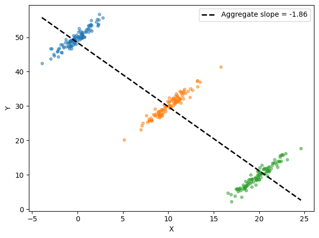

# 인과추론 모의실험

## 개요

이 페이지에서는 상관을 인과와 다르게 만드는 두 가지 고전적 함정, 즉 교란변수와 Simpson의 역설을 보인다. 모의실험을 통해 숨은 공통원인이 두 변수 사이에 오도하는 연관을 만드는 과정과, 하위집단을 합칠 때 상관의 방향이 뒤집히는 과정을 살펴본다.

---

## 1. 교란변수

**교란변수** $Z$는 $X$와 $Y$ 모두에 영향을 주어, $X$가 $Y$에 직접 효과가 없어도 둘 사이에 허위 연관을 만든다. 이 상황의 방향성 비순환 그래프(DAG)는

$$
X \leftarrow Z \rightarrow Y
$$

이다.

### 모의실험

$Z$가 참 공통원인인 자료를 생성한다:

<div class="exbox" markdown>

**보기 1.** <span class="diff easy" title="쉬움"></span> 교란이 만들어 내는 상관의 크기를 미리 알 수 있는가. $Z \sim \mathcal N(0,1)$, $X = 0.6Z + 0.5\varepsilon_X$, $Y = 0.8Z + 0.5\varepsilon_Y$ 이고 두 잡음은 서로, 그리고 $Z$ 와 독립이다.

**(1)** 자료를 보기 전에 $\rho_{XY}$ 를 닫힌 꼴로 구하시오. 그 값이 $\rho_{XZ}\rho_{YZ}$ 와 같음을 보이시오.

**(2)** $(X, Y)$ 자료만 가지고 "$Z$ 가 둘을 함께 끈다"와 "$X$ 가 $Y$ 를 직접 일으킨다"를 구별할 수 있는가. 같은 $(X,Y)$ 분포를 내는 두 번째 모형을 **구체적으로** 적으시오.

</div>

??? success "풀이"

    **(1) 공분산이 $Z$ 를 거쳐서만 흐른다.** 잡음이 서로 독립이므로

    $$
    \operatorname{Cov}(X, Y) = \operatorname{Cov}(0.6Z,\; 0.8Z) = 0.6 \times 0.8 = 0.48
    $$

    이고

    $$
    \operatorname{Var}(X) = 0.6^2 + 0.5^2 = 0.61,
    \qquad
    \operatorname{Var}(Y) = 0.8^2 + 0.5^2 = 0.89
    $$

    이므로

    $$
    \rho_{XY} = \frac{0.48}{\sqrt{0.61 \times 0.89}} = 0.651450
    $$

    이다. 한편

    $$
    \rho_{XZ} = \frac{0.6}{\sqrt{0.61}} = 0.768221,
    \qquad
    \rho_{YZ} = \frac{0.8}{\sqrt{0.89}} = 0.847998
    $$

    이고 두 분모를 곱하면 $\sqrt{0.61 \times 0.89}$, 두 분자를 곱하면 $0.48$ 이므로

    $$
    \rho_{XZ}\,\rho_{YZ} = \frac{0.6 \times 0.8}{\sqrt{0.61 \times 0.89}} = \rho_{XY}
    $$

    이다. **곱이 정확히 같아지는 것이 "모든 연관이 $Z$ 를 거쳐서만 흐른다"의 상관 판**이고, 보기 2에서 편상관이 $0$ 이 되는 까닭이 바로 이것이다.

    **(2) 구별할 수 없다.** $(X, Y)$ 는 이변량 정규이고 그 분포는 두 분산과 공분산 세 수로 완전히 정해진다. 그러므로 $Z$ 를 아예 쓰지 않고도 같은 세 수를 내는 모형을 쓸 수 있다.

    $$
    X \sim \mathcal N(0,\; 0.61),
    \qquad
    Y = 0.786885\,X + \eta,
    \qquad
    \eta \sim \mathcal N(0,\; 0.512295)
    $$

    여기서 $0.786885 = \operatorname{Cov}/\operatorname{Var}(X) = 0.48/0.61$ 이고 $0.512295 = 0.89 - 0.786885 \times 0.48$ 이다. 이 모형에서도 $\operatorname{Var}(X) = 0.61$, $\operatorname{Var}(Y) = 0.89$, $\operatorname{Cov} = 0.48$ 이라 **$(X,Y)$ 의 결합분포가 완전히 같다.**

    곧 한쪽은 "$X$ 가 $Y$ 를 전혀 일으키지 않는" 모형이고 다른 쪽은 "$X$ 가 $Y$ 를 $0.787$ 의 세기로 직접 일으키는" 모형인데, **$X$ 와 $Y$ 만 재어서는 둘을 가를 방법이 원리적으로 없다.** 가르려면 $Z$ 를 재거나($\to$ 보기 2), 실험을 하거나, 자료 바깥의 지식을 끌어와야 한다.

    ```python
    import numpy as np
    from scipy import stats

    np.random.seed(21)
    n = 300

    # Z 가 X 와 Y 를 함께 움직인다. X 와 Y 사이에는 직접 연결이 전혀 없다.
    # 그런데도 둘은 상관을 보인다 — 교란변수가 만드는 가짜 상관이다.
    Z = np.random.randn(n)
    X = 0.6 * Z + np.random.randn(n) * 0.5
    Y = 0.8 * Z + np.random.randn(n) * 0.5

    # 모집단 값을 닫힌 꼴로 적는다.
    var_x, var_y, cov_xy = 0.6**2 + 0.5**2, 0.8**2 + 0.5**2, 0.6 * 0.8
    rho_xy = cov_xy / np.sqrt(var_x * var_y)
    rho_xz, rho_yz = 0.6 / np.sqrt(var_x), 0.8 / np.sqrt(var_y)
    print(f"Var(X) = {var_x:.4f},  Var(Y) = {var_y:.4f},  Cov(X,Y) = {cov_xy:.4f}")
    print(f"rho_XY = {rho_xy:.6f}")
    print(f"rho_XZ * rho_YZ = {rho_xz:.6f} * {rho_yz:.6f} = {rho_xz * rho_yz:.6f}")
    print(f"둘이 같은가: {abs(rho_xy - rho_xz * rho_yz) < 1e-15}")
    print(f"\n표본 r(X,Y) = {stats.pearsonr(X, Y)[0]:.4f}   "
          f"SE = {(1 - rho_xy**2) / np.sqrt(n):.4f}   "
          f"z = {(stats.pearsonr(X, Y)[0] - rho_xy) / ((1 - rho_xy**2) / np.sqrt(n)):+.3f}")

    # Z 가 없는 모형으로도 같은 (X, Y) 를 만들 수 있다.
    beta = cov_xy / var_x
    resid_var = var_y - beta * cov_xy
    print(f"\nZ 없이 X -> Y 직접효과만으로 같은 분포를 만드는 모형:")
    print(f"  X ~ N(0, {var_x:.4f}),  Y = {beta:.6f} X + N(0, {resid_var:.6f})")
    X2 = np.random.normal(0, np.sqrt(var_x), 200_000)
    Y2 = beta * X2 + np.random.normal(0, np.sqrt(resid_var), 200_000)
    print(f"  그 모형의 상관 = {np.corrcoef(X2, Y2)[0, 1]:.4f}   (교란 모형 {rho_xy:.4f})")
    ```

    출력:

    ```
    Var(X) = 0.6100,  Var(Y) = 0.8900,  Cov(X,Y) = 0.4800
    rho_XY = 0.651450
    rho_XZ * rho_YZ = 0.768221 * 0.847998 = 0.651450
    둘이 같은가: True

    표본 r(X,Y) = 0.6512   SE = 0.0332   z = -0.007

    Z 없이 X -> Y 직접효과만으로 같은 분포를 만드는 모형:
      X ~ N(0, 0.6100),  Y = 0.786885 X + N(0, 0.512295)
      그 모형의 상관 = 0.6516   (교란 모형 0.6515)
    ```

    닫힌 꼴 $0.651450$ 과 곱 $\rho_{XZ}\rho_{YZ}$ 가 기계 정밀도까지 같고, 표본 $0.6512$ 가 그 값에서 $0.007$ 표준오차 떨어져 있다. $Z$ 없는 모형이 내는 상관 $0.6516$ 도 같은 값이다.

    여기서 $Y$ 는 $X$ 가 아니라 $Z$ 에만 의존하지만, 둘 다 $Z$ 에 이끌리므로 $X$ 와 $Y$ 는 상관된 것처럼 보인다.

### 부분상관

교란 효과를 제거하기 위해 $Z$가 주어졌을 때 $X$와 $Y$의 **부분상관**을 계산한다:

$$
r_{XY \cdot Z} = \frac{r_{XY} - r_{XZ}\, r_{YZ}}{\sqrt{(1 - r_{XZ}^2)(1 - r_{YZ}^2)}}
$$

<div class="exbox" markdown>

**보기 2.** <span class="diff easy" title="쉬움"></span> 통제가 상관을 지울 때와 만들 때. 보기 1의 자료에서 $Z$ 를 통제하면 $r$ 이 $0.651$ 에서 $0.052$ 로 떨어진다.

**(1)** 모집단 편상관의 값은 얼마인가. 표본값 $0.052$ 가 그것과 맞는지 판정하시오.

**(2)** **통제가 늘 상관을 줄이는가.** $Z$ 가 교란변수가 아니라 **충돌부**, 곧 $Z = X + Y + \varepsilon$ 이라면 어떻게 되는가. 그때의 편상관을 닫힌 꼴로 구하시오.

</div>

??? success "풀이"

    **(1) 모집단 편상관은 정확히 $0$ 이다.** 보기 1에서 $\rho_{XY} = \rho_{XZ}\rho_{YZ}$ 임을 보았으므로 편상관 공식의 분자가

    $$
    \rho_{XY} - \rho_{XZ}\rho_{YZ} = 0
    $$

    이 되어 $\rho_{XY\cdot Z} = 0$ 이다. 이것은 "$Z$ 를 알고 나면 $X$ 가 $Y$ 에 대해 더 알려 줄 것이 없다", 곧 $X \perp Y \mid Z$ 를 그대로 옮긴 것이다.

    표본값은 $0.0518$ 이다. 편상관의 표준오차는 통제변수 하나를 썼으므로

    $$
    \operatorname{SE} \approx \frac{1}{\sqrt{n-3}} = \frac{1}{\sqrt{297}} = 0.0580
    $$

    이고 $z = 0.0518/0.0580 = +0.893$ 이다. **$0$ 과 어긋나지 않는다.** $0.052$ 를 "작지만 남아 있는 직접효과"로 읽으면 안 된다. 그 크기는 잡음과 구별되지 않는다.

    **(2) 충돌부에서는 반대로 없던 상관이 생긴다.** $X, Y, \varepsilon$ 이 모두 독립인 $\mathcal N(0,1)$ 이고 $Z = X + Y + \varepsilon$ 이라 하자. 그러면 $\operatorname{Var}(Z) = 3$ 이고

    $$
    \rho_{XZ} = \rho_{YZ} = \frac{1}{\sqrt3},
    \qquad
    \rho_{XY} = 0
    $$

    이다. 편상관 공식에 넣으면

    $$
    \rho_{XY\cdot Z} = \frac{0 - \tfrac13}{\sqrt{\left(1-\tfrac13\right)\left(1-\tfrac13\right)}}
    = \frac{-\tfrac13}{\tfrac23} = -\frac12
    $$

    **원래 $0$ 이던 상관이 $-0.5$ 가 된다.** 모의실험도 $-0.4996$ 을 준다. 까닭은 간단하다. $Z$ 를 한 값에 묶어 놓으면 그 층 안에서 $X$ 가 큰 관측값은 $Y$ 가 작을 수밖에 없기 때문이다.

    | 구조 | 통제 전 | 통제 후 |
    |---|---|---|
    | 교란 $X \leftarrow Z \rightarrow Y$ | $0.6515$ | $\mathbf{0}$ |
    | 충돌부 $X \rightarrow Z \leftarrow Y$ | $0$ | $\mathbf{-0.5}$ |

    **그러므로 "변수를 많이 넣을수록 안전하다"는 말은 틀렸다.** 어느 변수를 통제해야 하고 어느 변수를 그대로 두어야 하는지는 상관행렬이 아니라 **인과 구조**가 정하며, 그 판정 규칙은 [방향성 비순환 그래프](dags.md) 절에서 다룬다.

    ```python
    # 부분상관은 Z 로 설명되는 몫을 X 와 Y 에서 걷어 낸 뒤의 상관이다.
    # 위 자료에서는 걷어 내고 나면 거의 0 만 남아야 한다.
    r_xy, _ = stats.pearsonr(X, Y)
    r_xz, _ = stats.pearsonr(X, Z)
    r_yz, _ = stats.pearsonr(Y, Z)

    r_partial = (r_xy - r_xz * r_yz) / np.sqrt((1 - r_xz**2) * (1 - r_yz**2))

    print(f"Pearson r(X, Y)       = {r_xy:.3f}")
    print(f"Partial r(X, Y | Z)   = {r_partial:.3f}")

    # (1) 모집단 편상관은 정확히 0 이다.
    var_x, var_y = 0.6**2 + 0.5**2, 0.8**2 + 0.5**2
    rho_xy = (0.6 * 0.8) / np.sqrt(var_x * var_y)
    rho_xz, rho_yz = 0.6 / np.sqrt(var_x), 0.8 / np.sqrt(var_y)
    part_pop = (rho_xy - rho_xz * rho_yz) / np.sqrt((1 - rho_xz**2) * (1 - rho_yz**2))
    se = 1 / np.sqrt(len(X) - 3)
    print(f"\n모집단 편상관 = {part_pop:.2e}   (정확히 0)")
    print(f"표본 편상관   = {r_partial:.4f}   SE = 1/sqrt(n-3) = {se:.4f}   "
          f"z = {r_partial / se:+.3f}")

    # (2) 충돌부에서는 방향이 반대다. Z = X + Y + e 이면 X 와 Y 는 원래 독립인데
    #     Z 를 통제하는 순간 음의 상관이 생긴다.
    rho_xz_c = 1 / np.sqrt(3)          # Corr(X, X+Y+e)
    part_collider = (0 - rho_xz_c**2) / (1 - rho_xz_c**2)
    print(f"\n충돌부 Z = X + Y + e  (X, Y, e ~ N(0,1) 독립)")
    print(f"  rho_XZ = rho_YZ = 1/sqrt(3) = {rho_xz_c:.6f},  rho_XY = 0")
    print(f"  편상관 이론값 = (0 - 1/3)/(1 - 1/3) = {part_collider:.6f}")
    rng = np.random.default_rng(7)
    m = 400_000
    Xc = rng.standard_normal(m)
    Yc = rng.standard_normal(m)
    Zc = Xc + Yc + rng.standard_normal(m)
    a, b, c = (np.corrcoef(Xc, Yc)[0, 1], np.corrcoef(Xc, Zc)[0, 1],
               np.corrcoef(Yc, Zc)[0, 1])
    print(f"  모의: r_XY = {a:+.4f}  ->  편상관 = "
          f"{(a - b * c) / np.sqrt((1 - b**2) * (1 - c**2)):+.4f}")
    ```

    출력:

    ```
    Pearson r(X, Y)       = 0.651
    Partial r(X, Y | Z)   = 0.052

    모집단 편상관 = 0.00e+00   (정확히 0)
    표본 편상관   = 0.0518   SE = 1/sqrt(n-3) = 0.0580   z = +0.893

    충돌부 Z = X + Y + e  (X, Y, e ~ N(0,1) 독립)
      rho_XZ = rho_YZ = 1/sqrt(3) = 0.577350,  rho_XY = 0
      편상관 이론값 = (0 - 1/3)/(1 - 1/3) = -0.500000
      모의: r_XY = +0.0018  ->  편상관 = -0.4996
    ```

    충돌부의 닫힌 꼴 $-0.5$ 와 모의값 $-0.4996$ 이 맞는다.

    $Z$ 를 통제하면 $X$ 와 $Y$ 의 연관이 거의 사라져, 관측된 상관이 전적으로 교란요인 때문이었음을 확인해 준다. **다만 그렇게 되는 것은 $Z$ 가 교란변수일 때뿐**이라는 단서가 (2)의 몫이다.

---

## 2. Simpson의 역설

하위집단마다 보이는 경향이 합치면 뒤집히는 일이 있다. 연속형 자료에서는
집단마다 **$x$ 의 범위**가 다른 것이 그 뒤집힘을 만든다 — 범주형에서 표본
크기가 가중치로 들어오던 자리를 $x$ 의 퍼짐이 맡는다.

이 역설은 10.2절 [Simpson의 역설](../ecological_correlation/simpsons_paradox.md)이
전담한다. 그 쪽 절 $6$ 이 연속형을 네 보기로 끝까지 따진다 — 기울기가 같은데
상관이 갈리는 자리, 합친 상관의 이론값, 합친 기울기의 출처, 그리고 그림이
**가리는** 것까지다.
## 3. 해석

이 모의실험들은 통계 실무에 대한 두 가지 근본적인 교훈을 보여준다:

1. **교란.** 숨은 변수가 $X$와 $Y$를 모두 이끌면 주변상관 $r_{XY}$가 오도한다. 부분상관 $r_{XY \cdot Z}$는 이 교란을 제거하며, 우리 모의실험에서 0에 가깝게 떨어져 직접적인 $X \to Y$ 효과가 없음을 올바르게 반영한다.

2. **Simpson의 역설.** 이질적인 하위집단을 합치면 연관의 방향이 뒤집힐 수 있다. 양의 집계 상관은 집단마다 기준 수준이 다른 데서 생긴 인공물이지 집단 내 관계의 성질이 아니다. 그래서 관찰자료에서 인과적 결론을 내리기 전에 층화 분석과 교란요인에 대한 신중한 고려가 필수적이다.

---

<div class="aibox" markdown>

**AI로 보는 통계학 1.** 합성 자료 시험은 구현을 보지 가정을 보지 않는다

이 쪽이 하는 일 — **참값을 알고 있는 자료를 만들어 추정값이 그것을 되찾는지 보는 것** —
은 오늘 인과 분석 코드의 사실상 유일한 단위 시험이다. 실제 자료에는 정답이 없으니
합성 자료 말고는 맞춰 볼 곳이 없다. 그래서 인과 추론 라이브러리들이 모두 이런 시험을
싣고 있다.

그런데 그 시험이 무엇을 보증하는지는 분명히 해 두어야 한다. 같은 코드에 **자료생성과정만**
바꾸어 넣어 보았다. 참 효과는 둘 다 $2.0$ 이고, 통제하는 변수도 똑같이 $Z$ 다.

```python
import numpy as np

rng = np.random.default_rng(73)
N, REP, TRUE = 4000, 400, 2.0

def coef_T(y, T, cols):
    """Z 를 통제한 채 T 의 계수를 구하는 최소제곱 — 구현은 어느 자료에나 같다."""
    X = np.column_stack([np.ones_like(T), T] + cols)
    return np.linalg.lstsq(X, y, rcond=None)[0][1]

def run(kind, fix):
    out = np.empty(REP)
    for i in range(REP):
        Z = rng.normal(size=N)
        if kind == "선형":
            T = 0.8 * Z + rng.normal(size=N)
            base = 1.5 * Z
        else:                                   # Z 가 T 와 Y 에 곡선으로 들어간다
            T = 0.5 * Z + 0.4 * Z ** 2 + rng.normal(size=N)
            base = 1.5 * Z ** 2
        y = TRUE * T + base + rng.normal(size=N)
        out[i] = coef_T(y, T, [Z, Z ** 2] if fix else [Z])
    return out.mean(), out.std()

print(f"참 효과 {TRUE},  표본 {N:,},  되풀이 {REP} 번\n")
print("        자료생성과정   통제 변수   추정값 평균   표준편차    치우침")
for kind in ("선형", "비선형"):
    for fix in (False, True):
        m, s = run(kind, fix)
        print(f"{kind + ' 교란':>16}{'Z, Z²' if fix else 'Z':>11}"
              f"{m:>14.4f}{s:>11.4f}{m - TRUE:>10.4f}")
```

출력:

```
참 효과 2.0,  표본 4,000,  되풀이 400 번

        자료생성과정   통제 변수   추정값 평균   표준편차    치우침
           선형 교란          Z        1.9991     0.0156   -0.0009
           선형 교란      Z, Z²        2.0018     0.0161    0.0018
          비선형 교란          Z        2.9085     0.0499    0.9085
          비선형 교란      Z, Z²        2.0012     0.0157    0.0012
```

**첫 줄은 시험을 통과한다.** $1.9991$ 로 참값 $2.0$ 을 소수 셋째 자리까지 맞히고, 표준편차가
$0.0156$ 이니 되풀이 $400$ 번의 몬테카를로 오차 안이다. 구현에 버그가 없다는 뜻이고,
그것이 이 시험이 보증할 수 있는 전부다.

**셋째 줄은 같은 코드다.** 바뀐 것은 $Z$ 가 $T$ 와 $Y$ 에 **곡선으로** 들어간다는 것뿐인데
추정값이 $2.9085$ — 참값의 $1.45$ 배다. 치우침 $0.91$ 이 표준편차 $0.05$ 의 열여덟 배이니
우연이 아니다. **「$Z$ 를 통제했다」는 말이 $Z$ 를 선형으로 넣었다는 뜻이었고, 남은
$Z^2$ 가 교란을 그대로 실어 나른다.**

**고치는 길은 코드가 아니라 모형이다.** 넷째 줄에서 $Z^2$ 를 함께 넣자 $2.0012$ 로 돌아온다.
같은 추정 함수, 같은 자료, 다른 **가정**이다.

그러니 합성 자료 시험이 초록불을 켜도 말할 수 있는 것은 **「내가 가정한 세계에서는 코드가
맞다」**까지다. 실제 자료가 첫 줄의 세계인지 셋째 줄의 세계인지는 그 시험이 답하지 않는다.
그것을 좁히는 일이 10.4절 [인과관계의 기준](causal_criteria.md)과
[방향성 비순환 그래프](dags.md)가 하는 일이고, 모의실험은 **그 믿음을 검사하는 도구이지
세우는 도구가 아니다.**

</div>

## 연습문제

<div class="drillbox" markdown>

**연습문제 1.** <span class="diff med" title="중간"></span>
$Z \sim \mathcal{N}(0, 1)$, $X = 0.9Z + \varepsilon_X$, $Y = 0.3Z + \varepsilon_Y$이고 $\varepsilon_X, \varepsilon_Y \sim \mathcal{N}(0, 0.3^2)$인 교란 상황을 $n = 500$으로 모의실험하라. $r_{XY}$와 부분상관 $r_{XY \cdot Z}$를 모두 계산하라. 잡음 분산을 줄이면 둘의 차이가 어떻게 달라지는가?

</div>

??? success "풀이"

    ```python
    import numpy as np
    from scipy import stats

    np.random.seed(10)
    n = 500
    Z = np.random.randn(n)
    X = 0.9 * Z + np.random.normal(0, 0.3, n)
    Y = 0.3 * Z + np.random.normal(0, 0.3, n)

    r_xy, _ = stats.pearsonr(X, Y)
    r_xz, _ = stats.pearsonr(X, Z)
    r_yz, _ = stats.pearsonr(Y, Z)
    r_partial = (r_xy - r_xz * r_yz) / np.sqrt((1 - r_xz**2) * (1 - r_yz**2))

    print(f"r(X, Y)     = {r_xy:.4f}")
    print(f"r(X, Y | Z) = {r_partial:.4f}")
    ```

    출력:

    ```
    r(X, Y)     = 0.6715
    r(X, Y | Z) = -0.0115
    ```

    $r(X,Y) = 0.67$이 $Z$를 통제하자 $-0.01$로 사라진다. $X$와 $Y$가 공통 원인 $Z$를 공유할 때 나타나는 전형적인 모습이다.

    $X$와 $Y$가 공통원인 $Z$를 공유하므로 주변상관 $r_{XY}$는 중간 정도의 양수가 된다. 부분상관 $r_{XY \cdot Z}$는 0에 가깝다. 잡음 분산을 줄이면 $r_{XZ}$와 $r_{YZ}$가 이론값에 더 가까워져 교란 효과가 더 뚜렷해지고($r_{XY}$가 커지고) 부분상관은 여전히 0 근처에 남는다. $\square$

<div class="drillbox" markdown>

**연습문제 2.** <span class="diff med" title="중간"></span>
하위집단이 (둘이 아니라) 셋인 Simpson 역설 보기를 구성하라. 각 하위집단 안에서 $X$에 대한 $Y$의 기울기가 $+2$이지만 집계 기울기는 음수여야 한다. 결과를 그려라.

</div>

??? success "풀이"

    ```python
    import numpy as np
    import matplotlib.pyplot as plt

    np.random.seed(42)
    groups = [(100, 0, 50), (100, 10, 30), (100, 20, 10)]
    # (크기, x 중심, y 절편). 집단 안에서는 기울기가 양이다

    fig, ax = plt.subplots()
    all_x, all_y = [], []

    for n, xc, yb in groups:
        x = np.random.normal(xc, 1.5, n)
        y = yb + 2 * (x - xc) + np.random.normal(0, 1, n)
        ax.scatter(x, y, alpha=0.5, s=15)
        all_x.extend(x)
        all_y.extend(y)

    all_x, all_y = np.array(all_x), np.array(all_y)
    m, b = np.polyfit(all_x, all_y, 1)
    xs = np.linspace(all_x.min(), all_x.max(), 100)
    ax.plot(xs, m * xs + b, 'k--', lw=2, label=f'Aggregate slope = {m:.2f}')
    ax.legend()
    ax.set_xlabel('X')
    ax.set_ylabel('Y')
    plt.tight_layout()
    plt.show()
    ```

    

    집단별로 보면 기울기가 음인데 전체로 보면 양이다. 두 구름이 대각선으로 배치되어 있어 생기는 현상이다.

    각 집단의 집단 내 기울기는 $+2$로 양수이지만, 집단의 $X$ 평균이 커질수록 집단 절편이 작아진다. 자료를 합치면 집단 간 추세가 지배하여 집계 기울기가 음수가 된다. $\square$

<div class="drillbox" markdown>

**연습문제 3.** <span class="diff med" title="중간"></span>
$X$를 $Z$에, $Y$를 $Z$에 회귀한 잔차에서 출발하여 부분상관 $r_{XY \cdot Z}$의 공식을 유도하라.

</div>

??? success "풀이"

    $e_X = X - \hat{\beta}_{XZ} Z$를 $X$를 $Z$에 회귀한 잔차, $e_Y = Y - \hat{\beta}_{YZ} Z$를 그에 대응하는 잔차라 하자. 정의에 의해 부분상관은

    $$
    r_{XY \cdot Z} = r(e_X, e_Y)
    $$

    이다. OLS의 사영 성질에 의해 $e_X$는 $X$ 중 $Z$에 직교하는 성분이고 $e_Y$는 $Y$ 중 $Z$에 직교하는 성분이다. $\hat{\beta}_{XZ} = r_{XZ} \cdot s_X / s_Z$로 쓰고 잔차에 Pearson 공식을 전개해 정리하면

    $$
    r_{XY \cdot Z} = \frac{r_{XY} - r_{XZ}\, r_{YZ}}{\sqrt{(1 - r_{XZ}^2)(1 - r_{YZ}^2)}}
    $$

    를 얻는다. 이것이 표준 부분상관 공식이다. 분자는 각 변수와 $Z$의 선형 연관을 제거하고, 분모는 $[-1, 1]$ 범위를 유지하도록 다시 축척한다. $\square$

<div class="drillbox" markdown>

**연습문제 4.** <span class="diff med" title="중간"></span>
Simpson 역설 모의실험에서 두 하위집단의 절편을 같게 하고 기울기만 다르게(하나는 양, 하나는 음) 하면 집계 상관은 어떻게 되는가? 모의실험하고 설명하라.

</div>

??? success "풀이"

    ```python
    import numpy as np
    from scipy import stats

    np.random.seed(42)
    n = 200
    x_a = np.random.uniform(0, 20, n)
    y_a = 10 + 0.5 * x_a + np.random.normal(0, 2, n)

    x_b = np.random.uniform(0, 20, n)
    y_b = 10 - 0.5 * x_b + np.random.normal(0, 2, n)

    x_all = np.concatenate([x_a, x_b])
    y_all = np.concatenate([y_a, y_b])

    r_a, _ = stats.pearsonr(x_a, y_a)
    r_b, _ = stats.pearsonr(x_b, y_b)
    r_all, _ = stats.pearsonr(x_all, y_all)

    print(f"Group A r = {r_a:+.3f}")
    print(f"Group B r = {r_b:+.3f}")
    print(f"Aggregate r = {r_all:+.3f}")
    ```

    출력:

    ```
    Group A r = +0.832
    Group B r = -0.825
    Aggregate r = -0.023
    ```

    집단 A에서 $r = +0.83$, 집단 B에서 $-0.83$, 합치면 $-0.02$다. 두 집단의 상관이 부호까지 반대라 합칠 때 서로를 지워 버린다.

    앞의 보기(합치면 상관이 생기는 경우)와 방향이 반대라는 점이 중요하다. 집단을 합치는 것은 상관을 만들 수도, 없앨 수도, 뒤집을 수도 있다.

    두 하위집단의 절편과 $X$ 범위가 같고 기울기의 부호만 반대이면 집계 상관은 거의 0이 된다. 양의 관계와 음의 관계가 서로 상쇄되기 때문이다. 엄밀히 말하면 (부호가 뒤집히지 않으므로) Simpson의 역설은 아니지만, 이질적인 집단을 섞으면 실제 집단 내 효과가 완전히 가려질 수 있음을 보여준다. $\square$

<div class="drillbox" markdown>

**연습문제 5.** <span class="diff hard" title="어려움"></span>
$X \perp Y \mid Z$($Z$가 주어졌을 때의 조건부 독립)이고 세 변수가 결합적으로 정규분포를 따르면 부분상관 $r_{XY \cdot Z} = 0$임을 증명하라.

</div>

??? success "풀이"

    결합정규 확률변수에서 $(X, Y) \mid Z$의 조건부 분포도 이변량 정규이다. 조건부 공분산은

    $$
    \text{Cov}(X, Y \mid Z) = \sigma_{XY} - \frac{\sigma_{XZ}\, \sigma_{YZ}}{\sigma_{ZZ}}
    $$

    이다. $X \perp Y \mid Z$이면 $\text{Cov}(X, Y \mid Z) = 0$이므로

    $$
    \sigma_{XY} = \frac{\sigma_{XZ}\, \sigma_{YZ}}{\sigma_{ZZ}}
    $$

    이다. $\sigma_X \sigma_Y$로 나누어 상관으로 바꾸면

    $$
    \rho_{XY} = \rho_{XZ}\, \rho_{YZ}
    $$

    이다. 이를 부분상관 공식에 대입하면

    $$
    \rho_{XY \cdot Z} = \frac{\rho_{XY} - \rho_{XZ}\, \rho_{YZ}}{\sqrt{(1 - \rho_{XZ}^2)(1 - \rho_{YZ}^2)}} = \frac{\rho_{XZ}\rho_{YZ} - \rho_{XZ}\rho_{YZ}}{\sqrt{(1 - \rho_{XZ}^2)(1 - \rho_{YZ}^2)}} = 0
    $$

    이 된다. 결합정규 변수에서는 역도 성립한다. $\rho_{XY \cdot Z} = 0$이면 $X \perp Y \mid Z$이다. 이는 다변량 정규분포의 특별한 성질이다. $\square$

<div class="drillbox" markdown>

**연습문제 6.** <span class="diff hard" title="어려움"></span>
보기 2의 (2)에서 충돌부 $Z = X + Y + \varepsilon$ 의 잡음을 $\varepsilon \sim \mathcal N(0,1)$ 로 고정해 두고 편상관 $-1/2$ 를 얻었다. 이제 $X, Y \sim \mathcal N(0,1)$ 은 그대로 독립이고 $\varepsilon \sim \mathcal N(0, \sigma^2)$ 이라 하자.

**(1)** $\rho_{XY\cdot Z}$ 를 $\sigma^2$ 의 함수로 구하시오. $\sigma = 1$ 에서 $-1/2$ 가 되는지 확인하고, $\sigma \to 0$ 과 $\sigma \to \infty$ 의 극한을 구하시오.

**(2)** 보기 1의 교란이 만든 가짜 상관은 $\rho_{XY} = 0.651450$ 이었다. 충돌부를 통제해서 생기는 가짜 상관의 크기가 이것과 **똑같아지는** $\sigma$ 를 구하시오.

</div>

??? success "풀이"

    **(1) 잡음이 작을수록 충돌부 편향이 커진다.** $\operatorname{Var}(Z) = 1 + 1 + \sigma^2 = 2 + \sigma^2$ 이고 $\operatorname{Cov}(X,Z) = \operatorname{Cov}(Y,Z) = 1$ 이므로

    $$
    \rho_{XZ} = \rho_{YZ} = \frac{1}{\sqrt{2+\sigma^2}},
    \qquad
    \rho_{XY} = 0
    $$

    이다. $t = \rho_{XZ}^2 = 1/(2+\sigma^2)$ 로 두면 두 상관이 같으므로 편상관의 분모가 $1 - t$ 로 간단해져

    $$
    \rho_{XY\cdot Z} = \frac{0 - t}{\sqrt{(1-t)(1-t)}} = -\frac{t}{1-t}
    = -\frac{1/(2+\sigma^2)}{(1+\sigma^2)/(2+\sigma^2)} = -\frac{1}{1+\sigma^2}
    $$

    을 얻는다. $\sigma = 1$ 에서 $-1/2$ 로 본문 값과 맞고, 극한은

    $$
    \lim_{\sigma \to 0} \rho_{XY\cdot Z} = -1,
    \qquad
    \lim_{\sigma \to \infty} \rho_{XY\cdot Z} = 0
    $$

    이다. $\sigma \to 0$ 이면 $Z = X + Y$ 가 되어 $Z$ 를 한 값에 묶는 순간 $Y = Z - X$ 가 **완전히 결정된다.** 그래서 편상관이 $-1$ 까지 간다. 거꾸로 잡음이 아주 크면 $Z$ 가 $X, Y$ 에 대해 알려 주는 것이 없어 통제해도 아무 일이 일어나지 않는다.

    **(2) 두 가짜 상관의 크기를 맞춘다.** $1/(1+\sigma^2) = 0.651450$ 을 풀면

    $$
    1 + \sigma^2 = \frac{1}{0.651450} = 1.535036,
    \qquad
    \sigma^2 = 0.535036,
    \qquad
    \sigma = 0.731462
    $$

    이다. 곧 잡음 표준편차가 $0.73$ 쯤인 충돌부를 통제하면, 보기 1의 교란을 통제하지 **않고** 내버려 둔 것과 똑같은 크기 $0.6515$ 의 가짜 상관을 얻는다. 부호만 반대다.

    **통제는 중립적인 조작이 아니다.** 어느 변수를 넣느냐에 따라 같은 크기의 거짓을 지우기도 하고 새로 만들기도 하며, 잡음이 적은 충돌부일수록 그 해가 크다. $\square$

<div class="drillbox" markdown>

**연습문제 7.** <span class="diff hard" title="어려움"></span>
10.2절 [Simpson의 역설](../ecological_correlation/simpsons_paradox.md) 보기 3 에서 집단 B의 $y$ 기준선을 $45$ 대신 $30 + d$ 로 두자(본문은 $d = 15$). 나머지는 그대로다. 곧 집단 안 기울기는 $-0.4$, $x$ 범위는 A가 $[10,30]$, B가 $[25,50]$, 잡음 표준편차는 $2$, 집단 크기는 반반이다.

**(1)** 합친 자료의 $\operatorname{Cov}(x,y)$, $\operatorname{Var}(x)$, $\operatorname{Var}(y)$ 를 $d$ 의 함수로 적고 합친 상관 $\rho(d)$ 를 쓰시오. $d = 15$ 에서 본문의 $0.316703$ 을 되찾는지 확인하시오.

**(2)** 두 집단을 아주 멀리 떼어 놓으면($d \to \infty$) 합친 상관이 $1$ 에 가까워지는가. $\rho(d)$ 가 $d$ 에 대해 단조증가임을 보이고 상한을 구하시오. 그 상한이 무엇을 재는 수인지 말하시오.

</div>

??? success "풀이"

    **(1) $d$ 는 세 양 가운데 둘에만 들어간다.** 집단별 $x$ 평균은 $20$, $37.5$ 로 $d$ 와 무관하고, $y$ 평균은 $22$ 와 $-0.4 \times 37.5 + 30 + d = 15 + d$ 이므로 그 차이는 $u \coloneqq d - 7$ 이다. 10.2절 [Simpson의 역설](../ecological_correlation/simpsons_paradox.md) 보기 3 의 분해를 그대로 쓰면 집단 안 몫은 $d$ 에 전혀 의존하지 않고

    $$
    V_{\text{안}} = \frac{33.3333 + 52.0833}{2} = 42.7083,
    \qquad
    V_{\text{사이}} = \left(\frac{17.5}{2}\right)^2 = 76.5625
    $$

    이다. 집단 사이 공분산은 두 집단이 반반이므로 $\left(\tfrac{17.5}{2}\right)\left(\tfrac{u}{2}\right) = 4.375u$ 다. 따라서

    $$
    \operatorname{Cov}(x,y) = 4.375\,u - 0.4 \times 42.7083 = 4.375\,u - 17.0833
    $$

    $$
    \operatorname{Var}(x) = 42.7083 + 76.5625 = 119.2708
    \quad (\text{$d$ 와 무관}),
    \qquad
    \operatorname{Var}(y) = 10.8333 + \frac{u^2}{4}
    $$

    이고

    $$
    \rho(d) = \frac{4.375\,u - 17.0833}{\sqrt{119.2708\left(10.8333 + u^2/4\right)}},
    \qquad u = d - 7
    $$

    이다. $d = 15$ 면 $u = 8$ 이므로 분자가 $35 - 17.0833 = 17.9167$, 분모가 $\sqrt{119.2708 \times 26.8333} = 56.5724$ 이고

    $$
    \rho(15) = \frac{17.9167}{56.5724} = 0.316703
    $$

    으로 본문 값과 같다.

    **(2) 상한은 $1$ 이 아니라 $0.8012$ 다.** $A = 4.375$, $B = 17.0833$, $C = 10.8333$, $K = 119.2708$ 로 쓰면 $\rho = (Au - B)/\sqrt{K(C + u^2/4)}$ 이고, 분모의 $-3/2$ 승을 묶어 내면 도함수의 부호는

    $$
    A\left(C + \frac{u^2}{4}\right) - (Au - B)\frac{u}{4}
    = AC + \frac{Au^2}{4} - \frac{Au^2}{4} + \frac{Bu}{4}
    = AC + \frac{Bu}{4}
    $$

    의 부호와 같다. 이것은 $u > -4AC/B = -11.0976$, 곧 $d > -4.0976$ 에서 늘 양수이므로 **$\rho$ 는 우리가 볼 모든 $d$ 에서 엄격히 증가한다.** 그런데 $u \to \infty$ 에서는

    $$
    \rho(d) \longrightarrow \frac{Au}{\sqrt{K}\,(u/2)} = \frac{2A}{\sqrt{K}}
    = \frac{8.75}{\sqrt{119.2708}} = \frac{8.75}{10.9211} = 0.801200
    $$

    에 머문다. 이 수의 정체는 분자 $8.75 = \sqrt{V_{\text{사이}}}$ 를 보면 드러난다.

    $$
    0.801200 = \sqrt{\frac{V_{\text{사이}}}{V_{\text{안}} + V_{\text{사이}}}}
    = \sqrt{\frac{76.5625}{119.2708}}
    = \lvert \operatorname{Corr}(x,\, \text{집단 꼬리표}) \rvert
    $$

    곧 **$x$ 와 집단 꼬리표의 상관**이다. $d$ 를 키우면 $y$ 의 흩어짐이 거의 전부 집단 사이 몫이 되어 $y$ 가 사실상 집단 꼬리표가 되고, 그러면 $x$ 와 $y$ 의 상관은 $x$ 와 꼬리표의 상관을 넘을 수 없다. 두 집단의 $x$ 분포가 겹쳐 있어 집단 안 몫이 집단 사이 몫의 $0.558$ 배나 남아 있는 한, 그 상관은 $0.8012$ 에서 막힌다.

    **합쳐서 생기는 가짜 상관의 크기에는 천장이 있고, 그 천장을 정하는 것은 기준선 차이가 아니라 집단과 $x$ 가 얼마나 엉켜 있는가다.** $\square$

<div class="drillbox" markdown>

**연습문제 8.** <span class="diff hard" title="어려움"></span>
보기 2는 "변수를 많이 넣을수록 안전하다"가 틀렸음을 **편상관**으로 보였다. 같은 이야기를 실무에서 실제로 쓰는 꼴, 곧 $Y$ 를 $X$ 와 $Z$ 에 **함께 회귀**해서 다시 보자. 두 모형 모두 $X$ 가 $Y$ 에 주는 참 직접효과는 $0$ 이다.

- 모형 A(보기 1의 교란): $\operatorname{Var}(X) = 0.61$, $\operatorname{Var}(Z) = 1$, $\operatorname{Cov}(X,Z) = 0.6$, $\operatorname{Cov}(Y,X) = 0.48$, $\operatorname{Cov}(Y,Z) = 0.8$.
- 모형 B(보기 2의 충돌부): $X, Y, \varepsilon \sim \mathcal N(0,1)$ 이 독립이고 $Z = X + Y + \varepsilon$.

**(1)** 두 모형에서 모집단 회귀계수 $(\beta_X, \beta_Z)$ 를 정규방정식으로 각각 구하시오.

**(2)** $n = 400{,}000$ 으로 모의실험해 (1)을 확인하고, 어느 쪽에서 "$X$ 는 $Y$ 에 직접 효과가 없다"는 참이 회복되는지 말하시오.

</div>

??? success "풀이"

    **(1) $2 \times 2$ 연립방정식 둘.** 중심화된 변수에서 $(\beta_X, \beta_Z)$ 는

    $$
    \begin{pmatrix} \operatorname{Var}(X) & \operatorname{Cov}(X,Z) \\ \operatorname{Cov}(X,Z) & \operatorname{Var}(Z) \end{pmatrix}
    \begin{pmatrix} \beta_X \\ \beta_Z \end{pmatrix}
    =
    \begin{pmatrix} \operatorname{Cov}(Y,X) \\ \operatorname{Cov}(Y,Z) \end{pmatrix}
    $$

    의 해다. 모형 A는 행렬식이 $0.61 \times 1 - 0.6^2 = 0.25$ 이므로

    $$
    \beta_X = \frac{0.48 \times 1 - 0.6 \times 0.8}{0.25} = \frac{0.48 - 0.48}{0.25} = 0,
    \qquad
    \beta_Z = \frac{0.61 \times 0.8 - 0.6 \times 0.48}{0.25} = \frac{0.2}{0.25} = 0.8
    $$

    이다. 모형 B는 $\operatorname{Var}(X) = 1$, $\operatorname{Var}(Z) = 3$, $\operatorname{Cov}(X,Z) = 1$, $\operatorname{Cov}(Y,X) = 0$, $\operatorname{Cov}(Y,Z) = 1$ 이라 행렬식이 $3 - 1 = 2$ 이고

    $$
    \beta_X = \frac{0 \times 3 - 1 \times 1}{2} = -\frac12,
    \qquad
    \beta_Z = \frac{1 \times 1 - 1 \times 0}{2} = \frac12
    $$

    이다.

    **(2) 같은 회귀, 반대의 판결.** 모형 A에서는 $\beta_X = 0$ 으로 참값을 정확히 되찾고, 생성식의 계수 $0.8$ 도 $\beta_Z$ 에서 그대로 나온다. 모형 B에서는 $X$ 가 $Y$ 를 전혀 건드리지 않는데도 $\beta_X = -0.5$ 라는 **없는 효과**가 나온다. 편상관과 회귀계수는

    $$
    \beta_X = r_{XY\cdot Z}\,\frac{s_Y\sqrt{1-r_{YZ}^2}}{s_X\sqrt{1-r_{XZ}^2}}
    $$

    로 늘 같은 부호이므로, 보기 2의 표를 회귀의 말로 옮긴 것이 바로 이 두 줄이다.

    ```python
    import numpy as np

    # (1) 교란 모형: Z 가 X 와 Y 를 함께 끈다. Y 에 대한 X 의 참 직접효과는 0 이다.
    S_conf = np.array([[0.61, 0.60],      # Var(X), Cov(X,Z)
                       [0.60, 1.00]])     # Cov(X,Z), Var(Z)
    c_conf = np.array([0.48, 0.80])       # Cov(Y,X), Cov(Y,Z)
    b_conf = np.linalg.solve(S_conf, c_conf).round(10) + 0.0

    # (2) 충돌부 모형: X, Y 는 독립이고 Z = X + Y + e 다. 참 직접효과도 0 이다.
    S_coll = np.array([[1.0, 1.0],        # Var(X), Cov(X,Z)
                       [1.0, 3.0]])       # Cov(X,Z), Var(Z)
    c_coll = np.array([0.0, 1.0])         # Cov(Y,X) = 0, Cov(Y,Z)
    b_coll = np.linalg.solve(S_coll, c_coll).round(10) + 0.0

    print(f"교란  X<-Z->Y : beta_X = {b_conf[0]:+.6f},  beta_Z = {b_conf[1]:+.6f}")
    print(f"충돌부 X->Z<-Y : beta_X = {b_coll[0]:+.6f},  beta_Z = {b_coll[1]:+.6f}")

    # 모의실험으로 확인한다.
    rng = np.random.default_rng(0)
    m = 400_000

    Zc = rng.standard_normal(m)
    Xc = 0.6 * Zc + 0.5 * rng.standard_normal(m)
    Yc = 0.8 * Zc + 0.5 * rng.standard_normal(m)
    A = np.column_stack([np.ones(m), Xc, Zc])
    hat_conf = np.linalg.lstsq(A, Yc, rcond=None)[0]

    Xk = rng.standard_normal(m)
    Yk = rng.standard_normal(m)
    Zk = Xk + Yk + rng.standard_normal(m)
    B = np.column_stack([np.ones(m), Xk, Zk])
    hat_coll = np.linalg.lstsq(B, Yk, rcond=None)[0]

    print(f"\n모의 교란  : beta_X = {hat_conf[1]:+.4f},  beta_Z = {hat_conf[2]:+.4f}")
    print(f"모의 충돌부: beta_X = {hat_coll[1]:+.4f},  beta_Z = {hat_coll[2]:+.4f}")
    print(f"\nZ 를 넣은 뒤 X 의 계수: 교란에서는 참값 0 을 맞히고, "
          f"충돌부에서는 {b_coll[0]:+.1f} 로 틀린다.")
    ```

    출력:

    ```text
    교란  X<-Z->Y : beta_X = +0.000000,  beta_Z = +0.800000
    충돌부 X->Z<-Y : beta_X = -0.500000,  beta_Z = +0.500000

    모의 교란  : beta_X = +0.0002,  beta_Z = +0.8003
    모의 충돌부: beta_X = -0.5015,  beta_Z = +0.5006

    Z 를 넣은 뒤 X 의 계수: 교란에서는 참값 0 을 맞히고, 충돌부에서는 -0.5 로 틀린다.
    ```

    닫힌 꼴 $(0,\, 0.8)$ 과 $(-0.5,\, 0.5)$ 가 모의값 $(+0.0002,\, 0.8003)$, $(-0.5015,\, 0.5006)$ 과 맞는다.

    **두 모형은 자료를 똑같이 생긴 회귀표로 내놓지만 하나는 참을 말하고 하나는 거짓을 말한다.** 어느 쪽인지는 표를 아무리 들여다봐도 알 수 없고, $Z$ 가 공통원인인지 결과의 결과인지라는 **구조**만이 정한다. $\square$

<div class="drillbox" markdown>

**연습문제 9.** <span class="diff hard" title="어려움"></span>
10.2절 [Simpson의 역설](../ecological_correlation/simpsons_paradox.md) 보기 3 의 (2)는 $y$ 기준선 차이가 $d > 10.905$ 를 넘으면 합친 상관의 부호가 뒤집힌다고 했다. 그 문턱을 정확히 하고, 문턱을 갓 넘은 자료에서 역설이 **표본에서도** 보이는지 묻는다. 설정은 연습문제 7과 같다.

**(1)** 문턱 $d^*$ 를 기약분수로 정확히 구하시오.

**(2)** 코드로 $\rho(d)$ 표를 만들고, $d = d^*,\ 11.5,\ 12,\ 15$ 각각에서 집단마다 $n = 100$ 인 표본을 $2000$ 번 뽑아 **표본 $r$ 이 양수가 되는 비율**을 재시오. 문턱을 갓 넘은 자료를 두고 "합치면 양의 상관"이라고 보고할 수 있는가.

</div>

??? success "풀이"

    **(1) $d^* = 229/21$.** 10.2절 [Simpson의 역설](../ecological_correlation/simpsons_paradox.md) 보기 3 의 문턱 조건은 집단 사이 기울기 $b = (d-7)/17.5$ 가 $0.4\,V_{\text{안}}/V_{\text{사이}}$ 를 넘는 것이었다. 분산을 분수로 적으면

    $$
    V_{\text{안}} = \frac{1}{2}\left(\frac{400}{12} + \frac{625}{12}\right) = \frac{1025}{24},
    \qquad
    V_{\text{사이}} = \left(\frac{35}{4}\right)^2 = \frac{1225}{16}
    $$

    이므로

    $$
    b^* = \frac{2}{5} \cdot \frac{1025}{24} \cdot \frac{16}{1225} = \frac{32800}{147000} = \frac{164}{735} = 0.223129
    $$

    이고

    $$
    d^* = 7 + \frac{35}{2} \cdot \frac{164}{735} = 7 + \frac{82}{21} = \frac{229}{21} = 10.904762
    $$

    다.

    **(2) 문턱 바로 위에서는 동전 던지기다.** $d = d^*$ 에서는 모집단 상관이 정확히 $0$ 이므로 표본 $r$ 의 부호는 절반씩 나온다(모의값 $0.511$). $d = 11.5$ 에서 이론 상관은 $0.0598$ 뿐이라 열 번 가운데 한 번쯤은 아직 음수가 나오고($0.913$), $d = 12$ 에서야 $0.994$ 로 거의 굳고 $d = 15$ 에서 $1.000$ 이 된다.

    ```python
    import numpy as np

    V_w = (20**2 / 12 + 25**2 / 12) / 2      # 집단 안 Var(x) 평균 = 1025/24
    V_b = (37.5 - 20) ** 2 / 4               # 집단 사이 Var(x)   = 1225/16


    def theory(d):
        """y 기준선 차이가 d 일 때 합친 기울기와 합친 상관의 이론값."""
        dy = d - 7.0                          # 집단 y 평균의 차이
        cov = 0.25 * 17.5 * dy - 0.4 * V_w    # 집단 사이 몫 + 집단 안 몫
        VX = V_w + V_b
        VY = (0.4**2 * (20**2 / 12) + 4 + 0.4**2 * (25**2 / 12) + 4) / 2 + dy**2 / 4
        return cov / VX, cov / np.sqrt(VX * VY)


    d_star = 7 + 17.5 * 0.4 * V_w / V_b
    print(f"문턱 d* = 7 + 17.5 * 0.4 * {V_w:.4f} / {V_b:.4f} = {d_star:.6f}  (= 229/21)")
    print(f"\n{'d':>8s} {'기울기':>12s} {'상관':>12s}")
    for d in [8, 10, d_star, 12, 15, 30, 100, 1000]:
        b, r = theory(d)
        print(f"{d:8.4f} {b:+12.6f} {r:+12.6f}")
    print(f"\nd -> 무한의 상한 = 8.75 / sqrt({V_w + V_b:.4f}) = "
          f"{8.75 / np.sqrt(V_w + V_b):.6f}")

    # 문턱 바로 위아래에서 표본 r 의 부호가 얼마나 믿을 만한가.
    rng2 = np.random.default_rng(1)
    print(f"\n{'d':>8s} {'이론 r':>10s} {'표본 r > 0 비율':>16s}")
    for d in [d_star, 11.5, 12, 15]:
        pos = 0
        reps = 2000
        for _ in range(reps):
            xa = rng2.uniform(10, 30, 100)
            ya = -0.4 * xa + 30 + rng2.normal(0, 2, 100)
            xb = rng2.uniform(25, 50, 100)
            yb = -0.4 * xb + 30 + d + rng2.normal(0, 2, 100)
            r = np.corrcoef(np.r_[xa, xb], np.r_[ya, yb])[0, 1]
            pos += r > 0
        print(f"{d:8.4f} {theory(d)[1]:+10.4f} {pos / reps:16.3f}")
    ```

    출력:

    ```text
    문턱 d* = 7 + 17.5 * 0.4 * 42.7083 / 76.5625 = 10.904762  (= 229/21)

           d          기울기           상관
      8.0000    -0.106550    -0.349531
     10.0000    -0.033188    -0.100204
     10.9048    +0.000000    +0.000000
     12.0000    +0.040175    +0.106153
     15.0000    +0.150218    +0.316703
     30.0000    +0.700437    +0.639501
    100.0000    +3.268122    +0.765645
    1000.0000   +36.281223    +0.798032

    d -> 무한의 상한 = 8.75 / sqrt(119.2708) = 0.801200

           d       이론 r      표본 r > 0 비율
     10.9048    +0.0000            0.511
     11.5000    +0.0598            0.913
     12.0000    +0.1062            0.994
     15.0000    +0.3167            1.000
    ```

    표의 $d = 10.9048$ 줄에서 기울기와 상관이 함께 $0$ 이 되어 (1)의 분수 문턱이 확인되고, 마지막 줄들에서 $\rho$ 가 연습문제 7의 상한 $0.801200$ 으로 기어 올라간다. $d = 8$ 에서는 $\rho = -0.3495$ 로 집단 안 부호와 같아 **역설이 아예 없다.**

    **문턱은 역설이 "가능해지는" 자리일 뿐 "보이는" 자리가 아니다.** 부호가 뒤집혔다고 보고하려면 문턱을 조금 넘는 것으로는 모자라고, 뒤집힌 상관이 표집오차보다 커질 만큼 넘어야 한다. $\square$

<div class="drillbox" markdown>

**연습문제 10.** <span class="diff hard" title="어려움"></span>
보기 1의 (2)는 $(X,Y)$ 만 재어서는 교란과 직접효과를 가를 수 없음을 보였다. 이제 $Z$ 까지 쟀다고 하자. 보기 1의 세 변수 공분산행렬은 $(X, Y, Z)$ 순서로

$$
\Sigma =
\begin{pmatrix}
0.61 & 0.48 & 0.60 \\
0.48 & 0.89 & 0.80 \\
0.60 & 0.80 & 1.00
\end{pmatrix}
$$

이다.

**(1)** 사슬 $X \to Z \to Y$ 꼴의 선형 정규 모형으로 **똑같은 $\Sigma$** 를 내는 것을 계수와 잡음분산까지 구체적으로 적으시오. 같은 일을 $Y \to Z \to X$ 에 대해서도 하시오.

**(2)** 충돌부 $X \to Z \leftarrow Y$ ($X, Y$ 가 외생이고 서로 독립)로는 이 $\Sigma$ 를 낼 수 **없음**을 보이시오.

**(3)** 그러면 $Z$ 를 재는 것은 네 DAG 가운데 몇 개를 걸러 내는가. 그 결과가 "$Z$ 를 통제해야 하는가"라는 실무의 물음에 답을 주는가. 사슬이 참일 때 $Z$ 를 통제하면 무엇을 잃는지 수로 적으시오.

</div>

??? success "풀이"

    **(1) 사슬도 같은 $\Sigma$ 를 낸다.** $X \to Z \to Y$ 를

    $$
    X \sim \mathcal N(0,\, 0.61),
    \qquad
    Z = aX + u,
    \qquad
    Y = cZ + v
    $$

    로 두고 $u \perp X$, $v \perp (X,Z)$ 라 하자. $\operatorname{Cov}(X,Z) = 0.61a = 0.60$ 에서

    $$
    a = \frac{0.60}{0.61} = 0.983607,
    \qquad
    \operatorname{Var}(u) = 1 - a^2 \times 0.61 = 1 - 0.590164 = 0.409836
    $$

    이고($0.409836 = 0.25/0.61$ 이다) $\operatorname{Cov}(Y,Z) = c \times 1 = 0.80$ 에서 $c = 0.8$, 이어서

    $$
    \operatorname{Var}(v) = 0.89 - c^2 \times 1 = 0.89 - 0.64 = 0.25
    $$

    이다. 남은 한 칸은 **저절로 맞는다**. $\operatorname{Cov}(X,Y) = c \operatorname{Cov}(X,Z) = 0.8 \times 0.6 = 0.48$. 거꾸로 돌린 사슬 $Y \to Z \to X$ 도 같은 방식으로

    $$
    Y \sim \mathcal N(0,\, 0.89),
    \qquad
    Z = 0.898876\,Y + w,
    \quad \operatorname{Var}(w) = \frac{0.25}{0.89} = 0.280899,
    \qquad
    X = 0.6\,Z + f,
    \quad \operatorname{Var}(f) = 0.25
    $$

    가 되고($0.898876 = 0.80/0.89$), $\operatorname{Var}(Z) = 0.8 \times 0.898876 + 0.280899 = 1$, $\operatorname{Cov}(X,Y) = 0.6 \times 0.8 = 0.48$ 로 모두 맞는다.

    **(2) 충돌부는 걸러진다.** $X, Y$ 가 외생이고 독립이면 $\operatorname{Cov}(X,Y) = 0$ 이어야 한다. 그런데 $\Sigma$ 는 $\operatorname{Cov}(X,Y) = 0.48 \ne 0$ 을 말한다. 조건부독립의 말로 적으면 더 분명하다. 충돌부가 함의하는 것은 **주변**독립 $X \perp Y$ 인데 $\Sigma$ 에서는 $\rho_{XY} = 0.651450$ 이고, 반대로 $\Sigma$ 가 만족하는 것은 보기 2의 (1)에서 본 **조건부**독립 $X \perp Y \mid Z$ ($\rho_{XY\cdot Z} = 0$)다. 두 함의가 어긋나므로 충돌부는 불가능하다.

    **(3) 넷에서 셋으로 줄지만 거기서 멈춘다.** 걸러지는 것은 충돌부 하나뿐이고, 교란 $X \leftarrow Z \rightarrow Y$ 와 두 사슬은 모두 $X \perp Y \mid Z$ 하나만을 함의하는 **마르코프 동등** DAG 들이라 $\Sigma$ 만으로는 영원히 갈라지지 않는다. 그런데 통제의 처방은 셋에서 서로 다르다.

    | 참 구조 | $X \to Y$ 의 참 효과 | $Z$ 를 통제하면 |
    |---|---|---|
    | 교란 $X \leftarrow Z \rightarrow Y$ | $0$ | $\hat\beta_X = 0$, 맞는 답 |
    | 사슬 $X \to Z \to Y$ | $ac = 0.786885$ | $\hat\beta_X = 0$, 효과를 **전부** 잃는다 |
    | 사슬 $Y \to Z \to X$ | $0$ ($Y$ 가 원인이다) | 방향 자체를 못 본다 |

    가운데 줄의 수를 확인해 두자. 사슬에서 $X$ 가 $Y$ 에 주는 총효과는 $a c = 0.983607 \times 0.8 = 0.786885$ 이고, 이것은 보기 1의 (2)에서 구한 회귀계수 $0.48/0.61 = 0.786885$ 와 **같은 수**다. 그런데 $Z$ 는 그 경로의 유일한 매개변수이므로 통제하면 경로가 끊겨 $\hat\beta_X = 0$ 이 된다(연습문제 8의 모형 A가 바로 그 계산이다).

    **곧 같은 자료, 같은 회귀에서 $\hat\beta_X = 0$ 이 한 번은 "직접효과가 없다"는 참이고 한 번은 "$0.787$ 의 효과를 통제로 지워 버렸다"는 거짓이다.** $Z$ 를 재는 것은 충돌부라는 한 가지 오류만 막아 주며, 남은 갈림길은 실험이나 자료 바깥의 지식이 아니면 끝내 가릴 수 없다. $\square$

---

## 정리하며

두 함정을 **모의실험으로** 재현했다.

- **교란: $X\leftarrow Z\to Y$.** $X$ 가 $Y$ 에 직접 효과가 없어도 $Z$ 를 통해 연관이 생긴다. DAG 로 적어 보면 경로가 눈에 보인다.
- **심슨의 역설: 하위집단을 합치면 방향이 뒤집힌다.** 집단별로는 음의 관계인데 전체로는 양의 관계가 되는 자료를 쉽게 만들 수 있다.
- **두 현상의 뿌리가 같다.** 숨은 변수가 집단 배정과 결과 둘 다에 영향을 준다는 구조이며, 심슨의 역설은 그 극단적인 경우다.
- **그림이 설명한다.** 산점도에 집단을 색으로 구별해 그리면 왜 뒤집히는지가 한눈에 보인다. **합친 산점도만 보면 알 수 없다.**
- **처방은 인과 구조를 먼저 그리는 것이다.** 무엇을 통제하고 무엇을 통제하지 않을지는 DAG 가 정하며, 자료가 정하지 않는다.

다음 절부터 **[상관의 유의성 검정](../correlation_test/test_pearson.md)**으로 넘어간다.
