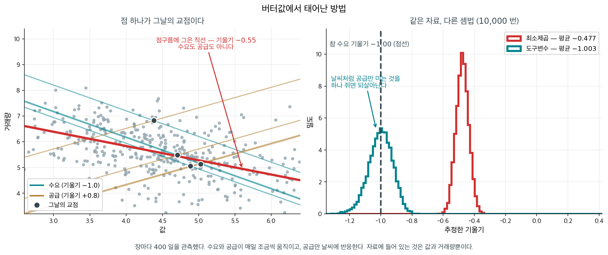
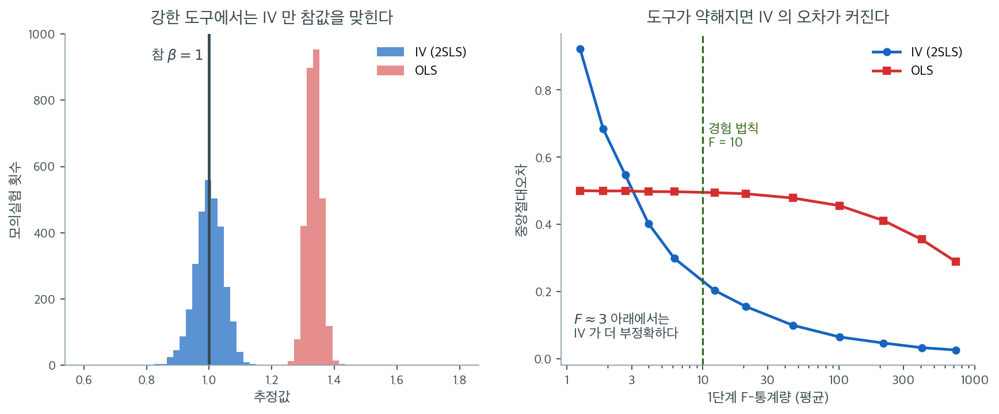

# 도구변수 (입문)

대학을 한 해 더 다니면 임금이 얼마나 오르는가. 장학금을 늘릴지 학자금 대출을 넓힐지 정할 때 쓰는 수다. 교육 연수와 임금에 직선을 그어 재면 교육 한 해에 로그임금 $0.130$ 이 나온다 — 임금이 약 $13\%$ 오른다는 뜻이다. **그 수는 교육의 값이 아니다.** 대학에 오래 다닌 사람은 애초에 다른 점도 많고, 그 다른 점의 몫이 기울기에 섞여 들어간다. 이 쪽 연습문제 5 의 자료에서 그 몫을 걷어내면 $0.100$, 곧 $10\%$ 다. 남은 $0.030$ 은 교육이 준 것이 아니라 「원래 그런 사람이었다」는 몫이고, 교육의 값을 $13\%$ 로 잡으면 참값보다 세 할을 부풀려 잡는 셈이다($0.030/0.100 = 0.3$).

걷어내는 방법이 **도구변수**다. 능력을 재지 않아도 된다. 교육에는 영향을 주지만 임금에는 직접 닿지 않는 것 하나를 지렛대로 쓴다 — 집에서 가장 가까운 대학까지의 거리 같은 것이다. 같은 자료에서 대학 가까이 사는 사람은 평균 $13.60$ 년을 배우고 로그임금이 $2.200$, 멀리 사는 사람은 $12.80$ 년과 $2.120$ 이다. 임금 차이 $0.080$ 을 교육 차이 $0.800$ 으로 나누면 $0.100$ 이 나온다. 나눗셈 한 번이 전부다. 이 지렛대가 처음 쓰인 자리는 교육이 아니라 버터값이었고, 그 뒷이야기는 아래 상자가 따라간다.

걷어내지 않으면 어떻게 되는지를 모의실험이 수로 보여 준다. 측정되지 않은 교란요인 하나를 심어 두고 참 인과효과를 $\beta = 1$ 로 둔 모의실험에서, 최소제곱 추정값은 평균 $1.33$ 에 **좁게** 모였다. 좁다는 것이 문제다 — 신뢰구간이 짧고, 그 짧은 구간이 참값 $1$ 을 한 번도 담지 못한다.

도구변수는 중앙값 $1.00$ 으로 참값을 맞히지만 공짜가 아니다. 도구가 약해지면 그 오차가 교란된 최소제곱의 $0.50$ 을 넘어서고, 더 약하면 $0.92$ 로 두 배 가까이 나빠진다. 교란을 피하려고 바꿔 쥔 이 추정량은 언제 남는 장사이고 언제 손해인가.

_확인한 곳 — 이 쪽 「버터값에서 태어난 방법」 상자와 그 출처 줄_

무작위 실험이 어렵고 측정되지 않은 교란요인이 관찰 추정값의 타당성을 위협할 때, **도구변수**(IV)는 교란에도 불구하고 인과효과를 추정하는 방법을 제공한다. 착상은 처치에는 영향을 주지만 결과에는 직접 영향을 주지 않는 변수, 즉 도구를 찾아 처치에 "마치 무작위인 듯한" 변동의 원천으로 삼는 것이다. 이 절에서는 IV 추정의 핵심 논리와 가정을 입문 수준에서 소개한다.

---

## 1. 문제: 측정되지 않은 교란

교란요인 $U$가 $X$와 $Y$ 모두와 연관되어 있으면 $X$가 $Y$에 미치는 효과의 추정에 편향이 생긴다.

$$
X \leftarrow U \rightarrow Y
$$

$U$가 측정되지 않았다면 표준적인 방법(회귀, 짝짓기, 층화)으로는 편향을 제거할 수 없다. 다른 전략이 필요하다.

---

## 2. 도구

**도구변수** $Z$는 다음을 만족하는 변수이다.

1. **관련성**: $Z$가 처치 $X$와 연관되어 있다.
2. **배제 제약**: $Z$가 결과 $Y$에 **오직 $X$를 통해서만** 영향을 준다($Y$에 직접 효과가 없다).
3. **독립성**: $Z$가 측정되지 않은 교란요인 $U$와 연관되어 있지 않다.

인과 구조는 다음과 같이 그릴 수 있다.

$$
Z \rightarrow X \rightarrow Y, \quad U \rightarrow X, \quad U \rightarrow Y
$$

여기서 $Z$에서 $Y$로 가는 화살표도, $U$에서 $Z$로 가는 화살표도 없다.

도구 $Z$는 $U$의 영향에서 자유로운 $X$의 변동을 제공한다. 이 "깨끗한" 변동을 분리함으로써 IV 방법은 $U$가 측정되지 않아도 $X$가 $Y$에 미치는 인과효과를 추정할 수 있다.

**그림으로 보는 통계학 1.** 버터값에서 태어난 방법

위 세 조건은 오늘날의 정리된 꼴이다. 이 방법이 처음 나온 자리는 교란요인 이야기가 아니었다.
**버터값**이었다.

1928 년, 필립 라이트가 『동식물성 유지에 대한 관세』라는 책을 냈다. 버터와 식용유에 매기는
관세를 올리면 값이 얼마나 오를지가 물음이었고, 답하려면 수요곡선의 기울기를 알아야 했다.

그런데 손에 있는 자료는 **값과 거래량의 짝**뿐이다. 그 짝 하나하나는 그날의 수요곡선과
그날의 공급곡선이 만난 **교점**이다. 두 곡선이 다 움직이므로, 점구름에 직선을 그으면 수요의
기울기도 공급의 기울기도 아닌 제3의 수가 나온다.

<figure markdown>
{ width="900" }
  <figcaption markdown>수요와 공급이 매일 조금씩 움직이고, 공급만 날씨에 반응한다. 자료에 들어 있는 것은 값과 거래량뿐이다.</figcaption>
</figure>

왼쪽에서 참 수요 기울기는 $-1.00$, 참 공급 기울기는 $+0.80$ 인데 점구름에 그은 직선은
$-0.55$ 다. 표본을 $10{,}000$ 번 다시 뽑아도 평균이 $-0.477$ 에서 꼼짝하지 않는다.
**자료를 아무리 많이 모아도 이 수는 수요 기울기로 가지 않는다.** 교란요인이 숨어 있어서가
아니라, 값과 거래량만으로는 두 곡선을 **갈라낼 방법이 없기** 때문이다. 이것을 식별의
문제라 한다.

라이트가 부록 B 에 적은 해법이 이것이다. **공급만 움직이고 수요는 건드리지 않는 것**을
하나 찾아 쓰면 된다. 날씨 같은 것이다. 비가 많이 온 해에는 공급곡선이 옮겨 가고 수요곡선은
그대로이므로, 그 움직임이 그려 내는 자취가 바로 수요곡선이다. 오른쪽 그림에서 그 추정값이
참값 $-1.00$ 위에 올라앉는다(평균 $-1.003$).

날씨가 위 세 조건을 그대로 만족한다는 점을 짚어 두자. 값과 **관련**이 있고($Z \to X$),
거래량에 직접 손대지 않으며(**배제**), 수요를 흔드는 숨은 사정과 **무관**하다. 오늘 쓰는
세 조건은 라이트가 버터로 한 일을 뒤에 정리한 것이다.

뒷이야기가 하나 있다. 부록 B 를 누가 썼는지를 두고 오래 다툼이 있었다. 필립의 아들이
**경로분석**을 만든 유전학자 시월 라이트이고, 부록 B 가 그 경로분석에 기대고 있기 때문이다.
스톡과 트레비가 2003 년에 두 사람의 다른 글들과 **문체를 통계적으로 견주어** 아버지 쪽이라고
결론지었다 — 아들이 조금 거들었을 수는 있다는 단서와 함께. **통계적 방법으로 그 방법을
만든 사람을 가려낸 셈이다.**

_확인한 곳 — 도구변수 추정량이 필립 G. 라이트의 『The Tariff on Animal and Vegetable Oils』($1928$) **부록 B** 에 처음 명시적으로 나타났고 거기서 날씨를 도구로 삼아 아마씨의 수요·공급 탄력성을 식별했다는 것, 스톡·트레비의 「Retrospectives: Who Invented Instrumental Variable Regression?」(『Journal of Economic Perspectives』 $17$ 권 $3$ 호 $177$–$194$ 쪽, $2003$)가 문체 분석으로 **부록 B 의 저자가 아버지 필립 쪽일 가능성이 높다**고 본 것. 모의실험의 수는 모두 직접 돌린 값이다_

---

## 3. 직관: 두 단계 과정

IV 추정의 논리는 두 단계로 이해할 수 있다.

**1단계**: $Z$로 $X$를 예측한다. $Z$가 $U$와 독립이므로 예측값 $\hat{X}$에는 $X$의 "깨끗한" 변동($U$가 아니라 $Z$가 이끈 부분)만 담긴다.

**2단계**: $Y$를 $\hat{X}$에 회귀한다. $\hat{X}$는 $U$에 의한 교란에서 자유로우므로 그 계수가 $X$가 $Y$에 미치는 인과효과를 추정한다.

이 절차를 **2단계 최소제곱**(2SLS)이라 하며 가장 흔한 IV 추정량이다.

---

## 4. 단순 IV 추정량

도구가 하나이고 추가 공변량이 없는 가장 단순한 경우, $X$가 $Y$에 미치는 인과효과 $\beta$의 IV 추정량은 **Wald 추정량**이다.

$$
\hat{\beta}_{IV} = \frac{\text{Cov}(Z, Y)}{\text{Cov}(Z, X)}
$$

이 비는 $Z$가 $Y$에 미치는 총효과를 $Z$가 $X$에 미치는 효과로 나눈 것이며, 결과적으로 $X$ 단위당 $Y$의 효과를 준다.

동등하게 표본상관으로 쓰면

$$
\hat{\beta}_{IV} = \frac{r_{ZY}}{r_{ZX}} \cdot \frac{S_Y}{S_X}
$$

이다.

---

## 5. 고전적인 도구의 예

### 교육의 도구로서 대학까지의 거리

교육($X$)이 임금($Y$)에 미치는 인과효과를 추정하기 위해 Card(1993)는 가장 가까운 대학까지의 거리($Z$)를 도구로 썼다.

- **관련성**: 대학에 가까이 사는 사람이 대학에 갈 가능성이 높다.
- **배제**: (지리적 요인을 통제한 뒤) 대학까지의 거리가 임금에 직접 영향을 주지는 않는다.
- **독립성**: 대학까지의 거리가 측정되지 않은 능력($U$)과 무관하다고 볼 만하다.

### 교육 연수의 도구로서 태어난 분기

Angrist와 Krueger(1991)는 교육 연수($X$)의 도구로 태어난 분기($Z$)를 썼다.

- **관련성**: 의무교육법이 태어난 분기와 상호작용하여 교육 연수에 변동을 만든다.
- **배제**: 태어난 분기가 임금에 직접 영향을 주지 않는다.
- **독립성**: 태어난 분기는 본질적으로 무작위이다.

### 경제활동의 도구로서 강수량

Miguel, Satyanath, Sergenti(2004)는 아프리카에서 경제 상황이 내전($Y$)에 미치는 효과를 연구하면서 경제성장($X$)의 도구로 강수량($Z$)을 썼다.

---

## 6. 가정과 그 위반

IV 추정의 타당성은 세 가정에 결정적으로 의존한다.

| 가정 | 위반 | 결과 |
|:---|:---|:---|
| 관련성($Z$가 $X$에 영향) | 약한 도구($Z$가 $X$에 거의 영향 없음) | 큰 편향, 신뢰할 수 없는 추론 |
| 배제($Z$가 $X$를 통해서만 $Y$에 영향) | $Z$가 $Y$에 직접 효과를 가짐 | 편향된 IV 추정 |
| 독립성($Z$가 $U$와 독립) | $Z$가 교란요인과 상관 | 편향된 IV 추정 |

!!! warning "약한 도구"
    도구가 처치와 약하게만 상관되어 있으면 IV 추정량의 분산이 크고 심각하게 편향될 수 있으며, 때로는 (교란된) 보통 최소제곱 추정량보다 나쁘다. 흔한 경험 법칙은 1단계 F-통계량이 10을 넘어야 한다는 것이다.

배제 제약은 자료로 직접 검정할 수 없으므로 대체로 가장 논쟁적인 가정이다. 실질적인 근거로 정당화해야 한다.

모의실험으로 두 가지를 한꺼번에 확인해 보자. 참 인과효과를 $\beta = 1$로 두고, 관측되지 않는 교란요인 $U$가 $X$와 $Y$를 동시에 끌어올리도록 만들었다. 관측값은 1,000개, 되풀이는 3,000번이다.

왼쪽은 도구가 충분히 강할 때($\pi = 1$)의 결과다. OLS 추정값은 평균 $1.33$에 좁게 모여 있다. 좁다는 것이 위험한 부분이다. **표준오차가 작으니 신뢰구간도 좁고, 그 좁은 구간이 참값 $1$을 한 번도 담지 못한다.** 교란에서 오는 오차는 표본을 키워도 줄지 않으므로, 자료가 많을수록 틀린 값을 더 확신하게 된다. IV 추정값의 중앙값은 $1.00$으로 참값 위에 놓인다. $Z$가 이끈 $X$의 변동만 쓰기 때문이며, 그 대신 분포는 OLS보다 눈에 띄게 넓다. 편향을 분산과 맞바꾼 셈이다.

오른쪽은 그 맞바꿈이 항상 남는 장사는 아님을 보여준다. 가로축은 1단계 $F$-통계량, 세로축은 참값에서 벗어난 거리의 중앙값이다. $F$가 커질수록 IV의 오차는 $0.30$($F \approx 6$), $0.20$($F \approx 12$), $0.10$($F \approx 46$)으로 꾸준히 줄지만, $F$가 작아지면 급격히 치솟아 $F \approx 3$ 부근에서 OLS의 $0.50$을 넘어선다. $F \approx 1.3$에서는 $0.92$로 교란된 OLS보다 두 배 가까이 나쁘다. 도구가 약하면 $\text{Cov}(Z, X)$가 0 근처에서 흔들리고, 그 값이 Wald 추정량의 분모에 들어가기 때문이다.

그래서 IV 분석을 읽을 때 가장 먼저 확인할 숫자는 추정값도 $p$값도 아니고 **1단계 $F$-통계량**이다. 경험 법칙인 $F > 10$은 위 그림에서 IV가 OLS보다 확실히 나은 영역에 안전하게 들어가기 위한 여유분이라고 보면 된다. 참고로 그림의 세로축은 점추정의 정확도만 잰 것이며, 신뢰구간의 포함확률은 그보다 훨씬 이른 지점에서 무너진다.

---

## 7. IV와 다른 방법의 비교

| 방법 | 측정되지 않은 교란을 다루는가? | 핵심 요건 |
|:---|:---:|:---|
| OLS 회귀 | 아니오 | 모든 교란요인이 측정되어야 함 |
| 짝짓기 / 성향점수 | 아니오 | 모든 교란요인이 측정되어야 함 |
| 도구변수 | 예 | 타당한 도구가 있어야 함 |
| 무작위 실험 | 예 | 윤리적이고 실행 가능해야 함 |

IV 방법은 (모든 교란요인의 측정을 요구하는) 관찰연구와 (실행이 어려울 수 있는) 실험 사이의 중요한 빈틈을 메운다. 대가는 타당한 도구를 찾아야 하고 배제 제약이 설득력 있어야 한다는 점이다.

---

## 연습문제

**연습문제 1.** 
관측되지 않은 교란요인 $U$가 있을 때 $X$가 $Y$에 미치는 인과효과를 식별하기 위해 도구변수 $Z$가 만족해야 하는 두 핵심 조건을 진술하라.

??? success "풀이"
    도구 $Z$는 다음을 만족해야 한다:

    1. **관련성:** $Z$가 $X$와 상관되어 있다(즉 $\text{Cov}(Z, X) \neq 0$). 도구가 실제로 처치변수에 영향을 주어야 한다.

    2. **배제 제약:** $Z$가 직접적으로도, 다른 경로를 통해서도 아니라 오직 $X$를 통해서만 $Y$에 영향을 준다. 형식적으로 $Z \perp Y \mid X, U$이다($X$와 관측되지 않은 $U$를 조건으로 하면 $Z$가 $Y$에 아무 효과가 없다).

    별도로 자주 진술되는 추가 가정은 **독립성**이다: $Z \perp U$(도구가 관측되지 않은 교란요인과 상관되지 않음). "외생성" 조건이라고도 한다.

    이 조건들이 함께 성립하면 IV 추정량 $\hat{\beta}_{IV} = \text{Cov}(Z, Y)/\text{Cov}(Z, X)$가 $X$가 $Y$에 미치는 인과효과를 일치추정한다.

**연습문제 2.** 
교육의 수익에 관한 고전적 예에서 태어난 분기를 교육 연수의 도구로 써서 소득에 대한 인과효과를 추정한다. 태어난 분기가 관련성 조건을 만족하는 이유를 설명하고 배제 제약이 그럴듯한지 논하라.

??? success "풀이"
    **관련성:** 의무교육법 때문에 연초에 태어난 학생은 학교생활 중 더 이른 시점에 최소 중퇴 가능 연령에 도달하여 더 어린 나이에 합법적으로 학교를 그만둘 수 있다. 그래서 1분기에 태어난 학생이 4분기에 태어난 학생보다 교육 연수가 조금 짧은 경향이 있다. 이것이 태어난 분기와 교육 연수 사이에 상관을 만든다.

    **배제 제약:** 태어난 분기가 교육을 통한 효과 말고 다른 경로로는 소득에 영향을 주지 않아야 한다. 우려되는 점들:

    - 인지 발달이나 건강에 대한 계절 효과(다른 계절에 태어난 아이들이 다를 수 있다)
    - 가족계획: 출산 시기가 가정의 사회경제적 지위와 상관될 수 있다
    - 일부 문화권에서 채용에 영향을 주는 점성술적 믿음

    배제 제약은 논쟁의 여지가 있다. 태어난 분기가 개인의 선택으로 결정되지 않는다는 점에서 외생적이라 볼 만하지만, 소득에 직접 효과가 전혀 없다는 요건은 직접 검정할 수 없는 강한 가정이다.

**연습문제 3.** 
"약한 도구" 문제를 설명하고 그것이 IV 추정에 왜 중요한지 밝혀라.

??? success "풀이"
    **약한 도구**는 내생변수 $X$와의 상관이 낮은 도구이다(관련성이 간신히 충족된다). ($X$를 $Z$에 회귀한) 1단계 F-통계량이 작다(경험 법칙으로 $F < 10$이면 약하다고 본다).

    약한 도구는 여러 문제를 일으킨다:

    1. **큰 편향:** IV 추정량의 유한표본 편향이 OLS 편향에 가까워진다. 도구가 매우 약하면 IV가 순진한 OLS만큼 편향될 수 있다.
    2. **큰 분산:** IV 추정값의 표준오차가 1단계 상관에 반비례한다. 약한 도구는 신뢰구간이 넓은 부정확한 추정을 낳는다.
    3. **왜곡된 추론:** 표준 신뢰구간과 t-검정의 포함확률과 크기가 부정확해진다. 점근 정규근사가 무너진다.

    대처로는 약한 도구 검정(1단계 F-통계량), (약한 도구에 로버스트한) Anderson-Rubin 신뢰집합의 사용, 더 강한 도구 찾기가 있다.

**연습문제 4.** 
($U$가 관측되지 않을 때) $U \to X$, $U \to Y$가 있는 DAG $Z \to X \to Y$를 써서 IV 추정량은 인과효과를 식별하지만 OLS는 그러지 못하는 이유를 그래프로 설명하라.

??? success "풀이"
    이 DAG에서 OLS는 $Y$를 $X$에 회귀하여 $X$의 효과를 추정한다. 그러나 뒷문 경로 $X \leftarrow U \to Y$가 열려 있고 ($U$가 관측되지 않으므로) 막을 수 없다. OLS는 인과효과($X \to Y$)와 교란 편향($X \leftarrow U \to Y$)을 뒤섞는다.

    IV 추정량은 대신 $Z$를 쓴다. $Z$에서 $Y$로 가는 경로는 $Z \to X \to Y$뿐이다. (외생성 가정에 의해) $Z$가 $U$와 독립이고 (배제 제약에 의해) $Z$가 $Y$에 직접 효과가 없으므로 $Z$에서 $Y$로 가는 뒷문 경로가 없다. 따라서 $\beta$가 인과효과일 때 $\text{Cov}(Z, Y) = \beta \cdot \text{Cov}(Z, X)$이고 $\beta = \text{Cov}(Z, Y)/\text{Cov}(Z, X)$가 된다.

    그래프로 보면 도구는 $Z$가 일으킨 $X$의 변동만 사용하여 교란에서 자유로운 외생적 변동을 "분리"해 낸다.

**연습문제 5.** 
Card(1993)의 설정을 따라 $Z = 1$이면 대학 근처에 살고 $Z = 0$이면 멀리 산다고 하자. 표본에서 $Z = 1$인 사람은 전체의 $48\%$이고, 두 집단의 평균은 다음과 같다.

| | 교육 연수 $X$ | 로그임금 $Y$ |
|:---|---:|---:|
| 근처 ($Z=1$) | $13.60$ | $2.200$ |
| 멀리 ($Z=0$) | $12.80$ | $2.120$ |

(가) 이진 변수 $Z$와 임의의 변수 $W$에 대해 $p = P(Z=1)$이라 할 때

$$
\text{Cov}(Z, W) = p(1-p)\bigl(E[W \mid Z=1] - E[W \mid Z=0]\bigr)
$$

임을 보여라.

(나) (가)를 써서 Wald 추정값 $\hat{\beta}_{IV}$를 구하라. 답에 $48\%$라는 수가 쓰이는가?

(다) 같은 자료에서 $Y$를 $X$에 회귀한 보통 최소제곱 기울기가 $0.130$이었다. 측정되지 않은 능력 $U$가 교육과 임금을 모두 끌어올린다는 설명이 이 두 값의 관계와 맞는지 판정하라.

??? success "풀이"
    **(가)** $Z$가 이진이므로 $E[ZW] = p \, E[W \mid Z=1]$이고 $E[Z] = p$, $E[W] = p \, E[W \mid Z=1] + (1-p) E[W \mid Z=0]$이다. 따라서

    $$
    \text{Cov}(Z, W) = E[ZW] - E[Z]E[W] = p \, E[W \mid Z=1] - p\bigl(p \, E[W \mid Z=1] + (1-p) E[W \mid Z=0]\bigr)
    $$

    이고, $p \, E[W \mid Z=1]$에서 $p^2 E[W \mid Z=1]$을 빼면 $p(1-p) E[W \mid Z=1]$이므로

    $$
    \text{Cov}(Z, W) = p(1-p)\bigl(E[W \mid Z=1] - E[W \mid Z=0]\bigr)
    $$

    이다. $\square$

    **(나)** (가)를 $W = Y$와 $W = X$에 각각 적용하면 분자와 분모에 같은 $p(1-p)$가 생겨 약분된다.

    $$
    \hat{\beta}_{IV} = \frac{\text{Cov}(Z, Y)}{\text{Cov}(Z, X)} = \frac{p(1-p)(2.200 - 2.120)}{p(1-p)(13.60 - 12.80)} = \frac{0.080}{0.800} = 0.100
    $$

    $48\%$는 쓰이지 않는다. 이진 도구의 Wald 추정값은 두 집단의 **평균 차이의 비**일 뿐이어서 집단 크기와 무관하다. (물론 표준오차는 $p$에 의존한다. $p$가 $0$이나 $1$에 가까우면 한쪽 집단이 거의 비어 추정이 불안정해진다.)

    **(다)** 맞는다. $U$가 $X$와 $Y$를 모두 끌어올리면 뒷문 경로 $X \leftarrow U \to Y$가 양의 편향을 더하므로 OLS 기울기가 인과효과보다 **커야** 한다. 실제로 $0.130 > 0.100$이고 차이는 $0.030$이다. 교육 1년의 임금 효과는 $13\%$가 아니라 $10\%$이며, 나머지 $3\%$포인트는 "대학에 더 오래 다닌 사람이 애초에 능력이 높았다"는 구성의 차이다.

**연습문제 6.** 
연습문제 5에서 $\hat{\beta}_{IV} = 0.100$을 얻었다(로그임금 변화 / 교육 연수).

(가) 상수 $a \neq 0$, $b$에 대해 도구를 $Z' = aZ + b$로 바꾸면 $\hat{\beta}_{IV}$가 변하지 않음을 Wald 공식에서 보여라. 반면 $X' = cX$, $Y' = eY$로 바꾸면 추정값이 어떻게 변하는가?

(나) 거리를 킬로미터에서 마일로 바꾸고, 교육을 연수에서 개월수로 바꾸고, 임금을 로그 대신 $100 \times$로그(퍼센트)로 바꾸었다. 새 추정값과 그 단위를 적어라.

(다) 표본상관으로 쓴 $\hat{\beta}_{IV} = (r_{ZY}/r_{ZX}) \cdot (S_Y/S_X)$에서 $r_{ZX} = 0.30$, $S_X = 2.5$년, $S_Y = 0.50$일 때 $r_{ZY}$를 구하라.

(라) (가)에서 $a$를 아무리 작게 해도 추정값이 그대로인데, 1단계 계수 $\pi$가 작아지면(약한 도구) 추정이 망가진다. $\text{Cov}(Z,X)$가 작아지는 것은 두 경우 모두인데 무엇이 다른가?

??? success "풀이"
    **(가)** 공분산은 상수를 더해도 변하지 않고 상수배에 비례하므로 $\text{Cov}(aZ+b, Y) = a\,\text{Cov}(Z,Y)$, $\text{Cov}(aZ+b, X) = a\,\text{Cov}(Z,X)$이다. 비를 취하면

    $$
    \frac{a\,\text{Cov}(Z,Y)}{a\,\text{Cov}(Z,X)} = \frac{\text{Cov}(Z,Y)}{\text{Cov}(Z,X)} = \hat{\beta}_{IV}
    $$

    로 $a$와 $b$가 모두 사라진다. 한편 $X' = cX$, $Y' = eY$이면

    $$
    \hat{\beta}'_{IV} = \frac{\text{Cov}(Z, eY)}{\text{Cov}(Z, cX)} = \frac{e}{c}\,\hat{\beta}_{IV}
    $$

    이다. 도구의 단위는 아무 흔적을 남기지 않고, $X$와 $Y$의 단위만 남는다. 당연한 일이다. $\beta$는 "$X$ 한 단위당 $Y$"이지 "$Z$ 한 단위당"이 아니다.

    **(나)** 거리의 단위 변경은 $Z$의 상수배이므로 아무 영향이 없다. $c = 12$(개월), $e = 100$(퍼센트)이므로

    $$
    \hat{\beta}'_{IV} = \frac{100}{12} \times 0.100 = 0.833
    $$

    이고 단위는 **교육 1개월당 임금 퍼센트**다. 같은 사실을 다르게 적은 것일 뿐이다(1년 $= 12$개월이므로 $0.833 \times 12 = 10.0\%$).

    **(다)** 공식을 $r_{ZY}$에 대해 풀면

    $$
    r_{ZY} = \hat{\beta}_{IV} \cdot r_{ZX} \cdot \frac{S_X}{S_Y} = 0.100 \times 0.30 \times \frac{2.5}{0.50} = 0.100 \times 0.30 \times 5 = 0.15
    $$

    이다. 도구는 교육과 $r_{ZX} = 0.30$, 임금과 $r_{ZY} = 0.15$로 상관되어 있고, 그 비 $0.5$에 $S_Y/S_X = 0.2$를 곱한 것이 $0.1$이다.

    **(라)** 다른 것은 **분자와 분모가 같이 줄어드는가**이다. $Z$를 $a$배 하면 $\text{Cov}(Z,X)$와 $\text{Cov}(Z,Y)$가 똑같이 $a$배 되어 비가 보존되고, 표본에서의 추정오차까지 같은 비율로 줄어든다. 즉 자료는 전혀 달라지지 않았고 눈금만 바뀌었다.

    반면 $\pi \to 0$은 눈금이 아니라 **신호**가 사라지는 것이다. $\text{Cov}(Z,X)$의 참값이 $0$으로 가도 표본에서 그것을 재는 잡음의 크기는 그대로이므로, 분모는 $0$ 근처에서 부호까지 바뀌며 흔들린다. 그래서 $\hat{\beta}_{IV}$의 분포가 두꺼운 꼬리를 갖게 되고, 본문 그림 오른쪽에서 $F \approx 3$ 부근에서 IV의 오차가 교란된 OLS의 $0.50$을 넘어서는 일이 벌어진다. **상수배는 눈금의 문제이고 약한 도구는 신호대잡음비의 문제다.**

**연습문제 7.** 
대학 진학 $X \in \{0, 1\}$이 연 소득 $Y$(백만 원)에 미치는 효과를 보려 한다. 측정되지 않는 능력 $U \in \{0, 1\}$을 (이 문제에서만) 들여다볼 수 있다고 하자.

| | $E[Y \mid X=0, U=u]$ | $E[Y \mid X=1, U=u]$ |
|:---|---:|---:|
| $U = 0$ | $20$ | $24$ |
| $U = 1$ | $30$ | $34$ |

또 $P(U=1 \mid X=1) = 0.7$, $P(U=1 \mid X=0) = 0.3$이다.

(가) 거친 차이 $\Delta = E[Y \mid X=1] - E[Y \mid X=0]$을 구하고, 1.1절 [상관관계와 인과관계](../../ch01/classical/confounding_causation.md) 정리 1 의 두 항을 각각 계산하여 합이 맞는지 확인하라.

(나) 도구 $Z \in \{0,1\}$이 $Z \perp U$를 만족하고 $P(X=1 \mid Z=1) = 0.6$, $P(X=1 \mid Z=0) = 0.4$라 하자. Wald 추정값을 구하라. 계산 중 어디에서 $Z \perp U$가 쓰이는가?

(다) 독립성이 조금 깨져서 $P(U=1 \mid Z=1) = 0.5$, $P(U=1 \mid Z=0) = 0.3$이고 $P(X=1 \mid Z)$는 (나)와 같다고 하자. 이때 Wald 추정값을 구하라.

??? success "풀이"
    표의 구조를 식으로 쓰면 $E[Y \mid X, U] = a(U) + 4X$이고 $a(0) = 20$, $a(1) = 30$이다. 층 안의 효과는 두 층 모두 $\Delta_0 = \Delta_1 = 4$로 같다. 즉 **참 인과효과는 $4$**다.

    **(가)** 각 집단의 평균은

    $$
    E[Y \mid X=1] = 0.3 \times 24 + 0.7 \times 34 = 7.2 + 23.8 = 31.0
    $$

    $$
    E[Y \mid X=0] = 0.7 \times 20 + 0.3 \times 30 = 14.0 + 9.0 = 23.0
    $$

    이므로 $\Delta = 31.0 - 23.0 = 8.0$이다. 정리의 두 항은

    $$
    \sum_u \Delta_u P(U=u \mid X=1) = 0.3 \times 4 + 0.7 \times 4 = 4.0
    $$

    $$
    \sum_u E[Y \mid X=0, U=u]\bigl[P(U=u \mid X=1) - P(U=u \mid X=0)\bigr] = 20(0.3 - 0.7) + 30(0.7 - 0.3) = -8.0 + 12.0 = 4.0
    $$

    이고 $4.0 + 4.0 = 8.0 = \Delta$로 맞는다. 거친 차이 $8$ 중 **절반이 교란항**이다. 대학 진학자가 소득이 $8$ 높은 것은 대학이 $4$를 올려서이고, 나머지 $4$는 애초에 능력이 높은 사람이 대학에 더 많이 간 데서 온다. $U$를 관측할 수 있으면 층화로 $4$를 골라낼 수 있지만, 관측할 수 없으면 이 분해 자체를 할 수 없다. 그래서 도구가 필요하다.

    **(나)** $Y = a(U) + 4X + (\text{잡음})$이므로

    $$
    E[Y \mid Z] = E[a(U) \mid Z] + 4\,E[X \mid Z]
    $$

    이다. $Z \perp U$이면 $E[a(U) \mid Z=1] = E[a(U) \mid Z=0]$이므로 첫 항이 차를 취할 때 **지워진다**:

    $$
    E[Y \mid Z=1] - E[Y \mid Z=0] = 4\,(0.6 - 0.4) = 0.8
    $$

    분모는 $E[X \mid Z=1] - E[X \mid Z=0] = 0.6 - 0.4 = 0.2$이므로(연습문제 5(가)에 의해 $P(Z=1)$은 약분된다)

    $$
    \hat{\beta}_{IV} = \frac{0.8}{0.2} = 4
    $$

    로 참값을 정확히 맞힌다. 독립성이 쓰인 자리는 단 하나, **$E[a(U) \mid Z]$가 $Z$에 의존하지 않아 차에서 사라지는 지점**이다.

    **(다)** 이제 그 항이 사라지지 않는다.

    $$
    E[a(U) \mid Z=1] = 0.5 \times 20 + 0.5 \times 30 = 25.0, \qquad E[a(U) \mid Z=0] = 0.7 \times 20 + 0.3 \times 30 = 23.0
    $$

    이므로

    $$
    E[Y \mid Z=1] = 25.0 + 4 \times 0.6 = 27.4, \qquad E[Y \mid Z=0] = 23.0 + 4 \times 0.4 = 24.6
    $$

    이고 차는 $2.8$이다. 분모는 그대로 $0.2$이므로

    $$
    \hat{\beta}_{IV} = \frac{2.8}{0.2} = 14
    $$

    이다. 참값 $4$의 세 배 반이고, 교란된 거친 차이 $8$보다도 훨씬 나쁘다. 능력의 비율이 $0.3$에서 $0.5$로 조금 움직인 것이 소득에 $2.0$의 차이를 만들었고, 그것이 작은 분모 $0.2$로 나뉘면서 $10$만큼 부풀었다. **도구 쪽의 작은 오염은 $1/\text{Cov}(Z,X)$ 배로 증폭되어 들어온다.**

**연습문제 8.** 
배제 제약이 깨진 경우를 모형으로 보자. $Z$가 $U$, $\nu$, $\varepsilon$과 독립이고

$$
X = \pi Z + \eta U + \nu, \qquad Y = \beta X + \gamma Z + \delta U + \varepsilon
$$

이라 하자. 여기서 $\gamma \neq 0$은 $Z$가 $Y$에 주는 **직접효과**, 즉 배제 제약의 위반이다.

(가) $\hat{\beta}_{IV} = \text{Cov}(Z,Y)/\text{Cov}(Z,X)$가 확률수렴하는 값을 $\beta$, $\gamma$, $\pi$로 나타내라.

(나) 연습문제 5의 설정에서 $\beta = 0.100$, $\pi = 0.8$(근처 거주가 교육을 $0.8$년 늘린다), 그리고 대학 근처에 사는 것이 교육과 무관하게 임금을 $\gamma = 0.02$만큼 올린다고 하자(도시의 노동시장 효과). 추정값은 얼마로 수렴하는가?

(다) 같은 $\gamma = 0.02$에서 도구가 약해져 $\pi = 0.1$이 되면 어떻게 되는가?

(라) (다)의 편향은 표본을 키우면 줄어드는가? 본문의 경험 법칙 $F > 10$이 이 편향을 막아 주는가?

??? success "풀이"
    **(가)** $Z$가 $U$, $\varepsilon$, $\nu$와 독립이므로 $\text{Cov}(Z,U) = \text{Cov}(Z,\varepsilon) = \text{Cov}(Z,\nu) = 0$이다. 따라서

    $$
    \text{Cov}(Z, Y) = \beta\,\text{Cov}(Z,X) + \gamma\,\text{Var}(Z) + \delta\,\text{Cov}(Z,U) = \beta\,\text{Cov}(Z,X) + \gamma\,\text{Var}(Z)
    $$

    $$
    \text{Cov}(Z, X) = \pi\,\text{Var}(Z) + \eta\,\text{Cov}(Z,U) + \text{Cov}(Z,\nu) = \pi\,\text{Var}(Z)
    $$

    이고 비를 취하면

    $$
    \hat{\beta}_{IV} \;\xrightarrow{\;p\;}\; \beta + \frac{\gamma\,\text{Var}(Z)}{\pi\,\text{Var}(Z)} = \beta + \frac{\gamma}{\pi}
    $$

    이다. 교란의 세기 $\delta$, $\eta$는 식에 아예 나타나지 않는다. 도구는 교란은 막아 주지만 자기 자신의 직접효과는 막지 못한다.

    **(나)** 편향은 $\gamma/\pi = 0.02/0.8 = 0.025$이므로

    $$
    \hat{\beta}_{IV} \to 0.100 + 0.025 = 0.125
    $$

    이다. 참값보다 $25\%$ 큰 값이다. 교육 1년의 수익을 $10\%$가 아니라 $12.5\%$로 읽게 된다.

    **(다)** 같은 직접효과인데 $\gamma/\pi = 0.02/0.1 = 0.2$가 되어

    $$
    \hat{\beta}_{IV} \to 0.100 + 0.2 = 0.300
    $$

    이다. 참값의 세 배다. 직접효과는 그대로인데 편향이 여덟 배로 커졌다. 이유는 $\gamma$가 $\pi$로 나뉘기 때문이다. 분자에 들어온 오염 $\gamma\,\text{Var}(Z)$는 그대로인데, 그것을 작은 1단계 효과로 나누면서 확대된다.

    **(라)** 줄지 않는다. $\gamma/\pi$는 **일치성의 실패**이지 분산이 아니다. 표본이 커지면 $\hat{\beta}_{IV}$는 $\beta$가 아니라 $\beta + \gamma/\pi$ 주위로 점점 좁게 모이므로, 자료가 많을수록 틀린 값을 더 확신하게 된다(본문 왼쪽 그림에서 OLS가 보였던 바로 그 모습이다).

    $F > 10$도 막아 주지 못한다. 1단계 $F$는 $\pi$가 $0$이 아님만 확인하므로, $\pi$가 커지면 $\gamma/\pi$는 줄어들긴 하지만 결코 $0$이 되지 않는다. 즉 **$F$ 검정은 관련성 가정만 검사하고 배제 제약은 전혀 건드리지 않는다.** 다만 (나)와 (다)를 비교하면 강한 도구가 배제 위반의 피해도 함께 줄인다는 사실은 알 수 있다. 약한 도구는 분산과 배제 위반 편향을 양쪽으로 키운다.

**연습문제 9.** 
본문 그림의 모의실험을 수식으로 확인해 보자. $Z$, $U$, $\nu$, $\varepsilon$이 서로 독립이고 각각 평균 $0$, 분산 $1$이며

$$
X = Z + U + \nu, \qquad Y = X + U + \varepsilon
$$

이라 하자(참 인과효과 $\beta = 1$, 도구의 세기 $\pi = 1$).

(가) $Y$를 $X$에만 회귀한 OLS 기울기가 확률수렴하는 값을 구하고, 본문의 $1.33$과 비교하라.

(나) $\hat{\beta}_{IV}$가 수렴하는 값을 구하라.

(다) OLS 기울기의 표준오차는 $\text{SE} = \sigma_e / \sqrt{n \, \text{Var}(X)}$이며 $\sigma_e^2$은 $Y$를 $X$에 회귀한 뒤 남는 분산이다. $\sigma_e^2$을 구하고, $n = 1000$에서 $\text{SE}$와 "$\beta = 1$에서 몇 $\text{SE}$ 떨어져 있는가"를 계산하라.

(라) $95\%$ 신뢰구간($\text{추정값} \pm 1.96\,\text{SE}$)이 참값 $1$을 담을 수 있는 가장 큰 표본크기 $n$을 구하라.

??? success "풀이"
    먼저 필요한 모멘트를 모아 둔다. $\text{Var}(X) = \text{Var}(Z) + \text{Var}(U) + \text{Var}(\nu) = 3$, $\text{Cov}(X, U) = 1$, $\text{Cov}(Z, X) = 1$이다.

    **(가)** $Y = X + U + \varepsilon$이므로 $\text{Cov}(X,Y) = \text{Var}(X) + \text{Cov}(X,U) = 3 + 1 = 4$이고

    $$
    \hat{\beta}_{OLS} \;\xrightarrow{\;p\;}\; \frac{\text{Cov}(X,Y)}{\text{Var}(X)} = \frac{4}{3} = 1.333\ldots
    $$

    본문이 보고한 평균 $1.33$과 일치한다. 편향 $1/3$은 뒷문 경로 $X \leftarrow U \to Y$에서 온다.

    **(나)** $\text{Cov}(Z,Y) = \text{Cov}(Z, X) + \text{Cov}(Z,U) + \text{Cov}(Z,\varepsilon) = 1 + 0 + 0 = 1$이고 $\text{Cov}(Z,X) = 1$이므로

    $$
    \hat{\beta}_{IV} \;\xrightarrow{\;p\;}\; \frac{1}{1} = 1 = \beta
    $$

    로 참값이다. 본문의 IV 중앙값 $1.00$이 이 값이다.

    **(다)** $\text{Var}(Y) = \text{Var}(X) + 2\,\text{Cov}(X,U) + \text{Var}(U) + \text{Var}(\varepsilon) = 3 + 2 + 1 + 1 = 7$이므로 기울기 $b = 4/3$에 대한 잔차분산은

    $$
    \sigma_e^2 = \text{Var}(Y) - b^2\,\text{Var}(X) = 7 - \frac{16}{9} \times 3 = 7 - \frac{16}{3} = \frac{5}{3}
    $$

    이다. 따라서

    $$
    \text{SE} = \sqrt{\frac{5/3}{3n}} = \sqrt{\frac{5}{9n}} = \frac{1}{3}\sqrt{\frac{5}{n}}
    $$

    이고 $n = 1000$에서 $\text{SE} = \frac{1}{3}\sqrt{0.005} = 0.0236$이다. 추정값은 $1.333$, 참값은 $1$이므로 거리는

    $$
    \frac{1/3}{0.0236} = 14.1
    $$

    로 약 $14$ 표준오차다. $95\%$ 신뢰구간의 반폭은 $1.96 \times 0.0236 = 0.046$에 불과하여 $[1.287,\ 1.379]$이고 $1$을 전혀 담지 못한다. 본문이 "그 좁은 구간이 참값 $1$을 한 번도 담지 못한다"고 한 것이 이 계산이다.

    **(라)** 구간이 $1$에 닿으려면 $1.96\,\text{SE} \ge 1/3$이어야 한다.

    $$
    1.96 \times \frac{1}{3}\sqrt{\frac{5}{n}} \ge \frac{1}{3} \;\Longleftrightarrow\; \sqrt{\frac{5}{n}} \ge \frac{1}{1.96} \;\Longleftrightarrow\; n \le 5 \times 1.96^2 = 19.2
    $$

    이므로 $n \le 19$이다. 즉 관측값이 **20개만 되어도** 이 신뢰구간은 참값을 영구히 놓친다.

    교훈은 분명하다. 편향 $1/3$은 $n$에 전혀 의존하지 않는데 표준오차는 $1/\sqrt{n}$로 줄어들므로, 포함확률은 $n$이 커질수록 $0$으로 간다. **교란이 있으면 자료를 늘리는 것은 틀린 값에 대한 확신을 늘리는 일이다.** 표본크기로 고칠 수 있는 것은 분산뿐이다.

**연습문제 10.** 
본문은 "배제 제약은 자료로 직접 검정할 수 없다"고 했다. 어떤 연구자가 이를 반박하며 이렇게 제안한다. "배제 제약이 맞다면 $X$를 통제한 뒤에는 $Z$가 $Y$를 설명하지 못해야 한다. 그러니 $Y$를 $X$와 $Z$에 함께 회귀해서 $Z$의 계수가 $0$인지 보면 된다."

연습문제 9의 모형($X = Z + U + \nu$, $Y = X + U + \varepsilon$, 네 변수는 독립이고 분산 $1$)을 쓰자. 이 모형에서 배제 제약은 **완벽하게 성립한다**($Z$는 $X$를 통해서만 $Y$에 닿는다).

(가) $U$를 $X$와 $Z$에 사영하여 $U = aX + bZ + r$($r$는 $X$, $Z$와 무상관)의 계수 $a$, $b$를 구하라.

(나) (가)를 써서 $Y$를 $X$와 $Z$에 회귀할 때 두 계수가 수렴하는 값을 구하라. 연구자의 검정은 어떤 결론을 내리는가?

(다) DAG $Z \to X \to Y$, $U \to X$, $U \to Y$에서 왜 이런 일이 생기는지 설명하라.

(라) $X$의 계수를 연습문제 9(가)의 $4/3$과 비교하고 무엇을 뜻하는지 말하라.

??? success "풀이"
    **(가)** 정규방정식을 세운다. $\text{Cov}(U,X) = 1$, $\text{Cov}(U,Z) = 0$, $\text{Var}(X) = 3$, $\text{Cov}(X,Z) = 1$, $\text{Var}(Z) = 1$이므로

    $$
    3a + b = 1, \qquad a + b = 0
    $$

    이다. 둘째 식에서 $b = -a$를 넣으면 $2a = 1$이므로

    $$
    a = \frac{1}{2}, \qquad b = -\frac{1}{2}
    $$

    이다. 검산하면 $\text{Cov}(U - aX - bZ,\, X) = 1 - \frac{1}{2}(3) + \frac{1}{2}(1) = 0$, $\text{Cov}(U - aX - bZ,\, Z) = 0 - \frac{1}{2}(1) + \frac{1}{2}(1) = 0$으로 맞는다.

    **(나)** $U$를 대입하면

    $$
    Y = X + U + \varepsilon = X + \left(\frac{1}{2}X - \frac{1}{2}Z + r\right) + \varepsilon = \frac{3}{2}X - \frac{1}{2}Z + (r + \varepsilon)
    $$

    이고 $r + \varepsilon$은 $X$와 $Z$ 모두와 무상관이다. 따라서 이것이 바로 모집단 회귀이며

    $$
    \hat{\beta}_X \to \frac{3}{2} = 1.5, \qquad \hat{\beta}_Z \to -\frac{1}{2} = -0.5
    $$

    이다. $Z$의 계수는 $0$이 아니고, 표본이 커지면 $t$-통계량이 무한히 커져 어떤 유의수준에서도 유의해진다. 연구자의 검정은 **배제 제약이 성립하는데도 위반되었다고 판정한다.** 제안된 검정은 틀렸다.

    **(다)** $X$는 경로 $Z \to X \leftarrow U$의 **충돌점**이다. 충돌점을 조건으로 두면 그 부모들 사이에 없던 연관이 생긴다. 직관은 이렇다. $X$가 같은 두 사람을 비교하는데 한 사람이 대학에서 더 멀리 살았다면($Z$가 작다면), 그 사람은 같은 교육 연수에 도달하기 위해 능력 $U$가 더 높았을 것이다. 그러므로 $X$를 고정하면 $Z$와 $U$ 사이에 **음의** 연관이 생긴다. $U$는 $Y$를 올리므로 이 음의 연관이 $Z$의 계수를 음수로 만든다. 실제로 $b = -1/2 < 0$이고 $\delta = 1 > 0$이어서 $\hat{\beta}_Z = \delta b = -0.5$다.

    정리하면 $X$를 통제한 회귀에서 $Z$의 계수는 두 가지가 섞인 값이다. 배제 위반의 직접효과 $\gamma$(연습문제 8)와, 충돌점 조건화가 만든 가짜 연관. 계수가 $0$이 아니어도 둘 중 어느 쪽인지 자료만으로는 가를 수 없다. 그래서 배제 제약은 검정이 아니라 실질적 근거로 정당화해야 한다. $\square$

    **(라)** $Z$를 통제하지 않은 단순회귀는 $4/3 \approx 1.33$, $Z$를 통제한 회귀는 $3/2 = 1.5$이므로 **타당한 도구를 공변량으로 넣으면 OLS 편향이 오히려 커졌다**($0.33 \to 0.50$). 이유는 선명하다. $X$의 변동 중 $Z$가 만든 부분이 바로 교란에서 자유로운 "깨끗한" 부분인데, $Z$를 통제하면 그 깨끗한 변동을 빼 버리고 $U$가 만든 더러운 변동만 남겨 비교하게 된다. **도구는 통제변수가 아니다.** 통제하면 안 되고, 분자와 분모에 나누어 써야 한다.

---

## 정리하며

도구변수는 측정되지 않은 교란이 있을 때 인과효과를 추정하는 방법을 제공한다. 도구는 관련성이 있고(처치에 영향), 배제 제약을 만족하며(처치를 통해서만 결과에 영향), 측정되지 않은 교란요인과 독립인 변수이다. 2단계 최소제곱 추정량은 도구를 써서 교란에서 자유로운 처치의 변동을 분리한다. 강력하지만 IV 방법은 강하고 흔히 검정할 수 없는 가정, 특히 배제 제약을 요구한다. 도구의 작동 기제가 분명하고 잘 이해될 때 가장 설득력이 있다.

다음 쪽 **[방향성 비순환 그래프](dags.md)**로 넘어간다. 이 장에서 교란요인·매개자·충돌자·잠복변수를 하나씩 만났는데, DAG 는 그것들을 **한 그림**에 적고 어떤 변수를 통제하고 어떤 변수를 그대로 두어야 하는지를 규칙으로 판정한다.
